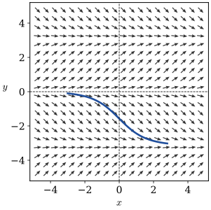
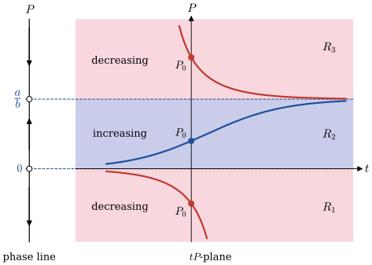
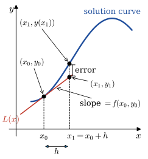
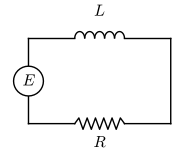
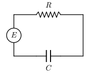

# First-Order Differential Equations {#sec-2}

## Solution Curves Without a Solution {#sec-2-1}

* <font color="blue">DEs can be analyzed qualitatively</font>, allowing us to approximate a solution curve without solving the problem
* Two approaches are:
  * Direction fields
  * Autonomous first-order DEs
* <font color="red">Direction fields:</font> 
  * Slope of the **lineal element** at $(x,y(x))$ on a solution curve is the value of $\,\frac{dy}{dx}\,$ at this point
  * **Direction/slope fields** of $\,\frac{dy}{dx}=f(x,y)\,$ are collections of lineal slope elements that visually suggest the shape of a family of solution curves

For example, $~\displaystyle\frac{dy}{dx}=\sin y$
    
{width="45%" fig-align="center"}

* Using the given computer-generated direction field, sketch, by hand, an approximate solution curve that passes through each of the indicated points:

  $$
   \begin{aligned} 
      \frac{dy}{dx} &= x^2 -y^2 \\ \\
      (a) &\;\; y(-2)=1 \\ 
      (b) &\;\; y(-1)=-1 \\ 
      (c) &\;\; y(0)=2 \\ 
      (d) &\;\; y(0)=0 
   \end{aligned}$$

```{python}
#| fig-align: "center"
import numpy as np
import matplotlib.pyplot as plt
plt.style.use('ggplot')

x = np.linspace(-2, 2, 20)
y = np.linspace(-2, 2, 20)
X, Y = np.meshgrid(x, y)

dy = (X*X -Y*Y)
dx = np.ones(dy.shape)

plt.figure(figsize=(5, 5))
plt.quiver(X, Y, dx, dy, color='red')
plt.plot([-2, -1, 0, 0], [1, -1, 2, 0], 'o', color="blue")
plt.xlim([-2.2, 2.2])
plt.ylim([-2.3, 2.2])
plt.xticks(np.arange(-2, 2.5, 0.5))
plt.yticks(np.arange(-2, 2.5, 0.5))
plt.xlabel('x')
plt.ylabel('y')

plt.show()
```

::: {.callout-note collapse="true" title="Answer" appearance="simple"}
Isoclines $y=\pm x$ (slope $0$): solutions rise where $|y|<|x|$ and fall where $|y|>|x|$.

**(a)** rises, has a maximum on $y=-x$ and a minimum on $y=x$, then rises again $\quad$ **(b)** $(-1,-1)$ is a local maximum; to the right the curve falls to $-\infty$

**(c)** falls with slope $-4$, has a minimum on $y=x$, then rises $\quad$ **(d)** the origin is an inflection point, $y\approx x^3/3$
:::

[Solution](files/solutions/sol_2_1.pdf){target="_blank"}

* **Autonomous** first-order DEs, $~\displaystyle\color{red}{\frac{dy}{dx}=f(y)}$

  An ODE in which the independent variable does not appear explicitly

  $$\begin{aligned}
      \frac{dy}{dx} &= 1+y^2 && \mathrm{autonomous} \\
      \frac{dy}{dx} &= 0.2\,xy && \mathrm{nonautonomous}
    \end{aligned}$$

* **Critical points**, $~f(c)=0$, $~$ are constant (or equilibrium) solutions of autonomous DEs

* A **phase portrait** (phase line) is made by putting the critical points on a vertical line, with arrows pointing up or down depending on the sign of $f(y)$ on the intervals between the points

* The horizontal lines $y=c$ through the critical points divide the $xy$-plane into sub-regions (horizontal strips) $R_i$

* Some conclusions can be drawn about nonconstant solution curves to autonomous DEs
  * If a solution $y(x)$ passes through $(x_0,y_0)$ in sub-region $R_i$, <font color="blue">$~$then $y(x)$ remains in $R_i$ </font>
  * By continuity, <font color="blue">$~f(y)$ cannot change signs in a sub-region $R_i$</font>
  * Since $f(y)$ is either positive or negative in $R_i$, $~$a solution is <font color="blue">either increasing or decreasing</font> and has no relative extremum

$~$

**Example** $\,$ Phase portrait and solution curves

$$ \displaystyle \frac{dP}{dt} = P(a-bP) $$

{width="80%" fig-align="center"}

$~$

**Example** $\,$ Consider the autonomous first-order differential equation 

$$\frac{dy}{dx}=y^2-y^4$$ 

and the initial condition $y(0)=y_0$. Sketch the graph of a typical solution $y(x)$ when $y_0$ has the given values

  $$
  \begin{aligned}
    &(a) && \phantom{-1 < }\; y_0 < {-1} \\
    &(b) && {-1} < y_0 < 0 \\ 
    &(c) && \phantom{-}0 < y_0 < 1 \\ 
    &(d) && \phantom{-}1 < y_0 \\ 
  \end{aligned}$$

::: {.callout-note collapse="true" title="Answer" appearance="simple"}
Critical points $y=-1$ (unstable), $y=0$ (semi-stable), $y=1$ (asymptotically stable); inflection points at $y=\pm1/\sqrt2$.

**(a)** decreases, $y\to-1$ as $x\to-\infty$ and $y\to-\infty$ at a finite $x$ $\quad$ **(b)** increases from $-1$ to $0$

**(c)** increases from $0$ to $1$ $\quad$ **(d)** decreases to $1$ as $x\to\infty$
:::

[Solution](files/solutions/sol_2_1.pdf){target="_blank"}

::: {.callout-tip appearance="simple" icon="false"}
**Try it in Python:** Draw direction fields for any $dy/dx = f(x, y)$: @sec-ode-direction-fields
:::

## Separable Equations {#sec-2-2}

* Consider $~\displaystyle\frac{dy}{dx}=f(x)$

  * When $f$ does not depend on $y$, $~\displaystyle\frac{dy}{dx}=f(x)$, $~$which can be solved by integration
  * The solution $\displaystyle y=\int f(x) dx = F(x) +c$, $~$where $F(x)$ is an antiderivative (indefinite integral)
  * Some functions, termed **nonelementary**, $~$do not possess an antiderivative that is an elementary function

* A first-order DE of the form $\displaystyle\frac{dy}{dx}=g(x)h(y)$ is said to be <font color="red">**separable**</font>, or have **separable variables**
  * A separable equation can be rewritten in the form

    $$ \color{red}{\frac{1}{h(y)}dy=g(x)dx}$$

    which is solved by integrating both sides

$~$

**Example** $\,$ Solve a separable equation $\displaystyle\frac{dy}{dx}=y^2-9$, $\;y(0)=0$

* Separating and using partial fractions

$$
  \begin{aligned}
    \frac{dy}{(y-3)(y+3)} &= dx \\
    &\Downarrow \\ 
    \frac{1}{6} \left [ \frac{1}{y-3} -\frac{1}{y+3} \right ] dy &= dx
  \end{aligned}$$

* Integrating and solving for $y\,$ yields

$$
  \begin{aligned}
    \frac{1}{6} \ln \left | \frac{y-3}{y+3} \right | &= x+c_1\\ 
    &\Downarrow c=\mp e^{6c_1} \\
    y &= 3 \frac{1-ce^{6x}}{1+ce^{6x}}
  \end{aligned}$$

* Finally, $~$ applying $y(0)=0~$ gives $c=1$

$~$

**Example** $\,$ Solve the given differential equation by separation of variables

* $\displaystyle \frac{dy}{dx}=\sin 5 x$

* $\displaystyle dx +e^{3x} dy = 0$

* $\displaystyle \frac{dy}{dx} = x\sqrt{1 -y^2}$

::: {.callout-note collapse="true" title="Answer" appearance="simple"}
**(1)** $y=-\tfrac15\cos5x+c$

**(2)** $y=\tfrac13e^{-3x}+c$

**(3)** $y=\sin\!\left(\tfrac12x^2+c\right)$, $\,$ plus the singular solutions $y=\pm1$
:::

[Solution](files/solutions/sol_2_2.pdf){target="_blank"}

$~$

```{python}
import sympy
from sympy import pi, dsolve
sympy.init_printing()

x = sympy.Symbol('x')
y = sympy.Function('y')

eq = y(x).diff(x) -x *sympy.sqrt(1 -y(x) *y(x))

dsolve(eq, hint='separable')
```

$~$

**Example** $\,$ Find an implicit and an explicit solution of the given initial-value problem

* $\displaystyle x^2 \frac{dy}{dx} = y -xy, \;\;y(-1)=-1$

* $\displaystyle \frac{dx}{dt}=4(x^2 + 1), \;\;x(\pi/4)=1$

::: {.callout-note collapse="true" title="Answer" appearance="simple"}
**(1)** Implicit: $\ln|y|=-1-\dfrac1x-\ln|x|$; $\quad$ explicit: $y=\dfrac1x\,e^{-1-1/x},\ \ x<0$

**(2)** Implicit: $\arctan x=4t-\dfrac{3\pi}4$; $\quad$ explicit: $x=\tan\!\left(4t-\dfrac{3\pi}4\right),\ \ \dfrac{\pi}{16}<t<\dfrac{5\pi}{16}$
:::

[Solution](files/solutions/sol_2_2.pdf){target="_blank"}

$~$

```{python}
t = sympy.Symbol('t')
x = sympy.Function('x')

eq = x(t).diff(t) -4 *(x(t)**2 +1)

dsolve(eq, ics={x(pi/4): 1}, hint='separable')
```

::: {.callout-tip appearance="simple" icon="false"}
**Try it in Python:** Newton's law of cooling and other first-order equations with `sympy.dsolve`, including initial conditions: @sec-ode-symbolic
:::

$~$

## Linear Equations {#sec-2-3}

A first-order DE of the form $\displaystyle a_1(x) \frac{dy}{dx} +a_0(x)y = g(x)~$ is a **linear equation** in the dependent variable $y$

* The DE is <font color="blue">**homogeneous**</font> when $g(x)=0$ ; $~$otherwise, $~$it is <font color="blue">**nonhomogeneous**</font>

* The standard form of a linear DE is obtained by dividing both sides by the lead coefficient

  $$\color{red}{\frac{dy}{dx}+P(x)y=f(x)}$$

The **standard form** equation has the property that its solution $y$ is the sum of the solution of the associated homogeneous equation $y_h$ and the particular solution of the nonhomogeneous equation $y_p$ : 

$$\color{red}{y=y_h +y_p}$$

* The homogeneous equation $\displaystyle\frac{dy_h}{dx} +P(x)y_h= 0~$ is separable, allowing us to solve for $y_h$

$$
\begin{aligned}
  \frac{dy_h}{y_h} &= -P(x)dx \\
  &\Downarrow \\ 
  \ln |y_h| &= -\int P(x)\,dx +c \,\Rightarrow\, y_h = \bar{c} \exp\left( -\int P(x) \,dx \right)    
\end{aligned}$$

* **Variation of parameters** $\,\color{blue}{y_p=u(x)y_h}~$ can be used to find a particular solution $\,y_p$ of the nonhomogeneous equation

$$
\begin{aligned}
    y_h \frac{du}{dx} +& \underbrace{\left (\frac{dy_h}{dx} +P(x) y_h  \right )}_{=\,0} u = f(x)\\
    du &= \frac{f(x)}{y_h} dx \;\Rightarrow\; u(x) = \displaystyle\int \frac{f(x)}{y_h(x)} dx \\
    &\Downarrow \\
    y_p &= y_h \displaystyle\int \frac{f(x)}{y_h(x)} dx 
\end{aligned}$$

$~$

**Example** $\,$ Find the general solution of the given differential equation:

* $~\displaystyle \frac{dy}{dx} + 2y=0$

* $~\displaystyle y' +2xy=x^3$

* $~\displaystyle x\frac{dy}{dx} +2y=3$

* $~\displaystyle xy' +(1+x)y=e^{-x} \sin 2x$

::: {.callout-note collapse="true" title="Answer" appearance="simple"}
**(1)** $y=ce^{-2x},\ \ -\infty<x<\infty$

**(2)** $y=\tfrac12x^2-\tfrac12+ce^{-x^2},\ \ -\infty<x<\infty$

**(3)** $y=\dfrac32+\dfrac{c}{x^2},\ \ 0<x<\infty$ $\,$ (or $-\infty<x<0$)

**(4)** $y=\dfrac{e^{-x}}{x}\left(c-\tfrac12\cos2x\right),\ \ 0<x<\infty$
:::

[Solution](files/solutions/sol_2_3.pdf){target="_blank"}

$~$

**Example** $\,$ Solve the given initial-value problem. Give the largest interval $~I$ over which the solution is defined

* $~\displaystyle y\frac{dx}{dy} -x=2y^2, \;\; y(1)=5$

* $~\displaystyle (x+1)\frac{dy}{dx}+y = \ln x, \;\;y(1)=10$

::: {.callout-note collapse="true" title="Answer" appearance="simple"}
**(1)** $x=2y^2-\dfrac{49}{5}y,\ \ 0<y<\infty$

**(2)** $y=\dfrac{x\ln x-x+21}{x+1},\ \ 0<x<\infty$
:::

[Solution](files/solutions/sol_2_3.pdf){target="_blank"}

$~$

```{python}
x = sympy.Symbol('x')
y = sympy.Function('y')

eq = (x + 1) *y(x).diff(x) +y(x) -sympy.log(x)

dsolve(eq, ics={y(1): 10}, hint='1st_linear')
```

$~$

**Example** $\,$ The given differential equation is not linear in $y$. $~$Nevertheless, find a general solution of the equation

* $~dx=(x+y^2)dy$

* $~ydx + (2x + xy-3)dy=0$

::: {.callout-note collapse="true" title="Answer" appearance="simple"}
**(1)** $x=-y^2-2y-2+ce^{y}$

**(2)** $x=\dfrac{3}{y}-\dfrac{3}{y^2}+\dfrac{c}{y^2}e^{-y}$
:::

[Solution](files/solutions/sol_2_3.pdf){target="_blank"}

$~$

**Example** $\,$ The sine integral function is defined as

   $$ \mathrm{Si}(x)=\int_0^x \frac{\sin t }{t} \,dt$$
  
   where the integrand is defined to be 1 at $x=0$. Express the solution of the initial value problem
   
   $$x^3 \frac{dy}{dx} + 2x^2 y = 10 \sin x, \;\; y(1)=0$$
  
   in terms of $\mathrm{Si}(x)$

::: {.callout-note collapse="true" title="Answer" appearance="simple"}
$y=\dfrac{10}{x^2}\left[\mathrm{Si}(x)-\mathrm{Si}(1)\right],\ \ 0<x<\infty$
:::

[Solution](files/solutions/sol_2_3.pdf){target="_blank"}

$~$

## Exact Equations {#sec-2-4}

* A differential expression $~M(x,y)dx + N(x,y)dy~$ is an **exact differential** in a region $R$ of the $xy$-plane if it corresponds to the differential of some function $f(x,y)$:

  $$ \color{red}{df(x,y)=\frac{\partial f}{\partial x} dx +\frac{\partial f}{\partial y} dy}$$

* **Criterion for an exact differential:** $~$if $M$, $N$ and their first partial derivatives are continuous in a rectangular region $R$, $~$then $M\,dx+N\,dy$ is exact in $R$ if and only if

  $$ \frac{\partial M}{\partial y}=\frac{\partial N}{\partial x}$$

* $M(x,y)\,dx + N(x,y)\, dy=0 ~$ is an **exact equation** if the left side is an exact differential

$~$

**Example** $\,$ Solving an exact DE, $\;2xy\,dx+(x^2-1)\,dy=0$

::: {.callout-note collapse="true" title="Answer" appearance="simple"}
$x^2y-y=c$, $\,$ i.e. $\,y=\dfrac{c}{x^2-1}\ \ (x\ne\pm1)$
:::

[Solution](files/solutions/sol_2_4.pdf){target="_blank"}

$~$

* <font color="blue">**Integrating Factor**</font> of the first-order linear DE

  $$
  \begin{aligned} 
    \frac{dy}{dx} +P(x)y &= f(x)\\ 
    &\Downarrow \\
    \left ( P(x)y -f(x) \right )dx +dy &= 0\\ 
    &\Downarrow \times \; I(x): \text{ Integrating Factor}\\ 
       I(x)\left ( P(x)y -f(x) \right )dx +I(x)dy &= 0 \\ \\
      {\small \text{To be an exact equation }} &\big\Downarrow \\ 
    \frac{\partial}{\partial y} 
     \left\{I(x)\left( P(x){\color{blue}{y}} -f(x) \right) \right \} &= I(x) 
       P(x) =\frac{d}{d x} I(x) \\
    &\big\Downarrow \;\; {\color{red}{I(x) = \exp\left(\int P(x) dx\right)}} 
  \end{aligned}$$

  Then

  $$
  \begin{aligned} 
     I(x) \frac{dy}{dx} +I(x) P(x)y &= I(x)f(x) \; \Rightarrow \; \frac{d} {dx}\left\{ I(x)y \right \} = I(x)f(x) \\ 
     &\Downarrow \\ 
    \color{red}{y(x) = I(x)^{-1}y(x_0)I(x_0)}  &\color{red}{\,+\,I(x)^{-1} \int_{x_0}^x I(t) f(t)\, dt}  
  \end{aligned}$$

**Example** $\,$ Solve $\displaystyle\frac{dy}{dx} -2xy = 2, \;y(0)=1$

$$
\begin{aligned} 
    \frac{dy}{dx} -2xy &= 2\\ 
    &\Downarrow \times \;e^{-x^2} \\ 
    \frac{d}{dx}[e^{-x^2}y] &= 2e^{-x^2}\\ 
    y &= c e^{x^2} +2e^{x^2} \int_0^x e^{-t^2} dt\\ 
    & \big\Downarrow \;{\small y(0) = 1 \rightarrow c=1} \\
     y &= e^{x^2} \left[ 1 +\sqrt{\pi} \underbrace{\left(\frac{2}{\sqrt{\pi}} \int_0^x e^{-t^2} dt \right)}_{\mathrm{erf}(x)} \right ] \\
     &= e^{x^2} \left[1 +\sqrt{\pi} \,\mathrm{erf} (x) \right] 
\end{aligned}$$

**Example** $\,$ Determine whether the given differential equation is exact. If it is exact, solve it

* $~(2x - 1)dx + (3y+7)dy=0$

* $~(5x + 4y)dx + (4x-8y^2)dy=0$

* $~(2xy^2-3)dx +(2x^2y+4)dy=0$

* $~(x^2 -y^2)dx+(x^2-2xy)dy=0$

::: {.callout-note collapse="true" title="Answer" appearance="simple"}
**(1)** Exact: $x^2-x+\tfrac32y^2+7y=c$

**(2)** Exact: $\tfrac52x^2+4xy-\tfrac83y^3=c$

**(3)** Exact: $x^2y^2-3x+4y=c$

**(4)** Not exact ($M_y=-2y\ne N_x=2x-2y$); $\,$ it can be solved by the substitution $y=ux$ of @sec-2-5
:::

[Solution](files/solutions/sol_2_4.pdf){target="_blank"}

$~$

```{python}
x = sympy.Symbol('x')
y = sympy.Function('y')

eq = (2 *x -1) +(3 *y(x) +7) *y(x).diff(x)

dsolve(eq, hint='1st_exact')
```

$~$

**Example** $\,$ Solve the given initial-value problem

* $~(x+y)^2 dx + (2xy +x^2-1)dy = 0, \;\;y(1)=1$

* $~(4y + 2t -5)dt + (6y +4t-1)dy=0, \;\;y(-1)=2$

::: {.callout-note collapse="true" title="Answer" appearance="simple"}
**(1)** $\tfrac13x^3+x^2y+xy^2-y=\tfrac43$

**(2)** $4ty+t^2-5t+3y^2-y=8$
:::

[Solution](files/solutions/sol_2_4.pdf){target="_blank"}

$~$

**Example** $\,$ Solve the given differential equation by finding an appropriate integrating factor

* $~y(x+y+1)dx + (x+2y)dy=0$

::: {.callout-note collapse="true" title="Answer" appearance="simple"}
$e^x(xy+y^2)=c$
:::

[Solution](files/solutions/sol_2_4.pdf){target="_blank"}

## Solutions by Substitutions {#sec-2-5}

**Substitution** is often used to get a DE in a form that a known procedure can be used to find a solution

* Reduction to separation of variables can be facilitated in the DE

  <font color="blue">$$\frac{dy}{dx}=f(Ax+By+C)~$$</font>

  by substituting <font color="blue">$\,u=Ax+By+C, \;B \neq 0$</font>

$~$

**Example** $\,$ Solve the IVP $~\displaystyle\frac{dy}{dx} = (-2x +y)^2 -7, \;y(0)=0$

Let $\,u=-2x+y$, then $~\displaystyle\frac{du}{dx}=-2 + \frac{dy}{dx}~$ giving $~\displaystyle\frac{du}{dx} = u^2 -9$

::: {.callout-note collapse="true" title="Answer" appearance="simple"}
$y=2x-3\tanh3x$
:::

[Solution](files/solutions/sol_2_5.pdf){target="_blank"}

$~$

```{python}
x = sympy.Symbol('x')
y = sympy.Function('y')

eq = y(x).diff(x) -(-2 *x +y(x))**2 +7

dsolve(eq, ics={y(0): 0})
```

$~$

* **Homogeneous** first-order DE

  A first-order ordinary DE in the form:

  $$\frac{dy}{dx}= - \frac{M(x,y)}{N(x,y)}$$

  is of homogeneous type if both functions $M(x,y)$ and $N(x,y)$ are homogeneous functions of the same degree $n$:

  $$M(\lambda x, \lambda y) = \lambda^n M(x, y), \;\; N(\lambda x, \lambda y) = \lambda^n N(x, y)$$

  Thus, we can let $\color{blue}{t=1/x}~$ to simplify this quotient to a function $f$ of the single variable $y/x$:

  $$\frac{M(x, y)}{N(x, y)}=\frac{M(t x,t y)}{N(t x, t y)} = \frac{M\left(1, \tfrac{y}{x}\right)}{N\left(1,\tfrac{y}{x}\right)}
=-f\left(\frac{y}{x}\right) = -\frac{dy}{dx}$$

  The change of variables <font color="blue">$y=ux$</font> transforms the original differential equation into the separable form:

  $$\frac{du}{f(u)-u}=\frac{dx}{x}$$

$~$

**Example** $\,$ Solve $(x^2 +y^2) dx +(x^2 -xy) dy = 0$  

::: {.callout-note collapse="true" title="Answer" appearance="simple"}
$(x+y)^2=Cx\,e^{y/x}$
:::

[Solution](files/solutions/sol_2_5.pdf){target="_blank"}

$~$

* **Bernoulli** DE: 
  
  $$~y'+P(x)y =Q(x)y^{n} \;\text{ where }\; n \neq 0~ \text{ and } n \neq 1$$

  * Bernoulli equations are special because they are nonlinear differential equations with known exact solutions
    
  * The substitution <font color="blue">$u=y^{1-n}$</font> reduces any Bernoulli equation to a linear differential equation

$~$

**Example** $\,$ Solve $\displaystyle y'-\frac{2}{x}y=-x^2y^2$

Changing variables $\displaystyle u=\tfrac{1}{y}$, $~$$\displaystyle u'=-\tfrac{1}{y^2}y'$ gives the equation

$$ u'+\frac{2}{x}u=x^2$$

::: {.callout-note collapse="true" title="Answer" appearance="simple"}
$y=\dfrac{5x^2}{x^5+C}$, $\,$ plus $y=0$ (lost when substituting $u=1/y$)
:::

[Solution](files/solutions/sol_2_5.pdf){target="_blank"}

$~$

```{python}
x = sympy.Symbol('x')
y = sympy.Function('y')

eq = y(x).diff(x) -2 /x *y(x) +x**2 *y(x)**2

dsolve(eq, hint='Bernoulli')
```

$~$

* **Riccati** DE

  * Riccati equation is any first-order ordinary differential equation that is quadratic in the unknown function. In other words, it is an equation of the form

    $$y'=q_0(x)+q_1(x)y+q_2(x)y^2$$ 
 
    where $q_0(x)\neq 0$ and $q_2(x)\neq 0$. If $q_0(x)=0$, it is a Bernoulli equation, and if $q_2(x)=0$, it is a linear equation

  * The new variable <font color="blue">$v=yq_2$</font> satisfies an equation
    
    $$v'=v^2+R(x)v+S(x)$$
    
    where $S(x)=q_2 q_0$ and $\displaystyle R(x)=q_{1}+\left({\tfrac{q_{2}'}{q_{2}}}\right)$

  * Substituting <font color="blue">$\displaystyle v=-\tfrac{u'}{u\,}$</font>, $~u$ satisfies the linear 2^nd^ order ODE
    
    $$u''-R(x)u'+S(x)u=0$$ A solution of this equation will lead to a solution $\displaystyle y=-\tfrac{u'}{q_2u}$ of the original Riccati equation

$~$

**Example** $\,$ Solve the given differential equation by using an appropriate substitution

* $~(x-y)dx+xdy=0$

* $~xdx+(y-2x)dy=0$

* $~\displaystyle \frac{dy}{dx}=\frac{y-x}{y+x}$

*  $~\displaystyle x\frac{dy}{dx}=y+\sqrt{x^2-y^2}, \;\;x>0$

::: {.callout-note collapse="true" title="Answer" appearance="simple"}
**(1)** $y=x(c-\ln|x|)$

**(2)** $\ln|y-x|+\dfrac{x}{y-x}=c$, $\,$ plus $y=x$

**(3)** $\tfrac12\ln(x^2+y^2)+\arctan\dfrac yx=c$

**(4)** $y=x\sin(\ln x+c)$, $\,$ plus the singular solutions $y=\pm x$
:::

[Solution](files/solutions/sol_2_5.pdf){target="_blank"}

$~$

```{python}
x = sympy.Symbol('x')
y = sympy.Function('y')

eq = x *y(x).diff(x) -y(x) -sympy.sqrt(x**2 -y(x)**2)

dsolve(eq, hint='1st_homogeneous_coeff_best')
```

$~$

**Example** $\,$ Solve the given initial-value problem

* $~\displaystyle xy^2 \frac{dy}{dx}=y^3-x^3, \;\;y(1)=2$

* $~\displaystyle (x^2 +2y^2) \frac{dx}{dy}=xy, \;\; y(-1)=1$

::: {.callout-note collapse="true" title="Answer" appearance="simple"}
**(1)** $y=x\,(8-3\ln x)^{1/3}$

**(2)** $x^2+y^2=2x^4$; $\,$ explicitly $y=-x\sqrt{2x^2-1},\ \ x<-\tfrac1{\sqrt2}$
:::

[Solution](files/solutions/sol_2_5.pdf){target="_blank"}

$~$

**Example** $\,$ Solve the given differential equation by using an appropriate substitution

* $~\displaystyle x\frac{dy}{dx} +y =\frac{1}{y^2}$

* $~\displaystyle 3(1+t^2)\frac{dy}{dt}=2ty(y^3-1)$

* $~\displaystyle \frac{dy}{dx}=\cos (x+y), \;\;y(0)=\frac{\pi}{4}$

::: {.callout-note collapse="true" title="Answer" appearance="simple"}
**(1)** $y^3=1+\dfrac{c}{x^3}$

**(2)** $y^{-3}=1+c(1+t^2)$, $\,$ plus $y=0$

**(3)** $y=2\arctan\!\left(x+\sqrt2-1\right)-x$
:::

[Solution](files/solutions/sol_2_5.pdf){target="_blank"}

::: {.callout-tip appearance="simple" icon="false"}
**Try it in Python:** A Riccati equation reduced in `sympy` to a second-order linear (Airy) equation by the substitution $y = -u'/(q_2 u)$: @sec-ode-symbolic
:::

$~$

## A Numerical Method {#sec-2-6}

**Numerical method:** $\,$ an algorithm for approximating the unknown solution to a DE

::: columns
::: {.column width="45%"}
* **Linearization** approximates solutions within a small area around lineal elements in direction fields
* The procedure of evaluating successive tangent lines is $~$**Euler's method**
:::

::: {.column width="55%"}
{width="95%" fig-align="center"}
:::
:::

**Example** $\,$ Consider $y'=0.1\sqrt{y}+0.4x^2, \;y(2)=4~$ and approximate $y(2.5)$ using $h=0.1$

* Substituting into the general formula for Euler's method gives

  $$y_{n+1}=y_n +h\left(0.1\sqrt{y_n} + 0.4x_n^2 \right)$$

* Considering the initial condition and $n=0$

  $$\scriptsize
    \begin{aligned} 
        y_1 &= 4+0.1\left( 0.1\sqrt{4} + 0.4 \cdot2^2\right ) =4.1800 \\ 
        y_2 &= 4.18 +0.1\left( 0.1\sqrt{4.18} + 0.4 \cdot2.1^2\right ) =4.3768 \\ 
        &\, \vdots \\
        y_5 &= 5.0768 
   \end{aligned}$$


```{python}
# | fig-cap: "Euler's Method"

x0 = 2.0
y0 = 4.0
xf = 2.5

h = 0.1
n = int((xf -x0) /h) + 1

x = np.linspace(x0, xf, n)
y = np.zeros(n)

y[0] = y0
for i in range(1, n):
    y[i] = y[i -1] +h *(0.1 *np.sqrt(y[i -1]) +0.4 *x[i -1]**2)
    print(f'x = {x[i]: 3.1f}, y = {y[i]: 5.4f}')

plt.figure(figsize=(4, 4))
plt.plot(x, y, 'o')
plt.xlabel("$x$")
plt.ylabel("$y$")
plt.title("$h=0.1$")

plt.show()
```

**Example** $\,$ Use Euler's method to obtain a four-decimal approximation of the indicated value. Carry out the recursion, first using $h=0.1$ and then using $h=0.05$
 
$$~y'=2x-3y+1, \;\; y(1)=5; \;\;y(1.2)$$

::: {.callout-note collapse="true" title="Answer" appearance="simple"}
$h=0.1$: $\,y(1.2)\approx2.9800$; $\quad h=0.05$: $\,y(1.2)\approx3.1151$
:::

[Solution](files/solutions/sol_2_6.pdf){target="_blank"}

::: {.callout-tip appearance="simple" icon="false"}
**Try it in Python:** Euler's method, Runge-Kutta and multistep methods: @sec-ode-numerical-methods; $~$adaptive solvers with `scipy.integrate.solve_ivp`: @sec-ode-scipy
:::


## Linear Models {#sec-2-7}

**Example** $\,$ Series Circuits -  For a series circuit containing a resistor $R$ and an inductor $L$,

$~$

{width="40%" fig-align="center"}

Kirchhoff's second law gives

$$L\frac{di}{dt}+Ri=E(t)$$

For a series circuit containing a resistor and a capacitor, 

{width="40%" fig-align="center"}

Kirchhoff's second law gives

$$Ri+\frac{1}{C}q=E(t)$$
  
where $\displaystyle i=\frac{dq}{dt}$. $~$Then $~$$\displaystyle R\frac{dq}{dt}+\frac{1}{C}q=E(t)$

$~$

**Example** $\,$ The population of a community is known to increase at a rate proportional to the number of people present at time $t$. If an initial population $P_0$ has doubled in 5 years, how long will it take to triple? To quadruple?

::: {.callout-note collapse="true" title="Answer" appearance="simple"}
Triples in $t=5\,\dfrac{\ln3}{\ln2}\approx7.92$ years; $\,$ quadruples in $t=5\,\dfrac{\ln4}{\ln2}=10$ years
:::

[Solution](files/solutions/sol_2_7.pdf){target="_blank"}

## Nonlinear Models {#sec-2-8}

$~$

**Example** $\,$ The logistic model

* Verhulst proposed a model, called the logistic model, for population growth in 1838. It does not assume unlimited resources. Instead, it assumes there is a carrying capacity $K$ for the population

* This carrying capacity is the stable population level. If the population is above $K$, then the population will decrease, but if below, then it will increase

* For this model, it is assumed that the rate of
change $\frac{dy}{dt}$ of the population $y$ is proportional to the product of the current population $y$ and $K − y$

  $$\frac{dy}{dt}=\alpha y(K-y)$$

## Modeling with Systems of First-Order DEs {#sec-2-9}

$~$

**Example** $\,$ Radioactive Series: 

$$X \xrightarrow{k_1} Y \xrightarrow{k_2} Z$$

::: {.incremental}
* The decay of the initial element $X$ is described by

  $$\frac{dx}{dt}=-k_1 x$$

* The second element $Y$ is produced by the decay of $X$ and is lost through its own spontaneous decay

  $$\frac{dy}{dt}=k_1 x -k_2 y$$
  
* The stable element $Z$ is generated from the decay of $Y$

   $$\frac{dz}{dt}=k_2 y$$
:::

$~$

**Example** $\,$ Consider the Lotka-Volterra predator-prey model defined by

$$  
\begin{aligned}
   \frac{dx}{dt} &= -0.1x +0.02xy \\ 
   \frac{dy}{dt} &= 0.2y -0.025xy 
\end{aligned}$$
 
where the populations $x(t)$ (predator) and $y(t)$ (prey) are measured in the thousands and $x(0)=6$ and $y(0)=6$
 
* Use a numerical solver to graph $x(t)$ and $y(t)$
 
```{python}
# | echo: true
# Lotka-Volterra predator-prey model
from scipy import integrate

a, b, c, d = -0.1, 0.02, 0.2, -0.025

def f(t, xy):
    x, y = xy
    return [a *x +b *x *y, c *y +d *x *y]

# Initial condition and Time span
xy0 = [6, 6]
tf = 400
t_eval = np.linspace(0, tf, 5*tf)

# Numerical Solver
sol = integrate.solve_ivp(f, [0, tf], xy0, t_eval=t_eval)

t = sol.t
xy_t = sol.y.T
```

---

* Use the graphs to approximate the period of each population

```{python}
# | fig-cap: "Lotka-Volterra predator-prey model"

fig, ax = plt.subplots(1, 1, figsize=(6, 5))

ax.plot(t, xy_t[:, 0], 'r', label="Predator")
ax.plot(t, xy_t[:, 1], 'b', label="Prey")

ax.set_xlabel("Time")
ax.set_ylabel("Number of animals")
ax.set_xlim(0, tf)
ax.set_ylim(0, 12)
ax.legend()

plt.show()
```

::: {.callout-note collapse="true" title="Answer" appearance="simple"}
Both populations are periodic with the same period, $T\approx45$ (time units)
:::

[Solution](files/solutions/sol_2_9.pdf){target="_blank"}

::: {.callout-tip appearance="simple" icon="false"}
**Try it in Python:** The Lotka-Volterra and Lorenz systems solved with `solve_ivp`, with phase-plane plots: @sec-ode-scipy
:::

## Worked Exercises {.unnumbered}

**Solve the given differential equation by separation of variables**

**[-@sec-2-2]: 1.** $\,\displaystyle \frac{dy}{dx}=\sin 5 x$

**Solution**

$$
\begin{aligned}
  \frac{dy}{dx} &=\sin 5x\\ 
   &\Downarrow \\
   dy &= \sin 5x \,dx \\
   &\Downarrow \\ 
   y &=-\frac{1}{5} \cos 5x +c 
\end{aligned}$$

**[-@sec-2-2]: 3.** $\,\displaystyle dx +e^{3x} dy = 0$

**Solution**

$$
\begin{aligned}
  dy &=-e^{-3x} \,dx\\ 
  &\Downarrow \\ 
  y &= \frac{1}{3}e^{-3x} +c 
\end{aligned}$$

**[-@sec-2-2]: 21.** $\,\displaystyle \frac{dy}{dx} = x\sqrt{1 -y^2}$

**Solution**

$$
\begin{aligned}
 \frac{1}{\sqrt{1 -y^2}}dy &= x \,dx\\ 
 &\Downarrow \\ 
 \arcsin y &= \frac{1}{2}x^2 +c \\
 &\Downarrow \\
 y &= \sin \left(\frac{1}{2}x^2 +c \right)
\end{aligned}$$

In dividing by $\sqrt{1-y^2}$ we assumed $|y|<1$; $~$the constant functions $y=1$ and $y=-1$ are also (singular) solutions

**[-@sec-2-2]: 25.** Find an implicit or an explicit solution of the given initial-value problem

$$ x^2 \frac{dy}{dx} = y -xy, \;\;y(-1)=-1$$

**Solution**

$$
\begin{aligned}
  \frac{1}{y}dy &= \frac{1-x}{x^2} \,dx\\ 
  &\Downarrow \\ 
  \ln |y| &= -\left(\frac{1}{x} +\ln |x| \right) +c \\
  &\Downarrow {\small y(-1)=-1 \; \Rightarrow \; c=-1}\\
  \ln |y| &= -\left(1 +\frac{1}{x} \right) -\ln |x| \\
  &\Downarrow \\ 
  y &= \frac{1}{x} e^{-\left( 1 +\frac{1}{x}\right)}
\end{aligned}$$

**[-@sec-2-7]: 41.** $\,$ **Evaporating Raindrop** $\,$ As a raindrop falls, it evaporates while retaining its spherical shape. If we make the further assumptions that the rate at which the raindrop evaporates is proportional to its surface area and that air resistance is negligible, then a model for the velocity $v(t)$ of the raindrop is

$$
\frac{dv}{dt} + \frac{3(k/\rho)}{(k/\rho) t +r_0} v = g
$$

Here $\rho$ is the density of water, $r_0$ is the radius of the raindrop at $t=0$, $k < 0$ is the constant of proportionality $\displaystyle \frac{dm}{dt}=4\pi r^2 k$, and the downward direction is taken to be the positive direction

(a)$\,$ Solve for $v(t)$ if the raindrop falls from the rest

(b)$\,$ Show that the radius of the raindrop at time $t$ is $r(t)=(k/\rho)t +r_0$

(c)$\,$ If $r_0=0.01$ ft and $r =0.007$ ft at time $t=10$ sec after the raindrop falls from a cloud, determine the time at which the raindrop has evaporated completely 

**Solution**

(a)$\,$

$$
\begin{aligned}
 \frac{dv}{dt} &+ \frac{3(k/\rho)}{(k/\rho) t +r_0} v = g \\ 
 &\Downarrow {\small \text{ multiply by the integrating factor }} \\ 
 \frac{d}{dt} \left[ \left(\frac{k}{\rho}t +r_0 \right)^3 v  \right] &= \left(\frac{k}{\rho}t +r_0 \right)^3 g\\ 
 &\Downarrow \\
 v(t)=\frac{g\rho}{4k} \left( \frac{k}{\rho} t +r_0 \right) &+c\left(\frac{k}{\rho}t +r_0 \right)^{-3} \\
 &\Downarrow {\small \text{ } v(0)=0 \; \rightarrow \;c = -\frac{g\rho}{4k} r_0^4} \\
 v(t) = \frac{g\rho}{4k} \left(\frac{k}{\rho}t +r_0 \right) & \left[ 1 - \left( \frac{r_0}{ \frac{k}{\rho}t +r_0 } 
 \right)^4 \right] \\ 
\end{aligned}$$

(b)$\,$

$$
\begin{aligned}
 m &= \frac{4}{3}\pi r^3 \rho\\ 
 &\Downarrow \\ 
 \frac{dm}{dt} &= 4\pi r^2 \rho \frac{dr}{dt}\\ 
 &\Downarrow  \text{ } {\scriptstyle \frac{dm}{dt}=4\pi r^2 k}\\
  \frac{dr}{dt} &= \frac{k}{\rho} \\
 &\Downarrow \text{ } {\scriptstyle r=r_0 \text{ at } t=0} \\
 r(t) &= \frac{k}{\rho} t +r_0  
\end{aligned}$$

(c)$\,$

$$
\begin{aligned}
 r(10) &= \frac{k}{\rho} \times 10 +0.01 =0.007 \; \Rightarrow \; \frac{k}{\rho} = -0.0003\\ 
 &\Downarrow \\ 
 r(t)  &= -0.0003 t + 0.01 = 0 \; \Rightarrow \; t =\frac{0.01}{0.0003} \approx 33.3 \;\text{sec}
\end{aligned}$$

$~$

**1.** $~$Find an explicit solution of the given initial value problem

$$\sqrt{1-y^2} \,dx -\sqrt{1-x^2}\,dy=0, \;y(0)=\sqrt{3}/2$$

**Solution**

**Step 1:** $~$Rearrange the Equation

We write the equation in differential form:

$$\sqrt{1 - y^2} \, dx = \sqrt{1 - x^2} \, dy$$

Separate variables:

$$\frac{dx}{\sqrt{1 - x^2}} = \frac{dy}{\sqrt{1 - y^2}}$$

**Step 2:** $~$Integrate Both Sides

$$\int \frac{dx}{\sqrt{1 - x^2}} = \int \frac{dy}{\sqrt{1 - y^2}}$$

These are standard integrals:

* $\displaystyle\scriptsize \int \frac{dx}{\sqrt{1 - x^2}} = \arcsin x + C$

* $\displaystyle\scriptsize \int \frac{dy}{\sqrt{1 - y^2}} = \arcsin y + C$

So:

$$\arcsin x = \arcsin y + C$$

**Step 3:** $~$Solve for the Constant Using the Initial Condition

We’re given $y(0) = \frac{\sqrt{3}}{2}$, so plug in $x = 0$, $y = \frac{\sqrt{3}}{2}$:

$$\arcsin(0) = \arcsin\left(\frac{\sqrt{3}}{2}\right) + C$$

$$0 = \frac{\pi}{3} + C \Rightarrow C = -\frac{\pi}{3}$$

**Step 4:** $~$Write the Explicit Solution

From earlier:

$$\arcsin x = \arcsin y - \frac{\pi}{3}$$

Solve for $y$:

$$\arcsin y = \arcsin x + \frac{\pi}{3}$$

Now apply $\sin$ to both sides:

$$y = \sin\left(\arcsin x + \frac{\pi}{3}\right)$$

or, expanding the sine, $~\displaystyle y=\frac{x}{2}+\frac{\sqrt{3}}{2}\sqrt{1-x^2}$

This is a solution only where $\cos\left(\arcsin x+\frac{\pi}{3}\right)\ge 0$, $~$because $\frac{dy}{dx}=\frac{\cos\left(\arcsin x+\pi/3\right)}{\sqrt{1-x^2}}$ must equal $\frac{\sqrt{1-y^2}}{\sqrt{1-x^2}}\ge 0$. $~$Hence $\arcsin x+\frac{\pi}{3}\le\frac{\pi}{2}$, $~$i.e. the solution is defined for $-1<x\le\frac{1}{2}$

$~$

**2.** $~$Find an explicit solution of the given initial value problem

$$\frac{dy}{dx} =-y\ln y, \;y(0)=e$$

**Solution**

**Step 1:** $~$Separate Variables

We want to isolate $y$ and $x$:

$$\frac{dy}{dx} = -y \ln y
\quad \Rightarrow \quad
\frac{1}{y \ln y} \, dy = -dx$$

**Step 2:** $~$Integrate Both Sides

Let’s handle the left-hand side:

Let $u = \ln y$, then:

$$\frac{du}{dy} = \frac{1}{y} \Rightarrow du = \frac{1}{y} \, dy$$

So:

$$\frac{1}{y \ln y} \, dy = \frac{1}{u} \cdot du = \frac{du}{u}$$

Thus, we have:

$$\int \frac{dy}{y \ln y} = \int \frac{du}{u} = \ln |\ln y|$$

So now integrate both sides:

$$\int \frac{dy}{y \ln y} = \int -dx \quad \Rightarrow \quad \ln|\ln y| = -x + C$$

**Step 3:** $~$Solve for $y(x)$

Start with:

$$\ln|\ln y| = -x + C$$

Exponentiate both sides:

$$|\ln y| = e^{-x + C} = A e^{-x}, \quad A > 0$$

So:

$$\ln y = \pm A e^{-x}$$

We drop the $\pm$ by using a general constant $B = \pm A$, so:

$$\ln y = B e^{-x} \Rightarrow y = e^{B e^{-x}}$$

**Step 4:** $~$Apply Initial Condition $y(0) = e$

Plug in:

$$y(0) = e^{B e^0} = e^{B} = e
\Rightarrow B = 1$$

Final Answer:

$$y(x) = e^{e^{-x}}$$

This is the explicit solution satisfying the differential equation and the initial condition $y(0) = e$

$~$

**3.** $~$Solve the given initial-value problem

$$\frac{dy}{dx} = \frac{3x+2y}{3x+2y+2}, \;y(-1)=-1$$

**Solution**

**Step 1:** $~$Make a Substitution

Let us simplify the expression by setting:

$$u = 3x + 2y$$

Differentiate both sides with respect to x:

$$\frac{du}{dx} = 3 + 2\frac{dy}{dx}$$

Now solve for $\frac{dy}{dx}$ from this:

$$\frac{dy}{dx} = \frac{1}{2} \left( \frac{du}{dx} - 3 \right)$$

But also, from the original equation:

$$\frac{dy}{dx} = \frac{u}{u + 2}$$

So equating both expressions:

$$\frac{1}{2} \left( \frac{du}{dx} - 3 \right) = \frac{u}{u + 2}$$

So:

$$\frac{du}{dx} = 3 + \frac{2u}{u + 2}$$

**Step 2:** $~$Simplify the Right-Hand Side

We simplify and so:

$$\frac{du}{dx} = \frac{5u + 6}{u + 2}$$

**Step 3:** $~$Separate Variables and Integrate

We separate:

$$\frac{u + 2}{5u + 6} \, du = dx$$

Let’s integrate the left-hand side. Let’s simplify:

$$\int \frac{u + 2}{5u + 6} \, du = \int \left[ \frac{1}{5} + \frac{4}{5(5u + 6)} \right] du
= \frac{1}{5} u + \frac{4}{25} \ln |5u + 6| + C$$

So:

$$x = \frac{1}{5} u + \frac{4}{25} \ln |5u + 6| + C$$

**Step 4:** $~$Substitute Back $u = 3x + 2y$

Recall $u = 3x + 2y$. So we substitute:

$$x = \frac{1}{5}(3x + 2y) + \frac{4}{25} \ln |5(3x + 2y) + 6| + C$$

This is an implicit solution

**Step 5:** $~$Apply the Initial Condition $y(-1) = -1$

Recall $u = 3x + 2y$, so at $x = -1$, $y = -1$:

$$u = 3(-1) + 2(-1) = -5
\Rightarrow 5u + 6 = -25 + 6 = -19$$

Then:

$$-1 = \frac{1}{5}(-5) + \frac{4}{25} \ln(19) + C
\Rightarrow C = - \frac{4}{25} \ln 19$$

**Final Answer:**

$$
x = \frac{1}{5}(3x + 2y) + \frac{4}{25} \ln |5(3x + 2y) + 6| - \frac{4}{25} \ln 19
$$

$~$

**4.** $~$Solve the given differential equation

$$\frac{dy}{dx} = \tan^2(x+y)$$

**Solution**

**Step 1:** $~$Make a Substitution

Let’s simplify the expression using substitution.

Let:

$$u = x + y \quad \Rightarrow \quad \frac{du}{dx} = 1 + \frac{dy}{dx}$$

From the original equation:

$$\frac{dy}{dx} = \tan^2(x + y) = \tan^2 u$$

So:

$$\frac{du}{dx} = 1 + \tan^2 u = \sec^2 u$$

**Step 2:** $~$Separate Variables and Integrate

$$\frac{du}{\sec^2 u} = dx \quad \Rightarrow \quad \cos^2 u \, du = dx$$

So integrate both sides:

$$\int \cos^2 u \, du = \int \frac{1 + \cos(2u)}{2} \, du = \frac{1}{2} \left[ u + \frac{1}{2} \sin(2u) \right]$$

So:

$$\frac{1}{2} u + \frac{1}{4} \sin(2u) = x + C$$

**Step 3:** $~$Substitute Back $u = x + y$

$$\frac{1}{2}(x + y) + \frac{1}{4} \sin(2(x + y)) = x + C$$

where $C$ is a constant of integration. This is an implicit solution to the original differential equation

$~$

**5.** $~$ Find the solution of period $2\pi$ of the equation

$$ y' +(\cos x) y = \sin 2x$$

**Solution**

**Step 1:** $~$Solve Using the Integrating Factor Method

**Integrating Factor**

$$\mu(x) = e^{\int \cos x \, dx} = e^{\sin x}$$

Multiply both sides of the ODE by $\mu(x) = e^{\sin x}$:

$$e^{\sin x} y’ + e^{\sin x} \cos x \, y = e^{\sin x} \sin 2x$$

Left-hand side becomes:

$$\frac{d}{dx}\left( e^{\sin x} y \right) = e^{\sin x} \sin 2x$$

**Step 2:** $~$Integrate Both Sides

With $s=\sin x$, $~ds=\cos x\,dx$ and $\sin 2x=2\sin x\cos x$, the integral is elementary:

$$\int e^{\sin x} \sin 2x \, dx = \int 2s\,e^{s}\,ds = 2(s-1)e^{s} = 2(\sin x-1)\,e^{\sin x}$$

So:

$$y(x) = e^{-\sin x} \left( 2(\sin x-1)e^{\sin x} + C \right) = 2(\sin x - 1) + C e^{-\sin x}$$

**Step 3:** $~$Impose Periodicity

Both $2(\sin x-1)$ and $e^{-\sin x}$ have period $2\pi$, $~$so **every** solution has period $2\pi$, $~$whatever the value of $C$:

$$\color{red}{y(x) = 2(\sin x - 1) + C e^{-\sin x}}$$

(The periodicity can also be seen without evaluating the integral: $~e^{-\sin x}$ is $2\pi$-periodic and $\int_0^{2\pi} e^{\sin t}\sin 2t\,dt = 0$, $~$because the integrand changes sign under $t\mapsto \pi-t$.) $~$Check: $~y=2\sin x-2$ gives $y'+(\cos x)y = 2\cos x+2\sin x\cos x-2\cos x=\sin 2x$

$~$

**6.** $~$ Find the solution of period $2\pi$ of the equation

$$ y' +3 y = \cos x$$

**Solution**

**Step 1:** $~$General Solution via Integrating Factor

This is a first-order linear ODE. Let’s solve it using the integrating factor method.

Let:

$\mu(x) = e^{\int 3 \, dx} = e^{3x}$

Multiply both sides of the equation by $e^{3x}$:

$$e^{3x} y’ + 3 e^{3x} y = e^{3x} \cos x
\Rightarrow \frac{d}{dx}(e^{3x} y) = e^{3x} \cos x$$

Now integrate both sides:

$$e^{3x} y = \int e^{3x} \cos x \, dx$$

**Step 2:** $~$Compute the Integral

$$\int e^{3x} \cos x \, dx = \frac{e^{3x}}{10}(3 \cos x + \sin x) + C$$

Thus:

$$e^{3x} y = \frac{e^{3x}}{10}(3 \cos x + \sin x) + C
\Rightarrow y(x) = \frac{1}{10}(3 \cos x + \sin x) + C e^{-3x}$$

**Step 3:** $~$Impose Periodicity

We are asked to find a solution with period $2\pi$. Let’s analyze:

* The term $\frac{1}{10}(3 \cos x + \sin x)$ is clearly $2\pi$-periodic
* But the term $C e^{-3x}$ is not periodic unless $C = 0$

So to obtain a periodic solution, we must take:
$C = 0$

**Final Answer:**

$$y(x) = \frac{1}{10}(3 \cos x + \sin x)$$


$~$

**7.** $~$ Solve the given differential equation by using an appropriate substitution

$$ \frac{dy}{dx} = \sin(x+y)$$

**Solution**

**Step 1:** $~$Use Substitution

Let:

$$u = x + y \quad \Rightarrow \quad \frac{du}{dx} = 1 + \frac{dy}{dx}$$

Substitute into the derivative of $u$:
$$\frac{du}{dx} = 1 + \sin u$$

**Step 2:** $~$Separate Variables

We now have the separable equation:

$$\frac{du}{1 + \sin u} = dx$$

We simplify the left-hand side:

$$\frac{1}{1 + \sin u} = \frac{1 - \sin u}{(1 + \sin u)(1 - \sin u)} 
= \frac{1 - \sin u}{1 - \sin^2 u} = \frac{1 - \sin u}{\cos^2 u}$$

Now integrate:

$$\int \sec^2 u \, du = \tan u, \quad
\int \sec u \tan u \, du = \sec u$$

So:

$$\int \frac{du}{1 + \sin u} = \tan u - \sec u \;\Rightarrow\; \tan u - \sec u = x + C$$

**Step 3:** $~$Substitute Back $u = x + y$

$$\tan(x + y) - \sec(x + y) = x + C$$

This is the implicit general solution to the differential equation. $~$In separating variables we divided by $1+\sin u$, $~$so the constant solutions $\sin u=-1$, $~$i.e. $y=-x-\frac{\pi}{2}+2k\pi$, $~$must be added

$~$

**8.** $~$ Find a general solution of the equation 

$$ydx+(2x+xy-3)dy=0$$

**Solution**

$$\begin{aligned}
 ydx +(2x+xy-3)&dy =0 \\ 
 &\Downarrow \\ 
 \frac{dx}{dy} + \left(1 + \frac{2}{y} \right)x &= \frac{3}{y} \\
 &\Downarrow \\  
 \frac{d}{dy} \left[ x \,y^2 e^y \right ] &= 3y e^y \\
 &\Downarrow \\ 
 \color{red}{x = \frac{3}{y}\left(1-\frac{1}{y} \right)}\, & \color{red}{\, + \,Cy^{-2} e^{-y}}
\end{aligned}$$

$$~\text{or}~$$

$$\begin{aligned}
 ydx \;+\;&(2x+xy-3)dy =0 \\ 
 &\Downarrow \;\; \times \, y e^y\\ 
 y^2 e^y dx \;+\;&y e^y (2x+xy-3)dy =0 \\ 
 &\Downarrow \\  
 \frac{\partial f}{\partial x} = y^2 e^y \;\;&\rightarrow \;\; f(x,y) =y^2 e^y x + h(y)\\
 &\Downarrow \\
 \frac{\partial f}{\partial y} = ye^y(2x +xy) +\frac{dh}{dy} \;\;&\rightarrow \;\; \frac{dh}{dy} = -3y e^y\\
 &\Downarrow \\  
 h(y) =-3e^y (y-1) \;\;&\rightarrow \;\; f(x,y) =y^2 e^y x -3e^y (y-1) = C \\ 
 &\Downarrow \\ 
 \color{red}{x = \frac{3}{y}\left(1-\frac{1}{y} \right)}\, & \color{red}{\, + \,Cy^{-2} e^{-y}}
\end{aligned}$$

$~$

**9.** $~$ Solve the differential equation 

$$ xv\frac{dv}{dx} +v^2=32x $$

**Solution**
$$
\begin{aligned}
 xv\frac{dv}{dx} +v^2 &=32x \\ 
 &\Downarrow \\
 \frac{dv}{dx} +\frac{1}{x} v &= \frac{32}{v}\\
 &\Downarrow \;\; u = v^2, \; \frac{du}{dx} = 2v \frac{dv}{dx}\\ 
 \frac{du}{dx} +\frac{2}{x}u &= 64\\ 
 &\Downarrow \\
 \frac{d}{dx} \left( u x^2 \right ) &= 64x^2 \\
 &\Downarrow \\
 u = \frac{64}{3} x + \frac{C}{x^2} \;\;&\rightarrow \;\; \color{red}{v = \pm\sqrt{\frac{64}{3} x + \frac{C}{x^2}}}
\end{aligned}
$$

$~$

**10.** $~$ Solve the initial-value problem 

$$\frac{dy}{dt} + 2(t+1) y^2=0, \;\;y(0)=-\frac{1}{8}$$ 

and give the largest interval $I$ on which the solution is defined:

**Solution**

$$\begin{aligned}
 \frac{dy}{dt} &+2(t+1)y^2 = 0 \\ 
 &\Downarrow \\
 \frac{dy}{y^2} &= -2(t+1) \, dt \\
 &\Downarrow \\ 
 y &= \frac{1}{t^2 + 2t + c}, \;\; y(0)=-\frac{1}{8} \\
 &\Downarrow \\ 
 \color{red}{y} &\color{red}{= \frac{1}{(t-2)(t+4)}, \;\;-4<t<2} 
\end{aligned}
$$

$~$
