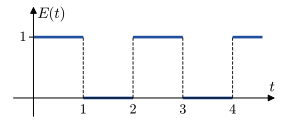
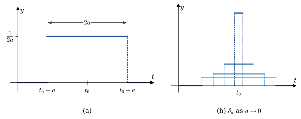
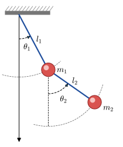

# The Laplace Transform {#sec-4}

::: {.callout-note appearance="simple" icon="false"}
**Learning objectives** $\,$ After this chapter you should be able to

* compute Laplace transforms from the definition and by linearity, $\,$and find inverse transforms with partial fractions
* solve initial-value problems for linear equations with constant coefficients, $\,$including piecewise and impulsive forcing
* use the translation theorems, $\,$derivatives of transforms, $\,$convolution and the transform of a periodic function
* solve systems of linear differential equations by the Laplace transform
:::

## Definition of the Laplace Transform {#sec-4-1}

* Let $f$ be a function defined for $t \geq 0$. $~$Then the *integral*

  $$\mathcal{L}\{f(t)\} =\int_0^\infty f(t) e^{-st}\, dt =F(s)$$

  is the **Laplace Transform** of $~f$ provided the integral converges. The result is a function of $s$

$~$

**Example** $\,$ Evaluate $\mathcal{L}\{1\}$, $~\mathcal{L}\{t\}$, $~$and $~\mathcal{L}\{e^{-3t}\}$

::: {.callout-note collapse="true" title="Answer" appearance="simple"}
$\mathcal L\{1\}=\dfrac1s\ (s>0)$, $\quad\mathcal L\{t\}=\dfrac1{s^2}$, $\quad\mathcal L\{e^{-3t}\}=\dfrac1{s+3}\ (s>-3)$
:::

[Solution](files/solutions/sol_4_1.pdf){target="_blank"}

$~$

**Example** $\,$ Evaluate $\mathcal{L}\{f(t)\}~$ for $~\displaystyle f(t) = \left\{\begin{matrix}
0, & 0 \leq t < 3\\ 
2, & \phantom{0 \leq }\; t \geq 3
\end{matrix}\right.$

::: {.callout-note collapse="true" title="Answer" appearance="simple"}
$\mathcal L\{f\}=\dfrac{2e^{-3s}}{s}$
:::

[Solution](files/solutions/sol_4_1.pdf){target="_blank"}

$~$

* $\mathcal{L}$ is a linear transform

  $$\mathcal{L}\{\alpha f(t) +\beta g(t)\} = \alpha \mathcal{L} \{f(t)\} +\beta\mathcal{L}\{g(t)\} =\alpha F(s) +\beta G(s)$$

$~$

**Example** $\,$ Find $\mathcal{L}\{f(t)\}$ by first using an appropriate trigonometric identity $~f(t)=\sin^2 2t$

::: {.callout-note collapse="true" title="Answer" appearance="simple"}
$\mathcal L\{\sin^22t\}=\dfrac{8}{s(s^2+16)}$
:::

[Solution](files/solutions/sol_4_1.pdf){target="_blank"}

$~$

**Example** $\,$ Find $\mathcal{L}\{f(t)\}$

* $~f(t)=\left\{\begin{matrix}
 -1, & 0 \leq t < 1\\ 
 \phantom{-}1, & t \geq 1\quad\;\;
\end{matrix}\right.$

* $~f(t)=\left\{\begin{matrix}
 \phantom{-}t, & 0 \leq t < 1\\ 
 \phantom{-}1, & t \geq 1\quad\;\;
\end{matrix}\right.$

* $~f(t)=\left\{\begin{matrix}
 \sin t,& 0 \leq t < \pi\\ 
 0,& t \geq \pi \quad\;\;
\end{matrix}\right.$

::: {.callout-note collapse="true" title="Answer" appearance="simple"}
**(1)** $\dfrac{2e^{-s}-1}{s}$

**(2)** $\dfrac{1-e^{-s}}{s^2}$

**(3)** $\dfrac{1+e^{-\pi s}}{s^2+1}$
:::

[Solution](files/solutions/sol_4_1.pdf){target="_blank"}

$~$

**Example** $\,$ Find $\mathcal{L}\{f(t)\}$

* $~f(t)=e^{t+7}$

* $~f(t)=e^t \cos t$

* $~f(t)=t\cos t$

* $~f(t)=\sin 3t \cos 3t$

* $~f(t)=\sin^4 t$

::: {.callout-note collapse="true" title="Answer" appearance="simple"}
$\mathcal L\{e^{t+7}\}=\dfrac{e^7}{s-1}$, $\quad\mathcal L\{e^t\cos t\}=\dfrac{s-1}{(s-1)^2+1}$, $\quad\mathcal L\{t\cos t\}=\dfrac{s^2-1}{(s^2+1)^2}$

$\mathcal L\{\sin3t\cos3t\}=\dfrac{3}{s^2+36}$, $\quad\mathcal L\{\sin^4t\}=\dfrac{24}{s(s^2+4)(s^2+16)}$
:::

[Solution](files/solutions/sol_4_1.pdf){target="_blank"}

::: {.callout-tip appearance="simple" icon="false"}
**Try it in Python:** Laplace transforms and inverse transforms with `sympy`: @sec-sympy-Laplace-transform
:::

$~$

## The Inverse Transform and Transforms of Derivatives {#sec-4-2}

* If $F(s)$ represents the Laplace transform of $~f(t)$, $~$then $f(t)$ is the **inverse Laplace transform** of $F(s)$

  $$f(t)=\mathcal{L}^{-1}\{F(s)\}$$
  
* $\mathcal{L}^{-1}$ is a linear transform

  $$\mathcal{L}^{-1}\{\alpha F(s) +\beta G(s)\} = \alpha \mathcal{L}^{-1} \{F(s)\} +\beta\mathcal{L}^{-1}\{G(s)\} =\alpha f(t) +\beta g(t)$$

$~$  

**Example** $\,$ Find the given inverse transform

::: columns
:::{.column width=50%}
* $\displaystyle \mathcal{L}^{-1} \left\{ \frac{1}{s^3} \right\}$

  $~$

* $\displaystyle \mathcal{L}^{-1} \left\{ \frac{1}{s^2} - \frac{48}{s^5} \right\}$

  $~$

* $\displaystyle \mathcal{L}^{-1} \left\{ \frac{(s+1)^3}{s^4} \right\}$
:::

:::{.column width=50%}
* $\displaystyle \mathcal{L}^{-1} \left\{ \frac{1}{4s^2+1} \right\}$

  $~$
  
* $\displaystyle \mathcal{L}^{-1} \left\{ \frac{s+1}{s^2+2} \right\}$
:::
:::

::: {.callout-note collapse="true" title="Answer" appearance="simple"}
$\dfrac{t^2}{2}$, $\quad t-2t^4$, $\quad 1+3t+\dfrac32t^2+\dfrac16t^3$, $\quad \dfrac12\sin\dfrac t2$, $\quad \cos\sqrt2t+\dfrac1{\sqrt2}\sin\sqrt2t$
:::

[Solution](files/solutions/sol_4_2.pdf){target="_blank"}

$~$

**Example** $\,$ Evaluate $\displaystyle\mathcal{L}^{-1}\left\{\frac{-2s +6}{s^2 +4}\right\}$

::: {.callout-note collapse="true" title="Answer" appearance="simple"}
$-2\cos2t+3\sin2t$
:::

[Solution](files/solutions/sol_4_2.pdf){target="_blank"}

$~$

* **Transforms of derivatives**

  $$
   \begin{aligned}
    \mathcal{L}\{f'(t)\} &= sF(s) -f(0)\\ 
    \mathcal{L}\{f''(t)\} &= s^2F(s) -sf(0) -f'(0)\\ 
    &\; \vdots  
   \end{aligned}$$
  
  $\displaystyle\mathcal{L}\left\{\frac{d^n f}{dt^n}\right\}$ depends on $F(s)=\mathcal{L}\{f(t)\}$ and the $n-1$ derivatives of $~f(t)$ evaluated at $t=0$

* If $~f$ is piecewise continuous on $[0, \infty)$ and of exponential order, then

  $$\lim_{s \to \infty} \mathcal{L}\{f(t)\}=0$$

* The Laplace transform of a linear DE with constant coefficients becomes an algebraic equation in $Y(s)$

$~$

**Example** $\,$ Use the Laplace transform to solve the IVP
  
$$\frac{dy}{dt} +3y = 13\sin 2t, \;y(0)=6$$

::: {.callout-note collapse="true" title="Answer" appearance="simple"}
$y=8e^{-3t}-2\cos2t+3\sin2t$
:::

[Solution](files/solutions/sol_4_2.pdf){target="_blank"}

$~$

**Example** $\,$ Use the Laplace transform to solve the given initial-value problem

* $~y''+y=\sqrt{2} \sin \sqrt{2}t, \;\;y(0)=10,\;y'(0)=0$
    
* $~2y'''+3y''-3y'-2y=e^{-t}, \;\;y(0)=0, \;y'(0)=0, \; y''(0)=1$

::: {.callout-note collapse="true" title="Answer" appearance="simple"}
**(1)** $y=10\cos t+2\sin t-\sqrt2\sin\sqrt2t$

**(2)** $y=\dfrac12e^{-t}+\dfrac5{18}e^{t}-\dfrac89e^{-t/2}+\dfrac19e^{-2t}$
:::

[Solution](files/solutions/sol_4_2.pdf){target="_blank"}

::: {.callout-tip appearance="simple" icon="false"}
**Try it in Python:** Solving an initial-value problem by Laplace transform, step by step in `sympy`: @sec-laplace-example-1 $~$and @sec-ode-laplace
:::

$~$

## Translation Theorems {#sec-4-3}

* **First Translation Theorem**

  If $\mathcal{L}\{f(t)\}=F(s)~$ and $~a$ is any real number, $~$then 
  
   $$\mathcal{L}\{e^{-at}f(t)\}=F(s+a)$$

$~$

**Example** $\,$ Evaluate $\mathcal{L}\{e^{-2t}\cos 4t\}$ and $\displaystyle\mathcal{L}^{-1}\left\{\frac{2s +5}{(s +3)^2}\right\}$

::: {.callout-note collapse="true" title="Answer" appearance="simple"}
$\mathcal L\{e^{-2t}\cos4t\}=\dfrac{s+2}{(s+2)^2+16}$, $\quad\mathcal L^{-1}\left\{\dfrac{2s+5}{(s+3)^2}\right\}=(2-t)e^{-3t}$
:::

[Solution](files/solutions/sol_4_3.pdf){target="_blank"}

$~$

* **Second Translation Theorem**

  If $\mathcal{L}\{f(t)\}=F(s)~$ and $~a >0$, then 
  
  $$\mathcal{L}\{f(t -a)\mathcal{U}(t -a)\}=e^{-as}F(s)$$

* **Alternative Form**
  
  $$
  \begin{aligned}
    \mathcal{L}\{g(t)\mathcal{U}(t -a)\} &= {\small\int_a^\infty e^{-st} g(t)\,dt}\\ 
       &={\small \int_0^\infty e^{-s(t'+a)} g(t' +a) \,dt'} \\&= e^{-as} \mathcal{L}\{g(t+a)\}
  \end{aligned}$$

$~$

**Example** $\,$ Find either $~F(s)$ or $~f(t)$

::: columns

::: {.column width="50%"}
* $\mathcal{L}\{ te^{10t} \}$

* $\mathcal{L}\{ t^{10}e^{-7t}\}$
  
* $\mathcal{L}\{ e^t \sin 3t \}$
:::

::: {.column width="50%"}
* $\displaystyle \mathcal{L}^{-1} \left\{ \frac{s}{(s+1)^2} \right\}$
  
* $\displaystyle \mathcal{L}^{-1} \left\{ \frac{2s-1}{s^2(s+1)^3} \right\}$
:::

:::

::: {.callout-note collapse="true" title="Answer" appearance="simple"}
$\dfrac1{(s-10)^2}$, $\quad\dfrac{10!}{(s+7)^{11}}$, $\quad\dfrac{3}{(s-1)^2+9}$

$(1-t)e^{-t}$, $\quad 5-t-5e^{-t}-4te^{-t}-\dfrac32t^2e^{-t}$
:::

[Solution](files/solutions/sol_4_3.pdf){target="_blank"}

$~$

**Example** $\,$ Solve $~y' +y = f(t)$, $~$$y(0)=5$, 
where 

$$f(t) =
    \begin{cases}
       0, & 0 \leq t < \pi\\ 
       3\cos t ,& t \geq \pi
    \end{cases}$$

::: {.callout-note collapse="true" title="Answer" appearance="simple"}
$y=\begin{cases}5e^{-t}, & 0\le t<\pi\\ 5e^{-t}+\frac32e^{-(t-\pi)}+\frac32(\cos t+\sin t), & t\ge\pi\end{cases}$
:::

[Solution](files/solutions/sol_4_3.pdf){target="_blank"}

$~$

## Additional Operational Properties {#sec-4-4}

* **Derivatives of Transforms:** $~$ If $F(s)=\mathcal{L}\{f(t)\}~$ and $n=1,2,\cdots,$ then

   $$\mathcal{L}\{t^nf(t)\}=(-1)^n \frac{d^n}{ds^n} F(s)$$

$~$

* **Convolution Theorem:** $\,$ $\displaystyle f*g=\int_0^t f(\tau)g(t -\tau)\, d\tau$

  $$\mathcal{L}\{f*g\}=\mathcal{L}\{f(t)\} \mathcal{L}\{g(t)\} =F(s) G(s)$$

$~$

* **Transform of a Periodic Function:** $~$ $f(t+T)=f(t)$

  $$\mathcal{L}\{f(t)\}=\frac{1}{1-e^{-sT}} \int_0^T e^{-st} f(t) \,dt$$

$~$

**Example** $\,$ Evaluate $~\mathcal{L}\{t\sin \omega t\}$

::: {.callout-note collapse="true" title="Answer" appearance="simple"}
$\mathcal L\{t\sin\omega t\}=\dfrac{2\omega s}{(s^2+\omega^2)^2}$
:::

[Solution](files/solutions/sol_4_4.pdf){target="_blank"}
  
$~$

**Example** $\,$ Solve $~x'' +16x =\cos 4t, \; x(0)=1, \; x'(0)=1$

::: {.callout-note collapse="true" title="Answer" appearance="simple"}
$x=\cos4t+\dfrac14\sin4t+\dfrac18t\sin4t$
:::

[Solution](files/solutions/sol_4_4.pdf){target="_blank"}

$~$

**Example** $\,$ Evaluate $\displaystyle\mathcal{L}^{-1}\left\{\frac{1}{(s^2 +\omega^2)^2}\right\}$

::: {.callout-note collapse="true" title="Answer" appearance="simple"}
$\dfrac{\sin\omega t-\omega t\cos\omega t}{2\omega^3}$
:::

[Solution](files/solutions/sol_4_4.pdf){target="_blank"}

$~$

**Example** $\,$ Evaluate $\displaystyle\mathcal{L} \left\{ \int_0^t f(\tau)\, d\tau \right\}$

::: {.callout-note collapse="true" title="Answer" appearance="simple"}
$\dfrac{F(s)}{s}$
:::

[Solution](files/solutions/sol_4_4.pdf){target="_blank"}

$~$

**Example** $\,$ Solve $\displaystyle \,f(t) =3t^2 -e^{-t} -\int_0^t f(\tau)\, e^{t -\tau}\, d\tau\;$ for $f(t)$

::: {.callout-note collapse="true" title="Answer" appearance="simple"}
$f(t)=3t^2-t^3+1-2e^{-t}$
:::

[Solution](files/solutions/sol_4_4.pdf){target="_blank"}

$~$

**Example** $\,$ Find the Laplace transform of the periodic function
  
{width="65%" fig-align="center"}
  
$$\scriptsize\mathcal{L}\{E(t)\}=\frac{1}{1 -e^{-2s}} \int_0^2 e^{-st} E(t)\,dt=\frac{1}{s(1 +e^{-s})}$$

$~$

**Example** $\,$ Evaluate the given Laplace transform

* $~\mathcal{L}\left\{ te^{-10t} \right\}$

* $~\mathcal{L}\left\{ t\cos 2t \right\}$
  
* $~\mathcal{L}\left\{ te^{2t}\sin 6t \right\}$

::: {.callout-note collapse="true" title="Answer" appearance="simple"}
$\dfrac1{(s+10)^2}$, $\quad\dfrac{s^2-4}{(s^2+4)^2}$, $\quad\dfrac{12(s-2)}{\left[(s-2)^2+36\right]^2}$
:::

[Solution](files/solutions/sol_4_4.pdf){target="_blank"}

$~$

**Example** $\,$ Use the Laplace transform to solve the given initial-value problem

* $~y'+y=t \sin t, \;y(0)=0$

* $~y''+9y=\cos 3t, \;y(0)=2, \;y'(0)=5$

::: {.callout-note collapse="true" title="Answer" appearance="simple"}
**(1)** $y=\dfrac12\left(t\sin t-t\cos t+\cos t-e^{-t}\right)$

**(2)** $y=2\cos3t+\dfrac53\sin3t+\dfrac16t\sin3t$
:::

[Solution](files/solutions/sol_4_4.pdf){target="_blank"}

$~$

**Example** $\,$ Find the convolution $~f*g$ of the given functions. After integrating, find the Laplace transform of $~f*g$

* $~f(t)=4t, \;g(t)=3t^2$

* $~f(t)=e^{-t}, \;g(t)=e^t$

::: {.callout-note collapse="true" title="Answer" appearance="simple"}
**(1)** $f*g=t^4$, $\quad\mathcal L\{f*g\}=\dfrac{24}{s^5}$

**(2)** $f*g=\sinh t$, $\quad\mathcal L\{f*g\}=\dfrac1{s^2-1}$
:::

[Solution](files/solutions/sol_4_4.pdf){target="_blank"}
 
$~$

**Example** $\,$ Find the Laplace transform

* $~\mathcal{L} \left\{ e^{-t}* e^t \cos t \right\}$

::: {.callout-note collapse="true" title="Answer" appearance="simple"}
$\dfrac1{s+1}\cdot\dfrac{s-1}{(s-1)^2+1}$
:::

[Solution](files/solutions/sol_4_4.pdf){target="_blank"}

$~$

**Example** $\,$ Evaluate the given inverse transform

* $~\displaystyle \mathcal{L}^{-1} \left\{ \frac{1}{s^3(s-1)} \right\}$

::: {.callout-note collapse="true" title="Answer" appearance="simple"}
$e^t-1-t-\dfrac{t^2}{2}$
:::

[Solution](files/solutions/sol_4_4.pdf){target="_blank"}

$~$

**Example** $\,$ Use the Laplace transform to solve the given integral or integrodifferential equation

* $~\displaystyle f(t) +2\int_0^t f(\tau)\cos (t-\tau)\,d\tau=4e^{-t}+\sin t$
  
* $~\displaystyle \frac{dy}{dt}=10-\int_0^t e^{-4\tau} y(t-\tau)\,d\tau, \;y(0)=5$

::: {.callout-note collapse="true" title="Answer" appearance="simple"}
**(1)** $f(t)=(4-7t+4t^2)e^{-t}$

**(2)** $y=40-e^{-2t}\left(35\cosh\sqrt3t+20\sqrt3\sinh\sqrt3t\right)$
:::

[Solution](files/solutions/sol_4_4.pdf){target="_blank"}

$~$

**Example** $\,$ The Laplace transform $\mathcal{L} \left\{ e^{-t^2} \right\}$ exists, but without finding it solve the initial-value problem

* $~y''+9y=3e^{-t^2}, \;\;y(0)=0, \;y'(0)=0$

::: {.callout-note collapse="true" title="Answer" appearance="simple"}
$y(t)=\displaystyle\int_0^te^{-\tau^2}\sin3(t-\tau)\,d\tau$
:::

[Solution](files/solutions/sol_4_4.pdf){target="_blank"}

$~$

**Example** $\,$ Solve the integral equation

* $~\displaystyle f(t)=e^t+e^t \int_0^t e^{-\tau} f(\tau)\, d\tau$

::: {.callout-note collapse="true" title="Answer" appearance="simple"}
$f(t)=e^{2t}$
:::

[Solution](files/solutions/sol_4_4.pdf){target="_blank"}

::: {.callout-tip appearance="simple" icon="false"}
**Try it in Python:** Derivatives of transforms and the convolution theorem in `sympy`: @sec-laplace-derivatives-of-transforms, @sec-laplace-convolution; $~$an ODE with variable coefficients: @sec-laplace-example-2
:::

$~$

## The Dirac Delta Function {#sec-4-5}

$$\textbf{Unit Pulse}$$
  
$$\small
     \delta_a(t-t_0) = 
       \left\{\begin{matrix}
          0, & \;\;\;\;\;\;\; 0 \leq t < t_0 -a\\ 
          \frac{1}{2a}, & t_0 -a \leq t \leq t_0 +a\\ 
          0, & \;\; t \geq t_0 +a
       \end{matrix}\right.$$

{width="80%" fig-align="center"}

* **The Dirac Delta Function**
  
  $$
   \begin{aligned}
     \delta(t -t_0) &= \lim_{a \to 0} \,\delta_a(t -t_0) \\
     &\Downarrow \\
     \mathcal{L}\{\delta(t -t_0)\} &= \lim_{a \to 0} \mathcal{L}\{\delta_a(t -t_0)\}=e^{-st_0}\lim_{a \to 0} \left(\frac{e^{sa} -e^{-sa}}{2sa}\right)\\ 
     &= e^{-st_0}
   \end{aligned}$$
  
  When $~t_0=0$, $~$$\displaystyle\mathcal{L}\{\delta(t)\}=1$

$~$

**Example** $\,$ Solve $~y'' +y=4\delta(t -2\pi)$ $~$subject to $y(0)=1, \;y'(0)=0$

::: {.callout-note collapse="true" title="Answer" appearance="simple"}
$y=\cos t+4\sin t\,\mathcal U(t-2\pi)$
:::

[Solution](files/solutions/sol_4_5.pdf){target="_blank"}

$~$

**Example** $\,$ Use the Laplace transform to solve the given differential equation subject to the indicated initial conditions

* $~y'-3y=\delta(t-2), \;y(0)=0$
  
* $~y''+y=\delta(t-2\pi), \;y(0)=0, \,y'(0)=1$
  
* $~y''+y=\delta(t-\pi/2)+\delta(t-3\pi/2),\;y(0)=0,\,y'(0)=0$

::: {.callout-note collapse="true" title="Answer" appearance="simple"}
**(1)** $y=e^{3(t-2)}\,\mathcal U(t-2)$

**(2)** $y=\sin t+\sin t\,\mathcal U(t-2\pi)$

**(3)** $y=-\cos t\,\mathcal U\!\left(t-\tfrac\pi2\right)+\cos t\,\mathcal U\!\left(t-\tfrac{3\pi}2\right)$
:::

[Solution](files/solutions/sol_4_5.pdf){target="_blank"}

$~$

## Systems of Linear Differential Equations {#sec-4-6}

* When initial conditions are specified, $~$the Laplace transform reduces a system of linear DEs to a set of simultaneous algebraic equations in the transformed functions

$~$

**Example** $\,$ Double Pendulum

{width="40%" fig-align="center"}

**Linearization** $\,$ For small displacements $\theta_1$ and $\theta_2$,

$$
   \begin{aligned}
      (m_1 +m_2) l_1 \ddot{\theta_1} +m_2 l_2 \ddot{\theta_2} +(m_1 +m_2) g \,\theta_1 &= 0\\ 
      l_2 \ddot{\theta_2} +l_1 \ddot{\theta_1} +g \,\theta_2 &= 0
  \end{aligned}$$

Solve the system when 

$$m_1=3, m_2=1, l_1=l_2=5, \text{ and } ~g=10$$

$$\theta_1(0) = 1, \theta_2(0)=-1, \dot{\theta_1}(0)=0,  \dot{\theta_2}(0)=0$$

::: {.callout-note collapse="true" title="Answer" appearance="simple"}
$\theta_1(t)=\dfrac14\cos\dfrac{2}{\sqrt3}t+\dfrac34\cos2t,\qquad \theta_2(t)=\dfrac12\cos\dfrac{2}{\sqrt3}t-\dfrac32\cos2t$
:::

[Solution](files/solutions/sol_4_6.pdf){target="_blank"}

$~$

**Example** $\,$ Use the Laplace transform to solve the given system of differential equations

$$
\begin{aligned}
     \dot{x} &= -x+y \\ 
     \dot{y} &= 2x, \;\;x(0)=0,\;y(0)=1 
\end{aligned}$$

$$
\begin{aligned}
    \dot{x} &= x-2y \\ 
    \dot{y} &= 5x-y, \;\;x(0)=-1,\;y(0)=2 
\end{aligned}$$

$$
\begin{aligned}
    2&\dot{x}+\dot{y} -2x= 1 \\ 
    &\dot{x}+\dot{y} -3x -3y= 2, \;\;x(0)=0,\;y(0)=0 
\end{aligned}$$

::: {.callout-note collapse="true" title="Answer" appearance="simple"}
**(1)** $x=\dfrac13\left(e^{t}-e^{-2t}\right),\quad y=\dfrac23e^{t}+\dfrac13e^{-2t}$

**(2)** $x=-\cos3t-\dfrac53\sin3t,\quad y=2\cos3t-\dfrac73\sin3t$

**(3)** $x=-\dfrac12+\dfrac52e^{2t}-2e^{3t},\quad y=-\dfrac16-\dfrac52e^{2t}+\dfrac83e^{3t}$
:::

[Solution](files/solutions/sol_4_6.pdf){target="_blank"}

## Summary {.unnumbered}

| Property | Formula |
|:--|:--|
| Definition | $\mathcal L\{f(t)\}=\displaystyle\int_0^\infty f(t)e^{-st}\,dt=F(s)$ |
| Basic transforms | $\mathcal L\{1\}=\dfrac1s$, $\ \mathcal L\{t^n\}=\dfrac{n!}{s^{n+1}}$, $\ \mathcal L\{e^{at}\}=\dfrac1{s-a}$, $\ \mathcal L\{\sin kt\}=\dfrac{k}{s^2+k^2}$, $\ \mathcal L\{\cos kt\}=\dfrac{s}{s^2+k^2}$ |
| Derivatives | $\mathcal L\{f'\}=sF(s)-f(0)$, $\quad\mathcal L\{f''\}=s^2F(s)-sf(0)-f'(0)$ |
| First translation | $\mathcal L\{e^{-at}f(t)\}=F(s+a)$ |
| Second translation | $\mathcal L\{f(t-a)\,\mathcal U(t-a)\}=e^{-as}F(s)$, $\quad\mathcal L\{g(t)\,\mathcal U(t-a)\}=e^{-as}\mathcal L\{g(t+a)\}$ |
| Derivatives of transforms | $\mathcal L\{t^nf(t)\}=(-1)^n\dfrac{d^n}{ds^n}F(s)$ |
| Convolution | $\mathcal L\{f*g\}=F(s)G(s)$, $\quad f*g=\displaystyle\int_0^t f(\tau)g(t-\tau)\,d\tau$ |
| Periodic function | $\mathcal L\{f(t)\}=\dfrac{1}{1-e^{-sT}}\displaystyle\int_0^T e^{-st}f(t)\,dt$, $\quad f(t+T)=f(t)$ |
| Dirac delta | $\mathcal L\{\delta(t-t_0)\}=e^{-st_0}$ |

$~$

## Worked Exercises {.unnumbered}

**1.** $\phantom{1}$ Solve the system

$$\begin{aligned}
 x' +y &= t\\
 4x +y' &=0
\end{aligned} \quad \text{at} \;\; x(0)=0, \;y(0)=2$$

$~$

**Solution**

**Step 1:** Take Laplace transforms

$$\scriptsize \mathcal{L}\{x’\} + Y(s) = \mathcal{L}\{t\}
\Rightarrow sX(s) - x(0) + Y(s) = \frac{1}{s^2}
\Rightarrow sX(s) + Y(s) = \frac{1}{s^2} \tag{a}\label{ch04:e1}$$

$$\scriptsize 4X(s) + \mathcal{L}\{y’\} = 0
\Rightarrow 4X(s) + (sY(s) - y(0)) = 0
\Rightarrow 4X(s) + sY(s) = 2\tag{b}\label{ch04:e2}$$

**Step 2:** Solve the algebraic system

From equation \eqref{ch04:e1}:

$$Y(s) = \frac{1}{s^2} - sX(s)$$

Substitute into equation \eqref{ch04:e2}:

$$4X(s) + s\left( \frac{1}{s^2} - sX(s) \right) = 2
\Rightarrow X(s) = \frac{2s - 1}{s(4 - s^2)}$$

Then, from \eqref{ch04:e1}:

$$ Y(s) = \frac{1}{s^2} - sX(s) = \frac{1}{s^2} - \frac{2s - 1}{4 - s^2}$$

**Step 3:** Partial fraction decomposition

For $X(s)$,

$$ X(s) = \frac{-1}{4s} + \frac{3}{8(2 - s)} + \frac{5}{8(2 + s)}$$

For $Y(s)$,

$$ Y(s) = \frac{1}{s^2} + \frac{3}{4(s - 2)} + \frac{5}{4(s + 2)}$$

**Step 4:** Inverse Laplace Transform

$$ \begin{aligned}
x(t) &= -\frac{1}{4} -\frac{3}{8} e^{2t} + \frac{5}{8} e^{-2t} \\
y(t) &= t + \frac{3}{4} e^{2t} + \frac{5}{4} e^{-2t}
\end{aligned}$$

$~$

**2.** $~$ Solve the system

$$\begin{aligned}
 x'' +y'' &= e^{2t}\\
 2x' +y'' &=-e^{2t}
\end{aligned} \quad \text{at} \;\; x(0)=0, \;y(0)=0, \;x'(0)=0, \;y'(0)=0$$

$~$

**Solution**

**Step 1:** Apply Laplace Transforms

$$\mathcal{L}\{x’’ + y’’\} = \mathcal{L}\{e^{2t}\}
\Rightarrow s^2 X(s) + s^2 Y(s) = \frac{1}{s - 2}\tag{a}\label{eq:ch04e3}$$

$$\mathcal{L}\{2x’ + y’’\} = \mathcal{L}\{-e^{2t}\}
\Rightarrow 2sX(s) + s^2 Y(s) = -\frac{1}{s - 2}
\tag{b}\label{eq:ch04e4}$$

**Step 2:** Solve the system algebraically

Subtract \eqref{eq:ch04e4} from \eqref{eq:ch04e3}:

$$\begin{aligned}(s^2 X &+ s^2 Y) - (2s X + s^2 Y) = \frac{1}{s - 2} - \left(-\frac{1}{s - 2}\right) \\
 &\Rightarrow X(s) = \frac{2}{(s - 2)(s^2 - 2s)}
 \end{aligned}
 $$

Now substitute into \eqref{eq:ch04e3} to find $Y(s)$:

$$ Y(s) = \frac{1}{s^2(s - 2)} - \frac{2}{(s - 2)(s^2 - 2s)}$$

**Step 3:** Simplify and compute inverse Laplace transforms

$$X(s) = \frac{2}{(s - 2)(s^2 - 2s)} = \frac{1}{2s} - \frac{1}{2(s - 2)} + \frac{1}{(s - 2)^2}$$

Take inverse Laplace:

$$ x(t) = \frac{1}{2} - \frac{1}{2} e^{2t} + t e^{2t}
= \frac{1}{2}(1 - e^{2t}) + t e^{2t}$$

Recall:

$$ Y(s) = \frac{1}{s^2(s - 2)} - \frac{2}{s(s - 2)^2} = -\frac{3}{4s} - \frac{1}{2s^2} + \frac{3}{4(s - 2)} - \frac{1}{(s - 2)^2}$$

Thus:

$$ y(t) = -\frac{3}{4} - \frac{1}{2} t + \frac{3}{4} e^{2t} - t e^{2t}$$

Check: $~x''+y'' = (2e^{2t}+4te^{2t}) + (-e^{2t}-4te^{2t}) = e^{2t}$, $~2x'+y''=4te^{2t}-e^{2t}-4te^{2t}=-e^{2t}$, $~$and $y(0)=y'(0)=0$

**3.** $(a)$ Show that $y = e^{-t^2}$ is a solution of the initial value problem

$$ \frac{dy}{dt} +2ty=0,\;\;y(0)=1 $$

$(b)$ Find $Y(s)=\mathcal{L}\left[ e^{-t^2} \right]$ by applying the Laplace transform to the above differential equation

$$\phantom{**}$$ Hint) $\displaystyle \mathrm{erfc}(t) = \frac{2}{\sqrt{\pi}} \int_t^\infty \, e^{-u^2}\, du$

**Solution (a)**

**Step 1:** $~$ Plug into the differential equation

Let $y(t) = e^{-t^2}$

Then:

$$\frac{dy}{dt} = \frac{d}{dt}(e^{-t^2}) = -2t e^{-t^2}$$

Now substitute into the equation:

$$\frac{dy}{dt} + 2t y = -2t e^{-t^2} + 2t e^{-t^2} = 0$$

**Step 2:** $~$ Check initial condition

$$y(0) = e^{0} = 1$$

**Solution (b)**

**Step 1:** $~$ Take Laplace transforms

Let $Y(s) = \mathcal{L}\{y(t)\}$

Apply Laplace transform:

$$\mathcal{L}\left\{ \frac{dy}{dt} + 2t y \right\}
= sY(s) - y(0) - 2 \frac{dY}{ds} = 0$$

Given $y(0) = 1$, the transformed equation becomes:

$$\frac{dY}{ds} = \frac{1}{2}\left[sY(s) - 1\right]$$

**Step 2:** $~$ Solve the first-order linear ODE

We solve:

$$\frac{dY}{ds} = \frac{1}{2}sY(s) - \frac{1}{2}$$

This is a first-order linear ODE for $Y(s)$. Standard form:

$$\frac{dY}{ds} - \frac{1}{2}sY = -\frac{1}{2}$$

Use integrating factor:

$$\mu(s) = e^{-\frac{1}{4}s^2}$$

Multiply both sides:

$$e^{-\frac{1}{4}s^2} \frac{dY}{ds} - \frac{1}{2}s e^{-\frac{1}{4}s^2} Y = -\frac{1}{2} e^{-\frac{1}{4}s^2}$$

LHS becomes derivative of the product:

$$\frac{d}{ds} \left( e^{-\frac{1}{4}s^2} Y \right) = -\frac{1}{2} e^{-\frac{1}{4}s^2}$$

Now integrate both sides:

$$\int \frac{d}{ds} \left( e^{-\frac{1}{4}s^2} Y \right) ds = \int -\frac{1}{2} e^{-\frac{1}{4}s^2} ds$$

There’s no elementary antiderivative for $e^{-\frac{1}{4}s^2}$, so we integrate from $0$ to $s$:

$$Y(s) = e^{\frac{1}{4}s^2} \left( C - \frac{1}{2} \int_0^s e^{-\frac{1}{4}u^2} du \right)$$

**Step 3:** $~$ Determine $C$

The initial condition $y(0)=1$ has already been used. $~$The constant is fixed instead by the fact that every Laplace transform satisfies $Y(s)\to 0$ as $s\to\infty$. $~$Since $e^{s^2/4}\to\infty$, $~$the bracket must tend to $0$:

$$C = \frac{1}{2} \int_0^\infty e^{-\frac{1}{4}u^2} du = \frac{\sqrt{\pi}}{2}$$

Hence, $~$with $u=2v$,

$$Y(s) = \frac{1}{2} e^{\frac{1}{4}s^2} \int_s^\infty e^{-\frac{1}{4}u^2} du = e^{\frac{1}{4}s^2} \int_{s/2}^\infty e^{-v^2} dv = \frac{\sqrt{\pi}}{2} e^{\frac{s^2}{4}} \operatorname{erfc}\left( \frac{s}{2} \right)$$

Therefore:

$$
\mathcal{L} \{ e^{-t^2} \} = \frac{\sqrt{\pi}}{2} e^{\frac{s^2}{4}} \operatorname{erfc}\left( \frac{s}{2} \right)
$$

$~$

**4.** $~$ One definition of the gamma function $\Gamma(\alpha)$
 is given by the improper integral

$$ \Gamma(\alpha) = \int_0^\infty t^{\alpha-1} \,e^{-t} \, dt, \;\alpha > 0 $$

$(a)$ Use this definition to show that $\Gamma(\alpha+1) = \alpha \Gamma(\alpha)$

$(b)$ Find $\mathcal{L}\left[ t^\alpha \right]$

**Solution (a)**

Start with $\Gamma(\alpha + 1)$

$$ \Gamma(\alpha + 1) = \int_0^\infty t^{\alpha} e^{-t} dt $$

We’ll use integration by parts:

* Let $u = t^\alpha \Rightarrow du = \alpha t^{\alpha - 1} dt$

* Let $dv = e^{-t} dt \Rightarrow v = -e^{-t}$

Then:

$$
\begin{aligned}
\Gamma(\alpha + 1) &= \left. -t^{\alpha} e^{-t} \right|_0^\infty + \int_0^\infty \alpha t^{\alpha - 1} e^{-t} dt \\
&= 0 + \alpha \int_0^\infty t^{\alpha - 1} e^{-t} dt \\
&= \alpha \Gamma(\alpha)
\end{aligned}$$

**Solution (b)**

$$ \mathcal{L} \{ t^\alpha \} = \int_0^\infty e^{-s t} t^\alpha dt $$

Make substitution $\displaystyle u = s t \Rightarrow t = \frac{u}{s}, \; dt = \frac{du}{s}$

Then:

$$
\begin{aligned}
\mathcal{L} \{ t^\alpha \}
&= \int_0^\infty e^{-s t} t^\alpha dt
= \int_0^\infty e^{-u} \left( \frac{u}{s} \right)^\alpha \cdot \frac{du}{s} \\
&= \frac{1}{s^{\alpha + 1}} \int_0^\infty u^\alpha e^{-u} du \\
&= \frac{\Gamma(\alpha + 1)}{s^{\alpha + 1}}, \qquad \alpha>-1, \; s>0
\end{aligned}$$

For $\alpha=n=0,1,2,\cdots$, $~\Gamma(n+1)=n!$ $~$and this reduces to $\mathcal{L}\{t^n\}=n!/s^{n+1}$

$~$

**5.** $~$ Solve the given differential equation 

$$y''+2y'+y=(t-1) u(t-1) +\delta(t-5), \;y(0)=0, \;y'(0)=0$$

**Solution**

$$\begin{aligned}
 y''+2y'+y=(t-1) u(t-1) &+\delta(t-5), \;\;y(0)=0,\; y'(0)=0 \\ 
 &\Downarrow \\ 
 (s^2 +2s +1)\,Y &= \frac{e^{-s}}{s^2} + e^{-5s}\\ 
 &\Downarrow \\ 
 Y = \frac{e^{-s}}{s^2(s+1)^2} + \frac{e^{-5s}}{(s+1)^2} &= \left[ -\frac{2}{s} +\frac{1}{s^2} +\frac{2}{s+1} +\frac{1}{(s+1)^2}\right] e^{-s} + \frac{e^{-5s}}{(s+1)^2} \\
 &\Downarrow \\
 \color{red}{y(t) = \left[-3 +t +(t+1)e^{-(t-1)} \right]} \; & \color{red}{\;u(t -1) +(t-5) e^{-(t-5)} u(t-5)}
\end{aligned}$$

$~$

**6.** $~$ Solve $~y'' + 4y' + 3y =e^t \delta (t-1), \;\;y(0)=0, \;y'(0)=2$

**Solution**

$$
\begin{aligned}
 y'' + 4y' + 3y &= e^t \delta (t-1), \;\;y(0)=0, \;y'(0)=2\\ 
 &\Downarrow \\ 
 (s^2 + 4s +3) Y(s) - 2 &= e e^{-s} \\ 
 Y(s) &= \frac{2}{(s+1)(s+3)} + \frac{e}{(s+1)(s+3)} e^{-s}\\ 
 &\Downarrow \\ 
 \color{red}{y(t)} &\color{red}{= e^{-t} - e^{-3t} +\frac{e}{2} \left[e^{-(t-1)} - e^{-3(t-1)}\right] u(t-1)}
\end{aligned}$$

$~$

**7.** $~$ Use the Laplace transform to find the numerical value of the improper integral 
$$\int_0^\infty t e^{-2t} \sin 4t \,dt$$

**Solution**

$$\begin{aligned}
 F(s) &= \mathcal{L} \left[ t\, \sin 4t\right ] = \int_0^\infty t\, \sin 4t \, e^{-st} \,dt\\ 
 &\Downarrow \\ 
 F(s) &= -\frac{d}{ds} \left(\frac{4}{s^2 + 4^2} \right) = \frac{8s}{(s^2 + 4^2)^2}\\ 
 &\Downarrow \\
 \color{red}{F(2)} \; &\color{red}{= \frac{1}{25}}
\end{aligned}$$

