# Vectors {#sec-7}

## Vectors in 2-Space {#sec-7-1}

* We distinguish two important quantities: $~$ **scalars** and **vectors**
  * A scalar is simply a real number or a quantity that has *magnitude*
  * A vector is usually described as a quantity that has both *magnitude* and *direction*

* Equal, Scalar Multiplication

  $~$
  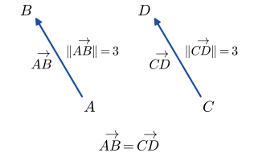{width="50%" fig-align="center"}

  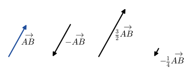{width="70%" fig-align="center"}

* Addition and Subtraction

  $~$
  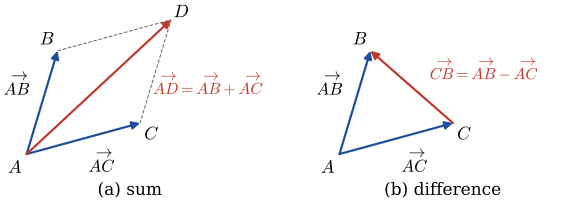{width="95%" fig-align="center"}

* Vectors in a Coordinate Plane

  $$\mathbf{a}=\left \langle a_1, a_2 \right \rangle$$

  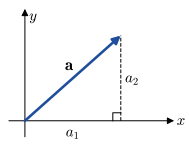{width="45%" fig-align="center"}

* Let $~$$\mathbf{a}=\left \langle a_1, a_2 \right \rangle~$ and $~$$\mathbf{b}=\left \langle b_1, b_2 \right \rangle~$ 
 be vectors in $\mathbb{R}^2$
 
  * Equality: $\text{ }$ $\mathbf{a} =\mathbf{b}~$ if and only if $~a_1 =b_1, \;a_2=b_2$
  * Addition: $\text{ }$ $\mathbf{a} +\mathbf{b} =\left \langle a_1 +b_1, a_2 +b_2 \right \rangle$
  * Scalar multiplication: $\text{ }$ $k\mathbf{a} =\left \langle k a_1, k a_2 \right \rangle$

* **Properties of Vectors**

  * $\mathbf{a} +\mathbf{b} = \mathbf{b} +\mathbf{a}$
   
  * $\mathbf{a} +(\mathbf{b} +\mathbf{c}) = (\mathbf{a} +\mathbf{b}) +\mathbf{c}$
   
  * $\mathbf{a} +\mathbf{0} = \mathbf{a}$
   
  * $\mathbf{a} +(-\mathbf{a}) = \mathbf{0}$
   
  * $k(\mathbf{a} +\mathbf{b}) = k\mathbf{a} +k\mathbf{b}$
     
  * $(k_1 +k_2)\mathbf{a} = k_1\mathbf{a} +k_2\mathbf{a}$
   
  * $k_1(k_2 \mathbf{a}) = (k_1 k_2) \mathbf{a}$
   
  * $1\mathbf{a} = \mathbf{a}$
   
  * $0\mathbf{a} = \mathbf{0}$ 

* Magnitude, $\,$ Unit Vector

  $\begin{aligned}
    \left \| \mathbf{a} \right \| &= \sqrt{a_1^2 +a_2^2} \;\;\text{ for }\; \mathbf{a} =\left \langle a_1, a_2 \right \rangle \\
    \mathbf{u} &= \frac{\mathbf{a}}{\left \| \mathbf{a} \right \|}
   \end{aligned}$

* $\mathbf{i}$, $~\mathbf{j}$ vectors

  $\begin{aligned}
   \mathbf{a} 
    &= \left \langle a_1, a_2 \right \rangle \\
    &=\left \langle a_1, 0 \right \rangle +\left \langle 0, a_2 \right \rangle  \\ 
    &= a_1 \left \langle 1, 0 \right \rangle +a_2 \left \langle 0, 1 \right \rangle \\ 
    &= a_1 \mathbf{i} +a_2 \mathbf{j}
  \end{aligned}$

$~$

**Example** $\,$ Use the given figure to prove the given result

$$\mathbf{a} +\mathbf{b} +\mathbf{c}=\mathbf{0}\;~\text{and}\;~\mathbf{a} +\mathbf{b} +\mathbf{c} +\mathbf{d}=\mathbf{0}$$

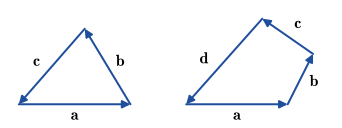{width="70%" fig-align="center"}

[Solution](files/solutions/sol_9_1.pdf){target="_blank"}

$~$

## Vectors in 3-Space {#sec-7-2}

$~$

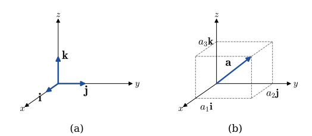{width="85%" fig-align="center"}

* $\mathbf{i}$, $~\mathbf{j}$, and $~\mathbf{k}$ vectors

  $\begin{aligned}
    \mathbf{a} &= \left \langle a_1, a_2, a_3 \right \rangle \\ 
    &= \left \langle a_1, 0, 0 \right \rangle +\left \langle 0, a_2, 0 \right \rangle 
     +\left \langle 0, 0, a_3 \right \rangle \\ 
    &= a_1 \left \langle 1, 0, 0 \right \rangle +a_2 \left \langle 0, 1, 0 \right \rangle
     +a_3 \left \langle 0, 0, 1 \right \rangle \\
    &= a_1 \mathbf{i} +a_2 \mathbf{j} +a_3 \mathbf{k}
  \end{aligned}$

* Octants

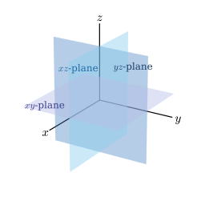{width="40%" fig-align="center"}

:::: {.columns}

::: {.column width="15%"}
$~$
:::

::: {.column width="70%"}
| Axes | Coordinates | Plane | Coordinates |
|------|-------------|-------|-------------|
| $x$ | $(a, 0, 0)$ | $xy$ | $(a, b, 0)$|
| $y$ | $(0, b, 0)$ | $yz$ | $(0, b, c)$|
| $z$ | $(0, 0, c)$ | $xz$ | $(a, 0, c)$|
:::

::: {.column width="15%"}
$~$
:::

::::

$~$

* Let $\,\mathbf{a}=\left \langle a_1, a_2, a_3 \right \rangle\,$ and $\,\mathbf{b}=\left \langle b_1, b_2, b_3 \right \rangle$ be vectors in $\mathbb{R}^3$

  * Equality: $~\mathbf{a} =\mathbf{b}~\text{ if and only if }~a_1 =b_1, \;a_2=b_2, \;a_3=b_3$
  * Addition: $~\mathbf{a} +\mathbf{b} =\left \langle a_1 +b_1, a_2 +b_2, a_3 +b_3 \right \rangle$
  * Scalar multiplication: $~k\mathbf{a} =\left \langle k a_1, k a_2, k a_3 \right \rangle$
  * Negative: $-\mathbf{b} =(-1)\mathbf{b} =\left \langle -b_1, -b_2, -b_3 \right \rangle$
  * Subtraction: $~\mathbf{a} -\mathbf{b} = \mathbf{a} +(-1)\mathbf{b} =\left \langle a_1 -b_1, a_2 -b_2, a_3 -b_3 \right \rangle$
  * Zero vector: $~\mathbf{0} =\left \langle 0, 0, 0 \right \rangle$
  * Magnitude: $~\left \| \mathbf{a} \right \| =\sqrt{a_1^2 +a_2^2 +a_3^2}$

$~$

**Example** $\,$ Describe the locus of points $P(x, y, z)$ that satisfy the given equations

* $xyz=0$
  
* $(x+1)^2 +(y-2)^2 +(z+3)^2 = 0$
  
* $(x-2)(z-8)=0$
  
* $z^2 -25=0$
  
* $x=y=z$

[Solution](files/solutions/sol_9_2.pdf){target="_blank"}

$~$

## Dot Product (Inner or Scalar Product) {#sec-7-3}

* The dot product of $\mathbf{a}=\left \langle a_1, a_2, a_3 \right \rangle$ and $\mathbf{b}=\left \langle b_1, b_2, b_3 \right \rangle$ is

  $\phantom{x}\mathbf{a} \cdot \mathbf{b} = a_1 b_1 + a_2 b_2 + a_3 b_3$
  
* Properties of the Dot Product

  * $\mathbf{a}\cdot\mathbf{b} = 0~$ if $~\mathbf{a}=\mathbf{0}~$ or $~\mathbf{b}=\mathbf{0}$
  * $\mathbf{a}\cdot\mathbf{b} = \mathbf{b}\cdot\mathbf{a}$
  * $\mathbf{a}\cdot(\mathbf{b} +\mathbf{c}) = \mathbf{a}\cdot\mathbf{b} +\mathbf{a}\cdot\mathbf{c}$
  * $\mathbf{a}\cdot(k\mathbf{b}) = (k\mathbf{a})\cdot\mathbf{b} =k(\mathbf{a}\cdot\mathbf{b})$
  * $\mathbf{a}\cdot\mathbf{a} \geq 0$
  * $\mathbf{a}\cdot\mathbf{a} =\left \| \mathbf{a} \right \|^2$

* Alternative Form

  The dot product of two vectors $\mathbf{a}$ and $\mathbf{b}$ is
  
  $\phantom{xx}\mathbf{a}\cdot\mathbf{b} =\left\| \mathbf{a} \right\| \left\| \mathbf{b} \right\| \cos\theta$
  
  where $\theta$ is the angle between the vectors, $\,0 \leq \theta \leq \pi$

* Angle between two vectors

  $\displaystyle\phantom{xx}\cos\theta = \frac{a_1 b_1 +a_2 b_2 + a_3 b_3}{\left\| \mathbf{a}\right\| \left\| \mathbf{b}\right\|}$

  * Direction cosines

  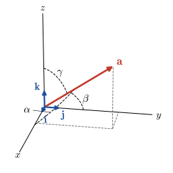{width="50%" fig-align="center"}
  
  $\phantom{xx}\displaystyle\cos\alpha=\frac{a_1}{\left\|\mathbf{a}\right\|}$, 
  $~\displaystyle\cos\beta=\frac{a_2}{\left\|\mathbf{a}\right\|}$,
  $~\displaystyle\cos\gamma=\frac{a_3}{\left\|\mathbf{a}\right\|}$

* Orthogonal vectors

  Two nonzero vectors $\mathbf{a}$ and $\mathbf{b}$ are orthogonal if and only if $~\mathbf{a}\cdot\mathbf{b}=0$

* Component of $\mathbf{a}$ on $\mathbf{b}$

  To find the component of $\mathbf{a}$ on a vector $\mathbf{b}$, $~$we dot $\mathbf{a}$ with a unit vector in the direction of $\mathbf{b}$
  
  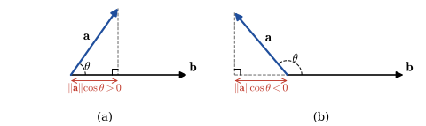{width="95%" fig-align="center"}
    
  $$\text{comp}_{\mathbf{b}} \mathbf{a} =\left\| \mathbf{a} \right\| \cos\theta
   =\left\| \mathbf{a} \right\| \cos\theta \frac{\left\| \mathbf{b} \right\|}{\left\| \mathbf{b} \right\|}
   =\frac{\mathbf{a}\cdot\mathbf{b}}{\left\| \mathbf{b} \right\|}
   =\mathbf{a} \cdot\frac{\mathbf{b}}{\left\| \mathbf{b} \right\|}$$

* Projection of $\mathbf{a}$ onto $\mathbf{b}$

  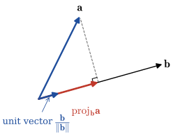{width="50%" fig-align="center"}
    
  $$\text{proj}_{\mathbf{b}} \mathbf{a} = \left(\text{comp}_{\mathbf{b}} \mathbf{a} \right) \left(\frac{\mathbf{b}}{\left\| \mathbf{b} \right\|} \right)=\color{red}{\left(\frac{\mathbf{a}\cdot\mathbf{b}}{\mathbf{b}\cdot\mathbf{b}}\right) \mathbf{b}}$$

$~$

**Example** $\,$ Verify that the vector
  $\displaystyle \mathbf{c}=\mathbf{b} - \left(\frac{\mathbf{a} \cdot \mathbf{b}}{\mathbf{a} \cdot \mathbf{a}}\right) \mathbf{a}\,$ is orthogonal to the vector $\mathbf{a}$

[Solution](files/solutions/sol_9_3a.pdf){target="_blank"}

$~$
  
**Example** $\,$ In the methane molecule $\mathrm{CH}_4$, the hydrogen atoms are located at the four vertices of a regular tetrahedron. The distance between the center of a hydrogen atom and the center of a carbon atom is 1.10 angstroms, and the hydrogen-carbon-hydrogen bond angle is $\,\theta=109.5^\circ$. Using vector methods only, find the distance between two hydrogen atoms

[Solution](files/solutions/sol_9_3b.pdf){target="_blank"}

$~$

## Cross Product {#sec-7-4}

* Cross product of Two vectors

  $\phantom{xx}\mathbf{a} \times \mathbf{b} 
   =\left|\begin{matrix} \mathbf{i} & \mathbf{j} & \mathbf{k}\\ a_1 &  a_2 & a_3\\ b_1 &  b_2 & b_3 \end{matrix}\right|
   =\left|\begin{matrix} a_2 & a_3\\ b_2 & b_3 \end{matrix}\right| \mathbf{i}
   -\left|\begin{matrix} a_1 & a_3\\ b_1 & b_3 \end{matrix}\right| \mathbf{j}
   +\left|\begin{matrix} a_1 & a_2\\ b_1 & b_2 \end{matrix}\right| \mathbf{k}$

* Alternative Form and Magnitude of the Cross Product
 
  $\phantom{xx}\mathbf{a}\times\mathbf{b} =(\left\| \mathbf{a} \right\| \left\| \mathbf{b} \right\| \sin\theta)\,\mathbf{n} =\left\| \mathbf{a}\times\mathbf{b} \right\| \mathbf{n}$

* Right-Hand Rule

  The vectors $\mathbf{a}$, $\mathbf{b}$, and $~\mathbf{a}\times\mathbf{b}~$ form a right-hand system:
  
  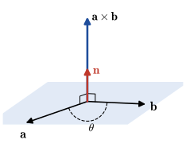{width="50%" fig-align="center"}

* Parallel Vectors

  Two nonzero vectors $\mathbf{a}$ and $\mathbf{b}$ are parallel if and only if $~\mathbf{a}\times\mathbf{b}=\mathbf{0}$

* Properties of the Cross Product
  $~$
  * $\mathbf{a}\times\mathbf{b} = \mathbf{0}~$ if $~\mathbf{a}=\mathbf{0}~$ or $~\mathbf{b}=\mathbf{0}$
  * $\mathbf{a}\times\mathbf{b} =-\mathbf{b}\times\mathbf{a}$
  * $\mathbf{a}\times(\mathbf{b} +\mathbf{c}) = (\mathbf{a}\times\mathbf{b}) +(\mathbf{a}\times\mathbf{c})$
  * $(\mathbf{a} +\mathbf{b}) \times\mathbf{c} = (\mathbf{a}\times\mathbf{c}) +(\mathbf{b}\times\mathbf{c})$  
  * $\mathbf{a}\times(k\mathbf{b}) = (k\mathbf{a})\times\mathbf{b} =k(\mathbf{a}\times\mathbf{b})$
  * $\mathbf{a}\times\mathbf{a} =\mathbf{0}$
  * $\mathbf{a}\cdot(\mathbf{a}\times\mathbf{b})=0$
  * $\mathbf{b}\cdot(\mathbf{a}\times\mathbf{b})=0$  

* Areas of a Parallelogram and a Triangle 

   $\text{(a)}$ $~A =\left\|\mathbf{a} \times \mathbf{b} \right\|$
   
   $\text{(b)}$ $~A =\frac{1}{2}\left\|\mathbf{a} \times \mathbf{b} \right\|$

   $~$
   
   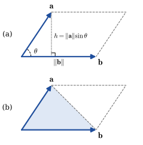{width="45%" fig-align="center"}

* Volume of a Parallelepiped 
 
  $\phantom{xx}V=\left| \mathbf{a} \cdot (\mathbf{b} \times \mathbf{c})\right|$

  $~$
 
  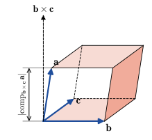{width="45%" fig-align="center"}

* Special Products

  $\phantom{xx}\mathbf{a} \cdot (\mathbf{b} \times \mathbf{c}) =
   \left|\begin{matrix}
    a_1 & a_2 & a_3\\ 
    b_1 & b_2 & b_3\\ 
    c_1 & c_2 & c_3 
   \end{matrix}\right| = (\mathbf{a} \times \mathbf{b}) \cdot \mathbf{c}$
  
  $~$

  $\phantom{xx}\mathbf{a} \times (\mathbf{b} \times \mathbf{c}) = (\mathbf{a} \cdot \mathbf{c}) \mathbf{b}
   -(\mathbf{a} \cdot \mathbf{b}) \mathbf{c}$

$~$

**Example** $\,$ Prove or disprove

* $~\mathbf{a} \times (\mathbf{b} \times \mathbf{c}) = (\mathbf{a} \cdot \mathbf{c}) \mathbf{b}
   -(\mathbf{a} \cdot \mathbf{b}) \mathbf{c}$
  
* $~\mathbf{a} \times (\mathbf{b} \times \mathbf{c}) =(\mathbf{a} \times \mathbf{b}) \times \mathbf{c}$
  
* $~\mathbf{a} \times (\mathbf{b} \times \mathbf{c}) +\mathbf{b} \times (\mathbf{c} \times \mathbf{a})
    +\mathbf{c} \times (\mathbf{a} \times \mathbf{b})=\mathbf{0}$
    
* Lagrange's identity
  $\| \mathbf{a}\times\mathbf{b}\|^2 = \|\mathbf{a}\|^2 \|\mathbf{b}\|^2 - (\mathbf{a}\cdot\mathbf{b})^2$

[Solution](files/solutions/sol_9_4.pdf){target="_blank"}

$~$

## Lines and Planes in 3-Space {#sec-7-5}

* Lines

  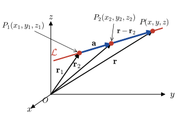{width="60%" fig-align="center"}

  $$
  \begin{aligned}
    \mathbf{r} -\mathbf{r}_2  &= t(\mathbf{r}_2 - 
      \mathbf{r}_1) = t\mathbf{a} \\ 
     &\Rightarrow \;\displaystyle t = \frac{x - x_2}{a_1} = \frac{y - y_2}{a_2} = \frac{z - z_2}{a_3}
  \end{aligned}$$

* Planes

   If the normal vector is $\mathbf{n}=n_1\mathbf{i} +n_2\mathbf{j} +n_3\mathbf{k}$, $~$then
   
  $$
    \begin{aligned}
       \mathbf{n}&\cdot(\mathbf{r} -\mathbf{r}_1) =0 \\
       &\Rightarrow~ n_1(x -x_1) +n_2 (y -y_1) +n_3(z- z_1)=0
    \end{aligned}
  $$

  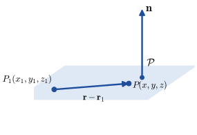{width="55%" fig-align="center"}

  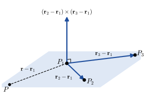{width="55%" fig-align="center"}

$~$

**Example** $\,$ Find parametric equation for the line that contains $(-4, 1, 7)$ and is perpendicular to the plane 
$$-7x+2y+3z=1$$

[Solution](files/solutions/sol_9_5a.pdf){target="_blank"}

$~$

**Example** $\,$ Find parametric equations for the line of intersection of the given planes
  
$$
\begin{aligned}
  5x - 4y -9z &= 8\\ 
  x + 4y +3z &= 4 
\end{aligned}$$

[Solution](files/solutions/sol_9_5b.pdf){target="_blank"}

$~$

**Example** $\,$ Find an equation of the plane that contains the given line and is orthogonal to the indicated plane

$$\frac{2-x}{3}=\frac{y+2}{5}=\frac{z-8}{2}; \quad 2x - 4y-z + 16=0$$

[Solution](files/solutions/sol_9_5c.pdf){target="_blank"}

$~$

## Vector Spaces {#sec-7-6}

* $n$-Space

  * A **vector in n-space** is any ordered $n$-tuple
    $\,\mathbf{a}=\left\langle a_1, a_2, \cdots, a_n \right\rangle$ of real numbers called the components of $~\mathbf{a}$
  * The set of all vectors in $n$-space is denoted by $\mathbb{R}^n$
  * The component definitions in 3-space carry over to $\mathbb{R}^n$  in a natural way

* The standard **dot** or **inner product** of two $n$-vectors is the real number defined by
 
  $\phantom{xx}\begin{aligned}
       \mathbf{a} \cdot \mathbf{b} &= \left\langle a_1, a_2, \cdots, a_n \right\rangle \cdot \left\langle b_1, b_2, \cdots, b_n \right\rangle \\ 
        &= a_1 b_1 +a_2 b_2 + \cdots + a_n b_n
    \end{aligned}$
     
* Two nonzero vectors $\mathbf{a}$ and $\mathbf{b}$ in $\mathbb{R}^n$ are said to be **orthogonal** 
    if and only if $~\mathbf{a} \cdot \mathbf{b} = 0$

* **Vector Space**

  Let $V$ be a set of elements on which two operations called **vector addition** and **scalar multiplication** are defined. Then $V$ is said to be a **vector space** if the following 10 properties are satisfied

* **Axioms for Vector Addition**
 
  * If $\mathbf{x}$ and $\mathbf{y}$ are in $V$, $~$then $\mathbf{x} +\mathbf{y}$ is in $V$

  * For all $\mathbf{x}$, $\mathbf{y}$ in $V$, $~$$\mathbf{x} +\mathbf{y} = \mathbf{y} +\mathbf{x}$

  * For all $\mathbf{x}$, $\mathbf{y}$, $\mathbf{z}$ in $V$, $~$$\mathbf{x} +(\mathbf{y} +\mathbf{z}) = (\mathbf{x} +\mathbf{y}) +\mathbf{z}$

  * There is a unique vector $\mathbf{0}$ in $V$ such that $~$$\mathbf{0} +\mathbf{x} = \mathbf{x} +\mathbf{0} =\mathbf{x}$
   
  * For each $\mathbf{x}$ in $V$, $~$there exists a vector $-\mathbf{x}~$ such that 
   $\mathbf{x} +(-\mathbf{x}) = (-\mathbf{x}) +\mathbf{x} =\mathbf{0}$

* **Axioms for Scalar Multiplication**
 
  * If $k$ is any scalar and $\mathbf{x}$ is in $V$, $~$then $~k\mathbf{x}~$ is in $V$

  * $k(\mathbf{x} +\mathbf{y}) =k\mathbf{x} + k\mathbf{y}$

  * $(k_1 +k_2)\mathbf{x} =k_1\mathbf{x} + k_2\mathbf{x}$

  * $k_1(k_2\mathbf{x})=(k_1k_2)\mathbf{x}$

  * $1\mathbf{x}=\mathbf{x}$

* Here are some important vector spaces:
  
  * The set $\mathbb{R}$ of real numbers

  * The set $\mathbb{R}^2$ of ordered pairs

  * The set $\mathbb{R}^3$ of ordered triples

  * The set $\mathbb{R}^n$ of ordered $n$-tuples

  * The set $P_n$ of polynomials of degree less than or equal to $n$

  * The set $P$ of all polynomials

  * The set of real-valued functions $~f$ defined on the set $\mathbb{R}$

  * The set $C[a,b]$ of real-valued functions $~f$ continuous on the closed interval $[a,b]$

  * The set $C(-\infty,\infty)$ of real-valued functions $~f$ continuous on the set $\mathbb{R}$

  * The set $C^n[a,b]$ of all real-valued functions $~f$, $\,$ for which $f$, $f'$, $f''$, $\cdots$, $f^{(n)}$ exist and are continuous on the closed interval $[a,b]$
  
$~$

**Example** $\,$ Consider the set $V$ of positive real numbers. If $x$ and $y$ denote positive real numbers, then we write vectors in $V$ as $\mathbf{x}=x~$ and $~\mathbf{y}=y$

* Now, $~$ addition of vectors is defined by
  
  $\phantom{xx}\mathbf{x} +\mathbf{y} =xy$

* and scalar multiplication is defined by
  
  $\phantom{xx}k\mathbf{x}=x^k$

  Determine whether $V$ is a vector space

[Solution](files/solutions/sol_9_6a.pdf){target="_blank"}

$~$

* **Subspace**
  
  * A nonempty subset $W$ of a vector space $V$ is a **subspace** of $V~$ if and only if $~W$ is closed under vector addition and scalar multiplication defined on $V$:

    * If $\mathbf{x}$ and $\mathbf{y}$ are in $W$, $~$then $\mathbf{x} +\mathbf{y}$ is in $W$
    * If $\mathbf{x}$ is in $W$ and $k$ is any scalar, $~$then $k\mathbf{x}$ is in $W$

* **Linear Independence**

  A set of vectors $\left\{ \mathbf{x}_1, \mathbf{x}_2, \cdots, \mathbf{x}_n \right\}$ is said to be **linearly independent** 
  if the only constants satisfying the equation
  
  $$k_1\mathbf{x}_1 +k_2\mathbf{x}_2 +\cdots +k_n\mathbf{x}_n=\mathbf{0}$$
  
  are $k_1=k_2=\cdots=k_n=0$. If the set of vectors is not linearly independent, $~$then it is said to be **linearly dependent** 

* **Basis**

  Consider a set of vectors $B=\left\{\mathbf{x}_1, \mathbf{x}_2,\cdots,\mathbf{x}_n\right\}\,$ in a vector space $V$. $~$If the set $\,B\,$ is linearly independent and if every vector in $V$ can be expressed as a linear combination of these vectors, $~$then $B$ is said to be a **basis** in $V$

* **Dimension**

  The number of vectors in a basis $\,B\,$ for a vector space $~V$ is said to be the **dimension** of the space

* **Span**

  If $S$ denotes any set of vectors $\left\{\mathbf{x}_1, \mathbf{x}_2,\cdots,\mathbf{x}_n\right\}$ in a vector space $V$, $\,$then the set of all linear combinations of the vectors $\mathbf{x}_1,\mathbf{x}_2,\cdots,\mathbf{x}_n$ in $S$,
  
  $$\left\{ k_1\mathbf{x}_1 +k_2\mathbf{x}_2+ \cdots+k_n\mathbf{x}_n\right\}$$
  
  where the $k_i$ are scalars, $\,$is called the **span** of the vectors and written $\mathrm{span}(S)$ or $\mathrm{span}(\mathbf{x}_1,\mathbf{x}_2,\cdots,\mathbf{x}_n)$
  
  $~$
  
  If $\,V=\text{span}(S)$, $\,$then we say that $\,S\,$ is a spanning set for the vector space $V$, $\,$or that $\,S\,$ spans $\,V$

$~$

**Example** $\,$ Determine whether the given set is a vector space:

* The set of complex numbers $a + bi$, $\,$where $i^2=-1$, $\,$addition and scalar multiplication defined by
  
  $$
  \begin{aligned}
    (a_1 + b_1 i) +(a_2 +b_2 i) &= (a_1 +a_2) +(b_1 +b_2)i \\ 
    k(a+bi) &= ka +kb i 
  \end{aligned}$$

  where $k$ is a real number

*  The set of arrays of real numbers 
   $\begin{pmatrix}
     a_{11} & a_{12} \\ 
     a_{21} & a_{22} 
    \end{pmatrix}$, $~$ addition and scalar multiplication defined by

  $$
  \begin{aligned}
    \begin{pmatrix}
      a_{11} & a_{12} \\ 
      a_{21} & a_{22} 
    \end{pmatrix} +
    \begin{pmatrix}
      b_{11} & b_{12} \\ 
      b_{21} & b_{22} 
    \end{pmatrix} &= \begin{pmatrix}
      a_{12} +b_{12} & a_{11}+b_{11} \\ 
      a_{22} +b_{22} & a_{21}+b_{21} 
    \end{pmatrix}\\ 
    k\begin{pmatrix}
       a_{11} & a_{12} \\ 
       a_{21} & a_{22} 
     \end{pmatrix}&= \begin{pmatrix}
       ka_{11} & ka_{12} \\ 
       ka_{21} & ka_{22} 
      \end{pmatrix}
  \end{aligned}$$

[Solution](files/solutions/sol_9_6b.pdf){target="_blank"}

$~$

## Gram-Schmidt Orthogonalization Process {#sec-7-7}

* Every vector $\mathbf{u}$ in $\mathbb{R}^n$ can be written as a linear combination of the vectors in the standard basis $B=\left\{ \mathbf{e}_1, \mathbf{e}_2, \cdots, \mathbf{e}_n \right\}$:
  
  $$
  \begin{aligned}
    \mathbf{e}_1 &=\left\langle 1,0,0,\cdots,0 \right\rangle \\ 
    \mathbf{e}_2 &=\left\langle 0,1,0,\cdots,0 \right\rangle \\ 
    &\;\;\vdots \\ 
    \mathbf{e}_n &=\left\langle 0,0,0,\cdots,1 \right\rangle 
  \end{aligned}$$
    
  This standard basis $B=\left\{ \mathbf{e}_1, \mathbf{e}_2, \cdots, \mathbf{e}_n \right\}\,$ is also an example of an **orthonormal basis**
  
  $$\mathbf{e}_i \cdot \mathbf{e}_j = 0, \,i \neq j ~\text{ and}~ \left\| \mathbf{e}_i \right\|=1, ~i=1,2,\cdots,n$$

* Coordinates Relative to an Orthonormal Basis

  Suppose $B=\left\{ \mathbf{w}_1, \mathbf{w}_2, \cdots, \mathbf{w}_n \right\}$ is an orthonormal basis for $\mathbb{R}^n$. 
  $\,$If $\mathbf{u}$ is any vector in $\mathbb{R}^n$, $~$then
  
  $$\mathbf{u} = (\mathbf{u}\cdot\mathbf{w}_1)\mathbf{w}_1 +(\mathbf{u}\cdot\mathbf{w}_2)\mathbf{w}_2 + \cdots +(\mathbf{u}\cdot\mathbf{w}_n)\mathbf{w}_n$$

* Constructing an Orthogonal Basis for $\mathbb{R}^2$
  
  $$\begin{aligned} \mathbf{v}_1 &= \mathbf{u}_1 \\ \mathbf{v}_2 &= \mathbf{u}_2 -\left( \frac{\mathbf{u}_2 \cdot \mathbf{v}_1}{\mathbf{v}_1 \cdot \mathbf{v}_1}\right) \mathbf{v}_1\end{aligned}$$

  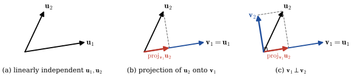{width="95%" fig-align="center"}

* Constructing an Orthogonal Basis for $\mathbb{R}^3$
  
  $$\begin{aligned} \mathbf{v}_1 &= \mathbf{u}_1 \\ 
   \mathbf{v}_2 &= \mathbf{u}_2 -\left( \frac{\mathbf{u}_2 \cdot \mathbf{v}_1}{\mathbf{v}_1 \cdot \mathbf{v}_1}\right) \mathbf{v}_1 \\
   \mathbf{v}_3 &= \mathbf{u}_3 -\left( \frac{\mathbf{u}_3 \cdot \mathbf{v}_1}{\mathbf{v}_1 \cdot \mathbf{v}_1}\right) \mathbf{v}_1
   -\left( \frac{\mathbf{u}_3 \cdot \mathbf{v}_2}{\mathbf{v}_2 \cdot \mathbf{v}_2}\right) \mathbf{v}_2 \end{aligned}$$

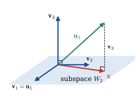{width="45%" fig-align="center"}

* **Gram-Schmidt Orthogonalization Process**

  Let $\,B=\left\{ \mathbf{u}_1, \mathbf{u}_2, \cdots, \mathbf{u}_m \right\}$, $~m \leq n$, $~$be a basis for a subspace $W_m$ of $~\mathbb{R}^n$. 
  $\,$Then $B'=\left\{ \mathbf{v}_1, \mathbf{v}_2, \cdots, \mathbf{v}_m \right\}$ , $\,$where
  
  $$
  \begin{aligned} 
      \mathbf{v}_1 & = \mathbf{u}_1 \\ 
      \mathbf{v}_2 & = \mathbf{u}_2 -\left( \frac{\mathbf{u}_2 \cdot \mathbf{v}_1}{\mathbf{v}_1 \cdot \mathbf{v}_1}\right) \mathbf{v}_1 \\
     \mathbf{v}_3 & = \mathbf{u}_3 -\left( \frac{\mathbf{u}_3 \cdot \mathbf{v}_1}{\mathbf{v}_1 \cdot \mathbf{v}_1}\right) \mathbf{v}_1
   -\left( \frac{\mathbf{u}_3 \cdot \mathbf{v}_2}{\mathbf{v}_2 \cdot \mathbf{v}_2}\right) \mathbf{v}_2 \\
   &\;\vdots \\
    \mathbf{v}_m & = \mathbf{u}_m -\left( \frac{\mathbf{u}_m \cdot \mathbf{v}_1}{\mathbf{v}_1 \cdot \mathbf{v}_1}\right) \mathbf{v}_1
   -\left( \frac{\mathbf{u}_m \cdot \mathbf{v}_2}{\mathbf{v}_2 \cdot \mathbf{v}_2}\right) \mathbf{v}_2
   -\cdots -\left( \frac{\mathbf{u}_m \cdot \mathbf{v}_{m-1}}{\mathbf{v}_{m-1} \cdot \mathbf{v}_{m-1}}\right) \mathbf{v}_{m-1}     
  \end{aligned}$$
   
  is an orthogonal basis for $W_m$

* An orthonormal basis for $W_m$ is
  
  $$B''=\left\{ \mathbf{w}_1, \mathbf{w}_2, \cdots, \mathbf{w}_m \right\}=\left\{ \frac{1}{\left\| \mathbf{v}_1 \right\|} \mathbf{v}_1,
  \frac{1}{\left\| \mathbf{v}_2 \right\|} \mathbf{v}_2, \cdots, \frac{1}{\left\| \mathbf{v}_m \right\|} \mathbf{v}_m \right\}$$

$~$

**Example** $\,$An inner product defined on the vector space $P_2$ of all polynomials of degree less than or equal to $2$, is given by

  $$\left\langle p, q \right \rangle =\int_{-1}^{1} p(x)\, q(x)\, dx$$
  
  Use the Gram-Schmidt orthogonalization process to transform the given basis for $P_2$ into an orthogonal basis $B'$
  
  $$B = \{1, x, x^2\}$$

[Solution](files/solutions/sol_9_7.pdf){target="_blank"}

$~$

## Worked Exercises {.unnumbered}

**1.** $~$ Determine whether the given vectors are linearly independent or linearly dependent:

$$1, (x+1), (x+1)^2, x^2 \text{ in } P_2$$

**Solution**

**Step 1:** $~$ Understand the space $P_2$

The vector space $P_2$ consists of all real polynomials of degree at most 2. So any element in $P_2$ has the form:

$$a_0 + a_1 x + a_2 x^2$$

That means the dimension of $P_2$ is 3. Therefore, any set of more than 3 vectors in $P_2$ must be linearly dependent

**Step 2:** $~$ Count the number of vectors

We are given 4 vectors:

$$1, \quad (x+1), \quad (x+1)^2, \quad x^2$$

Since $\dim P_2 = 3$, and we are given 4 vectors, they must be linearly dependent

**(Optional) Step 3:** $~$ Verify dependence explicitly

To see this more concretely, write each vector in terms of the standard basis $\{1, x, x^2\}$:

* $1 = 1 + 0x + 0x^2 \Rightarrow (1, 0, 0)$
* $x+1 = 1x + 1 \Rightarrow (1, 1, 0)$
* $(x+1)^2 = x^2 + 2x + 1 \Rightarrow (1, 2, 1)$
* $x^2 = x^2 \Rightarrow (0, 0, 1)$

Write these as column vectors:

$$\begin{bmatrix}
1\\0\\0
\end{bmatrix}, \quad
\begin{bmatrix}
1\\1\\0
\end{bmatrix}, \quad
\begin{bmatrix}
1\\2\\1
\end{bmatrix}, \quad
\begin{bmatrix}
0\\0\\1
\end{bmatrix}$$

You can now see, for instance:

$$(x+1)^2 = x^2 + 2(x) + 1 = x^2 + 2(x+1) - 1
\Rightarrow (x+1)^2 - 2(x+1) + x^2 - 1 = 0$$

So there is a nontrivial linear combination:

$$1\cdot(x+1)^2 - 2\cdot(x+1) + 1\cdot x^2 - 1 = 0$$

$~$

**2.** $~$ Explain why $\displaystyle f(x)=\frac{x}{x^2 +4x +3}$ is a vector in $C[0, 3]$ but not a vector in $C[-3,0]$

**Solution**

**Step 1:** $~$ Understand the vector space $C[a,b]$

* $C[a,b]$ is the vector space of all continuous real-valued functions defined on the interval $[a,b]$
* So, a function $f(x)$ is a vector in $C[a,b]$ if and only if it is continuous on the entire interval $[a,b]$

**Step 2:** $~$ Analyze $f(x) = \dfrac{x}{x^2 + 4x + 3}$

Factor the denominator:

$$x^2 + 4x + 3 = (x+1)(x+3)$$

So the function becomes:

$$f(x) = \frac{x}{(x+1)(x+3)}$$

This function is undefined at $x = -1$ and $x = -3$, since the denominator becomes 0 at those points.

**Step 3:** $~$ Behavior on $[0, 3]$

* The interval $[0,3]$ lies entirely to the right of both singularities $x = -1$ and $x = -3$
* On this interval, $f(x)$ is:
	*	Defined (denominator never zero),
	* Continuous (since it’s a rational function with no discontinuities on this domain)

**Step 4:** $~$ Behavior on $[-3, 0]$

* This interval includes the point $x = -1$, where the denominator becomes $0$.
* At $x = -1$, the function is undefined, so it is not continuous on the entire interval  

**Conclusion:**

* $f(x) \in C[0,3]$ — it is a continuous function on that interval, so it is a vector in $C[0,3]$

* $f(x) \notin C[-3,0]$ — because it is not defined (and hence not continuous) at $x = -1$, so it is not a vector in $C[-3,0]$

$~$

**3.** $~$ The given vectors span a subspace $W$ of $\mathbb{R}^4$. Use the Gram-Schmidt orthogonalization process to construct an orthonormal basis for the subspace

$$\mathbf{u}_1=\left \langle 4, 0, 2, -1 \right \rangle, \; \mathbf{u}_2=\left \langle 2, 1,-1,1 \right \rangle, \;\text{and}\; \mathbf{u}_3=\left \langle 1,1,-1,0 \right \rangle$$

**Solution**

$$\begin{aligned} 
     \mathbf{v}_1 &= \mathbf{u}_3=\left \langle 1,1,-1,0 \right \rangle \\ 
     \mathbf{v}_2 &= \mathbf{u}_2 -\left( \frac{\mathbf{u}_2 \cdot \mathbf{v}_1}{\mathbf{v}_1 \cdot \mathbf{v}_1}\right) \mathbf{v}_1 \\
     &= \left \langle 2, 1,-1,1 \right \rangle
        -\frac{4}{3}\left \langle 1,1,-1,0 \right \rangle = \frac{1}{3} \left \langle 2,-1,1,3 \right \rangle \\
        &\Rightarrow \; \left \langle 2,-1,1,3 \right \rangle\\
    \mathbf{v}_3 &= \mathbf{u}_1 -\left( \frac{\mathbf{u}_1 \cdot \mathbf{v}_1}{\mathbf{v}_1 \cdot \mathbf{v}_1}\right) \mathbf{v}_1
   -\left( \frac{\mathbf{u}_1 \cdot \mathbf{v}_2}{\mathbf{v}_2 \cdot \mathbf{v}_2}\right) \mathbf{v}_2 \\
   &= \left \langle 4, 0, 2, -1 \right \rangle -\frac{2}{3} \left \langle 1, 1, -1, 0 \right \rangle 
    -\frac{7}{15} \left \langle 2, -1, 1, 3 \right \rangle \\
    &= \frac{1}{5}  \left \langle 12, -1, 11, -12 \right \rangle \;\Rightarrow\; \left\langle 12, -1, 11, -12 \right \rangle \\
    &\Downarrow \\
    \mathbf{w}_1 &= \frac{1}{\sqrt{3}}\left \langle 1,1,-1,0 \right \rangle \\
    \mathbf{w}_2 &= \frac{1}{\sqrt{15}}\left \langle 2,-1,1,3 \right \rangle \\
    \mathbf{w}_3 &= \frac{1}{\sqrt{410}} \left\langle 12, -1, 11, -12 \right \rangle 
  \end{aligned}$$

$~$

**4.** $~$ The set of vectors $\{ \mathbf{u}_1, \mathbf{u}_2, \mathbf{u}_3 \}$, where

$$\mathbf{u}_1=\left \langle 1, 1, 3 \right \rangle, \; \mathbf{u}_2=\left \langle 1,4,1 \right \rangle, \;\text{and}\; \mathbf{u}_3=\left \langle 1,10,-3 \right \rangle$$

is linearly dependent in $\mathbb{R}^3$. Carry out the Gram-Schmidt orthogonalization process and then discuss that result

**Solution**

$$\begin{aligned} 
     \mathbf{v}_1 &= \mathbf{u}_1=\left \langle 1,1,3\right \rangle \\ 
     \mathbf{v}_2 &= \mathbf{u}_2 -\left( \frac{\mathbf{u}_2 \cdot \mathbf{v}_1}{\mathbf{v}_1 \cdot \mathbf{v}_1}\right) \mathbf{v}_1 = \left \langle 1,4,1 \right \rangle
        -\frac{1+4+3}{1+1+9}\left \langle 1,1,3 \right \rangle \\
        &= \frac{1}{11} \left \langle 3,36,-13 \right \rangle
        \;\;\Rightarrow \;\; \left \langle 3,36,-13 \right \rangle\\
    \mathbf{v}_3 &= \mathbf{u}_1 -\left( \frac{\mathbf{u}_1 \cdot \mathbf{v}_1}{\mathbf{v}_1 \cdot \mathbf{v}_1}\right) \mathbf{v}_1
   -\left( \frac{\mathbf{u}_1 \cdot \mathbf{v}_2}{\mathbf{v}_2 \cdot \mathbf{v}_2}\right) \mathbf{v}_2 \\
   &= \left \langle 1,10,-3 \right \rangle -\frac{1+10-9}{1+1+9} \left \langle 1, 1, 3 \right \rangle 
    -\frac{93+360+39}{9+36^2+13^2} \left \langle 3,36,-13 \right \rangle \\
    &= \left\langle 0, 0, 0 \right \rangle \\
    &\Downarrow \\
    \mathbf{w}_1 &= \frac{1}{\sqrt{11}}\left \langle 1,1,3 \right \rangle \\
    \mathbf{w}_2 &= \frac{1}{\sqrt{1474}}\left \langle 3,36,-13 \right \rangle 
   \end{aligned}$$