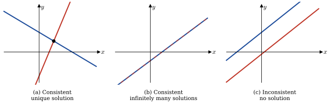
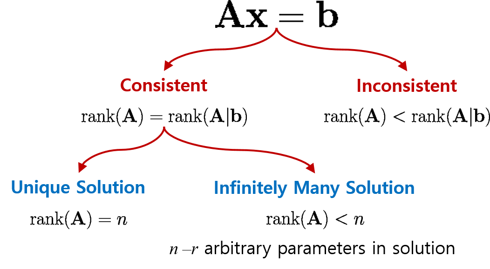
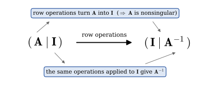
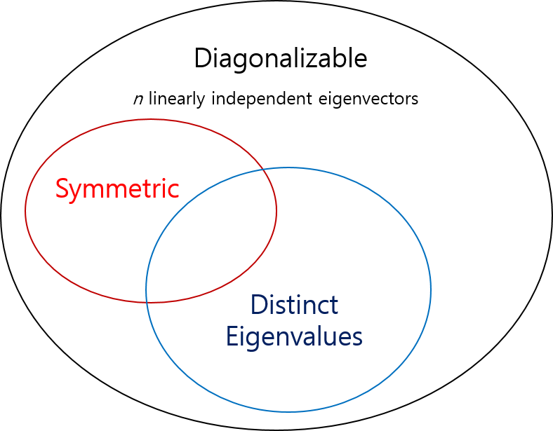
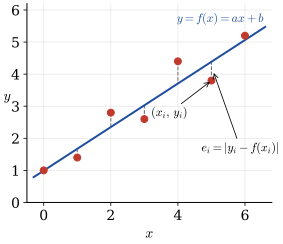
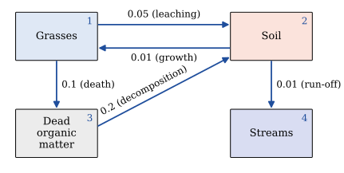

# Matrices {#sec-8}

## Prerequisites

* Vector Spaces (@sec-7-6)
* Gram-Schmidt Orthogonalization Process (@sec-7-7)

## Matrix Algebra {#sec-8-1}

* A **matrix** is any rectangular array of numbers or functions

  $$\begin{pmatrix}
    a_{11} & a_{12} & \cdots & a_{1n}\\ 
    a_{21} & a_{22} & \ddots & a_{2n} \\ 
    \vdots & \ddots & \ddots & \vdots \\ 
    a_{m1} & a_{m2} & \cdots & a_{mn}
  \end{pmatrix}$$ 
   
  * The numbers or functions in the array are **entries** or **elements**
  * An $n \times n$ matrix  is a **square** matrix of **order $n$**

* **Column** and **row vectors** are $n \times 1$ and $1 \times n$ matrices

  $$
  \begin{pmatrix}
    a_1\\ 
    a_2\\ 
    \vdots\\ 
    a_n
  \end{pmatrix},\;
  \begin{pmatrix}
    a_1 & a_2 & \cdots & a_n
  \end{pmatrix}  
  $$

* **Equality of Matrices** 

  $$
  \begin{aligned}
   \mathbf{A} = \left(a_{ij}\right)_{m \times n} \; \text{ and } \;&\mathbf{B} = \left(b_{ij}\right)_{m \times n} \;\text{ are equal } \\[5pt]
   \text{ if } a_{ij}=b_{ij} \;&\text{ for each } i \text{ and } j
   \end{aligned}$$

* **Matrix Addition**

  $$\mathbf{A} +\mathbf{B} = \left(a_{ij} +b_{ij}\right)_{m \times n}$$

* **Scalar Multiplication**

  $$k\mathbf{A} = \left(ka_{ij}\right)_{m \times n}$$

* **Properties of Matrix Addition and Scalar Multiplication**

  Suppose $\mathbf{A}$, $\mathbf{B}$, and $\mathbf{C}$ are $m \times n$ matrices and $k_1$ and $k_2$ are scalars. Then

  $$
  \begin{aligned}
    \mathbf{A} +\mathbf{B} &= \mathbf{B} +\mathbf{A} \\ 
    \mathbf{A} +\left(\mathbf{B} +\mathbf{C}\right) &= \left(\mathbf{A} +\mathbf{B}\right) +\mathbf{C} \\
    \left(k_1 k_2\right)\mathbf{A} &= k_1 \left(k_2\mathbf{A}\right) \\
    k_1\left(\mathbf{A} +\mathbf{B}\right)&=k_1\mathbf{A} +k_1\mathbf{B} \\
    \left(k_1 +k_2\right)\mathbf{A} &= k_1 \mathbf{A} +k_2\mathbf{A}  
  \end{aligned}$$

* **Matrix multiplication** 
  
  $$\mathbf{A}\mathbf{B}=\left(\sum_{k=1}^p a_{ik} b_{kj}\right)_{m \times n}$$
  
  where $\mathbf{A}$ is an $m \times p$ matrix, $~\mathbf{B}$ is a $p \times n$ matrix, and
  $~\mathbf{A}\mathbf{B}$ is the $m \times n$ matrix
  
  * In general, $~\mathbf{A}\mathbf{B}\neq\mathbf{B}\mathbf{A}$
  
  * **Associative Law:** $~\mathbf{A}\left(\mathbf{B}\mathbf{C}\right)=\left(\mathbf{A}\mathbf{B}\right)\mathbf{C}$ 
  
  * **Distributive Law:** $~\mathbf{A}\left(\mathbf{B}+\mathbf{C}\right)=\mathbf{A}\mathbf{B} +\mathbf{A}\mathbf{C}$ 

* **Transpose of a Matrix**

$$\mathbf{A}^T =
   {\scriptsize\begin{pmatrix}
     a_{11} & a_{21} & \cdots & a_{m1}\\ 
     a_{12} & a_{22} & \ddots & a_{m2} \\ 
     \vdots & \ddots & \ddots & \vdots \\ 
     a_{1n} & a_{2n} & \cdots & a_{mn}
   \end{pmatrix}}$$

* **Properties of Transpose**

  $$
  \begin{aligned}
     \left(\mathbf{A}^T\right)^T &= \mathbf{A} \\ 
     \left(\mathbf{A} +\mathbf{B}\right)^T 
       &=\mathbf{A}^T +\mathbf{B}^T \\         
     \left(\mathbf{A}\mathbf{B}\right)^T
       &=\mathbf{B}^T\mathbf{A}^T \\ 
     \left(k\mathbf{A}\right)^T
      &=k\mathbf{A}^T
  \end{aligned}$$

* **Special Matrices**

  * In a **zero matrix**, $~$all entries are zeros
  
  * In a **triangular matrix**, $~$all entries above or below the main diagonal are zeros (lower triangular or upper triangular)
  
  * In a **diagonal matrix**, $~$all entries not on the main diagonal are zeros

  * A **scalar matrix** is a diagonal one where all entries on the main diagonal are equal.
    $~$If those entries are $1$'s, it is an **identity matrix**, $\mathbf{I}$ 
    (or $~\mathbf{I}_n$ when there is a need to emphasize the order of the matrix)
    
  * An $n \times n$ matrix $\mathbf{A}$ is **symmetric** $~$if $\mathbf{A}^T=\mathbf{A}$

$~$

**Example** $\,$ 
If $~\mathbf{A}=
   \begin{pmatrix}
     \phantom{-}2 & -3 \\ 
     -5 & \phantom{-}4 
   \end{pmatrix}$ and 
  $~\mathbf{B}=
    \begin{pmatrix}
       -1 & 6 \\ 
       \phantom{-}3 & 2 
    \end{pmatrix}$,
    
find $~$(a) $\mathbf{AB}$, $~$(b) $\mathbf{BA}$, $~$(c) $\mathbf{A}^2$, $~$(d) $\mathbf{B}^2$

[Solution](files/solutions/sol_6_1.pdf){target="_blank"}

$~$

**Example** $\,$ Show that if $\mathbf{A}$ is an $m\times n$ matrix, $~$then $\mathbf{AA}^T$ is symmetric

[Solution](files/solutions/sol_6_1.pdf){target="_blank"}

$~$

**Example** $\,$ In matrix theory, $~$many of the familiar properties of the real number system are not valid. $~$If $a$ and $b$ are real numbers, then $ab=0\;$ implies that $a=0$ or $b=0$. $~$Find two matrices such that $\mathbf{AB}=\mathbf{0}~$ but $\mathbf{A}\neq\mathbf{0}$ and $\mathbf{B}\neq \mathbf{0}$

[Solution](files/solutions/sol_6_1.pdf){target="_blank"}

$~$

**Example** $\,$ Let $\mathbf{A}$ and $\mathbf{B}$ be $n\times n$ matrices. Explain why, in general, the given formula is not valid

$$(\mathbf{A} + \mathbf{B})^2 = \mathbf{A}^2 + 2\mathbf{A}\mathbf{B} +\mathbf{B}^2$$

[Solution](files/solutions/sol_6_1.pdf){target="_blank"}

$~$

**Example** $\,$ Find the resulting vector $\mathbf{b}$ if the given vector $\mathbf{a} = \langle 1, 1 \rangle$ is rotated through the indicated angle
 $\theta=\pi/2$

[Solution](files/solutions/sol_6_1.pdf){target="_blank"}

$~$

**Example** $\,$ Verify that the quadratic form $ax^2 +bxy +cy^2$ is the same as

$$\begin{pmatrix}
      x & y 
    \end{pmatrix}
    \begin{pmatrix}
      a & \frac{1}{2}b \\ 
     \frac{1}{2}b & c 
    \end{pmatrix}
    \begin{pmatrix}
      x \\ y 
\end{pmatrix}$$

[Solution](files/solutions/sol_6_1.pdf){target="_blank"}

$~$

## Systems of Linear Algebraic Equations {#sec-8-2}

* **General Form**

  A system of <font color="red">$m$ linear equations</font> in <font color="red">$n$ unknowns</font> has the general form
  
  $$
  \begin{aligned}
    a_{11} x_1 +a_{12} x_2 + \cdots +a_{1n} x_n 
      & = b_1\\ 
    a_{21} x_1 +a_{22} x_2 + \cdots +a_{2n} x_n 
      & = b_2\\ 
     &\;\, \vdots \\ 
     a_{m1} x_1 +a_{m2} x_2 + \cdots +a_{mn} x_n 
      & = b_m
  \end{aligned}$$

* The **coefficients** of the unknowns can be abbreviated as $a_{ij}$. The numbers $b_1, b_2, \cdots, b_m$ are called the **constants** of the system. 
  If all the constants are zero, the system is said to be **homogeneous**, otherwise it is **nonhomogeneous**
  $$
  \begin{aligned}
    \mathbf{A} 
    &= 
    \begin{pmatrix}
      a_{11} & a_{12} & \cdots & a_{1n} \\ 
      a_{21} & a_{22} & \cdots & a_{2n} \\ 
      \vdots &   & \ddots & \\ 
      a_{m1} & a_{m2} & \cdots & a_{mn} \\ 
    \end{pmatrix}, \;\;
    \mathbf{x} = 
    \begin{pmatrix}
       x_1  \\ x_2 \\ \vdots \\ x_n
    \end{pmatrix}, \;\; 
    \mathbf{b} = 
    \begin{pmatrix}
       b_1 \\ b_2 \\ \vdots \\ b_m
    \end{pmatrix}
  \end{aligned}$$

 $$\mathbf{A} \mathbf{x} = \mathbf{b}$$ 

* A linear system of equations is said to be **consistent** if it has at least one solution and **inconsistent** if it has no solutions. If a linear system is consistent, $~$it has either

  * a unique solution (that is, precisely one solution), or
  * infinitely many solutions

$~$

{width="95%" fig-align="center"}

* **Augmented Matrix**

  $$
  \left(\begin{array}{cccc|c}
    a_{11} & a_{12} & \cdots & a_{1n} & b_1\\ 
    a_{21} & a_{22} & \ddots & a_{2n} & b_2\\ 
    \vdots & \ddots & \ddots & \vdots & \vdots\\ 
    a_{m1} & a_{m2} & \cdots & a_{mn} & b_m
  \end{array}\right)$$


* A system can be solved with **elementary operations** (**row reduction** for matrices)
  on an augmented matrix
  
| Elementary<br>Operations | Meaning |
|:--------|:----------------------------|
| $R_{ij}$        | Interchange rows $i$ and $j$                       |
| $cR_{i}$        | Multiply the row $i$ by the nonzero constant $c$   | 
| $cR_{i}+R_{j}$  | Multiply the row $i$ by $c$ and add to the row $j$ |

$~$

* In the **Gaussian elimination**, $~$ we row-reduce the augmented matrix until we arrive 
  at a row-equivalent augmented matrix in **row-echelon form**
  
  * <font color='green'>The first nonzero entry in a nonzero row is a $1$</font>

  * <font color='blue'>In consecutive nonzero rows, $~$the first entry $1$ in the lower row appears to the right of the $1$ in the higher row</font>
  
  * <font color='green'>Rows consisting of all zeros are at the bottom of the matrix</font>

$~$

**Example** $\,$ Solve
  
$$\begin{pmatrix}
    2 & 6 & \phantom{-}1\\ 
    1 & 2 & -1\\ 
    5 & 7 & -4
  \end{pmatrix}
  \begin{pmatrix}
    x_1\\ 
    x_2\\ 
    x_3
  \end{pmatrix}=
  \begin{pmatrix}
    \phantom{-}7\\ 
    -1\\ 
    \phantom{-}9
  \end{pmatrix}$$

$~$  

Using row operations on the augmented matrix, $~$ we obtain
  
$${\scriptsize
  \left(\begin{array}{rrr|r}
    2 & 6 &  1 & 7\\ 
    1 & 2 & -1 & -1\\ 
    5 & 7 & -4 & 9
  \end{array}\right) 
  \overset{ R_{12}}{\Longrightarrow}}
  {\scriptsize
  \left(\begin{array}{rrr|r}
    1 & 2 & -1 & -1\\   
    2 & 6 &  1 & 7\\ 
    5 & 7 & -4 & 9
  \end{array}\right)
  \overset{\begin{matrix} -2R_1 +R_2 \\ -5R_1 +R_3 \end{matrix}}{\Longrightarrow}
  \left(\begin{array}{rrr|r}
    1 & 2 & -1 & -1\\   
    0 & 2 &  3 & 9\\ 
    0 & -3 & 1 & 14
  \end{array}\right)}$$
  
$${\scriptsize
  \overset{\frac{1}{2}R_2}{\Longrightarrow}
  \left(\begin{array}{rrr|r}
    1 & 2 & -1 & -1\\   
    0 & 1 &  \frac{3}{2} & \frac{9}{2} \\
    0 & -3 & 1 & 14
  \end{array}\right)
  \overset{ 3R_2 +R_3}{\Longrightarrow}
  \left(\begin{array}{rrr|r}
    1 & 2 & -1 & -1\\   
    0 & 1 &  \frac{3}{2} & \frac{9}{2} \\
    0 & 0 & \;\frac{11}{2} & \;\frac{55}{2}
  \end{array}\right)}$$
$${\scriptsize\overset{\frac{2}{11}R_3}{\Longrightarrow}
  \left(\begin{array}{rrr|r}
    1 & 2 & -1 & -1\\   
    0 & 1 &  \frac{3}{2} & \frac{9}{2} \\
    0 & 0 & 1 & 5
  \end{array}\right)}$$

The last matrix is in row-echelon form. $~$We can make the last matrix above to be in reduced row-echelon form

$${\scriptsize
  \left(\begin{array}{rrr|r}
    1 & 2 & -1 & -1\\   
    0 & 1 &  \frac{3}{2} & \frac{9}{2} \\
    0 & 0 & 1 & 5
  \end{array}\right)  
  \overset{ -2R_2 +R_1}{\Longrightarrow}
  \left(\begin{array}{rrr|r}
    1 & 0 & -4 & -10\\   
    0 & 1 &  \frac{3}{2} & \frac{9}{2} \\
    0 & 0 & 1 & 5
  \end{array}\right)   
  \overset{\begin{matrix}
           4R_3 +R_1 \\
          -\frac{3}{2}R_3 +R_2 
           \end{matrix}}{\Longrightarrow}
  \left(\begin{array}{rrr|r}
    1 & 0 & 0 & 10\\   
    0 & 1 & 0 & -3 \\
    0 & 0 & 1 & 5
  \end{array}\right)}$$
  
We see that the solution is $x_1=10$, $~x_2=-3$, $~x_3=5$

$~$

**Example** $\,$ Solve
  
$$
  \left(\begin{array}{rrr}
    1 & 3 & -2\\ 
    4 & 1 & 3\\ 
    2 & -5 & 7
  \end{array}\right) 
  \begin{pmatrix}
    x_1\\ 
    x_2\\ 
    x_3
  \end{pmatrix}=
 \left(\begin{array}{r}
    -7\\ 
     5\\ 
    19
  \end{array}\right)$$

$~$

Using row operations on the augmented matrix, we obtain
  
$${\scriptsize
  \left(\begin{array}{rrr|r}
    1 & 3 & -2 & -7\\ 
    4 & 1 &  3 & 5\\ 
    2 & -5 & 7 & 19
  \end{array}\right) 
  \overset{\begin{matrix}
           -4R_1 +R_2 \\
           -2R_1 +R_3 
           \end{matrix}}
  {\Longrightarrow}
  \left(\begin{array}{rrr|r}
    1 & 3 & -2 & -7\\ 
    0 & -11 & 11 & 33\\ 
    0 & -11 & 11 & 33
  \end{array}\right) 
  \overset{\begin{matrix}
           -R_2 +R_3 \\
           -\frac{1}{11}R_2 
           \end{matrix}}
  {\Longrightarrow}
  \left(\begin{array}{rrr|r}
    1 & 3 & -2 & -7\\ 
    0 & 1 & -1 & -3\\ \hline
    0 & 0 & 0 & {\color{Red}0 }
  \end{array}\right)}$$

In this case, $~$the last matrix implies that the original system of three equations is really equivalent to two equations
  
$${
  \overset{-3R_2 +R_1}
  {\Longrightarrow}
  \left(\begin{array}{rrr|r}
    1 & 0 & 1 & 2\\ 
    0 & 1 & -1 & -3\\ 
    \hline
    0 & 0 & 0 & 0
  \end{array}\right)}$$
  
If we let $x_3=t$, $x_1=-t +2$ and $x_2=t -3$, $~$then we see that the system has infinitely many solutions

$~$

**Example** $\,$ Solve
  
$$
  \left(\begin{array}{rr}
    1 & 1 \\ 
    4 & -1 \\ 
    2 & -3
  \end{array}\right) 
  \begin{pmatrix}
    x_1\\ 
    x_2
  \end{pmatrix}=
 \left(\begin{array}{r}
    1\\ 
   -6\\ 
    8
  \end{array}\right)$$

$~$

Using row operations on the augmented matrix, $~$we obtain
  
$${\scriptsize
  \left(\begin{array}{rr|r}
    1 & 1 & 1\\ 
    4 & -1 & -6\\ 
    2 & -3 & 8
  \end{array}\right) 
  \overset{\begin{matrix}
           -4R_1 +R_2 \\ 
           -2R_1 +R_3 
           \end{matrix}}
  {\Longrightarrow}
  \left(\begin{array}{rr|r}
    1 & 1 & 1\\ 
    0 & -5 & -10\\ 
    0 & -5 & 6
  \end{array}\right) 
  \overset{\begin{matrix}
           -R_2 +R_3 \\ 
           -\frac{1}{5}R_2 
           \end{matrix}}
  {\Longrightarrow}
  \left(\begin{array}{rr|r}
    1 & 1 & 1\\ 
    0 & 1 & 2\\ \hline
    0 & 0 & {\color{Red}{16}}
  \end{array}\right)}$$
  
The system has no solution

$~$

* A **homogeneous system** of linear equations is **always consistent**. The solution consisting of all zeros is called the **trivial solution**. A homogeneous system either possesses only the trivial solution or possesses the trivial solution along with infinitely many nontrivial solutions

* <font color='blue'>**A homogeneous system possesses nontrivial solutions if the number $m$ of equations is less than the number $n$ of unknowns $(m<n)$**</font>

$~$

**Example** $\,$ Find the positive integers $x_1$, $x_2$, $x_3$, and $x_4$ so that

$$x_1 \mathrm{C_2H_6} +x_2 \mathrm{O_2} \rightarrow x_3 \mathrm{CO_2} +x_4 \mathrm{H_2O}$$

Because the number of atoms of each element must be the same on each side of the last equation, $~$we have:

| Atom       |                      |
|   -------- | :------------------- |
|$\mathrm{C}$ |$2x_1=x_3$           |
|$\mathrm{H}$ |$6x_1=2x_4$          |
|$\mathrm{O}$ |$2x_2=2x_3 +x_4$     |

$${\scriptsize
  \left(\begin{array}{rrrr|r}
    2 & 0 & -1 &  0 & 0\\   
    6 & 0 &  0 & -2 & 0\\
    0 & 2 & -2 & -1 & 0
  \end{array}\right)
  \overset{\begin{matrix}
             R_{12} \\ 
             R_{23} 
           \end{matrix}}{\Longrightarrow}
  \left(\begin{array}{rrrr|r}
    6 & 0 &  0 & -2 & 0\\
    0 & 2 & -2 & -1 & 0\\
    2 & 0 & -1 &  0 & 0  
  \end{array}\right) 
  \overset{\;\,\text{ row } \\ \text{operations}}{\Longrightarrow}
  \left(\begin{array}{rrrr|r} 
    1 & 0 & 0 & -\frac{1}{3} & 0\\   
    0 & 1 & 0 & -\frac{7}{6} & 0\\
    0 & 0 & 1 & -\frac{2}{3} & 0
  \end{array}\right)}$$

Then when we let  $x_4=t$, $~x_1=\frac{1}{3}t$, $x_2=\frac{7}{6}t$, $x_3=\frac{2}{3}t$. $\,$ If we pick $t=6$, $\,x_1=2$, $\,x_2=7$, $\,x_3=4$, $\,x_4=6$

$~$

**Example** $\,$ Use either Gaussian elimination or Gauss-Jordan elimination to solve the given system or show that no solution exists

$$
\begin{aligned}
   x_1 - x_2 &= 11\\ 
   4x_1 +3x_2 &=-5 
\end{aligned}$$

$$
\begin{aligned}
   9x_1 +3x_2 &= -5\\ 
   2x_1 +x_2 &= -1 
\end{aligned}$$

$$
\begin{aligned}
    x_1 -x_2 -x_3 &= -3\\ 
    2x_1 +3x_2 +5x_3 &= 7\\
    x_1 -2x_2 +3x_3 &=-11 
\end{aligned}$$

$$
\begin{aligned}
    x_1 +x_2 +x_3 &= 0\\ 
    x_1 +x_2 +3x_3 &=0 
\end{aligned}$$

$$
\begin{aligned}
    &x_1 -x_2 -x_3 = 8\\ 
    &x_1 -x_2 +x_3 = 3\\
    -&x_1 +x_2 +x_3 = 4 
\end{aligned}$$

[Solution](files/solutions/sol_6_2.pdf){target="_blank"}

$~$

**Example** $\,$ Balance the given chemical equation:
  
$$\mathrm{C}_5\mathrm{H}_8 +\mathrm{O}_2 \rightarrow \mathrm{CO}_2 + \mathrm{H}_2\mathrm{O}$$

$$\mathrm{Cu} + \mathrm{HNO}_3 \rightarrow \mathrm{Cu(NO}_3\mathrm{)}_2 + \mathrm{H}_2\mathrm{O} +\mathrm{NO}$$

[Solution](files/solutions/sol_6_2.pdf){target="_blank"}

$~$

**Example** $\,$ Compute the given product for an arbitrary $~3 \times 3$ matrix $\mathbf{A}$

$$\begin{pmatrix}
 0 & 1 & 0\\ 
 1 & 0 & 0\\ 
 0 & 0 & 1
\end{pmatrix}
\begin{pmatrix}
 1 & 0 & 0\\ 
 0 & 1 & 0\\ 
 0 & c & 1
\end{pmatrix} \mathbf{A}$$

[Solution](files/solutions/sol_6_2.pdf){target="_blank"}

$~$

## Rank of a Matrix {#sec-8-3}

* The **rank** of an $m \times n$ matrix $\mathbf{A}$, $~\mathrm{rank}(\mathbf{A})$, $\,$ is 
  **the maximum number of linearly independent row vectors**. If a matrix $\mathbf{A}$ is row equivalent to
  a row-echelon form $\mathbf{B}$, $~$then

  * the row space of $\mathbf{A}$ = the row space of $\mathbf{B}$
  * the nonzero rows of $\mathbf{B}$ form a basis for the row space of $\mathbf{A}$, $~$and
  * $\mathrm{rank}(\mathbf{A})$ = the number of nonzero rows in $\mathbf{B}$

* <font color='red'>**Consistency of** $~\mathbf{A}\mathbf{x}=\mathbf{b}$</font>

  * A linear system of equations $\mathbf{A}\mathbf{x}=\mathbf{b}$ is <font color='red'>consistent if and only if $~\mathrm{rank}(\mathbf{A})=\mathrm{rank}(\mathbf{A}|\mathbf{b})$</font>

  * Suppose a linear system $\mathbf{A}\mathbf{x}=\mathbf{b}$ with $m$ equations and $n$ unknowns is consistent.
  $~$If <font color='blue'>$\mathrm{rank}(\mathbf{A})=r\leq n$</font>, then the solution of the system contains <font color='blue'>$n -r$ parameters</font>. This means that we have the <font color='blue'>unique solution when $r=n$</font>

$${\scriptsize
  \left(\begin{array}{cccc|c}
    a_{11} & a_{12} & \cdots & a_{1n} & b_1\\ 
    a_{21} & a_{22} & \ddots & a_{2n} & b_2\\ 
    \vdots & \ddots & \ddots & \vdots & \vdots\\ 
    a_{m1} & a_{m2} & \cdots & a_{mn} & b_m
  \end{array}\right)
  \overset{\text{row operations}}{\Longrightarrow}} \\ 
  {\scriptsize
  \left(\begin{array}{cccc|ccc|c}
    1      & a_{12}' & \cdots & a_{1{\color{red}r}}'& a_{1r+1}' & \cdots   & a_{1n}' & b_1' \\ 
    0      & 1       & \ddots & \vdots & a_{2r+1}' & \ddots   & a_{2n}' & b_2' \\
    \vdots & \ddots  & \ddots & \vdots & \vdots    & \ddots   & \vdots  & \vdots \\    
    0      & \cdots  & 0      & 1      & a_{{\color{red}r}r+1}' & \cdots   & a_{rn}' & b_r' \\ \hline     
    0      & 0       & 0      & 0      & 0         & 0        & 0       & {\color{red} 0} \\
    \vdots & \vdots  & \vdots & \vdots & \vdots    & \vdots   & \vdots  & {\color{red} \vdots} \\    
    0      & 0       & 0      & 0      & 0         & 0        & 0       & {\color{red} 0}    
  \end{array}\right)}$$

{width="60%" fig-align="center"}

$~$

**Example** $\,$ Find the rank of the given matrix

$${\scriptsize\begin{pmatrix}
     \phantom{-}2 & \phantom{-}1 & \phantom{-}3 \\ 
     \phantom{-}6 & \phantom{-}3 & \phantom{-}9 \\ 
     -1 & -\frac{1}{2} & -\frac{3}{2} 
    \end{pmatrix}}$$

$${\scriptsize\begin{pmatrix}
     1 & 1 & 1\\ 
     1 & 0 & 4\\ 
     1 & 4 & 1
   \end{pmatrix}}$$

$${\scriptsize\begin{pmatrix}
    0 & 2 & 4 & 2 & 2\\ 
    4 & 1 & 0 & 5 & 1\\ 
    2 & 1 & \frac{2}{3} & 3 & \frac{1}{3} \\ 
    6 & 6 & 6 & 12 & 0 
   \end{pmatrix}}$$

[Solution](files/solutions/sol_6_3.pdf){target="_blank"}

$~$

**Example** $\,$ Determine whether the given set of vectors is linearly dependent or linearly independent

$$\mathbf{u}_1 = \langle 1, 2, 3 \rangle, \;\mathbf{u}_2 = \langle 1, 0, 1 \rangle, \; \mathbf{u}_3 = \langle 1, -1, 5 \rangle$$

$$\mathbf{u}_1 = \langle 1, -1, 3, -1 \rangle, \;\mathbf{u}_2 = \langle 1, -1, 4, 2 \rangle, \; \mathbf{u}_3 = \langle 1, -1, 5, 7 \rangle$$

[Solution](files/solutions/sol_6_3.pdf){target="_blank"}

$~$

**Example** $\,$ Suppose the system $\mathbf{Ax}=\mathbf{b}~$ is consistent and $~\mathbf{A}$ is a $5\times 8~$ matrix and $~\mathrm{rank}\,\mathbf{A}=3.$ $~$How many parameters does the solution of the system have?

[Solution](files/solutions/sol_6_3.pdf){target="_blank"}

$~$

**Example** $\,$ Let $\mathbf{A}$ be a nonzero $4 \times 6~$ matrix

| **1.** $~$ What is the maximum rank that $~\mathbf{A}$ can have?

$~$ 

| **2.** $~$ If $\mathrm{rank}(\mathbf{A}|\mathbf{b})=2$, $~$then for what value(s) of $\mathrm{rank}(\mathbf{A})$ is the system $~\mathbf{Ax}=\mathbf{b}$, $~\mathbf{b}\neq \mathbf{0}$, inconsistent? Consistent?

$~$

| **3.** $~$ If $\mathrm{rank}(\mathbf{A})=3$, $~$then how many parameters does the solution of the system $~\mathbf{Ax}=\mathbf{0}~$ have?

[Solution](files/solutions/sol_6_3.pdf){target="_blank"}

$~$

**Example** $\,$ Let $\mathbf{v}_1$, $\mathbf{v}_2$, and $~\mathbf{v}_3~$ be the first, second, and third column vectors, respectively, of the matrix

$$\mathbf{A} = 
\begin{pmatrix}
 \phantom{-}2 & 1 & 7\\ 
 \phantom{-}1 & 0 & 2\\ 
 -1 & 5 & 13 
\end{pmatrix}$$

  What can we conclude about $\mathrm{rank} (\mathbf{A})$ from the observation $2\mathbf{v}_1 +3\mathbf{v}_2 -\mathbf{v}_3=\mathbf{0}$?

[Solution](files/solutions/sol_6_3.pdf){target="_blank"}

$~$

## Determinants {#sec-8-4}

* **Determinant of a $2 \times 2$ Matrix**

$$\mathrm{det}(\mathbf{A})={\scriptsize
   \begin{vmatrix}
     a_{11} & a_{12}\\ 
     a_{21} & a_{22}
   \end{vmatrix}=a_{11}a_{22}-a_{12}a_{21}}$$

* **Determinant of a $3 \times 3$ Matrix**

$$
   \mathrm{det}(\mathbf{A})={\scriptsize
   \begin{vmatrix}
     a_{11} & a_{12} & a_{13}\\ 
     a_{21} & a_{22} & a_{23}\\
     a_{31} & a_{32} & a_{33}
   \end{vmatrix}}\\{\scriptsize=
   a_{11}(-1)^{1+1} 
   \begin{vmatrix}
     a_{22} & a_{23}\\ 
     a_{32} & a_{33}
   \end{vmatrix} +
   a_{12}(-1)^{1+2} 
   \begin{vmatrix}
     a_{21} & a_{23}\\ 
     a_{31} & a_{33}
   \end{vmatrix} +
   a_{13}(-1)^{1+3} 
   \begin{vmatrix}
     a_{21} & a_{22}\\ 
     a_{31} & a_{32}
   \end{vmatrix}}$$

* **Determinant of a $n\times n$ Matrix**

  $$\mathrm{det}\,\mathbf{A} = \sum (-1)^h a_{1l_1} a_{2l_2} \cdots a_{nl_n}$$

  where the summation is over all permutations $l_1,$ $l_2,$ $\cdots,$ $l_n$ of $1,$ $2,$ $\cdots,$ $n$ and the sign accords with the parity of the permutation

* **Cofactor and Minor**

  The **cofactor of $\,a_{ij}$** is the determinant
  
  $$C_{ij}=(-1)^{i +j} M_{ij}$$
  
  where $M_{ij}$ is the determinant of the submatrix obtained by deleting the $i$-th row and the $j$-th column of $\mathbf{A}$. The determinant $M_{ij}$ is called a **minor determinant**

* **Cofactor Expansion of a Determinant: Laplace Development**

   Let $\mathbf{A}=\left(a_{ij}\right)_{n \times n}$ be an $n \times n$ matrix. $~$For each $1 \leq i \leq n$, 
  $~$ **the cofactor expansion of $\mathrm{det}(\mathbf{A})$ along the $i$-th row** is
  
  $${\mathrm{det}(\mathbf{A})=\sum_{k=1}^na_{ik}C_{ik}}$$

   For each $1 \leq j \leq n$, $~$**the cofactor expansion of $\mathrm{det}(\mathbf{A})$ along the $j$-th column** is
  
   $${\mathrm{det}(\mathbf{A})=\sum_{k=1}^na_{kj}C_{kj}}$$

$~$

**Example** $\,$ Suppose

$$\mathbf{A} = \begin{pmatrix}
    \phantom{-}2 & \phantom{-}3 & 4\\ 
    \phantom{-}1 & -1 & 2\\ 
     -2 & \phantom{-}3 & 5 
   \end{pmatrix}$$
   
   Evaluate the indicated minor determinant or cofactor
   
| **1.** $~M_{12}~$ **2.** $~M_{32}~$ **3.** $~C_{13}~$ **4.** $~C_{22}$

[Solution](files/solutions/sol_6_4.pdf){target="_blank"}
   
$~$

**Example** $\,$ Evaluate the determinant of the matrix

$$\begin{pmatrix}
 \phantom{-}3 & 5 \\ 
 -1 & 4 
\end{pmatrix}$$

$$\begin{pmatrix}
 1 - \lambda & 3 \\ 
 2 & 2 - \lambda 
\end{pmatrix}$$

[Solution](files/solutions/sol_6_4.pdf){target="_blank"}

$~$

**Example** $\,$ Evaluate the determinant of the given matrix by cofactor expansion

$$\begin{pmatrix}
 -2 & -1 & 4\\ 
 -3 & \phantom{-}6 & 1\\ 
 -3 & \phantom{-}4 & 8
\end{pmatrix}$$

$$\begin{pmatrix}
 1 & 1 & 1\\ 
 x & y & z\\ 
 2 & 3 & 4
\end{pmatrix}$$

[Solution](files/solutions/sol_6_4.pdf){target="_blank"}

$~$

## Properties of Determinants {#sec-8-5}

* If $\mathbf{A}^T$ is the transpose of the $n \times n$ matrix $\mathbf{A}$, 
  $~$then <font color='blue'>$\mathrm{det}(\mathbf{A}^T)=\mathrm{det}(\mathbf{A})$</font>
  
  $${\scriptsize\begin{vmatrix}
   a_{11} & a_{12} & a_{13}\\ 
   a_{21} & a_{22} & a_{23}\\ 
   a_{31} & a_{32} & a_{33}
  \end{vmatrix} =
  \begin{vmatrix}
   a_{11} & a_{21} & a_{31}\\ 
   a_{12} & a_{22} & a_{32}\\ 
   a_{13} & a_{23} & a_{33}
  \end{vmatrix}}$$
 
* <font color='blue'>If any two rows (columns) of an $n \times n$ matrix $\mathbf{A}$ are the same, $~$then $\mathrm{det}(\mathbf{A})=0$</font>

  $${\scriptsize\begin{vmatrix}
   a_{11} & a_{12} & a_{13}\\ 
   a_{11} & a_{12} & a_{13}\\ 
   a_{31} & a_{32} & a_{33}
  \end{vmatrix} = 0}$$

* <font color='blue'>If all the entries in a row (column) of an $n \times n$ matrix $\mathbf{A}$ are zero, $~$then $\mathrm{det}(\mathbf{A})=0$</font>

  $${\scriptsize\begin{vmatrix}
   a_{11} & a_{12} & a_{13}\\ 
   0 & 0 & 0\\ 
   a_{31} & a_{32} & a_{33}
  \end{vmatrix} = 0}$$

* <font color='green'>If $\mathbf{B}$ is the matrix obtained by interchanging any two rows (columns) of an $n \times n$ matrix $\mathbf{A}$, $~$then $\mathrm{det}(\mathbf{B})=-\mathrm{det}(\mathbf{A})$</font>

  $${\scriptsize\begin{vmatrix}
   a_{21} & a_{22} & a_{23}\\ 
   a_{11} & a_{12} & a_{13}\\ 
   a_{31} & a_{32} & a_{33}
  \end{vmatrix} = -
  \begin{vmatrix}
   a_{11} & a_{12} & a_{13}\\ 
   a_{21} & a_{22} & a_{23}\\ 
   a_{31} & a_{32} & a_{33}
  \end{vmatrix}}$$

* <font color='green'>If $\mathbf{B}$ is the matrix obtained by multiplying a row (column) by a nonzero real number $k$,
  $~$ then $\mathrm{det}(\mathbf{B})=k\,\mathrm{det}(\mathbf{A})$</font>
  
  $${\scriptsize\begin{vmatrix}
   a_{11} & a_{12} & a_{13}\\ 
   ka_{21} & ka_{22} & ka_{23}\\ 
   a_{31} & a_{32} & a_{33}
  \end{vmatrix} = k
  \begin{vmatrix}
   a_{11} & a_{12} & a_{13}\\ 
   a_{21} & a_{22} & a_{23}\\ 
   a_{31} & a_{32} & a_{33}
  \end{vmatrix}}$$

* <font color='blue'>If $\mathbf{A}$ and $\mathbf{B}$ are both $n \times n$ matrices, $~$then $\mathrm{det}(\mathbf{AB})=\mathrm{det}(\mathbf{A})\cdot \mathrm{det}(\mathbf{B})$</font>
  
  $${\scriptsize\begin{vmatrix} 
  \begin{pmatrix}
   a_{11} & a_{12} & a_{13}\\ 
   a_{21} & a_{22} & a_{23}\\ 
   a_{31} & a_{32} & a_{33}
  \end{pmatrix}
  \begin{pmatrix}
   b_{11} & b_{12} & b_{13}\\ 
   b_{21} & b_{22} & b_{23}\\ 
   b_{31} & b_{32} & b_{33}
  \end{pmatrix}
  \end{vmatrix}
  =
  \begin{vmatrix}
   a_{11} & a_{12} & a_{13}\\ 
   a_{21} & a_{22} & a_{23}\\ 
   a_{31} & a_{32} & a_{33}
  \end{vmatrix}
  \begin{vmatrix}
   b_{11} & b_{12} & b_{13}\\ 
   b_{21} & b_{22} & b_{23}\\ 
   b_{31} & b_{32} & b_{33}
  \end{vmatrix}}$$

* <font color='blue'>Suppose $\mathbf{B}$ is the matrix obtained from an $n \times n$ matrix $\mathbf{A}$ by multiplying  a row(column) by a nonzero $k$ and adding the result to another row(column). $~$ Then $\mathrm{det}(\mathbf{B})=\mathrm{det}(\mathbf{A})$</font>
  
  $${\scriptsize\begin{vmatrix} 
   a_{11} & a_{12} & a_{13}\\ 
   a_{21} & a_{22} & a_{23}\\ 
   ka_{21} +a_{31} & ka_{22}+a_{32} & ka_{23} +a_{33}
  \end{vmatrix}
  =
  \begin{vmatrix}
   a_{11} & a_{12} & a_{13}\\ 
   a_{21} & a_{22} & a_{23}\\ 
   a_{31} & a_{32} & a_{33}
  \end{vmatrix}}$$

* If $\mathbf{A}$ is an $n \times n$ triangular matrix, $~$then $\mathrm{det}(\mathbf{A})=a_{11} a_{22}\cdots a_{nn}$

  $${\scriptsize\begin{vmatrix}
   a_{11} & 0 & 0\\ 
   a_{21} & a_{22} & 0\\ 
   a_{31} & a_{32} & a_{33}
  \end{vmatrix} = a_{11} a_{22} a_{33}}$$

**Alien Cofactors**

* Suppose $\mathbf{A}$ is an $n \times n$ matrix. If $a_{i1}, a_{i2}, \cdots, a_{in}$ are the entries
in the $i$-th row and $C_{p1}, C_{p2}, \cdots, C_{pn}\,$ are the cofactors of the entries in the $p$-th row, $~$then

  $$\sum_{k=1}^n a_{ik}C_{pk}=0\;\;\text{for}\; i \neq p$$

* If $a_{1j}, a_{2j}, \cdots, a_{nj}$ are the entries
in the $j$-th column and $C_{1p},$ $C_{2p},$ $\cdots,$ $C_{np}$ are the cofactors of the entries in the $p$-th column, $~$then

  $$\sum_{k=1}^n a_{kj}C_{kp}=0\;\;\text{for}\; j \neq p$$

$~$

**Example** $\,$ State the appropriate theorem(s) in this section that justifies the given equality
  
$$\begin{vmatrix}
 1 & 2\\ 
 3 & 4
\end{vmatrix} = -
\begin{vmatrix}
 3 & 4\\
 1 & 2 
\end{vmatrix}$$

$$\begin{vmatrix}
 -5 & \phantom{-}6\\ 
 \phantom{-}2 & -8
\end{vmatrix} =
\begin{vmatrix}
 \phantom{-}1 & \phantom{-}6\\
 -6 & -8 
\end{vmatrix}$$

$${\begin{vmatrix}
 1 & 2 & \phantom{--}3\\ 
 4 & 2 & \phantom{-}18\\
 5 & 9 & -12
\end{vmatrix} = 6
\begin{vmatrix}
 1 & 2 & \phantom{-}1\\ 
 2 & 1 & \phantom{-}3\\
 5 & 9 & -4
\end{vmatrix}}$$

[Solution](files/solutions/sol_6_5.pdf){target="_blank"}

$~$

**Example** $\,$ Evaluate the determinant of the given matrix using the result

$$\begin{vmatrix}
 a_1 & a_2 & a_3\\ 
 b_1 & b_2 & b_3\\
 c_1 & c_2 & c_3
\end{vmatrix} = 5$$

**1.** $~$ ${\scriptsize \mathbf{A} =
\begin{pmatrix}
 a_3 & a_2 & a_1\\ 
 b_3 & b_2 & b_1\\ 
 c_3 & c_2 & c_1
\end{pmatrix}}$
  
**2.** $~$ ${\scriptsize\mathbf{A} =
\begin{pmatrix}
 2a_1 & a_2 & a_3\\ 
 6b_1 & 3b_2 & 3b_3\\ 
 2c_1 & c_2 & c_3
\end{pmatrix}}$

**3.** $~$ ${\scriptsize\mathbf{A} =
\begin{pmatrix}
 4a_1 -2a_3 & a_2 & a_3\\ 
 4b_1 -2b_3 & b_2 & b_3\\ 
 2c_1 -c_3 & \frac{1}{2}c_2 & \frac{1}{2}c_3
\end{pmatrix}}$

[Solution](files/solutions/sol_6_5.pdf){target="_blank"}

$~$

**Example** $\,$ Consider the matrix

$${\mathbf{A} =
\begin{pmatrix}
 1 & 1 & 1\\ 
 x & y & z\\ 
 y+z & x+z & x+y
\end{pmatrix}}$$

Without expanding, $~$show that $\mathrm{det}\, \mathbf{A}=0$

[Solution](files/solutions/sol_6_5.pdf){target="_blank"}

$~$

**Example** $\,$ Evaluate 

$${\begin{vmatrix}
 1 & 1 & 1 & 1\\ 
 a & b & c & d\\ 
 a^2 & b^2 & c^2 & d^2\\ 
 a^3 & b^3 & c^3 & d^3
\end{vmatrix}}$$

[Solution](files/solutions/sol_6_5.pdf){target="_blank"}

$~$

## Inverse of a Matrix {#sec-8-6}

* If $\mathbf{A}$ is an $n \times n$ matrix and there exists an $n \times n$ matrix $\mathbf{B}$ such that

  $$\mathbf{A}\mathbf{B}=\mathbf{B}\mathbf{A}=\mathbf{I}$$
  
  then $\mathbf{A}$ is said to be **nonsingular** or **invertible** and $\mathbf{B}$ 
  is the **inverse** of $\mathbf{A}$

* An $n \times n$ matrix that has no inverse is called **singular**. If $\mathbf{A}$ is nonsingular, 
  $~$its inverse is denoted by $\mathbf{B}=\mathbf{A}^{-1}$

* **Properties of the Inverse**

  Let $\mathbf{A}$ and $\mathbf{B}~$ be nonsingular matrices. Then
  
  $$
  \begin{aligned}
    \left(\mathbf{A}^{-1}\right)^{-1}&=\mathbf{A} \\
    \left(\mathbf{A}\mathbf{B}\right)^{-1}&=\mathbf{B}^{-1}\mathbf{A}^{-1} \\
    \left(\mathbf{A}^T\right)^{-1}&=\left(\mathbf{A}^{-1}\right)^T
  \end{aligned}$$

* **Adjoint Matrix**

  $$\mathrm{adj}(\mathbf{A})=
   \begin{pmatrix}
     C_{11} & C_{12} & \cdots & C_{1n}\\ 
     C_{21} & C_{22} & \cdots & C_{2n}\\ 
     \vdots &        &        & \vdots\\ 
     C_{n1} & C_{n2} & \cdots & C_{nn}
   \end{pmatrix}^T$$

* **Finding the Inverse**
  
  Let $\mathbf{A}$ be an $n \times n$ matrix. $~$If $\mathrm{det}(\mathbf{A})\neq 0$ (**nonsingular**), then
  
  $$\mathbf{A}^{-1}=\frac{\mathrm{adj}(\mathbf{A})}{\mathrm{det}(\mathbf{A})}$$

  or

  {width="80%" fig-align="center"}

* **Using the Inverse to Solve Systems**

  The coefficient matrix $\mathbf{A}$ is $n \times n$. In particular, $~$if $\mathbf{A}$ is nonsingular,
  $~$the system $\mathbf{A}\mathbf{x}=\mathbf{b}$ can be solved by
  
  $$\mathbf{x}=\mathbf{A}^{-1}\mathbf{b}$$
  
  A homogeneous system of $n$ linear equations in $~n$ unknowns <font color='blue'>$\mathbf{A}\mathbf{x}=\mathbf{0}$</font> $~$has
  
  * only the trivial solution if and only if $\mathbf{A}$ is nonsingular
  
  * <font color='blue'>a nontrivial solution if and only if $\mathbf{A}$ is singular</font>

$~$

**Example** $\,$ Verify that the matrix $\mathbf{B}$ is the inverse of the matrix $\mathbf{A}$

$$\mathbf{A}=\begin{pmatrix}
 1 & \frac{1}{2} \\ 
 2 & \frac{3}{2}
\end{pmatrix}, \;\;
\mathbf{B}=\begin{pmatrix}
 \phantom{-}3 & -1 \\ 
 -4 & \phantom{-}2
\end{pmatrix}$$

[Solution](files/solutions/sol_6_6.pdf){target="_blank"}

$~$

**Example** $\,$ Determine whether the given matrix is singular or nonsingular. $\,$If it is nonsingular, find the inverse using $\mathbf{A}^{-1}=\frac{\mathrm{adj}\,\mathbf{A}}{\mathrm{det}\,\mathbf{A}}$

$$\begin{pmatrix}
 3&  0& \phantom{-}0\\ 
 0&  6& \phantom{-}0\\ 
 0&  0& -2 
\end{pmatrix}, \;\;\;
\begin{pmatrix}
 0 & -1 & \phantom{-}1 & 4\\ 
 3 & \phantom{-}2 & -2 & 1\\ 
 0 & \phantom{-}4 & \phantom{-}0 & 1\\ 
 1 & \phantom{-}0 & -1 & 1 
\end{pmatrix}, \;\;\;
\begin{pmatrix}
 1 & \phantom{-}0 & 0 & 0\\ 
 0 & \phantom{-}1 & 0 & 0\\ 
 0 & -2 & 1 & 0\\ 
 0 & -3 & 0 & 1
\end{pmatrix}$$

[Solution](files/solutions/sol_6_6.pdf){target="_blank"}

$~$

**Example** $\,$ Find the inverse of the given matrix or show that no inverse exists
  
$$\begin{pmatrix}
 1 & 2 & 3\\ 
 4 & 5 & 6\\ 
 7 & 8 & 9 
\end{pmatrix},\;\;
\begin{pmatrix}
 \phantom{-}4 & \phantom{-}2 & 3 \\ 
 \phantom{-}2 & \phantom{-}1 & 0\\ 
 -1 & -2 & 0
\end{pmatrix}$$

[Solution](files/solutions/sol_6_6.pdf){target="_blank"}

$~$

**Example** $\,$ If $\mathbf{A}$ is nonsingular, then $\left( \mathbf{A}^T\right)^{-1}=\left( \mathbf{A}^{-1}\right)^T$, $~$verify this for
  
$$\mathbf{A}=\begin{pmatrix}
 1 & 4\\ 
 2 & 10 
\end{pmatrix}$$

[Solution](files/solutions/sol_6_6.pdf){target="_blank"}

$~$

**Example** $\,$ Find the inverse of the rotation matrix 

$$\mathbf{M}=\begin{pmatrix}
 \cos\theta & -\sin\theta\\ 
 \sin\theta & \phantom{-}\cos\theta 
\end{pmatrix}$$
  
What does $\mathbf{a}=\mathbf{M}^{-1}\mathbf{b}$ represent?

[Solution](files/solutions/sol_6_6.pdf){target="_blank"}

$~$

**Example** $\,$ A nonsingular matrix $\mathbf{A}$ is said to be **orthogonal** if $\mathbf{A}^{-1}=\mathbf{A}^T$ 

**1.** $~$ Verify that the rotation matrix is orthogonal
  
**2.** $~$ Verify that 
$${\scriptsize\mathbf{A}=\frac{1}{\sqrt{6}}\begin{pmatrix}
 \sqrt{2} & \phantom{-}0 & -2 \\ 
 \sqrt{2} & \phantom{-}\sqrt{3} & \phantom{-}1\\ 
 \sqrt{2} &  -\sqrt{3} & \phantom{-}1
\end{pmatrix}}~$$ is an orthogonal matrix

[Solution](files/solutions/sol_6_6.pdf){target="_blank"}

$~$

**Example** $\,$ Answer the questions based on the supposition

* Show that if $\mathbf{A}$ is an orthogonal matrix, $~$then $\mathrm{det}\,\mathbf{A}=\pm 1$

* Suppose $\mathbf{A}$ and $\mathbf{B}~$ are nonsingular $~n\times n$ matrices. Then show that $\mathbf{AB}~$ is nonsingular

* Suppose $\mathbf{A}$ and $\mathbf{B}~$ are $~n\times n$ matrices and that either $\mathbf{A}$ or $\mathbf{B}~$ is singular. $~$Then show that $\mathbf{AB}~$ is singular

* Suppose $\mathbf{A}~$ is a nonsingular matrix. $~$Then show that $\displaystyle\mathrm{det}\,\mathbf{A}^{-1}=\frac{1}{\mathrm{det}\,\mathbf{A}}$

* Suppose $\mathbf{A}^2=\mathbf{A}$. $~$Then show that either $\mathbf{A}=\mathbf{I}~$ or $~\mathbf{A}~$ is singular 

* Suppose $\mathbf{A}$ and $\mathbf{B}~$ are $~n\times n$ matrices. $~\mathbf{A}~$ is nonsingular, $~$ and 
$\mathbf{AB}=\mathbf{0}$. $~$Then show that $\mathbf{B}=\mathbf{0}$

* Suppose $\mathbf{A}$ and $\mathbf{B}~$ are $~n\times n$ matrices. $~\mathbf{A}~$ is nonsingular, $~$ and $\mathbf{AB}=\mathbf{AC}$. $~$Then show that $\mathbf{B}=\mathbf{C}$

* Suppose $\mathbf{A}$ and $\mathbf{B}~$ are nonsingular $~n\times n$ matrices. Is $~\mathbf{A} +\mathbf{B}~$ necessarily nonsingular?

* Suppose $\mathbf{A}~$ is a nonsingular matrix. $~$Then show that $\mathbf{A}^T~$ is nonsingular

* Suppose $\mathbf{A}$ and $\mathbf{B}~$ are $~n\times n~$ nonzero matrices and $\mathbf{AB}=\mathbf{0}$. $~$Then show that both $\mathbf{A}~$ and $~\mathbf{B~}$ are singular

[Solution](files/solutions/sol_6_6.pdf){target="_blank"}


## Cramer's Rule {#sec-8-7}

If $\mathrm{det}(\mathbf{A}) \neq 0$, $~$the solution of the system is given by

$$x_k=\frac{\mathrm{det}(\mathbf{A}_k)}{\mathrm{det}(\mathbf{A})}, \;\;{\scriptsize k=1, 2, \cdots, n}$$
  
where

$${\scriptsize\mathbf{A}_k=
  \begin{pmatrix}
    a_{11} & \cdots & a_{1k-1} & {\color{red} {b_1}}    & a_{1k+1} & \cdots & a_{1n}\\ 
    a_{21} & \cdots & a_{2k-1} & {\color{red} {b_2}}    & a_{2k+1} & \cdots & a_{2n} \\ 
    \vdots &        & \vdots   & {\color{red} {\vdots}} & \vdots   &        & \vdots\\ 
    a_{n1} & \cdots & a_{nk-1} & {\color{red} {b_n}}    & a_{nk+1} & \cdots & a_{nn}
  \end{pmatrix}}$$

$~$

**Example** $\,$ Solve the given system of equations by Cramer's rule

$$
  \begin{aligned}
   -3x_1 + x_2 &= 3 \\ 
    2x_1 -4x_2 &= -6 \\ \\
    0.1x_1 -0.4x_2 &= 0.13 \\ 
    x_1 -x_2 &= 0.4 \\ \\
    2x + y &=1\\
    3x +2y &=-2
  \end{aligned}$$

[Solution](files/solutions/sol_6_7.pdf){target="_blank"}

$~$

**Example** $\,$ Consider the system

$$
  \begin{aligned}
    x_1 + x_2 &= 1 \\ 
    x_1 +\epsilon x_2 &= 2 
  \end{aligned}$$

When $\epsilon$ is close to $1$, $~$the lines that make up the system are almost parallel
  
**1.** Use Cramer's rule to show that a solution of the system is
  
  $${\scriptsize x_1 = 1 -\frac{1}{\epsilon -1}, \;\;x_2 = \frac{1}{\epsilon - 1}}$$
  
**2.** The system is said to be ill-conditioned since small changes in the input data(for example, the coefficients) cause a significant or large change in the output or solution. $~$Verify this by finding the solution of the system for $\epsilon=1.01$ and then for $\epsilon=0.99$

[Solution](files/solutions/sol_6_7.pdf){target="_blank"}

$~$

## The Eigenvalue Problem {#sec-8-8}

* Let $\mathbf{A}$ be an $n \times n~$ matrix. $~$A number $\lambda$ is said to be an **eigenvalue** of 
  $\mathbf{A}$ if there exists a nonzero solution vector $\mathbf{k}$ of the linear system

  $$\mathbf{A}\mathbf{k}=\lambda\mathbf{k}$$

  and the solution vector $\mathbf{k}$ is said to be an **eigenvector** corresponding to the eigenvalue $\lambda$
  
* The problem of solving $~\mathbf{A}\mathbf{k}=\lambda\mathbf{k}~$ for nonzero vectors $\mathbf{k}$ is
  called the **eigenvalue problem** for $\mathbf{A}$

* We must solve the **characteristic equation** 
  $~\mathrm{det}(\mathbf{A} -\lambda\mathbf{I})=0~$ to find an eigenvalue $\lambda$
  
* To find an eigenvector $\mathbf{k}$ corresponding to an eigenvalue $\lambda$, $~$we solve $~(\mathbf{A} -\lambda\mathbf{I})\mathbf{k}=\mathbf{0}~$ by applying Gauss elimination 
  to $~(\mathbf{A} -\lambda\mathbf{I}|\mathbf{0})$

$~$

**Example** $\,$ Find the eigenvalues and eigenvectors of
 
$$\mathbf{A}=
  \left(\begin{array}{rrr}
    1 & 2 &  1\\ 
    6 &-1 &  0\\ 
   -1 &-2 & -1
  \end{array}\right)   
  $$

To find the eigenvalues, $~$ we solve
  
$${\scriptsize
  \mathrm{det} (\mathbf{A} -\lambda\mathbf{I}) =
  \begin{vmatrix}
    1 -\lambda & \;\;\,2 & \;\;\,1\\ 
    6 & -1 -\lambda & \;\;\,0\\ 
    -1\;\;\, & -2 & -1 -\lambda
  \end{vmatrix}=0}$$
  
It follows that the characteristic equation is 
  
$$~-\lambda^3 -\lambda^2 +12\lambda=-\lambda(\lambda+4)(\lambda-3)=0$$
  
Hence the eigenvalues are $~\lambda_1=-4$, $\,\lambda_2=0$, $\,\lambda_3=3$

For $\lambda_1=-4$, $~$we have
  
$$
  (\mathbf{A} +4\mathbf{I}|\mathbf{0}) = {\scriptsize
  \left(\begin{array}{rrr|r}
    5 & 2 &  1 & 0\\ 
    6 & 3 &  0 & 0\\ 
   -1 &-2 &  3 & 0
  \end{array}\right)
  \overset{\;\text{row operations}\;}{\Longrightarrow}
  \left(\begin{array}{rrr|r}
    1 & 0 & 1 & 0\\ 
    0 & 1 &-2 & 0\\ \hline
    0 & 0 & 0 & 0
  \end{array}\right)}$$

Thus $k_1=-k_3$, $\text{ }k_2=2k_3$. Choosing $\text{ }k_3=1$ gives the eigenvector
  
$$\mathbf{k}_1=
  \left(\begin{array}{r}
    -1\\ 
     2\\ 
     1
  \end{array}\right)$$

For $\lambda_2=0$, $~$we have
  
$$
  (\mathbf{A} -0\mathbf{I}|\mathbf{0}) = {\scriptsize
  \left(\begin{array}{rrr|r}
    1 & 2 &  1 & 0\\ 
    6 &-1 &  0 & 0\\ 
   -1 &-2 & -1 & 0
  \end{array}\right)
  \overset{\text{row operations}}{\Longrightarrow}
  \left(\begin{array}{rrr|r}
    1 & 0 & \frac{1}{13} & 0\\ 
    0 & 1 & \frac{6}{13} & 0\\ \hline
    0 & 0 & 0\; & 0
  \end{array}\right)}$$
  
Thus $k_1=-\frac{1}{13}k_3$, $\text{ }k_2=-\frac{6}{13}k_3$. $~$Choosing $~k_3=1$ gives the eigenvector
  
$$\mathbf{k}_2=
  \left(\begin{array}{r}
    -\frac{1}{13}\\ 
    -\frac{6}{13}\\ 
    1\;
  \end{array}\right)$$

For $\lambda_3=3$, $~$ we have
  
$$
  (\mathbf{A} -3\mathbf{I}|\mathbf{0}) = {\scriptsize
  \left(\begin{array}{rrr|r}
   -2 & 2 &  1 & 0\\ 
    6 &-4 &  0 & 0\\ 
   -1 &-2 & -4 & 0
  \end{array}\right)
  \overset{\text{row operations}}{\Longrightarrow}
  \left(\begin{array}{rrr|r}
    1 & 0 & 1 & 0\\ 
    0 & 1 & \frac{3}{2} & 0\\ \hline
    0 & 0 & 0 & 0
  \end{array}\right)}$$
  
Thus $k_1=-k_3$, $\text{ }k_2=-\frac{3}{2}k_3$. $~$Choosing $\text{ }k_3=1$ gives the eigenvector
  
$$\mathbf{k}_3=
  \left(\begin{array}{r}
   -1\\ 
   -\frac{3}{2}\\ 
    1
  \end{array}\right)$$

```{python}
# | echo: true
import sympy
sympy.init_printing()

A = sympy.Matrix([[1, 2, 1], [6, -1, 0], [-1, -2, -1]])

A.eigenvects()
```

$~$

**Example** $\,$ Find the eigenvalues and eigenvectors of
 
$$\mathbf{A}=
  \left(\begin{array}{rrr}
    9 & 1 & 1\\ 
    1 & 9 & 1\\ 
    1 & 1 & 9
  \end{array}\right)$$

The characteristic equation
  
$${\scriptsize
  \mathrm{det} (\mathbf{A} -\lambda\mathbf{I}) =
  \begin{vmatrix}
    9 -\lambda & 1 & 1\\ 
    1 & 9 -\lambda & 1\\ 
    1 & 1 & 9 -\lambda
  \end{vmatrix}=-(\lambda-11)(\lambda-8)^2=0}$$
  
shows that $\lambda_1=11$ and that $\lambda_2=\lambda_3=8$ is an eigenvalue of multiplicity 2

For $\lambda_1=11$, $~$we have
  
$${\scriptsize
  (\mathbf{A} -11\mathbf{I}|\mathbf{0}) =
  \left(\begin{array}{rrr|r}
   -2 & 1 &  1 & 0\\ 
    1 &-2 &  1 & 0\\ 
    1 & 1 & -2 & 0
  \end{array}\right)
  \overset{\text{row operations}}{\Longrightarrow}
  \left(\begin{array}{rrr|r}
    1 & 0 & -1 & 0\\ 
    0 & 1 & -1 & 0\\ \hline
    0 & 0 & 0 & 0
  \end{array}\right)}$$
  
Thus $k_1=k_3$, $k_2=k_3$. $~$Choosing $k_3=1$ gives the eigenvector
  
$$\mathbf{k}_1=
  \left(\begin{array}{r}
    1\\ 
    1\\ 
    1
  \end{array}\right)$$

For $\lambda_2=8$, $~$we have
  
$${\scriptsize
  (\mathbf{A} -8\mathbf{I}|\mathbf{0}) =
  \left(\begin{array}{rrr|r}
    1 & 1 &  1 & 0\\ 
    1 & 1 &  1 & 0\\ 
    1 & 1 &  1 & 0
  \end{array}\right)
  \overset{\text{row operations}}{\Longrightarrow}
  \left(\begin{array}{rrr|r}
    1 & 1 & 1 & 0\\ \hline
    0 & 0 & 0 & 0\\ 
    0 & 0 & 0 & 0
  \end{array}\right)}$$
  
Here $k_1 +k_2 +k_3=0$, $~$we are free to select two of the variables arbitrarily

Choosing, $\,$ on the one hand, $~k_2=1$, $\,k_3=0$, and on the other, $~k_2=0$, $\,k_3=1$, $\,$ we obtain two linearly independent eigenvectors
  
$$\mathbf{k}_2=
  \left(\begin{array}{r}
   -1\\ 
    1\\ 
    0
  \end{array}\right) \text{ and } 
  \mathbf{k}_3=
  \left(\begin{array}{r}
   -1\\ 
    0\\ 
    1
  \end{array}\right)$$
  
corresponding to a single eigenvalue

If instead we choose $k_2=1$, $k_3=1$ and then $k_2=1$, $k_3=-1$, $~$we obtain, respectively, two entirely different but orthogonal eigenvectors
  
$$\mathbf{k}_2=
  \left(\begin{array}{r}
   -2\\ 
    1\\ 
    1
  \end{array}\right) \text{ and }
  \mathbf{k}_3=
  \left(\begin{array}{r}
    0\\ 
    1\\ 
   -1
  \end{array}\right)$$

```{python}
# | echo: true
A = sympy.Matrix([[9, 1, 1], [1, 9, 1], [1, 1, 9]])
A.eigenvects()
```

$~$

**Example** $\,$ Find the eigenvalues and eigenvectors of 

$$\mathbf{A}=
   \left(\begin{array}{rr}
     3 & 4 \\ 
    -1 & 7 
   \end{array}\right)$$

From the characteristic equation
   
$$\scriptsize
   \mathrm{det}(\mathbf{A} -\lambda\mathbf{I})=
   \left|\begin{array}{cc}
     3-\lambda & 4 \\ 
    -1 & 7 -\lambda 
   \end{array}\right|
   =(\lambda -5)^2=0$$

we see $\lambda_1=\lambda_2=5$ is an eigenvalue of algebraic multiplicity 2

To find
   the eigenvector(s) corresponding to $\lambda_1=5$, $~$we resort to 
   the system $(\mathbf{A} -5\mathbf{I}|\mathbf{0})$
   
$${\scriptsize
  (\mathbf{A} -5\mathbf{I}|\mathbf{0}) =
  \left(\begin{array}{rr|r}
   -2 & 4 & 0\\ 
   -1 & 2 & 0
  \end{array}\right)
  \overset{\text{row operations}}{\Longrightarrow}
  \left(\begin{array}{rr|r}
    1 &-2 & 0\\ \hline
    0 & 0 & 0
  \end{array}\right)}$$
  
Thus $k_1=2k_2$. $~$If we choose $k_2=1$, $\,$ we find the single eigenvector 
  
$$\mathbf{k}_1=\begin{pmatrix}
     2 \\ 1
   \end{pmatrix}$$

We define the geometric multiplicity of an eigenvalue
  to be the number of linearly independent eigenvectors for the eigenvalue   

When the geometric multiplicity of an eigenvalue is less than the algebraic 
  multiplicity, $~$ we say the matrix is *defective*. $~$ In the case of defective matrices, $~$ we must search for additional system 

$${\scriptsize
  (\mathbf{A} -5\mathbf{I}|\mathbf{k}_1) =
  \left(\begin{array}{rr|r}
   -2 & 4 & 2\\ 
   -1 & 2 & 1
  \end{array}\right)
  \overset{\text{row operations}}{\Longrightarrow}
  \left(\begin{array}{rr|r}
    1 &-2 & -1\\ \hline
    0 & 0 & 0
  \end{array}\right) }$$
  
Thus $k_1-2k_2=-1$. $~$If we choose $k_2=0$, $~$we find the generalized eigenvector
  
$$\mathbf{k}_2=\begin{pmatrix}
     -1 \\ \;\;0
   \end{pmatrix}$$

```{python}
# | echo: true
A = sympy.Matrix([[3, 4], [-1, 7]])
A.eigenvects()
```

```{python}
# | echo: true
lambda1 = A.eigenvects()[0][0]
k1 = A.eigenvects()[0][2][0]
A1 = A -lambda1 *sympy.eye(2)
A1.pinv_solve(k1)
```

$~$

* Let $\mathbf{A}$ be a square matrix with real entries. If $\lambda=\alpha +i\beta$, $~\beta \neq 0$, $~$is a complex eigenvalue of $\mathbf{A}$ with eigenvector $\mathbf{k}$, $~$then $\bar{\lambda}$ is also an eigenvalue, $~$with eigenvector $\bar{\mathbf{k}}$:
  
  $$\mathbf{A}\bar{\mathbf{k}}=\bar{\lambda}\bar{\mathbf{k}}$$

* $\lambda=0~$ is an eigenvalue of $~\mathbf{A}$ if and only if $~\mathbf{A}$ is singular

* If $~\lambda~$ is an eigenvalue of nonsingular $~\mathbf{A}$ with eigenvector $~\mathbf{k}$, $~1/\lambda$ is an eigenvalue of $~\mathbf{A}^{-1}$ with the same eigenvector $~\mathbf{k}$

* The eigenvalues of an upper triangular, $~$lower triangular, $~$and diagonal matrix are the main diagonal entries

$~$

**Example** $\,$ Find the eigenvalues and eigenvectors of the given matrix. $~$State whether the matrix is singular or nonsingular

$$\begin{pmatrix}
 -1& 2\\ 
 -7& 8
\end{pmatrix}, \;\;
\begin{pmatrix}
 4 & \phantom{-}8 \\ 
 0 & -5 
\end{pmatrix}, \;\;
\begin{pmatrix}
 0 & 0 & -1 \\ 
 1 & 0 & \phantom{-}0 \\ 
 1 & 1 & -1 
\end{pmatrix}$$

[Solution](files/solutions/sol_6_8.pdf){target="_blank"}

$~$

**Example** $\,$ Find the eigenvalues and eigenvectors of the given nonsingular matrix $\mathbf{A}$. $~$Then without finding $\mathbf{A}^{-1}$, $~$find its eigenvalues and corresponding eigenvectors

$$\begin{pmatrix}
 5& 1\\ 
 1& 5
\end{pmatrix}, \;\;
\begin{pmatrix}
 4 & 2 & -1 \\ 
 0 & 3 & -2 \\ 
 0 & 0 & \phantom{-}5 
\end{pmatrix}$$

[Solution](files/solutions/sol_6_8.pdf){target="_blank"}

$~$

**Example** $\,$ True or False: $~$ If $\lambda$ is an eigenvalue of an $n \times n~$ matrix $\mathbf{A}$, $~$ then the matrix $\mathbf{A}-\lambda\mathbf{I}~$ is singular. Justify your answer

[Solution](files/solutions/sol_6_8.pdf){target="_blank"}

$~$

**Example** $\,$ Suppose $\lambda$ is an eigenvalue with corresponding eigenvector $~\mathbf{k}~$ of an $n\times n~$ matrix $\mathbf{A}$
  
**1.** If $\mathbf{A}^2=\mathbf{AA}$, $~$ then show that $\mathbf{A}^2\mathbf{k}=\lambda^2\mathbf{k}$. $~$ Explain the meaning of the last equation
  
**2.** Verify the result obtained in part 1 for the matrix 
  
$$\mathbf{A}=\begin{pmatrix}
 2 & 3\\ 
 5 & 4
\end{pmatrix}$$

**3.** Generalize the result in part 1

[Solution](files/solutions/sol_6_8.pdf){target="_blank"}

$~$

**Example** $\,$ Let $\mathbf{A}$ and $\mathbf{B}$ be $n \times n~$ matrices. The matrix $\mathbf{B}$ is said to be **similar** to the matrix $\mathbf{A}~$ if there exists a nonsingular matrix $\mathbf{S}$ such that $\mathbf{B}=\mathbf{S}^{-1}\mathbf{AS}$. $~$If $\mathbf{B}$ is similar to $\mathbf{A}$, $~$then show that $\mathbf{A}$ is similar to $\mathbf{B}$

[Solution](files/solutions/sol_6_8.pdf){target="_blank"}

$~$

**Example** $\,$ Suppose $\mathbf{A}$ and $\mathbf{B}$ are similar matrices. Show that $\mathbf{A}$ and $\mathbf{B}$ have the same eigenvalues

[Solution](files/solutions/sol_6_8.pdf){target="_blank"}

$~$

## Powers of Matrices {#sec-8-9}

* **Cayley-Hamilton Theorem**

  If $(-1)^n \lambda^n +c_{n-1}\lambda^{n-1} + \cdots +c_1 \lambda +c_0 = 0~$ is the characteristic equation
  of $n \times n$ matrix $\mathbf{A}$, $~$then
  
  $$(-1)^n \mathbf{A}^n +c_{n-1}\mathbf{A}^{n-1} + \cdots +c_1 \mathbf{A} +c_0 \mathbf{I} = \mathbf{0}$$

  And we can write
  
  $$\mathbf{A}^m = a_{n-1}\mathbf{A}^{n-1} +a_{n-2}\mathbf{A}^{n-2} + \cdots +a_1 \mathbf{A} +a_0 \mathbf{I} $$
    
  and the equation for the eigenvalues
    
  $$\lambda^m = a_{n-1}\lambda^{n-1} +a_{n-2}\lambda^{n-2} + \cdots +a_1 \lambda +a_0$$
    
  hold for the same constants

$~$

**Example** $\,$ Verify that the given matrix satisfies its own characteristic equation
  
$$~\mathbf{A}=\begin{pmatrix}
 1 & -2\\ 
 4 & \phantom{-}5
\end{pmatrix}$$

[Solution](files/solutions/sol_6_9.pdf){target="_blank"}

$~$

**Example** $\,$ Compute $\mathbf{A}^m$

$$\mathbf{A}=\begin{pmatrix}
 8 & 5\\ 
 4 & 0
\end{pmatrix}; \;\;m=5,\;\;
\mathbf{A}=\begin{pmatrix}
 1 & 1 & 1\\ 
 0 & 1 & 2\\ 
 0 & 1 & 0
\end{pmatrix}; \;\;m=10$$

[Solution](files/solutions/sol_6_9.pdf){target="_blank"}

$~$

**Example** $\,$ Show that the given matrix has an eigenvalue $\lambda_1$ of multiplicity two. $~$ As a consequence, $~$the equation $\lambda^m=c_0+c_1\lambda$ does not yield enough independent equations to form a system for determining the coefficients $c_i$. $~$Use the derivative (with respect to $\lambda$) of this equation evaluated at $\lambda_1$ as the extra needed equation to form a system. $~$Compute $\mathbf{A}^m$ and use this result to compute the indicated power of the matrix $\mathbf{A}$

$$\mathbf{A}=\begin{pmatrix}
 \phantom{-}7 & 3\\ 
 -3 & 1
\end{pmatrix}; \;\;m=6$$

[Solution](files/solutions/sol_6_9.pdf){target="_blank"}

$~$

**Example** $\,$ $\lambda=0~$ is an eigenvalue of each matrix. $~$In this case, $~$ show that the coefficient $c_0$ in the characteristic equation

$$(-1)^n\mathbf{A}^n + c_{n-1}\mathbf{A}^{n-1}+\cdots+c_1\mathbf{A}+c_0\mathbf{I}=\mathbf{0}$$
  
  is $0$. $~$Compute $\mathbf{A}^m$ in each case. $~$In part (a), $~$explain why we do not have to solve any system for the coefficients $c_i$ in determining $\mathbf{A}^m$
  
$$(a)\;\;\mathbf{A}=\begin{pmatrix}
 1 & 1\\ 
 3 & 3
\end{pmatrix},\;\;(b)\;\;
\mathbf{A}=\begin{pmatrix}
 2 & 1 & \phantom{-}1\\ 
 1 & 0 & -2\\ 
 1 & 1 & \phantom{-}3
\end{pmatrix}$$

[Solution](files/solutions/sol_6_9.pdf){target="_blank"}

$~$

**Example** $\,$ A non-zero $n \times n$ matrix $\mathbf{A}~$ is said to be **nilpotent of index $m$** $~$if $m$ is the smallest positive integer for which $\mathbf{A}^m=\mathbf{0}$. 

**1.** $~$Explain why any nilpotent matrix $~\mathbf{A}$ is singular

**2.** $~$Show that all the eigenvalues of a nilpotent matrix $~\mathbf{A}$ are $0$ 

[Solution](files/solutions/sol_6_9.pdf){target="_blank"}


## Orthogonal Matrices {#sec-8-10}

* <font color='red'>Let $\mathbf{A}$ be a *symmetric* matrix ($\mathbf{A}=\mathbf{A}^T$) with *real* entries. Then the eigenvalues of $\mathbf{A}$ are *real*</font>

* <font color='blue'>Let $\mathbf{A}$ be a *symmetric* matrix. Then eigenvectors corresponding to distinct(different) eigenvalues are *orthogonal*</font>

* <font color='red'>An $n \times n$ matrix $\mathbf{A}$ is *orthogonal* ($\mathbf{A}^{-1}=\mathbf{A}^T$) $~$if and only if its columns $\mathbf{x}_1,$ $\mathbf{x}_2,$ $\cdots,$ $\mathbf{x}_n$ form an orthonormal set</font>
  
  $$\mathbf{x}_i \cdot \mathbf{x}_j=0, \;i \neq j \; \text{and} \;\mathbf{x}_i \cdot \mathbf{x}_i=1$$

* It may not be possible to find $n$ linearly independent eigenvectors for an $n \times n$ matrix $\mathbf{A}$
  when some of eigenvalues are repeated (defective matrix)
  
* <font color='red'>But a symmetric matrix is an exception. $~$It can be proved that a set of 
  $n$ linearly independent eigenvectors can always be found for an $n \times n$ symmetric matrix $\mathbf{A}$ even if
  there is some repetition of the eigenvalues</font>

* However, $~$this does not mean that all eigenvectors are mutually orthogonal for an $n \times n$ symmetric matrix $\mathbf{A}$.
  Eigenvectors corresponding to distinct eigenvalues are orthogonal; $~$but different eigenvectors corresponding to 
  a repeated eigenvalue may not be orthogonal
  
* But it is always possible to *find* or *construct* a set of $n$ mutually orthogonal eigenvectors by using Gram-Schmidt orthogonalization. See @sec-7-7

$~$

**Example** $\,$ Construct an orthogonal matrix from the eigenvectors of

$$\mathbf{A}=
  \left(\begin{array}{rrr}
    7 & 4 & -4\\ 
    4 &-8 & -1\\ 
   -4 &-1 & -8
  \end{array}\right)$$

```{python}
# | echo: true
A = sympy.Matrix([[7, 4, -4], [4, -8, -1], [-4, -1, -8]])
A.eigenvects()
```

```{python}
# | echo: true
v1 = A.eigenvects()[0][2][0].T
v2 = A.eigenvects()[0][2][1].T
v3 = A.eigenvects()[1][2][0].T

B = sympy.Matrix(sympy.GramSchmidt([v1, v2, v3], orthonormal=True)).T; B
```

```{python}
# | echo: true
B.T *B
```

$~$

**Example** $\,$ Determine whether the given matrix is orthogonal

$$\begin{pmatrix}
 0 & 1 & 0\\ 
 1 & 0 & 0\\ 
 0 & 0 & 1
\end{pmatrix}, \;\;
\begin{pmatrix}
 \phantom{-}0 & 0 & 1\\ 
 -\frac{12}{13}& \frac{5}{13} & 0\\ 
 \phantom{-}\frac{5}{13}&  \frac{12}{13}& 0
\end{pmatrix}$$

[Solution](files/solutions/sol_6_10.pdf){target="_blank"}

$~$

**Example** $\,$ (a)$~$ Verify that the indicated column vectors are eigenvectors of the given symmetric matrix and $~$(b)$~$ identify the corresponding eigenvalues. $~$(c)$~$ Use Gram-Schmidt process to construct an orthogonal matrix $\mathbf{P}$ from the eigenvectors

$$\mathbf{A}=
\begin{pmatrix}
 0 & 2 & 2\\ 
 2 & 0 & 2\\ 
 2 & 2 & 0
\end{pmatrix}; \;\; \mathbf{k}_1=\begin{pmatrix}
\phantom{-}1\\ -1\\ \phantom{-}0
\end{pmatrix}, \;\; \mathbf{k}_2=\begin{pmatrix}
\phantom{-}1\\ \phantom{-}0\\ -1
\end{pmatrix}, \;\; \mathbf{k}_3 = \begin{pmatrix}
1 \\ 1 \\ 1
\end{pmatrix}$$

[Solution](files/solutions/sol_6_10.pdf){target="_blank"}

$~$

**Example** $\,$ Answer the questions based on the supposition

* Suppose $\mathbf{A}$ and $\mathbf{B}~$ are $~n\times n$ orthogonal matrices. Then show that $\mathbf{AB}~$ is orthogonal

* Suppose $\mathbf{A}$ is an orthogonal matrix. $~$Is $\mathbf{A}^2~$ orthogonal?

* Suppose $\mathbf{A}~$ is an orthogonal matrix. $~$Then show that $\mathbf{A}^{-1}$ is orthogonal

* Suppose $\mathbf{A}~$ is an orthogonal matrix such that $~\mathbf{A}^2=\mathbf{I}~$. $~$Then show that $\mathbf{A}^T=\mathbf{A}$

* Show that the rotation matrix is orthogonal

[Solution](files/solutions/sol_6_10.pdf){target="_blank"}

$~$

## Approximation of Eigenvalues {#sec-8-11}

* Let $\lambda_1$, $\lambda_2$, $\cdots$, $\lambda_k$, $\cdots$, $\lambda_n$ denote the eigenvalues of an $n \times n$ matrix $\mathbf{A}$. The eigenvalue $\lambda_k$ is said to be the **dominant eigenvalue** of $\mathbf{A}$ if $|\lambda_k| > |\lambda_i|$, $~i=1,2,\cdots,n$, $~$but $\text{ }i \neq k$

* An eigenvector corresponding to $\lambda_k$ is called the **dominant eigenvector** of $\mathbf{A}$

* **Power Method**

  Let us assume that the eigenvalues of $\mathbf{A}$ are such that
  $|\lambda_1| > |\lambda_2| \geq |\lambda_3| \geq \cdots \geq |\lambda_n|$
  and that the corresponding $n$ eigenvectors $\mathbf{k}_1$, $\mathbf{k}_2$, $\cdots$, $\mathbf{k}_n$
  are linearly independent. $~$Because of this last assumption, $~n$ eigenvectors
  can serve as a basis for $\mathbb{R}^n$. $~$For any nonzero $n \times 1$ vector $\mathbf{x}_0$, 
  
  $$ \mathbf{x}_0 =c_1 \mathbf{k}_1 +c_2 \mathbf{k}_2 +c_3 \mathbf{k}_3 +\cdots +c_n \mathbf{k}_n $$

  We shall also assume $\mathbf{x}_0$ is chosen so that $c_1 \neq 0$. $\text{ }$ We do the following procedure
  
  $$\scriptsize
  \begin{aligned}
      \mathbf{A}\mathbf{x}_0 & = c_1 \mathbf{A}\mathbf{k}_1 +c_2 \mathbf{A}\mathbf{k}_2 
         +c_3 \mathbf{A}\mathbf{k}_3 +\cdots +c_n \mathbf{A}\mathbf{k}_n\\ 
     &\;\big\Downarrow \;\;\mathbf{x}_i=\mathbf{A}\mathbf{x}_{i -1}, \;\mathbf{A}\mathbf{k}_j=\lambda_j \mathbf{k}_j\\ 
      \mathbf{x}_1 & = c_1 \lambda_1\mathbf{k}_1 +c_2 \lambda_2\mathbf{k}_2 
         +c_3 \lambda_3\mathbf{k}_3 +\cdots +c_n \lambda_n\mathbf{k}_n\\ 
     &\Downarrow \\
     \mathbf{A}\mathbf{x}_1 & = c_1 \lambda_1\mathbf{A}\mathbf{k}_1 +c_2 \lambda_2\mathbf{A}\mathbf{k}_2 
         +c_3 \lambda_3\mathbf{A}\mathbf{k}_3 +\cdots +c_n \lambda_n\mathbf{A}\mathbf{k}_n\\ 
     &\Downarrow \\
     \mathbf{x}_2 & = c_1 \lambda_1^2\mathbf{k}_1 +c_2 \lambda_2^2\mathbf{k}_2 
         +c_3 \lambda_3^2\mathbf{k}_3 +\cdots +c_n \lambda_n^2\mathbf{k}_n\\
     &\Downarrow \\
     \mathbf{x}_m & = c_1 \lambda_1^m\mathbf{k}_1 +c_2 \lambda_2^m\mathbf{k}_2 
         +c_3 \lambda_3^m\mathbf{k}_3 +\cdots +c_n \lambda_n^m\mathbf{k}_n\\ 
     & = \lambda_1^m \left[c_1 \mathbf{k}_1 +c_2 \left(\frac{\lambda_2}{\lambda_1}\right)^m\mathbf{k}_2 
         +c_3 \left(\frac{\lambda_3}{\lambda_1}\right)^m\mathbf{k}_3 +\cdots +c_n \left(\frac{\lambda_n}{\lambda_1}\right)^m\mathbf{k}_n \right]\\        & \;\big\Downarrow \;\;m \rightarrow \infty\\
      \mathbf{x}_m &\simeq \lambda_1^m c_1 \mathbf{k}_1   
  \end{aligned}$$

*  For large values of $m$ and under all the assumptions that were made, $~$the $n \times 1$ vector $\mathbf{x}_m$ is an approximation to a dominant eigenvector associated with the dominant eigenvalue $\lambda_1$

* If $\mathbf{x}_m$ is an approximation to a dominant eigenvector, $~$then the dominant eigenvalue $\lambda_1$ can be approximated by the **Rayleigh quotient**
  
  $$
   \lambda_1=\frac{\mathbf{A}\mathbf{x}_m \cdot \mathbf{x}_m}{\mathbf{x}_m \cdot \mathbf{x}_m}
  $$

* Iteration often results in vectors whose entries become very large. $~$Large numbers can cause a problem in computation. One way around this difficulty is to use a **scaled-down** normalized vector
  
  $$
  \mathbf{x}_m \leftarrow 
    \frac{\mathbf{x}_m}{\left \| \mathbf{x}_m \right \|}$$

```{python}
# | echo: true
import numpy as np
import pprint

def power_method(A, n_iteration):
    # Ideally choose a random vector
    # To decrease the chance that 
    #   our vector is orthogonal to the eigenvector
    k = np.random.rand(A.shape[1])

    for _ in range(n_iteration):
        # calculate the matrix-by-vector product Ak
        k_1 = np.dot(A, k)

        # calculate the norm
        k_1_norm = np.linalg.norm(k_1)

        # re normalize the vector
        k = k_1 /k_1_norm

    return k

def Rayleigh_quotient(A, k):
    # calculate Rayleigh quotient
    lambda_ = np.dot(np.dot(A, k), k) /np.dot(k, k)
    
    return lambda_

A = np.array([[4, 2], [3, -1]])
k_1 = power_method(A, 10)
lambda_1 = Rayleigh_quotient(A, k_1)

print('A =')
pprint.pprint(A)
print('\nDominant Eigenvector:', np.around(k_1, 3))
print('Dominant Eigenvalue:', np.around(lambda_1, 3))

```

* **Method of Deflation**

  * After we have found the dominant eigenvalue $\lambda_1$ of a matrix $\mathbf{A}$, $\,$it may still be necessary to find nondominant eigenvalues. $\,$We will limit the discussion to the case where $\mathbf{A}$ is a *symmetric* matrix
  
  * Suppose $\lambda_1$ and $\mathbf{k}_1$ are, respectively, the dominant eigenvalue and a corresponding *normalized* eigenvector of a symmetric matrix $\mathbf{A}$. $\,$Furthermore, $\,$suppose the eigenvalues of $\mathbf{A}$ are such that
  
    $$ |\lambda_1| > |\lambda_2| > |\lambda_3| > \cdots > |\lambda_n| $$
 
    In this case, the matrix
  
    $$ \mathbf{A}_1 =\mathbf{A} -\lambda_1\mathbf{k}_1\mathbf{k}_1^T $$
  
    has eigenvalues $0$, $\lambda_2$, $\lambda_3$, $\cdots$, $\lambda_n$ and that eigenvectors of $\mathbf{A}_1$ are also eigenvectors of $\mathbf{A}$. $~$ Note that $\lambda_2$ is now the dominant eigenvalue of $\mathbf{A}_1$

```{python}
# | echo: true
def deflation_method(A, n_iteration):
    
    n = A.shape[1]

    K = np.zeros((n, n))
    Lambda = np.zeros(n)
    
    k0 = np.zeros(n)
    L0 = 0
    for i in range(n):
        A = A -L0 *np.outer(k0, k0)
        k0 = power_method(A, n_iteration)
        L0 = Rayleigh_quotient(A, k0)
        K[i, :] = k0
        Lambda[i] = L0
        
    return K, Lambda      

# symmetric matrix
A = np.array([[1, 2, -1], [2, 1, 1], [-1, 1, 0]])

K, Lambda = deflation_method(A, 20)  

print('A =')
pprint.pprint(A)
    
print('\nk_1 =', np.around(K[0, :], 3))
print('k_2 =', np.around(K[1, :], 3))
print('k_3 =', np.around(K[2, :], 3))

print('\nlambda_1 =', np.around(Lambda[0], 3))
print('lambda_2 =', np.around(Lambda[1], 3))
print('lambda_3 =', np.around(Lambda[2], 3))

```

* **Inverse Power Method**

  If we want to find the smallest eigenvalue instead of the largest one, then we perform power iteration for $\mathbf{A}^{-1}$ (since the eigenvalues of $\mathbf{A}^{-1}$ are the reciprocals of the eigenvalues of $\mathbf{A}$). Of course, $~$we do not want to compute $\mathbf{A}^{-1}$

```{python}
# | echo: true
def inverse_power_method(A, n_iteration):
    # Ideally choose a random vector
    # To decrease the chance that 
    #   our vector is orthogonal to the eigenvector
    k = np.random.rand(A.shape[1])

    for _ in range(n_iteration):
        # calculate the matrix-by-vector product Ak
        w = np.linalg.solve(A, k)

        # calculate the norm
        w_norm = np.linalg.norm(w)

        # re normalize the vector
        k = w /w_norm

    return k

A = np.array([[4, 2], [3, -1]])
k_2 = inverse_power_method(A, 10)
lambda_2 = Rayleigh_quotient(A, k_2)

print('A =')
pprint.pprint(A)
print('\nEigenvector =', np.around(k_2, 3))
print('Eigenvalue of Least Magnitude =', np.around(lambda_2, 3))
```

## Diagonalization {#sec-8-12}

* <font color='red'>For an $n \times n$ matrix $\mathbf{A}$, $~$can we find an $n \times n\,$ nonsingular matrix $\mathbf{P}$ such that 
$\mathbf{P}^{-1}\mathbf{A}\mathbf{P}=\mathbf{D}$ is a diagonal matrix?</font>

* An $n \times n$ matrix $\mathbf{A}$ is diagonalizable if and only if $\mathbf{A}$ has $n$ linearly independent eigenvectors

* Let $\mathbf{k}_1$, $\mathbf{k}_2$, $\cdots$, $\mathbf{k}_n$ be linearly independent eigenvectors corresponding to eigenvalues $\lambda_1$, $\lambda_2$, $\cdots$, $\lambda_n$. $~$Next form the matrix $~\mathbf{P}~$ with column vectors $~\mathbf{k}_1$, $\mathbf{k}_2$, $\cdots$, $\mathbf{k}_n$
  
  <font color="blue">
  $${
  \mathbf{P}= \begin{pmatrix}
    \mathbf{k}_1 & \mathbf{k}_2 & \cdots & \mathbf{k}_n
  \end{pmatrix}}$$</font>
  
  We can write the product $\mathbf{A}\mathbf{P}$ as
  
  $$
  \begin{aligned}
   \mathbf{A}\mathbf{P}
      &= 
      \begin{pmatrix}
        \mathbf{A}\mathbf{k}_1 & \mathbf{A}\mathbf{k}_2 & \cdots & \mathbf{A}\mathbf{k}_n 
      \end{pmatrix} =
      \begin{pmatrix}
        \lambda_1\mathbf{k}_1 & \lambda_2\mathbf{k}_2 & \cdots & \lambda_n\mathbf{k}_n 
      \end{pmatrix} \\
      &=\begin{pmatrix}
           \mathbf{k}_1 & \mathbf{k}_2 & \cdots & \mathbf{k}_n
        \end{pmatrix}
        \begin{pmatrix}
           \lambda_1 &  &  & \\ 
                     & \lambda_2 &  & \\ 
                     &  & \ddots & \\ 
                     &  &  & \lambda_n
        \end{pmatrix}=\mathbf{P}\mathbf{D}
  \end{aligned}$$
  
  Multiplying by $\mathbf{P}^{-1}$ on the left then gives $\mathbf{P}^{-1}\mathbf{A}\mathbf{P}=\mathbf{D}$

{width="50%" fig-align="center"}

* If an $n \times n$ matrix $\mathbf{A}$ has $n$ distinct eigenvalues, $\,$it is diagonalizable
* An $n \times n$ matrix $\mathbf{A}$ can be *orthogonally* diagonalized if and only if $\mathbf{A}$ is symmetric

$~$

**Example** $\,$ Diagonalize

$$\mathbf{A}=
  \left(\begin{array}{rrr}
    9 & 1 & 1\\ 
    1 & 9 & 1\\ 
    1 & 1 & 9
  \end{array}\right)$$
  
* The eigenvalues and corresponding orthogonal eigenvectors are $\lambda_1=11$, $\lambda_2=\lambda_3=8$
  
  $$\mathbf{k}_1=
  \left(\begin{array}{r}
    1\\ 
    1\\ 
    1
  \end{array}\right),  
  \mathbf{k}_2=
  \left(\begin{array}{r}
   -2\\ 
    1\\ 
    1
  \end{array}\right) \text{ and } 
  \mathbf{k}_3=
  \left(\begin{array}{r}
    0\\ 
    1\\ 
   -1
  \end{array}\right)$$

* Multiplying these vectors, in turn, by the reciprocals of the norms $\left \| \mathbf{k}_1 \right \|=\sqrt{3}$, $\,\left \| \mathbf{k}_2 \right \|=\sqrt{6}\,$ and $\,\left \| \mathbf{k}_3 \right \|=\sqrt{2}$, $\,$we obtain an orthonormal set
  
  $${\scriptsize
  \mathbf{k}_1=
  \left(\begin{array}{r}
    \frac{1}{\sqrt{3}}\\ 
    \frac{1}{\sqrt{3}}\\ 
    \frac{1}{\sqrt{3}}
  \end{array}\right), \; 
  \mathbf{k}_2=
  \left(\begin{array}{r}
    -\frac{2}{\sqrt{6}}\\ 
     \frac{1}{\sqrt{6}}\\ 
     \frac{1}{\sqrt{6}}
  \end{array}\right) \;{\text{ and }} \;
  \mathbf{k}_3=
  \left(\begin{array}{r}
    0\phantom{\;\,}\\ 
    \frac{1}{\sqrt{2}}\\ 
   -\frac{1}{\sqrt{2}}
  \end{array}\right)}$$
  
  We then use these vectors as columns to construct an orthogonal matrix that diagonalizes $\mathbf{A}$
  
  $${\mathbf{P}=
  \left(\begin{array}{rrr}
    \frac{1}{\sqrt{3}} & -\frac{2}{\sqrt{6}} &  0\phantom{\;\,}\\ 
    \frac{1}{\sqrt{3}} &  \frac{1}{\sqrt{6}} &  \frac{1}{\sqrt{2}}\\ 
    \frac{1}{\sqrt{3}} &  \frac{1}{\sqrt{6}} & -\frac{1}{\sqrt{2}}
  \end{array}\right)}$$

* This transforms $\mathbf{A}$ to $\mathbf{D}$
  
  $$\mathbf{P}^{-1}\mathbf{A}\mathbf{P}=\mathbf{P}^{T}\mathbf{A}\mathbf{P}=
   \begin{pmatrix}
    11 & 0 & 0\\ 
     0 & 8 & 0\\ 
     0 & 0 & 8
   \end{pmatrix}=\mathbf{D}$$
   
  The entries in $\mathbf{D}$ are the eigenvalues of $\mathbf{A}$ and the order in which these numbers appear on the diagonal corresponds to the order in which the eigenvectors are used as columns in the matrix $\mathbf{P}$

$~$

**Example - Quadratic Forms:** $\,$ Identify the conic section whose equation $\,2x^2 +4xy -y^2 =1$

* We can write the given equation as
  
  $$
  \begin{pmatrix}
    x & y
  \end{pmatrix}
  \left(\begin{array}{rr}
    2 & 2\\ 
    2 &-1 
  \end{array}\right)
  \begin{pmatrix}
    x \\ 
    y
  \end{pmatrix}
  =1 \;\text{ or }\; \mathbf{x}^T\mathbf{A}\mathbf{x}=1
  $$
  
* The eigenvalues and corresponding eigenvectors of $\mathbf{A}$ are found to be
  
  $$\lambda_1=-2, \,\lambda_2=3, \,\mathbf{k}_1=\left(\begin{array}{r} 1\\ -2 \end{array}\right),
  \,\mathbf{k}_2=\left(\begin{array}{r} 2\\ 1 \end{array}\right)$$

$~$

```{python}
# | echo: true
# | fig-align: center

from sympy import symbols, Eq, plot_implicit

x, y = symbols('x y')

p1 = plot_implicit(Eq(2*x**2 +4*x*y -y**2, 1), 
                   (x, -3, 3), (y, -3, 3),
                   aspect_ratio=(1, 1), size=(5, 5))
```

* Observe that $\mathbf{k}_1$ and $\mathbf{k}_2$ are orthogonal. $~$Moreover, 
  $~\left \| \mathbf{k}_1 \right \| =\left \| \mathbf{k}_2 \right \| =\sqrt{5}$, $~$ and so the vectors
  
  $${\mathbf{k}_1=\left(\begin{array}{r} \frac{1}{\sqrt{5}}\\ -\frac{2}{\sqrt{5}} \end{array}\right) \;\text{and}
  \; \mathbf{k}_2=\left(\begin{array}{r} \frac{2}{\sqrt{5}}\\ \frac{1}{\sqrt{5}} \end{array}\right)}$$
  
  are orthonormal. $\,$Hence, $\,$the matrix
  
  $${\mathbf{P}=
     \left(\begin{array}{rr} \frac{1}{\sqrt{5}} & \frac{2}{\sqrt{5}}\\ 
    -\frac{2}{\sqrt{5}} & \frac{1}{\sqrt{5}}
    \end{array}\right)}$$
  
  is orthogonal

* If we define the change of variables $~\mathbf{x}=\mathbf{P}\bar{\mathbf{x}}\text{ }$ 
  where $\scriptsize \bar{\mathbf{x}}=\begin{pmatrix} \bar{x} \\ \bar{y} \end{pmatrix}$, $\,$then the quadratic form can be written
  
  $$
  \begin{aligned}
      \mathbf{x}^T\mathbf{A}\mathbf{x} 
     & = 
      \bar{\mathbf{x}}^T\mathbf{P}^T\mathbf{A}\mathbf{P}\bar{\mathbf{x}}
      =\bar{\mathbf{x}}^T\mathbf{D}\bar{\mathbf{x}}\\ 
     & = 
     \begin{pmatrix}
       \bar{x} & \bar{y}
     \end{pmatrix}
     \left(\begin{array}{rr}
       -2 & 0\\ 
        0 & 3 
     \end{array}\right)
     \begin{pmatrix}
       \bar{x} \\ 
       \bar{y}
     \end{pmatrix}=1 \\
     & \text{ or} \\ 
     -2\bar{x}^2 &+3\bar{y}^2 =1
  \end{aligned}$$
  
  This last equation is recognized as the standard form of a hyperbola

$~$

```{python}
# | echo: true
# | fig-align: center
bar_x, bar_y = symbols('bar_x bar_y')

p1 = plot_implicit(Eq(-2*bar_x**2 +3*bar_y**2, 1), 
                   (bar_x, -3, 3), (bar_y, -3, 3), 
                   aspect_ratio=(1, 1), size=(5, 5),
                   xlabel=r'$\bar{x}$', ylabel=r'$\bar{y}$')

```

$~$

**Example** $\,$ Determine whether the given matrix $\mathbf{A}$ is diagonalizable. $~$ If so, find the matrix $\mathbf{P}$ that diagonalizes $\mathbf{A}$ and the diagonal matrix $\mathbf{D}$ such that $\mathbf{D}=\mathbf{P}^{-1}\mathbf{AP}$

$$\begin{pmatrix}
 -9 & 13\\ 
 -2 & 6
\end{pmatrix}, \;\; \begin{pmatrix}
 1 & -1 & 1 \\ 
 0 & \phantom{-}1 & 0\\ 
 1 &  -1&  1
\end{pmatrix}, \;\;\begin{pmatrix}
 1 & \phantom{-}2 & 0\\ 
 2 & -1 & 0\\ 
 0 & \phantom{-}0 & 1
\end{pmatrix}$$

[Solution](files/solutions/sol_6_12.pdf){target="_blank"}

$~$

**Example** $\,$ The given matrix $\mathbf{A}$ is symmetric. $~$ Find an orthogonal matrix $\mathbf{P}$ that diagonalizes $\mathbf{A}$ and the diagonal matrix $\mathbf{D }$ such that $\mathbf{D}=\mathbf{P}^T\mathbf{AP}$

$$\begin{pmatrix}
 1 & 1\\ 
 1 & 1
\end{pmatrix}, \;\; \begin{pmatrix}
 0 & 1 & 0 \\ 
 1 & 0 & 0\\ 
 0 & 0 &  1
\end{pmatrix}, \;\;\begin{pmatrix}
 1 & 0 & 7\\ 
 0 & 1 & 0\\ 
 7 & 0 & 1
\end{pmatrix}$$

[Solution](files/solutions/sol_6_12.pdf){target="_blank"}

$~$

**Example** $\,$ Identify the given conic section

$$\phantom{-}5x^2 -2xy +5y^2 =24$$
  
$$-3x^2 +8xy +3y^2 =20$$

[Solution](files/solutions/sol_6_12.pdf){target="_blank"}
  
$~$

**Example** $\,$ Find $3 \times 3~$ symmetric matrix that has eigenvalues $~\lambda_1=1$, $~\lambda_2=3$, and $~\lambda_3=5$ and corresponding eigenvectors

$$\mathbf{k}_1 = \begin{pmatrix}
  \phantom{-}1 \\ -1 \\ 1
\end{pmatrix}, \;\;
\mathbf{k}_2 = \begin{pmatrix}
  \phantom{-}1 \\ \phantom{-}0 \\ -1
\end{pmatrix}, \;\;
\mathbf{k}_3 = \begin{pmatrix}
  1 \\ 2 \\ 1
\end{pmatrix}$$

[Solution](files/solutions/sol_6_12.pdf){target="_blank"}

$~$

**Example** $\,$ If $\mathbf{A}$ is an $n\times n~$ diagonalizable matrix, then $\mathbf{D}=\mathbf{P}^{-1}\mathbf{AP}$, $~$ where $\mathbf{D}$ is a diagonal matrix. $~$ Show that if $m$ is a positive integer,  then $\mathbf{A}^m=\mathbf{PD}^m\mathbf{P}^{-1}$

[Solution](files/solutions/sol_6_12.pdf){target="_blank"}

$~$
  
**Example** $\,$ Find the indicated power of the given matrix

$$
\begin{aligned}
  \mathbf{A} &= \begin{pmatrix}
     1 & 1\\ 
     2 & 0
  \end{pmatrix},\;\;\mathbf{A}^5\\ 
  \mathbf{A} &= \begin{pmatrix}
     6 & -10\\ 
     3 & -5
  \end{pmatrix},\;\;\mathbf{A}^{10}
\end{aligned}$$

[Solution](files/solutions/sol_6_12.pdf){target="_blank"}

$~$

**Example** $\,$ Suppose $\mathbf{A}$ is a nonsingular diagonalizable matrix. Then show that $\mathbf{A}^{-1}$ is diagonalizable

[Solution](files/solutions/sol_6_12.pdf){target="_blank"}

$~$
  
**Example** $\,$ Suppose $\mathbf{A}$ is a diagonalizable matrix. $~$Is the matrix $\mathbf{P}$ unique?

[Solution](files/solutions/sol_6_12.pdf){target="_blank"}

$~$

## LU Factorization {#sec-8-13}

* Let $\mathbf{A}$ be a square matrix. $~$An *LU factorization* refers to the factorization of $\mathbf{A}$ into two factors – a lower triangular matrix $\mathbf{L}$ and an upper triangular matrix $\mathbf{U}$:

  $$\mathbf{A}=\mathbf{L}\mathbf{U}$$

* Without a proper ordering or permutations in the matrix, $~$the factorization may fail to materialize. $\,$This is a procedural problem. $\,$It can be removed by simply reordering the rows of $\mathbf{A}$. $\,$It turns out that a proper permutation in rows (or columns) is sufficient for LU factorization. $\,$LU factorization with partial pivoting (LUP) refers often to LU factorization with row permutations only
  
  $$\mathbf{P}\mathbf{A}=\mathbf{L}\mathbf{U}$$
  
  where $\mathbf{P}$ is a permutation matrix, which, when left-multiplied to $\mathbf{A}$, reorders the rows of $\mathbf{A}$. $\,$It turns out that all square matrices can be factorized in this form

* If $\mathbf{A}$ is invertible, then it admits an LU factorization if and only if all its leading principal minors are nonzero. $\,$If $\mathbf{A}$ is a singular matrix of rank $k$, $\,$then it admits an LU factorization if the first $k$ leading principal minors are nonzero

* LU decomposition is basically a modified form of Gaussian elimination. $~$We transform the matrix $\mathbf{A}$ into an upper triangular matrix $\mathbf{U}$ by eliminating the entries below the main diagonal. $\,$The **Doolittle algorithm** does the column-by-column elimination, starting from the left, by multiplying $\mathbf{A}$ to the left with atomic lower triangular matrices. It results in a *unit* lower triangular matrix and an upper triangular matrix

$~$

* **Doolittle Algorithm**

  * We define

    $$\mathbf{A}^{(0)}=\mathbf{A}$$

  * We eliminate the matrix elements below the main diagonal in the $k$-th column of $\mathbf{A}^{(k -1)}$ by subtracting from the $i$-th row of this matrix the $k$-th row multiplied by
  
    $$l_{i,k}=\frac{a_{i,k}^{(k-1)}}{a_{k,k}^{(k-1)}} \;\text{ for }\; i=k+1, \cdots, n$$

    This can be done by multiplying $\mathbf{A}^{(k -1)}$ to the left with the lower triangular matrix
  
    $${\scriptsize
  \mathbf{L}_k=
     \begin{pmatrix}
         1      & 0      &           & \cdots &        & 0      \\ 
         0      & \ddots & \ddots    &        &        &        \\ 
                &        & 1         &        &        &        \\ 
        \vdots  &        &-l_{k+1,k} &        &        & \vdots \\ 
                &        & \vdots    &        & \ddots & 0      \\ 
         0      &        &-l_{n,k}   &        & 0      & 1
     \end{pmatrix}}$$

  * We set
  
    $${\mathbf{A}^{(k)}=\mathbf{L}_k\mathbf{A}^{(k-1)}, \;k=1,\cdots,n -1}$$
  
    After $n -1$ steps, $~$we eliminated all the matrix elements below the main diagonal, $\,$so we obtain an upper triangular matrix $\mathbf{A}^{(n -1)}$. $\,$We find the decomposition
  
    $$\scriptsize
  \begin{aligned}
     \mathbf{A} 
     &= \mathbf{L}_1^{-1}\mathbf{L}_1\mathbf{A}^{(0)} 
      =\mathbf{L}_1^{-1}\mathbf{A}^{(1)}
      = \mathbf{L}_1^{-1}\mathbf{L}_2^{-1}
        \mathbf{L}_2\mathbf{A}^{(1)} 
      =\mathbf{L}_1^{-1}\mathbf{L}_2^{-1}
       \mathbf{A}^{(2)}\\ 
      &\;\;\vdots \\
      &=\mathbf{L}_1^{-1}\cdots\mathbf{L}_{n -1}^{-1}
        \mathbf{A}^{(n -1)}
  \end{aligned}$$
  
    Denote the upper triangular matrix $\mathbf{A}^{(n -1)}$ by $\mathbf{U}$, $\,$ and $\mathbf{L}=\mathbf{L}_1^{-1}\cdots\mathbf{L}_{n -1}^{-1}$

  * Because the inverse of a lower triangular matrix $\mathbf{L}_k$ is again a lower triangular matrix, 
  and the multiplication of two lower triangular matrices is again a lower triangular matrix, 
  it follows that $\mathbf{L}$ is a lower triangular matrix:
  
    $${\scriptsize
  \mathbf{L}=
     \begin{pmatrix}
         1      & 0      &           & \cdots &          & 0      \\ 
         l_{2,1}& \ddots & \ddots    &        &          &        \\ 
                &        & 1         &        &          &        \\ 
        \vdots  &        & l_{k+1,k} &        &          & \vdots \\ 
                &        & \vdots    &        & 1        & 0      \\ 
         l_{n,1}& \cdots & l_{n,k}   & \cdots & l_{n,n-1}& 1
     \end{pmatrix}}$$
  
    We obtain $\mathbf{A}=\mathbf{L}\mathbf{U}$

**NOTE** $\,$It is clear that in order for this algorithm to work, one needs to have $a_{k,k}^{(k-1)}\neq 0$ at each step (see the definition of $l_{i,k}$). If this assumption fails at some point, one needs to interchange $k$-th row with another row below it before continuing. This is why an LU decomposition in general looks like   $\mathbf{P}\mathbf{A}=\mathbf{L}\mathbf{U}$

$~$

```{python}
# | echo: true
def lu_factor(A):
    """
        LU factorization with partial pivoting
    
        PA = LU    
        P(permutation), 
        L(unit Lower triangular) and 
        U(upper triangular) 
    
        Return P, L, U
    """
    n = A.shape[0]    
    U = A.copy()
    P = np.identity(n)
    L = np.identity(n)

    for k in range(n -1):

        # Partial Pivoting
        max_row_index = np.argmax(abs(U[k:n,k])) +k
        P[[k,max_row_index]] = P[[max_row_index,k]]
        U[[k,max_row_index]] = U[[max_row_index,k]]

        # LU
        L[k+1:,k] = U[k+1:,k] /U[k,k]
        U[k+1:,k] = 0.0
        U[k+1:,k+1:] -= np.tensordot(L[k+1:,k],
                           U[k,k+1:], axes=0)

    return P, L, U

A = np.array([[7, 3, -1, 2], [3, 8, 1, -4], [-1, 1, 4, -1], 
             [2, -4, -1, 6]], dtype='float64')
P, L, U = lu_factor(A)

print('A ='); pprint.pprint(A)
print('\nP ='); pprint.pprint(P)
print('\nL ='); pprint.pprint(L)
print('\nU ='); pprint.pprint(U)
```

$~$

```{python}
# | echo: true

from scipy.linalg import lu

A = np.array([[7, 3, -1, 2], [3, 8, 1, -4], [-1, 1, 4, -1],
             [2, -4, -1, 6]], dtype='float64')
P, L, U = lu(A)

print('P =')
pprint.pprint(P)
print('\nL =')
pprint.pprint(L)
print('\nU =')
pprint.pprint(U)
```

```{python}
A_ = sympy.Matrix([[7, 3, -1, 2], [3, 8, 1, -4], [-1, 1, 4, -1],
             [2, -4, -1, 6]])
L_, U_, _ = A_.LUdecomposition()
L_, U_
```


* **Solving Linear Equations**

  Given a system of linear equations in matrix form
  
  $$\mathbf{A}\mathbf{x}=\mathbf{b}$$
  
  Suppose we have already obtained the LUP decomposition of $\mathbf{A}$ such that 
  $\mathbf{P}\mathbf{A}=\mathbf{L}\mathbf{U}$, $\,$so
  
  $$\mathbf{L}\mathbf{U}\mathbf{x}=\mathbf{P}\mathbf{b}$$
  
  In this case the solution is done in two logical steps:

  $~$

  * First, $\,$we solve the equation $\mathbf{L}\mathbf{y}=\mathbf{P}\mathbf{b}$ for $\mathbf{y}$  
  * Second, $\,$we solve the equation $\mathbf{U}\mathbf{x}=\mathbf{y}$ for $\mathbf{x}$

  * Note that in both cases we are dealing with triangular matrices 
 $\mathbf{L}$ and $\mathbf{U}$, 
  which can be solved directly by forward and backward substitution without using the Gaussian elimination process 
  (however we do need this process or equivalent to compute the LU decomposition itself)

  * The cost of solving a system of linear equations is approximately $\frac{2}{3}n^{3}$ floating-point operations
   
  * The above procedure can be repeatedly applied to solve the equation multiple times for different $\mathbf{b}$. 
  $\,$In this case it is faster (and more convenient) to do an LU decomposition of the matrix $\mathbf{A}$ 
  once and then solve the triangular matrices for the different $\mathbf{b}$, rather than using Gaussian 
  elimination each time
  
  * The matrices $\mathbf{L}$ and $\mathbf{U}$ could be thought to have *encoded* the Gaussian elimination process

$~$

```{python}
# | echo: true

def ufsub(L, b):
    """ Unit row oriented forward substitution """
    y = b.copy()
    for i in range(1, L.shape[0]):
        y[i] -= np.dot(L[i,:i], y[:i])
    return y

def bsub(U, y):
    """ Row oriented backward substitution """
    x = y.copy()
    x[-1] /= U[-1,-1]
    for i in range(U.shape[0] -2, -1, -1): 
        x[i] -= np.dot(U[i,i+1:], x[i+1:])
        x[i] /= U[i,i]
    return x    
                    
A = np.array([[7, 3, -1, 2], [3, 8, 1, -4], 
              [-1, 1, 4, -1], [2, -4, -1, 6]], dtype='float64')
b = np.array([1, 2, 3, 4], dtype='float64')

P, L, U = lu_factor(A)
Pb = np.matmul(P, b)

y = ufsub(L, Pb)
x = bsub(U, y)

print('A ='); pprint.pprint(A)
print('\nb =', end=' '); pprint.pprint(b)
print('\nx =', end=' '); pprint.pprint(x)
```

```{python}
A_ = sympy.Matrix([[7, 3, -1, 2], [3, 8, 1, -4], 
              [-1, 1, 4, -1], [2, -4, -1, 6]])
b_ = sympy.Matrix([1, 2, 3, 4])

A_.LUsolve(b_)
```

$~$

* **Inverting a Matrix**

  In matrix inversion, instead of vector $\mathbf{b}$, $\,$we have matrix $\mathbf{I}_n$ so that we are trying to find a matrix $\mathbf{X}$
  
  $$\mathbf{L}\mathbf{U}\mathbf{X}=\mathbf{I}_n$$
  
  We can use the same algorithm presented earlier to solve for each column of matrix $\mathbf{X}$

```{python}
A_.inv(method='LU')
```
* **Computing the Determinant**

  Given the LUP decomposition $\mathbf{A}=\mathbf{P}^{-1}\mathbf{L}\mathbf{U}$ of a square matrix $\mathbf{A}$, 
  $\,$the determinant of $\mathbf{A}$ can be computed straightforwardly as   
  $$\mathrm{det}\,\mathbf{A}=\mathrm{det}\,\mathbf{P}^{-1}\,\mathrm{det}\,\mathbf{L}\,
  \mathrm{det}\,\mathbf{U}=(-1)^s \prod_{i=1}^n l_{ii}\prod_{i=1}^n u_{ii}$$
   
  where $s$ is the number of row exchanges in the permutation matrix

$~$

**Example** $\,$ Find the LU factorization of the given matrix

$$
  \begin{pmatrix}
    2 & -2\\ 
    1 & \phantom{-}2
  \end{pmatrix}, \;\; 
  \begin{pmatrix}
    -1 & 4 \\ 
    \phantom{-}2 & 2
  \end{pmatrix}, \;\;
  \begin{pmatrix}
   \phantom{-}4 & -2 & 1\\ 
   -4 & 1 & 2\\ 
   12 & 1 & 3
  \end{pmatrix}$$

[Solution](files/solutions/sol_6_13.pdf){target="_blank"}

$~$

**Example** $\,$ Use the LU factorization to solve the given linear system of equations

$$\begin{pmatrix} 2 & -2 \\ 1 & \phantom{-}2\end{pmatrix}
  \begin{pmatrix} x_1 \\ x_2 \end{pmatrix} = 
  \begin{pmatrix} \phantom{-}1 \\-2 \end{pmatrix}\\$$

$$\begin{pmatrix} 
    \phantom{-}4 & -2 & 1 \\ -4 & \phantom{-}1 & 2\\12 & \phantom{-}1 & 3
  \end{pmatrix}
  \begin{pmatrix} x_1 \\ x_2 \\x_3 \end{pmatrix} = 
  \begin{pmatrix} 7 \\ 7\\28 \end{pmatrix}$$

[Solution](files/solutions/sol_6_13.pdf){target="_blank"}


## Applications {#sec-8-14}

### **Cryptography**

  Cryptography is the study of making *secret writings* or *codes*. $~$ We will consider a system of encoding and decoding
  messages that requires both the sender and the receiver to know:
  
  * A specified rule of correspondence between a set of symbols and a set of integers; and 
  * A specified *nonsingular* matrix $\mathbf{A}$

$~$

**Example** $\,$ A correspondence between the twenty-seven integers and the letters of the alphabet and a blank space is given by
  

$$\tiny
 \left(\begin{array}{rrrrrrrrrrrrrrrr}
  0 & 1 & 2 & 3 & 4 & 5 & 6 & 7 & 8 & 9 &10 &11 &12 &13 &14 &15  \\ 
 \text{space} & j & k & l & n & m & s & t & u & w & x & g & h & i & o & p     
 \end{array}\right. \\ \\
 \tiny\left.\begin{array}{rrrrrrrrrrrr}
   &16 &17 &18 &19 &20 &21 &22 &23 &24 &25 &26 \\ 
   &q & r & v & y & z & a & b & c & d & e & f   
  \end{array}\right)$$
  
The numerical equivalent of the message **DR JOHN IS A DOUBLE SPY** is 
  
$$\tiny\left.\begin{array}{rrrrrrrrrrrrrrrr}
    24 & 17 & 0 & 1 & 14 & 12 & 4 & 0 & 13 & 6 & 0 & 21 & 0 & 24 & 14 \\
    8 & 22 & 3 & 25 & 0 & 6 & 15 & 19
  \end{array}\right.$$

* The sender will **encode** the message by means of the nonsingular matrix $\mathbf{A}$ and the receiver will **decode**
  the encoded message by means of the matrix $\mathbf{A}^{-1}$. $~$ We choose to write the numerical message as the $3 \times 8$ matrix
  
  $${\scriptsize
  \mathbf{M}=
    \left(\begin{array}{rrrrrrrr}
      24 & 17 & 0 & 1 & 14 & 12 & 4 & 0 \\ 
      13 & 6 & 0 & 21 & 0 & 24 & 14 & 8 \\ 
      22 & 3 & 25 & 0 & 6 & 15 & 19 & 0 
    \end{array}\right)}$$
  
  Note that the last entry $m_{38}$ has been simply padded with a space (the number $0$)

* A $3 \times 8$ matrix allows us
  to encode the message by means of a $3 \times 3$ matrix. The encoding matrix $\mathbf{A}$ is constructed, so that
  
  * $\mathbf{A}$ is nonsingular
  * $\mathbf{A}$ has only integer entries, and
  * $\mathbf{A}^{-1}$ has only integer entries

* To accomplish the last criterion, $~$ we need only select the integer entries of $\mathbf{A}$ in such a manner that 
  $\mathrm{det}\,\mathbf{A}=\pm 1$. $~$ We choose
      
  $${\scriptsize
  \mathbf{A}=
    \left(\begin{array}{rrr}
        -1 & 0 &-1 \\
        2 & 3 & 4 \\
        2 & 4 & 5
     \end{array}\right)}$$
  
  and
  
  $${\scriptsize
  \mathbf{A}^{-1}=
    \left(\begin{array}{rrr}
        1 & 4 &-3 \\
        2 & 3 &-2 \\
       -2 &-4 & 3
     \end{array}\right)}$$  
      
  You should verify that $\mathrm{det}\,\mathbf{A}=-1$

* The original message is encoded as following:
      
  $${\tiny\mathbf{B}=\mathbf{A}\mathbf{M}=
    \left(\begin{array}{rrrrrrrr}
     -46 & -20 & -25 & -1 & -20 & -27 & -23 & 0 \\ 
     175 &  64 & 100 & 65 & 52 & 156 & 126 & 24 \\ 
     210 &  73 & 125 & 86 & 58 & 195 & 159 & 32 
    \end{array}\right)}$$
  
  To send the encoded message as letters of the alphabet rather than as numbers, we rewrite $\mathbf{B}$ as $\mathbf{B}'$ using integers modulo 27:
  
  $${\tiny\mathbf{B'}=
    \left(\begin{array}{rrrrrrrr}
     8 & 7 & 2 & 26 & 7 & 0 & 4 & 0 \\ 
     13 &  10 & 19 & 11 & 25 & 21 & 18 & 24 \\ 
     21 &  19 & 17 & 5 & 4 & 6 & 24 & 5 
    \end{array}\right)}$$ 
  
  The encoded message to be sent in letters is
  <center>**UTKFT N IXYGEAVDAYRMNSDM**</center>

```{python}
# | echo: true

import numpy as np

#-- Data for Encoding and Decoding------------------------------------

cp = { 0:' ',  1:'j',  2:'k',  3:'l',  4:'n',  5:'m',  6:'s',  7:'t',    
       8:'u',  9:'w', 10:'x', 11:'g', 12:'h', 13:'i', 14:'o', 15:'p',  
      16:'q', 17:'r', 18:'v', 19:'y', 20:'z', 21:'a', 22:'b', 23:'c', 
      24:'d', 25:'e', 26:'f' }

A = np.array([[-1, 0, -1], [2, 3, 4], [2, 4, 5]])

inv_cp =  {v: k for k, v in cp.items()}
inv_A = np.rint(np.linalg.inv(A)).astype('int32')

print('inv_A = ')
print(inv_A)
print('det_A =', np.linalg.det(A))
```

```{python}
# | echo: true

def convert_to_numeric(message):   
    return np.array([inv_cp[m] for m in message])

def convert_to_letter(numeric_message):
    return ''.join([cp[m] for m in numeric_message])

def encoding_message(message):  
    
    numeric_message = convert_to_numeric(message)
    
    n_app = (3 -len(numeric_message) % 3) % 3
    M = np.append(numeric_message, [0]*n_app).reshape(3, -1)
    B = (A @ M) % 27

    numeric_message_encoded = B.flatten()
    
    return convert_to_letter(numeric_message_encoded)
```

```{python}
# | echo: true
message = 'dr john is a double spy'
message_encoded = encoding_message(message)

print('Message =', message.upper())
print('Encoded message =', message_encoded.upper())
```

* You should try to imagine the difficulty of decoding the encoded message without prior knowledge. $\,$Using the original correspondence and $\mathbf{A}$, $\,$the decoding is the straightforward computation

  $$\mathbf{M}=\mathbf{A}^{-1}\mathbf{B}'$$

```{python}
# | echo: true

def decoding_message(message_encoded):

    B_ = convert_to_numeric(message_encoded).reshape(3, -1)
    M_ = (inv_A @ B_) % 27
    numeric_message_decoded = M_.flatten()

    return convert_to_letter(numeric_message_decoded)


message_decoded = decoding_message(message_encoded)

print('Decoding message =', message_decoded.upper())
```

### **An Error-Correcting Code**

  We are going to examine briefly the concept of digital communication between a satellite and a computer. As a result, we will deal only with matrices whose entries are binary digits, namely $0$s and $1$s

* When adding and multiplying such matrices,
  $\,$we will use arithmetic modulo 2. This arithmetic is defined by the addition and multiplication tables

:::: {.columns}

::: {.column width="15%"}
$~$
:::

::: {.column width="30%"}
| + | 0 | 1 |
|---|---|---| 
| **0** | 0 | 1 |
| **1** | 1 |<font color='red'> 0 </font>|
:::

::: {.column width="10%"}
$~$
:::

::: {.column width="30%"}
| x | 0 | 1 |
|---|---|---| 
| **0** | 0 | 0 |
| **1** | 0 | 1 | 
:::

::: {.column width="15%"}
$~$
:::

::::

* In digital communication the messages or words are binary $n$-tuples. $\,$An $n$-bit word is also said to be a binary string of length $n$. $\,$By **encoding** a message, $\,$we mean a process whereby we transform
  a word $\mathbf{W}$ of length $n$ into another word $\mathbf{C}$ of length $n +m$ by augmenting $\mathbf{W}$ with $m$ additional bits, $~$called **parity check bits**. $\,$An encoding/decoding scheme is called a **code**

* The **Hamming (7, 4) code** is an encoding/decoding scheme that can detect the presence of a single error
  in a received message and can tell which bit must be corrected. In $(7, 4)$ code the encoding process
  consists of transforming a 4-bit word 
  
  $$\mathbf{W}=\begin{bmatrix} w_1 & w_2 & w_3 & w_4 \end{bmatrix}$$
  
  into a 7-bit code word
  
  $$\mathbf{C}=\begin{bmatrix} \color{green}{c_1} & \color{green}{c_2} & w_1 & \color{green}{c_3} & w_2 & w_3 & w_4 \end{bmatrix}$$
  
  where $c_1$, $c_2$, and $c_3$ denote the parity check bits and are defined in terms of the information bits $w_1$, $w_2$, $w_3$, and $w_4$
  
  $$
  \begin{aligned}
    c_1 & = w_1 +w_2 +w_4\\ 
    c_2 & = w_1 +w_3 +w_4 \\ 
    c_3 & = w_2 +w_3 +w_4
  \end{aligned} \tag{C1}\label{eq:C1}$$ 
  
  We first observe that in modulo 2 arithmetic there are no negative numbers; $\,$the additive inverse of $1$ is $1$, not $-1$. $\,$With this in mind, $\,$we can write the system \eqref{eq:C1} in the equivalent form
  
  $$
  \begin{aligned}
     c_3 & + w_2 +w_3 +w_4 = 0\\
     c_2 & + w_1 +w_3 +w_4 = 0 \\        
     c_1 & + w_1 +w_2 +w_4 = 0 
  \end{aligned} \tag{C2}\label{eq:C2}$$
 
  These are called **parity check equations**

* As a matrix product, \eqref{eq:C2} can be written
  
  $$\mathbf{H}\mathbf{C}^T=\mathbf{0}$$
  
  where 
  
  $$\mathbf{H}=
    \begin{pmatrix}
        0 & 0 & 0 & 1 & 1 & 1 & 1\\ 
        0 & 1 & 1 & 0 & 0 & 1 & 1\\
        1 & 0 & 1 & 0 & 1 & 0 & 1
    \end{pmatrix}$$
  
  is called the **parity check matrix**. $~$A closer inspection of $\mathbf{H}$ shows a surprising fact: The columns of $\mathbf{H}$, left to right, are the numbers $1$ through $7$ written in binary

* Let $\mathbf{R}$ be a $1 \times 7$ matrix representing the received message. The product
  
  $$\mathbf{S}=\mathbf{H}\mathbf{R}^T$$
  
  is called the **syndrome** of $\mathbf{R}$. $\,$If $\mathbf{S}=\mathbf{0}$, $\,$it is assumed that the transmission is correct and that $\mathbf{R}$ is the same as the original encoded message $\mathbf{C}$. $\,$The decoding of the message is accomplished by simply dropping the 
  three check bits in $\mathbf{R}$

* Let 
  
  $${\mathbf{E}=\begin{bmatrix} e_1 & e_2 & e_3 & e_4 & e_5 & e_6 & e_7 \end{bmatrix}}$$
  
  be a *single-error noise* word added to $\mathbf{C}$ during its transmission

* If noise changes the $i$-th bit, $\,e_i=1$. $\,$The received message is then $\mathbf{R}=\mathbf{C}+\mathbf{E}$. $\,$We see that
  
  $$
  \begin{aligned}
     \mathbf{S}&=\mathbf{H}\mathbf{R}^T
        =\mathbf{H}(\mathbf{C}^T +\mathbf{E}^T)=\mathbf{H}\mathbf{E}^T\\[5pt]
        &=\scriptsize e_1 \begin{pmatrix} 0\\ 0\\ 1\end{pmatrix}
          +e_2 \begin{pmatrix} 0\\ 1\\ 0\end{pmatrix}
          +e_3 \begin{pmatrix} 0\\ 1\\ 1\end{pmatrix}
          +e_4 \begin{pmatrix} 1\\ 0\\ 0\end{pmatrix}
          +e_5 \begin{pmatrix} 1\\ 0\\ 1\end{pmatrix} 
          +e_6 \begin{pmatrix} 1\\ 1\\ 0\end{pmatrix}
          +e_7 \begin{pmatrix} 1\\ 1\\ 1\end{pmatrix}           
    \end{aligned}$$ 
   
   Hence, if $\mathbf{S}\neq\mathbf{0}$, $\,$then $\mathbf{S}$ must be one of 
   the columns of $\mathbf{H}$. $\,$If $\mathbf{R}$ contains a single error, $\,$we see that the syndrome itself indicates which bit is in error

$~$

### **Method of Least Squares**

{width="40%" fig-align="center"}

  When performing experiments we often tabulate data in the form of ordered pairs $(x_1, y_1),$ $(x_2, y_2),$ $\cdots,$ $(x_n, y_n),$ with each $x_i$ distinct. Given the data, it is then often desirable to predict $y$ from $x$ by finding a mathematical model, that is, a function $f(x)$ that approximates or fits the data

* We shall confine our attention to the problem of finding a linear polynomial
  $f(x)=ax +b$ that best fits the data $(x_i, y_i)$, $i=1,\cdots, n$. The procedure
  for finding this linear function is known as **the method of least squares**

* One way to determine how well the linear function $f(x)=ax +b~$ fits the data is to
  measure the vertical distances between the data points $y_i$ and the graphs $f(x_i)$
  
  $$e_i=|y_i -f(x_i)|, \;\;i=1,\cdots, n$$

* An actual approach is to find a linear function $f$ so that the sum of the *squares* of all the $e_i$ values is a minimum
  
  $$\min_{a, \,b} E=\min_{a, \,b} \sum_{i=1}^n \left[y_i -ax_i -b\right]^2$$
  
  Then to find the minimum value of $E$, $\,$we set the first partial derivatives with respect to
  $a$ and $b$ to zero:
  
  $$\frac{\partial E}{\partial a}=0 \;\text{ and }\; \frac{\partial E}{\partial b}=0$$

* The last two conditions yield, in turn,
  
  $$
  \begin{aligned}
        -2 \sum_{i=1}^n x_i [y_i -a x_i -b] &= 0\\ 
        -2 \sum_{i=1}^n [y_i -a x_i -b] &= 0
  \end{aligned}$$ 


  Expanding the sums and rearranging, $~$we find the above system is the same as
  
  $${\scriptsize
    \begin{pmatrix}
     \displaystyle\sum_{i=1}^n x_i^2 & \displaystyle\sum_{i=1}^n x_i\\ 
     \displaystyle\sum_{i=1}^n x_i   & n
    \end{pmatrix}
    \begin{pmatrix}
      a \\ b
    \end{pmatrix}=
    \begin{pmatrix}
     \displaystyle \sum_{i=1}^n x_i y_i\\ \displaystyle \sum_{i=1}^n y_i \;\;\;
    \end{pmatrix}} 
  $$

  and, in terms of matrices, is  equivalent to 
    
  $$\mathbf{A}^T\mathbf{A}\mathbf{x}=\mathbf{A}^T\mathbf{b}$$
  
  where
  
  $${\scriptsize
    \mathbf{A}=
    \begin{pmatrix}
     x_1 & 1\\ 
     x_2 & 1\\ 
     \vdots & \vdots\\ 
     x_n & 1 
    \end{pmatrix},
    \;\mathbf{b}=
    \begin{pmatrix}
     y_1\\
     y_2\\ 
     \vdots\\ 
     y_n
    \end{pmatrix},
    \;\mathbf{x}=
    \begin{pmatrix}
     a \\ b
    \end{pmatrix}} \tag{C3}\label{eq:C3}
  $$ 
  
  Unless the data points all lie on the same vertical line, the matrix $\mathbf{A}^T\mathbf{A}$ is nonsingular. Thus \eqref{eq:C3} has the unique solution
  
  $$
    \mathbf{x} =\left(\mathbf{A}^T \mathbf{A} \right)^{-1} \mathbf{A}^T \mathbf{b}
  $$

$~$  

**Example** $\,$ Nonlinear Least Squares: $\text{ } f(x) = 2.5e^{-1.3x}$

```{python}
# | echo: true
from scipy.optimize import curve_fit
import matplotlib.pyplot as plt

np.random.seed(1970)

def func(x, a, b):
    return a *np.exp(-b*x)

# Define the data to be fit with some noise
xdata = np.linspace(0, 4, 50)
ydata = func(xdata, 2.5, 1.3) +0.1 *np.random.normal(size=xdata.size)
plt.plot(xdata, ydata, 'ro', label='data')

# Fit for the parameters a and b of the function func:
popt, pcov = curve_fit(func, xdata, ydata)
plt.plot(xdata, func(xdata, *popt), 
         'b-', label='fit: a=%5.3f, b=%5.3f' % tuple(popt))
plt.xlabel('x'), plt.ylabel('y'), plt.legend()
plt.show()
```

$~$

### **Discrete Compartmental Models**

* Strontium 90 is deposited into pastureland by rainfall. To study how this material is cycled through the ecosystem, $~$we divide the system into the compartments:

  {width="75%" fig-align="center"}
  
  Suppose that $\Delta t=1$ month and the transfer coefficients shown in the figure are measured in fraction/month

* Suppose that rainfall has
  deposited the strontium 90 into the compartments so that
  
  $${\mathbf{x}_0=
   \begin{pmatrix}
    20 & 
    60 & 
    15 & 
    20
   \end{pmatrix}^T}$$
   
  Units might be grams per hectare. Compute the states of the ecosystem over the next 12 months
  
* From the data in figure, $\,$we see that transfer matrix $\mathbf{T}$ is
  
  $$\scriptsize
    \mathbf{T}=
    \begin{pmatrix}
     0.85 & 0.01 & 0   & 0 \\ 
     0.05 & 0.98 & 0.2 & 0 \\ 
     0.1  & 0    & 0.8 & 0 \\ 
     0    & 0.01 & 0   & 1
    \end{pmatrix}  
  $$
  
  We must compute $\mathbf{x}_1$, $\mathbf{x}_2$, $\cdots$, $\mathbf{x}_{12}$ by using
  the recursion formula $~\mathbf{x}_{n+1}=\mathbf{T}\mathbf{x}_n$

$~$

```{python}
# | echo: true
T = np.array([[0.85, 0.01, 0.00, 0.00], 
              [0.05, 0.98, 0.20, 0.00],
              [0.10, 0.00, 0.80, 0.00], 
              [0.00, 0.01, 0.00, 1.00]])
x = np.array([20, 60, 15, 20]).T

print('-' *47)
print('Month     Grasses   Soil      Dead_OM   Streams')
print('-' *47)
for month in range(13):   
    print(f'{month:5d} {x[0]:9.2f} {x[1]:9.2f} {x[2]:9.2f} {x[3]:9.2f}')  
    x = T @ x 
```

## Worked Exercises {.unnumbered}

**1.** $\phantom{1}$ Use the inverse of the matrix $\mathbf{A}$ to solve the system $\mathbf{Ax}=\mathbf{b}_i$, where

$$\displaystyle \mathbf{A}=\begin{pmatrix}
 1 & 2 & 3 \\
 2 & 3 & 0 \\
 0 & 1 & 2 \\
\end{pmatrix}$$

and the vectors $\mathbf{b}_i$, $i=1,2$ are given by 
(a) $~\mathbf{b}_1=\begin{pmatrix}
 1\\
 1\\
 1
\end{pmatrix}$, (b) $~\mathbf{b}_2=\begin{pmatrix}
 -2\\
 \phantom{-}1\\
 \phantom{-}3
\end{pmatrix}$

**Solution**

$$\color{blue}{\mathbf{A}^{-1} = \frac{1}{\det(\mathbf{A})} \cdot \text{adj}(\mathbf{A}) = \frac{1}{4} \begin{pmatrix}
\phantom{-}6 & -1 & -9 \\
-4 & \phantom{-}2 & \phantom{-}6 \\
\phantom{-}2 & -1 & -1 \\
\end{pmatrix}}$$

For $\mathbf{b}_1 = \begin{pmatrix} 1 \\ 1 \\ 1 \end{pmatrix}$

$$\mathbf{x}_1 = \mathbf{A}^{-1} \mathbf{b}_1 
= \frac{1}{4} 
\begin{pmatrix}
  \phantom{-}6 & -1 & -9 \\
  -4 & \phantom{-}2 & \phantom{-}6 \\
  \phantom{-}2 & -1 & -1 \\
\end{pmatrix}
\begin{pmatrix} 1 \\ 1 \\ 1 \end{pmatrix} = 
\color{blue}{\begin{pmatrix} -1 \\ \phantom{-}1 \\ \phantom{-}0 \end{pmatrix}}$$

For $\mathbf{b}_2 = \begin{pmatrix} -2 \\ \phantom{-}1 \\ \phantom{-}3 \end{pmatrix}$

$$ \mathbf{x}_2 = \frac{1}{4} \begin{pmatrix}
\phantom{-}6 & -1 & -9 \\
-4 & \phantom{-}2 & \phantom{-}6 \\
\phantom{-}2 & -1 & -1 \\
\end{pmatrix}
\begin{pmatrix} -2 \\ \phantom{-}1 \\ \phantom{-}3 \end{pmatrix} = \color{blue}{\begin{pmatrix} -10 \\ \phantom{-}7 \\ -2 \end{pmatrix}}$$

$~$

**2.** $\phantom{1}$ Use the given LU-factorization

$$\mathbf{A} = \begin{pmatrix}
 1 & 1 & 1 \\
 1 & 2 & 2\\
 1&  2 & 3 \\
\end{pmatrix} =
\begin{pmatrix}
 1 & 0 & 0 \\
 1 & 1 & 0 \\
 1 & 1 & 1 \\
\end{pmatrix} 
\begin{pmatrix}
 1 & 1 & 1 \\
 0 & 1& 1 \\
 0 & 0 & 1 \\
\end{pmatrix}$$

to solve the linear system $\mathbf{Ax}=\mathbf{b_i}$ for the given column matrix $\mathbf{b}_i$, $i=1,2,3,4$

$(a)$ $~\mathbf{b}_1=\begin{pmatrix}
 2\\
 4\\
 1
\end{pmatrix}$, $(b)$ $~\mathbf{b}_2=\begin{pmatrix}
 -4\\
 \phantom{-}7\\
 10
\end{pmatrix}$, $(c)$ $~\mathbf{b}_3=\begin{pmatrix}
 \phantom{-}\frac{1}{2}\\
 \phantom{-}\frac{3}{4}\\
 -\frac{1}{2}
\end{pmatrix}$, $(d)$ $~\mathbf{b}_4=\begin{pmatrix}
 \phantom{-}30\\
 -42\\
 -18
\end{pmatrix}$

**Solution**

To solve $\mathbf{A}\mathbf{x} = \mathbf{b}$, we use the factorization:


$$\mathbf{A}\mathbf{x} = \mathbf{L}\mathbf{U}\mathbf{x} = \mathbf{b}$$

* <font color='red'>Step 1: Solve $\mathbf{L}\mathbf{y} = \mathbf{b}$ (forward substitution)
</font>
* <font color='red'>Step 2: Solve $\mathbf{U}\mathbf{x} = \mathbf{y}$ (backward substitution)
</font>

We will apply this for each given $\mathbf{b}_i$


**(a)** $~\mathbf{b}_1 = \begin{pmatrix} 2 \\ 4 \\ 1 \end{pmatrix}$

**Step 1:** $~$Solve $\mathbf{L}\mathbf{y} = \mathbf{b}_1$

$$\begin{pmatrix}
1 & 0 & 0 \\
1 & 1 & 0 \\
1 & 1 & 1
\end{pmatrix}
\begin{pmatrix}
y_1 \\ y_2 \\ y_3
\end{pmatrix} =
\begin{pmatrix}
2 \\ 4 \\ 1
\end{pmatrix}$$


* $y_1 = 2$
* $y_1 + y_2 = 4 \Rightarrow y_2 = 2$
* $y_1 + y_2 + y_3 = 1 \Rightarrow  y_3 = -3$


So:

$$\mathbf{y} = \begin{pmatrix} \phantom{-}2 \\ \phantom{-}2 \\ -3 \end{pmatrix}$$

**Step 2:** $~$Solve $\mathbf{U}\mathbf{x} = \mathbf{y}$

$$\begin{pmatrix}
1 & 1 & 1 \\
0 & 1 & 1 \\
0 & 0 & 1
\end{pmatrix}
\begin{pmatrix}
x_1 \\ x_2 \\ x_3
\end{pmatrix} =
\begin{pmatrix}
\phantom{-}2 \\ \phantom{-}2 \\ -3
\end{pmatrix}$$

Back substitution:

* $x_3 = -3$
* $x_2 + x_3 = 2 \Rightarrow x_2 = 5$
* $x_1 + x_2 + x_3 = 2 \Rightarrow  x_1 = 0$

$$\color{red}{\mathbf{x}_1 = \begin{pmatrix} \phantom{-}0 \\ \phantom{-}5 \\ -3 \end{pmatrix}}$$

**(b)** $~\mathbf{b}_2=\begin{pmatrix}
 -4\\
 \phantom{-}7\\
 10
\end{pmatrix}$

**Step 1:** $~\mathbf{L}\mathbf{y} = \mathbf{b}_2$

* $y_1 = -4$
* $y_1 + y_2 = 7 \Rightarrow y_2 = 11$
* $y_1 + y_2 + y_3 = 10 \Rightarrow  y_3 = 3$

$$\mathbf{y} = \begin{pmatrix} -4 \\ \phantom{-}11 \\ \phantom{-}3 \end{pmatrix}$$

**Step 2:** $~\mathbf{U}\mathbf{x} = \mathbf{y}$

* $x_3 = 3$
* $x_2 + x_3 = 11 \Rightarrow x_2 = 8$
* $x_1 + x_2 + x_3 = -4 \Rightarrow x_1 = -15$

$$\color{red}{\mathbf{x}_2 = \begin{pmatrix} -15 \\ \phantom{-}8 \\ \phantom{-}3 \end{pmatrix}}
$$

**(c)** $\mathbf{b}_3 = \begin{pmatrix} \phantom{-}\frac{1}{2} \\ \phantom{-}\frac{3}{4} \\ -\frac{1}{2} \end{pmatrix}$

**Step 1:**

* $y_1 = \frac{1}{2}$
* $y_1 + y_2 = \frac{3}{4} \Rightarrow y_2 = \frac{1}{4}$
* $y_1 + y_2 + y_3 = -\frac{1}{2} \Rightarrow  y_3 = -\frac{5}{4}$

$$\mathbf{y} = \begin{pmatrix} \phantom{-}\frac{1}{2} \\ \phantom{-}\frac{1}{4} \\ -\frac{5}{4} \end{pmatrix}$$

**Step 2:**

* $x_3 = -\frac{5}{4}$
* $x_2 + x_3 = \frac{1}{4} \Rightarrow x_2 = \frac{3}{2}$
* $x_1 + x_2 + x_3 = \frac{1}{2} \Rightarrow  x_1 = \frac{1}{4}$

$$\color{red}{\mathbf{x}_3 = \begin{pmatrix} \phantom{-}\frac{1}{4} \\ \phantom{-}\frac{3}{2} \\ -\frac{5}{4} \end{pmatrix}}$$

**(d)** $\mathbf{b}_4 = \begin{pmatrix} \phantom{-}30 \\ -42 \\ -18 \end{pmatrix}$

**Step 1:**

* $y_1 = 30$
* $y_1 + y_2 = -42 \Rightarrow y_2 = -72$
* $y_1 + y_2 + y_3 = -18 \Rightarrow y_3 = 24$

$$\mathbf{y} = \begin{pmatrix} \phantom{-}30 \\ -72 \\ \phantom{-}24 \end{pmatrix}$$

**Step 2:**

* $x_3 = 24$
* $x_2 + x_3 = -72 \Rightarrow x_2 = -96$
* $x_1 + x_2 + x_3 = 30 \Rightarrow  x_1 = 102$

$$\color{red}{\mathbf{x}_4 = \begin{pmatrix} \phantom{-}102 \\ -96 \\ \phantom{-}24 \end{pmatrix}}
$$

$~$

**3.** $~$Consider the matrix

$$\mathbf{A}=\begin{pmatrix}
 3 & 0 & 1\\ 
 0 & 1 & 0\\ 
 1 & 0 & 1
\end{pmatrix}$$

(a) Find an orthogonal matrix $\mathbf{P}$ that diagonalizes $\mathbf{A}$ and the diagonal matrix $\mathbf{D}$

(b) Calculate the eigenvalues and eigenvectors of the matrix

$$3\mathbf{A}^2 +4\mathbf{A}^{-1} -7\mathbf{I}$$

**Solution (a)**

Compute $\det(\mathbf{A} - \lambda \mathbf{I})$:

$$\mathbf{A} - \lambda \mathbf{I} =
\begin{pmatrix}
3 - \lambda & 0 & 1 \\
0 & 1 - \lambda & 0 \\
1 & 0 & 1 - \lambda
\end{pmatrix}$$

Use cofactor expansion along the 2nd row:

$$\det(\mathbf{A} - \lambda \mathbf{I}) = (1 -\lambda)(\lambda^2 -4\lambda +2) = 0$$

So the eigenvalues are:

$$\color{blue}{\lambda_1 = 1,\quad \lambda_2 = 2 + \sqrt{2},\quad \lambda_3 = 2 - \sqrt{2}}$$


Let’s find eigenvectors for each eigenvalue. We’ll normalize them at the end.

* For $\lambda = 1$,

    Solve $(\mathbf{A} - \mathbf{I}) \mathbf{v}_1 = \mathbf{0}$:
    
    $$ \mathbf{A} - \mathbf{I} = \begin{pmatrix}
    2 & 0 & 1 \\
    0 & 0 & 0 \\
    1 & 0 & 0
    \end{pmatrix} \; \Rightarrow \;
    \color{blue}{\mathbf{v}_1 = \begin{pmatrix} 0 \\ 1 \\ 0 \end{pmatrix}}$$

* For $\lambda = 2 + \sqrt{2}$,

    Solve $(\mathbf{A} - \lambda \mathbf{I}) \mathbf{v}_2 = \mathbf{0}$:
    
    This yields:
    
    $$\color{blue}{\mathbf{v}_2 = \begin{pmatrix}
    1 \\
    0 \\
    -1 + \sqrt{2}
    \end{pmatrix}}$$
    
    Normalize:
    
    $$ \|\mathbf{v}_2\| = \sqrt{1^2 + (-1 + \sqrt{2})^2} = \sqrt{4 - 2\sqrt{2}}$$
    
    Let’s denote the normalized vector as $\color{blue}{\mathbf{u}_2 = \mathbf{v}_2 /\| \mathbf{v_2}\|}$

* For $\lambda = 2 - \sqrt{2}$,

    Similarly:
    
    $$\color{blue}{\mathbf{v}_3 = \begin{pmatrix}
    1 \\
    0 \\
    -1 - \sqrt{2}
    \end{pmatrix}}$$
    
    $$ \|\mathbf{v}_3\| = \sqrt{1^2 + (1 + \sqrt{2})^2} = \sqrt{4 + 2\sqrt{2}}$$
    
    Normalize to get $\color{blue}{\mathbf{u}_3 = \mathbf{v}_3 /\| \mathbf{v_3}\|}$

Let:

$$ \color{blue}{\mathbf{P} = \begin{pmatrix} \mathbf{v}_1 & \mathbf{u}_2 & \mathbf{u}_3 \end{pmatrix}, \quad
\mathbf{D} = \begin{pmatrix}
1 & 0 & 0 \\
0 & 2 + \sqrt{2} & 0 \\
0 & 0 & 2 - \sqrt{2}
\end{pmatrix}}$$

**Solution (b)**

Let’s use the fact that if $\mathbf{v}$ is an eigenvector of $\mathbf{A}$ with eigenvalue $\lambda$, then:

$$
\begin{aligned}
&\mathbf{A}^2 \mathbf{v} = \lambda^2 \mathbf{v} \\
&\mathbf{A}^{-1} \mathbf{v} = \lambda^{-1} \mathbf{v} \\
&\mathbf{I} \mathbf{v} = \mathbf{v}
\end{aligned}$$

So:

$$\color{blue}{\left( 3\mathbf{A}^2 + 4\mathbf{A}^{-1} - 7\mathbf{I} \right) \mathbf{v} = \left( 3\lambda^2 + 4\lambda^{-1} - 7 \right) \mathbf{v}}$$

So the eigenvalues of this new matrix are:

$$ \mu_i = 3\lambda_i^2 + \frac{4}{\lambda_i} - 7$$

This matrix shares the same set of eigenvectors with matrix $\mathbf{A}$

Now compute for each $\lambda_i$:

$$ \begin{aligned}
\color{blue}{\mu_1} &= 3(1)^2 + \frac{4}{1} - 7 = 3 + 4 - 7 = 0 \\
\color{blue}{\mu_2} &= 3(6 + 4\sqrt{2}) + 4 \cdot \frac{2 - \sqrt{2}}{2} - 7 = 15 + 10\sqrt{2} \\
 \color{blue}{\mu_3} &= 3(6 - 4\sqrt{2}) + 4 \cdot \frac{2 + \sqrt{2}}{2} - 7 = 15 - 10\sqrt{2}
 \end{aligned}$$

 $~$

**4.** $\phantom{1}$ Simplify the following equation of conic section in two-dimensional space, and give the corresponding coordinate tranformation:

$$16 x^2 + 24xy +9y^2 -3x +4y =0$$

and plot the transformed conic section

**Solution**

We diagonalized the quadratic part:

$$\color{red}{\mathbf{A} = \begin{pmatrix} 16 & 12 \\ 12 & 9 \end{pmatrix}}$$

The eigenvalues of this matrix give the coefficients of the conic in the rotated $(u,v)$ coordinate system, and the eigenvectors provide the rotation matrix

**Eigenvalues:**

$$\color{red}{\lambda_1 = 0, \quad \lambda_2 = 25}$$

These are the new coefficients of the quadratic terms in the rotated coordinate system. That is, the conic becomes:

$$\color{red}{0 \cdot u^2 + 25v^2 + \text{(linear terms in } u, v) = 0}$$

**Eigenvectors (columns of rotation matrix):**

$$\color{red}{\mathbf{P} = \begin{pmatrix}
\phantom{-}\frac{3}{5} & -\frac{4}{5} \\
 -\frac{4}{5} &  -\frac{3}{5}
\end{pmatrix}}$$

This gives the coordinate transformation from $(u, v)$ to $(x, y)$:

$$\color{red}{\mathbf{x} = \mathbf{P}\mathbf{y}}, \quad \mathbf{x}=\begin{pmatrix} x \\ y\end{pmatrix}, 
\quad \mathbf{y}=\begin{pmatrix} u \\ v\end{pmatrix}$$

The linear terms come from substituting $x = \frac{3}{5}u - \frac{4}{5}v$, $y = -\frac{4}{5}u - \frac{3}{5}v$ into the original equation’s linear part:

$$-3x + 4y = -3(\frac{3}{5}u - \frac{4}{5}v) + 4(-\frac{4}{5}u - \frac{3}{5}v)= -5u$$

So, the full rotated equation becomes:

$$\color{red}{5v^2 - u = 0}$$

This is a parabola that opens along the $u$-axis with its vertex at the origin in the $(u, v)$ coordinate system

```{python}
import numpy as np
import matplotlib.pyplot as plt

# Define v values
v_vals = np.linspace(-2, 2, 400)

# Compute corresponding u values from u = 5 *v^2
u_vals = 5 *v_vals**2

# Plot the parabola in (u, v) coordinates
plt.figure(figsize=(8, 6))

plt.plot(u_vals, v_vals, label=r'$5v^2 -u = 0$', color='purple')
plt.gca().set_aspect('equal')

plt.title("Conic Section in Rotated Coordinates (u, v)")
plt.xlabel("u")
plt.ylabel("v")
plt.grid(True)
plt.legend()
plt.show()
```

```{python}
# Step 1: Define the (u, v) parabola
v_vals = np.linspace(-2, 2, 400)
u_vals = 5 *v_vals**2  # From u = 5v^2

# Step 2: Rotation matrix (from previous eigenvectors)
P = np.array([[ 0.6, -0.8],
              [-0.8, -0.6]])

# Step 3: Stack u and v into coordinate array
UV = np.vstack((u_vals, v_vals))  # Shape (2, N)

# Step 4: Transform back to original (x, y) 
# using inverse rotation: [x, y]^T = P @ [u, v]^T
XY = P @ UV
x_vals, y_vals = XY[0, :], XY[1, :]

# Step 5: Plot the result in original (x, y) coordinates
plt.figure(figsize=(8, 6))

plt.plot(x_vals, y_vals, label="Conic in (x, y)", color='darkgreen')
plt.gca().set_aspect('equal')

plt.title("Original Conic in (x, y) Coordinates (Back-Transformed)")
plt.xlabel("x")
plt.ylabel("y")
plt.grid(True)
plt.legend()
plt.show()
```

**5.** $~$ Find the inverse of the given matrix or show that no inverse exists

$$\begin{pmatrix}
 \phantom {-} 1 & \phantom {-}2 & \phantom {-}3 & \phantom {-}1\\ 
 -1& \phantom {-}0 & \phantom {-}2 &\phantom {-}1 \\ 
 \phantom {-}2&  \phantom {-}1&  -3& \phantom {-}0\\ 
 \phantom {-}1& \phantom {-}1 & \phantom {-}2 & \phantom {-}1
\end{pmatrix}$$

**Solution**

$$\begin{aligned}
 \mathbf{A} &= \begin{pmatrix}
 \phantom {-} 1 & \phantom {-}2 & \phantom {-}3 & \phantom {-}1\\ 
 -1& \phantom {-}0 & \phantom {-}2 &\phantom {-}1 \\ 
 \phantom {-}2&  \phantom {-}1&  -3& \phantom {-}0\\ 
 \phantom {-}1& \phantom {-}1 & \phantom {-}2 & \phantom {-}1
\end{pmatrix} \\ 
 &\Downarrow \\ 
 \left ( \mathbf{A} \;| \;\mathbf{I} \right ) \;\;
&\overset{\text{row operations}}{\longrightarrow}  \left ( \mathbf{I} \;|\; \mathbf{A}^{-1} \right ) \\
 &\Downarrow \\ 
 \mathbf{A}^{-1} &=
 \begin{pmatrix}
  -\frac{1}{2} & -\frac{2}{3} & -\frac{1}{6} & \phantom {-}\frac{7}{6}\\ 
  \phantom {-}1& \phantom {-}\frac{1}{3} &  \phantom {-}\frac{1}{3}  &-\frac{4}{3}  \\ 
 \phantom {-}0& -\frac{1}{3}&  -\frac{1}{3}&  \phantom {-}\frac{1}{3}\\ 
  -\frac{1}{2}& \phantom {-}1 & \phantom {-}\frac{1}{2} & \phantom {-}\frac{1}{2}
\end{pmatrix} 
\end{aligned}$$

$~$

**6.** $~$ Use Cramer's rule to determine the solution of the system

$$\begin{matrix}
 (2-k) x_1&  +  & kx_2 & = &4 \\ 
 k x_1 & + & (3-k) x_2  & = &3 
\end{matrix}$$

For what value(s) of $k$ is the system inconsistent?

**Solution**

$$\begin{aligned}
 \mathbf{A } &=\begin{pmatrix}
2-k & k \\ 
k & 3-k 
\end{pmatrix},\;\;\mathbf{b}=\begin{pmatrix}
4\\3
\end{pmatrix} \\ 
 &\Downarrow \\ 
 \left |  \mathbf{A } \right |&=\begin{vmatrix}
2-k & k \\ 
k & 3-k 
\end{vmatrix}=-5k+6 \\ 
 \left |  \mathbf{A }_1 \right |&=\begin{vmatrix}
4 & k \\ 
3 & 3-k 
\end{vmatrix}=-7k+12, \;\; \left |  \mathbf{A}_2 \right |=\begin{vmatrix}
2-k & 4 \\ 
k & 3 
\end{vmatrix}=-7k+6 \\
 &\Downarrow \\ 
 x_1 &=\frac{12-7k}{6-5k}, \;\;x_2=\frac{6-7k}{6-5k} \;\;\;\;\text{when}\;\;k\neq\frac{6}{5}
\end{aligned}$$

$~$

**7.** $~$ Simplify the following equations of quadric surfaces in three-dimensional space, and give the corresponding coordinate tranformations:

$$x^2 -2y^2 +z^2 +6xy -2yz +8x +2y -12z -3 = 0$$

**Solution** 

$$\begin{aligned}
 \mathbf{A }=\begin{pmatrix}
 1& \phantom{-}3 &\phantom{-}0 \\ 
 3& -2 &-1 \\ 
 0& -1 & \phantom{-}1
\end{pmatrix}&, \;   \mathbf{x}=\begin{pmatrix}
x\\y \\z
\end{pmatrix} \\ 
 &\Downarrow \\
 \mathbf{x}^T \mathbf{A}\mathbf{x} +&\begin{pmatrix}
 8 & 2 & -12 
\end{pmatrix}\mathbf{x}=3 \\
 &\Downarrow \\
|\mathbf{A} -\lambda \mathbf{I} | = 0 \;\; \Rightarrow \;\; & \lambda_1=-4, \;\lambda_2=1, \;\lambda_3=3 \\ 
\lambda_1=-4 \;\;&\rightarrow \;\; \mathbf{k}_1 =\frac{1}{\sqrt{35}}  \begin{pmatrix}
-3\\\phantom{-}5\\\phantom{-}1 \end{pmatrix}\\
\lambda_2=1 \;\;&\rightarrow \;\; \mathbf{k}_2 =\frac{1}{\sqrt{10}}  \begin{pmatrix}
1\\0\\3 \end{pmatrix}\\
\lambda_3=3 \;\;&\rightarrow \;\; \mathbf{k}_3 =\frac{1}{\sqrt{14}}  \begin{pmatrix}
-3\\-2\\\phantom{-}1 \end{pmatrix}\\
 &\Downarrow \\
\mathbf{P} =\begin{pmatrix}
 \mathbf{k}_1 &  \mathbf{k}_2 &  \mathbf{k}_3
\end{pmatrix} \;\; &\Rightarrow \;\; \mathbf{x} = \mathbf{P}\mathbf{y}\\
 &\Downarrow \\ 
  \mathbf{y}^T  \mathbf{P}^T \mathbf{A} \mathbf{P} \mathbf{y} & +
  \begin{pmatrix}
 8 & 2 & -12 
\end{pmatrix} \mathbf{P} \mathbf{y} =3\\
\end{aligned}$$

$$\begin{aligned}
 &\Downarrow \\ 
 \mathbf{y}^T 
\begin{pmatrix}
 -4 &  \phantom{-}0  &  \phantom{-}0\\ 
 \phantom{-}0 &  \phantom{-}1 &  \phantom{-}0\\ 
  \phantom{-}0 &  \phantom{-}0 &  \phantom{-}3 
\end{pmatrix}  \mathbf{y} &-
\begin{pmatrix}
 \frac{26}{\sqrt{35}} & \frac{28}{\sqrt{10}} & \frac{40}{\sqrt{14}}
\end{pmatrix}  \mathbf{y}= 3\\ 
 &\Downarrow \\ 
{\scriptsize -4\left( y_1 + \frac{13}{4\sqrt{35}} \right )^2} 
 &{\scriptsize +\left( y_2 - \frac{14}{\sqrt{10}} \right )^2 +3 \left( y_3 - \frac{20}{3\sqrt{14}} \right )^2 =\frac{2597}{84}} \\
 &\Downarrow \\
-\frac{(y_1 +0.5494)^2}{2.7801^2} &+ \frac{(y_2 -4.4272)^2}{5.5603^2} + \frac{(y_3 -1.7817)^2}{3.2102^2} \approx 1 \\
 &\Downarrow \\
 \mathbf{z} &=  \mathbf{y} +\begin{pmatrix}
\phantom{-}0.5494 \\ -4.4272 \\ -1.7817
\end{pmatrix} \\
 &\Downarrow \\
-\frac{z_1^2}{2.7801^2} &+ \frac{z_2^2}{5.5603^2} + \frac{z_3^2}{3.2102^2} \approx 1 \\
 &\Downarrow \\
 \mathbf{x} &= \mathbf{P}\left[\mathbf{z} -\begin{pmatrix}
\phantom{-}0.5494 \\ -4.4272 \\ -1.7817
\end{pmatrix} \right]
 \end{aligned}$$

$~$

**8.** $~$ Simplify the following equations of quadric surfaces in three-dimensional space, and give the corresponding coordinate tranformations:

$$5x^2 + 6y^2 +7z^2 -4xy +4yz -10x +8y +14z -6=0$$

**Solution**

$$\begin{aligned}
 \mathbf{A }=\begin{pmatrix}
 \phantom{-}5 &-2 &\phantom{-}0 \\ 
-2& \phantom{-}6  &\phantom{-}2 \\ 
  \phantom{-}0& \phantom{-}2  & \phantom{-}7
\end{pmatrix}&, \;   \mathbf{x}=\begin{pmatrix}
x\\y \\z
\end{pmatrix} \\ 
 &\Downarrow \\
 \mathbf{x}^T \mathbf{A}\mathbf{x} +&\begin{pmatrix}
 -10 & 8 & 14 
\end{pmatrix}\mathbf{x}=6 \\
 &\Downarrow \\
|\mathbf{A} -\lambda \mathbf{I} | = 0 \;\; \Rightarrow \;\; & \lambda_1=3, \;\lambda_2=6, \;\lambda_3=9 \\ 
\lambda_1=3 \;\;&\rightarrow \;\; \mathbf{k}_1 =\frac{1}{3}  \begin{pmatrix}
\phantom{-}2\\\phantom{-}2\\-1 \end{pmatrix}\\
\lambda_2=6 \;\;&\rightarrow \;\; \mathbf{k}_2 =\frac{1}{3}  \begin{pmatrix}
\phantom{-}2\\-1\\\phantom{-}2 \end{pmatrix}\\
\lambda_3=9 \;\;&\rightarrow \;\; \mathbf{k}_3 =\frac{1}{3}  \begin{pmatrix}
-1 \\ \phantom{-}2 \\ \phantom{-}2 \end{pmatrix}\\
 &\Downarrow \\ 
\mathbf{P} =\begin{pmatrix}
 \mathbf{k}_1 &  \mathbf{k}_2 &  \mathbf{k}_3
\end{pmatrix} \;\; &\Rightarrow \;\; \mathbf{x} = \mathbf{P}\mathbf{y} 
\end{aligned}$$

$$
\begin{aligned}
 &\Downarrow \\ 
 \mathbf{y}^T 
\begin{pmatrix}
 3 & 0  & 0\\ 
 0 & 6 & 0\\ 
 0 & 0 & 9 
\end{pmatrix}  \mathbf{y} &+
\begin{pmatrix}
 6 &  0 & 18 
\end{pmatrix} \mathbf{y} = 6\\ 
 &\Downarrow \\ 
 3(y_1^2 +2y_1 +1) +6y_2^2 &+9(y_3^2 +2y_3+1) =18 \\
 &\Downarrow \\ 
\frac{(y_1 +1)^2}{6} +\frac{y_2^2}{3} &+\frac{(y_3+1)^2}{2} = 1 \\
 &\Downarrow \\
 \mathbf{z} &=  \mathbf{y} +\begin{pmatrix}
\phantom{-} 1 \\ \phantom{-} 0 \\ \phantom{-} 1
\end{pmatrix} \\
 &\Downarrow \\
\frac{z_1^2}{6} &+ \frac{z_2^2}{3} + \frac{z_3^2}{2} = 1 \\
 &\Downarrow \\
 \mathbf{x} &= \mathbf{P}\left[\mathbf{z} -\begin{pmatrix}
\phantom{-} 1 \\ \phantom{-} 0 \\ \phantom{-}1
\end{pmatrix} \right]
\end{aligned}
$$