# Vector Calculus {#sec-9}

## Vector Functions {#sec-9-1}

* A parametric curve in space is a set of ordered triples $(x,y,z),$ $~$where
  
  $$x=f(t), \;y=g(t), \;z=h(t)$$
  
  are continuous on an interval: $~a \leq t \leq b$
   
* The following 
  
  $$\mathbf{r}(t) =\left\langle f(t), \,g(t), \,h(t) \right\rangle = f(t)\,\mathbf{i} +g(t)\,\mathbf{j} +h(t)\,\mathbf{k}$$ 
  
  are **vector-valued functions**

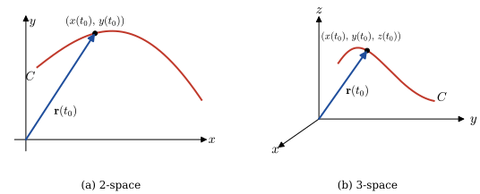{width="90%" fig-align="center"}

* **Limits**

  * $\displaystyle\lim_{t \to a} \mathbf{r}(t)=\left\langle \lim_{t \to a} f(t), \;\lim_{t \to a} g(t), \;\lim_{t \to a} h(t) \right\rangle$
   
  * If $~$$\displaystyle\lim_{t\to a} \mathbf{r}_1(t)=\mathbf{L}_1$ and $~$$\displaystyle\lim_{t\to a} \mathbf{r}_2(t)=\mathbf{L}_2$, $~$then
  
    $\displaystyle\lim_{t\to a} c\mathbf{r}_1(t)=c\mathbf{L}_1$
    
    $\displaystyle\lim_{t\to a} \left[\mathbf{r}_1(t) +\mathbf{r}_2(t) \right] =\mathbf{L}_1 +\mathbf{L}_2$
    
    $\displaystyle\lim_{t\to a} \left[\mathbf{r}_1(t) \cdot \mathbf{r}_2(t) \right] =\mathbf{L}_1 \cdot \mathbf{L}_2$

* **Continuity**

  * A vector function $\mathbf{r}$ is said to be **continuous** at $t=a$ $\,$if
  
    $\displaystyle\,\mathbf{r}(a) \;\text{ is defined, }\phantom{\frac{1}{1}}$ 

    $\displaystyle\lim_{t\to a} \mathbf{r}(t)$ exists, and 

    $\displaystyle\lim_{t\to a} \mathbf{r}(t) = \mathbf{r}(a)$

* **Derivatives**  

  * The **derivative** of a vector function $\mathbf{r}$ is
  
    $\displaystyle\phantom{xx}\mathbf{r}'(t) = \lim_{\Delta t\to 0} \frac{1}{\Delta t} \left[ \mathbf{r}(t +\Delta t) -\mathbf{r}(t) \right]$
    
    for all $\,t\,$ for which the limit exists

  * If $~\mathbf{r}(t) = \langle f(t), g(t), h(t) \rangle,$ $\,$where $~f$, $g$, and $h\,$ are differentiable, then
    
    $\phantom{xx}\mathbf{r}'(t) = \left\langle f'(t), g'(t), h'(t) \right\rangle$

  * When $\mathbf{r}$ has a continuous first derivative and $\mathbf{r}'(t)\neq\mathbf{0}~$ for all $~t~$ in the open interval $(a,b),$ $\,$then $\mathbf{r}$ is said to be a **smooth function**

    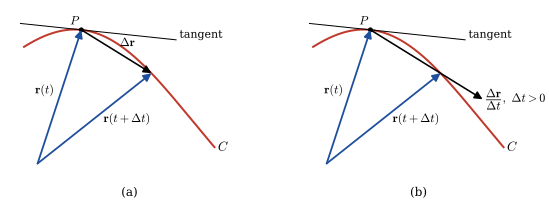{width="95%" fig-align="center"}

  * In the case of the **second derivative**, $\,$we have
    
    $\phantom{xx}
    \mathbf{r}''(t) = \left\langle f''(t), g''(t), h''(t) \right\rangle 
     = f''(t)\mathbf{i} +g''(t)\mathbf{j} +h''(t)\mathbf{k}$

  * Chain rule

    If $\mathbf{r}$ is a differentiable vector function and $s=u(t)$ is a differentiable scalar function, then the derivative of $\mathbf{r}(s)$ with respect to $t$ is
  
    $\displaystyle\phantom{xx}\frac{d\mathbf{r}}{dt} =\frac{d\mathbf{r}}{ds} \frac{ds}{dt} =\mathbf{r}'(s) u'(t)$

  * Rules of Differentiation

    Let $\mathbf{r}_1(t)$ and $\mathbf{r}_2(t)$ be differentiable vector functions 
  and $u(t)$ a differentiable scalar function
  
    * $\displaystyle \frac{d}{dt} \left[ \mathbf{r}_1(t) +\mathbf{r}_2(t) \right] = \mathbf{r}_1'(t) +\mathbf{r}_2'(t)$

    * $\displaystyle \frac{d}{dt} \left[ u(t)\mathbf{r}_1(t) \right] = u(t)\mathbf{r}_1'(t) +u'(t)\mathbf{r}_1(t)$

    * $\displaystyle \frac{d}{dt} \left[ \mathbf{r}_1(t) \cdot \mathbf{r}_2(t) \right] = \mathbf{r}_1(t)\cdot\mathbf{r}_2'(t) +\mathbf{r}_1'(t)\cdot\mathbf{r}_2(t)$

    * $\displaystyle \frac{d}{dt} \left[ \mathbf{r}_1(t) \times \mathbf{r}_2(t) \right] = \mathbf{r}_1(t)\times\mathbf{r}_2'(t) +\mathbf{r}_1'(t)\times\mathbf{r}_2(t)$

* Integrals

  $\phantom{xx}\displaystyle\int \mathbf{r}(t) \,dt = \left[ \int f(t) \,dt \right]\mathbf{i} +\left[ \int g(t) \,dt \right]\mathbf{j} +\left[ \int h(t) \,dt \right]\mathbf{k}$


* Length of a Space Curve

  If $~\mathbf{r}(t) = f(t)\mathbf{i} +g(t)\mathbf{j} +h(t)\mathbf{k}\,$ is a smooth function, $\,$then it can be shown that the **length** of the smooth curve traced by
  $\,\mathbf{r}\,$ is given by
  
  $\phantom{xx}\displaystyle s = \int_a^b \sqrt{\left[ f'(t) \right]^2 +\left[ g'(t) \right]^2 +\left[ h'(t) \right]^2}\,dt =\int_a^b \left\| \mathbf{r}'(t) \right\|\,dt$

## Motion on a Curve {#sec-9-2}

* Position 

  Suppose a body moves along a curve $C$ so that its position at time $t$ is given by the vector function 

  $\phantom{xx}\mathbf{r}(t) = f(t)\mathbf{i} +g(t)\mathbf{j} +h(t)\mathbf{k}$

* Velocity and Acceleration

  If $\,f$, $g$, and $h$ have second derivatives, $\,$ then the vectors
  
  $\phantom{xx}\begin{aligned}
    \mathbf{v}(t) &= \mathbf{r}'(t) = f'(t)\mathbf{i} +g'(t)\mathbf{j} +h'(t)\mathbf{k} \\ 
    \mathbf{a}(t) &= \mathbf{r}''(t) = f''(t)\mathbf{i} +g''(t)\mathbf{j} +h''(t)\mathbf{k}
  \end{aligned}$
 
  are called the **velocity** and **acceleration** of the particle, respectively

  * The scalar function $\left\| \mathbf{v}(t)\right\|$ is the **speed** of the particle

  * The speed is related to arc length $s$ by $s'(t) = \left\| \mathbf{v}(t) \right\|$

  * If a particle moves  with <font color="red">a constant speed $c$</font>, $\,$ then its acceleration vector is perpendicular to the velocity vector $\mathbf{v}$

  * To see this, note that $\mathbf{v}\cdot\mathbf{v}=c^2$. $~$ We differentiate both sides with respect to $t$ and obtain
  
    $${\frac{d}{dt}(\mathbf{v} \cdot \mathbf{v}) = \mathbf{v}\cdot\frac{d\mathbf{v}}{dt} +\frac{d\mathbf{v}}{dt} \cdot \mathbf{v}
  =2\mathbf{v}\cdot\frac{d\mathbf{v}}{dt}=0}$$
  
    Thus, $\displaystyle\,\frac{d\mathbf{v}}{dt} \cdot \mathbf{v}=0$ $\text{ }$or$\text{ }$ $\mathbf{a}(t) \cdot \mathbf{v}(t)=0~\,$ for all $\,t$

* Centripetal Acceleration

  For circular motion in the plane, described by $\mathbf{r}(t) = r_0 \cos\omega t \,\mathbf{i} +r_0\sin\omega t \,\mathbf{j},$ $\,$it is evident that
  
  $$\mathbf{r}''=-\omega^2\mathbf{r}$$

  * This means that the acceleration vector $\mathbf{a}(t)=\mathbf{r}''(t)$ points in the direction opposite to that of the position vector $\mathbf{r}(t)$. $\,$ We then say $~\mathbf{a}(t)$ is **centripetal acceleration**

## Curvature and Components of Acceleration {#sec-9-3}

* We know that $\mathbf{r}'(t)$ is a tangent vector to the curve $C$, and consequently

  $$\mathbf{T}(t) = \frac{\mathbf{r}'(t)}{\left\| \mathbf{r}'(t) \right\|}$$
  
  is a **unit tangent**

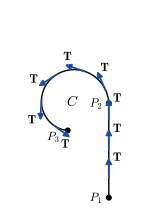{width="40%" fig-align="center"}

$$
\begin{aligned}
  \frac{d\mathbf{r}}{dt} &=\frac{d\mathbf{r}}{ds} 
    \frac{ds}{dt}\;\text{ and so }\\[5pt] 
  \frac{d\mathbf{r}}{ds} = 
   \frac{\displaystyle\frac{d\mathbf{r}}{dt}} {\displaystyle\frac{ds}{dt}}
   &=\frac{\mathbf{r}'(t)}{\left\| \mathbf{r}'(t) \right\|} 
   = \mathbf{T}(t)
\end{aligned}$$

* Let $\,\mathbf{r}(t)\,$ be a vector function defining a smooth curve $C$. $\,$If $s$ is the arc length parameter and $\mathbf{T}$ is the unit tangent vector, $\,$then the **curvature** of $C$ at a point is
  
  $$\kappa=\left\|\frac{d\mathbf{T}}{ds}\right\|$$

* Using the chain rule, $\,$we can write
  
  $$\frac{d\mathbf{T}}{dt}=\frac{d\mathbf{T}}{ds}\frac{ds}{dt} \;\;\Rightarrow\;\; \frac{d\mathbf{T}}{ds}=\frac{\displaystyle\frac{d\mathbf{T}}{\displaystyle dt}}{\frac{\displaystyle ds}{\displaystyle dt}}$$
  
  In other words, $\,$curvature is given by $\,\kappa(t)=\frac{\displaystyle\left\|\mathbf{T}'(t)\right\|}{\displaystyle\left\|\mathbf{r}'(t)\right\|}$

* Tangential and Normal Components of Acceleration

  * The velocity of the particle on $C$ is $~\mathbf{v}(t)=\mathbf{r}'(t)$, $\,$whereas its speed is $\displaystyle\frac{ds}{dt}=v=\| \mathbf{v}(t) \|$. $\,$ Thus, 
    $$\mathbf{v}(t)=v\mathbf{T}$$
  * Differentiating this last expression with respect to $t$ gives acceleration
  
    $$\mathbf{a}(t)=v\frac{d\mathbf{T}}{dt}+\frac{dv}{dt}\mathbf{T}$$

  * It follows from the differentiation of $\mathbf{T}\cdot\mathbf{T}=1\,$ that $\displaystyle\,\mathbf{T}\cdot \frac{d\mathbf{T}}{dt}=0$. $\,$If $\displaystyle\,\left\|\frac{d\mathbf{T}}{dt}\right\| \neq 0$, $\,$the vector
  
    $$\mathbf{N}(t) = \frac{\frac{\displaystyle d\mathbf{T}}{\displaystyle dt}}{\left\| \frac{\displaystyle d\mathbf{T}}{\displaystyle dt}\right\|}$$

    is a **unit normal** to the curve $C$. $\,$The vector $\mathbf{N}$ is also called the **principal normal** 

  * Since curvature is $\displaystyle\,\kappa = \frac{\left\|\frac{d\mathbf{T}}{dt} \right\|}{v}$, $\,$
it follows that $\displaystyle\frac{d\mathbf{T}}{dt}=\kappa v \mathbf{N}$. $\,$Thus
  
    $$\mathbf{a}(t)=\kappa v^2 \mathbf{N} +\frac{dv}{dt}\mathbf{T} =a_N \mathbf{N} +a_T\mathbf{T}$$

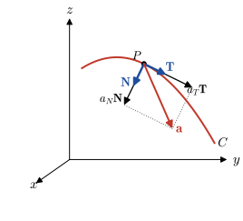{width="50%" fig-align="center"}

* Binormal: $\,\mathbf{B}(t)=\mathbf{T}(t) \times \mathbf{N}(t)$

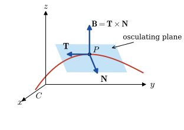{width="55%" fig-align="center"}

* Formulas for $a_T$, $a_N$, and Curvature

  $$
  \begin{aligned}
    \mathbf{v}\cdot\mathbf{a} 
      &= a_N(v\mathbf{T}\cdot\mathbf{N}) 
       +a_T(v\mathbf{T}\cdot\mathbf{T})=a_T v\\[5pt] 
      &\Rightarrow \; a_T =\frac{dv}{dt} 
       =\frac{\mathbf{v}\cdot\mathbf{a}}{\| \mathbf{v} \|}
       =\frac{\mathbf{r}'(t) \cdot \mathbf{r}''(t)}{\| \mathbf{r}'(t) \|} \\ \\
     \mathbf{v}\times\mathbf{a} 
      &= a_N(v\mathbf{T}\times\mathbf{N}) 
       +a_T(v\mathbf{T}\times\mathbf{T})
        =a_N v\mathbf{B}\\[5pt] 
     &\Rightarrow \; a_N =\kappa v^2 
        =\frac{\|\mathbf{v}\times\mathbf{a}\|}{\| \mathbf{v} \|}
        =\frac{\| \mathbf{r}'(t) \times \mathbf{r}''(t) \|}{\| \mathbf{r}'(t) \|} \\ \\
   \kappa(t)&=\frac{\| 
     \mathbf{r}'(t)\times\mathbf{r}''(t) \|}{\| 
       \mathbf{r}'(t) \|^3}
  \end{aligned}$$

* Radius of Curvature

  $$\rho=\frac{1}{\kappa}$$

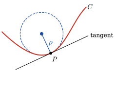{width="40%" fig-align="center"} 

$~$

## Partial Derivatives {#sec-9-4}

* Functions of Two Variables

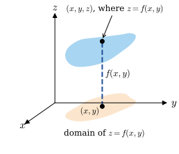{width="50%" fig-align="center"} 

* Level Curves

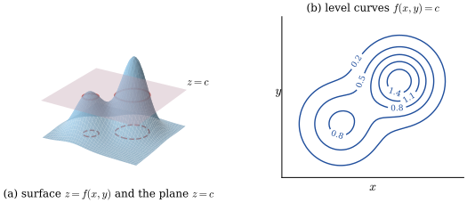{width="80%" fig-align="center"} 

* Functions of Three Variables, Level Surfaces

  $$w=F(x,y,z) \;\Rightarrow \; c=F(x,y,z)$$
  
  ex) $~\displaystyle w=\frac{x^2+y^2}{z}$

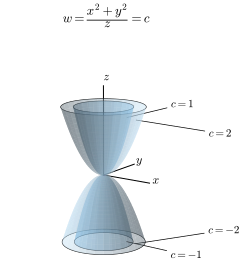{width="40%" fig-align="center"}   

* Partial Derivatives
  
  $\phantom{xx}
  \begin{aligned}
    \frac{\partial z}{\partial x} 
      &=\lim_{\Delta x \to 0} \frac{f(x+\Delta x, y) -f(x,y)}{\Delta x} = f_x \\
    \frac{\partial z}{\partial y}
      &=\lim_{\Delta y \to 0} \frac{f(x, y+\Delta y) -f(x,y)}{\Delta y} = f_y \\
    \frac{\partial^2 z}{\partial x^2}
      &=\frac{\partial}{\partial x}\left( \frac{\partial z}{\partial x} \right) = f_{xx} \\
    \frac{\partial^2 z}{\partial x \partial y} 
      &=\frac{\partial}{\partial x} \left( \frac{\partial z}{\partial y} \right) = f_{yx}
  \end{aligned}$

* Chain Rule

  If $z=f(u,v)$ is differentiable and $u=g(x,y)$ and $v=h(x,y)$ have continuous first partial derivatives, $\,$then
  
  $$
  \begin{aligned}
    \frac{\partial z}{\partial x}&= \frac{\partial z}{\partial u}\frac{\partial u}{\partial x} 
   +\frac{\partial z}{\partial v}\frac{\partial v}{\partial x}\\ 
    \frac{\partial z}{\partial y}&= \frac{\partial z}{\partial u}\frac{\partial u}{\partial y} 
   +\frac{\partial z}{\partial v}\frac{\partial v}{\partial y} 
  \end{aligned}$$
   
  If $z=f(u,v)$ is differentiable and $u=g(t)\,$ and $v=h(t)$ are differentiable functions of a single variable $t$,
   $\,$the ordinary derivative $\displaystyle\frac{dz}{dt}$ is
   
  $$\frac{dz}{dt}=\frac{\partial z}{\partial u}\frac{du}{dt}+\frac{\partial z}{\partial v}\frac{dv}{dt}$$

::: {.callout-tip appearance="simple" icon="false"}
**Try it in Python:** Partial and higher derivatives with `sympy`: @sec-sympy-derivatives
:::

$~$

## Directional Derivatives {#sec-9-5}

* **Vector Differential Operator**
  
  $\phantom{xx}
  \begin{aligned}
     \nabla  
     &= \mathbf{i} \frac{\partial }{\partial x} +\mathbf{j}\frac{\partial }{\partial y} \\ 
     \nabla  
     &= \mathbf{i}\frac{\partial }{\partial x} +\mathbf{j}\frac{\partial }{\partial y} +\mathbf{k}\frac{\partial }{\partial z}
 \end{aligned}$ 

* **Gradient of a Function**
  
  $\phantom{xx}
  \begin{aligned}
    \nabla f 
    &= \mathbf{i} \frac{\partial f}{\partial x} +\mathbf{j}\frac{\partial f}{\partial y} \\ 
    \nabla F 
    &= \mathbf{i}\frac{\partial F}{\partial x} +\mathbf{j}\frac{\partial F}{\partial y} +\mathbf{k}\frac{\partial F}{\partial z}
\end{aligned}$

$~$

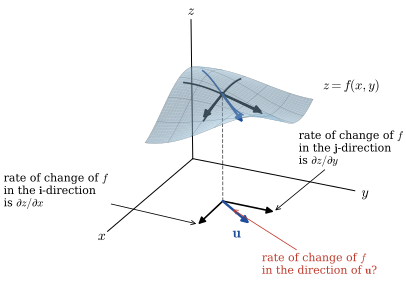{width="65%" fig-align="center"} 

* Generalization of Partial Differentiation

  The **directional derivative** of $z=f(x,y)\,$ in the direction of a unit vector $\mathbf{u}$ $\,$is 

  $$
  \begin{aligned} 
   D_\mathbf{u} f(x,y) \;
     &= { \scriptsize \lim_{h\to 0} 
      \frac{f(x+\Delta x, \,y+\Delta y) -f(x,y)}{h} }\\
     &= { \scriptsize \lim_{h\to 0} 
      \frac{f(x+h\cos\theta, \,y+h\sin\theta) -f(x,y)}{h} }
       = \nabla f(x,y)\cdot \mathbf{u}
    \end{aligned}$$

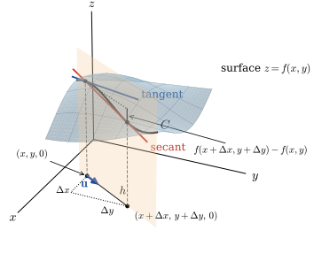{width="70%" fig-align="center"}

* **Partial Proof** $\,$ Let $x$, $y$, and $\theta$ $\,$be fixed so that 
  
  $$g(t)=f(x+t\cos\theta,\,y+t\sin\theta)$$
  
  is a function of one variable. $\,$We wish to compare the value of $g'(0)$, $\,$which is found by two different methods

  * First, $\,$by the definition of a derivative,
  
  $${ g'(0)= {\scriptsize \lim_{h\to 0} \frac{g(0+h)-g(0)}{h}} 
  = {\scriptsize \lim_{h\to 0}\frac{f(x+h\cos\theta, \,y+h\sin\theta)-f(x,y)}{h} } }$$

  * Second, $\,$by the chain rule,
  
    $$
    \begin{aligned}
      g'(t) &= {\scriptsize f_1(x+t\cos\theta,\,y+t\sin\theta)\frac{d}{dt}(x+t\cos\theta) } \\
          &\qquad 
          {\scriptsize +f_2(x+t\cos\theta,\,y+t\sin\theta)\frac{d}{dt}(y+t\sin\theta) } \\ 
          &= {\scriptsize f_1(x+t\cos\theta,\,y+t\sin\theta)\cos\theta
            +f_2(x+t\cos\theta,\,y+t\sin\theta)\sin\theta } \\  
          &\big\Downarrow\;\; t\to 0 \\         
    g'(0) &= {\scriptsize f_x(x,y)\cos\theta+f_y(x,y)\sin\theta } \\
    &={\scriptsize \left[\,f_x(x,y)\,\mathbf{i}+f_y(x,y)\,\mathbf{j} \,\right]\cdot \left(\cos\theta\,\mathbf{i}+\sin\theta\,\mathbf{j}\right) } \\[3pt]
      &=\nabla f(x,y)\cdot \mathbf{u}
  \end{aligned}$$

* For a function $w=F(x,y,z)$, $~$the directional derivative is defined by
  
  $$\begin{aligned} 
   D_\mathbf{u} F(x,y,z) &= {\scriptsize \lim_{h\to 0} \frac{F(x+h\cos\alpha, \,y+h\cos\beta, \,z +h\cos\gamma) -F(x,y,z)}{h} } \\ 
  &=\nabla F(x,y,z)\cdot \mathbf{u}
  \end{aligned}$$

* Maximum Value of the Directional Derivative

  $$
  \begin{aligned}
    D_\mathbf{u}\,f 
      &= \| \nabla f\| \| \mathbf{u} \| \cos\phi =\| \nabla f\| \cos\phi \\[5pt]
      &\,\Rightarrow\, \color{red}{-\| \nabla f\| \leq D_\mathbf{u} \,f \leq \| \nabla f \|}
  \end{aligned}$$

* The gradient vector $\nabla f$ points in the direction in which $f$ increases most rapidly, $\,$whereas $-\nabla f$ points in the direction of the most decrease of $\,f$

$~$

## Tangent Planes and Normal Lines {#sec-9-6}

* <font color="blue">$\nabla f$ is orthogonal to the level curve at $P$</font>

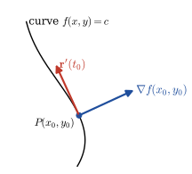{width="40%" fig-align="center"}

* The derivative of $\,f\left(x(t), \,y(t)\right)=c\,$ with respect to $\,t\,$ is
  
  $${\frac{\partial f}{\partial x}\frac{dx}{dt} 
        +\frac{\partial f}{\partial y}\frac{dy}{dt}=0
      ={\scriptsize \left( \frac{\partial f}{\partial x}\mathbf{i} 
        +\frac{\partial f}{\partial y} \mathbf{j} \right)
        \cdot \left( \frac{dx}{dt}\mathbf{i} +\frac{dy}{dt} \mathbf{j} \right) }
        =\nabla f \cdot \mathbf{r}'}$$

* The derivative of $\,F\left(x(t),y(t),z(t)\right)=c\,$ implies that

  $$
  \begin{aligned}
   \frac{\partial F}{\partial x}&\frac{dx}{dt} 
     +\frac{\partial F}{\partial y}\frac{dy}{dt}
     +\frac{\partial F}{\partial z}\frac{dz}{dt}=0 \\
    &={\scriptsize \left( \frac{\partial F}{\partial x}\mathbf{i} 
     +\frac{\partial F}{\partial y} \mathbf{j} 
     +\frac{\partial F}{\partial z} \mathbf{k} \right)
     \cdot 
    \left( \frac{dx}{dt}\mathbf{i} 
           +\frac{dy}{dt} \mathbf{j} 
            +\frac{dz}{dt} \mathbf{k} \right) }
    =\nabla F \cdot \mathbf{r}'
  \end{aligned}$$

* <font color="blue">$\nabla F$ is normal to the level surface at $P$</font>

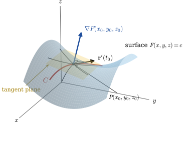{width="60%" fig-align="center"}

* Let $\,P(x_0,y_0,z_0)$ be a point on the graph of $F(x,y,z)=c$. $\,$The **tangent plane** at $P$ is

  $$\begin{aligned} 
    F_x&(x_0,y_0,z_0)(x-x_0) \\
    & +F_y(x_0,y_0,z_0)(y-y_0) \\
    &\qquad +F_z(x_0,y_0,z_0)(z-z_0)=0
    \end{aligned}$$
  
  The line containing $P(x_0,y_0,z_0)$ $\,$that is parallel to $\nabla F(x_0,y_0,z_0)$ $\,$is called the **normal line** to the surface at $P$

$~$

## Gradient, Curl and Divergence {#sec-9-7}

* Vector Fields - Vector functions of two or three variables

  $$
  \begin{aligned}
   \mathbf{f}(x,y) 
     &= P(x,y) \mathbf{i} +Q(x,y)\mathbf{j}\\ 
   \mathbf{f}(x,y,z)
     &= P(x,y,z) \mathbf{i} 
      +Q(x,y,z)\mathbf{j} +R(x,y,z)\mathbf{k}
  \end{aligned}$$

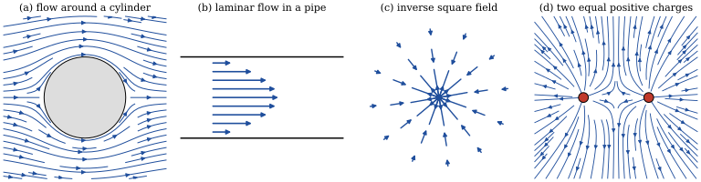{width="95%" fig-align="center"}

* The del operator combined with a scalar function $\,\phi(x,y,z)$ $\,$produces a vector field

  $$\mathbf{f}(x,y,z)=\nabla \phi 
  = \mathrm{grad}\, \phi   
  =\frac{\partial \phi}{\partial x}\mathbf{i} 
   +\frac{\partial \phi}{\partial y}\mathbf{j} 
    +\frac{\partial \phi}{\partial z}\mathbf{k} 
    \;\Rightarrow\; \delta_{ij} \mathbf{e}_i \frac{\partial \phi}{\partial x_j}$$
  
  called the <font color="red">**gradient of $\phi$**</font>, $\,$where $\,\delta_{ij}$ $\,$is *Kronecker Delta*

* The <font color="red">**curl** of a vector field $~\mathbf{f}=P\,\mathbf{i} +Q\,\mathbf{j} +R\,\mathbf{k}\,$</font> is the vector field

   $$\nabla \times \mathbf{f}= 
   \mathrm{curl}\, \mathbf{f}=
    \begin{vmatrix}
       \mathbf{i} & \mathbf{j} & \mathbf{k}\\ 
       \frac{\partial }{\partial x} & \frac{\partial }{\partial y} & \frac{\partial }{\partial z} \\
       P & Q & R
     \end{vmatrix} 
  \; \Rightarrow \; \varepsilon_{ijk} \mathbf{e}_i \frac{\partial}{\partial x_j} f_k$$
    
   where $\,\varepsilon_{ijk}$ is *Levi-Civita Symbol*

* The <font color="red">**divergence** of a vector field $~\mathbf{f}=P\,\mathbf{i} +Q\,\mathbf{j} + R\,\mathbf{k}~$</font> is the scalar function

  $$\nabla \cdot \mathbf{f}=
  \mathrm{div} \,\mathbf{f}=
  \frac{\partial P}{\partial x} 
  +\frac{\partial Q}{\partial y} 
  +\frac{\partial R}{\partial z} 
  \;\Rightarrow\;\delta_{ij} 
  \frac{\partial}{\partial x_i} f_j$$

* Two important properties and plus alpha

  <font color="blue">
  $\phantom{xx}
  \begin{aligned}
    \nabla\times\nabla f 
     &= \mathrm{curl}(\mathrm{grad}\, f) = \mathbf{0}\\ 
     &\Rightarrow \; \varepsilon_{ijk} \mathbf{e}_i 
      \frac{\partial}{\partial x_j} 
      \frac{\partial f}{\partial x_k} = 0 
       \,\mathbf{e}_i=\mathbf{0}
  \end{aligned}$
  </font>

  <font color="blue">
  $\phantom{xx}
  \begin{aligned}  
   \nabla \cdot(\nabla\times\mathbf{f}) 
    &= \mathrm{div}(\mathrm{curl} \,\mathbf{f}) =0 \\
     &\Rightarrow \; \delta_{ij} 
     \frac{\partial}{\partial x_i} \varepsilon_{jlm} 
     \frac{\partial}{\partial x_l} f_m = 
     \varepsilon_{ilm} 
     \frac{\partial^2}{\partial x_i \partial x_l} f_m=0
  \end{aligned}$
  </font>

  <font color="red">
  $\displaystyle \phantom{xx}
   \nabla \cdot \nabla f 
    =\nabla^2 f \; 
    \Rightarrow \; \delta_{ij} 
    \frac{\partial}{\partial x_i} 
    \frac{\partial f}{\partial x_j} 
    =\frac{\partial^2 f}{\partial x_i^2}$
  </font>

  <font color="green">
  $\displaystyle \phantom{xx}
   \nabla \cdot \nabla \mathbf{f} 
   =\nabla^2 \mathbf{f} \; 
   \Rightarrow \; \delta_{ij} 
    \frac{\partial}{\partial x_i} 
     \mathbf{e}_m \frac{\partial f_m}{\partial x_j} 
   =\mathbf{e}_m 
     \frac{\partial^2 f_m}{\partial x_i^2}$
  </font> 

  <font color="green">
  $\displaystyle \phantom{xx}
  \begin{aligned}
  \nabla \times (\nabla \times \mathbf{f}) 
   &= \nabla (\nabla \cdot \mathbf{f}) -\nabla^2 \mathbf{f} \\ 
  &\Rightarrow \;
   \varepsilon_{ijk} \mathbf{e}_i 
    \frac{\partial}{\partial x_j} 
     \varepsilon_{klm} 
     \frac{\partial}{\partial x_l}f_m \\
  &\qquad
   =(\delta_{il}\delta_{jm}-\delta_{im}\delta_{jl}) 
   \mathbf{e}_i \frac{\partial}{\partial x_j} 
    \frac{\partial}{\partial x_l}f_m \\
  &\qquad
  =\mathbf{e}_i \frac{\partial}{\partial x_i} 
  \frac{\partial f_j}{\partial x_j} 
  -\mathbf{e}_i \frac{\partial^2 f_i}{\partial x_j^2}
  \end{aligned}$
  </font> 

* Product Rules with $\nabla$

  $\phantom{xx}
  \begin{aligned}
   \nabla (fg) &= f \nabla g + g \nabla f \\
   \nabla (\mathbf{u} \cdot \mathbf{v}) 
     &= \mathbf{u} \times (\nabla \times \mathbf{v}) 
       +\mathbf{v} \times (\nabla \times \mathbf{u}) \\
       &+(\mathbf{u} \cdot \nabla) \mathbf{v} 
       +(\mathbf{v} \cdot \nabla) \mathbf{u} 
     = (\nabla \mathbf{u}) \cdot \mathbf{v} 
       +(\nabla \mathbf{v}) \cdot \mathbf{u} \\
   \nabla \cdot (f \mathbf{u}) 
     &= f (\nabla \cdot \mathbf{u}) 
       +\mathbf{u} \cdot \nabla f \\
   \nabla \cdot (\mathbf{u} \times \mathbf{v}) 
      &= \mathbf{v} \cdot (\nabla \times \mathbf{u}) 
       -\mathbf{u} \cdot (\nabla \times \mathbf{v}) \\  
    \nabla \times (f \mathbf{u}) 
      &= \nabla f \times \mathbf{u} 
       +f (\nabla \times \mathbf{u}) \\
    \nabla \times (\mathbf{u} \times \mathbf{v}) 
      &= \mathbf{u} (\nabla \cdot \mathbf{v}) 
       -\mathbf{v} (\nabla \cdot \mathbf{u}) 
       +(\mathbf{v} \cdot \nabla) \mathbf{u} 
       -(\mathbf{u} \cdot \nabla) \mathbf{v}
  \end{aligned}$

* Generalized Curvilinear Coordinates: $\,$ $\mathbf{q}_i$, $\,q_i$, $\,h_i$

  $$
  \begin{aligned} 
  \nabla f \;
   &= {\scriptsize \mathbf{q}_1 \frac{1}{h_1} 
      \frac{\partial f}{\partial q_1}
    + \mathbf{q}_2 \frac{1}{h_2} 
      \frac{\partial f}{\partial q_2}
    + \mathbf{q}_3 \frac{1}{h_3} 
      \frac{\partial f}{\partial q_3} } \\ \\
  \nabla \cdot \mathbf{u} \;
   &= {\scriptsize \frac{1}{h_1 h_2 h_3} 
      \left[ \frac{\partial }{\partial q_1} 
        \left( u_1h_2h_3 \right)
    + \frac{\partial }{\partial q_2} 
        \left( u_2h_1h_3 \right)  
    + \frac{\partial }{\partial q_3} 
        \left( u_3h_1h_2 \right)\right] } \\ \\
   \nabla^2 f\;
   & = {\scriptsize \frac{1}{h_1 h_2 h_3} 
    \left[ \frac{\partial }{\partial q_1} 
      \left( \frac{h_2 h_3}{h_1} 
        \frac{\partial f}{\partial q_1} \right)
      + \frac{\partial }{\partial q_2} 
      \left( \frac{h_1 h_3}{h_2} 
        \frac{\partial f}{\partial q_2}  \right)  
      + \frac{\partial }{\partial q_3} 
        \left( \frac{h_1 h_2}{h_3} 
        \frac{\partial f}{\partial q_3} \right)\right] }\\ \\
   \nabla \times \mathbf{u} \;
    &={\scriptsize \frac{1}{h_1 h_2 h_3} 
    \begin{vmatrix}
     h_1 \mathbf{q}_1 & h_2 \mathbf{q}_2 & h_3 \mathbf{q}_3\\ 
     \displaystyle\frac{\partial }{\partial q_1} & \displaystyle\frac{\partial }{\partial q_2} & \displaystyle\frac{\partial }{\partial q_3}  \\ 
     h_1 u_1 & h_2 u_2 & h_3 u_3 
   \end{vmatrix}}
  \end{aligned}$$

  * Cylindrical Coordinates

    $\phantom{xx} q_1=r, \;q_2=\theta, \; q_3=z$
 
    $\phantom{xx} h_1=h_r=1, \;\;h_2=h_\theta=r, \;\;h_3=h_z=1$

  * Spherical Coordinates
 
    $\phantom{xx} q_1=\rho, \;q_2=\phi, \; q_3=\theta$
 
    $\phantom{xx} h_1=h_\rho=1, \;\;h_2=h_\phi=\rho, \;\;h_3=h_\theta=\rho \sin\phi$

* Physical Interpretations

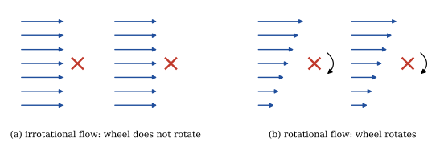{width="95%" fig-align="center"}

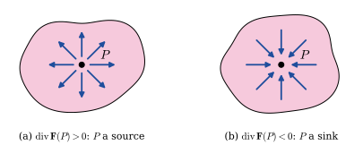{width="90%" fig-align="center"}

$~$

## Line Integrals {#sec-9-8}

* Integration of a function defined along a curve

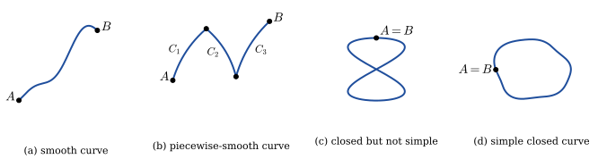{width="95%" fig-align="center"}

* Definite Integral

  $$\lim_{\|P\|\to 0} \sum_{k=1}^n f(x_k^*)\Delta x_k = \int_a^b f(x)\,dx$$

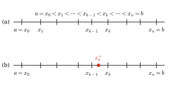{width="70%" fig-align="center"}

* Line Integrals in the Plane

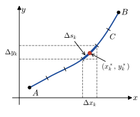{width="45%" fig-align="center"}

$$
\begin{aligned}
    \lim_{\| P \|\to 0} \sum_{k=1}^n G(x_k^*, y_k^*)\,\Delta x_k &= \int_C G(x,y)\,dx\\ 
    \lim_{\| P \|\to 0} \sum_{k=1}^n G(x_k^*, y_k^*)\,\Delta y_k &=\int_C G(x,y)\,dy\\
    \lim_{\| P \|\to 0} \sum_{k=1}^n G(x_k^*, y_k^*)\,\Delta s_k &= \int_C G(x,y)\,ds
\end{aligned}$$

* Method of Evaluation 

  * Curve Defined Parametrically, $\;x=f(t)$, $\;y=g(t)$, $\;a\leq t \leq b$ 

    $$
    \begin{aligned}
      \int_C G(x,y)\,dx 
       &=\int_a^b G(\,f(t), g(t)) \,f'(t)\,dt \\ 
      \int_C G(x,y)\,dy 
       &=\int_a^b G(\,f(t), g(t)) \,g'(t)\,dt \\
      \int_C G(x,y)\,ds 
       &=\int_a^b G(\,f(t), g(t)) \,\sqrt{[f'(t)]^2 
       +[g'(t)]^2}\,dt
    \end{aligned}$$

  * Curve Defined by an Explicit Function, $\;y=f(x)$, $\;a\leq x \leq b$ 

    $$
    \begin{aligned}
      \int_C G(x,y)\,dx 
       &=\int_a^b G(x, f(x)) \,dx \\ 
      \int_C G(x,y)\,dy 
       &=\int_a^b G(x, f(x)) \,f'(x)\,dx \\
      \int_C G(x,y)\,ds 
       &=\int_a^b G(x, f(x)) \,\sqrt{1 
        +[f'(x)]^2}\,dx
    \end{aligned}$$

* Notation

  $${\displaystyle\int_C P\,dx +\int_C Q\,dy \,\Rightarrow \, \int_C P\,dx +Q \,dy}$$

  $${\displaystyle\int_{-C} P\,dx +Q\,dy = -\int_C P\,dx +Q\,dy}$$

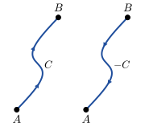{width="40%" fig-align="center"}

* A line integral along a closed curve $C$
  
  $$\oint_C P \,dx +Q \,dy$$

* Line Integrals in Space

  $$
  \begin{aligned}
  \int_C &G(x,y,z)\,ds = \\ &\int_a^b G(\,f(t), g(t),h(t)) \,\sqrt{[f'(t)]^2 +[g'(t)]^2 +[h'(t)]^2}\,dt
  \end{aligned}$$

* Suppose the vector-valued function 

  $$\mathbf{f}(x,y,z)=P(x,y,z)\mathbf{i} +Q(x,y,z)\mathbf{j} +R(x,y,z)\mathbf{k}$$
  
  is defined along a curve $C$ and 
  
  $$d\mathbf{r}=dx\mathbf{i} +dy\mathbf{j} +dz\mathbf{k}\,$$ 
  
  is the displacement vector of points on $C$, $\,$then 
  
  $$\int_C \mathbf{f}\cdot \,d\mathbf{r} =\int_C P(x,y,z) \, dx +Q(x,y,z) \, dy +R(x,y,z) \, dz$$

* Work and Circulation
  $$W =\int_C \mathbf{f} \cdot d\mathbf{r} = \int_C \mathbf{f}\cdot \mathbf{T} \,ds $$
  $$\mathrm{Circulation}= \oint_C \mathbf{f} \cdot d\mathbf{r} = \oint_C \mathbf{f}\cdot \mathbf{T} \,ds $$

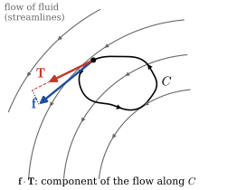{width="45%" fig-align="center"}

$~$

## Independence of the Path {#sec-9-9}

* The value of a line integral 
  
  $$\int_C \mathbf{F}\cdot \,d\mathbf{r}$$ 
  
  depends on the path of integration
 
* Stated another way, $\,$if $C_1$ and $C_2$ are two different paths between the same points $A$ and $B$, $\,$then we expect that
  $$\int_{C_1} \mathbf{F}\cdot \,d\mathbf{r} \neq \int_{C_2} \mathbf{F}\cdot \,d\mathbf{r}$$

* **Path Independence**

  A line integral $\displaystyle\int_C \mathbf{f}\cdot d\mathbf{r}~$ is <font color="red">independent of the path</font> if 
  
  $$\int_{C_1} \mathbf{f}\cdot d\mathbf{r}=\int_{C_2}\mathbf{f}\cdot d\mathbf{r}$$

  for any two paths $C_1$ and $C_2$ between $A$ and $B$

* A vector function $\mathbf{f}$ in 2- or 3-space is said to be <font color="red">**conservative**</font>  if $\,\mathbf{f}$ can be written as the gradient of a scalar function $\phi$. $\,$The function $\phi$ is called a <font color="red">**potential function**</font> for $\,\mathbf{f}$

* In other words, $\,\mathbf{f}$ is conservative if there exists a function $\phi$ such that <font color="red">$\,\mathbf{f}=\nabla \phi$</font>. $\,$A conservative vector field is also called a **gradient vector field**

* **Fundamental Theorem**

  If $~\mathbf{f}(x,y,z)~$ is a conservative vector field in $R$ and $\phi$ is a potential function for $\,\mathbf{f}$, $\,$then
  
  $$\int_C \mathbf{f}\cdot d\mathbf{r}=\int_C \nabla\phi \cdot d\mathbf{r}=\phi(B) -\phi(A)$$
  
  where $A=(x(a), y(a), z(a))~$ and $\,B=(x(b), y(b), z(b))$

  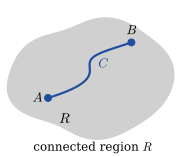{width="45%" fig-align="center"}

* **Equivalent Concepts:** $\,$In an open connected region $R$, 
  $\displaystyle\int_C \mathbf{f}\cdot d\mathbf{r}$ 
  is independent of the path $C$

  * if and only if the vector field $\mathbf{f}$ is conservative in $R$
  
  * if and only if 
    $\displaystyle\oint_{C'} \mathbf{f}\cdot d\mathbf{r}=0\,$ for every closed path $\,C'$ in $R$

* **Test for a Conservative Field:**

  * Suppose 

    $$\mathbf{f}(x,y,z)=P(x,y,z)\mathbf{i} +Q(x,y,z)\mathbf{j} +R(x,y,z)\mathbf{k}$$ 

    is a conservative vector field in an open region of 3-space, and that $P$, $Q$, and $R$ are continuous and have continuous first partial derivatives in that region

  * Then $\,\mathbf{f}=\nabla \phi\,$ and $\,\nabla\times\mathbf{f}=\nabla\times\nabla\phi=\mathbf{0}$, $\,$that is
  
    $${\scriptsize \nabla\times\mathbf{f}=\left( \frac{\partial R}{\partial y} -\frac{\partial Q}{\partial z}\right)\mathbf{i}
   +\left( \frac{\partial P}{\partial z} -\frac{\partial R}{\partial x}\right)\mathbf{j}
   +\left( \frac{\partial Q}{\partial x} -\frac{\partial P}{\partial y}\right)\mathbf{k}=\mathbf{0}}\;\;$$
  
    $$~\;\Downarrow$$
  
    $$\;\;{\frac{\partial P}{\partial y} =\frac{\partial Q}{\partial x}, \;\frac{\partial P}{\partial z} =\frac{\partial R}{\partial x},\;
  \frac{\partial Q}{\partial z} =\frac{\partial R}{\partial y}}$$
  
    for all $\,(x,y,z)$ in that region

$~$

## Double Integrals {#sec-9-10}

* The Double Integral
 
  Let $\,f$ be a function of two variables defined on a closed region $R$. Then the **double integral of $\,f$ over $R$** $\,$is given by
  
  $$\lim_{\|P\|\to 0} \sum_{k=1}^n f\left(x_k^*, y_k^*\right) \Delta A_k = \iint_R f(x,y)\,dA$$

* Area and Volume
   
  $$ A=\iint_R dA $$

  $$ V=\iint_R f(x,y) \,dA $$

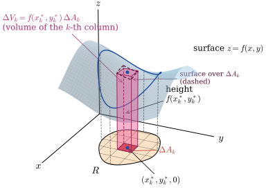{width="65%" fig-align="center"}

* Properties of Double Integrals

  $$ \iint_R kf(x,y) \,dA = k \iint_R f(x,y) \,dA $$

  $$ \iint_R f(x,y) \pm g(x,y)  \,dA = \iint_R f(x,y) \,dA \pm \iint_R g(x,y) \,dA $$
  
  $$ \iint_R f(x,y) \,dA = \iint_{R_1} f(x,y) \,dA + \iint_{R_2} f(x,y) \,dA $$

  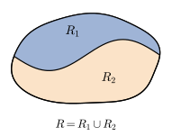{width="45%" fig-align="center"}

* **Evaluation of Double Integrals**

  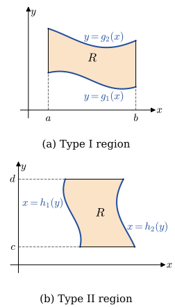{width="30%" fig-align="center"}

  * If $R$ is of Type I, $\,$then
  
    $${\iint_R f(x,y) \,dA =\int_a^b\int_{g_1(x)}^{g_2(x)} f(x,y) \,dydx}$$

  * If $R$ is of Type II, $\,$then
  
    $${\iint_R f(x,y) \,dA =\int_c^d\int_{h_1(y)}^{h_2(y)} f(x,y) \,dxdy}$$

* Center of Mass and Moments of Inertia

  $$ \bar{x} = \frac{\displaystyle\iint_R x\rho(x,y)\,dA}{M} \, \;\textrm{ and } \; \bar{y}=\frac{\displaystyle\iint_R y\rho(x,y) \,dA}{M}$$

  $$ I_y=\iint_R x^2\rho(x,y) \, dA\;\textrm{ and } \; I_x=\iint_R y^2\rho(x,y) \,dA $$

::: {.callout-tip appearance="simple" icon="false"}
**Try it in Python:** Double and triple integrals numerically with `scipy` (`dblquad`, `tplquad`, `nquad`): @sec-integration-multiple; $~$symbolically with `sympy`: @sec-sympy-integrals
:::

$~$

## Double Integrals in Polar Coordinates {#sec-9-11}

* Polar Rectangles
  
  $$
  \begin{aligned}
    \Delta A_k &=\frac{1}{2}(r_{k+1}^2 -r_k^2)\Delta \theta_k \\ 
    &=\frac{1}{2}(r_{k+1} +r_k)(r_{k+1} -r_k) \Delta\theta_k \\[5pt]
    &=r_k^*\Delta r_k \Delta\theta_k
  \end{aligned}$$

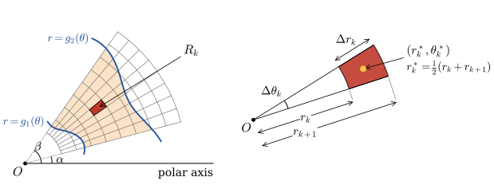{width="90%" fig-align="center"}

* Double Integrals in Polar Coordinates

  $$
  \begin{aligned}
  \lim_{\| P \|\to 0} \sum_{k=1}^n & f\left( r_k^*, \theta_k^* \right) r_k^* \Delta r_k \Delta\theta_k \\ 
    & = \iint_R f(r,\theta) \,dA\\ 
    & = \int_\alpha^\beta 
      \int_{g_1(\theta)}^{g_2(\theta)} f(r,\theta)\,r \,dr \,d\theta \\
    & =\int_a^b \int_{h_1(r)}^{h_2(r)} f(r,\theta)\,r \,d\theta \,dr
  \end{aligned}$$

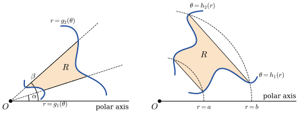{width="85%" fig-align="center"}

$~$

## Green's Theorem {#sec-9-12}

* Suppose that $C$ is a piecewise-smooth simple closed curve bounding a simply connected region $R$ 

* If $\,P$, $Q$, $\displaystyle\frac{\partial P}{\partial y}$, and $\displaystyle\frac{\partial Q}{\partial x}$ are continuous on $R$, $\,$then

  <font color="red">$${\oint_C P \,dx +Q \,dy = \iint_R \left( \frac{\partial Q}{\partial x} -\frac{\partial P}{\partial y} \right)\, dA}$$</font>

$~$  

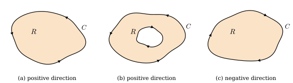{width="95%" fig-align="center"}

* **Partial Proof**
  
  $$
  \begin{aligned}
     -\iint_R \frac{\partial P}{\partial y}\, dA &= -\int_a^b \int_{g_1(x)}^{g_2(x)} \frac{\partial P}{\partial y} \,dy dx \\
     &=-\int_a^b [P(x,g_2(x)) -P(x,g_1(x))] \,dx\\ 
     &=\int_a^b P(x,g_1(x))\,dx +\int_b^a P(x,g_2(x)) \,dx \\
     &= \oint_C P(x,y) \,dx 
  \end{aligned}$$
  
  $~$

  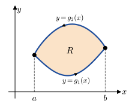{width="40%" fig-align="center"}

* **Region with Holes**
  
  $$
  \begin{aligned}
    \iint_R &\left( \frac{\partial Q}{\partial x} -\frac{\partial P}{\partial y} \right)\, dA \\
    &=\iint_{R_1} \left( \frac{\partial Q}{\partial x} -\frac{\partial P}{\partial y} \right)\, dA 
     +\iint_{R_2} \left( \frac{\partial Q}{\partial x} -\frac{\partial P}{\partial y} \right)\, dA\\ 
    &=\oint_{C_1} P \,dx +Q \,dy +\oint_{C_2} P \,dx +Q \,dy =\oint_C P \,dx +Q \,dy
  \end{aligned}$$

  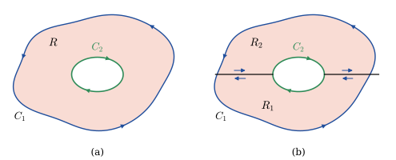{width="90%" fig-align="center"}

$~$

**Example** $\,$ Evaluate $\displaystyle\oint_{C} \frac{-y}{x^2 +y^2}\, dx + \frac{x}{x^2 + y^2}\,dy$, 
  $\,$ where $C=C_1 \cup C_2$ is the boundary of the shaded region $R$

  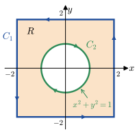{width="40%" fig-align="center"}

[Solution](files/solutions/sol_10_12a.pdf){target="_blank"}

$~$

**Example** $\,$ Evaluate $\displaystyle\oint_{C_1} \frac{-y}{x^2 +y^2}\, dx + \frac{x}{x^2 + y^2}\,dy$

[Solution](files/solutions/sol_10_12b.pdf){target="_blank"}

$~$

## Surface Integrals {#sec-9-13}

* Surface Area

  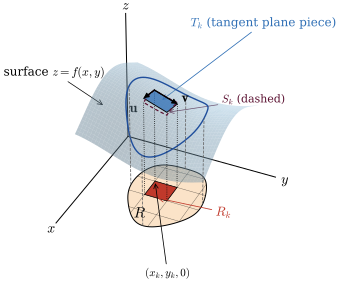{fig-align="center" width="65%"}
  
  $$
  \begin{aligned}
    \mathbf{u} &= \Delta x_k \mathbf{i} +f_x(x_k,y_k)\Delta x_k \mathbf{k}\\ 
    \mathbf{v} &= \Delta y_k \mathbf{j} +f_y(x_k,y_k)\Delta y_k \mathbf{k}\\
    & \Downarrow \\ 
    \mathbf{u} \times \mathbf{v} &={\scriptsize\left[-f_x(x_k,y_k)\mathbf{i} -f_y(x_k,y_k)\mathbf{j}+\mathbf{k}\right] \Delta x_k \Delta y_k}\\
    & \Downarrow \\
    \Delta S_k &= {\sqrt{1 +\left[\,f_x(x_k,y_k)\right]^2 +\left[\,f_y(x_k,y_k)\right]^2}\Delta A_k }
  \end{aligned}$$
  Then the area of the surface over $R$ is given by 
  $$ { S=\iint_R \sqrt{1+\left[\,f_x(x,y)\right]^2 +\left[\,f_y(x,y)\right]^2}\,dA} $$

* Surface Integral

  Let $\,G\,$ be a function of three variables defined over a region of space containing the surface $S$.
  $\,$Then the surface integral of $G$ over $S$ is given by
  
  $$
  \begin{aligned}
     \lim_{\|P\|\to 0}&\sum_{k=1}^n G(x_k^*,y_k^*,z_k^*)\,\Delta S_k = \iint_S G(x,y,z)\,dS\\ 
     &= \iint_R G(x,y,f(x,y)) \,\sqrt{1+\left[\,f_x(x,y)\right]^2 +\left[\,f_y(x,y)\right]^2}\,dA
  \end{aligned}$$

* If a smooth surface $S$ $\,$is $g(x,y,z)=0,$ $\,$a unit normal is

  $$\mathbf{n}=\frac{\nabla g}{\|\nabla g\|}$$

  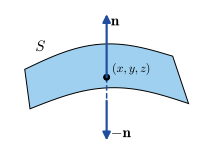{width="45%" fig-align="center"}

* Integrals of Vector Fields

  The total volume of a fluid passing through $\,S$ $\,$is called the **flux of $\mathbf{v}$ through $S$** and is given by

$$ \mathrm{flux} =\iint_S (\mathbf{v}\cdot\mathbf{n})\,dS $$

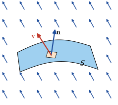{width="50%" fig-align="center"}

$~$

## Stokes' Theorem {#sec-9-14}

* Vector Form of Green's Theorem

  If $\,\mathbf{f}(x,y)=P(x,y)\mathbf{i} +Q(x,y)\mathbf{j} \,$ is a two-dimensional vector field, $\text{ }$then
  
  $$\mathrm{curl}\, \mathbf{f} =\nabla \times \mathbf{f} 
   =\left|\begin{matrix} \mathbf{i} & \mathbf{j} & \mathbf{k}\\ 
      \displaystyle\frac{\partial}{\partial x} 
      & \displaystyle\frac{\partial}{\partial y} 
      & \displaystyle\frac{\partial}{\partial z}\\ P & Q & 0 \end{matrix}\right|
   =\left( \frac{\partial Q}{\partial x} -\frac{\partial P}{\partial y} \right )\mathbf{k}$$
   
  Green's theorem can be written in vector notation as
  
  $$\oint_C \mathbf{f}\cdot \,d\mathbf{r} =\oint_C \mathbf{f}\cdot\mathbf{T}\,ds
   =\iint_R (\nabla \times \mathbf{f}) \cdot \mathbf{k}\,dA$$

* **Stokes' Theorem - Green's Theorem in 3-Space**

  * Let $S$ be a piecewise-smooth orientable surface bounded by a piecewise-smooth simple closed curve $C$
  
  * Let $~\mathbf{f}(x,y,z)=P(x,y,z)\mathbf{i} +Q(x,y,z)\mathbf{j} +R(x,y,z)\mathbf{k} \,$ be a vector field for which $P$, $Q$, and $R$ are continuous and have continuous first partial derivatives in a region of 3-space containing $S$. $~$If $C$ is traversed in the positive direction, then
  
  <font color="red">$$\oint_C \mathbf{f}\cdot \,d\mathbf{r} =\oint_C \mathbf{f}\cdot\mathbf{T}\,ds = \iint_S (\nabla \times\mathbf{f}) \cdot \mathbf{n}\,dS$$</font>

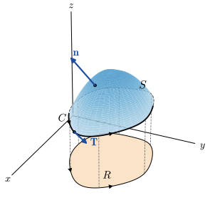{fig-align="center" width="45%"}

* Physical Interpretation of Curl

  $$
  \begin{aligned}
    \oint_{C_r} \mathbf{f} \cdot d\mathbf{r}
     = \iint_{S_r} \left[\nabla\times\mathbf{f}(P_0)\right] \cdot \mathbf{n}(P_0) &\, dS\\ 
     = \left[\nabla\times\mathbf{f}(P_0)\right]\, \cdot \mathbf{n}(P_0)\,\iint_{S_r}\,dS &
      =\left[\nabla\times\mathbf{f}(P_0)\right] \cdot \mathbf{n}(P_0)\,S_r\\ 
    \qquad\qquad\qquad\qquad &\Downarrow\\ 
    \left[\nabla\times\mathbf{f}(P_0)\right] \cdot \mathbf{n}(P_0) 
    = \lim_{r\to 0} \frac{1}{S_r} &\oint_{C_r} \mathbf{f} \cdot 
    d\mathbf{r} \approx \frac{1}{S_r}\oint_{C_r} \mathbf{f} \cdot 
    d\mathbf{r}
  \end{aligned}$$

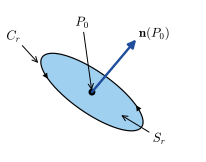{width="45%" fig-align="center"}

$~$

## Triple Integrals {#sec-9-15}

* Let $F$ be a function of three variables defined over a closed region $D$ of space. Then the triple integral of $F$ over $D$ is given by
  
  $${\lim_{\| P\|\to 0} \sum_{k=1}^n F(x_k^*,y_k^*,z_k^*)\,\Delta V_k = \iiint_D F(x,y,z)\,dV}$$

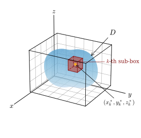{width="55%" fig-align="center"}

* Evaluation by Iterated Integrals
  
  $$
  \begin{aligned}
      \iiint_D F(x,y,z)\,dV &= \iint_R \left[ \int_{f_1(x,y)}^{f_2(x,y)} F(x,y,z)\,dz \right]\,dA\\ 
     &= \int_a^b \int_{g_1(x)}^{g_2(x)} \int_{f_1(x,y)}^{f_2(x,y)} F(x,y,z)\,dz\,dy\,dx
  \end{aligned}$$
  
  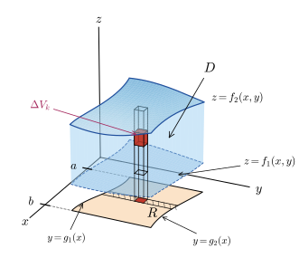{width="60%" fig-align="center"}

$~$

**Example**
  $\,$ Find the volume of the solid in the first octant bounded by the graphs of $z=1-y^2$, $y=2x$, and $x=3$

  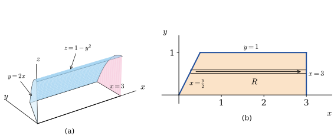{width="90%" fig-align="center"}

[Solution](files/solutions/sol_10_15.pdf){target="_blank"}

$~$

* Cylindrical Coordinates

  $$\begin{aligned}
    x=r\cos\theta, \;\;&y=r\sin\theta, \;\;z=z \\ 
    &\Downarrow \\ 
    r^2 = x^2 +y^2, \;\; &\tan\theta=\frac{y}{x},\;\; z=z 
  \end{aligned}$$

  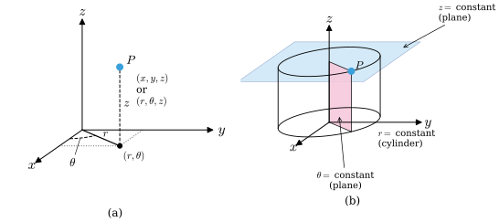{width="90%" fig-align="center"}

* Triple Integrals in Cylindrical Coordinates

  $$
  \begin{aligned}
     \iiint_D F(r,\theta,z)\,dV &= \iint_R \left[ \int_{f_1(r,\theta)}^{f_2(r,\theta)} 
        F(r,\theta,z)\,dz \right]\,dA \\ 
     &= \int_\alpha^\beta \int_{g_1(\theta)}^{g_2(\theta)} 
       \int_{f_1(r,\theta)}^{f_2(r,\theta)} F(r,\theta,z)\,r\,dz\,dr\,d\theta
  \end{aligned}$$

  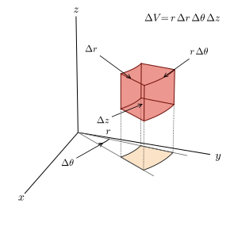{width="55%" fig-align="center"}

* Spherical Coordinates
  
  $$
  \begin{aligned}
   x = \rho\sin\phi\cos\theta, \;\;
   &y=\rho\sin\phi\sin\theta, \;\;
   z=\rho\cos\phi \\ 
     &\Downarrow \\ 
   \rho^2 =x^2 +y^2 +z^2, \;\; &\tan\theta=\frac{y}{x},
   \;\;\cos\phi=\frac{z}{\sqrt{x^2 +y^2 +z^2}} 
 \end{aligned}$$

 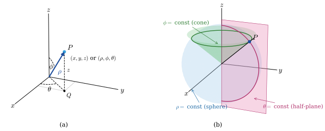{width="90%" fig-align="center"}

 * Triple Integrals in Spherical Coordinates
  
  $$
  \begin{aligned}
      \iiint_D &F(\rho,\theta,\phi)\,dV  \\ 
      &= \int_\alpha^\beta \int_{g_1(\theta)}^{g_2(\theta)} 
      \int_{f_1(\phi,\theta)}^{f_2(\phi,\theta)} F(\rho,\theta,\phi)\,
      \rho^2 \sin\phi\, d\rho\,d\phi\,d\theta
  \end{aligned}$$

  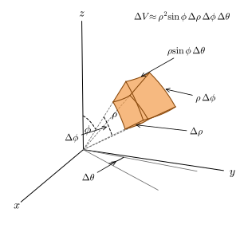{width="55%" fig-align="center"}


## Divergence Theorem {#sec-9-16}

* Another Vector Form of Green's Theorem
  
  $$
  \begin{aligned}
   \oint_C (\mathbf{f}\cdot\mathbf{n})&\,ds 
     = \oint_C -Qdx +Pdy \\ 
     &= \iint_R \left[ \frac{\partial P}{\partial x} 
       -\left( -\frac{\partial Q}{\partial y} \right) \right]\,dA 
     = \iint_R \left[ \frac{\partial P}{\partial x} 
       +\frac{\partial Q}{\partial y} \right]\,dA \\ 
     &= \iint_R \nabla\cdot\mathbf{f}\,dA
  \end{aligned}$$
  
  where $\displaystyle\,\mathbf{n}=\frac{dy}{ds}\mathbf{i} -\frac{dx}{ds}\mathbf{j}$

* **Divergence Theorem**

  * Let $D\,$ be a closed and bounded region in 3-space with a piecewise-smooth boundary $S$ that is oriented outward
  
  * Let $\;\mathbf{f}(x,y,z)=P(x,y,z)\,\mathbf{i}+Q(x,y,z)\,\mathbf{j} +R(x,y,z)\,\mathbf{k}~$ be a vector field for which
  $P$, $Q,$ and $R$ are continuous and have continuous first partial derivatives in a region of 3-space containing $D$. $\,$ Then
  
  <font color="red">
  $$\iint_S (\mathbf{f}\cdot \mathbf{n})\,dS =\iiint_D \nabla\cdot\mathbf{f}\,dV$$
  </font>

* **Partial Proof**
  
  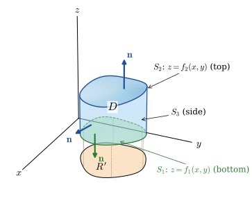{width="55%" fig-align="center"}

  $${\scriptsize \displaystyle\iiint_D \frac{\partial R}{\partial z}\,dV
   =\iint_{R'} \left[ \int_{f_1(x,y)}^{f_2(x,y)} \frac{\partial R}{\partial z}\,dz \right]\,dA
   =\iint_{R'} \left[ R(x,y,f_2(x,y)) -R(x,y,f_1(x,y)) \right] \,dA }$$
   
  $${\scriptsize \displaystyle\iint_S R(\mathbf{k}\cdot\mathbf{n}) \,dS=\iint_{S_1} R(\mathbf{k}\cdot\mathbf{n})\,dS
   +\iint_{S_2} R(\mathbf{k}\cdot\mathbf{n})\,dS +\iint_{S_3} R(\mathbf{k}\cdot\mathbf{n}) \,dS }$$

  * On $S_1$: $\,$ Since the outward normal points downward, $g(x,y,z)=f_1(x,y)-z=0$. Thus
    
    $$
    \begin{aligned}
      {\scriptsize \mathbf{n}} 
      &{\scriptsize \;= \frac{ \frac{\partial f_1}{\partial x} \mathbf{i} 
      +\frac{\partial f_1}{\partial y} \mathbf{j} -\mathbf{k} }{ \sqrt{1+\left(\frac{\partial f_1}{\partial x}\right)^2
      +\left(\frac{\partial f_1}{\partial y}\right)^2}} \;\; 
    \Rightarrow \;\; 
    \mathbf{k}\cdot\mathbf{n}
    =\frac{-1}{\sqrt{1+\left(\frac{\partial f_1}{\partial x}\right)^2
   +\left(\frac{\partial f_1}{\partial y}\right)^2}} } \\ 
   &\Downarrow \\ 
    \iint_{S_1} &R(\mathbf{k}\cdot\mathbf{n})\,dS = -\iint_{R'} R(x,y,f_1(x,y))\,dA
    \end{aligned}$$

  * On $S_2$: $\,$ Since the outward normal points upward, $g(x,y,z)=z -f_2(x,y)=0$. Thus
   
    $$
    \begin{aligned}
    {\scriptsize \mathbf{n} }& {\scriptsize \;= \frac{ -\frac{\partial f_2}{\partial x} \mathbf{i} 
    -\frac{\partial f_2}{\partial y} \mathbf{j} +\mathbf{k} }{ \sqrt{1+\left(\frac{\partial f_2}{\partial x}\right)^2
    +\left(\frac{\partial f_2}{\partial y}\right)^2}} \;\; 
   \Rightarrow \;\; 
   \mathbf{k}\cdot\mathbf{n}
   =\frac{1}{\sqrt{1+\left(\frac{\partial f_2}{\partial x}\right)^2
   +\left(\frac{\partial f_2}{\partial y}\right)^2}} }\\ 
   &\Downarrow \\ 
   \iint_{S_2} &R(\mathbf{k}\cdot\mathbf{n})\,dS = \iint_{R'} R(x,y,f_2(x,y))\,dA
  \end{aligned}$$

  * On $S_3$: $\,$ $\mathbf{k}\cdot\mathbf{n}=0$
   
   $$\quad \iint_{S_3} R(\mathbf{k}\cdot\mathbf{n})\,dS = 0$$

* Physical Interpretation of Divergence
  
  $$
  \begin{aligned}
    \iint_{S_r} (\mathbf{f} \cdot \mathbf{n})\,dS 
      &= \iiint_{D_r} \nabla\cdot\mathbf{f}\,dV \\
      \approx
    \iiint_{D_r} &\nabla\cdot\mathbf{f}(P_0)\,dV 
    = \nabla\cdot\mathbf{f}(P_0) \iiint_{D_r}\,dV 
    = \nabla\cdot\mathbf{f}(P_0) D_r\\ 
     &\Downarrow\\ 
    \nabla\cdot\mathbf{f}(P_0) &= \lim_{r\to 0} \frac{1}{D_r}\iint_{S_r} 
     (\mathbf{f} \cdot \mathbf{n})\,dS
  \end{aligned}$$
  
  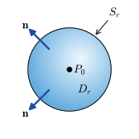{width="40%" fig-align="center"}

* Continuity Equation

  $$
  \begin{aligned}
   \frac{dm}{dt} 
    &= \frac{d}{dt}\iiint_D \rho(x,y,z,t)\,dV
     = \iiint_D \frac{\partial \rho}{\partial t}\,dV \\ 
    &= -\iint_S (\rho\mathbf{v}\cdot\mathbf{n})\,dS
     =-\iiint_D \nabla\cdot(\rho\mathbf{v})\,dV\\ 
    &\Downarrow \\ 
     \iiint_D \left[ \frac{\partial \rho}{\partial t} \right. 
    &+\left. \phantom{\frac{}{}}\nabla\cdot(\rho\mathbf{v}) \right]\,dV=0 \\ 
    &\Downarrow \\
    \frac{\partial \rho}{\partial t} & 
     +\nabla\cdot(\rho\mathbf{v})=0 
  \end{aligned}$$

* Euler's Equation of Motion

  Allowing for the presence of a gravitational body force per unit mass $\mathbf{g}$, $\,$the basic equations of an ideal fluid are

  $$\frac{D \mathbf{v}}{D t} = -\frac{1}{\rho} \nabla p + \mathbf{g}$$

  $$\nabla \cdot \mathbf{v} = 0$$

* Furthermore, it can be helpful to use $\mathbf{g}=-\nabla \chi$ $\,$and the identity

  $$ \left( \mathbf{v} \cdot \nabla \right) \mathbf{v} 
    = \left( \nabla \times \mathbf{v} \right) \times \mathbf{v} + \nabla \left( \frac{1}{2} \mathbf{v}^2 \right)$$

  to cast the momentum equation into the form

  $$ \frac{\partial \mathbf{v}}{\partial t} + \left( \nabla \times \mathbf{v} \right) \times \mathbf{v} = -\nabla \left( \frac{p}{\rho} +\frac{1}{2} \mathbf{v}^2 + \chi \right) =- \nabla H$$

$~$

## Change of Variables in Multiple Integrals {#sec-9-17} 

* To change the Variable in a Definite Integral

  $$\int_a^b f(x)\,dx =\int_c^d f(g(u))\, g'(u)\,du$$

* Double Integrals

  $$\begin{aligned}
   \iint_R & F(x,y)\,dA \\
   &= \iint_{R'} F(f(u,v), g(u,v))\, \left| \frac{\partial(x,y)}{\partial(u,v)} \right|\,dA'
   \end{aligned}$$

  $$\left| \frac{\partial(x,y)}{\partial(u,v)} \right| =
    \left|\begin{matrix}
    \frac{\partial x}{\partial u} & \frac{\partial x}{\partial v}\\ 
    \frac{\partial y}{\partial u} & \frac{\partial y}{\partial v}
    \end{matrix}\right|, \qquad dA = h_1 h_2\, dq_1 dq_2 \;\text{ (orthogonal curvilinear coordinates)}$$

* Triple Integrals

  $$\begin{aligned}
    \iiint_D & F(x,y,z)\,dV \\
    &= \iiint_{D'} F\left(f(u,v,w), g(u,v,w), h(u,v,w)\right)\, \left| \frac{\partial(x,y,z)}{\partial(u,v,w)} \right|\,dV'
    \end{aligned}$$

  $$\left| \frac{\partial (x,y,z)}{\partial (u,v,w)} \right| =
    \left|\begin{matrix}
    \frac{\partial x}{\partial u} & \frac{\partial x}{\partial v} & \frac{\partial x}{\partial w}\\ 
    \frac{\partial y}{\partial u} & \frac{\partial y}{\partial v} & \frac{\partial y}{\partial w}\\
    \frac{\partial z}{\partial u} & \frac{\partial z}{\partial v} & \frac{\partial z}{\partial w} 
   \end{matrix}\right|, \qquad dV = h_1 h_2 h_3\, dq_1 dq_2 dq_3$$

$~$

## Worked Exercises {.unnumbered}

**1.** $~$ Find an equation of the plane containing the lines $x=t$, $~y=4t$, $~z=-2t$, and $~x=1+t$, $~y=1+4t$, $~z=3-2t$

**Solution**

**Step 1:** $~$ Write the parametric forms of both lines

First line:

$$
L_1: \begin{cases}
x = t \\
y = 4t \\
z = -2t
\end{cases}\\
\;\Rightarrow\; 
\begin{aligned}
&\text{Point: } P_1 = (0, 0, 0)\\ &\text{Direction vector: } \mathbf{d}_1 = \langle 1, 4, -2 \rangle
\end{aligned}$$

Second line:

$$
L_2: \begin{cases}
x = 1 + t \\
y = 1 + 4t \\
z = 3 - 2t
\end{cases}
\;\Rightarrow\; 
\begin{aligned}
&\text{Point: } P_2 = (1, 1, 3)\\
&\text{Direction vector: } \mathbf{d}_2 = \langle 1, 4, -2 \rangle
\end{aligned}$$

**Step 2:** $~$ Observe relationship between the lines

* Both lines share the same direction vector: $\mathbf{d}_1 = \mathbf{d}_2 = \langle 1, 4, -2 \rangle$
* But they pass through different points

So the lines are parallel and distinct, and therefore they lie in a common plane

**Step 3:** $~$ Find two vectors in the plane

The plane is determined by:

1.	Direction vector of the lines:
$$\mathbf{v}_1 = \langle 1, 4, -2 \rangle$$

2.	Vector connecting a point on one line to a point on the other line:

$$\mathbf{v}_2 = P_2 - P_1 = \langle 1, 1, 3\rangle - \langle0, 0, 0\rangle = \langle 1, 1, 3 \rangle$$

**Step 4:** $~$ Find a normal vector to the plane

Take the cross product:

$$\mathbf{n} = \mathbf{v}_1 \times \mathbf{v}_2 =
\begin{vmatrix}
\mathbf{i} & \mathbf{j} & \phantom{-}\mathbf{k} \\
1 & 4 & -2 \\
1 & 1 & \phantom{-}3
\end{vmatrix}$$

Compute:

$$\mathbf{n} = {\scriptsize\mathbf{i}(4 \cdot 3 - (-2)\cdot 1) - \mathbf{j}(1 \cdot 3 - (-2)\cdot 1) + \mathbf{k}(1 \cdot 1 - 4 \cdot 1)}
\;\Rightarrow\;
\mathbf{n} = \langle 14, -5, -3 \rangle$$

**Step 5:** $~$ Use the point-normal form of a plane

With point $P_1 = (0,0,0)$ and normal vector $\langle 14, -5, -3 \rangle$, the equation is:

$$14(x - 0) - 5(y - 0) - 3(z - 0) = 0
\Rightarrow 14x - 5y - 3z = 0$$

$~$

**2.** $~$ Find an equation of the plane containing $(1, 7, -1)$ that is perpendicular to the line of intersection of $-x +y -8z=4~$ and $~3x -y +2z=0$

**Solution**

**Step 1:** $~$ Find direction vector of the line of intersection

The line of intersection of two planes lies in both planes, and its direction vector is perpendicular to both normals of the planes

So, compute the cross product of the normal vectors of the two planes

* Normal to $\pi_1$: $~\mathbf{n}_1 = \langle -1, 1, -8 \rangle$
* Normal to $\pi_2$: $~\mathbf{n}_2 = \langle 3, -1, 2 \rangle$

Then:

$$
\mathbf{d} = \mathbf{n}_1 \times \mathbf{n}_2 =
\begin{vmatrix}
\phantom{-}\mathbf{i} & \phantom{-}\mathbf{j} & \phantom{-}\mathbf{k} \\
-1 & \phantom{-}1 & -8 \\
\phantom{-}3 & -1 & \phantom{-}2
\end{vmatrix}$$

Compute the determinant:

$$\begin{aligned}
\mathbf{d} &= {\scriptsize\mathbf{i}(1\cdot2 - (-8)\cdot(-1)) - \mathbf{j}((-1)\cdot2 - (-8)\cdot3) + \mathbf{k}((-1)\cdot(-1) - 1\cdot3)} \\
 &= \langle -6, -22, -2 \rangle
\end{aligned}$$

This is the direction vector of the line of intersection.

**Step 2:** $~$ Use the fact that the desired plane is perpendicular to this line

So the direction vector $~\mathbf{d} = \langle -6, -22, -2 \rangle$ is the normal vector of the desired plane

We now have:

* Point on the plane: $(1, 7, -1)$
* Normal vector: $~\mathbf{n} = \langle -6, -22, -2 \rangle$

**Step 3:** $~$ Use point-normal form of a plane

$$-6(x - 1) -22(y - 7) -2(z + 1) = 0$$

Expand:

$$-6x + 6 -22y + 154 -2z -2 = 0
\Rightarrow -6x - 22y - 2z + 158 = 0$$

Multiply both sides by -1 to make the leading coefficient positive:

$$6x + 22y + 2z = 158$$

$~$

**3.** $~$ Use Green's theorem to evaluate the given double integral by a line integral

$$\iint_R x^2 \,dA$$

where $R~$ is the region bounded by the ellipse $\displaystyle\frac{x^2}{9} +\frac{y^2}{4}=1$

**Solution**

**Step 1:** $~$ Green’s Theorem 

Green’s Theorem relates a line integral over a positively oriented, simple closed curve $C$ to a double integral over the region $R$ it encloses:

$$\iint_R \left( \frac{\partial Q}{\partial x} - \frac{\partial P}{\partial y} \right) dA = \oint_C P\,dx + Q\,dy$$

We need to rewrite $\displaystyle \iint_R x^2 \, dA$ as the right-hand side of Green’s Theorem.

**Step 2:** $~$ Choose $P(x, y)$ and $Q(x, y)$

We want:

$$\frac{\partial Q}{\partial x} - \frac{\partial P}{\partial y} = x^2$$

Let’s choose:

* $\displaystyle P = 0 \Rightarrow \frac{\partial P}{\partial y} = 0$

* $\displaystyle Q = \frac{1}{3} x^3 \Rightarrow \frac{\partial Q}{\partial x} = x^2$

So:

$$\frac{\partial Q}{\partial x} - \frac{\partial P}{\partial y} = x^2$$

**Step 3:** $~$ Set up the line integral

Then by Green’s Theorem:

$$\iint_R x^2 \, dA = \oint_C P\,dx + Q\,dy = \oint_C \frac{1}{3} x^3 \, dy$$

where $C$ is the positively oriented boundary of the ellipse.

**Step 4:** $~$ Parametrize the ellipse

Given:

$$\frac{x^2}{9} + \frac{y^2}{4} = 1$$

Use the parametric equations:

$$x = 3\cos\theta, \quad y = 2\sin\theta, \quad 0 \leq \theta \leq 2\pi$$

Compute:

* $x^3 = (3\cos\theta)^3 = 27\cos^3\theta$

* $\displaystyle dy = \frac{dy}{d\theta} \, d\theta = 2\cos\theta \, d\theta$

Now plug into the line integral:

$$\oint_C \frac{1}{3} x^3 \, dy
= \int_0^{2\pi} \frac{1}{3} \cdot 27 \cos^3\theta \cdot 2\cos\theta \, d\theta
= \int_0^{2\pi} 18\cos^4\theta \, d\theta$$

**Step 5:** $~$ Evaluate the integral

Use the identity:

$$\cos^4\theta = \frac{3}{8} + \frac{1}{2} \cos(2\theta) + \frac{1}{8} \cos(4\theta)$$

So:

$$\int_0^{2\pi} 18 \cos^4\theta \, d\theta
= 18 \int_0^{2\pi} \left( \frac{3}{8} + \frac{1}{2} \cos(2\theta) + \frac{1}{8} \cos(4\theta) \right) d\theta$$

Now integrate:

* $\displaystyle\int_0^{2\pi} \frac{3}{8} \, d\theta = \frac{3}{8} \cdot 2\pi = \frac{3\pi}{4}$

* $\displaystyle\int_0^{2\pi} \cos(2\theta) \, d\theta = 0$

* $\displaystyle\int_0^{2\pi} \cos(4\theta) \, d\theta = 0$

So:

$$\iint_R x^2\,dA = 18 \cdot \frac{3\pi}{4} = \frac{27\pi}{2}$$

$~$

**4.** $~$ Find the work done by the given force $~\mathbf{f}=(x-y)\mathbf{i} +(x+y)\mathbf{j}~$ around the closed curve in the following

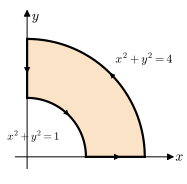{width="55%" fig-align="center"}

**Solution**

The image shows a region bounded between two quarter circles:

* Outer curve: $x^2 + y^2 = 4$ (radius 2)
* Inner curve: $x^2 + y^2 = 1$ (radius 1)

The region is the quarter annulus in the first quadrant, swept from the positive $x$-axis to the positive $y$-axis, and the curve is oriented counterclockwise, forming a positively oriented closed curve $C$

**Step 1:** $~$ Use Green’s Theorem

We are to compute:

$$\oint_C \mathbf{f} \cdot d\mathbf{r} = \iint_R \left( \frac{\partial N}{\partial x} - \frac{\partial M}{\partial y} \right)\,dA$$

Where:

* $M = x - y \Rightarrow \frac{\partial M}{\partial y} = -1$
* $N = x + y \Rightarrow \frac{\partial N}{\partial x} = 1$

So:

$$\frac{\partial N}{\partial x} - \frac{\partial M}{\partial y} = 1 - (-1) = 2$$

**Step 2:** $~$ Area of the Region $R$

The region $R$ is a quarter annulus between radius 1 and 2, in the first quadrant.

Area of an annulus between $r = 1$ and $r = 2$ is:

$$\text{Full area} = \pi(2^2) - \pi(1^2) = 4\pi - \pi = 3\pi $$

But we only have $1/4$ of it:

$$\text{Area}(R) = \frac{1}{4} \cdot 3\pi = \frac{3\pi}{4}$$

**Step 3:** $~$ Apply Green’s Theorem

$$\oint_C \mathbf{f} \cdot d\mathbf{r} = \iint_R 2\, dA = 2 \cdot \frac{3\pi}{4} = \frac{3\pi}{2}$$

$~$

**5.** $~$ Evaluate the integral

$$\iint_R \frac{1}{\sqrt{(x-y)^2 +2(x+y) +1}} \,dA$$

where $R$ is the region bounded by the graphs of $y=x$, $x=2$, and $y=0$ by means of the change of variables $x=u +uv$, $y=v +uv$

**Solution**

**Step 1:** $~$ Understand the transformation

We compute:

* $x - y = (u + uv) - (v + uv) = u - v$
* $x + y = (u + uv) + (v + uv) = u + v + 2uv$

Then,

$$(x - y)^2 + 2(x + y) + 1 = (u - v)^2 + 2(u + v + 2uv) + 1 = (u +v +1)^2$$

**Step 2:** $~$ Jacobian of the transformation

We need the Jacobian determinant $J = \left| \frac{\partial(x,y)}{\partial(u,v)} \right|$. Compute partial derivatives:

$$x = u + uv \Rightarrow
\begin{cases}
\frac{\partial x}{\partial u} = 1 + v, \\
\frac{\partial x}{\partial v} = u,
\end{cases}
\quad
y = v + uv \Rightarrow
\begin{cases}
\frac{\partial y}{\partial u} = v, \\
\frac{\partial y}{\partial v} = 1 + u.
\end{cases}$$

So the Jacobian matrix is:

$$J = \begin{vmatrix}
1 + v & u \\
v & 1 + u
\end{vmatrix} = (1 + v)(1 + u) - uv = 1 + u + v$$

**Step 3:** $~$ Find the region $S$ in the $uv$-plane

We translate the region $R$ into the $uv$-coordinates

From the substitution:

$$x = u + uv = u(1 + v), \quad y = v + uv = v(1 + u)$$

We now rewrite the boundaries:

* $y = 0 \Rightarrow v(1 + u) = 0 \Rightarrow v = 0$ (since $1 + u \ne 0$)
* $y = x \Rightarrow v(1 + u) = u(1 + v) \Rightarrow v = u$
* $x = 2 \Rightarrow u(1 + v) = 2 ⇒ u = \frac{2}{1 + v}$

So the region in the $uv$-plane is:

* lower bound: $v = 0$
* upper bound: $v = u$
* and $u \le \frac{2}{1 + v}$

Let’s fix bounds:

Since $u = \frac{2}{1 + v}$, and also $v = u$, we substitute:

$$v = \frac{2}{1 + v} \Rightarrow v(1 + v) = 2 \Rightarrow (v - 1)(v + 2) = 0$$

So $v = 1$ is the upper limit (since $v > 0$), and the region $S$ is bounded by:

* $0 \le v \le 1$
* $v \le u \le \frac{2}{1 + v}$

**Step 4:** $~$ Change of variables in the integral

We rewrite the integral in terms of $u$, $v$:

$$\iint_S \frac{1}{\sqrt{(u + v +1)^2}} \cdot |J| \, du\, dv$$

So the integrand becomes simply 1. Then the integral becomes the area of the region $S$:

$$\iint_S 1 \, du\, dv = \int_{v=0}^{1} \int_{u=v}^{\frac{2}{1 + v}} 1 \, du\, dv = \int_0^1 \left( \frac{2}{1 + v} - v \right) dv =2 \ln 2 - \frac{1}{2}$$

$~$

**6.** $~$ Evaluate the integral 

$$ \iint_R (x^2 +y^2) \sqrt[3]{x^2 -y^2} \,dA $$

where $R$ is the region bounded by the graphs of $x=0$, $x=1$, $y=0$, and $y=1$ by means of the change of variables $u=2xy$, $v=x^2 -y^2$

**Solution**

**Step 1:** $~$ Compute the Jacobian

We need the Jacobian determinant $J = \left| \frac{\partial(x, y)}{\partial(u, v)} \right|$, but we are given $u = 2xy$, $v = x^2 - y^2$, so we compute $\frac{\partial(u, v)}{\partial(x, y)}$ and then take the reciprocal for the change of variables

Compute partial derivatives:

* $\displaystyle u = 2xy \;\Rightarrow \frac{\partial u}{\partial x} = 2y, \; \frac{\partial u}{\partial y} = 2x$
* $\displaystyle v = x^2 - y^2 \;\Rightarrow \frac{\partial v}{\partial x} = 2x, \; \frac{\partial v}{\partial y} = -2y$

So the Jacobian matrix is:

$$\frac{\partial(u,v)}{\partial(x,y)} =
\begin{pmatrix}
2y & \phantom{-}2x \\
2x & -2y
\end{pmatrix}$$

Therefore,

$$\left| \frac{\partial(x,y)}{\partial(u,v)} \right| = \frac{1}{|J|} = \frac{1}{| -4(x^2 + y^2) |} = \frac{1}{4(x^2 + y^2)}$$

**Step 2:** $~$ Substituting the integrand and Jacobian

The integrand is $(x^2 + y^2)\sqrt[3]{x^2 - y^2}$, $~$ and from the transformation:

* $v = x^2 - y^2 \Rightarrow \sqrt[3]{x^2 - y^2} = \sqrt[3]{v}$
* $x^2 + y^2$ appears in both the integrand and the Jacobian, so:

$$(x^2 + y^2) \cdot \sqrt[3]{x^2 - y^2} \cdot \left| \frac{\partial(x,y)}{\partial(u,v)} \right| = (x^2 + y^2) \cdot \sqrt[3]{v} \cdot \frac{1}{4(x^2 + y^2)} = \frac{1}{4} \sqrt[3]{v}$$

So the transformed integral becomes:

$$\iint_S \frac{1}{4} \sqrt[3]{v} \, du\, dv$$

**Step 3:** $~$ Find the region $S$ in $uv$-coordinates

We are given the transformation:

$$u = 2xy, \quad v = x^2 - y^2$$

and the original region $R$ is the unit square:

$$0 \le x \le 1,\quad 0 \le y \le 1$$

We compute the image of the four corners of the square under the transformation:

| $(x, y)$ | $u = 2xy$ | $v = x^2 - y^2$ | $(u, v)$ |
|--------------|-------------|----------------|-----------------|
| $(0, 0)$      | $0$             | $\phantom{-}0$    | $(0, \phantom{-}0)$ |
| $(1, 0)$      | $0$             | $\phantom{-}1$    | $(0, \phantom{-}1)$ |
| $(0, 1)$      | $0$             | $-1$              | $(0, -1)$           |
| $(1, 1)$      | $2$             | $\phantom{-}0$    | $(2, \phantom{-}0)$ |

We examine how each edge of the square transforms under the change of variables:

* Edge $x = 0$:
  $~u = 0, v = -y^2 \in [-1, 0] \Rightarrow\; {\scriptsize\text{Vertical segment on the } u = 0}$
* Edge $y = 0$:
  $~u = 0, v = x^2 \in [0, 1] \Rightarrow\; {\scriptsize\text{Another vertical segment on the } u = 0}$
* Edge $x = 1$:
  $~u = 2y \in [0, 2], v = 1 - y^2 = 1 - \frac{u^2}{4} \Rightarrow\; {\scriptsize\text{Upper parabola}}$
* Edge $y = 1$:
$~u = 2x \in [0, 2], v = x^2 - 1 = \frac{u^2}{4} - 1 \Rightarrow\; {\scriptsize\text{Lower parabola}}$

So, the transformed region is:

$$S = \left\{ (u, v) \ \middle| \ 0 \le u \le 2,\quad \frac{u^2}{4} - 1 \le v \le 1 - \frac{u^2}{4} \right\}$$

```{python}
import numpy as np
import matplotlib.pyplot as plt

# Create u values
u = np.linspace(0, 2, 400)

# Define the upper and lower boundaries of v
v_upper = 1 -(u**2)/4
v_lower = (u**2)/4 -1

# Plot the region S
plt.figure(figsize=(6, 6))
plt.plot((0, 0, 0, 2), (0, 1, -1, 0), 'ko')
plt.plot(u, v_upper, 'r', label=r'$v = 1 -\frac{u^2}{4}$')
plt.plot((0, 0), (0, 1), 'r', lw=3)
plt.plot(u, v_lower, 'b', label=r'$v = \frac{u^2}{4} -1$')
plt.plot((0, 0), (0, -1), 'b', lw=3)
plt.fill_between(u, v_lower, v_upper, color='lightgray', alpha=0.6)

# Formatting
plt.title("Region S in the uv-plane")
plt.xlabel("u")
plt.ylabel("v")
plt.legend()
plt.grid(True)
plt.xlim(0, 2)
plt.ylim(-1.1, 1.1)
plt.gca().set_aspect('equal')

plt.show()
```

**Step 4:** $~$ Evaluate the integral

Since the integrand $v^{1/3}$ is an odd function, and the bounds of $u$ are symmetric in $v$, the integral is:

$$\iint_S \frac{1}{4} \sqrt[3]{v} \, du\, dv = 0$$

$~$

**7.** $~$ Find the tangential and normal components of acceleration for the path:

$$ \mathbf{x}(t) = \left(2t, e^{2t} \right)$$

**Solution**

**Step 1:** $~$ Compute the velocity vector

$$\mathbf{v}(t) = \frac{d\mathbf{x}}{dt} = \left(2, 2e^{2t} \right)$$

**Step 2:** $~$ Compute the acceleration vector

$$\mathbf{a}(t) = \frac{d\mathbf{v}}{dt} = \left(0, 4e^{2t} \right)$$

**Step 3:** $~$ Compute the speed

$$|\mathbf{v}(t)| = \sqrt{2^2 + (2e^{2t})^2} = \sqrt{4 + 4e^{4t}} = 2\sqrt{1 + e^{4t}}$$

**Step 4:** $~$ Tangential component of acceleration

The tangential component of acceleration is given by the derivative of speed:

$$a_T = \frac{d}{dt}|\mathbf{v}(t)| = \frac{d}{dt} \left(2\sqrt{1 + e^{4t}} \right)
= \frac{2 \cdot \frac{1}{2} \cdot 4e^{4t}}{\sqrt{1 + e^{4t}}}
= \frac{4e^{4t}}{\sqrt{1 + e^{4t}}}$$

**Step 5:** $~$ Normal component of acceleration

The normal component of acceleration is given by:

$$a_N = \sqrt{|\mathbf{a}(t)|^2 - a_T^2}$$

We compute:

* $|\mathbf{a}(t)| = \sqrt{0^2 + (4e^{2t})^2} = 4e^{2t}$
* So $|\mathbf{a}(t)|^2 = 16e^{4t}$
* And $a_T^2 = \left(\frac{4e^{4t}}{\sqrt{1 + e^{4t}}}\right)^2 = \frac{16e^{8t}}{1 + e^{4t}}$

Now plug into the normal acceleration formula:

$$
\begin{aligned}
a_N &= \sqrt{16e^{4t} - \frac{16e^{8t}}{1 + e^{4t}}} \\
&= \sqrt{ \frac{16e^{4t}(1 + e^{4t}) - 16e^{8t}}{1 + e^{4t}} } \\
&= \sqrt{ \frac{16e^{4t}}{1 + e^{4t}} } \\
&= \frac{4e^{2t}}{\sqrt{1 + e^{4t}}}
\end{aligned}
$$

$~$

**8.** $~$ Find the tangential and normal components of acceleration for the path:

$$ \mathbf{x}(t) = \left(t, t, t^2 \right) $$

**Solution**

**Step 1:** $~$ Compute velocity and acceleration

$$
\begin{aligned}
\mathbf{v}(t) &= \frac{d\mathbf{x}}{dt} = (1, 1, 2t)\\
\mathbf{a}(t) &= \frac{d\mathbf{v}}{dt} = (0, 0, 2)
\end{aligned}$$

**Step 2:** $~$ Compute speed

$$|\mathbf{v}(t)| = \sqrt{1^2 + 1^2 + (2t)^2} = \sqrt{2 + 4t^2}$$

**Step 3:** $~$ Tangential component of acceleration

The tangential component is:

$$a_T = \frac{d}{dt} |\mathbf{v}(t)| = \frac{d}{dt} \sqrt{2 + 4t^2}
= \frac{1}{2\sqrt{2 + 4t^2}} \cdot 8t = \frac{4t}{\sqrt{2 + 4t^2}}$$

**Step 4:** $~$ Normal component of acceleration

The normal component is given by:

$$a_N = \sqrt{|\mathbf{a}(t)|^2 - a_T^2}$$

We have:

* $|\mathbf{a}(t)| = \sqrt{0^2 + 0^2 + 2^2} = 2$
* $|\mathbf{a}(t)|^2 = 4$
* $a_T^2 = \left( \frac{4t}{\sqrt{2 + 4t^2}} \right)^2 = \frac{16t^2}{2 + 4t^2}$

Now compute:

$$
\begin{aligned}
a_N &= \sqrt{4 - \frac{16t^2}{2 + 4t^2}} = \sqrt{ \frac{4(2 + 4t^2) - 16t^2}{2 + 4t^2} } \\
&= \sqrt{ \frac{8 + 16t^2 - 16t^2}{2 + 4t^2} } = \sqrt{ \frac{8}{2 + 4t^2} }\\
&= \frac{2\sqrt{2}}{\sqrt{2 + 4t^2}}
\end{aligned}$$

$~$

**9.** $~$ Let $\mathbf{r} = x \mathbf{i} + y \mathbf{j} + z \mathbf{k}$ and $r$ denote $\| \mathbf{r} \|$. Evaluate the following:

$$\nabla \cdot (r^n \mathbf{r})$$

**Solution**

**Step 1:** $~$ Use product rule for divergence

Let’s use the identity:

$$\nabla \cdot (f \mathbf{v}) = (\nabla f) \cdot \mathbf{v} + f (\nabla \cdot \mathbf{v})$$

Set:

* $f = r^n$
* $\mathbf{v} = \mathbf{r}$

Then:

$$\nabla \cdot (r^n \mathbf{r}) = (\nabla r^n) \cdot \mathbf{r} + r^n (\nabla \cdot \mathbf{r})$$

**Step 2:** $~$ Compute the terms

1. Gradient of $r^n$:

We use the chain rule:

$$\nabla r^n = n r^{n-1} \nabla r$$

and since $r = \sqrt{x^2 + y^2 + z^2}$, $\,$ we know:

$$\nabla r = \left( \frac{x}{r}, \frac{y}{r}, \frac{z}{r} \right) = \frac{\mathbf{r}}{r}$$

So:

$$\nabla r^n = n r^{n-1} \cdot \frac{\mathbf{r}}{r} = n r^{n-2} \mathbf{r}$$

Therefore,

$$(\nabla r^n) \cdot \mathbf{r} = n r^{n-2} \mathbf{r} \cdot \mathbf{r} = n r^{n-2} r^2 = n r^n$$

2. Divergence of $\mathbf{r}$:

$$\nabla \cdot \mathbf{r} = \frac{\partial x}{\partial x} + \frac{\partial y}{\partial y} + \frac{\partial z}{\partial z} = 1 + 1 + 1 = 3$$

**Step 3:** $~$ Combine everything

$$\nabla \cdot (r^n \mathbf{r}) = n r^n + 3 r^n = (n + 3) r^n$$

$~$

**10.** $~$ Let $\mathbf{r} = x \mathbf{i} + y \mathbf{j} + z \mathbf{k}$ and $r$ denote $\| \mathbf{r} \|$. Evaluate the following:

$$\nabla \times (r^n \mathbf{r})$$

**Solution**

**Step 1:** $~$ Use Vector Identity

We apply the identity:

$$\nabla \times (f \mathbf{v}) = (\nabla f) \times \mathbf{v} + f (\nabla \times \mathbf{v})$$

Let:

* $f = r^n$
* $\mathbf{v} = \mathbf{r}$

So:

$$\nabla \times (r^n \mathbf{r}) = (\nabla r^n) \times \mathbf{r} + r^n (\nabla \times \mathbf{r})$$

**Step 2:** $~$ Compute Each Term

(1) $\nabla \times \mathbf{r}$

$$\nabla \times \mathbf{r} = \nabla \times (x\mathbf{i} + y\mathbf{j} + z\mathbf{k}) = \mathbf{0}$$

(2) $\nabla r^n$

We compute:

$$\nabla r^n = n r^{n-1} \nabla r$$

and since:

$$\nabla r = \left( \frac{x}{r}, \frac{y}{r}, \frac{z}{r} \right) = \frac{\mathbf{r}}{r}
\Rightarrow \nabla r^n = n r^{n-1} \cdot \frac{\mathbf{r}}{r} = n r^{n-2} \mathbf{r}$$

(3) Compute the cross product

$$(\nabla r^n) \times \mathbf{r} = (n r^{n-2} \mathbf{r}) \times \mathbf{r} = n r^{n-2} (\mathbf{r} \times \mathbf{r}) = n r^{n-2} \cdot \mathbf{0} = \mathbf{0}$$

$~$

**11.** $~$ Let $\mathbf{v} = u(x,y) \mathbf{i} - v(x,y) \mathbf{j}$ be an **incompressible**, **irrotational** velocity field

**(a)** Show that the functions $u$ and $v$ (which determine the component functions of $\mathbf{v}$) satisfy the **Cauchy-Riemann equations**

  $$\frac{\partial u}{\partial x} = \frac{\partial v}{\partial y}\, \;\text{and}\; \,
  \frac{\partial u}{\partial y} = -\frac{\partial v}{\partial x}$$

**(b)** Show that $u$ and $v$ are **harmonic**, that is, that

  $$\frac{\partial^2 u}{\partial x^2} + \frac{\partial^2 u}{\partial y^2}=0\, \;\text{and}\; \,
    \frac{\partial^2 v}{\partial x^2} + \frac{\partial^2 v}{\partial y^2} = 0$$

**Solution**

We are given a 2D velocity field and told that this flow is:

* Incompressible (i.e., $\nabla \cdot \mathbf{v} = 0$)
* Irrotational (i.e., $\nabla \times \mathbf{v} = 0$)

$(a)$ 

**Step 1:** $~$ Incompressibility condition

The divergence of a 2D vector field $\mathbf{v} = (u, -v)$ is:

$$\nabla \cdot \mathbf{v} = \frac{\partial u}{\partial x} + \frac{\partial (-v)}{\partial y}
= \frac{\partial u}{\partial x} - \frac{\partial v}{\partial y}$$

Incompressibility implies:

$$\frac{\partial u}{\partial x} - \frac{\partial v}{\partial y} = 0
\quad \Rightarrow \quad
\boxed{\frac{\partial u}{\partial x} = \frac{\partial v}{\partial y}}$$

**Step 2:** $~$ Irrotationality condition

In 2D, the scalar curl of a vector field $\mathbf{v} = (u, -v)$ is:

$$\nabla \times \mathbf{v} = \frac{\partial (-v)}{\partial x} - \frac{\partial u}{\partial y}
= -\frac{\partial v}{\partial x} - \frac{\partial u}{\partial y}$$

Irrotationality implies:

$$-\frac{\partial v}{\partial x} - \frac{\partial u}{\partial y} = 0
\quad \Rightarrow \quad
\boxed{\frac{\partial u}{\partial y} = -\frac{\partial v}{\partial x}} $$

$(b)$

**Step 1:** $~$ Differentiate the Cauchy-Riemann equations

Start with the first:

$$\frac{\partial u}{\partial x} = \frac{\partial v}{\partial y}$$

Differentiate both sides with respect to $x$:

$$\frac{\partial^2 u}{\partial x^2} = \frac{\partial^2 v}{\partial x \partial y}
\quad\text{(1)}$$

Now differentiate the second Cauchy-Riemann equation:

$$\frac{\partial u}{\partial y} = -\frac{\partial v}{\partial x}$$

Differentiate both sides with respect to $y$:

$$\frac{\partial^2 u}{\partial y^2} = -\frac{\partial^2 v}{\partial y \partial x}
\quad\text{(2)}$$

**Step 2:** $~$ Add the second derivatives of $u$

From equations (1) and (2):

$$\frac{\partial^2 u}{\partial x^2} + \frac{\partial^2 u}{\partial y^2}
= \frac{\partial^2 v}{\partial x \partial y} - \frac{\partial^2 v}{\partial y \partial x} = 0$$

(because mixed partial derivatives are equal under continuity)

So,

$$\boxed{\frac{\partial^2 u}{\partial x^2} + \frac{\partial^2 u}{\partial y^2} = 0}$$

**Step 3:** $~$ Do the same for $v$

Start again from:

$$\frac{\partial v}{\partial y} = \frac{\partial u}{\partial x}
\Rightarrow \frac{\partial^2 v}{\partial y^2} = \frac{\partial^2 u}{\partial x \partial y}
\quad\text{(3)}$$

$$\frac{\partial v}{\partial x} = -\frac{\partial u}{\partial y}
\Rightarrow \frac{\partial^2 v}{\partial x^2} = -\frac{\partial^2 u}{\partial x \partial y}
\quad\text{(4)}$$

Now add:

$$\frac{\partial^2 v}{\partial x^2} + \frac{\partial^2 v}{\partial y^2}
= -\frac{\partial^2 u}{\partial x \partial y} + \frac{\partial^2 u}{\partial x \partial y} = 0$$

Thus:

$$\boxed{\frac{\partial^2 v}{\partial x^2} + \frac{\partial^2 v}{\partial y^2} = 0}$$

  $~$

**12.** $~$ Let a particle of mass $m$ travel along a differentiable path $\mathbf{x}$ in a Newtonian vector field $\mathbf{F}$ (i.e., one that satisfies Newton's second law $\mathbf{F} = m\mathbf{a}$, where $\mathbf{a}$ is the acceleration of $\mathbf{x}$). We define the **angular momentum** $\mathbf{l}(t)$ of the particle to be the cross product of the position vector and the linear momentum $m\mathbf{v}$, i.e.,

  $$\mathbf{l}(t) = \mathbf{x}(t) \times m \mathbf{v}(t)$$

(Here $\mathbf{v}$ denotes the velocity of $\mathbf{x}$.) The **torque** about the origin of the coordinate system due to the force $\mathbf{F}$ is the cross product of position and force:

  $$\mathbf{M}(t) = \mathbf{x}(t) \times \mathbf{F}(t)$$


$(a)$ Show that 

  $$\frac{d\mathbf{l}}{dt} = \mathbf{M}$$
  
Thus, we see that the rate of change of angular momentum is equal to the torque imparted to the particle by the vector field $\mathbf{F}$
 

$(b)$ Suppose that $\mathbf{F}$ is a central force (i.e., a force that always points directly towards or away from the origin). Show that in this case the angular momentum is **conserved**, that is, that it must remain constant

**Solution**

$(a)$

Start from the definition of angular momentum:

$$\mathbf{l}(t) = \mathbf{x}(t) \times m\mathbf{v}(t)$$

Differentiate using the product rule for cross products:

$$\frac{d\mathbf{l}}{dt} = \frac{d}{dt} \left[ \mathbf{x}(t) \times m\mathbf{v}(t) \right]
= \dot{\mathbf{x}}(t) \times m\mathbf{v}(t) + \mathbf{x}(t) \times m\dot{\mathbf{v}}(t)$$

Since $\dot{\mathbf{x}}(t) = \mathbf{v}(t)$, and $\dot{\mathbf{v}}(t) = \mathbf{a}(t),$ this becomes:

$$\frac{d\mathbf{l}}{dt} = \mathbf{v}(t) \times m\mathbf{v}(t) + \mathbf{x}(t) \times m\mathbf{a}(t)$$

Now note:

* $\mathbf{v}(t) \times \mathbf{v}(t) = \mathbf{0}$ (any vector crossed with itself is zero)
* So the first term vanishes

Thus:

$$\frac{d\mathbf{l}}{dt} = \mathbf{x}(t) \times m\mathbf{a}(t)
= \mathbf{x}(t) \times \mathbf{F}(t) = \mathbf{M}(t)$$

$(b)$

What is a central force?

A central force is a vector field where the force always points directly toward or away from the origin. That is:

$$\mathbf{F}(t) = f(r)\, \hat{\mathbf{r}} = f(r) \frac{\mathbf{x}(t)}{r}
\quad \text{where} \quad r = \|\mathbf{x}(t)\|$$

In other words, $\mathbf{F}(t)$ is parallel to $\mathbf{x}(t)$, so:

$$\mathbf{x}(t) \times \mathbf{F}(t) = \mathbf{0}$$

Recall from part (a):

We showed that:

$$\frac{d\mathbf{l}}{dt} = \mathbf{x}(t) \times \mathbf{F}(t) = \mathbf{M}(t)$$

Now if $\mathbf{F}$ is a central force, then $\mathbf{x}(t) \times \mathbf{F}(t) = \mathbf{0},$ so:

$$\frac{d\mathbf{l}}{dt} = \mathbf{0}$$

This implies that:

$$\boxed{\mathbf{l}(t) = \text{constant vector}}$$

$~$

**13.** $~$ Find the curvature at $t=\pi$ of the cycloid that is described by

$$\mathbf{r}(t) =a(t -\sin t)\mathbf{i} +a(1 -\cos t)\mathbf{j}, \;\; a > 0$$

$~$

**Solution**

Compute derivatives and use the planar curvature formula

$$\kappa(t)=\frac{|x’(t)y’’(t)-y’(t)x’’(t)|}{\big(x’(t)^2+y’(t)^2\big)^{3/2}}$$

For $\mathbf r(t)=\big<a(t-\sin t),\,a(1-\cos t)\big>$ we have

$$x’=a(1-\cos t),\quad x’’=a\sin t,\qquad
y’=a\sin t,\quad y’’=a\cos t$$

So the numerator is

$$\begin{aligned}
|x’y’’-y’x’’| &=a^2\big|(1-\cos t)\cos t-\sin^2 t\big| \\
&= a^2|\,\cos t-(\cos^2 t+\sin^2 t)\,|=a^2(1-\cos t)
\end{aligned}$$

The denominator inside the $3/2$ power is

$$\begin{aligned}
x’^2+y’^2 &=a^2\big((1-\cos t)^2+\sin^2 t\big) \\
 &= a^2\big(2-2\cos t\big)=2a^2(1-\cos t)
 \end{aligned}$$

hence

$$
\big(x’^2+y’^2\big)^{3/2}=a^3\big(2(1-\cos t)\big)^{3/2}=a^3 2^{3/2}(1-\cos t)^{3/2}$$

Thus
$$\kappa(t)=\frac{a^2(1-\cos t)}{a^3 2^{3/2}(1-\cos t)^{3/2}}
=\frac{1}{a\,2^{3/2}\sqrt{\,1-\cos t\,}}
$$

Using $1-\cos t=2\sin^2(t/2)$, $~$ this becomes the simpler form

$$\kappa(t)=\frac{1}{4a\,|\sin(t/2)|}$$

At $t=\pi$, $~\sin(\pi/2)=1$, so

$$\boxed{\kappa(\pi)=\frac{1}{4a}}$$

$~$

**14.** $~$ Find the osculating plane to the following circular helix at $t=\pi/4$


$$\mathbf{r}(t) = -2 \sin t \mathbf{i} +2\cos t\mathbf{j} +3 t\mathbf{k}$$

$~$

**Solution**

For $\mathbf r(t)=\left<-2\sin t,\,2\cos t,\,3t \right>$,
the osculating plane at $t_0$ is the plane through $\mathbf r(t_0)$ whose normal is the binormal vector
$$\mathbf B(t_0)=\frac{\mathbf r’(t_0)\times\mathbf r’’(t_0)}{\|\mathbf r’(t_0)\times\mathbf r’’(t_0)\|}$$

Compute derivatives:

$$\mathbf r’(t)=(-2\cos t,\,-2\sin t,\,3),\qquad
\mathbf r’’(t)=(2\sin t,\,-2\cos t,\,0)$$

At $t=\pi/4$:
$$\mathbf r\!\left(\tfrac{\pi}{4}\right)=\big(-\sqrt2,\;\sqrt2,\;\frac{3\pi}{4}\big)$$
and
$$\mathbf r’\!\left(\tfrac{\pi}{4}\right)\times\mathbf r’’\!\left(\tfrac{\pi}{4}\right)
= \begin{pmatrix}3\sqrt2\\[4pt]3\sqrt2\\[4pt]4\end{pmatrix}$$

Use this cross product as the plane normal. The osculating plane equation is
$$(3\sqrt2,\,3\sqrt2,,\,4)\cdot\big((x,y,z)-(-\sqrt2,\sqrt2,\frac{3\pi}{4})\big)=0$$
Expanding and simplifying gives the tidy form
$$\boxed{\,3\sqrt2 (x+y) +4z=3\pi\,}$$
which is the osculating plane at $t=\pi/4$

$~$ 

**15.** $~$ Let $\boldsymbol{\omega} = \nabla \times \mathbf{u}$ represent the vorticity of an inviscid, barotropic fluid governed by the Euler equation

$$\frac{D\mathbf{u}}{Dt} =-\frac{1}{\rho}\nabla p + \mathbf{f}$$

where $\frac{D}{Dt}$ denotes the material derivative ($\frac{\partial}{\partial t}+\mathbf{u} \cdot \nabla$). Under the barotropic assumption, the pressure is a function of density alone, $p = p(\rho)$

**(a)** Take the curl of the Euler equation to obtain the evolution equation for the vorticity field

**(b)** Show that for an inviscid, barotropic fluid with *conservative* body forces,
  $$\Gamma(t)=\oint_{C(t)} \mathbf{u} \cdot d\mathbf{r}$$
  remains constant in time if $C(t)$ moves with the fluid. **Hint** Differentiate $\Gamma(t)$:
  $$\frac{d\Gamma}{dt}=\oint_{C(t)}\frac{D\mathbf{u}}{Dt} \cdot d\mathbf{r}$$

**(c)** Evaluate $\frac{D\omega_z}{Dt}$ for a *two-dimensional incompressible* flow, and
discuss the resulting consequences for the evolution of vortex patches and vortex sheets

**Solution**

**(a)** **Curl the Euler equation $\rightarrow$ vorticity evolution**

Euler (compressible) in material-derivative form:

$$\frac{\partial \mathbf u}{\partial t}+(\mathbf u\cdot\nabla)\mathbf u
= -\frac{1}{\rho}\nabla p+\mathbf f$$

Define vorticity $\boldsymbol\omega=\nabla\times\mathbf u$.  Take $\nabla\times(\cdot)$ of both sides. Use the identity

$$(u\cdot\nabla)u = \nabla\!\Big(\tfrac12|u|^2\Big) + \boldsymbol\omega\times\mathbf u$$

so $\nabla\times\big((u\cdot\nabla)u\big)=\nabla\times(\boldsymbol\omega\times\mathbf u)$.  

Another identity gives

$$\nabla\times(\boldsymbol\omega\times\mathbf u)
=(\mathbf u\cdot\nabla)\boldsymbol\omega -(\boldsymbol\omega\cdot\nabla)\mathbf u
+\boldsymbol\omega(\nabla\cdot\mathbf u)-\mathbf u(\nabla\cdot\boldsymbol\omega)$$

and $\nabla\cdot\boldsymbol\omega=\nabla\cdot(\nabla\times\mathbf u)=0$. Thus

$$\frac{\partial\boldsymbol\omega}{\partial t}+(\mathbf u\cdot\nabla)\boldsymbol\omega
=(\boldsymbol\omega\cdot\nabla)\mathbf u-\boldsymbol\omega(\nabla\cdot\mathbf u)
+\nabla\times\mathbf f-\nabla\times\!\Big(\frac{1}{\rho}\nabla p\Big)$$

Under the barotropic assumption $p=p(\rho)$

$$\nabla\times\!\Big(\frac{1}{\rho}\nabla p\Big)
=\nabla\Big(\frac{1}{\rho}\Big)\times\nabla p
=\frac{1}{\rho^2}\big(\nabla\rho\times\nabla p\big)=0$$

because $\nabla p$ is parallel to $\nabla\rho$ 

Therefore the vorticity equation becomes

$$\boxed{\;\frac{D\boldsymbol\omega}{Dt}=(\boldsymbol\omega\cdot\nabla)\mathbf u
-\boldsymbol\omega(\nabla\cdot\mathbf u)+\nabla\times\mathbf f\;}$$

For an incompressible flow ($\nabla\cdot\mathbf u=0$) this reduces to the familiar

$$\frac{D\boldsymbol\omega}{Dt}=(\boldsymbol\omega\cdot\nabla)\mathbf u+\nabla\times\mathbf f$$

The term $(\boldsymbol\omega\cdot\nabla)\mathbf u$ is the vortex-stretching term that can amplify vorticity in 3D

**(b)** **Kelvin’s circulation theorem (conservation of circulation)**

Circulation around a material loop $C(t)$ is

$$\Gamma(t)=\oint_{C(t)}\mathbf u\cdot d\mathbf r$$

Differentiate following the moving loop (hint given):

$$\frac{d\Gamma}{dt}=\oint_{C(t)}\frac{D\mathbf u}{Dt}\cdot d\mathbf r
=\oint_{C(t)}\Big(-\frac{1}{\rho}\nabla p+\mathbf f\Big)\cdot d\mathbf r$$

Under barotropic $p=p(\rho)$ there exists a scalar $H(\rho)$ (specific enthalpy) with $\nabla H=\frac{1}{\rho}\nabla p$. If the body force is conservative, $\mathbf f=-\nabla\Phi$ for some potential $\Phi$. Then the integrand is a gradient:

$$-\frac{1}{\rho}\nabla p+\mathbf f = -\nabla H -\nabla\Phi = -\nabla(H+\Phi)$$

and the line integral of a gradient around a closed curve vanishes. Hence

$$\frac{d\Gamma}{dt}=0$$

So circulation around any material loop $C(t)$ is constant in time — this is Kelvin’s circulation theorem (for inviscid, barotropic fluid with conservative body forces)

**(c)** **Two-dimensional incompressible flow:** $\dfrac{D\omega_z}{Dt}$ and consequences

For 2D flow in the $xy$-plane, let $\mathbf u=(u(x,y,t),v(x,y,t),0)$ and assume no $z$-dependence. The vorticity has only a $z$-component:

$$\boldsymbol\omega=(0,0,\omega_z),\qquad \omega_z=\partial_x v-\partial_y u$$

For incompressible flow $\nabla\cdot\mathbf u=0$. Also $(\boldsymbol\omega\cdot\nabla)\mathbf u$ vanishes because $\boldsymbol\omega$ points in $z$ and there is no $z$-variation:

$$(\boldsymbol\omega\cdot\nabla)\mathbf u=\omega_z\partial_z\mathbf u=0$$

If body forces are irrotational so $\nabla\times\mathbf f=0$, the vorticity equation reduces to

$$\frac{D\omega_z}{Dt}=0$$

So in 2D incompressible Euler flow the scalar vorticity $\omega_z$ is materially conserved along particle paths

**Consequences:**

* **Vortex patches.** A vortex patch is a region where $\omega_z$ is nonzero (often constant) and zero outside. Because $\omega_z$ is advected with the flow, every fluid particle keeps its initial vorticity value. Thus a patch’s vorticity value is preserved and the patch is merely carried/deformed by the flow. Incompressibility preserves area, so the area of the patch remains constant (though its shape can become complex — e.g. filamentation)

* **Vortex sheets.** A vortex sheet is a curve across which the tangential velocity is discontinuous (equivalently a delta-distribution vorticity concentrated on a curve). In 2D inviscid flow the sheet strength (the jump in tangential velocity, or equivalently circulation per unit length) is transported with the sheet — the sheet is convected by the flow. However, vortex sheets in inviscid flow are nonlinearly unstable (Kelvin–Helmholtz instability) and tend to roll up into spirals (the sheet can develop finer and finer structure). In the ideal Euler limit this leads to complicated, potentially singular behavior; with even small viscosity the sheet diffuses and rolls up more smoothly

* **No vortex stretching in 2D.** Because there is no $(\boldsymbol\omega\cdot\nabla)\mathbf u$ term, vorticity cannot be amplified by stretching as it can in 3D. This is the fundamental reason 2D turbulence and vortex dynamics differ qualitatively from 3D: vorticity values are conserved along particle paths, and inverse energy cascade / persistence of coherent vortices are characteristic features

$~$

**16.** Let $\mathbf{u}(x,y,z)=\left<-y f(r,z),\ x f(r,z),\ g(r,z)\right>,\quad r=\sqrt{x^2+y^2}$

**(a)** In cylindrical coordinates $(r,\theta,z)$, find the condition from $\nabla\cdot\mathbf{u}=0$

**(b)** Assuming no $\theta$-dependence, show that there exists a streamfunction $\Psi(r,z)$ such that
$$u_r=\frac{1}{r}\frac{\partial\Psi}{\partial z},\qquad
u_z=-\frac{1}{r}\frac{\partial\Psi}{\partial r}$$

**(c)** Write the formal decomposition $\mathbf{u}=\nabla\phi+\nabla\times\mathbf{A}$.
Discuss what $\phi$ (and boundary conditions on $\mathbf{A}$, this part is optional) become for incompressible flow

**(d)** For $f(r,z)=\dfrac{\alpha}{(r^2+z^2)^{3/2}}$, $g=0$, compute $\boldsymbol{\omega}=\nabla\times\mathbf{u}$ and describe its physical meaning

**Solution**

Throughout use cylindrical coordinates $(r,\theta,z)$ with
$$x=r\cos\theta,\qquad y=r\sin\theta$$
and unit vectors 
$$\mathbf e_r=(\cos\theta,\sin\theta,0),\;\mathbf e_\theta=(-\sin\theta,\cos\theta,0),\;\mathbf e_z=(0,0,1)$$

A quick and useful observation from the given Cartesian form
$$\mathbf u=(-y f(r,z),\;x f(r,z),\;g(r,z))$$
is that
$$u_r=\mathbf u\cdot\mathbf e_r=0,\qquad
u_\theta=\mathbf u\cdot\mathbf e_\theta = r\,f(r,z),\qquad
u_z=g(r,z)$$

**(a)** **Divergence-free condition in cylindrical coordinates**

The divergence in cylindrical coordinates is

$$\nabla\cdot\mathbf u=\frac{1}{r}\frac{\partial}{\partial r}(r u_r)
+\frac{1}{r}\frac{\partial u_\theta}{\partial\theta}+\frac{\partial u_z}{\partial z}$$

Substitute $u_r=0,\;u_\theta=r f(r,z),\;u_z=g(r,z)$. Then

$$\nabla\cdot\mathbf u
=\frac{1}{r}\frac{\partial}{\partial\theta}\big(r f(r,z)\big)+\frac{\partial g}{\partial z}$$

So the condition $\nabla\cdot\mathbf u=0$ is

$$\boxed{\;\frac{1}{r}\frac{\partial}{\partial\theta}\big(r f(r,z)\big)+\frac{\partial g}{\partial z}=0\;}$$

If the flow is axisymmetric (no $\theta$-dependence) this reduces to

$$\boxed{\,\frac{\partial g}{\partial z}=0\quad\Longrightarrow\quad g=g(r)\,}$$

**(b)** **Existence of an axisymmetric stream function $\Psi(r,z)$**

Assume no $\theta$-dependence (axisymmetric). For general axisymmetric flows (not necessarily the special form above) the divergence-free condition becomes

$$\frac{1}{r}\frac{\partial}{\partial r}(r u_r)+\frac{\partial u_z}{\partial z}=0$$

Multiply by $r$:

$$\frac{\partial}{\partial r}(r u_r)+\frac{\partial}{\partial z}(r u_z)=0$$

This is the 2D divergence-free condition in the $(r,z)$-plane for the vector $(r u_r,\; r u_z)$; hence there exists a stream function $\Psi(r,z)$ (unique up to additive constant) such 

$$r u_r=\frac{\partial\Psi}{\partial z},\qquad
r u_z=-\frac{\partial\Psi}{\partial r}$$

Dividing by $r$ gives the standard axisymmetric Stokes stream function relations

$$\boxed{\;u_r=\frac{1}{r}\frac{\partial\Psi}{\partial z},\qquad
u_z=-\frac{1}{r}\frac{\partial\Psi}{\partial r}\;}$$

(These formulae automatically satisfy $\nabla\cdot\mathbf u=0$)

**(c)** **Helmholtz decomposition $\mathbf u=\nabla\phi+\nabla\times\mathbf A$ and consequences for incompressible flow**

The Helmholtz decomposition states any sufficiently smooth vector field on $\mathbb R^3$ (with suitable decay or boundary conditions) can be written as

$$ \mathbf u=\nabla\phi+\nabla\times\mathbf A $$

where $\phi$ is a scalar potential and $\mathbf A$ a vector potential. Taking divergence gives

$$\nabla\cdot\mathbf u=\nabla^2\phi+\nabla\cdot(\nabla\times\mathbf A)=\nabla^2\phi$$

since $\nabla\cdot(\nabla\times\mathbf A)=0$. Thus for an incompressible flow $\nabla\cdot\mathbf u=0$ we have

$$\boxed{\;\nabla^2\phi=0\;}$$

so $\phi$ is harmonic. With common boundary/decay conditions (e.g. $\mathbf u$ vanishes at infinity or normal velocity specified on a closed boundary), the only physically allowable harmonic $\phi$ compatible with zero net flux is typically a constant (so $\nabla\phi=0$), and all motion is described by the solenoidal part $\nabla\times\mathbf A$. In short:

* For incompressible flow, $\phi$ is harmonic; if boundary/decay conditions force $\phi$ to be constant, the flow is purely solenoidal $\mathbf u=\nabla\times\mathbf A$

* A convenient gauge for $\mathbf A$ is the Coulomb gauge $\nabla\cdot\mathbf A=0$. Then 

  $$\nabla\times(\nabla\times\mathbf A)= -\nabla^2\mathbf A=\mathbf u-\nabla\phi$$ 

  For incompressible flows with $\phi$ chosen zero, $\mathbf A$ solves the vector Poisson equation 
  
  $$-\nabla^2\mathbf A=\mathbf u$$ 
  
  with boundary conditions on $\mathbf A$ chosen to make the solution unique, e.g. $\mathbf A\to0$ at infinity and $\nabla\cdot\mathbf A=0$

So physically: for incompressible flows the irrotational part \nabla\phi is absent (or trivial) under typical no-flux/decay conditions, and the velocity is given entirely by the curl of a vector potential which encodes the vorticity

**(d)** **Vorticity for $f(r,z)=\dfrac{\alpha}{(r^2+z^2)^{3/2}}$, $g=0$. Physical interpretation**

With the specified $f$ and $g=0$ the flow is purely azimuthal:

$$u_r=0,\qquad u_\theta = r f(r,z)=\frac{\alpha r}{(r^2+z^2)^{3/2}},\qquad u_z=0$$

Compute the vorticity $\boldsymbol\omega=\nabla\times\mathbf u.$ For axisymmetric, $\theta$-independent fields the cylindrical-component formulas simplify to

$$\omega_r = -\frac{\partial u_\theta}{\partial z},\qquad
\omega_\theta = \frac{\partial u_r}{\partial z}-\frac{\partial u_z}{\partial r}=0,\qquad
\omega_z = \frac{1}{r}\frac{\partial}{\partial r}(r u_\theta)$$

Compute derivatives. Put $s=r^2+z^2$. Then

$$ f=\alpha s^{-3/2},\qquad f_z = -\frac{3\alpha z}{s^{5/2}}$$

Thus

$$\omega_r = -\frac{\partial}{\partial z}(r f) = -r f_z
= -r\Big(-\frac{3\alpha z}{s^{5/2}}\Big)
= \frac{3\alpha r z}{s^{5/2}}$$

For $\omega_z$:

$$r u_\theta = r^2 f = \alpha \frac{r^2}{s^{3/2}}$$

Differentiate in $r$:

$$\frac{\partial}{\partial r}(r^2 f)
=\alpha\Big(2r s^{-3/2} + r^2\cdot(-\tfrac{3}{2}) s^{-5/2}\cdot 2r\Big)
= \alpha r s^{-5/2}\big(2s-3r^2\big)$$

Therefore

$$\omega_z=\frac{1}{r}\frac{\partial}{\partial r}(r^2 f)
=\alpha s^{-5/2}\big(2s-3r^2\big)
=\alpha\frac{-r^2+2z^2}{(r^2+z^2)^{5/2}}$$

So the vorticity vector is

$$\boxed{\;
\boldsymbol\omega(r,z)
=\omega_r\,\mathbf e_r+\omega_z\,\mathbf e_z
=\frac{3\alpha r z}{(r^2+z^2)^{5/2}}\,\mathbf e_r
+\frac{\alpha(-r^2+2z^2)}{(r^2+z^2)^{5/2}}\,\mathbf e_z\;}$$

**Notes / physical interpretation**

* The vorticity has no azimuthal component ($\omega_\theta=0$); it is in the meridional (poloidal) plane $(r,z)$. Thus swirling motion $u_\theta$ produces poloidal vorticity — typical of axisymmetric swirling flows

* The vorticity field is singular at the origin (behaves like a power of distance) and decays rapidly for large distance: the denominator $(r^2+z^2)^{5/2}$ gives a far-field decay like $O(\text{distance}^{-5})$ for components (so the induced velocity decays more slowly)

* The structure of $\boldsymbol\omega$ resembles a dipole-like poloidal vorticity: $\omega_r$ is odd in $z$ (changes sign across the $z=0$ plane), while $\omega_z$ has a quadrupolar character (combination of $r^2$ and $z^2$). Vorticity lines (integral curves of $\boldsymbol\omega$) lie in meridional planes and encircle/loop around the symmetry axis — qualitatively similar to a vortex ring/poloidal-dipole structure concentrated near the origin

* Physically this flow can be seen as an idealized concentrated swirl (azimuthal velocity decaying like $(\text{distance})^{-2}$ for large distance because $u_\theta\sim r/(r^2+z^2)^{3/2}$), and the computed $\boldsymbol\omega$ describes the local twisting/rotation of fluid elements produced by that swirl. The sign pattern indicates opposite vorticity above and below the midplane $z=0$ in the radial component, etc

```{python}
import numpy as np
import matplotlib.pyplot as plt
import matplotlib.colors as colors

alpha = 1.0

# Grid for r > 0 region
r = np.linspace(0.02, 3, 100)
z = np.linspace(-3, 3, 80)
R, Z = np.meshgrid(r, z)

# Define vorticity component ω_z
s = R**2 +Z**2
omega_z = alpha *(-R**2 +2 *Z**2) /s**(2.5)

# Compute log10 of magnitude and preserve sign
log_omega = np.sign(omega_z) * np.log10(np.abs(omega_z) + 1e-10)

# --- Plot log-scaled ω_z ---
plt.figure(figsize=(3, 5))
cont = plt.contour(R, Z, log_omega, levels=60, cmap="RdBu_r")
plt.colorbar(cont, label=r"$\mathrm{sign}(\omega_z)\log_{10}|\omega_z|$")
plt.title(r"Log-scaled $\omega_z(r,z)$ for $r > 0$")
plt.xlabel("$r$")
plt.ylabel("$z$")
plt.axhline(0, color='k', lw=0.8)
plt.grid(True)
plt.axis("equal")
plt.show()
```