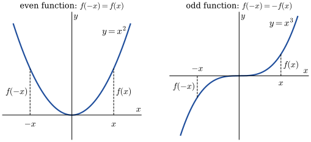
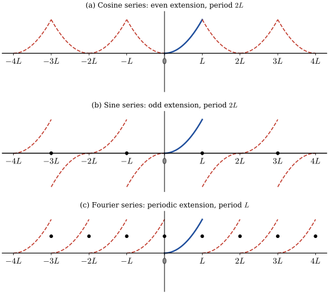
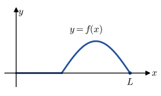

# Orthogonal Functions and Fourier Series {#sec-12}

## Orthogonal Functions {#sec-12-1}

* Inner Product

  If $\,\mathbf{u}=u_1\mathbf{i} +u_2\mathbf{j} +u_3\mathbf{k}\,$ and $\,\mathbf{v}
  =v_1\mathbf{i} +v_2\mathbf{j} +v_3\mathbf{k}\,$ are two vectors in $\mathbb{R}^3$, $\,$then inner product is defined:
  
  $$(\mathbf{u},\mathbf{v})=u_1v_1 +u_2v_2 +u_3v_3=u_iv_i$$

* The inner product $(\mathbf{u},\mathbf{v})$ possesses the following properties:
  
  * $(\mathbf{u},\mathbf{v})=(\mathbf{v},\mathbf{u})$

  * $(k\mathbf{u},\mathbf{v})
     =k(\mathbf{u},\mathbf{v})$, $\;k:\;$ a scalar

  * $(\mathbf{u},\mathbf{u})=0\,$ if $\,\mathbf{u}=\mathbf{0}\,$ and $\,(\mathbf{u},\mathbf{u})>0\,$ if $\,\mathbf{u}\neq\mathbf{0}$

  * $(\mathbf{u}+\mathbf{v},\mathbf{w})=(\mathbf{u},\mathbf{w}) +(\mathbf{v},\mathbf{w})$

* Inner Product of Functions

  The inner product of two functions $f_1$ and $f_2$ on an interval $[a,b]$ is the number
  
  $$ (f_1,f_2)=\int_a^b f_1(x)\, f_2(x) \,dx$$

* Orthogonal Functions

  Two functions $\,f_1$ and $\,f_2$ are said to be **orthogonal** on $[a,b]\,$ if
  
  $$(f_1,f_2)=\int_a^b f_1(x)\, f_2(x) \,dx=0$$

* Orthogonal Sets

  A set of real-valued functions $\{\phi_0(x),\phi_1(x),\phi_2(x),\cdots\}\,$ is said to be **orthogonal** on 
  $[a,b]\,$ if
  
  $$(\phi_m,\phi_n)=\int_a^b \phi_m(x) \, \phi_n(x) \,dx=0, \;\;m\neq n$$
  
  With the property that $\|\phi_n(x)\|=1$, $\,$then $\{\phi_n(x)\}$ is said to be an **orthonormal set** on the interval

$~$

**Example** $\displaystyle \left\{ \frac{1}{\sqrt{2\pi}}, \frac{\cos x}{\sqrt{\pi}}, \frac{\cos 2x}{\sqrt{\pi}},\cdots \right\}$, $\;\; -\pi \leq x\leq \pi$

::: {.callout-note collapse="true" title="Answer" appearance="simple"}
$(\phi_m,\phi_n)=\delta_{mn}$, $\ $ so the set is orthonormal on $[-\pi,\pi]$
:::

[Solution](files/solutions/sol_11_1.pdf){target="_blank"}

$~$

* Orthogonal Series Expansion

  Suppose $\left\{ \phi_n(x)\right\}$ is an infinite orthogonal set of functions on $[a,b]$. $\,$If $\,y=f(x)\,$ is a function defined on $[a,b]$,
  
  $$
  \begin{aligned}
     \color{blue}{f(x)}
       &\; \color{blue}{= c_0\phi_0(x) +c_1\phi_1(x) +\cdots +c_n\phi_n(x)+\cdots}\\
       &\; {\scriptsize\Downarrow}\\ 
      {\scriptsize \int_a^b f(x) \phi_n(x)\,dx} 
       &\; {\scriptsize =c_0\int_a^b \phi_0(x) \phi_n(x)\,dx 
        +c_1\int_a^b \phi_1(x)\phi_n(x)\,dx +\cdots +c_n\int_a^b \phi_n^2(x)\,dx+\cdots}\\ 
       &\; {\scriptsize = c_n\int_a^b \phi_n^2(x)\,dx} \\
       &\; {\scriptsize\Downarrow} \\ 
    {\color{red}{c_n}} & {\color{red}{= \frac{\displaystyle \int_a^b f(x)\,\phi_n(x)\,dx}{\displaystyle \int_a^b \phi_n^2(x)\,dx},\;\;n=0,1,2,\cdots}} 
  \end{aligned}$$

* Orthogonal Set/Weight Function

  A set of real-valued functions $\{\,\phi_0(x),\phi_1(x),\phi_2(x),\cdots\}\,$ is said to be **orthogonal 
  with respect to a weight function** $w(x)$ on $[a,b]\,$ if
  
  $$(\phi_m,\phi_n)=\int_a^b w(x)\phi_m(x) \phi_n(x) \,dx=0, \;\;m\neq n$$
  
  With this inner product notation, 
  
  $$ f(x)=\sum_{n=0}^\infty c_n \phi_n(x)$$
  
  where $~{\scriptsize c_n=\frac{\displaystyle\int_a^b f(x)w(x)\phi_n(x)\,dx}{\displaystyle\int_a^b w(x) \phi_n^2(x)\,dx}}$

$~$

## Fourier Series {#sec-12-2}

* Trigonometric Series

  $$ \left\{ 1, \,\cos\frac{\pi}{p}x, \,\cos\frac{2\pi}{p}x, \,\cos\frac{3\pi}{p}x,\cdots,
   \,\sin\frac{\pi}{p}x, \,\sin\frac{2\pi}{p}x, \,\sin\frac{3\pi}{p}x, \,\cdots \right\} $$

* Fourier Series

  The <font color="blue">**Fourier series**</font> of a function $f$ defined on the interval $(-p,p)\,$ is given by
  
  <font color="blue"> $$ f(x)=\frac{a_0}{2} +\sum_{n=1}^\infty \left( a_n\cos\frac{n\pi}{p}x +b_n\sin\frac{n\pi}{p}x \right)$$ </font>
  
  where
  
  $$
  \begin{aligned} 
     a_n &= \frac{1}{p}\int_{-p}^p f(x)\cos\frac{n\pi}{p}x \,dx, \quad a_0 = \frac{1}{p}\int_{-p}^p f(x)\,dx \\ 
     b_n &= \frac{1}{p}\int_{-p}^p f(x)\sin\frac{n\pi}{p}x \,dx
  \end{aligned}$$
  
  At a point of discontinuity, $\,$the Fourier series converges to the average $\displaystyle {\scriptsize \;\frac{f(x^+)+f(x^-)}{2}}$

$~$

**Example**

$$\begin{aligned}
 f(x) &=
  \begin{cases}
    \;0, & -\pi \leq x \leq 0 \\ 
    \;1, & \;\;\, 0 < x \leq \pi 
  \end{cases} \\
  &\Downarrow \\
 f(x)&= \frac{1}{2} 
 +\sum_{m=1}^\infty \frac{2}{(2m -1)\pi} \sin{(2m -1)x}
 \end{aligned}$$

$~$

```{python}
from sympy import fourier_series, Piecewise, pi, plot
from sympy.abc import x

f = Piecewise((0, x < 0), (1, True))
s = fourier_series(f, (x, -pi, pi))
s.truncate(5)
```

```{python}
s3 = s.truncate(n = 3)
s6 = s.truncate(n = 6)
s9 = s.truncate(n = 9)

p = plot(f, s3, s6, s9, (x, -1.5 *pi, 1.5 *pi), show=False, legend=True)

p[0].label = 'f'
p[1].label = 'n = 3'
p[2].label = 'n = 6'
p[3].label = 'n = 9'

p.show()
```

```{python}
import numpy as np
import matplotlib.pyplot as plt
plt.rcParams['font.size'] = 10

x_t1 = [-2*np.pi, -np.pi, -np.pi, 0, 0, np.pi, np.pi, 2*np.pi]
y_t1 = [1, 1, 0, 0, 1, 1, 0, 0]

x_t2 = [-np.pi, 0, 0, np.pi]
y_t2 = [0, 0, 1, 1]

x = np.linspace(-2 *np.pi, 2 *np.pi, 1000)

def example_plot(func, ns):
    
    fig, axes = plt.subplots(2, 2, figsize=(7.5, 7))
    i = 0
    for n in ns:
        ax = axes[i//2, i%2]
        ax.plot(x_t1, y_t1, 'b:')
        ax.plot(x_t2, y_t2, 'g-', lw=3)
        ax.plot(x, func(x, n), c='darkorange')
        ax.set_xticks([-2.0 *np.pi, -np.pi, 0, np.pi, 2.0 *np.pi])
        ax.set_xticklabels([r'$-2\pi$', r'$-\pi$', '0', 
          r'$\pi$', r'$2\pi$'])
        ax.set_xlim(-2.0 *np.pi, 2.0 *np.pi)
        ax.set_ylim(-0.2, 1.2)
        ax.set_title(f"$n=${n}")
    
        i += 1
```

```{python}
# | label: fig-ch12-Fourier-Series
# | fig-cap: 'Fourier Series'

def rect_wave(x, n): 
    y = 0.5
    for m in range(1, n +1):
        y = y +2.0 /((2.0*m -1) *np.pi) *np.sin((2.0*m -1)*x)
    return y 
    
example_plot(rect_wave, ns=[1, 3, 6, 9])
```

$~$

* The <font color="red">*overshooting*</font> by the partial sums from the functional values near a point of discontinuity does not smooth out but remains fairly constant. This behavior of a Fourier series near a point at which $f$ is discontinuous is known as the <font color="red">*Gibbs phenomenon*</font>

::: {.callout-tip appearance="simple" icon="false"}
**Try it in Python:** Computing Fourier coefficients by numerical integration (`scipy.integrate.quad`): @sec-integration-scipy; $~$or exactly with `sympy`: @sec-sympy-integrals
:::

$~$

## Fourier Cosine and Sine Series {#sec-12-3}

{width="90%" fig-align="center"}

* If $\,f\,$ is even, $~$ then 

  $\displaystyle\phantom{xx} \int_{-a}^a f(x)\,dx = 2\int_0^a f(x)\,dx$

* If $\,f\,$ is odd, $\,$then 

  $\displaystyle\phantom{xx} \int_{-a}^a f(x)\,dx = 0$

* The Fourier series of an even function on the interval $(-p,p)\,$ is the cosine series
  
  $$ f(x)=\frac{a_0}{2} +\sum_{n=1}^\infty a_n \cos\frac{n\pi}{p}x $$
  
  $\text{where }\,\displaystyle a_0=\frac{2}{p} \int_0^p f(x)\,dx,\; a_n=\frac{2}{p} \int_0^p f(x) \cos\frac{n\pi}{p}x \,dx$
 
* The Fourier series of an odd function on the interval $(-p,p)\,$ is the sine series
  
  $$ f(x)=\sum_{n=1}^\infty b_n \sin\frac{n\pi}{p}x\;\;\;\text{where}\;\displaystyle b_n=\frac{2}{p} \int_0^p f(x) \sin\frac{n\pi}{p}x \,dx $$

$~$

**Example**

$$
  \begin{aligned}
    f(x) &= x, \;\;0 < x < 2 \\
      &\Downarrow \\
    f(x) &=
     \frac{4}{\pi}\sum_{n=1}^\infty 
       \frac{(-1)^{n +1}}{n} \sin{\frac{n\pi}{2}x} \\
      &\,\text{or} \\
    f(x) &= 1 -\frac{8}{\pi^2}\sum_{m=1}^\infty
      \frac{1}{(2m -1)^2} \cos{\frac{(2m -1)\pi}{2}x}
  \end{aligned}$$

$~$

```{python}
x_t1 = [-4,-2,-2, 2, 2, 4]
y_t1 = [ 0, 2,-2, 2,-2, 0]

x_t2 = [0, 2]
y_t2 = [0, 2]
    
x = np.linspace(-4, 4, 1000)

def example_plot2(func, ns):
    fig, axes = plt.subplots(2, 2, figsize=(7.5, 7))
    i = 0
    for n in ns:
        ax = axes[i//2, i%2]    
        ax.plot(x_t1, y_t1, 'b:') 
        ax.plot(x_t2, y_t2, 'g-', lw=3)          
        ax.plot(x, func(x, n), c='darkorange') 
        ax.set_xlim(-4, 4)
        ax.set_title(f"$n=${n}")
    
        i += 1
```

```{python}
# | label: fig-ch12-Sine-Series
# | fig-cap: 'Sine Series'

def ramp_sin(x, n): 
    y = 0
    for m in range(1, n +1): 
        y = y +4.0 /np.pi *(-1)**(m +1)/m *np.sin(m *np.pi /2 *x)
    return y 
    
example_plot2(ramp_sin, ns=[1, 3, 6, 9])
```

```{python}
# | label: fig-ch12-Cosine-Series
# | fig-cap: 'Cosine Series'
x_t1 = [-4,-2, 0, 2, 4]
y_t1 = [ 0, 2, 0, 2, 0]

def ramp_cos(x, n):  
    y = 1
    for m in range(1, n +1): 
        y = y -8.0 /(np.pi *(2*m -1))**2.0 *np.cos((2*m -1) *np.pi /2 *x)
    return y 
    
example_plot2(ramp_cos, ns=[1, 3, 6, 9])
```

$~$

* Half-Range Expansion

  * Throughout the preceding discussion, $\,$it was understood that a function $\,f\,$ was defined on an interval with the origin as midpoint
  
  * However, in many instances, $\,$we are interested in representing a function that is defined only for $\,0 < x < L~$ by a trigonometric series

* This can be done in many different ways by supplying an arbitrary definition of the function on the interval $-L < x < 0$. $\,$For brevity we consider the three most important cases:

  * Reflect the graph of the function about the $y$-axis onto $-L < x < 0$
  
  * Reflect the graph of the function through the origin onto $-L < x < 0$
  
  * Define $f$ on $-L < x < 0\;$ by $\,f(x)=f(x+L)$

{fig-align="center" width="60%"}


## Complex Fourier Series {#sec-12-4}

* Complex Fourier Series

  The **complex Fourier series** of functions $\,f$ defined on an interval $(-p,p)\,$ is given by
  
  $$ f(x)=\sum_{n=-\infty}^\infty c_n e^{\frac{in\pi}{p}x} $$
  
  where
  
  $$ c_n=\frac{1}{2p}\int_{-p}^p f(x) e^{-\frac{in\pi}{p}x}\,dx $$

* Fundamental Frequency

  The Fourier series defines a periodic function and the fundamental period of that function is $T=2p$. $\,$Since $p=T/2$,
  
  $$ \frac{a_0}{2} +\sum_{n=1}^\infty (a_n \cos n\omega x +b_n \sin n\omega x)\;\;$$ 
  
  $$\text{and}$$

  $$ \sum_{n=-\infty}^\infty c_n e^{in\omega x}$$
  
  where $\,\omega=2\pi/T\,$ is called the **fundamental angular frequency**

* Frequency Spectrum

  If $\,f$ is periodic and has fundamental period $T$, $\,$the plot of the points $(n\omega, |c_n|)$ $\,$is called the frequency spectrum of $\;f$

$~$

**Example** $\,$ Expand $\;f(x)=e^{-x}$, $\;-\pi<x<\pi\;$ in a complex Fourier series and find the frequency spectrum

::: {.callout-note collapse="true" title="Answer" appearance="simple"}
$c_n=\dfrac{(-1)^n\sinh\pi}{\pi\,(1+in)}$, $\quad e^{-x}=\dfrac{\sinh\pi}{\pi}\displaystyle\sum_{n=-\infty}^{\infty}\frac{(-1)^n}{1+in}\,e^{inx}$

Spectrum: $\omega=1$, $\ $ points $\left(n,\ \dfrac{\sinh\pi}{\pi\sqrt{1+n^2}}\right)$
:::

[Solution](files/solutions/sol_11_4.pdf){target="_blank"}

$~$

## Sturm-Liouville Problem {#sec-12-5}

* Self-Adjoint Form

  $$\begin{aligned}
    a(x) \frac{d^2 y}{dx^2} 
     +b(x) \frac{dy}{dx} 
    &+\left[ \lambda c(x) +d(x) \right] y 
     = 0,\;\;a(x)\neq 0 \\
    &\Downarrow \\
    {\scriptsize \frac{d}{dx}\left[ \exp\left(\int\frac{b(x)}{a(x)}dx\right)\frac{dy}{dx} \right ]} 
    &{\scriptsize +\left\{ \lambda \frac{c(x)}{a(x)}\exp\left(\int\frac{b(x)}{a(x)}dx\right) 
     +\frac{d(x)}{a(x)}\exp\left(\int\frac{b(x)}{a(x)}dx\right)\right \} y = 0} \\
    &\Downarrow \\     
     \color{red}{\frac{d}{dx}\left[r(x)\frac{dy}{dx}\right]}&\color{red}{+\left[\lambda p(x) +q(x)\right]y=0}
  \end{aligned}$$

* Eigenvalues and Eigenfunctions

  An orthogonal set of functions can be generated by solving a two-point boundary-value problem involving a linear second-order differential equation containing a parameter $\lambda$

* The boundary-value problem 
  
  $$ y''+\lambda y =0, \;y(0)=0, \;y(L)=0~$$

  possessed nontrivial solutions only when the parameter $\lambda$ took on the values 
  
  $$ \lambda_n= \left(\frac{n\pi}{L}\right)^2, \;\;n=1,2,3,\cdots $$ 
  
  called **eigenvalues**. The corresponding nontrivial solutions 
  
  $$ y_n=c_n\sin \frac{n\pi x}{L} $$
  
  are called the **eigenfunctions**

* **Regular Sturm-Liouville Problem**

  Let $p$, $q$, $r$, and $r'$ be real-valued functions continuous on an interval $[a,b]$, $\,$and let $r(x) > 0~$ and $\,p(x)>0~$ for every $\,x\,$ in the interval. $\,$Then
  
  $$ \frac{d}{dx}\left[r(x)\frac{dy}{dx}\right]+\left[\lambda p(x) +q(x)\right]y=0 $$
  
  subject to
  
  $$\begin{aligned}
    A_1 y(a) +B_1 y'(a)&= 0\\ 
    A_2 y(b) +B_2 y'(b)&= 0
  \end{aligned}$$
    
  is said to be a **regular Sturm-Liouville problem**

* Properties of the Regular Sturm-Liouville problem

  1. There are <font color="blue"> an infinite number of real eigenvalues</font> that can be arranged in increasing order $\lambda_1<\lambda_2<\lambda_3<\cdots<\lambda_n<\cdots\;\;$ such that $\lambda_n \to \infty\;$ as $n\to\infty$

  1. For each eigenvalue $\lambda_i$, $~$there is <font color="blue">only one eigenfunction</font> (except for nonzero constant multiples)

  1. Eigenfunctions corresponding to different eigenvalues are <font color="blue">linearly independent</font>
  
  1. The set of eigenfunctions corresponding to the set of eigenvalues is <font color="blue">orthogonal with respect to the weight function $p(x)$</font> on the interval $[a,b]$

* **Proof of 4**

  $$\scriptstyle   
    \begin{aligned}
     \frac{d}{dx}\left[r(x)\frac{dy_m}{dx}\right] 
     &+\left(\lambda_m p(x) +q(x)\right) y_m \;=\; 0 \\ 
     \frac{d}{dx}\left[r(x)\frac{dy_n}{dx}\right] 
     &+\left(\lambda_n p(x) +q(x)\right) y_n \;=\; 0 \\ 
     &\Downarrow \\ 
     \left( \lambda_m -\lambda_n \right ) p(x) y_m y_n \;
     &=\; y_m \frac{d}{dx}\left[r(x)\frac{dy_n}{dx}\right] -y_n \frac{d}{dx}\left[r(x)\frac{dy_m}{dx}\right] \\
     &\Downarrow \\
     \left( \lambda_m -\lambda_n \right) \int_a^b p(x) y_m y_n \,dx \;
     & =\; \left.y_m r(x) \frac{d y_n}{dx} \right|_a^b
      \;-\;\int_a^b \frac{d y_m}{dx} r(x) \frac{d y_n}{dx} \,dx \;-\;\left.y_n r(x) \frac{d y_m}{dx} \right|_a^b
      \;+\;\int_a^b \frac{d y_n}{dx} r(x) \frac{d y_m}{dx} \,dx \\
     & =\; r(b)\left[ y_m(b) y_n'(b) - y_n(b) y_m'(b) \right ] \;-\;r(a)\left[ y_m(a) y_n'(a) - y_n(a) y_m'(a) \right ] \\
     & =\; 0 \\
     &\Downarrow \\
     \int_a^b p(x) y_m y_n \,dx \;
     & =\; 0, \;\;\lambda_m \neq \lambda_n
  \end{aligned}$$

$~$

**Example** $\,$ Solve the boundary-value problem
  
  $$ y'' +\lambda y=0, \;\;y(0)=0, \;\;y(1) +y'(1)=0 $$
  
**Solution**

$$
\begin{aligned}
  y &= c_1\cos\sqrt{\lambda}\,x 
      +c_2\sin\sqrt{\lambda}\,x \\ \\
    &\;\Downarrow \;y(0)=0,\;y(1)+y'(1)=0 \\ \\ 
     c_1\cos 0 &+c_2\sin 0 = 0 \;\rightarrow \;c_1=0 \\
     c_2\sin\sqrt{\lambda} 
    &+c_2\sqrt{\lambda}\cos\sqrt{\lambda}=0 
     \;\rightarrow \;c_2 \neq 0, \;\tan\sqrt{\lambda}=-\sqrt{\lambda}
\end{aligned}$$

$~$

```{python}
x = np.linspace(0, 4*np.pi, 1000)  
y = np.tan(x)

threshold = 100
y[y > threshold] = np.inf
y[y <-threshold] = np.inf

def example_plot3(eigenvalues):
    plt.figure(figsize=(6, 5))
    plt.plot(x, y, linewidth=1.2, color="blue")
    plt.plot(x,-x, linewidth=1.2, color="green")
    plt.scatter(eigenvalues,-eigenvalues, color='red')
    plt.xticks([0, np.pi, 2.0*np.pi, 3.0*np.pi, 4.0*np.pi], 
        ['0', r'$\pi$', r'$2\pi$', r'$3\pi$', r'$4\pi$'], 
        fontsize=16)
    plt.yticks(fontsize=16)
    plt.xlim(0, 4.0*np.pi)
    plt.ylim(-15, 15)
    plt.grid()
    plt.show()
```

```{python}
#| echo: true
from scipy import optimize

sqrt_eigenvalues = np.zeros(4)
for i in range(4):
    sqrt_eigenvalues[i] = np.round(optimize.brentq(
      lambda x : np.tan(x) +x, 
      (i +0.5001) *np.pi, 
      (i +0.9999) *np.pi), 4)

print(f'{sqrt_eigenvalues =}')
```

```{python}
#| fig-align: 'center'
example_plot3(sqrt_eigenvalues)
```

```{python}
#| label: fig-eigenfunctions-1
#| fig-cap: "Eigenfunctions"
def example_plot3_(x, n_eig, sqrt_eig, eigfunc):

    plt.figure(figsize=(6, 5))
    for n in range(n_eig):
        plt.plot(x, eigfunc(x, sqrt_eig[n]), label='$X_%d(x)$' % (n +1))
     
    plt.xlim(0, 1)
    plt.ylim(-1.2, 1.2)
    plt.grid(ls=':')    
    plt.legend(loc='upper left', bbox_to_anchor=(1, 1.03))
    plt.xlabel('$x$')
    plt.ylabel('$X_n(x)$')
    plt.title(r'$X_n(x)=\sin\sqrt{\lambda_n} x$')
    plt.show()

def eigfunc(x, sqrt_eig):  
    return np.sin(sqrt_eig *x)

x = np.linspace(0, 1, 150)
example_plot3_(x, len(sqrt_eigenvalues), sqrt_eigenvalues, eigfunc)
```

$~$

* **Singular Sturm-Liouville Problem**

  There are several important conditions under which we seek nontrivial solutions 
  
  1. $r(a)=0\;$ and $\;A_2y(b)+B_2y'(b)=0$
  2. $A_1y(a)+B_1y'(a)=0\;$ and $\;r(b)=0$
  3. $r(a)=r(b)=0\;$ and no boundary condition is specified at either $x=a\;$ or $\;x=b$
  4. $r(a)=r(b)\;$ and $\,y(a)=y(b)$, $\;y'(a)=y'(b)$
  
  $$\scriptsize
  \begin{aligned}
     \left( \lambda_m -\lambda_n \right ) \int_a^b p(x) y_m y_n \,dx \,
     & \,= r(b)\left[ y_m(b) y_n'(b) - y_n(b) y_m'(b) \right ] \\
     & \text{ }-r(a)\left[ y_m(a) y_n'(a) - y_n(a) y_m'(a) \right ] = 0 \\
     & \Downarrow \\
      \int_a^b p(x) y_m y_n \,dx \,
     & \,= 0, \;\;\lambda_m \neq \lambda_n
  \end{aligned}$$

* Parametric Bessel Equation: 
  
  $$ x^2y'' +xy' +(\color{red}{\alpha^2}x^2 -\color{blue}{n^2})y=0,\;\; n=0,1,2,\cdots$$
    
  $$ \frac{d}{dx}\left[xy'\right] +\left(\alpha^2x -\frac{n^2}{x}\right)y=0 $$
  
* Legendre Equation: 
    
  $$(1-x^2)y''-2xy'+\color{red}{n(n+1)}y=0,\;\; n=0,1,2,\cdots $$
  
  $$ \frac{d}{dx}\left[(1-x^2)y'\right] +n(n +1)y = 0 $$

* Consider $\,y'' +\lambda y =0~$ subject to the periodic boundary condition $~y(-L)=y(L)$, $\,y'(-L)=y'(L)$. $\,$Show that the eigenfunctions are
  
  $$ \left\{ 1,\cos\frac{\pi}{L}x, \cos\frac{2\pi}{L}x, \cdots, \sin\frac{\pi}{L}x, \sin\frac{2\pi}{L}x, \,\cdots \right\}$$
  
  This set, $\,$which is orthogonal on $\,[-L,L]$, $\,$is the basis for the Fourier Series

::: {.callout-note collapse="true" title="Answer" appearance="simple"}
$\lambda_0=0$: $\ y_0=1$; $\quad \lambda_n=\left(\dfrac{n\pi}{L}\right)^2$: $\ y_n=A_n\cos\dfrac{n\pi x}{L}+B_n\sin\dfrac{n\pi x}{L}\quad(n=1,2,\dots)$
:::

  [Solution](files/solutions/sol_11_5.pdf){target="_blank"}

$~$

## Bessel and Legendre Series {#sec-12-6}

### Fourier-Bessel Series {#sec-12-6-1}

* The parametric Bessel differential equation is
  
  <font color="red"> $$ \frac{d}{dx}\left[xy'\right] +\left(\alpha^2x -\frac{n^2}{x}\right)y=0 $$ </font>

  in which $~r(x)=x$, $~p(x)=x$, $~q(x)=-n^2/x$, $\,$and $~\lambda=\alpha^2$. 
  $\,$The general solution of this equation is
 
  $$ \color{blue}{y=c_1J_n(\alpha x)} +c_2Y_n(\alpha x) $$

* Now $r(0)=0$, $\,$and of two solutions $J_n(\alpha x)$ and $Y_n(\alpha x)$, $\,$ <font color="blue">only $J_n(\alpha x)$ is bounded at $x=0$</font>
  
* The eigenvalues $\lambda_i=\alpha_i^2, \;i=1,2,3,\cdots,$ $\,$are defined by means of a boundary condition at $x=b$:
  
  <font color="red"> $$A_2J_n(\alpha b) +B_2\alpha J_n'(\alpha b) = 0 $$ </font>
  
* For any choice of $A_2$ and $B_2$, $\,$not both zero, $\,$it is known that <font color="blue">the above boundary condition gives an infinite number of roots $x_i=\alpha_i b$. The eigenvalues are then $\lambda_i=\alpha_i^2=(x_i/b)^2$ </font>

* Differential Recurrence Relations

  $$
  \begin{aligned}
   xJ_n'(x)&=xJ_{n-1}(x) -nJ_n(x)\\
   xJ_n'(x)&=nJ_n(x)-xJ_{n+1}(x)\\
   &\Downarrow \\
   \frac{d}{dx}\left[ x^n J_n(x) \right ]&= x^n J_{n-1}(x)\\ 
   \frac{d}{dx}\left[ x^{-n} J_n(x) \right ]&=-x^{-n} J_{n+1}(x) 
  \end{aligned}$$

* Square Norm

  $$ 
  \begin{aligned}
    \frac{d}{dx}\left[ xy' \right] &+\left( \alpha^2x -\frac{n^2}{x} \right)y = 0\\ 
    &\Downarrow \;\times \;2xy' \\ 
    \frac{d}{dx}\left[ xy' \right]^2 &+\left( \alpha^2x^2 -n^2 \right) \frac{d}{dx}[y]^2 =0\\ 
    &\Downarrow {\tiny \text{integrating by parts on}\; [0,b]}\\ 
    \left[ \left[xy' \right]^2 +(\alpha^2x^2 -n^2)y^2 \right]_0^b &=2\alpha^2 \int_0^b xy^2\,dx \\ 
    &\Downarrow \; {\tiny y=J_n(\alpha x),\;y'=\alpha J_n'(\alpha x), \;J_n(0)=0\,\;\text{for}\; n>0} \\
    \color{blue}{2\alpha^2 \int_0^b xJ_n^2(\alpha x)\,dx}\; &\color{blue}{= \alpha^2b^2 \left[ J_n'(\alpha b) \right]^2 
    +\left(\alpha^2b^2 -n^2\right)\left[ J_n(\alpha b) \right]^2}
  \end{aligned}$$

* **Consider three cases of the boundary condition** 
  
  $$A_2J_n(\alpha b) +B_2\alpha J_n'(\alpha b) = 0$$

$~$

* **Case I :** <font color="red"> $~~A_2=1, \,B_2 = 0 \Rightarrow J_n(\alpha b)=0\;$ $\Rightarrow$ $\;\lambda_i=\alpha_i^2 =(x_i/b)^2 >0$</font>
    
  $$
  \begin{aligned}
      2\alpha_i^2 \int_0^b xJ_n^2(\alpha_i x)\,dx &= \alpha_i^2b^2 \left[ J_n'(\alpha_i b) \right]^2 +(\alpha_i^2b^2 -n^2)\left[ J_n(\alpha_i b) \right]^2 \\
      &\Downarrow \;xJ_n'(x)=n\underbrace{J_n(x)}_{=0} -xJ_{n+1}(x) \\
      \color{blue}{\| J_n(\alpha_i x) \|^2 = \int_0^b xJ_n^2(\alpha_i x)}&\color{blue}{\,dx\; =\frac{b^2}{2} J_{n+1}^2(\alpha_i b)}
  \end{aligned}$$

$~$    

```{python}
from scipy.special import jv, jn_zeros
from mpl_toolkits.axisartist.axislines import SubplotZero

def make_plot_form():

    fig = plt.figure(figsize=(7, 8))
    ax1 = SubplotZero(fig, 211)
    ax2 = SubplotZero(fig, 212)

    fig.add_subplot(ax1)
    ax1.axis["left", "right", "bottom", "top"].set_visible(False)
    ax1.axis["xzero", "yzero"].set_visible(True)
    ax1.axis["xzero", "yzero"].set_axisline_style("-|>")

    ax1.set_xticks([2, 4, 6, 8, 10])
    ax1.text(12, -0.03, r'$\alpha$', fontsize=14)

    fig.add_subplot(ax2)
    ax2.axis["left", "right", "bottom", "top"].set_visible(False)
    ax2.axis["xzero", "yzero"].set_visible(True)
    ax2.axis["xzero", "yzero"].set_axisline_style("-|>")

    ax2.set_xticks([0.2, 0.4, 0.6, 0.8, 1.0])
    ax2.text(1.1, -0.03, r'$x$', fontsize=14)

    r1 = np.linspace(0, 11, 100) 
    r2 = np.linspace(0, 1, 100)       

    return ax1, ax2, r1, r2

def make_plot(case_no, ax1, ax2, r1, r2, mm, bc_txt, eigfn_txt):

    alpha_0m = eval_alpha(mm)

    y1 = eval_bc(r1)
    ax1.plot(r1, y1, label=bc_txt)
    ax1.plot(alpha_0m, np.zeros(mm), 'ro')

    for m in range(mm):
        ax1.text(alpha_0m[m] -0.2, 0.1, rf'$\alpha_{m +1}$', 
            fontsize=12)            
    ax1.legend(bbox_to_anchor=(1, 1), loc="upper left")

    x_zeros = eval_x_zeros(mm)
    for m in range(mm):   
        y2 = eval_eigfn(alpha_0m[m]*r2)
        ax2.plot(r2, y2, label=eigfn_txt +rf'$(\alpha_{m +1}x)$')
        if case_no == 1:
          ax2.plot(x_zeros[:m +1] /alpha_0m[m], np.zeros(m +1), 'x')
        elif case_no == 2:
          ax2.plot(x_zeros[:m] /alpha_0m[m], np.zeros(m), 'x')
        elif case_no == 3:
          if m != 0:
            ax2.plot(x_zeros[:m] /alpha_0m[m], np.zeros(m), 'x')
 
    ax2.legend(bbox_to_anchor=(1, 1), loc="upper left")

```

```{python}
#| fig-cap: 'Case I: $~n=0, A_2 = 1, B_2 = 0, b=1$'
def eval_eigfn(x):
    return jv(0, x)

def eval_bc(alpha):
    return eval_eigfn(alpha)

def eval_alpha(mm):
    return jn_zeros(0, mm)

def eval_x_zeros(mm):
    return eval_alpha(mm)

def example_plot4():

    ax1, ax2, r1, r2 = make_plot_form()

    ax1.set_ylim(-0.5, 1.1)
    ax1.set_yticks([-0.5, 0.5, 1.0])

    ax2.set_ylim(-0.5, 1.1)   
    ax2.set_yticks([-0.5, 0.5, 1.0])

    mm = 3

    make_plot(1, ax1, ax2, r1, r2, mm, r'$J_0(\alpha)$', '$J_0$')

    plt.show()

example_plot4()
```

```{python}
#| fig-cap: 'Case I: $~n=1, A_2 = 1, B_2 = 0, b=1$'

def eval_eigfn(x):
    return jv(1, x)

def eval_bc(alpha):
    return eval_eigfn(alpha)

def eval_alpha(mm):
    return jn_zeros(1, mm)

def eval_x_zeros(mm):
    return eval_alpha(mm)           

def example_plot4_():

    ax1, ax2, r1, r2 = make_plot_form()  

    ax1.set_ylim(-0.5, 1.1)
    ax1.set_yticks([-0.5, 0.5, 1.0])

    ax2.set_ylim(-0.5, 1.1)   
    ax2.set_yticks([-0.5, 0.5, 1.0])

    mm = 3

    make_plot(1, ax1, ax2, r1, r2, mm, r'$J_1(\alpha)$', '$J_1$')

    plt.show()

example_plot4_()
```

$~$

* **Case II :** $\,$($A_2=h, \,B_2 = b \Rightarrow h\geq 0$) 

  <font color="red"> $$~ hJ_n(\alpha b) +\alpha bJ_n'(\alpha b)=0 \;\Rightarrow \;\lambda_i=\alpha_i^2 =\left(\frac{x_i}{b}\right)^2 \;\text{ except for }\; 
  h=0\; \text{ and } \; n=0 $$ </font>
  
    $$
    \begin{aligned}
       2\alpha_i^2 \int_0^b xJ_n^2(\alpha_i x)\,dx 
        &= \alpha_i^2b^2 \left[ J_n'(\alpha_i b) \right]^2 +(\alpha_i^2b^2 -n^2)\left[ J_n(\alpha_i b) \right]^2 \\ \\
       &\Downarrow \;\alpha_ibJ_n'(\alpha_i b)=-hJ_n(\alpha_i b) \\ \\
       \color{blue}{\| J_n(\alpha_i x) \|^2 = \int_0^b xJ_n^2(\alpha_i x)\,dx} \; & \color{blue}{=\frac{\alpha_i^2b^2 -n^2 +h^2}{2\alpha_i^2}
       J_n^2(\alpha_i b) }
    \end{aligned}$$

$~$

```{python}
#| fig-cap: "Case II: $~n=0, h = 1, b=1, \\;J_0(\\alpha) + \\alpha J_0' (\\alpha)=0$"
from scipy.special import j0, j1
from scipy.optimize import fsolve

def eval_eigfn(x):
    return j0(x)

def eval_bc(alpha):
    return j0(alpha) -alpha *j1(alpha)

def eval_alpha(mm):
    alpha_0m = np.zeros(mm)
    for i in range(mm):
      alpha_0m[i] = fsolve(eval_bc, 1 +3*i)[0]
    
    return alpha_0m

def eval_x_zeros(mm):
    return jn_zeros(0, mm -1)    

def example_plot4__():

    ax1, ax2, r1, r2 = make_plot_form()  

    ax1.set_ylim(-4, 4)
    ax1.set_yticks([-3, -2, -1, 1, 2, 3])

    ax2.set_ylim(-0.5, 1.2)   
    ax2.set_yticks([-0.5, 0.5, 1.0])

    mm = 4

    make_plot(2, ax1, ax2, r1, r2, mm, 
        r"$J_0(\alpha) +\alpha J_0'(\alpha)$", '$J_0$')    

    plt.show()

example_plot4__()
```

$~$

* **Case III :** $\,$($h=0$ and $n=0$) : <font color="red"> $~~J_0'(\alpha b)=0\;$ </font>
  
  It is the only situation for which $\lambda=0$ is an eigenvalue
   
  $$
  \begin{aligned}
    \color{blue}{\alpha_1 = 0 \rightarrow 
     \| J_0(\alpha_1 x) \|^2}\; &\color{blue}{= \int_0^b x\,dx =\frac{b^2}{2}} \\ \\  
     2\alpha_i^2 \int_0^b xJ_0^2(\alpha_i x)\,dx &= \alpha_i^2b^2 \left[ J_0'(\alpha_i b) \right]^2 +(\alpha_i^2b^2 -0^2)\left[ J_0(\alpha_i b) \right]^2 \\
     &\Downarrow \\
     \color{blue}{\alpha_i,\; i=2,3,4,\cdots \rightarrow
     \| J_0(\alpha_i x) \|^2} \; &\color{blue}{ =\int_0^b xJ_0^2(\alpha_i x)\,dx =\frac{b^2}{2}J_0^2(\alpha_i b)}
  \end{aligned}$$

$~$

```{python}
#| fig-cap: "Case III: $~n=0, h = 0, b=1, \\;J_0'(\\alpha)=0$"
from scipy.special import jnp_zeros

def eval_eigfn(x):
    return j0(x)

def eval_bc(alpha):
    return -j1(alpha)

def eval_alpha(mm):
    return np.append([0], jnp_zeros(0, mm -1))

def eval_x_zeros(mm):
    return jn_zeros(0, mm -1)      

def example_plot4___():

    ax1, ax2, r1, r2 = make_plot_form()   
  
    ax1.set_ylim(-0.8, 0.5)   
    ax1.set_yticks([-0.5, 0.5])
  
    ax2.set_ylim(-0.5, 1.2)   
    ax2.set_yticks([-0.5, 0.5, 1.0])
  
    mm = 4

    make_plot(3, ax1, ax2, r1, r2, mm, r"$J_0'(\alpha)$", '$J_0$')    

    plt.show()

example_plot4___()
```

$~$

* The set $\{J_n(\alpha_i x), \;i=1,2,3,\cdots\}$ is orthogonal with respect to the weight function $p(x)=x~$ on $~[0, b]$
   
  <font color="red"> $$\int_{0}^b x\, J_n(\alpha_i x) \, J_n(\alpha_j x)\,dx=0,\; i\neq j$$ </font>

* The Fourier-Bessel series of a function $\,f$ defined on the interval $(0, b)$ is given by
  
  <font color="red"> $$ f(x)=\sum_{i=1}^\infty c_i J_n(\alpha_i x)$$ </font> 
    
    where

  <font color="red"> $$ c_i=\frac{\displaystyle\int_0^b x\,f(x)\,J_n(\alpha_i x)\,dx}{\displaystyle\int_0^b x \, J_n^2(\alpha_i x)\,dx} =\color{blue}{\frac{1}{\| J_n(\alpha_i x)\|^2}}\int_0^b x\,f(x) \, J_n(\alpha_i x)\,dx $$</font>

$~$

### Fourier-Legendre Series {#SEC-12-6-2}

* Legendre's differential equation is
  
   $$(1-x^2)y'' -2xy'+n(n+1)y=0\;$$ 
  
   $$\text{or}$$ 
  
   <font color="red"> $$\frac{d}{dx}\left[ (1-x^2)y' \right]+n(n+1)y=0$$ </font>
  
   in which $~r(x)=1-x^2, \,p(x)=1, \,\lambda=n(n+1),$ and $~q(x)=0$

* <font color="red"> The Legendre polynomials $P_n(x)$ are the only solutions that are bounded on the interval $[\text{-}1, \,1]$ </font>

$~$

```{python}
# | label: fig-Legendre
# | fig-cap: "Legendre Polynomials"
from scipy.special import eval_legendre

fig = plt.figure(figsize=(5, 5))
ax = SubplotZero(fig, 111)

fig.add_subplot(ax)
ax.axis["left", "right", "bottom", "top"].set_visible(False)
ax.axis["xzero", "yzero"].set_visible(True)
ax.axis["xzero", "yzero"].set_axisline_style("-|>")

ax.set_xticks([-1, -0.5, 0.5, 1], ['-1', '', '', '1'])
ax.set_yticks([-1, -0.5, 0.5, 1], ['-1', '', '', '1'])
ax.grid(ls=':')
ax.text(-0.1, 1.3, r'$P_n(x)$', fontsize=14)
ax.text(1.3, -0.05, r'$x$', fontsize=14)
ax.set_xlim(-1.2, 1.2)  
ax.set_ylim(-1.2, 1.2)  

x = np.linspace(-1, 1, 100)
for n in range(5):
    y = eval_legendre(n, x)
    ax.plot(x, y, label=f'$P_{n}(x)$')

ax.legend(loc='lower left', bbox_to_anchor=(1, 0))

plt.show()
```

$~$

* The set $\{P_n(x), \;n=0,1,2,\cdots\}$ is orthogonal with respect to the weight function $p(x)=1$ on $[\text{-}1,\,1]$
   
  <font color="red"> $$\int_{-1}^1 P_m(x)P_n(x)\,dx=0,\; m\neq n$$ </font>

* The Fourier-Legendre series of a function $\,f$ defined on the interval $(\text{-}1,1)$ is given by
  
  <font color="red"> $$ f(x)=\sum_{n=0}^\infty c_n P_n(x)$$ </font> 
    
  where

  <font color="red"> $$ c_n=\frac{\displaystyle\int_{-1}^1 f(x)P_n(x)\,dx}{\displaystyle\int_{-1}^1 P_n^2(x)\,dx} =\color{blue}{\frac{2n+1}{2}}\int_{-1}^1 f(x)P_n(x)\,dx $$ </font>    

### Other Important Equations {#SEC-12-6-3}

$~$

* Hermite

  $$y'' -2x y' +2n y=0$$
  
* Laguerre

  $$xy'' +(1-x)y' +ny=0$$
  
* Chebyshev

  $$(1-x^2) y'' -xy' +n^2y = 0$$
  
* Hypergeometric 

  $$x(1-x)y'' +[c - (a + b +1)x]\, y' -ab y = 0$$

$~$

## Worked Exercises {.unnumbered}

**1.** $~$ Suppose the function $y=f(x)$, $0 < x < L$, given in figure is expanded in a cosine series, in a sine series, and in a Fourier series. Sketch the periodic extension to which each series converges



$$f(x) = \begin{cases}
 0 & 0 \displaystyle \leq x < \frac{L}{2} \\
\displaystyle -\sin \frac{2\pi x}{L} & \displaystyle \frac{L}{2} \leq x \leq L
\end{cases}$$

**Solution**

**1. Cosine Series (Even Extension)**

* A cosine series is the Fourier cosine series, which assumes that the function is extended evenly about $x=0$
* The extended function is even, meaning $f(-x) = f(x)$
* The domain is extended to $[-L, L]$ and periodically repeated with period $2L$

So the full even extension on $[-L, L]$:

$$f_{\text{even}}(x) = \begin{cases}
\sin\left(\frac{2\pi x}{L}\right) & -L \le x < -\frac{L}{2} \\
0 & -\frac{L}{2} \le x < \frac{L}{2} \\
-\sin\left(\frac{2\pi x}{L}\right) & \frac{L}{2} \le x \le L
\end{cases}$$

Then repeat with period $2L$

**2. Sine Series (Odd Extension)**

* A sine series extends the function oddly about $x=0$
* The extended function is odd, so $f(-x) = -f(x)$
* Defined on $[-L, L]$ and repeated every $2L$

So the odd extension is:

$$f_{\text{odd}}(x) = \begin{cases}
\sin\left(\frac{2\pi x}{L}\right) & -L \le x < -\frac{L}{2} \\
0 & -\frac{L}{2} \le x < \frac{L}{2} \\
-\sin\left(\frac{2\pi x}{L}\right) & \frac{L}{2} \le x \le L
\end{cases}$$

Then repeated every $2L$

**3. Full Fourier Series (Periodic Extension)**

* The full Fourier series uses both sine and cosine terms
* The function is extended periodically with period $L$

This shape repeats every $L$ units

```{python}
import numpy as np
import matplotlib.pyplot as plt

# Define function f(x) on [0, L]
L = 2 * np.pi  # for easy visualization, let L = 2π
x = np.linspace(-2*L, 2*L, 2000)

# Define the base function f(x) on [0, L]
def f_base(x):
    x_mod = x % L
    return np.where(
        x_mod < L/2,
        0,
        -np.sin(2 * np.pi * x_mod / L)
    )

# Even extension (cosine series)

def f_even(x):
    # Reflect across x = 0 and repeat with period 2L
    x_mod = np.mod(x, 2*L)
    reflected = np.where(x_mod < L, x_mod, 2*L - x_mod)
    return f_base(reflected)

# Odd extension (sine series)    

def f_odd(x):
    # Reflect and invert across x = 0, repeat with period 2L
    x_mod = np.mod(x, 2*L)
    reflected = np.where(x_mod < L, x_mod, 2*L - x_mod)
    sign = np.where(x_mod < L, 1, -1)
    return sign * f_base(reflected)

# Full periodic extension (Fourier series)
def f_periodic(x):
    return f_base(x)

# Redefine x-axis from -L to 2L
x_zoom = np.linspace(-L, 2*L, 1000)

xticks = [-L, -L/2, 0, L/2, L, 3*L/2, 2*L]
xtick_labels = [r"$-L$", r"$-\frac{L}{2}$", 
  r"$0$", r"$\frac{L}{2}$", r"$L$", r"$\frac{3L}{2}$", r"$2L$"]

# Plotting with labeled ticks
fig, axs = plt.subplots(3, 1, figsize=(6, 8), sharex=True)

axs[0].plot(x_zoom, f_even(x_zoom), color='blue')
axs[0].set_title('Even Extension (Cosine Series)')
axs[0].grid(True)
axs[0].set_xlim([-L, 2*L])
axs[0].set_ylim([-1.1, 1.1])

axs[1].plot(x_zoom, f_odd(x_zoom), color='green')
axs[1].set_title('Odd Extension (Sine Series)')
axs[1].grid(True)
axs[1].set_xlim([-L, 2*L])
axs[1].set_ylim([-1.1, 1.1])

axs[2].plot(x_zoom, f_periodic(x_zoom), color='red')
axs[2].set_title('Periodic Extension (Full Fourier Series)')
axs[2].grid(True)
axs[2].set_xlim([-L, 2*L])
axs[2].set_ylim([-1.1, 1.1])

# Set common x-axis ticks and labels
axs[2].set_xticks(xticks)
axs[2].set_xticklabels(xtick_labels, fontsize=12)
plt.xlabel('x')
plt.tight_layout()
plt.show()
```

$~$

**2.** $~$ Find the half-range cosine and sine expansions of the given function:

$$ f(x)=x(2-x), \;\;0 < x < 2$$

**Solution**

**1. Half-Range Cosine Series (Even Extension)**

We write $f(x)$ on $0 < x < 2$ as a cosine series:

$$f(x) \sim \frac{a_0}{2} + \sum_{n=1}^{\infty} a_n \cos\left(\frac{n\pi x}{L}\right)$$
where $L = 2$, and the coefficients are:

$$a_0 = \frac{1}{L} \int_0^L f(x) \, dx = \frac{1}{2} \int_0^2 x(2 - x) \, dx$$

$$a_n = \frac{1}{L} \int_0^L f(x) \cos\left(\frac{n\pi x}{L}\right) \, dx = \frac{1}{2} \int_0^2 x(2 - x) \cos\left(\frac{n\pi x}{2}\right) \, dx$$

* Compute $a_0$:

$$a_0 = \frac{1}{2} \int_0^2 (2x - x^2) \, dx = \frac{1}{2} \left[ x^2 - \frac{x^3}{3} \right]_0^2 = \frac{1}{2} \left(4 - \frac{8}{3} \right) = \frac{2}{3}$$

* Compute $a_n$:

We split the integral:

$$\begin{aligned}
 a_n &= \frac{1}{2} \left[ 2 \int_0^2 x \cos\left(\frac{n\pi x}{2}\right) dx - \int_0^2 x^2 \cos\left(\frac{n\pi x}{2}\right) dx \right] \\
&= \frac{-4 \left[(-1)^n + 1\right]}{\pi^2 n^2}
\end{aligned}$$

Therefore, the final simplified form is:

$$a_n =
\begin{cases}
\displaystyle \frac{-8}{\pi^2 n^2}, & \text{if } n \text{ is even} \\
0, & \text{if } n \text{ is odd}
\end{cases}
\quad \text{for } n \ge 1$$

$~$

**2. Half-Range Sine Series (Odd Extension)**

We write $f(x)$ on $0 < x < 2$ as a sine series:

$$f(x) \sim  \sum_{n=1}^{\infty} a_n \sin\left(\frac{n\pi x}{L}\right)$$
where $L = 2$, and the coefficients are:

$$b_n = \frac{1}{L} \int_0^L f(x) \sin\left(\frac{n\pi x}{L}\right) \, dx = \frac{1}{2} \int_0^2 x(2 - x) \sin\left(\frac{n\pi x}{2}\right) \, dx$$

The exact expression for the sine series coefficients $b_n$ 
is:

$$b_n =
\begin{cases}
\displaystyle \frac{-4\pi n \sin(n\pi) - 8\cos(n\pi) + 8}{\pi^3 n^3}, & n \ne 0 \\
0, & n = 0
\end{cases}$$

So the final simplified form is:

$$b_n =
\begin{cases}
\displaystyle \frac{16}{\pi^3 n^3}, & \text{if } n \text{ is odd} \\
0, & \text{if } n \text{ is even}
\end{cases}
\quad \text{for } n \ge 1$$

$~$

**3.** $~$ (a) Find the eigenvalues and eigenfunctions of the boundary value problem

$$ y'' +2y' +(\lambda +1) y =0, \;\;y(0)=0, \;y(1)=0$$

(b) Put the differential equation in self-adjoint form, (c) Give an orthogonality relation

**Solution (a)**

**Step 1:** $~$ Solve the ODE

Given:

$$y''+ 2y' + (\lambda + 1)y = 0$$

Let’s reduce it to a homogeneous constant-coefficient equation.

The characteristic equation is:

$$p^2 + 2p + (\lambda + 1) = 0
\; \Rightarrow \; p = -1 \pm \sqrt{1 - \lambda}$$

We’ll split into cases based on the sign of $1 - \lambda$:

**Step 2.1: $~\lambda > 1$**

Let $\lambda = 1 + \mu^2$ with $\mu > 0$

Then:

$$p = -1 \pm i\mu$$

The general solution is:

$$y(x) = e^{-x} \left[ A \cos(\mu x) + B \sin(\mu x) \right]$$

Apply boundary conditions:

* $y(0) = e^{0}\,A = A = 0 \Rightarrow A = 0$
* $y(1) = e^{-1} B \sin(\mu) = 0$

Since $e^{-1} \ne 0$ and $B \ne 0$ (nontrivial solution), we require:

$$\sin(\mu) = 0 \; \Rightarrow \; \mu = n\pi, \; n = 1, 2, 3, \dots$$

So:

$$\lambda_n = 1 + \mu^2 = 1 + n^2 \pi^2$$

And the corresponding eigenfunctions:

$$y_n(x) = e^{-x} \sin(n\pi x)$$

$~$

**Step 2.2: $~\lambda < 1$**

The characteristic equation is:

$$p^2 + 2p + (\lambda + 1) = 0 \Rightarrow p = -1 \pm \sqrt{1 - \lambda}$$

Since $\lambda < 1$, the discriminant $\sqrt{1 - \lambda}$ is real and positive, so the roots are real and distinct. Let:

$$\alpha = \sqrt{1 - \lambda} > 0$$

Then the general solution is:

$$y(x) = A e^{(-1 + \alpha)x} + B e^{(-1 - \alpha)x}$$

Apply boundary conditions:

1.	$y(0) = A + B = 0 \Rightarrow B = -A$

So:

$$y(x) = A \left(e^{(-1 + \alpha)x} - e^{(-1 - \alpha)x} \right)$$

2.	Apply $y(1) = 0$:

$$y(1) = A\left(e^{-1 + \alpha} - e^{-1 - \alpha} \right) = 0
\Rightarrow e^{-1 + \alpha} = e^{-1 - \alpha} \Rightarrow \alpha = 0$$

But we assumed $\alpha > 0$, so this is a contradiction.
For $\lambda < 1$, the only solution satisfying the boundary conditions is the trivial solution $y(x) = 0$ . Therefore, no eigenvalue exists for $\lambda < 1$

$~$

**Step 2.3: $~\lambda = 1$**

In this case:

$$p = -1 \pm \sqrt{1 - \lambda} = -1 \pm 0 = -1 \quad \text{(repeated root)}$$

The general solution becomes:

$$y(x) = (A + Bx) e^{-x}$$

Apply boundary conditions:

* $y(0) = A = 0 \Rightarrow y(x) = Bx e^{-x}$
* $y(1) = Be^{-1} = 0 \Rightarrow B = 0$

So again, the only solution is the trivial one $\Rightarrow$ no eigenvalue at $\lambda = 1$

**Conclusion**

Eigenvalues only exist for $\lambda > 1$, specifically $\lambda_n = 1 + n^2 \pi^2,\; n = 1, 2, 3, \dots$. The corresponding eigenfunctions are
$y_n(x) = e^{-x} \sin(n\pi x)$

$~$

**Solution (b)**

We are given:

$$y'' + 2y' + (\lambda + 1)y = 0$$

We want to rewrite this in self-adjoint form, that is, in the general form:

$$\frac{d}{dx} \left[ p(x) y' \right] + [\lambda w(x) +q(x)] y = 0$$

Or more specifically:

$$\frac{d}{dx}\left[ p(x) y’ \right] + \lambda w(x) y = 0$$

**Step 1:** $~$ Multiply by an integrating factor

We remove the first derivative term by multiplying the equation by an integrating factor $\mu(x)$ such that:

$$\mu(x)y'' + 2\mu(x)y' + \mu(x)(\lambda + 1)y = 0$$

We want:

$$\mu(x) y'' + 2\mu(x) y' = \frac{d}{dx} \left[ \mu(x) y’ \right]$$

So the condition is:

$$\frac{d}{dx} \mu(x) = 2 \mu(x) \Rightarrow \mu(x) = e^{2x}$$

**Step 2:** $~$ Multiply the ODE by $\mu(x) = e^{2x}$:

$$e^{2x} y’’ + 2e^{2x} y’ + (\lambda + 1)e^{2x} y = 0
\Rightarrow \frac{d}{dx} \left( e^{2x} y’ \right) + (\lambda + 1) e^{2x} y = 0$$

**Self-adjoint form:**

$$
\frac{d}{dx} \left( e^{2x} y' \right) + (\lambda + 1) e^{2x} y = 0$$

$~$

**Solution (c)**

From part $(a)$, the eigenfunctions were:

$$y_n(x) = e^{-x} \sin(n\pi x)$$

And from part $(b)$, the weight function (from the self-adjoint form) is:

$$w(x) = e^{2x}$$

Then, the eigenfunctions $y_n(x)$ are orthogonal with respect to the weight function $w(x) = e^{2x}$ on the interval $[0,1]$

**Orthogonality relation:**

$$
\int_0^1 e^{2x} y_m(x) y_n(x) \, dx = 0 \quad \text{for } m \ne n$$

or equivalently:

$$
\int_0^1 e^{2x} e^{-x} \sin(m\pi x) \cdot e^{-x} \sin(n\pi x) \, dx = 0, \quad m \ne n
$$

$~$

**4.** $~$ $(a)~$ Find the Fourier series of $f$ on the given interval

$$f(x) = |x|, \;\;-\pi \le x \le \pi$$

$(b)~$ Use the result of (a) and Parseval's Theorem to evaluate the following series:

$$ 1 + \frac{1}{3^4} + \frac{1}{5^4} + \frac{1}{7^4} + \cdots$$


**Parseval's Theorem** $~$ If $f$ is piecewise continuous, of period $2\pi$, then

$$\frac{1}{\pi} \int_0^{2\pi} \left[ f(x) \right]^2 \,dx = \frac{1}{2}a_0^2 + \sum_{n=1}^\infty \left( a_n^2 + b_n^2 \right)$$

where $a_0$, $a_n$, and $b_n$ are Fourier coefficients

**Solution**

$(a)~$

**Step 1:** $~$ Determine symmetry

Since

$$f(-x) = |-x| = |x| = f(x)$$

the function is even

So the Fourier series of $f(x)$ will have the form:

$$f(x) \sim \frac{a_0}{2} + \sum_{n=1}^{\infty} a_n \cos(nx)$$

(No sine terms appear, because $\sin(nx)$ is odd)

**Step 2:** $~$ Compute the coefficients

Constant term:

$$a_0 = \frac{1}{\pi} \int_{-\pi}^{\pi} |x| \, dx = \frac{2}{\pi} \int_{0}^{\pi} x \, dx = \frac{2}{\pi} \cdot \left[ \frac{x^2}{2} \right]_0^\pi = \pi$$

Cosine coefficients:

$$a_n = \frac{1}{\pi} \int_{-\pi}^{\pi} |x| \cos(nx) \, dx
= \frac{2}{\pi} \int_{0}^{\pi} x \cos(nx) \, dx$$

Now evaluate:

$$\int_0^\pi x \cos(nx)\, dx = \left. \frac{x \sin(nx)}{n} \right|_0^\pi + \left. \frac{\cos(nx)}{n^2} \right|_0^\pi
= 0 + \frac{(-1)^n - 1}{n^2}$$

Then:

$$a_n = \frac{2}{\pi} \cdot \frac{(-1)^n - 1}{n^2}
= \begin{cases}
0 & \text{if } n \text{ even} \\
-\dfrac{4}{\pi n^2} & \text{if } n \text{ odd}
\end{cases}$$

**Final Answer:** $~$ Fourier series of $f(x) = |x|$

$$\begin{aligned}
 f(x) &= \frac{\pi}{2} - \frac{4}{\pi} \sum_{\substack{n=1\\n\text{ odd}}}^\infty \frac{1}{n^2} \cos(nx) \\
&= \frac{\pi}{2} - \frac{4}{\pi} \left( \frac{\cos x}{1^2} + \frac{\cos 3x}{3^2} + \frac{\cos 5x}{5^2} + \cdots \right)
\end{aligned}$$

$(b)~$

**Step 1:** $~$ Recall the Fourier Series for $f(x) = |x|$

From part $(a)$, the Fourier series is:

$$f(x) = |x| \sim \frac{\pi}{2} - \frac{4}{\pi} \sum_{n=1,3,5,\dots}^\infty \frac{\cos(nx)}{n^2}$$

So the coefficients are:

* $a_0 = \pi \Rightarrow \frac{a_0^2}{2} = \frac{\pi^2}{2}$
* $a_n = -\frac{4}{\pi n^2}~$ for odd $n$, and $a_n = 0$ for even $n$
* $b_n = 0~$ for all $n$ (because $f(x)$ is even)

**Step 2:** $~$ Apply Parseval’s Theorem

Recall Parseval’s identity for $f$ with period $2\pi$:

$$\frac{1}{\pi} \int_0^{2\pi} f(x)^2 dx = \frac{1}{2} a_0^2 + \sum_{n=1}^\infty \left( a_n^2 + b_n^2 \right)$$

* Over $[0, \pi]$, $~f(x) = x$
* Over $[\pi, 2\pi]$, $~f(x) = 2\pi - x$

So:

$$\frac{1}{\pi} \int_0^{2\pi} f(x)^2 dx = \frac{1}{\pi} \left( \int_0^\pi x^2 dx + \int_\pi^{2\pi} (2\pi - x)^2 dx \right)$$

Change variable $u = 2\pi - x$ in second integral, $du = -dx$, it becomes:

$$\int_\pi^{2\pi} (2\pi - x)^2 dx = \int_0^\pi x^2 dx $$

So:

$$\frac{1}{\pi} \int_0^{2\pi} f(x)^2 dx = \frac{2}{\pi} \int_0^\pi x^2 dx = \frac{2\pi^2}{3}$$

**Step 3:** $~$ Compute RHS from Fourier coefficients

Recall:

* $a_0 = \pi \Rightarrow \frac{a_0^2}{2} = \frac{\pi^2}{2}$
* For odd $n$, $~a_n = -\frac{4}{\pi n^2}$, so $~a_n^2 = \frac{16}{\pi^2 n^4}$

So:

$$\sum_{n=1}^\infty a_n^2 = \frac{16}{\pi^2} \sum_{n=1,3,5,\dots}^\infty \frac{1}{n^4}$$

Plug into Parseval’s identity:

$$\frac{2\pi^2}{3} = \frac{\pi^2}{2} + \frac{16}{\pi^2} \sum_{n=1,3,5,\dots}^\infty \frac{1}{n^4}$$

Subtract $\frac{\pi^2}{2}$ from both sides:

$$\frac{2\pi^2}{3} - \frac{\pi^2}{2} = \frac{\pi^2}{6}
= \frac{16}{\pi^2} \sum_{n=1,3,5,\dots}^\infty \frac{1}{n^4}$$

Solve for the sum:

$$\sum_{n=1,3,5,\dots}^\infty \frac{1}{n^4} = \frac{\pi^4}{96}$$

$~$

**5.** $~$ The **root-mean-square value** of a function $f(x)$ defined over an interval $(a, b)$ is given by

$$\text{RMS}(f) = \sqrt{\frac{\displaystyle\int_a^b \,f^2(x)\,dx}{b-a}}$$

Show that the RMS value of $f$ over the interval $(-p, p)$ is given by

$$\text{RMS}(f) = \sqrt{\frac{1}{4} a_0^2 +\frac{1}{2} \sum_{n=1}^\infty \left(a_n^2 + b_n^2 \right)}$$

where $a_0$, $a_n$, and $b_n$ are the Fourier coefficients, respectively

**Solution**

**Step 1:** $~$ Fourier Series on $(-p, p)$

Assume $f(x)$ has a Fourier series expansion on $(-p, p)$, with period $2p$:

$$f(x) = \frac{a_0}{2} + \sum_{n=1}^\infty \left[ a_n \cos\left(\frac{n\pi x}{p}\right) + b_n \sin\left(\frac{n\pi x}{p}\right) \right]$$

**Step 2:** $~$ Parseval’s Theorem (general interval)

Parseval’s identity for a function with period $2p$ is:

$$\frac{1}{p} \int_{-p}^{p} f^2(x)\, dx = \frac{1}{2} a_0^2 + \sum_{n=1}^\infty \left( a_n^2 + b_n^2 \right)$$

Now multiply both sides by $\frac{1}{2}$ to match the RMS definition, which has $\frac{1}{2p}$:

$$\frac{1}{2p} \int_{-p}^{p} f^2(x)\, dx
= \frac{1}{4} a_0^2 + \frac{1}{2} \sum_{n=1}^\infty \left( a_n^2 + b_n^2 \right)$$

Take square root of both sides:

$$\text{RMS}(f) = \sqrt{ \frac{1}{2p} \int_{-p}^p f^2(x)\,dx }
= \sqrt{ \frac{1}{4} a_0^2 + \frac{1}{2} \sum_{n=1}^\infty \left( a_n^2 + b_n^2 \right) }$$


$~$

**6.** $~$ $(a)~$ Find the eigenvalues and eigenfunctions of the boundary-value problem

$$y''+y'+\lambda y=0, \;y(0)=0, \; y(2)=0$$

$(b)~$ Put the differential equation in self-adjoint form

$(c)~$ Give an orthogonality condition

**Solution**

$(a)$

**Step 1:** $~$ Solve the ODE

Consider the characteristic equation:

$$r^2 + r + \lambda = 0
\Rightarrow r = \frac{-1 \pm \sqrt{1 - 4\lambda}}{2}$$

We consider three cases depending on the discriminant $D = 1 - 4\lambda$:

**Case 1:** $~\lambda < \frac{1}{4} \Rightarrow D > 0$

Real and distinct roots:

$$r_{1,2} = \frac{-1 \pm \sqrt{1 - 4\lambda}}{2}$$

General solution:

$$y(x) = c_1 e^{r_1 x} + c_2 e^{r_2 x}$$

Apply boundary conditions:

* $y(0) = c_1 + c_2 = 0 \Rightarrow c_2 = -c_1$
* $y(2) = c_1 (e^{r_1 \cdot 2} - e^{r_2 \cdot 2}) = 0$

This implies $e^{2r_1} = e^{2r_2} \Rightarrow r_1 = r_2$, but they are distinct $\Rightarrow$ only trivial solution.
So, no nontrivial solution for $\lambda < \frac{1}{4}$

**Case 2:** $~\lambda = \frac{1}{4} \Rightarrow D = 0$

Double root:

$$r = -\frac{1}{2}
\Rightarrow y(x) = (c_1 + c_2 x) e^{-x/2}$$

Apply BCs:

* $y(0) = c_1 = 0$
* $y(2) = c_2 \cdot 2 e^{-1} = 0 \Rightarrow c_2 = 0$

So again, only trivial solution $\Rightarrow$ no eigenvalue at $\lambda = \frac{1}{4}$

**Case 3:** $~\lambda > \frac{1}{4} \Rightarrow D < 0$

Now roots are complex:

$$r = -\frac{1}{2} \pm i \mu, \quad \text{where } \mu = \frac{\sqrt{4\lambda - 1}}{2}$$

Then the general solution becomes:

$$y(x) = e^{-x/2} \left( c_1 \cos(\mu x) + c_2 \sin(\mu x) \right)$$

Apply BCs:

* $y(0) = e^0 (c_1) = 0 \Rightarrow c_1 = 0$
* $y(2) = e^{-1} \cdot c_2 \sin(2\mu) = 0$

So $\sin(2\mu) = 0 \Rightarrow 2\mu = n\pi \Rightarrow \mu = \frac{n\pi}{2}, \; n = 1,2,3,\dots$

Then:

$$\mu = \frac{\sqrt{4\lambda - 1}}{2} = \frac{n\pi}{2} 
\Rightarrow \lambda_n = \frac{1 + n^2 \pi^2}{4}$$

**Eigenvalues and Eigenfunctions:**

* Eigenvalues:
$$\boxed{\lambda_n = \frac{1 + n^2 \pi^2}{4}, \quad n = 1,2,3,\dots}$$
* Eigenfunctions:
$$\boxed{y_n(x) = e^{-x/2} \sin\left( \frac{n\pi x}{2} \right)}$$

$(b)~$

We want to rewrite the equation:

$$y'' + y' + \lambda y = 0$$

in the form:

$$\frac{d}{dx} \left[ p(x) y’ \right] + q(x) y + \lambda w(x) y = 0$$

We do this by finding an integrating factor $\mu(x)$ such that:

$$\mu(x) y'' + \mu(x) y' = \frac{d}{dx} \left[ \mu(x) y’ \right]$$

We want:

$$
\begin{aligned}
\frac{d}{dx} [\mu(x) y'] &= \mu(x) y'' + \mu'(x) y' = \mu(x) y'' + \mu(x) y'\\ &\Rightarrow \mu'(x) = \mu(x) \Rightarrow \mu(x) = e^x
\end{aligned}$$

Multiply the original equation by $e^x$:

$$e^x y'' + e^x y' + \lambda e^x y = 0
\Rightarrow \frac{d}{dx} \left( e^x y’ \right) + \lambda e^x y = 0$$

So the self-adjoint form is:

$$\boxed{
\frac{d}{dx} \left( e^x y’ \right) + \lambda e^x y = 0
}$$

$(c)~$ Orthogonality Condition

In a Sturm-Liouville problem, eigenfunctions corresponding to distinct eigenvalues are orthogonal with respect to the weight function $w(x)$

From $(b)$, we see the weight function is:

$$w(x) = e^x$$

So, the orthogonality condition is:

$$\boxed{
\int_0^2 e^x y_m(x) y_n(x)\, dx = 0 \quad \text{if } m \ne n
}$$

$~$

**7.** $~$ Find the eigenfunctions and the equation that defines the eigenvalues for the given boundary-value problem:

$$ y''+\lambda y = 0, \;y(0) +y'(0) = 0, \; y(1)=0$$

**Solution**

**Step 1:** $~$ General Solution of the ODE

We consider $\lambda > 0$, since we typically expect nontrivial eigenfunctions.
Let $\lambda = \mu^2$, $~$ with $\mu > 0$. Then the general solution to the differential equation

$$y'' + \mu^2 y = 0$$

is:

$$y(x) = A \cos(\mu x) + B \sin(\mu x)$$

and

$$y'(x) = -A \mu \sin(\mu x) + B \mu \cos(\mu x)$$

**Step 2:** $~$ Apply the Boundary Conditions

* Condition 1: $~y(0) + y'(0) = 0$
	
$$A + B \mu = 0 \quad \Rightarrow \quad A = -B \mu$$

* Condition 2: $~y(1) = 0$

$$y(1) = A \cos(\mu) + B \sin(\mu)
= B\left( \sin(\mu) - \mu \cos(\mu) \right)$$

We seek nontrivial solutions $B \ne 0$, so we must have:

$$\boxed{
\sin(\mu) = \mu \cos(\mu)
}$$

This is the equation that defines the eigenvalues $\lambda = \mu^2$

**Step 3:** $~$ Eigenfunctions

So the eigenfunctions are (up to constant multiples):

$$\boxed{
y_\mu(x) = \sin(\mu x) - \mu \cos(\mu x)
}$$

where $\mu$ satisfies $\sin(\mu) = \mu \cos(\mu)$, and the eigenvalue is $\lambda = \mu^2$

**Final Answer**

* Eigenvalue equation:

$$\boxed{ \sin(\mu) = \mu \cos(\mu) \quad \text{with } \lambda = \mu^2 }$$

* Eigenfunctions:

$$\boxed{ y(x) = \sin(\mu x) - \mu \cos(\mu x) }$$

```{python}
import numpy as np
import matplotlib.pyplot as plt
from scipy.optimize import fsolve

# Define the function whose roots we want to find: 
# f(mu) = sin(mu) - mu*cos(mu)
def f(mu):
  return np.sin(mu) - mu *np.cos(mu)

# Find the first few roots numerically using initial guesses
initial_guesses = [0.5, 4.5, 7.5, 11]
mu_roots = [fsolve(f, guess)[0] for guess in initial_guesses]
lambda_roots = [mu**2 for mu in mu_roots]

# Define eigenfunction for given mu
def eigenfunction(mu, x):
  return np.sin(mu *x) - mu *np.cos(mu *x)

# Plot the first few eigenfunctions on [0, 1]
x_vals = np.linspace(0, 1, 500)
plt.figure(figsize=(6, 4))

for i, mu in enumerate(mu_roots):
    y_vals = eigenfunction(mu, x_vals)
    plt.plot(x_vals, y_vals, label=fr"$\mu_{i +1} \approx {mu:6.3f}$")

plt.title("First Few Eigenfunctions")
plt.xlabel("x")
plt.ylabel("y(x)")
plt.legend()
plt.grid(True)
plt.tight_layout()
plt.show()
```

$~$

**8.** $~$ Expand $f(x)=x^4$, $-1<x<1$ in a Fourier-Legendre series

**Solution**

**Step 1:** $~$ Legendre Polynomials

The first few Legendre polynomials are:

$$\begin{aligned}
P_0(x) &= 1 \\
P_1(x) &= x \\
P_2(x) &= \frac{1}{2}(3x^2 - 1) \\
P_3(x) &= \frac{1}{2}(5x^3 - 3x) \\
P_4(x) &= \frac{1}{8}(35x^4 - 30x^2 + 3) \\
\end{aligned}$$

Since $f(x) = x^4$ is a polynomial of degree 4, the Legendre expansion will have at most 5 nonzero terms:

$$f(x) = a_0 P_0(x) + a_1 P_1(x) + a_2 P_2(x) + a_3 P_3(x) + a_4 P_4(x)$$

But since $f(x) = x^4$ is even, and odd Legendre polynomials are odd functions (so their integrals with even functions vanish), we expect:

$$a_1 = a_3 = 0$$

**Step 2:** $~$ Compute coefficients

We compute:

$$a_n = \frac{2n+1}{2} \int_{-1}^1 x^4 P_n(x)\, dx$$

* $a_0$

$$a_0 = \frac{1}{2} \int_{-1}^{1} x^4 \cdot 1 \, dx = \frac{1}{2} \cdot \int_{-1}^1 x^4 dx = \frac{1}{2} \cdot \frac{2}{5} = \frac{1}{5}$$

* $a_2$

$$a_2 = \frac{5}{4} \cdot \int_{-1}^{1} (3x^6 - x^4) dx
= \frac{4}{7} $$

* $a_4$

$$a_4 = \frac{9}{16} \cdot \int_{-1}^{1} (35x^8 - 30x^6 + 3x^4) dx
= \frac{8}{35} $$

**Final Answer:** $~$ Fourier–Legendre Expansion of $f(x) = x^4$

$$\boxed{
x^4 = \frac{1}{5} P_0(x) + \frac{4}{7} P_2(x) + \frac{8}{35} P_4(x)
}$$

```{python}
import numpy as np
import matplotlib.pyplot as plt

x = np.linspace(-1, 1, 400)
P0 = np.ones_like(x)
P2 = 0.5 *(3*x**2 -1)
P4 = (1/8) *(35*x**4 -30*x**2 +3)

f = (1/5)*P0 +(4/7)*P2 +(8/35)*P4

plt.figure(figsize=(6, 4))
plt.plot(x, x**4)
plt.plot(x, f, 
  label=r'$ \frac{1}{5} P_0(x) +\frac{4}{7} P_2(x) +\frac{8}{35} P_4(x)$')
plt.axhline(0, color='gray', lw=0.7)
plt.axvline(0, color='gray', lw=0.7)
plt.title("Legendre Polynomial Combination")
plt.xlabel("x")
plt.ylabel("f(x)")
plt.legend()
plt.grid(True)
plt.show()
```

$~$

**9.** $~$ Expand the given function in a Fourier-Bessel series using Bessel functions of the same order as in the indicated boundary condition: 

$$ f(x)=x^2, \;\;0<x<3, \;\;J_0'(3\alpha)=0$$

**Solution**

**Step 1:** $~$ Understand the eigenfunctions and the orthogonality

This is a Fourier-Bessel series of order $0$ with a Neumann boundary condition $J_0’(3\alpha_n) = 0$, so the eigenfunctions are:

$$\phi_n(x) = J_0(\alpha_n x)$$

where $\alpha_n$ are such that $J_0’(3\alpha_n) = 0$, or equivalently $\alpha_n = \frac{\beta_n}{3}$, with $\beta_n$ being the $n$-th positive zero of $J_0’(z)$

These $\phi_n(x)$ are orthogonal with respect to the weight $x$ on $(0, 3)$:

$$\int_0^3 x J_0(\alpha_m x) J_0(\alpha_n x) dx = 0 \quad \text{for } m \ne n$$

**Step 2:** $~$ General Fourier-Bessel expansion formula

The coefficients $a_n$ are given by:

$$a_n = \frac{\displaystyle\int_0^3 x f(x) J_0(\alpha_n x) dx}{\displaystyle\int_0^3 x J_0^2(\alpha_n x) dx}$$

Here, $f(x) = x^2$, so the numerator becomes:

$$\int_0^3 x \cdot x^2 \cdot J_0(\alpha_n x) dx = \int_0^3 x^3 J_0(\alpha_n x) dx$$

**Step 3:** $~$ Define the coefficients

Let’s write:

* $\alpha_n = \frac{\beta_n}{3}$, where $\beta_n$ is the $n$-th zero of $J_0’$
* Then the expansion is:

$$f(x) = x^2 = \sum_{n=1}^{\infty} a_n J_0\left( \frac{\beta_n}{3} x \right)$$

with

$$a_n = \frac{\displaystyle\int_0^3 x^3 J_0\left( \frac{\beta_n}{3} x \right) dx}{\displaystyle\int_0^3 x J_0^2\left( \frac{\beta_n}{3} x \right) dx}$$

Now, do a substitution to simplify:

Let $u = \frac{\beta_n}{3} x \Rightarrow x = \frac{3}{\beta_n} u$, and when $x = 0$, $u = 0$; when $x = 3$, $u = \beta_n$. Then:

* $dx = \frac{3}{\beta_n} du$
* $x^3 = \left(\frac{3}{\beta_n}\right)^3 u^3$

So numerator becomes:

$$\int_0^3 x^3 J_0\left( \frac{\beta_n}{3} x \right) dx = \left( \frac{3}{\beta_n} \right)^4 \int_0^{\beta_n} u^3 J_0(u) du$$

Similarly, denominator becomes:

$$\int_0^3 x J_0^2\left( \frac{\beta_n}{3} x \right) dx = \left( \frac{3}{\beta_n} \right)^2 \int_0^{\beta_n} u J_0^2(u) du$$

So the coefficient is:

$$a_n = \frac{\displaystyle\left( \frac{3}{\beta_n} \right)^4 \int_0^{\beta_n} u^3 J_0(u) du}{\displaystyle\left( \frac{3}{\beta_n} \right)^2 \int_0^{\beta_n} u J_0^2(u) du} = \left( \frac{3}{\beta_n} \right)^2 \cdot \frac{\displaystyle \int_0^{\beta_n} u^3 J_0(u) du }{\displaystyle \int_0^{\beta_n} u J_0^2(u) du }$$

$~$

**10.** Suppose the function $y=f(x)$, $0 < x < L$, is expanded in a cosine series, in a sine series, and in a Fourier series. Sketch the periodic extension to which each series converges

**Case A**

$$ f(x) =
\begin{cases}
\;0, & \;\; 0 < x < \dfrac{L}{2} \\
\;L - x, & \dfrac{L}{2} < x < L
\end{cases} $$

**Case B**

$$ f(x) =
\begin{cases}
\;x, & \;\; 0 < x < \dfrac{1}{2} \\
\;0, & \dfrac{1}{2} < x < 1
\end{cases} $$

**Solution**

```{python}
import numpy as np
import matplotlib.pyplot as plt

# ----------- Original f1, f2 definitions -----------
def f1(x, L):
    f = np.zeros_like(x)
    mask1 = (x > L/2) & (x < L)
    f[mask1] = L - x[mask1]
    return f

def f2(x, L):
    f = np.zeros_like(x)
    mask1 = (x > 0) & (x < L/2)
    f[mask1] = x[mask1]
    return f

# ----------- Correct periodic extension helpers -----------
def even_extension(f, L, x):
    # Bring x into [-L, L] first
    x_mod = ((x + L) % (2*L)) - L
    f_base = np.where(x_mod >= 0, f(x_mod, L), f(-x_mod, L))
    return f_base

def odd_extension(f, L, x):
    x_mod = ((x + L) % (2*L)) - L
    f_base = np.where(x_mod >= 0, f(x_mod, L), -f(-x_mod, L))
    return f_base

def periodic_extension(f, L, x):
    x_mod = x % L
    return f(x_mod, L)

# ----------- Parameters -----------
L1 = L2 = 1.0
x1 = np.linspace(-2*L1, 2*L1, 2000)
x2 = np.linspace(-2*L2, 2*L2, 2000)

# Compute extensions
f1_even = even_extension(f1, L1, x1)
f1_odd  = odd_extension(f1, L1, x1)
f1_per  = periodic_extension(f1, L1, x1)

f2_even = even_extension(f2, L2, x2)
f2_odd  = odd_extension(f2, L2, x2)
f2_per  = periodic_extension(f2, L2, x2)

# ----------- Plot -----------
fig, axes = plt.subplots(2, 3, figsize=(12, 6), sharex=True)

titles = ["Cosine (Even)", "Sine (Odd)", "Fourier (Periodic)"]

for i, (data, title) in enumerate(zip([f1_even, f1_odd, f1_per], titles)):
    axes[0, i].plot(x1, data, 'b')
    axes[0, i].set_ylim([-0.6, 0.6])
    axes[0, i].set_title(f"Case A: {title}")
    axes[0, i].grid(True)

for i, (data, title) in enumerate(zip([f2_even, f2_odd, f2_per], titles)):
    axes[1, i].plot(x2, data, 'r')
    axes[1, i].set_ylim([-0.6, 0.6])
    axes[1, i].set_title(f"Case B: {title}")
    axes[1, i].grid(True)

for ax in axes[:, 0]:
    ax.set_ylabel("f(x)")
for ax in axes[-1, :]:
    ax.set_xlabel("x")

plt.tight_layout()
plt.show()
```

$~$

**11.** Consider the differential equation
$$ (1-x^2) y'' -2x y' + \lambda y = 0, \qquad -1 < x < 1$$ed to remain bounded at $x = \pm 1$

**(a)** Show that this equation can be written in the Sturm–Liouville form
$$\frac{d}{dx} \left[r(x)\frac{dy}{dx}\right] + \left[ \lambda p(x) + q(x) \right] y = 0$$
and identify the coefficient functions $r(x)$, $p(x)$, and $q(x)$

**(b)** Find all eigenvalues $\lambda_n$ and the corresponding eigenfunctions $y_n(x)$ satisfying the boundedness condition

**(c)** Show that the eigenfunctions are orthogonal with respect to the weight function $w(x)$

**(d)** Expand the function $f(x) = x^2$ in terms of the orthogonal eigenfunctions obtained above

**Solution**

**(a)** **Put into Sturm–Liouville form**

The given ODE is

$$(1-x^2)y’’-2x y’ + \lambda y = 0,\qquad -1<x<1$$

Note that

$$\frac{d}{dx}\!\big[(1-x^2)y’\big] = (1-x^2)y’’ -2x y’$$

Hence the equation can be written as

$$\frac{d}{dx}\!\Big[r(x)\frac{dy}{dx}\Big] + \big[\lambda p(x) + q(x)\big]y = 0$$

with

$$\boxed{\,r(x)=1-x^2,\qquad p(x)=1,\qquad q(x)=0,\qquad -1<x<1}$$

The natural weight for this Sturm–Liouville problem is $w(x)=p(x)=1$

**(b)** **Eigenvalues and eigenfunctions (bounded at $x=\pm1$)**

This is the Legendre equation. Requiring solutions bounded on $[-1,1]$ forces the parameter $\lambda$ to take the values

$$\boxed{\;\lambda_n = n(n+1),\quad n=0,1,2,\dots\;}$$

and the corresponding bounded eigenfunctions are (constant multiples of) the Legendre polynomials $P_n(x)$. A standard closed form is Rodrigues’ formula:

$$P_n(x)=\frac{1}{2^n n!}\frac{d^n}{dx^n}\big[(x^2-1)^n\big]$$

so

$$\boxed{\;y_n(x)=P_n(x),\quad n=0,1,2,\dots\;}$$

(Any nonzero constant multiple of $P_n$ is also an eigenfunction)

Remark (why these $\lambda_n$): solving by power series around $x=0$ (Frobenius-type) one finds a polynomial solution only when $\lambda=n(n+1)$; otherwise the series does not terminate and the solution is singular at the endpoints. The polynomial solutions are exactly the Legendre polynomials which are bounded on $[-1,1]$

**(c)** **Orthogonality with respect to the weight $w(x)=1$**

Sturm–Liouville theory gives orthogonality, but a short direct derivation is instructive. Let $y_n$ and $y_m$ satisfy

$$\frac{d}{dx}\big[(1-x^2)y_n’\big]+\lambda_n y_n=0,\qquad
\frac{d}{dx}\big[(1-x^2)y_m’\big]+\lambda_m y_m=0$$

Multiply the first by $y_m$, the second by $y_n$, subtract and integrate from $-1$ to $1$:

$$(\lambda_n-\lambda_m)\int_{-1}^1 y_n y_m\,dx
= \Big[(1-x^2)(y_n’ y_m - y_m’ y_n)\Big]_{x=-1}^{x=1}$$

But $1-x^2$ vanishes at $x=\pm1$. If $y_n$ and $y_m$ are bounded on $[-1,1]$ then the boundary term is zero. Thus, for $\lambda_n\ne\lambda_m$

$$\int_{-1}^1 y_n(x)\,y_m(x)\,dx=0$$

Hence the eigenfunctions are orthogonal with respect to the weight $w(x)=1$:

$$\boxed{\;\int_{-1}^1 P_n(x)P_m(x)\,dx = 0\quad (m\ne n)\;}$$

(One also has the normalization formula)

$$\int_{-1}^1 P_n(x)^2\,dx = \frac{2}{2n+1}$$

**(d)** **Expand $f(x)=x^2$ in the eigenfunctions (Legendre series)**

Any reasonable function on $[-1,1]$ can be expanded in Legendre polynomials:

$$f(x)=\sum_{n=0}^\infty a_n P_n(x),\qquad
a_n=\frac{2n+1}{2}\int_{-1}^1 f(x)P_n(x)\,dx$$

Since $x^2$ is a polynomial of degree $2$, only $P_0$, $P_2$ contribute (orthogonality kills all other coefficients). Use

$$P_0(x)=1,\qquad P_2(x)=\tfrac{1}{2}(3x^2-1)$$

Express $x^2$ in the $P_n$-basis by solving

$$x^2 = \alpha P_0(x)+\beta P_2(x)$$

From $P_2 = \tfrac{1}{2}(3x^2-1)$ we get

$$ \boxed{\,x^2 = \frac{1}{3}P_0(x) + \frac{2}{3}P_2(x)\,} $$

One can check the coefficients by the integral formula: 

$$a_0=\tfrac{1}{2}\int_{-1}^1 x^2 dx = 1/3,\; a_2=\tfrac{5}{2}\int_{-1}^1 x^2 P_2(x)\,dx = 2/3,\; \text{all other } a_n=0$$

$~$

**12.** Consider the differential equation
$$x \frac{d}{dx}\left( x \frac{dy}{dx} \right) + \left( \lambda x^2 - \nu^2 \right) y = 0, \qquad 0 < x < a$$
where $y(x)$ remains finite at $x = 0$ and satisfies $y(a) = 0$

**(a)** Show that this equation can be written in the Sturm–Liouville form
$$\frac{d}{dx} \left[r(x)\frac{dy}{dx}\right] + \left[ \lambda p(x) + q(x) \right] y = 0$$
and identify the coefficient functions $r(x)$, $p(x)$, and $q(x)$

**(b)** Find all eigenvalues $\lambda_n$ and the corresponding eigenfunctions $y_n(x)$ satisfying the given boundary conditions
(**Hint** The solution should be expressed in terms of the Bessel function $J_\nu(x)$)

**(c)** Show that the eigenfunctions are orthogonal with respect to the weight function $w(x)$

**(d)** Expand the function $f(x) = x$ in terms of the orthogonal eigenfunctions obtained above

**Solution**

**(a)** **Sturm–Liouville form**

Write the equation as

$$x^2 y’’ + x y’ + (\lambda x^2 - \nu^2) y = 0$$

A convenient SL form is

$$\frac{d}{dx} \big[r(x) y’(x)\big] + \big[\lambda p(x) + q(x)\big] y(x)=0$$

with

$$r(x)=x,\qquad p(x)=x,\qquad q(x)=-\frac{\nu^2}{x},\qquad 0<x<a$$

Indeed,

$$\frac{d}{dx}\big(x y’\big) + \Big(\lambda x -\frac{\nu^2}{x}\Big) y =0$$

is equivalent to the given equation after multiplying by $x$. The natural weight function for this SL problem is

$$w(x)=p(x)=x$$

**(b)** **Eigenvalues and eigenfunctions**

The differential equation is the Bessel equation of order $\nu$ with parameter $k^2=\lambda$:

$$x^2 y’’ + x y’ + (k^2 x^2 - \nu^2) y =0,\qquad k=\sqrt{\lambda}$$

The two linearly independent solutions are $J_\nu(kx)$ and $Y_\nu(kx)$ (Bessel functions of first and second kind). Finiteness at $x=0$ requires discarding $Y_\nu$ (which is singular at $0$ for nonnegative $\nu$), so the regular solution is

$$y(x)=A\,J_\nu(kx)$$

The boundary condition $y(a)=0$ forces

$$J_\nu(k a)=0$$

Let $j_{\nu,n}$ denote the $n$-th positive zero of $J_\nu$ (counting $n=1,2,\dots$). Then

$$k_n=\frac{j_{\nu,n}}{a},\qquad \lambda_n=k_n^2=\left(\frac{j_{\nu,n}}{a}\right)^2,\qquad n=1,2,\dots$$

and the corresponding eigenfunctions (choose the gauge $A=1$ or any normalization constant) are

$$\boxed{\;y_n(x)=J_\nu\!\Big(\frac{j_{\nu,n}}{a}\,x\Big),\qquad
\lambda_n=\Big(\frac{j_{\nu,n}}{a}\Big)^2 \;}$$

(One may include $n=0$ only if $J_\nu(0)=0$ which does not happen for general $\nu$; typically eigenindexing starts at $n=1$)

**(c)** **Orthogonality (weight $w(x)=x$)**

From general Sturm–Liouville theory, eigenfunctions for distinct eigenvalues are orthogonal with respect to the weight $w(x)=p(x)=x$. Concretely, if $y_n$ and $y_m$ correspond to $\lambda_n\neq\lambda_m$, then

$$\int_0^a x\,y_n(x)\,y_m(x)\,dx = 0,\qquad m\ne n$$

You can verify this directly: multiply the $n$-equation by $y_m$, the $m$-equation by $y_n$, subtract, integrate $0$ to $a$, and use the boundary conditions and the fact that $r(0)=0$ to kill the boundary term

A standard normalization formula for the squared norm is

$$\int_0^a x \Big[J_\nu\!\Big(\frac{j_{\nu,n}}{a}x\Big)\Big]^2 dx
= \frac{a^2}{2}\,\big[J_{\nu+1}(j_{\nu,n})\big]^2$$

You can derive this by the substitution $u=j_{\nu,n}x/a$ and the known integral 

$$\int_0^{j_{\nu,n}} u J_\nu^2(u)\,du=\tfrac{j_{\nu,n}^2}{2}[J_{\nu+1}(j_{\nu,n})]^2$$

Thus orthogonality and normalization are completely standard

**(d)** **Expansion of $f(x)=x$ in the eigenfunctions**

Because $y_n$ form a complete orthogonal set in the weighted space $L^2([0,a],w(x)\,dx)$ with $w(x)=x$, we may expand

$$x = \sum_{n=1}^\infty c_n\,J_\nu\!\Big(\frac{j_{\nu,n}}{a}x\Big)$$

where the expansion coefficients are obtained by the weighted inner product:

$$c_n
= \frac{\displaystyle\int_0^a x\cdot f(x)\, y_n(x)\,dx}
{\displaystyle\int_0^a x\, y_n(x)^2\,dx}
= \frac{\displaystyle\int_0^a x^2 J_\nu\!\Big(\frac{j_{\nu,n}}{a}x\Big)\,dx}
{\displaystyle\frac{a^2}{2}\big[J_{\nu+1}(j_{\nu,n})\big]^2 }$$

It is convenient to change variable $u = \dfrac{j_{\nu,n}}{a} x$. Then

$$\int_0^a x^2 J_\nu\!\Big(\frac{j_{\nu,n}}{a}x\Big)\,dx
= \frac{a^3}{j_{\nu,n}^3}\int_0^{j_{\nu,n}} u^2 J_\nu(u)\,du$$

so

$$\boxed{\;
c_n
= \frac{2a}{j_{\nu,n}^3\,[J_{\nu+1}(j_{\nu,n})]^2}\;
\int_0^{\,j_{\nu,n}} u^2 J_\nu(u)\,du \;}$$
