# Parabolic Partial Differential Equations {#sec-x1}

::: {.callout-note appearance="simple" icon="false"}
**Learning objectives** $\,$ After this chapter you should be able to

* classify second-order linear PDEs, $\,$and set up diffusion problems with Dirichlet, $\,$Neumann and Robin boundary conditions
* solve the heat equation on a finite interval by separation of variables and eigenfunction expansions
* remove nonhomogeneous boundary conditions with a steady-state solution, $\,$and simplify equations by substitutions
* solve problems with the finite sine and cosine transforms, $\,$the Fourier, $\,$Fourier sine and cosine transforms, $\,$and the Laplace transform
* treat convection terms, $\,$superposition of sources and time-dependent boundary conditions (Duhamel's principle)
:::


## Introduction to Partial Differential Equations {#sec-x1-1}

* Most physical phenomena, $\,$whether in the domain of fluid dynamics, electricity, magnetism, mechanics, optics, or heat flow, $\,$can be described in general by partial differential equations(PDEs): $\,$in fact, $\,$<font color="red">most of mathematical physics are PDEs</font>

* **What Are PDEs?**

  A partial differential equation is an equation that contains partial derivatives. In contrast to ordinary differential equations (ODEs), where the unknown function depends on *only one variable*, <font color="red">**in PDEs, the unknown function depends on several variables**: $\,u(x,t)$ depends both on location $x$ and time $t$</font>

* A few well-known PDEs
  
  $$
  \begin{aligned}
     u_t &= u_{xx}, &&\scriptsize\text{heat equation in one dimension} \\[5pt]
     u_t &= u_{xx}+u_{yy}, &&\scriptsize\text{heat equation in two dimensions} \\[5pt]
     u_{tt} &= u_{xx}+u_{yy}+u_{zz}, &&\scriptsize\text{wave equation in three dimensions} \\
     u_{rr} &+\frac{1}{r}u_r+\frac{1}{r^2}u_{\theta\theta}=0, &&\scriptsize\text{Laplace's equation in polar coordinates}
  \end{aligned}$$

* The unknown function $u$ always depends on more than one variable. $\,$The variable $u$ (which we differentiate) is called the <font color="blue">**dependent** variable</font>, $\,$whereas the ones we differentiate *with respect to* are called the <font color="blue">**independent** variables</font>

* **Classification** is an important concept because the general theory and methods of solution apply only to a given class of equations. $\,$<font color="blue">Six basic classifications are</font>:

  * **Order of the PDE**

    $$
    \begin{aligned}
      u_t &= u_{\color{red}{xx}}, && \scriptsize \text{second order} \\
      u_{\color{red}{t}} &= u_{\color{red}{x}}, && \scriptsize \text{first order} \\
      u_t &= uu_{\color{red}{xxx}}+\sin x, && \scriptsize \text{third order}
      \end{aligned}$$

  * **Number of Independent Variables**

    $$
    \begin{aligned}
      u_t &= u_{xx}, && \scriptsize \text{two variables: } \,x \,\text{and } \,t \\
      u_t &= u_{rr}+\frac{1}{r}u_{r}+\frac{1}{r^2}u_{\theta\theta}, && \scriptsize \text{three variables: } \,t, \,r \,\text{and } \,\theta
    \end{aligned}$$

  * **Linearity**
 
    $$
    \begin{aligned}
      & u_{tt} = e^{-t}u_{xx}+\sin t, && \scriptsize \text{linear} \\
      & \color{blue}{uu_{xx}}+u_t=0, && \scriptsize \text{nonlinear} \\
      & u_{xx}+yu_{yy}=0, && \scriptsize \text{linear} \\
      & xu_x+yu_y +\color{blue}{u^2}=0, && \scriptsize \text{nonlinear}
      \end{aligned}$$

* A second-order linear equation in two variables is an equation of the form:
  
  $$Au_{xx} +Bu_{xy} +Cu_{yy} +Du_x +Eu_y +Fu = G \tag{SL}\label{eq:SL}$$  
  
  where $A$, $B$, $C$, $D$, $E$, $F$, and $G$ can be constants or given functions of $x$ and $y$

  * **Homogeneity**

    * \eqref{eq:SL} is called <font color="blue">**homogeneous**</font> if the right hand side $G(x,y)$ is identically zero for all $x$ and $y$. 
  
    * If $G(x,y)$ is not identically zero, then the equation is <font color="blue">**nonhomogeneous**</font>

  * **Kinds of Coefficients**

    The coefficients in \eqref{eq:SL} are constants, then \eqref{eq:SL} is said to have constant coefficients (otherwise, $\,$variable coefficients)

  * **Three Basic Types of Linear Equations** 

    * <font color="red">**Parabolic**</font> 

      <font color="blue">$B^2-4AC=0,~$</font> heat flow and diffusion processes
  
      $u_t=u_{xx}$
  
    * <font color="red">**Hyperbolic**</font> 
    
      <font color="blue">$B^2-4AC>0,~$</font> vibrating systems and wave motion
  
      $u_{tt}=u_{xx}, \;u_{\xi\eta}=0$
    
    * <font color="red">**Elliptic**</font> 
    
      <font color="blue">$B^2-4AC < 0,~$</font> steady-state phenomena
  
      $u_{xx}+u_{yy}=0$
    
  * In the case of variable coefficients, the situation can change from point to point
  
    $yu_{xx}+u_{yy}=0$

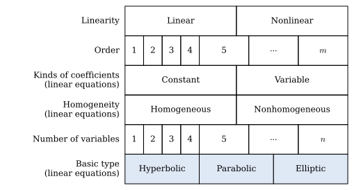{width="60%" fig-align="center"}    

## Diffusion-Type Problems (Parabolic Equations) {#sec-x1-2}

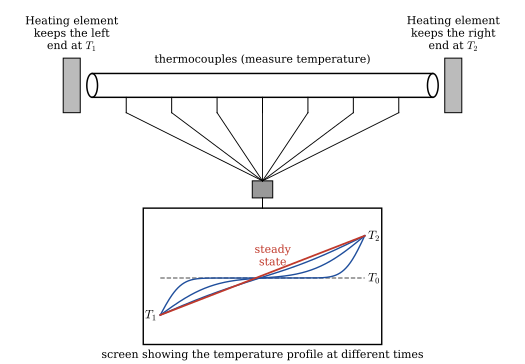{width="90%" fig-align="center"}

* **The Mathematical Model of the Heat-Flow**

  The description of our physical problem requires three types of equations

  * The <font color="red">**PDE**</font> describing the physical phenomenon of heat flow

  * The <font color="red">**boundary conditions**</font> describing the physical nature of our problem on the boundaries

  * The <font color="red">**initial condition**</font> describing the physical phenomenon at the start of the experiment 

* **<font color="blue">The Heat Equation</font>**

  The basic equation of *one-dimensional* heat flow is 

  $$u_t=\alpha u_{xx},\;0<x<L, \;0<t<\infty \tag{HE}\label{eq:HE}$$  

  This equation is derived from the basic conservation of energy

* **<font color="blue">Boundary Conditions</font>**

  All physical problems have boundaries of some kind, $\,$so we must describe mathematically what goes on there in order to adequately describe the problem. Since the temperature $\,u\,$ was fixed for all time $t>0~$ at $~T_1$ and $T_2~$ at the two ends $\,x=0~$ and $~x=L$

  $$
  \begin{array}{r}
   u(0,t) = T_1\\ 
   u(L,t) = T_2 
  \end{array}, \;\; 0 < t < \infty 
  \tag{BCs}\label{eq:BCs}$$

* **<font color="blue">Initial Condition</font>**

  All physical problems must start from some value of time (generally called $t=0$), $\,$so we must specify the physical apparatus at this time. Since we started monitoring the rod temperature from time the rod has achieved a constant temperature $T_0$, $\,$we have

  $$ u(x,0) = T_0, \;\; 0 \leq x \leq L \tag{IC}\label{eq:IC}$$

  By writing \eqref{eq:HE}, \eqref{eq:BCs}, and \eqref{eq:IC} together, $\,$we have what is called an <font color="red">*initial-boundary-value problem*</font>. The interesting thing here, which is not at all obvious, is that there is only one function $u(x,t)$ that satisfies the problem

* **More Diffusion-Type Equations**

  * **Lateral Heat Loss Proportional to the Temperature Difference**

    The equation

    $$u_t=\alpha u_{xx} -\beta (u -u_0),\;\beta>0$$

    describes heat flow in the rod with both diffusion $\alpha u_{xx}$ along the rod and heat loss (or gain) across the lateral sides of the rod. $\,$Heat loss ($u>u_0$) or gain ($u<u_0$) is proportional to the difference between the temperature $u(x,t)$ and the surrounding medium $u_0$

  * **Internal Heat Source**

    The nonhomogeneous equation

    $$u_t=\alpha u_{xx}+f(x,t)$$

    corresponds to the situation where the rod is being supplied with an internal heat source

  * **Diffusion-Convection Equation**

    Suppose a pollutant is being carried along in a stream moving with velocity $v$. $\,$The rate of change $u_t$ is measured by the diffusion-convection equation

    $$u_t=\alpha u_{xx}-vu_x$$

    The term $\alpha u_{xx}$ is the diffusion contribution and $-vu_x$ is the convection component

## Derivation of the Heat Equation {#sec-x1-3}

$~$

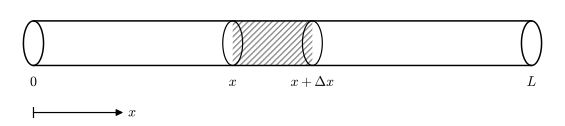{width="70%" fig-align="center"}

* Suppose we have a one-dimension rod of length $L$ for which we make the following assumptions:

  * The rod is made of a single homogeneous conducting material

  * The rod is laterally insulated (heat flows only in the $x$-direction)

  * The rod is thin (the temperature at all points of a cross section is constant)

* If we apply the principle of conservation of energy to the segment $[x,x+\Delta x]$, $\,$we can claim

  $$
  \begin{aligned}
    \text{Net Change} & \text{ of Heat inside } [x,x+\Delta x] \;=\; \\
     &\text{Net Flux of Heat across the Boundaries} \;+ \\
     &\qquad\qquad\text{Total Heat Generated inside }[x,x+\Delta x]
    \end{aligned}$$ 

  * The total amount of heat inside $[x,x+\Delta x]$ at any time $\,t\,$ is measured by
 
    $$ \text{Total Heat inside } [x,x+\Delta x] = \int_x^{x+\Delta x} \rho c_p A u(s,t)\,ds $$

  * We can write the conservation of energy via calculus as

  $$\scriptsize
  \begin{aligned}
    \frac{d}{dt}\int_x^{x +\Delta x} 
     &\rho c_p A u(s,t)\,ds = \rho c_p A \int_x^{x +\Delta x} u_t(s,t)\,ds \\
     &=kA \left[ u_x(x+\Delta x,t) -u_x(x,t) \right] +A\int_x^{x +\Delta x} F(s,t)\,ds \\ \\
    &\big\downarrow {\; \text{Mean Value Theorem}\;\int_a^b f(x)\,dx=f(\xi)(b-a),\;a<\xi<b } \\ \\
    \rho c_p A u_t(\xi_1,t) \Delta x 
     &= kA \left[ u_x(x+\Delta x,t) -u_x(x,t) \right] +AF(\xi_2,t)\Delta x, \;\;x<\xi_1, \xi_2<x+\Delta x\\ \\
    &\big\downarrow \\ \\
    u_t(\xi_1,t) 
    &=\frac{k}{\rho c_p} \left\{ \frac{u_x(x+\Delta x,t) -u_x(x,t)}{\Delta x} \right\} +\frac{1}{\rho c_p} F(\xi_2,t) \\ \\
    &\big\downarrow \;\Delta x \to 0 \\ \\
     {\normalsize u_t(x,t)}\; & {\normalsize =\alpha u_{xx}(x,t) +f(x,t)}
  \end{aligned}$$

## Boundary Conditions for Diffusion-Type Problems {#sec-x1-4}

* When describing the various types of boundary conditions that can occur for heat-flow problems, <font color="blue">three basic types generally come to mind</font>

* **Type 1 BC (Temperature specified on the boundary)** 

  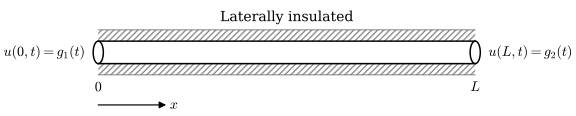{width="70%" fig-align="center"}

  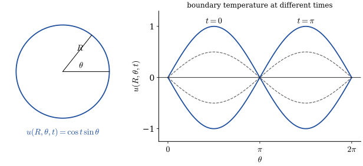{width="70%" fig-align="center"}

  * Of course, we'd have an initial temperature to get this experiment started, but in this case, the effects of our IC would vanish after a short period of time, and the resulting temperature inside the circle would depend on the boundary temperature

* **Type 2 BC (Flux specified - including the special case of insulated boundaries)**

  * **Insulated boundaries** are those that do not allow any heat flow to pass, and, hence, the normal derivative (inward or outward) must be zero on the boundary (since the normal derivative is proportional to the flux)

  * In the case of the one-dimensional rod with insulated ends at $x=0$ and $x=L$, the BCs are

    $$\begin{array}{r}
      u_x(0,t) = 0\\ 
      u_x(L,t) = 0 
    \end{array},\;\; 0 < t <\infty $$

  * In two-dimensional domains, an insulated boundary would mean that the normal derivative of the temperature across the boundary is zero.
For example, if the circular disc insulated on the boundary, then the BC would be

    $$u_r(R,\theta,t)=0\; \text{ for } \;0\leq \theta <2\pi\; \text{ and }\;0<t<\infty$$

    On the other hand, if we specify the amount of heat entering across the boundary of our disc, the BC is

    $$u_r(R,\theta,t)=f(\theta,t)$$

* **Type 3 BC (Temperature of the surrounding medium specified)**

  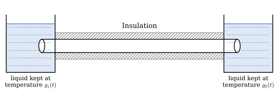{width="60%" fig-align="center"}

  * By specifying these types of BCs, $\,$we cannot say the boundary temperatures of the rod will be the same as the liquid temperature $g_1(t)$ and $g_2(t)$,

  * but we do know (Newton's law of cooling) that whenever the rod temperature at one of the boundaries is less than the respective liquid temperatures, $\,$then heat will flow into the rod at a rate proportional to this difference

  * In other words, for the one-dimensional rod with boundaries at $x=0$ and $L$, $\,$Newton's law of cooling states:

    $$ \text{Outward Flux of Heat (at } x=0\text{) }=h[u(0,t) -g_1(t)] $$
  
    $$ \text{Outward Flux of Heat (at } x=L\text{) }=h[u(L,t) -g_2(t)] $$

    where $\,h$ is a heat transfer coefficient

  * Fourier's law gives us another representation for the outward flux of heat. In our one-dimensional problem, $\,$Fourier's law takes the form:

    $$ \text{Outward Flux of Heat (at }x=0\text{) } \displaystyle =k\frac{\partial u(0,t)}{\partial x}$$

    $$ \text{Outward Flux of Heat (at }x=L\text{) }\displaystyle =-k\frac{\partial u(L,t)}{\partial x}$$

    where $k$ is the thermal conductivity of the material

  * Finally if we use the two expressions for heat flux, $\,$we have our desired BCs in purely mathematical terms;

    $$\begin{array}{l}
    \displaystyle\frac{\partial u(0,t)}{\partial x} 
      = \phantom{-}\frac{h}{k} \left[ u(0,t) -g_1(t) \right]\\[8pt] 
    \displaystyle\frac{\partial u(L,t)}{\partial x} 
    = -\frac{h}{k} \left[ u(L,t) -g_2(t) \right]
   \end{array},\;\; 0 < t < \infty$$

  * In higher dimensions, we have similar BCs; for example, if the boundary of a circular disc is interfaced with a moving liquid that has a temperature $g(\theta,t)$, $\,$our BC would be

    $$\frac{\partial u}{\partial r}(R,\theta, t)=-\frac{h}{k} \left[ u(R,\theta,t) -g(\theta,t) \right]$$

## Separation of Variables {#sec-x1-5}

* Separation of variables is one of the oldest techniques for solving initial-boundary-value problems and applies to problems where

  * The PDE is <font color="blue">linear and homogeneous (not necessarily constant coefficients)</font>

  * The boundary conditions are of the form

  
    $$\begin{aligned}
      \alpha u_x(0,t) +\beta u(0,t)&= 0\\ 
      \gamma u_x(L,t) +\delta u(L,t)&= 0 
    \end{aligned}$$

    where $\alpha$, $\beta$, $\gamma$, and $\delta$ are constants (boundary conditions of this form are called <font color="blue">linear homogeneous BCs</font>)

* We wish to find the function $u(x,t)$ that satisfies the following four conditions:

  $$
  \begin{aligned}
      u_t &= \alpha u_{xx} && 0 < x < L,\; 0 < t < \infty \\
      u(0, t) &= 0 && 0 < t < \infty \\
      u(L, t) &= 0 && \\
      u(x, 0) &= \phi(x) && 0 \leq x \leq L
  \end{aligned}$$

  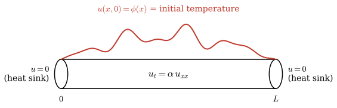{width="70%" fig-align="center"}

**STEP 1** $\,$ To begin, $\,$we look for solutions of the form $u(x,t)=X(x)T(t)$ by substituting $X(x)T(t)$ into the PDE

$$
\begin{aligned}
  X(x)T'(t)&=\alpha X''(x)T(t) \\ 
  &\Downarrow \\ 
  \frac{T'(t)}{\alpha T(t)}&= \frac{X''(x)}{X(x)}=-\lambda <0\\ 
  &\Downarrow {\scriptsize \text{We essentially change a second-order PDE to two ODEs}}\\ 
  T' &+\alpha\lambda T= 0\\ 
  X'' &+\lambda X = 0 \\
  &\Downarrow \\
  T(t)&=a_1 e^{-\alpha\lambda t}\\
  X(x)&=a_2 \sin \sqrt{\lambda}x +a_3 \cos \sqrt{\lambda}x\\
  &\Downarrow \\
  u(x,t)&=e^{-\alpha\lambda t} \left[ A \sin \sqrt{\lambda}x +B\cos\sqrt{\lambda} x \right]
\end{aligned}$$

At this point, $\,$we have an infinite number of functions that satisfy the PDE

**STEP 2** $\,$The next step is to choose a certain subset of our current crop of solutions

$$e^{-\alpha\lambda t} \left[ A \sin \sqrt{\lambda}x +B\cos\sqrt{\lambda} x \right]\;$$ {#eq-Heat_01}

that satisfy the boundary conditions

$$
\begin{aligned}
 u(0,t) &= 0 \\ 
 u(L,t) &= 0 
\end{aligned}$$

To do this, $\,$we substitute @eq-Heat_01 into these BCs, $\,$getting

$$
\begin{aligned}
  u(0,t) & =Be^{-\alpha\lambda t}=0\;\Rightarrow B=0\\ 
  u(L,t) & =Ae^{-\alpha\lambda t}\sin\sqrt{\lambda}L=0 \;\Rightarrow \sin\sqrt{\lambda}L=0,\; A\neq 0 \\
  &\Downarrow \\
 \lambda &= \left(\frac{\pi}{L}\right)^2, \left(\frac{2\pi}{L}\right)^2,\left(\frac{3\pi}{L}\right)^2,\cdots \\
 &\Downarrow \\
 \lambda_n &=\left(\frac{n\pi}{L}\right)^2,\;n=1,2,3,\cdots \\ \text{ }
\end{aligned}$$

We have now finished the second step; we have an infinite number of functions

$$ u_n(x,t)=c_n e^{-\alpha\left(\frac{n\pi}{L}\right)^2 t} \sin\left( \frac{n\pi}{L}x \right), \;n=1,2,3,\cdots $$

each one satisfying the PDE and the BCs

**STEP 3** $\,$The last step is to add the fundamental solutions

$$ u(x,t)=\sum_{n=1}^\infty c_n e^{-\alpha\left(\frac{n\pi}{L}\right)^2 t} \sin\left( \frac{n\pi}{L}x \right)$$ {#eq-Heat_02}

in such a way (pick the coefficients $c_n$) that the initial condition

$$u(x,0)=\phi(x)$$

is satisfied. $\,$Substituting the sum into the IC gives

$$ \phi(x)=\sum_{n=1}^\infty c_n \sin\left( \frac{n\pi}{L} x \right) $$

Now the problem becomes how to find the coefficients $c_n$. $\,$This is actually very easy 

* One uses properties of the functions known as orthogonality:

  $$ \int_0^L \sin\left(\frac{m\pi}{L} x \right)\sin\left(\frac{n\pi}{L}x \right)\,dx = 
\begin{cases} 0 &  m\neq n \\ \frac{L}{2} & m=n \end{cases}$$

  We multiply each side of @eq-Heat_02 by $\sin(m\pi x/L)$ and integrate from zero to $L$; $\,$we get

  $$ \int_0^L \phi(x) \sin \left( \frac{m\pi}{L} x\right)\, dx=c_m\int_0^L \sin^2\left( \frac{m\pi}{L} x\right)\,dx = \frac{L}{2}c_m $$

  We're done; $\,$the solution is

  $$ u(x,t)=\sum_{n=1}^\infty c_n e^{-\alpha\left(\frac{n\pi}{L}\right)^2 t} \sin\left( \frac{n\pi}{L}x \right)\;\;\text{ where }\; c_n =\frac{2}{L} \int_0^L \phi(x) \sin \left( \frac{n\pi}{L} x\right)\, dx $$

**NOTES**

* Observe that the only difference between the Fourier sine expansion of $\phi(x)$ and the solution is the insertion of the time factor

  $$ e^{-\alpha\left(\frac{n\pi}{L}\right)^2 t} $$

  in each term
  
* The terms in the series get small very fast due to the factor $e^{-\alpha\left(\frac{n\pi}{L}\right)^2 t}$. $\,$Hence, for long time periods,
  $\,$the solution is approximately equal to the first term
  
  $$ u(x,t)\approx c_1 e^{-\alpha\left(\frac{\pi}{L}\right)^2 t} \sin\left( \frac{\pi}{L}x \right) $$

$~$

**Example** $\,$Solve the diffusion problem with insulated boundaries; $\,$ that is

$$\begin{aligned}
    u_t & = u_{xx} && 0 < x < 1,\; 0 < t < \infty\\
    u_x(0,t) & = 0 && 0 < t <\infty\\
    u_x(1,t) & = 0 && \\
    u(x,0) & = 1 + \cos\pi x +0.5\cos 3\pi x && 0 \leq x \leq 1
  \end{aligned}$$

::: {.callout-note collapse="true" title="Answer" appearance="simple"}
$u(x,t)=1+e^{-\pi^2 t}\cos\pi x+0.5\,e^{-9\pi^2 t}\cos 3\pi x$
:::

[Solution](files/solutions/sol_12_5.pdf){target="_blank"}

$~$

## Solving More Complicated Problems by Separation of Variables {#sec-x1-6}

* We start with a one-dimensional heat-flow problem where one of the BCs contains derivatives

* **Heat-Flow Problem with 3^rd^ kind BC**

  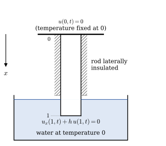{width="60%" fig-align="center"}

* We fix the temperature at the top of the rod at $u(0,t)=0$ and immerse the bottom of the rod in a solution of water fixed at the same temperature of zero. The natural flow of heat says that the BC at $x=1$ is

  $$u_x(1,t)=-hu(1,t)$$

* Suppose now the initial temperature of the rod is $u(x,0)=x,$ $\,$but instantaneously thereafter ($t>0$), $\,$we apply our BCs. To find the ensuing temperature, $\,$we must solve the IBVP

  $$
  \begin{aligned}
    u_t &= \alpha u_{xx} && 0 < x < 1, \;0 < t <\infty \\
    u(0,t) &= 0 && 0 < t < \infty\\ 
    u_x(1,t) +hu(1,t) &= 0 && \\
    u(x,0) &= x && 0 \leq x \leq 1
  \end{aligned}$$

**STEP 1**

* Substituting $u(x,t)=X(x)T(t)$ into the PDE gives

  $$u(x,t)=e^{-\alpha\lambda t} \left[ A\sin\sqrt{\lambda}x +B\cos\sqrt{\lambda}x \right]$$

  for any $\lambda>0$ and any $A$ and $B$

**STEP 2**

* Substituting the solution into the BCs gives us conditions on $\lambda$, $A$ and $B$ $\,$that must be satisfied;

  $$
  \begin{aligned}
   B e^{-\alpha\lambda t}&= 0\; \Rightarrow \; B=0 \\ 
   A e^{-\alpha\lambda t}(\sqrt{\lambda} \cos \sqrt{\lambda} 
    +h\sin\sqrt{\lambda})&= 0 \;\Rightarrow \; \tan \sqrt{\lambda}
    =-\frac{\sqrt{\lambda}}{h}, \; A \neq 0
  \end{aligned}$$

* To find $\lambda$, $\,$we must find the intersections of the curves $\tan\sqrt{\lambda}$ and $-\frac{\sqrt{\lambda}}{h}$. $\,$These values $\lambda_1$, $\lambda_2$, $\cdots$ $\,$can be computed numerically for a given $h$ and are called the **eigenvalues** of the boundary-value problem

  $$\begin{aligned}
   X''+\lambda X &= 0 \\ 
   X(0)&=0 \\ 
   X'(1)+hX(1)&=0 
  \end{aligned}$$ {#eq-Heat_complex}

  The eigenvalue problem @eq-Heat_complex is a special case of the general **Sturm-Liouville problem**

$~$

```{python}
import numpy as np
from scipy import optimize
import matplotlib.pyplot as plt

plt.rcParams['font.size'] = 12
plt.rcParams['xtick.direction'] = 'in'
plt.rcParams['ytick.direction'] = 'in'
plt.rcParams['text.usetex'] = True
plt.rcParams['text.latex.preamble'] = r'\usepackage{amsmath}'

def example_plot(h, n_eig, sqrt_eig):
    
    x = np.linspace(0, n_eig*np.pi, 1000)  
    y = np.tan(x)

    threshold = 100
    y[y > threshold] = np.inf
    y[y <-threshold] = np.inf

    plt.figure(figsize=(7, 4))

    plt.plot(x, y, linewidth=1.2, color="blue")
    plt.plot(x,-x/h, linewidth=1.2, color="green")
    plt.scatter(sqrt_eig,-sqrt_eig/h, color='red')
    
    plt.xticks([0, np.pi, 2*np.pi, 3*np.pi, 4*np.pi, 5*np.pi], 
            ['0',r'$\pi$',r'$2\pi$',r'$3\pi$',r'$4\pi$',r'$5\pi$'])
    plt.xlim(0, 5.0*np.pi)
    plt.ylim(-20, 20)
    
    plt.xlabel(r'$\sqrt{\lambda}$')
    plt.ylabel(r'$\tan \sqrt{\lambda}$, $-\sqrt{\lambda}/h$')
    plt.title(r'$h=%3.1f$' % h)
    plt.grid()
    
    plt.show()
```

```{python}
#| label: fig-eigenvalues
#| fig-cap: "Eigenvalues"
#| fig-align: center

def calc_eig(h, n_eig):
    return np.array([optimize.brentq(lambda x: np.tan(x) +x/h, 
      (i +0.5001)*np.pi, (i +1)*np.pi) for i in range(n_eig)])

h = 1
n_eig = 5

sqrt_eig = calc_eig(h, n_eig)
example_plot(h, n_eig, sqrt_eig)
```

```{python}
#| output: asis
for i in range(n_eig):
  print(rf'$$ \lambda_{i +1} = {np.round(sqrt_eig[i]**2, 2)} $$')
```

$~$

* The solutions of @eq-Heat_complex corresponding to the eigenvalues $\lambda_n$ are called **eigenfunctions** $X_n(x)$

  $$ X_n(x)=\sin\sqrt{\lambda_n} x $$

$~$

```{python}
def example_plot2(x, n_eig, sqrt_eig, eigfunc):

    plt.figure(figsize=(7, 4))
    for n in range(n_eig):
        plt.plot(x, eigfunc(x, sqrt_eig[n]), label=rf'$X_{n +1}(x)$')
     
    plt.xlim(0, 1)
    plt.ylim(-1.2, 1.2)
    plt.grid(ls=':')    
    plt.legend(loc='upper left', bbox_to_anchor=(0, -0.1))
    
    plt.xlabel('$x$')
    plt.ylabel('$X_n(x)$')
    plt.title(r'$X_n(x)=\sin\sqrt{\lambda_n} x$')
    
    plt.show()
```

```{python}
#| label: fig-eigenfunctions
#| fig-cap: "Eigenfunctions"
#| fig-align: center
def eigfunc(x, sqrt_eig):  
    return np.sin(sqrt_eig *x)

x = np.linspace(0, 1, 150)
example_plot2(x, n_eig, sqrt_eig, eigfunc)
```

$~$

**STEP 3**

* We now have an infinite number of solutions

  $$u_n(x,t)=e^{-\alpha\lambda_n t} \sin\sqrt{\lambda_n}x$$

  each one satisfying the PDE and the BCs. $\,$The final step is to add these functions together (the sum will still satisfy the PDE and BCs, since both the PDE and BCs are linear and homogeneous) 

  $$ u(x,t)=\sum_{n=1}^\infty c_n e^{-\alpha\lambda_n t} \sin\sqrt{\lambda_n}x $$

  in such a way that they agree with the IC

  $$ u(x,0)=x=\sum_{n=1}^\infty c_n \sin\sqrt{\lambda_n}x $$

* To find the coefficients $c_n$, $\,$we must multiply each side of the equation by $\sin\sqrt{\lambda_m}x$ and integrate $x$ from $0$ to $1$

  $${\scriptsize
  \begin{aligned}
   \int_0^1 x\sin\sqrt{\lambda_m}x\,dx&= \sum_{n=1}^\infty c_n \int_0^1 \sin\sqrt{\lambda_n}x\,\sin\sqrt{\lambda_m}x \,dx\\ 
   &\Downarrow \\ 
   \frac{\sin\sqrt{\lambda_m}-\sqrt{\lambda_m}\cos\sqrt{\lambda_m}}{\lambda_m}&=c_m \int_0^1 \sin^2\sqrt{\lambda_m}x\,dx =c_m\left[ \frac{\sqrt{\lambda_m}-\sin\sqrt{\lambda_m}\cos\sqrt{\lambda_m}}{2\sqrt{\lambda_m}} \right ] \\
   &\Downarrow\\
   c_n&=\frac{2}{\sqrt{\lambda_n}} \left[\frac{\sin\sqrt{\lambda_n} -\sqrt{\lambda_n}\cos\sqrt{\lambda_n}}{\sqrt{\lambda_n}-\sin\sqrt{\lambda_n}\cos\sqrt{\lambda_n}} \right]
 \end{aligned}}$$

  In this problem, $\,$the first five constants $c_n$ have been computed:

```{python}
#| echo: true
#| output: asis
def cal_c_n(sqrt_eig):  
    
    sin_sqrt_eig = np.sin(sqrt_eig)
    cos_sqrt_eig = np.cos(sqrt_eig)
    
    return (2.0 /sqrt_eig 
           *(sin_sqrt_eig -sqrt_eig *cos_sqrt_eig)
           /(sqrt_eig -sin_sqrt_eig *cos_sqrt_eig))

c_n = cal_c_n(sqrt_eig)
print(r'$,\;\;$'.join([rf'$c_{i} = {c_i: 6.4f}$' 
              for i, c_i in enumerate(c_n, 1)]))
```

```{python}
def example_plot3(alpha, t, x, n_eig, sqrt_eig, eigfunc, u_solution):
    plt.figure(figsize=(7, 4))
    plt.plot(x, x, 'r:', label='$t=0.0$')
    for tt in t:
        plt.plot(x, u_solution(alpha, tt, x, n_eig, sqrt_eig, eigfunc),
                 label='$t=%0.1f$' % tt)
    
    plt.xlim(0, 1)
    plt.ylim(0, 1)
    plt.legend(loc='upper left')
    plt.xlabel('$x$')
    plt.ylabel('$u(x,t)$')
    
    plt.show() 
```

```{python}
#| echo: true
#| fig-align: center
#| label: fig-u
#| fig-cap: "Solutions"
def u_solution(alpha, t, x, n_eig, sqrt_eig, eigfunc):
    u = 0
    for i in range(n_eig):
        u += c_n[i] *np.exp(-alpha *sqrt_eig[i]**2 *t) \
                    *eigfunc(x, sqrt_eig[i])
    return u    
        
alpha = 1
t = np.linspace(0.1, 0.5, 4)
example_plot3(alpha, t, x, n_eig, sqrt_eig, eigfunc, u_solution)
```

## Transforming Nonhomogeneous BCs into Homogeneous Ones {#sec-x1-7}

* Consider heat flow in an insulated rod where the two ends are kept at constant temperatures $k_1$ and $k_2$:

  $$\begin{array} {r} u(0,t) = k_1\\ u(L,t) = k_2 \end{array}, \qquad\quad 0<t<\infty$$ {#eq-Heat_nh} 

* The difficulty here is that since the BCs are not homogeneous, $\,$we cannot solve this problem by separation of variables

* However, $\,$it is obvious that the solution will have a steady-state solution (when $t=\infty$) that varies linearly between the boundary temperatures $k_1$ and $k_2$

  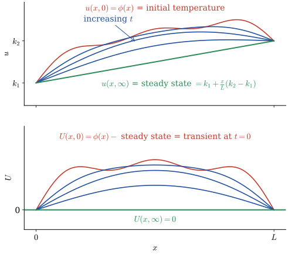{width="70%" fig-align="center"}

* In other words, $\,$it seems reasonable to think of our temperature $u(x,t)$ as the sum of two parts

  $$
  \begin{aligned}
    u(x,t) &=\underbrace{\text{steady state}}_{\text{Eventual Solution for Large Time}} 
        +\underbrace{\text{transient}}_{\underset{\text{(and will go to zero)}}{\text{Part of the Solution that depends on the IC}}}\\ 
        &\Downarrow \\ 
        &= \left[ k_1 +\frac{x}{L}(k_2 -k_1) \right] +U(x,t)
  \end{aligned}$$

* By substituting the above relation in the original problem @eq-Heat_nh, $\text{ }$we arrive at a new problem in $U(x,t)$:

  $${U_t = \alpha U_{xx},\quad 0 < x < L,\; 0 < t < \infty} $$

  $${\scriptsize\color{blue}{\begin{array}{r}
    U(0,t)=0 \\ 
    U(L,t)=0 
  \end{array}, \;\; 0<t<\infty}, \;\;
  U(x,0)=\phi(x)
  -\left[ k_1 +\displaystyle\frac{x}{L}(k_2 -k_1) \right]
  =\bar{\phi}(x), \;\; 0\leq x \leq L}$$

* **Transforming Time Varying BCs to Zero BCs**

  * What about more realistic-type derivative BCs with time-varying right-hand sides? Consider the typical problem

    $$
    \begin{aligned}
      u_t &= \alpha u_{xx} && 0 < x < L, \;0 < t <\infty \\
      u(0,t) &= g_1(t) && 0 < t < \infty \\
      u_x(L,t) +hu(L,t) &= g_2(t) && \\
      u(x,0) &=\phi(x) && 0 \leq x \leq L 
    \end{aligned}$$ {#eq-Heat_nh2}

  * To change these nonzero BCs to homogeneous ones, $\,$we (after some trial and error) seek a solution of the form:

    $$ u(x,t)=\underbrace{A(t)\left[1-\frac{x}{L}\right] +B(t)\frac{x}{L}}_{S(x,t)}+U(x,t)$$

    where $A(t)$ and $B(t)$ are chosen so that $S(x,t)$ satisfies the BCs and thus

    $$\begin{array}{r} U(0,t) = 0\\ U_x(L,t)+hU(L,t) = 0 \end{array}, \quad 0<t<\infty$$

  * Substituting $S(x,t)$ into the BCs gives

    $$ \begin{aligned} 
        S(0,t) &= g_1(t)\\ 
        S_x(L,t)+hS(L,t) &= g_2(t) 
      \end{aligned}, \quad 0<t<\infty $$

    in which we get

    $$\begin{aligned} 
       A(t)&= g_1(t)\\ 
       B(t)&= \frac{g_1(t) +Lg_2(t)}{1+Lh} 
      \end{aligned}, \quad 0<t<\infty$$

  * So if we substitute this into the original problem @eq-Heat_nh2, $\,$we get the transformed problem in $U(x,t)$:

    $$
    \begin{aligned}
      U_t &= \alpha U_{xx} -\color{red}{S_t} && 0 < x <L, \;0 < t <\infty \\
      U(0,t) &= 0 && 0 < t < \infty\\ 
      U_x(L,t) +hU(L,t) &= 0 && \\
      U(x,0) &= \phi(x)-S(x,0) && 0 \leq x \leq L
    \end{aligned}$$

    * We now have our new problem with zero BCs but unfortunately the PDE is nonhomogeneous

    * We cannot solve this problem by separation of variables, $\,$but we will solve it  by integral transforms and eigenfunction expansions

$~$

**Example** $\,$Solve the initial-boundary-value problem

$$
  \begin{aligned}
    u_t &= \alpha u_{xx} && 0 < x < 1, \;0 < t <\infty \\
    u(0,t) &= 1 && 0 < t < \infty\\ 
    u_x(1,t) +hu(1,t) &= 1 && \\
    u(x,0) &= \sin\pi x +x && 0 \leq x \leq 1
  \end{aligned}$$

::: {.callout-note collapse="true" title="Answer" appearance="simple"}
$u(x,t)=1+\dfrac{1-h}{1+h}\,x+\displaystyle\sum_{n=1}^\infty a_n e^{-\alpha\lambda_nt}\sin\sqrt{\lambda_n}\,x$

$\lambda_n$: positive roots of $\tan\sqrt\lambda=-\sqrt\lambda/h$, $\ \left(n-\frac12\right)^2\pi^2<\lambda_n<n^2\pi^2$; $\quad a_n=\dfrac{2(\lambda_n+h^2)}{\lambda_n+h^2+h}\left[\dfrac{\pi\sin\sqrt{\lambda_n}}{\pi^2-\lambda_n}+\dfrac{h\sin\sqrt{\lambda_n}}{\lambda_n}-\dfrac{1}{\sqrt{\lambda_n}}\right]$
:::

[Solution](files/solutions/sol_12_7.pdf){target="_blank"}

$~$

## Transforming Hard Equations into Easier Ones {#sec-x1-8}

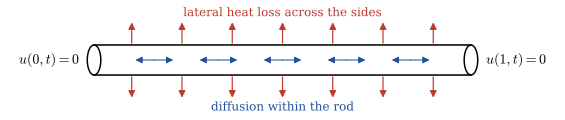{width="75%" fig-align="center"}

* Consider the following problem:

  $$
  \begin{aligned}
    u_t &= \alpha u_{xx} \color{blue}{-\beta u} && 0 < x < 1, \;0 < t <\infty \\
    u(0,t) &= 0 && 0 < t < \infty\\ 
    u(1,t) &= 0 && \\
    u(x,0) &= \phi(x) && 0 \leq x \leq 1
  \end{aligned}$$ {#eq-Heat_lateral}

  where the term $-\beta u$ represents heat flow across the lateral boundary

* We introduce a new temperature $w(x,t)$ in place of $u(x,t)$, $\,$so that the PDE in $w$ is simpler than the original one

* The transformation is generally based on an intuitive feeling of how the solution of the original PDE behaves

* In our problem @eq-Heat_lateral, $\,$the temperature $u(x,t)$ at any point $x_0$ is changing as a result of two phenomena

  1. **diffusion** of heat within the rod due to $\alpha u_{xx}$
  2. **heat flow** across the lateral boundary due to $-\beta u$

* The important point is that if there were no diffusion within the rod ($\alpha=0$) then the temperature at each point $x_0$ would
decay exponentially to zero according to 

  $$u(x_0,t)=u(x_0,0) e^{-\beta t}$$

* By means of this observation, $\,$we can essentially decompose the temperature $u(x,t)$ into two factors

  $$u(x,t)=e^{-\beta t} w(x,t)$$

  where $w(x,t)$ would represent the temperature due to diffusion only

* When we substitute this expression into @eq-Heat_lateral, $\,$we arrive at

  $$
  \begin{aligned}
    w_t &= \alpha w_{xx} && 0 < x < 1, \;0 < t <\infty \\
    w(0,t) &= 0 && 0 < t < \infty\\ 
    w(1,t) &= 0 && \\
    w(x,0) &= \phi(x) && 0 \leq x \leq 1
  \end{aligned}$$

* The diffusion-convection equation

  $$u_t=\alpha u_{xx}-vu_x$$
  
  ($v$ is a constant) can also be transformed to
  
  $$w_t=\alpha w_{xx}$$
  
  In this case, $\,$the transformation is
  
  $$ u(x,t)=\exp\left[ \frac{v}{2\alpha} \left(x -\frac{v}{2}t\right) \right] w(x,t)$$

$~$

**Example** $\,$ Solve the diffusion-convection problem
$$
  \begin{aligned}
    u_t &= u_{xx} -u_x && 0 < x < 1, \;0 < t <\infty \\
    u(0,t) &= 0 && 0 < t < \infty\\ 
    u(1,t) &= 0 && \\
    u(x,0) &= e^{x/2} && 0 \leq x \leq 1
  \end{aligned}$$

by transforming it into an easier one

$$
  \begin{aligned}
    w_t &= w_{xx} && 0 < x < 1, \;0 < t <\infty \\
    w(0,t) &= 0 && 0 < t < \infty\\ 
    w(1,t) &= 0 && \\
    w(x,0) &= 1 && 0 \leq x \leq 1
  \end{aligned}$$

**Solution**

$$\begin{aligned}
 u(x,t)&=\exp\left[ \frac{1}{2}\left( x -\frac{1}{2}t \right ) \right] w(x,t) \\ 
 &\Downarrow \\ 
 w_t=w_{xx},\; w(0,t)&=0,\;w(1,t)=0,\;w(x,0)=1 \\
 &\Downarrow \\
 w(x,t)&=2\sum_{n=1}^\infty \frac{1-(-1)^n}{n\pi} e^{-n^2\pi^2 t}\sin n\pi x \\
 &\Downarrow \\
 u(x,t)&= 2\sum_{n=1}^\infty \frac{1-(-1)^n}{n\pi} e^{-n^2\pi^2 t +\frac{1}{2}\left( x-\frac{1}{2}t \right )}\sin n\pi x \\
 &=4\sum_{m=1}^\infty \frac{1}{(2m-1)\pi} e^{-(2m-1)^2\pi^2 t +\frac{1}{2}\left( x-\frac{1}{2}t \right )}\sin (2m-1)\pi x    
\end{aligned}$$

$~$

```{python}
def example_plot4(t, x, n_terms, u_solution):   
    plt.figure(figsize=(6, 4))   
    plt.plot(x, np.exp(x /2.0), 'r:', label='$t=0$')
   
    for tt in t:
        plt.plot(x, u_solution(tt, x, n_terms), label='$t=%0.3f$' % tt)
    
    plt.xlim(0, 1)
    plt.ylim(0, 2)
    plt.legend(loc='upper left', bbox_to_anchor=(1.0, 1.0))
    plt.xlabel('$x$')
    plt.ylabel('$u(x,t)$')
    plt.title(r'$\alpha=1,\;v=1$') 

    plt.show() 
```
```{python}
#| fig-align: center
#| label: fig-u2
#| fig-cap: "Solutions"
def u_solution(t, x, n_terms):  
    u = 0
    for m in range(1, n_terms +1):
        a = (2.0 *m -1.0) *np.pi
        u += 1 /a *np.exp(-a *a *t +(x -t /2.0) /2.0) *np.sin(a *x)
    return 4.0*u

x = np.linspace(0, 1, 150)
t = np.array([0.001, 0.002, 0.004, 0.008, 0.05, 0.10, 0.15, 0.20])

n_terms = 25

example_plot4(t, x, n_terms, u_solution)
```

$~$

## Solving Nonhomogeneous PDEs (Eigenfunction Expansion) {#sec-x1-9}

* Consider the nonhomogeneous problem

  $$
  \begin{aligned}
    u_t &= \alpha u_{xx} +f(x,t) && 0 < x < 1, \;0 < t <\infty \\
    u(0,t) &= 0 && 0 < t < \infty\\ 
    u(1,t) &= 0 && \\
    u(x,0) &= \phi(x) && 0 \leq x \leq 1
  \end{aligned}$$ {#eq-Heat_ee}

  The purpose of this section is to solve this problem by a method that is analogous to the method of variation of parameters in ODEs 
and is known as the eigenfunction expansion

**STEP 1**

* The basic idea in this method is to decompose the heat source $f(x,t)$ into simple components

  $$ f(x,t)=\sum_{n=1}^\infty f_n(t) X_n(x)$$

  It turns out that the $X_n(x)$ are the **eigenfunctions of the Sturm-Liouville system** 
we get when solving the associated homogeneous system by separation of variables

* In this case, $\,$the Sturm-Liouville problem we find when separating variables is

  $$\begin{aligned}
   &X'' +\lambda X =0 \\ 
   &X(0)=0 \\ 
   &X(1)=0 
  \end{aligned}$$

  and, $\,$hence, $\,$the $X_n(x)$ are

  $$X_n(x)=\sin n\pi x,\;n=1,2,3,\cdots$$

* Finally, $\,$ to find the functions $\,f_n(t)$, $\,$we merely multiply each side of this equation by $\sin m\pi x\,$ and integrate from zero to one:

  $$\begin{aligned}
    \int_0^1 f(x,t) \sin m\pi x \,dx&= \sum_{n=1}^\infty f_n(t) \int_0^1 \sin m\pi x\, \sin n\pi x \,dx=\frac{1}{2}f_m(t)\\ 
    &\Downarrow\;{\scriptsize\text{changing}\;m \;\text{to}\; n} \\ 
    f_n(t)&=2\int_0^1 f(x,t) \sin n\pi x\, dx 
   \end{aligned}$$

**STEP 2**

* The responses $u_n(x,t)=T_n(t) \sin n\pi x\,$ to each of these individual components $\,f_n(t)\sin n\pi x\,$ are added to construct the solution of our problem:

  $$ u(x,t)=\sum_{n=1}^\infty u_n(x,t)=\sum_{n=1}^\infty T_n(t) \sin n\pi x $$

  Substituting $u(x,t)$ and $f(x,t)$ into @eq-Heat_ee gives us

  $${\scriptsize
  \begin{aligned}
    \sum_{n=1}^\infty T_n'(t) \sin n\pi x&=-\alpha \sum_{n=1}^\infty (n\pi)^2\, T_n(t) \sin  n\pi x +\sum_{n=1}^\infty f_n(t) \sin n\pi x \\ 
    \sum_{n=1}^\infty T_n(0)\sin n\pi x&=\phi(x) \\ 
    &\Downarrow \\
     \sum_{n=1}^\infty\underbrace{\left[ T_n'+\alpha(n\pi)^2\,T_n -f_n(t) \right ]}_{=0}\,&\sin n\pi x= 0 \\
     T_n(0)=2\int_0^1 \phi(x)&\sin n\pi x\,dx=a_n \\
     &\Downarrow \\
     T_n(t)=a_n e^{-\alpha(n\pi)^2 t}&+\int_0^t e^{-\alpha(n\pi)^2(t-\tau)} f_n(\tau)\,d\tau
   \end{aligned}}$$  

  Hence, the solution of our problem @eq-Heat_ee is

  $${\scriptsize
  \begin{aligned}
   u(x,t)&=\sum_{n=1}^\infty T_n(t) \sin n\pi x 
   =\underbrace{\sum_{n=1}^\infty a_n e^{-\alpha(n\pi)^2 t}\sin n\pi x }_{\text{Transient Part due to the IC}}+\underbrace{\sum_{n=1}^\infty \int_0^t e^{-\alpha(n\pi)^2(t-\tau)} f_n(\tau)\,d\tau \cdot \sin n\pi x}_{\text{Forcing Part due to}\, f(x,t)} 
   \end{aligned}}$$

* The eigenfunctions $X_n(x)$ in the expansion change from problem to problem and depend on the PDE and BCs

$~$

**Example** $\,$Find the solution

$$
  \begin{aligned}
    u_t &= u_{xx} +\sin\sqrt{\lambda_1} x && 0 < x < 1, \;0 < t <\infty \\
    u(0,t) &= 0 && 0 < t < \infty\\ 
    u_x(1,t) +hu(1,t) &= 0 && \\
    u(x,0) &= 0 && 0 \leq x \leq 1
  \end{aligned}$$

where $h=1$ and $\lambda_1$ is the first root of the equation $\,$ $\tan\sqrt{\lambda}=-\sqrt{\lambda}$

::: {.callout-note collapse="true" title="Answer" appearance="simple"}
$u(x,t)=\dfrac{1-e^{-\lambda_1 t}}{\lambda_1}\,\sin\sqrt{\lambda_1}\,x$, $\quad \sqrt{\lambda_1}=2.028758,\ \ \lambda_1=4.115858$
:::

[Solution](files/solutions/sol_12_9.pdf){target="_blank"}

$~$

## $~$The Finite Sine and Cosine Transforms {#sec-x1-10}

* An integral transformation is merely a transformation that assigns to one function $f(t)$ a new function $F(s)$ by means of a formula like

  $$ F(s)=\int_a^b K(s,t) \,f(t)\,dt $$

  Note that we start with a function of $t$ and end with a function of $s$

* The function $K(s,t)$ is called the **kernel** of the transformation and is
the major ingredient that distinguishes one transform from another; $\,$ it is chosen so that the transform has certain desirable properties. The limits $a$ and $b$ also change from transformation to transformation

* With every integral transform, there is an inverse transform that will reproduce that original function from its transform. $\,$The transform and its inverse together form what is called **a transform pair**

* The general philosophy behind integral transformation is that they eliminate *partial derivatives* with respect to one of the variables; $\,$hence, $\,$the new equation has one less variable

* In other words, integral transformations change problems into easier ones. $\,$The transformed problem is then solved, and its inverse is obtained to find the solution to the original problem

{width="90%" fig-align="center"}

* We first start with a function $f(x)$ defined on an interval $[0,L]$. $\,$The finite sine and cosine transforms of this function are defined by

  $$\begin{aligned}
   \mathcal{F}_s[f]&=\frac{2}{L} \int_0^L f(x)\,\sin\frac{n\pi x}{L} \,dx =b_n &&\;{\scriptsize\text{Finite Sine Transform}} \\[8pt] 
   \mathcal{F}_c[f]&=\frac{2}{L} \int_0^L f(x)\,\cos\frac{n\pi x}{L} \,dx =a_n &&\;{\scriptsize\text{Finite Cosine Transform}}
  \end{aligned}$$

* The student will note that these transforms do nothing more than transform a function into the Fourier sine and cosine coefficients. $\,$The inverse transform of these transforms are the Fourier sine and cosine series

  $$\begin{aligned}
    f(x) &=\sum_{n=1}^{\infty} b_n \sin\frac{n\pi x}{L} &&\;{\scriptsize\text{Inverse Sine Transform}} \\ 
    f(x) &= \frac{a_0}{2} +\sum_{n=1}^\infty a_n \cos \frac{n\pi x}{L} &&\;{\scriptsize\text{Inverse Cosine Transform}}
    \end{aligned}$$

  Note that the inverse cosine transform includes the $n=0$ term $a_0/2$, $\,$while the inverse sine starts at $n=1$

$~$

**Examples of the Sine Transform**

$$\begin{aligned}
   f(x)&=1, \;\;\;\; 0 \leq x \leq 1 \\ 
   &\Downarrow \\ 
   \scriptsize b_n=2 \int_0^1 \sin n\pi x \,dx &\scriptsize=
   \begin{cases}
     \;\;\;\;0& n\; \text{ even} \\ 
     \;^{\displaystyle 4}/_{\displaystyle n\pi}& n\; \text{ odd }  
   \end{cases} \\
   &\Downarrow \\
   f(x)&=\frac{4}{\pi} \sum_{n=1}^\infty \left[ \frac{1}{2n-1} \right] \sin (2n-1)\pi x
  \end{aligned}$$

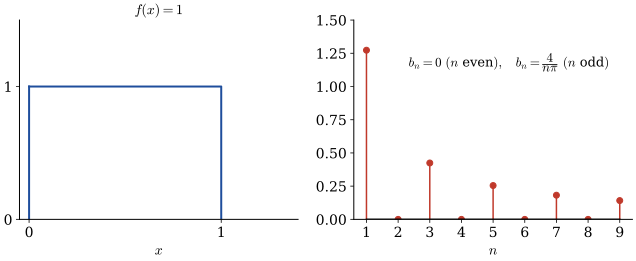{width="65%" fig-align="center"}

$~$

* **Properties of the Finite Sine and Cosine Transforms**

  $$\begin{aligned}
    \mathcal{F}_s [u_t] 
       &= \frac{d \mathcal{F}_s [u]}{dt} \\ 
    \mathcal{F}_s [u_{tt}] 
       &= \frac{d^2 \mathcal{F}_s [u]}{dt^2} \\ \\ 
    \mathcal{F}_s [u_x] 
       &= -\frac{n\pi}{L} \mathcal{F}_c [u] \\
    \color{red}{\mathcal{F}_s [u_{xx}]} 
       &\color{red}{\:= -\left( \frac{n\pi}{L} \right)^2 \mathcal{F}_s [u] +\frac{2n\pi}{L^2} 
     \left[ u(0,t) -(-1)^n u(L,t) \right]}\\ 
    \mathcal{F}_c [u_x] 
       &= \frac{n\pi}{L} \mathcal{F}_s [u] +\frac{2}{L} \left[(-1)^n u(L,t) -u(0,t) \right] \\ 
    \color{red}{\mathcal{F}_c [u_{xx}]} & \color{red}{\:= -\left(\frac{n\pi}{L}\right)^2 \mathcal{F}_c [u] +\frac{2}{L} \left[(-1)^n u_x(L,t) -u_x(0,t) \right]} \\ 
  \end{aligned}$$

$~$

**Example** $\,$Solve the general problem

$$
  \begin{aligned}
    u_t &= \alpha u_{xx} -\beta u +f(x,t) && 0 < x < 1, \;0 < t <\infty \\
    u(0,t) &= 0 && 0 < t < \infty\\ 
    u(1,t) &= 0 && \\
    u(x,0) &= 0 && 0 \leq x \leq 1
  \end{aligned}$$

::: {.callout-note collapse="true" title="Answer" appearance="simple"}
$u(x,t)=\displaystyle\sum_{n=1}^\infty\left[\int_0^t e^{-(\alpha n^2\pi^2+\beta)(t-\tau)}F_n(\tau)\,d\tau\right]\sin n\pi x$, $\quad F_n(t)=2\displaystyle\int_0^1 f(x,t)\sin n\pi x\,dx$
:::

[Solution](files/solutions/sol_12_10.pdf){target="_blank"}

$~$

## $~$Superposition (The Backbone of Linear Systems) {#sec-x1-11}

* For an engineer who wishes to find the response $u$ to a linear system from input $\,f$, $\,$a common approach is

  1.  Break $\,f$ into elementary parts, $\,f=\sum f_k$
  2.  Find the system response $u_k$ to $f_k$
  3.  Add(superimpose) the simple responses $u_k$ to get $\,u=\sum u_k$

* It turns out if the system is *linear*, $\,$then the sum $u$ is the response we get if the function $\,f$ were input directly; $\,$this is the <font color="red">**principle of superposition**</font>

* **Superposition Used to Break an IBVP into Two Simpler Problems**

  Suppose we have the linear problem

  $$
  \begin{aligned}
    u_t &= u_{xx} +\color{red}{\sin \pi x} && 0 < x < 1, \;0 < t <\infty \\
    u(0,t) &= 0 && 0 < t < \infty\\ 
    u(1,t) &= 0 && \\
    u(x,0) &= \sin 2\pi x && 0 \leq x \leq 1
  \end{aligned}\tag{P}\label{eq:P}$$

  Here, $\,$we have a *nonhomogeneous* heat equation, $\,$so separation of variables is not a viable method of attack

  * We could, $\,$of course, $\,$use the finite sine transform on the variable $x$ or the Laplace transform on $t$, $\,$but still another idea would be to consider two subproblems

    $$
    \begin{aligned}
     u_t 
      &= u_{xx} +\color{red}{\sin \pi x} 
      && 0 < x < 1, \;0 < t <\infty \\
     u(0,t) &= 0 && 0 < t < \infty\\ 
     u(1,t) &= 0 && \\
     u(x,0) &= 0 && 0 \leq x \leq 1
    \end{aligned}\tag{A}\label{eq:A}$$

    $$\text{and} \qquad\qquad\qquad$$

    $$
    \begin{aligned}
      u_t &= u_{xx} && 0 < x < 1, \;0 < t <\infty \\
      u(0,t) &= 0 && 0 < t < \infty\\ 
      u(1,t) &= 0 && \\
      u(x,0) 
      &= \color{red}{\sin 2\pi x} && 0 \leq x \leq 1
    \end{aligned}\tag{B}\label{eq:B}$$

  * These two problems can be solved individually with a little effort, $\,$and it should be clear here that the *sum* of the solutions to \eqref{eq:A} and \eqref{eq:B} is the solution to the original problem \eqref{eq:P}; $\,$that is

    $$u(x,t)=\underbrace{\frac{1}{\pi^2} (1 -e^{-\pi^2 t}) \sin\pi x}_{\text{Solution to \eqref{eq:A}}} +\underbrace{e^{-(2\pi)^2 t} \sin 2\pi x}_{\text{Solution to \eqref{eq:B}}}$$

* **<font color="blue">Separation of Variables and Integral Transforms as Superpositions</font>**

  * <font color="red">In separation of variables</font>, $\,$we generally break down the <font color="red">initial conditions</font> into an infinite number of simple parts and find the response to each part. $\,$We then sum these individual responses to find the solution to the problem

  * On the other hand, $\,$<font color="red">integral transforms</font> also use superposition, $\,$for instance, $\,$let's show how the finite sine transform uses this principle. $\,$Consider the nonhomogeneous heat equation

    $$
    \begin{aligned}
    u_t &= u_{xx} +f(x,t) && 0 < x < 1, \;0 < t <\infty \\
    u(0,t) &= 0 && 0 < t < \infty\\ 
    u(1,t) &= 0 && \\
    u(x,0) &= 0 && 0 \leq x \leq 1
    \end{aligned}$$

    and its solution by use of the finite sine transform. $\,$What we're really doing is resolving <font color="red">the input $f(x,t)$</font> into components, $\,$finding the response $U_n$ due to each component, $\,$and adding these responses

  $${
  \begin{aligned}
    u_t &= u_{xx} +f(x,t)\\ 
    &\Downarrow\,{\scriptstyle \text{finite sine transform,}} \; {\scriptstyle u(0,t) = u(1,t) =0} \\ 
    \sum_{n=1}^\infty &\left[ U_n' +(n\pi)^2 U_n -F_n(t) \right] \sin n\pi x =0 \\
    &\Downarrow \, {\scriptstyle u(x,0)=0}\\
    U_n'(t) &+(n\pi)^2 U_n(t) =F_n(t), \;\;
       U_n(0) =0\;\;\;\;n=1,2,3,\cdots \\
    &\Downarrow \\
    U_n(t) &= e^{-(n\pi)^2 t} \int_0^t e^{(n\pi)^2 \tau} F_n(\tau) \,d\tau 
      = \int_0^t e^{-(n\pi)^2 (t -\tau)} F_n(\tau) \,d\tau\\
    &\Downarrow \\
    u(x,t) &=\sum_{n=1}^\infty U_n(t) \sin n\pi x
  \end{aligned}}$$

**NOTES**

In the finite sine transform, $\,$the resolutions were infinite series, $\,$whereas in most other integral transforms, $\,$the resolutions are integrals (continuous resolutions)

$~$

**Example** $\,$Find four initial-boundary-value problems whose solutions sum to the solution of the following problem:

$$
  \begin{aligned}
    u_t &= u_{xx} +f(x,t) && 0 < x < 1, \;0 < t <\infty \\
    u(0,t) &= g_1(t) && 0 < t < \infty\\ 
    u(1,t) &= g_2(t) && \\
    u(x,0) &= \phi(x) && 0 \leq x \leq 1
  \end{aligned}$$

::: {.callout-note collapse="true" title="Answer" appearance="simple"}
$u=u_1+u_2+u_3+u_4$, $\,$ each solving $u_t=u_{xx}$ with one source of nonhomogeneity and zero for the rest:

(P1) heat source $f(x,t)$ only $\quad$ (P2) $u(0,t)=g_1(t)$ only $\quad$ (P3) $u(1,t)=g_2(t)$ only $\quad$ (P4) $u(x,0)=\phi(x)$ only
:::

[Solution](files/solutions/sol_12_11a.pdf){target="_blank"}

$~$

**Example** $\,$Solve the problem
  
$$
  \begin{aligned}
    u_t &= u_{xx} +\sin 3\pi x && 0 < x < 1, \;0 < t <\infty \\
    u(0,t) &= 0 && 0 < t < \infty\\ 
    u(1,t) &= 1 && \\
    u(x,0) &= \sin \pi x && 0 \leq x \leq 1
  \end{aligned}$$

::: {.callout-note collapse="true" title="Answer" appearance="simple"}
$u(x,t)=x+\dfrac{\sin3\pi x}{9\pi^2}+e^{-\pi^2t}\sin\pi x-\dfrac{e^{-9\pi^2t}}{9\pi^2}\sin3\pi x+\displaystyle\sum_{n=1}^\infty\frac{2(-1)^n}{n\pi}\,e^{-n^2\pi^2t}\sin n\pi x$
:::

[Solution](files/solutions/sol_12_11b.pdf){target="_blank"}

$~$

## $~$The Fourier Integral and Transform {#sec-x1-12}

* An integral transformation can be thought of as a resolution of a function into a certain spectrum of components:

* Let's consider the resolution of a periodic function $f(x)$ into Fourier series

  $$ f(x)= \frac{a_0}{2} +\sum_{n=1}^\infty \left[ a_n\cos \frac{n\pi x}{L} +b_n \sin \frac{n\pi x}{L} \right] $$

* Here the coefficients $a_n$ and $b_n$ represent the amount of the function $f(x)$ made up of $\displaystyle\cos \frac{n\pi x}{L}$ and $\displaystyle\sin \frac{n\pi x}{L}$, $\,$respectively

* While the square root

  $$\sqrt{a_n^2 +b_n^2}$$

  (called the spectrum of the function) measures the amount of $\,f(x)$ with frequency $\displaystyle\frac{n\pi}{L}$

* Functions that are *periodic* can be resolved into *infinite series* (they have discrete spectra)

* Of course, $\,$if a function is defined only on a *finite interval*, $\,$we could extend the function outside the interval in a periodic way, $\,$so that a Fourier series representation could be obtained for the function inside the interval

* <font color="red">Whereas functions that are *not periodic* must be resolved into a *continuous spectrum* of values</font>

* Although a nonperiodic function $f(x)$ cannot be represented by an infinite series of sines and cosines, $\,$<font color="red">we might write it as *continuous analog* of the Fourier series</font>:

  $${\scriptsize
  \begin{aligned}
   f(x)&= \frac{a_0}{2} +\sum_{n=1}^\infty \left[ a_n\cos \frac{n\pi x}{L} +b_n \sin \frac{n\pi x}{L} \right] \\ 
   &= {\tiny \frac{1}{2L} \int_{-L}^L f(\xi)\,d\xi +\frac{1}{L}
   \sum_{n=1}^\infty \left[ \left( \int_{-L}^L f(\xi) \cos\frac{n\pi\xi}{L}\,d\xi \right) \cos \frac{n\pi x}{L} 
   +\left( \int_{-L}^L f(\xi) \sin\frac{n\pi\xi}{L}\,d\xi \right) \sin \frac{n\pi x}{L} \right] }\\ 
   &\Downarrow\; {\tiny \omega_n =\frac{n\pi}{L}, \;\Delta\omega=\omega_{n+1} -\omega_n=\frac{\pi}{L}}\\ 
   &= {\tiny \frac{1}{2\pi} \left( \int_{-L}^L f(\xi)\,d\xi\right)\Delta \omega +\frac{1}{\pi}
   \sum_{n=1}^\infty \left[ \left( \int_{-L}^L f(\xi) \cos\omega_n\xi\,d\xi \right) \cos \omega_n x 
   +\left( \int_{-L}^L f(\xi) \sin\omega_n \xi\,d\xi \right) \sin\omega_n x \right]\Delta \omega }\\  
    &\Downarrow\;{\tiny L \to \infty,\;\Delta \omega \to 0,\; \lim_{\Delta\omega \to 0} \sum_{n=1}^\infty F(\omega_n)\,\Delta\omega=\int_0^\infty F(\omega)\,d\omega }\\
    \color{red}{f(x)} \,&\color{red}{ =\int_0^\infty \left[ a(\omega) \cos\omega x +b(\omega)\sin\omega x \right]\,d\omega} \\
    &\color{blue}{a(\omega)=\frac{1}{\pi} \int_{-\infty}^\infty f(x)\cos \omega x\, dx} \\
    &\color{blue}{b(\omega)=\frac{1}{\pi} \int_{-\infty}^\infty f(x)\sin \omega x\, dx}
  \end{aligned}}$$

  where the functions $a(\omega)$ and $b(\omega)$ are known as <font color="red">the Fourier cosine and sine transforms</font> and measure the cosine and sine component of $\,f(x)$ and

  $$\color{red}{\sqrt{a^2(\omega) +b^2(\omega)}}$$

  measures the $\omega$ frequency component of $f(x)$ and is called <font color="red">the spectrum of $f(x)$</font>. $\,$With this intuitive explanation of the spectrum of a function, $\,$we now get to the nuts and bolts of integral transforms

* **The Exponential Fourier Transform**

  We are now in a position to define what is generally known as the exponential Fourier transform:

  $${\scriptsize
   \begin{aligned}
     f(x)
     &=\frac{1}{\pi} \int_0^\infty \int_{-\infty}^\infty f(\xi)\left[ \cos\omega\xi \cos\omega x +\sin\omega \xi \sin\omega x \right]\,d\xi\,d\omega \\
     &={\scriptsize \frac{1}{\pi} \int_0^\infty \int_{-\infty}^\infty f(\xi) \underbrace{\color{blue}{\cos\omega(\xi -x)}}_{\cos\omega(x-\xi) \; - \;\text{even function w.r.t. }\omega } \,d\xi\,d\omega }\\
     &{\tiny = \frac{1}{2\pi} \int_{-\infty}^\infty \int_{-\infty}^\infty f(\xi) \cos\omega(x -\xi) \,d\xi\,d\omega }
    {\tiny = \frac{1}{2\pi} \int_{-\infty}^\infty \int_{-\infty}^\infty f(\xi) \left[ \cos\omega(x -\xi) +\underbrace{\color{blue}{i\sin\omega(x -\xi)}}_{\text{odd in }\omega\text{: integrates to 0}} \right]\,d\xi\,d\omega }\\
     &={\scriptsize \frac{1}{2\pi} \int_{-\infty}^\infty \int_{-\infty}^\infty f(\xi) e^{i\omega (x -\xi)} \,d\xi\,d\omega }\\
     &=\frac{1}{\sqrt{2\pi}} \int_{-\infty}^\infty \left[ \color{red}{\frac{1}{\sqrt{2\pi}}\int_{-\infty}^\infty f(\xi) e^{-i\omega \xi} \,d\xi} \right] \,e^{i\omega x}\,d\omega  \\
   \end{aligned}}$$

$$\begin{aligned}
&\Downarrow \\
 \mathcal{F}[f(x)]&=\frac{1}{\sqrt{2\pi}} \int_{-\infty}^\infty f(x) e^{-i\omega x}\,dx = F(\omega) \\
 \mathcal{F}^{-1}[F(\omega)]&=\frac{1}{\sqrt{2\pi}} \int_{-\infty}^\infty F(\omega) e^{i\omega x}\,d\omega = f(x)
\end{aligned}$$

::: {.callout-tip appearance="simple" icon="false"}
**Try it in Python:** Fourier and Laplace transforms with `sympy`: @sec-integration-transforms
:::

$~$

## $~$The Fourier Transform and its Application to PDEs {#sec-x1-13}

* The usefulness of the Fourier transform comes from the fact that <font color="green">it changes the operation of differentiation into multiplication</font>; $\,$that is, $\,$partial differential equations are changed into ordinary differential equations

  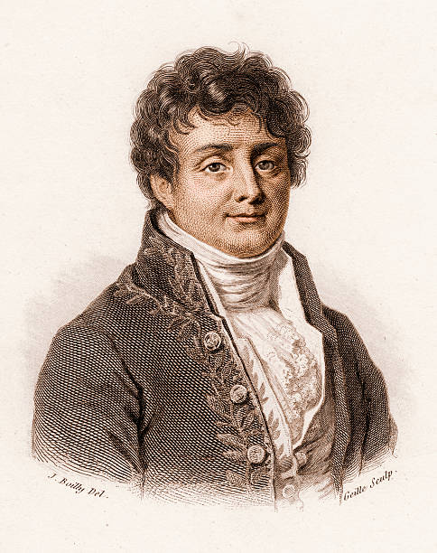{width="35%" fig-align="center"}

* <font color="blue">**Useful Properties of the Fourier Transform**</font>

  **Property 1** $\,$Fourier Transform Pair

  The Fourier transform of $\;f(x), -\infty <x <\infty$, $\,$produces a new function $F(\omega)$:

  $$ \mathcal{F}[f(x)]=\frac{1}{\sqrt{2\pi}} \int_{-\infty}^\infty f(x) e^{-i\omega x}\,dx = F(\omega)$$

  and the inverse Fourier transform of $F(\omega), -\infty<\omega<\infty$, $\,$will produce the original function $f(x)$:

  $$\displaystyle \mathcal{F}^{-1}[F(\omega)]=\frac{1}{\sqrt{2\pi}} \int_{-\infty}^\infty F(\omega) e^{i\omega x}\,d\omega = f(x)$$

  For example,

  $${\scriptsize e^{-|x|} \overset{\mathcal{F}}{\longrightarrow} \sqrt{\frac{2}{\pi}} \frac{1}{1+\omega^2} \overset{\mathcal{F}^{-1}}{\longrightarrow} e^{-|x|} }$$

  **Property 2** $\,$Linear Transformation

  $$ \mathcal{F} [af(x) +bg(x)] = a\mathcal{F}[f(x)] +b\mathcal{F}[g(x)] $$

  **Property 3** $\,$Transformation of Partial Derivatives

  $$ \mathcal{F}[f_x]=\frac{1}{\sqrt{2\pi}} \int_{-\infty}^\infty f_x e^{-i\omega x}\,dx = i\omega \mathcal{F}[f] $$

  $$ \mathcal{F}[f_{xx}]=\frac{1}{\sqrt{2\pi}} \int_{-\infty}^\infty f_{xx} e^{-i\omega x}\,dx = -\omega^2 \mathcal{F}[f] $$

  **Property 4** $\,$Convolution Property

  Every integral transform has what is called a convolution property. $\,$The general idea is that the transform of a product of two functions $\,f(x)g(x)\,$ is not the product of the individual transforms:

  $$ \mathcal{F}[f(x)g(x)]\neq\mathcal{F}[f(x)]\mathcal{F}[g(x)] $$

  However, $\,$in transform theory, $\,$there is something called the **convolution** $\,f*g\,$ of two functions that more or less plays the role of the product:

  $$ \mathcal{F}[f*g]=\mathcal{F}[f(x)]\mathcal{F}[g(x)]$$

  So what is this mysterious convolution $\,f*g$? $\,$It's given by formula

  $$ (\,f*g)(x)=\frac{1}{\sqrt{2\pi}} \int_{-\infty}^\infty f(x -\xi) g(\xi)\,d\xi $$

  The importance of the convolution in applications is due to the fact that quite often, $\,$the final step in solving a PDE boils down to finding the inverse transform of some expression that we can interpret as the product of two transforms $\mathcal{F}[f]\mathcal{F}[g]$

* **Solution of an Initial-Value Problem**

  Consider the heat flow in an <font color="blue">infinite</font> rod where the initial temperature is $\,u(x,0)=\phi(x)$

  $$
  \begin{aligned}
    u_t &=\alpha u_{xx} 
      &&\; \color{red}{-\infty < x < \infty}, \;0 < t < \infty \\
    u(x,0) &=\phi(x) &&-\infty < x < \infty
  \end{aligned}$$

**STEP 1** $\,$Transforming the Problem

$$\begin{aligned}
 \mathcal{F}[u_t] &= \alpha \mathcal{F}[u_{xx}]\\ 
 \mathcal{F}[u(x,0)] &= \mathcal{F} [\phi(x)]\\ 
 &\Downarrow \\
 \frac{dU(t)}{dt} &= -\alpha\omega^2 U(t)\\
 U(0)&=\Phi(\omega)
\end{aligned}$$

**STEP 2** $\,$Solving the Transformed Problem

$$U(t)=\Phi(\omega) e^{-\alpha \omega^2 t}$$

**STEP 3** $\,$Finding the Inverse Transform

$$\begin{aligned}
 u(x,t)&= \mathcal{F}^{-1}\left[ \Phi(\omega) e^{-\alpha\omega^2 t} \right]\\ 
 &= \mathcal{F}^{-1}\left[ \Phi(\omega) \right] * \mathcal{F}^{-1}\left[ e^{-\alpha\omega^2 t} \right]\\ 
 &= \phi(x)*\frac{1}{\sqrt{2\alpha t}} e^{-x^2/4\alpha t}\\ 
 &= \frac{1}{2\sqrt{\alpha\pi t}} \int_{-\infty}^{\infty} \phi(\xi) e^{-(x -\xi)^2/4\alpha t} \,d\xi
\end{aligned}$$

Note that the integrand is made up of two terms:

1. $\,$The initial temperature $\phi(x)$  
1. $\,$The Green's function or impulse-response function 

$$ G(x-\xi,t)=\frac{1}{2\sqrt{\alpha\pi t}}e^{-(x -\xi)^2/4\alpha t}, \;\;\lim_{t\to 0^+}G(x-\xi,t) = \underbrace{\delta(x-\xi)}_{\text{Dirac delta function}}$$

It can be shown that this impulse-response function $G(x-\xi,t)$ $\,$is the temperature response to an initial temperature impulse at $\,x=\xi$

"){width="75%" fig-align="center"}

<font color="blue">Hence, $\,$the interpretation of solution is that the initial temperature $\,u(x,0)=\phi(x)\,$ is decomposed into a continuum of impulses of $\,\phi(\xi)\,$ at each point $x=\xi$ and the resulting temperature $\,\phi(\xi)G(x-\xi,t)\,$ is found.</font> <font color="red">$\,$These resulting temperatures are then added (integrated) to obtain the solution. This general idea is also superposition</font>

$~$

```{python}
#| label: fig-impulse-response-function
#| fig-cap: "Impulse-response function"
#| fig-align: center
def example_plot5(alpha, xi, t, x):

    plt.figure(figsize=(7, 5))

    for tt in t:
      plt.plot(x, 0.5 /np.sqrt(alpha *np.pi *tt) 
            *np.exp(-(x -xi)**2 /(4.0 *alpha *tt)), 
          label=f'$t={tt:0.2f}$')
    plt.legend(loc='upper right')          

    plt.text(x[0] +1, 1.5, 
      r'$$G(x-\xi,t)=\frac{1}{2\sqrt{\alpha\pi t}}'
      r'e^{-(x-\xi)^2/4\alpha t}$$')

    plt.xlim(x[0], x[-1])
    plt.ylim(0, 2)

    plt.xlabel('$x$')
    plt.ylabel(r'$G(x-\xi,t)$')

    plt.title(rf'$\alpha={alpha:2.1f}, \;\xi={xi:2.1f}$')

    plt.show()

alpha = 1
xi = 0

t = [0.05, 0.1, 0.2, 0.4, 0.8, 1.6, 3.2]
x = np.linspace(-6, 6, 1000)

example_plot5(alpha, xi, t, x) 
```

**NOTES**

The major drawback of the Fourier transform is that not all functions can be transformed. $\,$For example, $\,$even simple functions like

$$
\begin{aligned}
 f(x) &= \text{constant} \\ 
 f(x) &= e^x\\ 
 f(x) &= \sin x 
\end{aligned}$$

cannot be transformed, $\,$since the integral

$$\mathcal{F}[f]=\frac{1}{\sqrt{2\pi}} \int_{-\infty}^\infty f(x) e^{-i\omega x}\,dx$$

does not exist. $\,$Only functions that damp to zero sufficiently fast as $|x| \to\infty$ have transforms

## $~$Sine and Cosine Transforms {#sec-x1-14}

* **Fourier Sine Transform Pair**

  $$
  \begin{aligned}
    \mathcal{F}_s\left[ f(x) \right]
      &= \frac{2}{\pi} \int_0^\infty f(x) \sin\omega x\,dx =F(\omega) \\ 
    \mathcal{F}_s^{-1} \left[ F(\omega) \right ]
      &= \int_0^\infty F(\omega) \sin\omega x \,d\omega =f(x)
  \end{aligned}$$

* **Fourier Cosine Transform Pair**

  $$
  \begin{aligned}
    \mathcal{F}_c \left[ f(x) \right] &= \frac{2}{\pi} 
      \int_0^\infty f(x) \cos\omega x\,dx =F(\omega) \\ 
    \mathcal{F}_c^{-1} \left[ F(\omega) \right ]&= 
       \int_0^\infty F(\omega) \cos\omega x \,d\omega =f(x)
  \end{aligned}$$

* The next step is to list a few properties of these transforms that make them work

  $${\scriptsize
  \begin{aligned}
    \mathcal{F}_s\left[ f'(x) \right]  
      &= \frac{2}{\pi} \int_0^\infty f'(x) 
        \sin\omega x\,dx\\ 
      &= \left.\frac{2}{\pi} \, f(x) 
        \sin\omega x \,\right|_0^\infty 
       -\omega\frac{2}{\pi}\int_0^\infty f(x) 
        \cos\omega x\,dx 
       =-\omega\mathcal{F}_c\left[ f(x) \right]  
      \phantom{xxxxxxxxxx}
  \end{aligned}}$$
  
  $${\scriptsize 
  \begin{aligned}
    \mathcal{F}_c\left[ f'(x) \right] 
      &= \frac{2}{\pi} \int_0^\infty f'(x) 
       \cos\omega x\,dx \\ 
      &= \left.\frac{2}{\pi} \, f(x) 
       \cos\omega x \,\right|_0^\infty 
       +\omega\frac{2}{\pi}\int_0^\infty f(x) 
        \sin\omega x\,dx =-\frac{2}{\pi}\,f(0) 
      +\omega\mathcal{F}_s\left[ f(x) \right] 
       \phantom{xx}
  \end{aligned}}$$

  $${\scriptsize \begin{aligned}
     \color{red}{\mathcal{F}_s\left[ f''(x) \right]} 
    &= \frac{2}{\pi} \int_0^\infty f''(x) 
     \sin\omega x\,dx =
    \left.\frac{2}{\pi}f'(x) \sin\omega x 
     \,\right|_0^\infty -\omega\frac{2} 
      {\pi}\int_0^\infty f'(x) \cos\omega x\,dx \\
    &=\color{red}{\frac{2}{\pi}\omega \,f(0)- 
     \omega^2\mathcal{F}_s\left[ f(x) \right]}
  \end{aligned}}$$

  $${\scriptsize \begin{aligned}
    \color{red}{\mathcal{F}_c\left[ f''(x) \right]} 
    &= \frac{2}{\pi} \int_0^\infty f''(x) 
    \cos\omega x\,dx =\left.\frac{2}{\pi}f'(x) 
     \cos\omega x \,\right|_0^\infty 
     +\omega\frac{2}{\pi}\int_0^\infty f'(x) 
     \sin\omega x\,dx \\ 
    &=\color{red}{-\frac{2}{\pi} \,f'(0) - 
     \omega^2\mathcal{F}_c\left[ f(x) \right]}
  \end{aligned}}$$

* **Solution of a Semi-infinite Diffusion Problem via the Sine Transform**

  The problem we are interested in is the *semi-infinite diffusion problem*

  $$
  \begin{aligned}
    u_t &= \alpha u_{xx} 
     && \color{red}{0<x<\infty}, \; 0 < t <\infty \\ 
    \color{red}{u(0,t)} & \color{red}{\;= A} 
     && 0 < t < \infty \\ 
    u(x,0) &= 0 && 0 \leq x < \infty
  \end{aligned}$$

  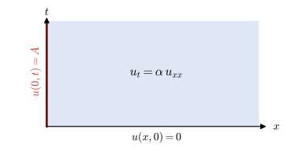{width="60%" fig-align="center"}

  To solve this, $\,$we break into three simple steps. $\,$First our strategy is to transform the <font color="blue">$x$-variable via Fourier sine transform</font> so that we get an ODE in time

$~$

**STEP 1**

We start by transforming each side of the PDE;
  
$$
\begin{aligned}
  \mathcal{F}_s [u_t]
    &=\alpha \mathcal{F}_s\left[u_{xx} \right] \\ 
    &\Downarrow\;{\scriptsize 
    \mathcal{F}_s[u(x,t)]=U(t)} \\ 
    \frac{d}{dt}U(t)
    &= \alpha\left [\frac{2}{\pi}\omega u(0,t) 
     -\omega^2\mathcal{F}_s[u]  \right ]=\alpha\left 
      [A\frac{2}{\pi}\omega -\omega^2 U(t)  \right ]\\ 
    &\Downarrow \;{\scriptsize 
     \mathcal{F}_s[u(x,0)]=U(0)}\\ 
     \frac{dU}{dt}&+\alpha \omega^2 U
     =A\frac{2}{\pi}\alpha\omega, \;U(0)=0 
\end{aligned}$$

We arrive at the ODE

**STEP 2**

To solve this IVP, $\,$we could use a variety of elementary techniques from ordinary differential equations. $\,$The solution is

$$ U(t)=A\frac{2}{\pi}\left[\frac{1 -e^{-\alpha\omega^2 t}}{\omega} \right]$$

We have now found the sine transformation for the answer $\,u(x,t)$

**STEP 3**

To find the solution, $\,$we can either evaluate the inverse transform directly from the integral or else resort to the tables. $\,$Using the tables, $\,$we get

$$ u(x,t)=A\, \mathrm{erfc} \left( \frac{x}{2\sqrt{\alpha t}} \right)$$

where $\mathrm{erfc}(\eta), \;0 < \eta < \infty$, $\,$is called the complementary-error function and is given by

$$ \mathrm{erfc}(\eta)=\frac{2}{\sqrt{\pi}} \int_\eta^\infty e^{-\beta^2}\,d\beta$$

$~$

```{python}
#| label: fig-semi-infinite-domain-1
#| fig-cap: "Heat conduction in semi-infinite domain with fixed temperature at the boundary"
#| fig-align: center
from scipy.special import erf, erfc

def example_plot6(A, alpha, t, x):
    plt.figure(figsize=(7, 5))
    for tt in t:
        plt.plot(x, A *erfc(x /(2 *np.sqrt(alpha *tt))), 
          label=rf'$t={tt:0.1f}$')
    plt.xlim(0, x[-1])
    plt.ylim(0, 1.2)
    plt.legend(loc='upper right')
    plt.xlabel('$x$')
    plt.ylabel('$u(x,t)$')
    plt.text(2, 0.8, 
      r'$$u(x,t)=A\, \mathrm{erfc}' 
      r'\left( \dfrac{x}{2\sqrt{\alpha t}} \right)$$')
    plt.title(rf'$A={A:3.1f}, \; \alpha={alpha:3.1f}$')
    plt.show()

A = 1
alpha = 1

t = [0.1, 0.2, 0.4, 0.8, 1.6, 3.2]
x = np.linspace(0, 8)

example_plot6(A, alpha, t, x)    
```

$~$

**Example** $\,$Solve by means of the cosine transform

$$
\begin{aligned}
 u_t &= \alpha u_{xx} && \color{red}{0 < x < \infty}, \;0 < t < \infty\\ 
 \color{red}{u_x(0,t)} &= 0 && 0 < t < \infty\\
 \color{red}{u(x,0)} &=\color{red}{H(1-x)} && 0 \leq x < \infty
\end{aligned}$$

where $H(x)$ is the Heaviside function

::: {.callout-note collapse="true" title="Answer" appearance="simple"}
$u(x,t)=\dfrac2\pi\displaystyle\int_0^\infty\frac{\sin\omega}{\omega}e^{-\alpha\omega^2t}\cos\omega x\,d\omega=\frac12\left[\mathrm{erf}\!\left(\frac{1+x}{2\sqrt{\alpha t}}\right)+\mathrm{erf}\!\left(\frac{1-x}{2\sqrt{\alpha t}}\right)\right]$
:::

[Solution](files/solutions/sol_12_14.pdf){target="_blank"}

$~$

```{python}
#| label: fig-semi-infinite-domain-2
#| fig-cap: "Heat conduction in semi-infinite domain insulated at the boundary"
#| fig-align: center
x0 = [0, 1, 1, 8]
u0 = [1, 1, 0, 0]

def example_plot6b(alpha, t, x, u_solution):
    plt.figure(figsize=(7, 5))
    plt.plot(x0, u0, 'r:', label='$t=0.0$')
    for tt in t:
        u = u_solution(alpha, tt, x)
        plt.plot(x, u, label='$t=%0.1f$' % tt)       
    plt.xlim(0, x[-1])
    plt.ylim(0, 1.1)
    plt.legend(loc='upper right')
    plt.xlabel('$x$')
    plt.ylabel('$u(x,t)$')
    plt.text(2, 0.35, 
        (r'$$u(x,t)=\dfrac{2}{\pi}\,' 
         r'\int_0^\infty \dfrac{\sin\omega}{\omega}\,' 
         r'\exp(-\alpha\omega^2 t)\, \cos\omega x \,d\omega$$'))
    plt.title(r'$\alpha=%3.1f$' % alpha)    
    plt.show()

alpha = 1

t = [0.1, 0.2, 0.4, 0.8, 1.6, 3.2, 6.4]
x = np.linspace(0, 8)

def u_solution(alpha, t, x):   
    # closed form of the cosine-transform integral
    s = 2.0 *np.sqrt(alpha *t)
    return 0.5 *(erf((1.0 +x) /s) +erf((1.0 -x) /s))

example_plot6b(alpha, t, x, u_solution)      
```

$~$

## $~$The Laplace Transform {#sec-x1-15}

* The Laplace transform 

  $$ \mathcal{L}[f(t)]= \int_0^\infty f(t) e^{-st}\,dt $$

  is probably the only integral transform the student has seen before, $\,$since it is a very powerful tool for transforming initial-value problems in ODEs into algebraic equations

* Not only is the Laplace transform useful in transforming ODEs into algebraic equations, $\,$but now we will use the Laplace transform to transform PDEs into ODEs

* The major difference in applying the Laplace transform to PDEs in contrast to ODEs is that now when the original PDE is transformed, $\,$the new resulting equation will be either a new PDE with one less independent variable or else an ODE in one variable

* We must then decide how to solve this new problem (maybe by another transform, $\,$by separation of variables, $\,$and so on)

$~$

**Property 1** $\,$ Transform Pair

* The Laplace transform and its inverse are given by

  $$\begin{aligned}
   \mathcal{L}[f(t)] &= F(s) =\int_0^\infty f(t) e^{-st}\,dt \\ 
   \mathcal{L}^{-1}[F(s)] &= \frac{1}{2\pi i}\int_{\gamma-i\infty}^{\gamma+i\infty} F(s)e^{st}\,ds
  \end{aligned}$$

* <font color="blue">The Laplace transform has one major advantage over the Fourier transform in that the damping factor $e^{-st}$ in the integrand allows us to transform a wider class of functions (the factor $e^{-i\omega x}$ in the Fourier transform doesn't do any damping since its absolute value is one)</font> 

* In fact, $\,$the exact conditions that ensure that a function $f(t)$ has a Laplace transform are given by the following theorem:

  $\,$

  If we can find constants $\,M$ and $\,a\,$ such that
  
  $$ \left|f(t)\right| \leq Me^{at} \;\text{ for } \; t > T, $$
  
  then $\displaystyle \int_0^\infty f(t)\,e^{-st}\,dt~$ exists for $s>a$

* We now list a few functions that have Laplace transforms

  $${\scriptsize \begin{aligned}
    f(t) 
      &= 1 
      && (\text{pick } M=1, a=0) 
        \;\;\longrightarrow\;\; F(s)=\frac{1}{s}\\ 
    f(t) 
      &=e^{2t} 
      && (\text{pick } M=1, a=2) 
        \;\;\longrightarrow\;\; F(s)=\frac{1}{s-2},\;\; s > 2 \\ 
    f(t) 
      &=\sin \omega t 
      && (\text{pick } M=1, a=0) 
        \;\;\longrightarrow\;\; F(s)=\frac{\omega}{s^2 +\omega^2} \\
    f(t) 
      &=e^{t^2} 
      && (\text{doesn't have a Laplace transform})
  \end{aligned}}$$

* In the definition of the Laplace transform, $\,$the variable $s$ is taken to be a real variable $0 < s < \infty$. $\,$It is possible to extend this definition to complex values of $s$ and, in fact, to evaluate the inverse Laplace transform

  $$ \mathcal{L}^{-1}[F(s)]=\frac{1}{2\pi i}\int_{\gamma-i\infty}^{\gamma+i\infty} F(s)e^{st}\,ds $$

  We must often resort to contour integration in the complex plane and the theory of residues. $\,$We won't bother ourselves with this topic here but will use the tables for finding inverse transforms

**Property 2** $\,$ Transforms of Partial Derivatives

* Suppose we have a function $u(x,t)$ of two variables. $\,$Since the Laplace transform transforms the $t$-variable, $\,$the rules of transformation for partial derivatives are

  $~$

  $\displaystyle \color{red}{\mathcal{L}[u_t]}=\int_0^\infty u_t(x,t) e^{-st}\,dt=\color{red}{sU(x,s) -u(x,0)}$

  $\displaystyle \color{red}{\mathcal{L}[u_{tt}]}=\int_0^\infty u_{tt}(x,t) e^{-st}\,dt=\color{red}{s^2U(x,s) -su(x,0) -u_t(x,0)}$

  $\displaystyle \mathcal{L}[u_x]=\int_0^\infty u_x(x,t) e^{-st}\,dt=\frac{\partial U}{\partial x}(x,s)$

  $\displaystyle \mathcal{L}[u_{xx}]=\int_0^\infty u_{xx}(x,t) e^{-st}\,dt=\frac{\partial^2 U}{\partial x^2}(x,s)$

**Property 3** $\,$ Convolution Theory

* Convolution plays the same role here as it did in the Fourier transform, $\,$but now the convolution is defined slightly differently. $\,$The finite convolution of two functions $\,f$ and $g$ is defined by

  $$ \color{red}{(f*g)(t)=\int_0^t f(\tau) g(t-\tau)\,d\tau =\int_0^t f(t- \tau) g(\tau)\,d\tau} $$

  As in the case of the infinite convolution, $\,$the important property of this new convolution is that

  $$ \mathcal{L}[f*g]=\mathcal{L}[f]\,\mathcal{L}[g] $$

  or the equivalent formula

  $$ \mathcal{L}^{-1}\left\{\mathcal{L}[f] \,\mathcal{L}[g] \right\}=f*g $$

  For example

  $$ \mathcal{L}^{-1}\left[\frac{1}{s} \cdot \frac{1}{s^2+1}\right] = \int_0^t \sin \tau \,d\tau=1-\cos t $$

**NOTES**

<font color="blue">The Laplace transform can also be applied to problems where the PDE is nonhomogeneous (in separation of variables, $\,$the equation had to be homogeneous), $\,$but the Laplace transform will generally work only if the equation has constant coefficients (in separation of variables, $\,$we could have variable coefficients)</font>  

$~$

* **Heat Conduction in a Semi-infinite Medium**

  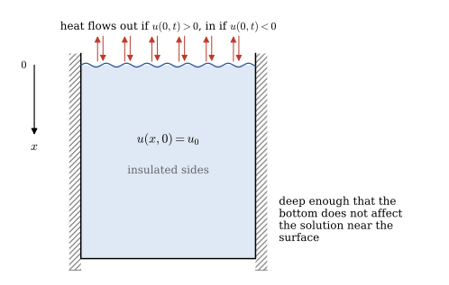{width="60%" fig-align="center"}

  * Consider a large (deep) container of liquid that is insulated on the sides. Suppose the liquid has an initial temperature of $u_0$ and that the temperature of the air above liquid is zero. Our goal is to find the temperature of the liquid at various depths of the container at different $t$ values:

    $$\begin{aligned}
     u_t &= u_{xx} && 0 < x < \infty,\;0 < t < \infty \\ 
     u_x(0,t) -u(0,t) &= 0 && 0 < t < \infty \\ 
     u(x,0) &= u_0 && 0 < x <\infty
    \end{aligned}$$

  * Transforming our problem, $\,$we arrive at an ODE in $x$

    $$
    \begin{aligned}
      sU(x) -u_0 &= \frac{d^2U}{dx^2} && 0 < x < \infty \\[5pt]
      \frac{dU}{dx}(0) &= U(0) &&
    \end{aligned}$$

    We first find the general solution of the ODE, $\,$which is

    $$ U(x)=c_1 e^{\sqrt{s}x} +c_2 e^{-\sqrt{s}x} +\frac{u_0}{s} $$ 

  * Substituting the BCs into this expression allows us to find the constants $c_1$ and $c_2$ (first note that $c_1=0\,$ or else the temperature will go to infinity as $x$ gets large). $\,$Finding $c_2$ from the BC at $x=0\,$ gives us the answer for $U(x)$

    $$ {\scriptsize U(x)=
      -u_0 \left[ \frac{e^{-\sqrt{s}x}}{s(\sqrt{s} +1)} \right] 
       +\frac{u_0}{s}
      =\frac{u_0}{s} -u_0\left[ \frac{e^{-\sqrt{s}x}}{s} 
      -\frac{e^{-\sqrt{s}x}}{\sqrt{s}(\sqrt{s} +1)}\right]} $$

    Now for the last step, $\,$to find $u(x,t)$, $\,$we compute

    $$ {\scriptsize u(x,t)
     =\mathcal{L}^{-1}\left[ U(x,s) \right]
     =u_0 -u_0 \left[ \mathrm{erfc}\left( \frac{x}{2\sqrt{t}} \right) 
    -\mathrm{erfc}\left( \sqrt{t}+\frac{x}{2\sqrt{t}} \right)
    e^{x+t}\right]} $$

    See [Inverse Laplace Transform Table](http://eqworld.ipmnet.ru/en/auxiliary/inttrans/LapInv5.pdf)

$~$

```{python}
#| label: fig-semi-infinite-domain-3
#| fig-cap: "Heat conduction in semi-infinite domain with 3^rd^ kind BC"
#| fig-align: center

def example_plot7(t, x, u0, u_solution):

    plt.figure(figsize=(7, 5))
    plt.plot(x, np.full_like(x, u0), label='$t=0$')
    for tt in t:
        plt.plot(x, u_solution(tt, x, u0), label='$t=%1.3f$' % tt)
    plt.legend(loc='lower right')

    plt.xlim(0, 5)
    plt.ylim(0.4, 1.2)

    plt.xlabel('$x$')
    plt.ylabel('$u(x,t)$')
    plt.title(r'$u_0=%3.1f$' % u0)

    plt.show()

def u_solution(t, x, u0):
    sqrt_t = np.sqrt(t)
    x_2sqrt_t = x /(2 *sqrt_t)
    return u0 -u0*(erfc(x_2sqrt_t) 
              -erfc(sqrt_t +x_2sqrt_t) *np.exp(x +t))

u0 = 1
t = np.logspace(-3, 0, 6)
x = np.linspace(0, 5, 300)

example_plot7(t, x, u0, u_solution)    
```

::: {.callout-tip appearance="simple" icon="false"}
**Try it in Python:** Laplace transforms with `sympy`: @sec-sympy-Laplace-transform
:::

$~$

## $~$The Convection Term $u_x$ in the Diffusion Problems {#sec-x1-16}

* Suppose now we consider the problem of finding the concentration of a substance upwards from the surface of the earth where the substance both diffuses through the air and is carried upwards (convected) by moving currents (moving with velocity $V$)

* In any case, $\,$it is our purpose here to solve the diffusion-convection equation

  $$ u_t = Du_{xx} -V u_x$$

* To get an idea of what solutions look like or how they behave with the convection term included, $\,$let's first work a problem that is pure convection (the diffusion term is zero)

* A typical problem would be dumping a substance into clean air (moving with upward velocity $V$) and observing the concentration of the substance at the upperside. $\,$Then the concentration of substance $u(x,t)$ can be found by solving the following mathematical model:

  $$
  \begin{aligned}
     u_t &= -Vu_x && \phantom{xx}\color{red}{0 < x < \infty}, \; 0 < t < \infty \\ \\
     u(0,t) &= P &&\longleftarrow\; \text{Constant Input of the Substance} \\
     u(x,0) &= 0 &&\longleftarrow\; \text{Initially Clean Air}
  \end{aligned} \tag{CV}\label{eq:CV}$$

* Since the $x$-variable is unbounded, $\,$we use the Laplace transform on $t$

  $$\begin{aligned}
    sU(x) &=-V\frac{dU}{dx}, \;\;\; 0 < x < \infty \\ 
    U(0) &= \frac{P}{s}\\ 
    &\Downarrow \\ 
    U(x) &=\frac{P}{s} e^{-\frac{x}{V}s}  \\ 
    &\Downarrow \\
    u(x,t) &= P \,H(t -x/V) \\
    &\Downarrow \\
    u(x,t) &=
    \begin{cases}
      P & x \leq Vt \\
      0 & x > Vt  
    \end{cases}
  \end{aligned}$$

* To see what happens when a moving wave diffuses, $\,$we solve the following problem $(P=1)$
  
  $$
  \begin{aligned}
     u_t &= Du_{xx}-Vu_x && -\infty < x < \infty, \;0 < t < \infty \\
     u(x,0) &= P\left(1 -H(x)\right) && -\infty < x < \infty
  \end{aligned} \tag{DC}\label{eq:DC}$$ 
  
  Note that in the new problem \eqref{eq:DC}, $\,$we have moved the boundary to $-\infty$ (we now have an initial-value problem)

* In this case, $\,$we introduce a new coordinate $\xi$, $\,$which moves along the $x$-axis with velocity $V$. $\,$In other words, $\,$we now place our coordinate system so that it moves with the wave front (of course, $\,$now when diffusion in addition to convection, $\,$we won't have a sharp wave front)

* Mathematically this says that we change our space coordinate $\,x\,$ to $\,\xi=x -Vt$. $\,$It's now clear that when $\xi=0,$ $\,$we are on the wave front

* To begin, $\,$we introduce new coordinates $(\xi, \tau)$ and use the chain rule to get the new IVP in terms of $\xi$ and $\tau$:

  $$\begin{aligned}
    u_t&= D u_{xx} -Vu_x\\ 
    &\Downarrow\; \xi=x-Vt, \;\tau=t \\ 
    u_t&= u_{\xi}\xi_t+u_\tau\tau_t=-Vu_\xi+u_\tau\\ 
    u_x&= u_\xi \xi_x+u_\tau\tau_x =u_\xi\\
    u_{xx}&=(u_\xi)_x=u_{\xi\xi}\xi_x=u_{\xi\xi} \\
    &\Downarrow \\
    -Vu_\xi+u_\tau &=Du_{\xi\xi} -Vu_\xi\\
    &\big\Downarrow \;\xi=x \text{ at } t=0\\
    u_\tau &=D u_{\xi\xi},\;\;\;-\infty<\xi<\infty \\
    u(\xi,0)&=P(1-H(\xi))=\phi(\xi) 
  \end{aligned}$$

* This problem has already been solved in @sec-x1-13 by the Fourier transform and has the solution

  $$ {\scriptsize u(\xi,\tau)=\frac{1}{2\sqrt{D\pi\tau}} \int_{-\infty}^{\infty}\phi(\omega) e^{-(\xi-\omega)^2/4D\tau}\,d\omega
  =\frac{P}{2\sqrt{D\pi\tau}} \int_{-\infty}^0 e^{-(\xi-\omega)^2/4D\tau}\,d\omega } $$

  where $\,\phi(\omega)$ is the initial condition

* By letting

  $${\beta=\frac{\xi -\omega}{2\sqrt{D\tau}},\;\; d\beta=-\frac{1}{2\sqrt{D\tau}}d\omega}$$

  we get the interesting result

  $$\begin{aligned}
    \displaystyle u(\xi,\tau)&=\frac{P}{2} \left[ \frac{2}{\sqrt{\pi}} \int_{\frac{\xi}{2\sqrt{D\tau}}}^\infty e^{-\beta^2}\,d\beta \right]  
     = {\scriptsize \begin{cases}
    \displaystyle\;\frac{P}{2} \left[ 1+\mathrm{erf}\left( -\frac{\xi}{2\sqrt{D\tau}} \right) \right],& \xi<0 \\ 
    \displaystyle\;\frac{P}{2}\, \mathrm{erfc}\left( \frac{\xi}{2\sqrt{D\tau}} \right), & \xi \geq 0 
      \end{cases}}
    \end{aligned}$$

* Finally, $\,$the solution of our problem in terms of  the coordinates $x$ and $t\,$ is

  $$u(x,t)=\begin{cases}
    \displaystyle\;\frac{P}{2} \left[ 1+\mathrm{erf}\left( \frac{Vt -x}{2\sqrt{Dt}} \right) \right], & Vt>x \\ 
    \displaystyle\;\frac{P}{2}\, \mathrm{erfc}\left( \frac{x-Vt}{2\sqrt{Dt}} \right), & Vt \leq x 
  \end{cases}$$

$~$

```{python}
#| label: fig-diffusion-convection
#| fig-cap: "Diffusion-convection on the infinite domain"
#| fig-align: center

def example_plot8(D, V, t, x, u_solution):
    plt.figure(figsize=(8, 6))
    plt.plot([-1, 0, 0, x[-1]], [1, 1, 0, 0], 'r:', label='$t=0.0$')
    for tt in t:
        x_tt = V*tt 
        plt.plot(x, u_solution(D, V, tt, x), label=rf'$t={tt:3.1f}$')
        plt.plot([-1, x_tt, x_tt, x[-1]], [1, 1, 0, 0], 'k:') 
    plt.xlim(-1, x[-1])
    plt.ylim(0, 1.2)
    plt.legend(loc='upper left', bbox_to_anchor=(1.0, 1.0))
    plt.xlabel('$x$')
    plt.ylabel('$u(x,t)$')
    plt.title(rf'$D={D:4.1f},\;V={V:3.1f},\;P=1.0$')    
    plt.show()        

def u_solution(D, V, t, x):
    x_t = (x -V*t) /(2.0 *np.sqrt(D*t))      
    return [0.5*(1.0 +erf(-q)) if q <= 0.0 else 0.5*erfc(q) for q in x_t] 

D = 0.1
V = 1.0

t = [2.0, 4.0, 6.0, 8.0]
x = np.linspace(0, 16, 400)

example_plot8(D, V, t, x, u_solution)  
```

$~$

## $~$Duhamel's Principle {#sec-x1-17}

* Quite often, $\,$it is important to find the temperature inside a medium due to time-varying boundary conditions. $\,$For example, $\,$consider an insulated rod with temperature specified as $\,f(t)$ on the right end

  $$
  \begin{aligned}
   u_t &= u_{xx} && 0 < x < 1, \; 0 < t < \infty \\
   u(0,t) &= 0 && 0 < t < \infty \\ 
   u(1,t) &= \color{red}{f(t)} && \\
   u(x,0) &= 0 && 0 \leq x \leq 1
  \end{aligned} \tag{D1}\label{eq:D1}$$

* We may think that the solution to \eqref{eq:D1} can be easily found once we know the solution to the simpler version (constant temperature on the boundaries)

  $$
  \begin{aligned}
   w_t &= w_{xx} && 0 < x < 1, \; 0 < t < \infty \\
   w(0,t) &= 0 && 0 < t < \infty \\ 
   w(1,t) &= \color{red}{1} && \\
   w(x,0) &= 0 && 0 \leq x \leq 1
  \end{aligned} \tag{D2}\label{eq:D2}$$ 

  In fact, $\,$if we solve \eqref{eq:D1} and \eqref{eq:D2} side by side by the Laplace transform, $\,$<font color=red>we will see a striking result (Duhamel's principle) that will give us the solution to \eqref{eq:D1} in terms of the solution of \eqref{eq:D2}</font>

* Solving \eqref{eq:D2} by Laplace transform, $\,$we have

  $$\begin{aligned}
   \frac{d^2W}{dx^2} &-sW = 0\\ 
     W(0)&=0 \\ 
     W(1)&=\color{red}{1/s} \\ 
         &\Downarrow {\scriptstyle \text{Solve the ODE}}\\ 
     W(x,s)&=\color{red}{\frac{1}{s} 
         \left[ \frac{\sinh x\sqrt{s}}{\sinh \sqrt{s}} \right]} \\
         &\Downarrow {\scriptstyle \text{Find the inverse transform}}\\
     w(x,t)=x +\frac{2}{\pi} & \sum_{n=1}^\infty 
     \frac{(-1)^n}{n} e^{-(n\pi)^2 t}\sin n\pi x 
  \end{aligned}$$

* And we also obtain the following by transforming \eqref{eq:D1}: 

  $$\begin{aligned}
   \frac{d^2U}{dx^2} &-sU = 0\\ 
    U(0)&=0 \\ 
    U(1)&=\color{red}{F(s)} \\ 
     &\Downarrow {\scriptstyle \text{Solve the ODE}}\\ 
    U(x,s)&=F(s) \left[ \frac{\sinh x\sqrt{s}}{\sinh \sqrt{s}} \right] 
           =F(s) s \color{red}{\frac{1}{s}\left[ \frac{\sinh x\sqrt{s}}{\sinh \sqrt{s}} \right]} 
           =F(s) sW(x,s)\\
     &\big\Downarrow \;{\scriptstyle \mathcal{L}[w_t]=sW -w(x,0)=sW}\\
    U(x,s)&=F(s) \mathcal{L}[w_t] \\
     &\big\Downarrow \;{\scriptstyle \text{Find the inverse transform}}\\
     \color{red}{u(x,t)} 
       &= \mathcal{L}^{-1} \left[ F(s) \mathcal{L}[w_t] \right] 
       =f(t) * w_t(x,t) \\
       &\color{red}{\;= \int_0^t w_{t -\tau}(x,t-\tau) \, f(\tau) \,d\tau} \\
       &= \left. -w(x,t-\tau)\, f(\tau) \phantom{\frac{}{}} 
        \right |_{\,0}^{\,t} +\int_0^t w(x,t-\tau) f'(\tau) \,d\tau\\
       &= \int_0^t w(x,t-\tau) f'(\tau)\,d\tau +w(x,t) \, f(0)
  \end{aligned}$$

  We have found the solution $u(x,t)$ to the time-varying problem in terms of the solution to the easy problem (constant BCs).
$\,$The above result is known as <font color="red">Duhamel's principle</font>

$~$

**NOTES**

* <font color="red">There is another interesting version of Duhamel's principle</font> that gives the answer to \eqref{eq:D1} in terms of the solution $\,v(x,t)$ of the alternative simple problem

  $$
  \begin{aligned}
   v_t &= v_{xx} && 0 < x < 1, \; 0 < t < \infty \\
   v(0,t) &= 0 && 0 < t < \infty \\ 
   v(1,t) &= \color{red}{\delta(t)} && \\
   v(x,0) &= 0 && 0 \leq x \leq 1
  \end{aligned}$$ 

* Knowing this formula

  $$ \color{red}{u(x,t)=\int_0^t v(x,t-\tau) \,f(\tau)\,d\tau} $$

  allows us to find $u(x,t)$ to an arbitrary boundary temperature $\,f(t)$ once we have carried out an experiment to determine the temperature response $\,v(x,t)$ from an impulse temperature


## Summary {.unnumbered}

| Topic | Key result |
|:--|:--|
| Classification | $Au_{xx}+Bu_{xy}+Cu_{yy}+\cdots=0$: $\,B^2-4AC<0$ elliptic, $\,=0$ parabolic, $\,>0$ hyperbolic |
| Heat equation | $u_t=\alpha u_{xx}$ |
| Separation of variables | $u(0,t)=u(L,t)=0$: $\ u=\displaystyle\sum_{n=1}^\infty b_ne^{-\alpha(n\pi/L)^2t}\sin\frac{n\pi x}{L}$, $\ b_n=\dfrac2L\displaystyle\int_0^L\phi(x)\sin\frac{n\pi x}{L}\,dx$ |
| Nonhomogeneous BCs | $u=$ steady state $+$ transient, $\,$the transient satisfying homogeneous BCs |
| Substitutions | $u_t=\alpha u_{xx}-\beta u$: $\,u=e^{-\beta t}w$; $\quad u_t=\alpha u_{xx}-vu_x$: $\,u=\exp\left[\dfrac{v}{2\alpha}\left(x-\dfrac v2t\right)\right]w$ |
| Eigenfunction expansion | $u_t=\alpha u_{xx}+f(x,t)$: $\,u=\sum T_n(t)X_n(x)$, $\,$one ODE for each $T_n$ |
| Finite sine transform | $\mathcal F_s[u_{xx}]=-\left(\dfrac{n\pi}{L}\right)^2\mathcal F_s[u]+\dfrac{2n\pi}{L^2}\left[u(0,t)-(-1)^nu(L,t)\right]$ |
| Fourier transform | $\mathcal F[f]=\dfrac1{\sqrt{2\pi}}\displaystyle\int_{-\infty}^\infty f(x)e^{-i\omega x}\,dx$, $\quad\mathcal F[f_x]=i\omega\mathcal F[f]$, $\ \mathcal F[f_{xx}]=-\omega^2\mathcal F[f]$ |
| Infinite rod | $u(x,t)=\dfrac{1}{2\sqrt{\alpha\pi t}}\displaystyle\int_{-\infty}^\infty\phi(\xi)\,e^{-(x-\xi)^2/4\alpha t}\,d\xi$ |
| Duhamel's principle | $u(x,t)=\displaystyle\int_0^t\frac{\partial w}{\partial t}(x,t-\tau)\,f(\tau)\,d\tau$, $\,$where $w$ solves the problem with the constant boundary value $1$ |

$~$

## Worked Exercises {.unnumbered}

**1.** $~$ Solve the problem

$$
\begin{aligned}
 u_t &= \alpha u_{xx}, \;\;a < x < b, \;\; t>0\\ 
 &u(a,t)=0, \;u(b,t)=0, \;u(x,0)=(x-a)(b-x) 
\end{aligned}
$$

**Solution**

**Step 1:** $~$ Separation of Variables

We look for solutions of the form:

$$u(x,t) = X(x)T(t)$$

Substitute into the PDE:

$$X(x) T’(t) = \alpha X’’(x) T(t)
\; \Rightarrow \; \frac{T’(t)}{\alpha T(t)} = \frac{X’’(x)}{X(x)} = -\lambda$$

We get two ODEs:

$$\begin{aligned}
T’(t) + \alpha \lambda T(t) &= 0 \\
X’’(x) + \lambda X(x) &= 0
\end{aligned}$$

with boundary conditions:

$$X(a) = 0, \quad X(b) = 0$$

**Step 2:** $~$ Solve the Spatial Part

We solve:

$$X'' + \lambda X = 0, \quad X(a) = 0, \quad X(b) = 0$$

This is a standard Sturm–Liouville problem

The eigenfunctions are:

$$X_n(x) = \sin\left( \frac{n\pi (x - a)}{b - a} \right), \quad n = 1, 2, 3, \dots$$

The corresponding eigenvalues are:

$$\lambda_n = \left( \frac{n\pi}{b - a} \right)^2$$

**Step 3:** $~$ Solve the Temporal Part

$$T_n(t) = e^{-\alpha \lambda_n t} = \exp\left( -\alpha \left( \frac{n\pi}{b - a} \right)^2 t \right)$$

**Step 4:** $~$ General Solution

$$u(x,t) = \sum_{n=1}^\infty B_n \sin\left( \frac{n\pi(x - a)}{b - a} \right)
e^{- \alpha \left( \frac{n\pi}{b - a} \right)^2 t}$$

**Step 5:** $~$ Apply Initial Condition

$$u(x,0) = (x - a)(b - x) = \sum_{n=1}^\infty B_n \sin\left( \frac{n\pi(x - a)}{b - a} \right)$$

To find coefficients $B_n$, use Fourier sine series:

$$B_n = \frac{2}{b - a} \int_a^b (x - a)(b - x) \sin\left( \frac{n\pi(x - a)}{b - a} \right) dx$$

Let’s use substitution:
Let $\xi = \frac{x - a}{b - a}$, so $x = (b-a)\xi + a$, $dx = (b-a) d\xi$, and when $x = a \Rightarrow \xi = 0, x = b \Rightarrow \xi = 1$

Then:

$$(x - a)(b - x) = (b - a)^2 \xi (1 - \xi)$$

and:

$$\frac{B_n}{(b-a)} = 2 \int_0^1 \xi(1 - \xi) \sin(n\pi \xi) d\xi =
\begin{cases}
\displaystyle \frac{8}{n^3 \pi^3}, & n \text{ odd} \\
0, & n \text{ even}
\end{cases}$$

```{python}
import numpy as np
import matplotlib.pyplot as plt

# Parameters
a = 0
b = 1
alpha = 1
t_values = [0, 0.05, 0.10, 0.15]  # Times to plot
x_vals = np.linspace(a, b, 400)
N_terms = 50  # Number of terms in Fourier series

# Solution series function
def u_series(x, t, N=N_terms):
    u = np.zeros_like(x)
    for n in range(1, N + 1, 2):  # Only odd n
        coeff = 8 /(n**3 * np.pi**3)
        term = coeff *(np.sin(n *np.pi *(x - a) /(b - a)) 
          *np.exp(-alpha *(n *np.pi /(b - a))**2 *t))
        u += term
    return u

# Plotting
plt.figure(figsize=(7.5, 5))
for t in t_values:
    u_vals = u_series(x_vals, t)
    plt.plot(x_vals, u_vals, label=f"t = {t}")

plt.title("Solution $u(x,t)$ of the Heat Equation")
plt.xlabel("x")
plt.ylabel("u(x,t)")
plt.legend()
plt.grid(True)
plt.show()
```

$~$

**2.** $~$ Solve the problem

$$
\begin{aligned}
 u_t &= \alpha u_{xx}, \;\; 0 < x < \pi, \;\; t>0\\ 
 &u_x(0,t)=0, \;u_x(\pi,t)=0, \;u(x,0)=1 +\frac{1}{2}\cos 3x 
\end{aligned}
$$

**Solution**

**Step 1:** $~$ Separation of Variables

Let’s look for a solution of the form:

$$u(x,t) = X(x)T(t)$$

Plug into the PDE:

$$X(x) T’(t) = \alpha X’’(x) T(t)
\; \Rightarrow \; \frac{T’(t)}{\alpha T(t)} = \frac{X’’(x)}{X(x)} = -\lambda$$

Which gives us two ODEs:

$$
\begin{aligned}
T'(t) + \alpha \lambda T(t) &= 0 \\
X''(x) + \lambda X(x) &= 0
\end{aligned}$$

With Neumann boundary conditions:

$$X'(0) = 0, \quad X'(\pi) = 0$$

**Step 2:** $~$ Solve the Spatial ODE

$$X'' + \lambda X = 0$$

Solutions depend on the value of $\lambda$:	

* The eigenfunctions satisfying Neumann BCs are:

$$X_n(x) =
\begin{cases}
1, & n = 0 \\
\cos(nx), & n = 1, 2, 3, \dots
\end{cases}$$

* Corresponding eigenvalues:

$$\lambda_n = n^2, \quad n = 0, 1, 2, \dots$$

**Step 3:** $~$ Solve the Time Part

$$T_n(t) = e^{-\alpha n^2 t}$$

**Step 4:** $~$ General Solution

$$u(x,t) = \frac{A_0}{2} +\sum_{n=1}^\infty A_n \cos(nx) e^{-\alpha n^2 t}$$

**Step 5:** $~$ The initial condition is:

$$u(x,0) = 1 + \cos 3x$$

This already matches our eigenfunctions:
* $1$ corresponds to $\frac{A_0}{2}$
* $\frac{1}{2}\cos 3x$ corresponds to $A_3\cos(3x)$

So the expansion is:

$$u(x,t) = \frac{A_0}{2} + A_3 \cos(3x) e^{-9\alpha t}$$

Comparing with $u(x,0) = 1 + \frac{1}{2}\cos 3x$, we get:

$$A_0 = 2, \quad A_3 = \frac{1}{2}$$

All other $A_n = 0$

**Final Answer:**

$$u(x,t) = 1 + \frac{1}{2}\cos(3x) e^{-9\alpha t}$$

$~$

**3.** $~$ Solve the problem
$$
\begin{aligned}
 u_{t} &= u_{xx} +F(x,t), \;\; -\infty < x < \infty, \;\; t>0\\ 
 &u(x,0) = 0, \;u(x, t) \sim \text{bounded}\\
\end{aligned}
$$

**Solution**

For the heat equation on $\mathbb{R}$, the Green’s function (or heat kernel) is:
$$G(x,t) = \frac{1}{\sqrt{4\pi t}} e^{-x^2/(4t)}$$

The solution to the nonhomogeneous heat equation with zero initial condition is given by the Duhamel’s principle:
$$u(x,t) = \int_0^t \int_{-\infty}^\infty G(x - \xi, t - \tau) F(\xi, \tau) \, d\xi \, d\tau$$

So,

$$
u(x,t) = \int_0^t \int_{-\infty}^\infty \frac{1}{\sqrt{4\pi(t - \tau)}} \exp\left(-\frac{(x - \xi)^2}{4(t - \tau)}\right) F(\xi, \tau) \, d\xi \, d\tau
$$

$~$

**4.** $~$ Solve the problem
$$
\begin{aligned}
 u_{t} &= u_{xx}, \;\; 0 < x < \infty, \;\; t>0\\ 
 &u(0, t) = g(t), \;u(x, 0) = 0, \;u(x, t) \sim \text{bounded}\\
\end{aligned}
$$

**Solution**

This is a classical problem with the Dirichlet boundary condition on a semi-infinite domain.

Since the initial condition is zero and the boundary condition is nonzero at $x = 0$, we apply a Green’s function method for the semi-infinite domain

The appropriate solution is:

$$
u(x,t) = \int_0^t \frac{x}{\sqrt{4\pi (t - \tau)^3}} \exp\left(-\frac{x^2}{4(t - \tau)}\right) g(\tau) \, d\tau
$$

This is the Poisson kernel representation for the half-line heat problem with a source at the boundary

$~$

**5.** $~$ Solve the problem

$$\begin{aligned}
 u_t &= \alpha u_{xx} -\nu u_{x} -\beta u, \;\;0 < x < 1, \quad t>0\\
 &u(0, t) = 0, \;u(1, t) = 0, \;u(x,0) = \exp \left(\frac{\nu}{2\alpha}x\right)
\end{aligned}$$

**Solution**

**Step 1:** $~$ Change of variables

We use the substitution:

$$u(x,t) = e^{r x - \lambda t} w(x,t)$$

with the goal of choosing $r$ and \lambda so that the PDE for $w(x,t)$ becomes the standard heat equation

Compute derivatives:

$$\begin{aligned}
u_x &= r e^{r x - \lambda t} w + e^{r x - \lambda t} w_x = e^{r x - \lambda t}(r w + w_x) \\
u_{xx} &= e^{r x - \lambda t} (r^2 w + 2r w_x + w_{xx})\\
u_t &= e^{r x - \lambda t} (-\lambda w + w_t)
\end{aligned}$$

Now plug into the PDE:

$$u_t = \alpha u_{xx} - \nu u_x - \beta u$$

Substituting everything:

$$\begin{aligned}
e^{r x - \lambda t} (-\lambda w + w_t) &= \alpha e^{r x - \lambda t} (r^2 w + 2r w_x + w_{xx})\\ &- \nu e^{r x - \lambda t} (r w + w_x) - \beta e^{r x - \lambda t} w
\end{aligned}$$

Cancel the common exponential $e^{r x - \lambda t}$:

$$-\lambda w + w_t = \alpha (r^2 w + 2r w_x + w_{xx}) - \nu (r w + w_x) - \beta w$$

Group terms:

$$w_t = \alpha w_{xx} + (2\alpha r - \nu) w_x + (\alpha r^2 - \nu r - \beta + \lambda) w$$

We want to choose $r$ and $\lambda$ so that:

* Coefficient of $w_x$ is 0: $~2\alpha r - \nu = 0$
* Coefficient of $w$ is 0: $~\alpha r^2 - \nu r - \beta + \lambda = 0$

Solve for $r$:

$$2\alpha r = \nu \; \Rightarrow \; r = \frac{\nu}{2\alpha}$$

Plug $r = \frac{\nu}{2\alpha}$ into the second equation to find $\lambda$:

$$\lambda = \alpha r^2 - \nu r + \beta = \alpha \left( \frac{\nu}{2\alpha} \right)^2 - \nu \cdot \frac{\nu}{2\alpha} + \beta
= -\frac{\nu^2}{4\alpha} + \beta$$

**Step 2:** $~$ Resulting equation for $w$

We now have:

$$u(x,t) = e^{\frac{\nu}{2\alpha} x - \lambda t} w(x,t),
\quad \text{with } \lambda = -\frac{\nu^2}{4\alpha} + \beta$$

Then $w(x,t)$ satisfies the heat equation:

$$w_t = \alpha w_{xx},
\quad 0 < x < 1,\; t > 0$$

with boundary conditions:

$$w(0,t) = 0, \quad w(1,t) = 0$$

and initial condition:

$$w(x,0) = u(x,0) \cdot e^{ -\frac{\nu}{2\alpha} x } = \exp\left( \frac{\nu}{2\alpha} x \right) \cdot \exp\left( -\frac{\nu}{2\alpha} x \right) = 1$$

**Step 3:** $~$ Solve the heat equation with constant initial condition

We solve:

$$\begin{aligned}
w_t &= \alpha w_{xx}, \quad 0 < x < 1, \\
w(0,t) &= w(1,t) = 0, \\
w(x,0) &= 1.
\end{aligned}$$

Use Fourier sine series:

$$w(x,t) = \sum_{n=1}^\infty b_n e^{-\alpha (n\pi)^2 t} \sin(n\pi x)$$

where the coefficients $b_n$ come from:

$$b_n = 2 \int_0^1 1 \cdot \sin(n\pi x)\, dx = \frac{2}{n\pi}(1 - \cos(n\pi)) = \begin{cases}
\frac{4}{n\pi}, & \text{if } n \text{ odd}, \\
0, & \text{if } n \text{ even}.
\end{cases}$$

So,

$$w(x,t) = \sum_{\substack{n=1 \\ n \text{ odd}}}^\infty \frac{4}{n\pi} e^{-\alpha (n\pi)^2 t} \sin(n\pi x)$$

**Step 4:** $~$ Final answer for $u(x,t)$

$$
u(x,t) = e^{\frac{\nu}{2\alpha}x + \frac{\nu^2}{4\alpha}t - \beta t} \sum_{\substack{n=1\\n \text{ odd}}}^{\infty} \frac{4}{n\pi} e^{-\alpha (n\pi)^2 t} \sin(n\pi x)
$$

$~$

**6.** $~$ Solve the problem

$$
\begin{aligned}
 u_t &= u_{xx}, \;\;0<x<1, \;\; 0<t<\infty\\ 
 &u(0,t)=0\\ 
 &u(1,t)=\cos t \\ 
 &u(x,0)=x 
\end{aligned}
$$

by

$(a)~$ transforming it to one with zero BCs

$(b)~$ solving the resulting problem

**Solution**

$(a)$

Let’s define:

$$u(x,t) = v(x,t) + w(x,t)$$

where $w(x,t)$ is chosen so that it satisfies the boundary conditions, and thus the new function $v(x,t)$ will satisfy homogeneous (zero) boundary conditions.

We want:

$$\begin{cases}
w(0,t) = 0 \\
w(1,t) = \cos t
\end{cases}$$

We can try a linear function in $x$:

$$w(x,t) = x \cos t$$

Then we compute the equation for $v$:

* $u_t = v_t + \partial_t(x \cos t) = v_t - x \sin t$
* $u_{xx} = v_{xx} + \partial_{xx}(x \cos t) = v_{xx} + 0$ (since $x \cos t$ is linear in $x$)

So the equation becomes:

$$v_t - x \sin t = v_{xx}
\; \Rightarrow \;
v_t = v_{xx} + x \sin t$$

And the transformed problem is:

$$
\begin{aligned}
v_t &= v_{xx} + x \sin t, &&0 < x < 1,\; t > 0 \\
v(0,t) &= 0, \\
v(1,t) &= 0, \\
v(x,0) &= u(x,0) - x \cos(0) = x - x = 0
\end{aligned}$$

$(b)$

**Step 1:** $~$ Apply the Fourier sine transform

Let’s define the sine transform:

$$\mathcal{F}[v(x,t)] = \hat{v}_n(t) = \int_0^1 v(x,t) \sin(n\pi x)\, dx$$

Apply this transform to both sides of the PDE:

Left-hand side (time derivative):

$$\mathcal{F}[v_t(x,t)] = \frac{d}{dt} \hat{v}_n(t)$$

Right-hand side:

$$\mathcal{F}[v_{xx}(x,t)] = -n^2 \pi^2 \hat{v}_n(t)$$

$$\mathcal{F}[x\sin t] = \sin t \cdot \int_0^1 x \sin(n\pi x)\, dx = \sin t \cdot \frac{(-1)^{n+1}}{n\pi}$$

**Step 2:** $~$ Solve the ODE for $\hat{v}_n(t)$

Let’s write the equation again:

$$\hat{v}_n’(t) + n^2 \pi^2 \hat{v}_n(t) = \frac{(-1)^{n+1}}{n\pi} \sin t$$

Use integrating factor:

$$\mu(t) = e^{n^2 \pi^2 t}
\Rightarrow \frac{d}{dt} \left[ e^{n^2 \pi^2 t} \hat{v}_n(t) \right] = \frac{(-1)^{n+1}}{n\pi} \sin t \cdot e^{n^2 \pi^2 t}$$

Now integrate both sides from $0$ to $t$:

$$e^{n^2 \pi^2 t} \hat{v}_n(t)
= \frac{(-1)^{n+1}}{n\pi} \int_0^t \sin s \cdot e^{n^2 \pi^2 s} \, ds$$

So the solution in the transform domain is:

$$\hat{v}_n(t) = \frac{(-1)^{n+1}}{n\pi} \int_0^t \sin s \cdot e^{n^2 \pi^2 (s -t)} \, ds$$

**Step 3:** $~$ Invert the Fourier sine transform

Recall:

$$v(x,t) = \sum_{n=1}^\infty \hat{v}_n(t) \sin(n\pi x)$$

Substitute the expression for $\hat{v}_n(t)$:

$$v(x,t) = \sum_{n=1}^\infty \left[
\frac{(-1)^{n+1}}{n\pi} \int_0^t \sin s \cdot e^{n^2 \pi^2 (s -t)} \, ds
\right] \sin(n\pi x)$$

This gives us the complete solution for $v(x,t)$ using the Fourier sine transform method

So the full solution is:

$$u(x,t) =
\sum_{n=1}^\infty \left[
\frac{(-1)^{n+1}}{n\pi} \int_0^t \sin s \cdot e^{n^2 \pi^2 (s -t)} \, ds
\right] \sin(n\pi x)
	+x \cos t$$

```{python}
import numpy as np
import matplotlib.pyplot as plt
from scipy.integrate import quad

# number of Fourier-terms
N_terms = 20  

# Define parameters
L = 1
x_vals = np.linspace(0, L, 200)

# times at which to plot u(x, t)
t_vals = [1e-2, 1.5, 3.0, 4.5, 6.0] 

# Compute u(x, t)
def compute_u(x, t, N=N_terms):
    u = x *np.cos(t)  # add x cos t term
    for n in range(1, N +1):
        n_pi = n *np.pi
        prefactor = (-1)**(n +1) /n_pi
        
        # Integrate I_n(t)
        integrand = lambda s: np.sin(s) *np.exp(n_pi**2 *(s -t))
        I_n, _ = quad(integrand, 0, t)
        
        A_n = prefactor *I_n
        u += A_n *np.sin(n_pi *x)
    return u

# Plot
plt.figure(figsize=(6, 4))
for t in t_vals:
    u_vals = [compute_u(x, t) for x in x_vals]
    plt.plot(x_vals, u_vals, label=f"t = {t}")

plt.title("u(x,t) to the heat equation with nonhomogeneous BC")
plt.xlabel("x")
plt.ylabel("u(x,t)")
plt.legend()
plt.grid(True)
plt.show()
```

$~$

**7.** $~$ Solve the problem

$$
\begin{aligned}
 u_t &= u_{xx} -u + x, \;\;0<x<1, \;\; 0<t<\infty\\ 
 &u(0,t)=0\\ 
 &u(1,t)=1\\ 
 &u(x,0)=0 
\end{aligned}
$$

by

$(a)~$ changing the nonhomogeneous BCs to homogeneous ones

$(b)~$ transforming into a new equation without the term $-u$

$(c)~$ solving the resulting problem

**Solution**

$(a)~$ Make the boundary conditions homogeneous

Let’s define a new function:

$$u(x,t) = v(x,t) + w(x)$$

Choose $w(x)$ to satisfy the boundary conditions:

$$\begin{cases}
w(0) = 0 \\
w(1) = 1
\end{cases}$$

Let’s take the linear function:

$$w(x) = x$$

Then:

$$u(x,t) = v(x,t) + x \; \Rightarrow \; v(x,t) = u(x,t) - x$$

Now we compute:
* $u_t = v_t$
* $u_{xx} = v_{xx} + w''(x) = v_{xx} + 0 = v_{xx}$ (since $x'' = 0$)
* $u = v + x$

Substitute into the original PDE:

$$u_t = u_{xx} - u + x
\Rightarrow v_t = v_{xx} - (v + x) + x = v_{xx} - v$$

So the PDE for $v$ is:

$$v_t = v_{xx} - v$$

And the initial and boundary conditions become:

* $v(0,t) = u(0,t) - 0 = 0$
* $v(1,t) = u(1,t) - 1 = 0$
* $v(x,0) = u(x,0) - x = -x$

Transformed problem for $v(x,t)$:

$$
\begin{aligned}
v_t &= v_{xx} - v, \quad 0 < x < 1,\; t > 0 \\
v(0,t) &= v(1,t) = 0 \\
v(x,0) &= -x
\end{aligned}$$

$(b)~$ Eliminate the reaction term $-v$ by a second transformation

Let:

$$v(x,t) = e^{-t} z(x,t)$$

Then:

* $v_t = -e^{-t} z + e^{-t} z_t = e^{-t}(z_t - z)$
* $v_{xx} = e^{-t} z_{xx}$

Substitute into $v_t = v_{xx} - v$:

$$e^{-t}(z_t - z) = e^{-t} z_{xx} - e^{-t} z
\Rightarrow z_t - z = z_{xx} - z
\Rightarrow z_t = z_{xx}$$

So now we have the heat equation!

From $v = e^{-t} z\,$ at $t = 0$:

$$z(x,0) = v(x,0) = -x$$

And since $v(0,t) = v(1,t) = 0$, $\,$ we have:

$$z(0,t) = z(1,t) = 0$$

**Final simplified problem:**

$$
\begin{aligned}
z_t &= z_{xx}, \quad 0 < x < 1,\; t > 0 \\
z(0,t) &= z(1,t) = 0 \\
z(x,0) &= -x
\end{aligned}$$

$(c)~$ Solve the simplified heat equation

We solve this using separation of variables / Fourier series

**Step 1:** $~$ Expand initial condition in sine series

$$z(x,0) = -x = \sum_{n=1}^\infty A_n \sin(n\pi x)$$

Compute coefficients:

$$A_n = 2 \int_0^1 (-x) \sin(n\pi x) dx
= -2 \int_0^1 x \sin(n\pi x) dx$$

Use integration by parts:

$$\int_0^1 x \sin(n\pi x) dx = \frac{(-1)^{n+1}}{n\pi}
\Rightarrow A_n = \frac{2(-1)^{n}}{n\pi}$$

**Step 2:** $~$ General solution for $z(x,t)$

$$z(x,t) = \sum_{n=1}^\infty A_n e^{-n^2 \pi^2 t} \sin(n\pi x)
= \sum_{n=1}^\infty \frac{2(-1)^n}{n\pi} e^{-n^2 \pi^2 t} \sin(n\pi x)$$

**Step 3:** $~$ Back-substitute to get $u(x,t)$

So finally:

$$u(x,t) = x + e^{-t} \sum_{n=1}^\infty \frac{2(-1)^n}{n\pi} e^{-n^2 \pi^2 t} \sin(n\pi x)$$

**Final Answer:**

$$
\boxed{
u(x,t) = x + \sum_{n=1}^\infty \frac{2(-1)^n}{n\pi} e^{-(n^2 \pi^2 + 1)t} \sin(n\pi x)
}$$

```{python}
# Re-import necessary libraries after kernel reset
import numpy as np
import matplotlib.pyplot as plt
import matplotlib.animation as animation
from IPython.display import HTML

# Spatial domain
x = np.linspace(0, 1, 200)

# Number of Fourier terms
N = 50

# Time parameters
t_vals = np.linspace(0, 1, 100)  # from t=0 to t=1.5

# Precompute sin(nπx) terms
sin_terms = np.array([np.sin(n *np.pi *x) for n in range(1, N +1)])

# Compute the solution u(x, t) at each time t
def compute_u_xt(t):
    coeffs = np.array([
        (2 *(-1)**n) /(n *np.pi) 
          *np.exp(-(n**2 *np.pi**2 +1) *t)
        for n in range(1, N +1)
    ])
    v_xt = np.dot(coeffs, sin_terms)
    return x +v_xt  # u = x +e^{-t} *z(x,t)

# Set up the plot
fig, ax = plt.subplots(figsize=(6, 4))

line, = ax.plot([], [], lw=2)
ax.set_xlim(0, 1)
ax.set_ylim(-0.1, 1.1)
ax.set_xlabel('x')
ax.set_ylabel('u(x,t)')
title = ax.set_title("")

# Initialization function
def init():
    line.set_data([], [])
    title.set_text("")
    return line, title

# Animation update function
def update(frame):
    t = t_vals[frame]
    u = compute_u_xt(t)
    line.set_data(x, u)
    title.set_text(f"u(x, t) at t = {t:.2f}")
    return line, title

# Create animation
ani = animation.FuncAnimation(
    fig, update, frames=len(t_vals),
    init_func=init, blit=True, interval=80
)

plt.close()
HTML('<center>' + ani.to_html5_video() + '</center>')
```

$~$

**8.** $~$ Consider the heat equation on the interval $0 < x < 1$:
$$
u_t = u_{xx}
$$
subject to the boundary conditions
$$
u(0,t)=0, \quad u(1,t)=0
$$
and the initial condition
$$
u(x,0)=f(x)=x(1-x)
$$

**(a)** Find the solution $u(x,t)$ using separation of variables and Fourier sine series

**(b)** Show explicitly that $u(x,t) \to 0$ uniformly as $t \to \infty$

**Solution**

**(a) Using separation of variables**

The eigenfunctions for the Dirichlet problem on $(0,1)$ are
$$
X_n(x)=\sin(n\pi x), \quad n=1,2,3,\dots
$$
with eigenvalues
$$
\lambda_n = (n\pi)^2
$$

Thus the solution is
$$
u(x,t)=\sum_{n=1}^{\infty} b_n e^{-(n\pi)^2 t}\sin(n\pi x)
$$

We compute coefficients:
$$
b_n = 2\int_0^1 x(1-x)\sin(n\pi x)\, dx
$$

A standard integral computation gives
$$
b_n = \frac{4}{(n\pi)^3}\left[1 - (-1)^n\right]
$$

Thus
$$
u(x,t)=\sum_{\substack{n=1\\ n\text{ odd}}}^{\infty}
\frac{8}{(n\pi)^3} e^{-(n\pi)^2 t}\sin(n\pi x)
$$

$~$

**(b) Show $u(x,t)\to 0$ as $t\to\infty$**

Each term satisfies
$$
\left| \frac{8}{(n\pi)^3}e^{-(n\pi)^2 t}\sin(n\pi x) \right|
\le \frac{8}{(n\pi)^3}e^{-(n\pi)^2 t}
$$
and the series
$$
\sum_{n=1}^{\infty}\frac{1}{(n\pi)^3}
$$
converges

By the Weierstrass M-test, the solution converges uniformly for each $t$, and the factor  $e^{-(n\pi)^2 t} \to 0$ exponentially. Therefore
$$
u(x,t)\to 0 \quad \text{uniformly}
$$

$~$

**9.** $~$ Consider the inhomogeneous heat equation:
$$
u_t = u_{xx} + e^{-t}x^2
$$
on the whole line $-\infty < x < \infty$, with initial condition
$$
u(x,0)=0
$$

**(a)** Use Duhamel’s principle to express $u(x,t)$ in integral form involving the heat kernel
$$
G(x,t)=\frac{1}{2\sqrt{\pi t}}\exp\!\left(-\frac{x^2}{4t}\right)
$$

**(b)** Evaluate the integral explicitly and simplify the final closed-form expression

**Solution**

**(a) Duhamel formula**

For inhomogeneous forcing $F(x,t)=e^{-t}x^2$, Duhamel’s principle gives
$$
u(x,t)=\int_0^t \int_{-\infty}^{\infty}
G(x-\xi, t-\tau) e^{-\tau} \xi^2 \, d\xi\, d\tau
$$

Thus the integral representation is
$$
u(x,t)=
\int_0^t e^{-\tau}
\left[\frac{1}{2\sqrt{\pi (t-\tau)}} \int_{-\infty}^{\infty}
\exp\!\left(-\frac{(x-\xi)^2}{4(t-\tau)}\right)
\xi^2 \, d\xi
\right] d\tau
$$

$~$

**(b) Evaluate the Gaussian integral**

We use the standard identity
$$
\int_{-\infty}^{\infty} \xi^2
\exp\!\left(-\frac{(x-\xi)^2}{4a}\right) d\xi
=
2\sqrt{\pi a}\,(x^2 +2a),
\qquad a=t-\tau
$$

Thus the inner integral is
$$
\int_{-\infty}^{\infty}
G(x-\xi,t-\tau)\, \xi^2\, d\xi
=
x^2 +2(t-\tau)
$$

Therefore
$$
u(x,t)
=
\int_0^t e^{-\tau}\left[x^2 + 2(t-\tau)\right]\, d\tau
$$

Hence the final closed form is
$$
\boxed{\,u(x,t)
= 2t +(x^2-2)(1-e^{-t})\,}
$$

$~$

**10.** $~$ Consider the heat equation on the half-line $x>0$ with Dirichlet boundary at $x=0$:

$$
\begin{cases}
u_t(x,t)=u_{xx}(x,t), & x>0,\; t>0, \\[4pt]
u(0,t)=0, & t>0, \\[4pt]
u(x,0)=u_0(x), & x\ge0
\end{cases}
$$

**(a)**  Using the method of images, derive the integral representation of the solution in terms of the heat kernel $G(x,t)=\dfrac{1}{2\sqrt{\pi t}}e^{-x^2/(4t)}$

**(b)** Let $u_0(x)=\mathbf{1}_{[0,a]}(x)$ for some fixed $a>0$. Compute $u(x,t)$ explicitly (expressions with $\operatorname{erf}$ are acceptable). Then determine the pointwise limit $\displaystyle\lim_{t\to\infty}u(x,t)$ for each fixed $x\ge0$ and briefly justify the result

**Solution**

**(a) Method of images and integral representation**

Let the heat kernel on the whole line be
$$
G(x,t)=\frac{1}{2\sqrt{\pi t}}e^{-x^2/(4t)},\qquad t>0
$$
To enforce the Dirichlet condition $u(0,t)=0$, extend the initial data $u_0$ to an odd function $\widetilde u_0$ on $\mathbb{R}$:
$$
\widetilde u_0(\xi)=
\begin{cases}
u_0(\xi), & \xi\ge0,\\[4pt]
-\,u_0(-\xi), & \xi<0
\end{cases}
$$
The solution on the whole line with initial data $\widetilde u_0$ is
$$
\widetilde u(x,t)=\int_{-\infty}^{\infty} G(x-\xi,t)\,\widetilde u_0(\xi)\,d\xi
$$
Restricting to $x\ge0$ and using oddness of $\widetilde u_0$ gives the half-line solution
$$
\boxed{%
u(x,t)=\int_0^{\infty}\!\big( G(x-\xi,t)-G(x+\xi,t)\big)\,u_0(\xi)\,d\xi,\quad x\ge0,\ t>0%
}
$$
One readily checks $u(0,t)=0$ and that $u$ satisfies the heat equation for $x>0$

**(b) Indicator initial data and long-time limit**

Take $u_0(\xi)=\mathbf{1}_{[0,a]}(\xi)$ with fixed $a>0$. Then
$$
u(x,t)=\int_0^a G(x-\xi,t)-G(x+\xi,t)\,d\xi
$$
Compute each convolution term by the primitive of the Gaussian. Using the error function
$$
\operatorname{erf}(z)=\frac{2}{\sqrt{\pi}}\int_0^z e^{-\xi^2}\,d\xi
\quad\text{and}\quad
\int_{-\infty}^z \frac{1}{2\sqrt{\pi t}} e^{-\xi^2/(4t)}\,d\xi
= \frac{1}{2}\operatorname{erf}\!\left(\frac{z}{2\sqrt{t}}\right)+\frac{1}{2}
$$

one convenient form for $u(x,t)$ is

$$\begin{aligned}
 u(x,t)
  &=\frac{1}{2}\left[\operatorname{erf}\!\left(\frac{x}{2\sqrt{t}}\right) 
   -\operatorname{erf}\!\left(\frac{x-a}{2\sqrt{t}}\right)\right]
   -\frac{1}{2}\left[\operatorname{erf}\!\left(\frac{x+a}{2\sqrt{t}}\right)-\operatorname{erf}\!\left(\frac{x}{2\sqrt{t}}\right)\right] \\
  &=\operatorname{erf}\!\left(\frac{x}{2\sqrt{t}}\right)
   -\frac{1}{2}\left[\operatorname{erf}\!\left(\frac{x-a}{2\sqrt{t}}\right) 
   +\operatorname{erf}\!\left(\frac{x+a}{2\sqrt{t}}\right)\right]
\end{aligned}$$

Fix $x\ge 0$. $\;$ As $t\to\infty$, we have
$$
\frac{x\pm a}{2\sqrt{t}}\to 0,\qquad \frac{x}{2\sqrt{t}}\to 0
$$
and $\operatorname{erf}(0)=0$. Therefore each error-function term tends to $0$, $\,$so

$$
\lim_{t\to\infty} u(x,t)=0,\qquad\text{for every fixed }x\ge0
$$