# Hyperbolic Partial Differential Equations {#sec-x2}

::: {.callout-note appearance="simple" icon="false"}
**Learning objectives** $\,$ After this chapter you should be able to

* solve the infinite string by d'Alembert's formula and interpret the solution as traveling waves, $\,$including reflection at a boundary
* solve the wave equation in two and three dimensions in free space, $\,$and explain Huygens' principle
* solve vibrating strings and drumheads by separation of variables, $\,$and nonhomogeneous problems by finite transforms
* nondimensionalize problems, $\,$classify second-order PDEs and reduce a hyperbolic equation to canonical form
* solve first-order linear and nonlinear (conservation) equations and hyperbolic systems by the method of characteristics, $\,$including shocks
:::


## The One-dimensional Wave Equation {#sec-x2-18}

We will now begin to study the second major class of PDEs, $\,$<font color="red">**hyperbolic equations**</font>

* **Vibrating-String Problem**

  We consider the small vibrations of a string that is fastened at each end

  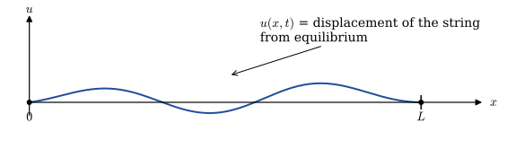{width="80%" fig-align="center"}

* To mathematically describe the vibrations of this string, $\,$we consider all the forces acting on a small section $\Delta x$ of the string 

  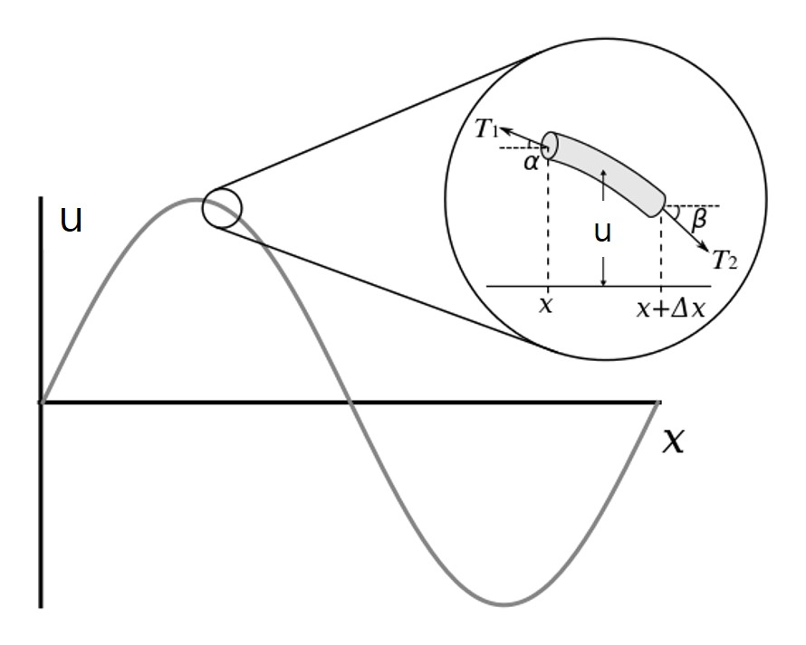{width="70%" fig-align="center"}

  If the horizontal component of tension is constant $T$, $\,$then the tension acting on each side of the string segment is given by

  $$
  \begin{aligned}
    T_1 \cos\alpha &\approx T \\ 
    T_2 \cos\beta &\approx T
  \end{aligned}$$

* In the vertical component of Newton's second law, $\,$the mass of this piece $\,\rho\Delta x\,$ times its acceleration $\,u_{tt}$ will be equal to the net force on the piece:

  $$\begin{aligned}
   \rho\Delta x u_{tt} &= T_2 \sin\beta +T_1 \sin\alpha \\ 
   &\Downarrow \\ 
   \frac{\rho\Delta x}{T} u_{tt} &= \frac{T_2 \sin\beta}{T_2 \cos\beta} 
     +\frac{T_1 \sin\alpha}{T_1 \cos\alpha} = \tan\beta +\tan\alpha \\ 
   &= u_x(x+\Delta x) -u_x(x) \\
   &\Downarrow \\
   u_{tt} &=\frac{T}{\rho} \frac{u_x(x+\Delta x) -u_x(x)}{\Delta x} \\
   &\Downarrow\; c^2 = T/\rho,\;\Delta x \to 0 \\
   u_{tt} &= c^2 u_{xx}
  \end{aligned}$$

  This is the <font color="blue">wave equation</font> for $\,u(x,t)\,$ and <font color="green">$\,c$ is the speed of propagation of the wave</font> in the string

## $\,$D'Alembert Solution of the Wave Equation {#sec-x2-19}

* If the student recalls the parabolic case, $\,$we started  solving diffusion problems when the space variable was bounded (by separation of variables), $\,$and then went on to solve the unbounded case (where <font color="red">$-\infty < x <\infty$</font>) by the Fourier transform

* In the hyperbolic case (wave equation), $\,$we will do the opposite. $\,$We start by solving the one-dimensional wave equation in free space:

$$
\begin{aligned}
  u_{tt} &=c^2 u_{xx} && -\infty < x < \infty,\; 0 < t < \infty \\ 
  \begin{array}{r}
    u(x, 0) \\
    u_t(x, 0)
  \end{array} 
   &
  \begin{array}{c}
    = f(x) \\
    = g(x)
  \end{array} && -\infty < x <\infty 
\end{aligned} \tag{DA}\label{eq:DA}$$ 

* We could solve this problem by using the Fourier transform (transforming $x$) or the Laplace transform (transforming $t$), $\,$but we will introduce yet a new technique (<font color="red">canonical coordinate</font>), $\,$which will introduce the reader to several new and exciting ideas

**STEP 1** $\,$Replacing $\,(x,t)$ by new canonical coordinates $(\xi,\eta)$

$$\begin{aligned}
 u_{tt}&=c^2 u_{xx} \\ 
 &\Downarrow\;\color{red}{\xi=x+ct,\;\eta=x-ct} \\ 
 u_t&= u_\xi \xi_t+u_\eta \eta_t =c(u_\xi -u_\eta) \\
 u_{tt}&= c(u_{\xi\xi} -u_{\eta\xi})\xi_t +c(u_{\xi\eta} -u_{\eta\eta})\eta_t\\
 &=c^2(u_{\xi\xi}-2u_{\xi\eta}+u_{\eta\eta})\\
 u_x&=u_\xi \xi_x+u_\eta \eta_x=u_\xi+u_\eta \\ 
 u_{xx}&= u_{\xi\xi}\xi_x+u_{\eta\xi}\xi_x+u_{\xi\eta}\eta_x +u_{\eta\eta}\eta_x\\
 &=u_{\xi\xi}+2u_{\xi\eta}+u_{\eta\eta}\\
 &\Downarrow \\
 u_{\xi\eta}&=0
\end{aligned}$$

**STEP 2** $\,$Solving the Transformed Equations

$$\begin{aligned}
 u_{\xi\eta}&= 0 \\ 
 &\Downarrow \\
 \text{Integration } &\text{with respect to }\xi \\ 
 &\Downarrow \\
 u_{\eta}(\xi,\eta)&=\varphi(\eta) \\
 &\Downarrow \\
 \text{Integration } &\text{with respect to }\eta \\ 
 &\Downarrow \;\;\phi=\int\varphi\,d\eta \\
 u(\xi,\eta)=\phi&(\eta) +\psi(\xi) \\
\end{aligned}$$

**STEP 3** $\,$Transforming back to the Original Coordinates $\,x\,$ and $\,t$

$$\begin{aligned}
 u(\xi,\eta)&=\phi(\eta) +\psi(\xi) \\
 &\Downarrow\; \xi=x+ct, \;\eta=x-ct \\
 u(x,t)=\phi&(x-ct) +\psi(x+ct)
\end{aligned}$$

**NOTE** $\,$This is the general solution of the wave equation, $\,$and it is interesting in that it physically represents the sum of any two moving waves, $\,$each moving in opposite directions with velocity $\,c$

**STEP 4** $\,$Substituting the General Solution into the ICs

$$\begin{aligned}
 u(x,t)=\phi(x-&ct) +\psi(x+ct) \\
 &\Downarrow \;\scriptsize u(x,0)=f(x), \;u_t(x,0)=g(x) \\
 \scriptsize\phi(x) +\psi(x) \; & \scriptsize = f(x)\\
 \scriptsize-c\phi_x(x) +c\psi_x(x) \; &\scriptsize = g(x) \\
 \big\Downarrow \;&{\scriptstyle \text{integrating the 2}^{nd} \text{equation} \text{  from } x_0 \text{ to } x} \\
 \scriptsize\phi(x) +\psi(x) = &\scriptsize \, f(x)\\
 \scriptsize-c\phi(x) +c\psi(x) = &\scriptsize \, \int_{x_0}^x g(\alpha)\,d\alpha +C \\
 &\Downarrow \\
 \scriptsize\phi(x)=\frac{1}{2}f(x) -\,& \scriptsize\frac{1}{2c}\int_{x_0}^x g(\alpha)\,d\alpha -\frac{C}{2c} \\
 \scriptsize\psi(x)=\frac{1}{2}f(x) +\,& \scriptsize\frac{1}{2c}\int_{x_0}^x g(\alpha)\,d\alpha +\frac{C}{2c} \\
   &\Downarrow \\
\end{aligned}$$

$$\color{red}{\begin{aligned}
 u(x,t) =\frac{1}{2} \left[ f(x -ct)\right. &+ \left. f(x +ct) \right] 
   +\frac{1}{2c} \int_{x-ct}^{x+ct} g(\alpha)\,d\alpha
\end{aligned}}\tag{DAS}\label{eq:DAS}$$ 

This is what we were aiming for, $\,$and it is called the **D'Alembert solution** to \eqref{eq:DA}

* **Motion of a Simple Square Wave**

  $$
  \begin{aligned}
    u(x,0)&=
    \begin{cases}
      1 & \;-1 < x < 1 \\ 
      0 & \text{everywhere else}  
    \end{cases} \\ 
    u_t(x,0)&=0 
  \end{aligned}$$ 

  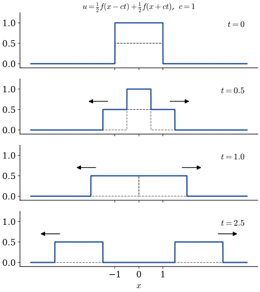{width="60%" fig-align="center"}

* **Initial Velocity Given**

  Suppose now the initial position of the string is at equilibrium and we impose an initial velocity (as in a piano string) of $\,\sin x$

  $$\begin{aligned}
   u(x,0)&= 0\\ 
   u_t(x,0)&=\sin x 
  \end{aligned}$$

  Here, $\,$the solution would be

  $$\begin{aligned}
   u(x,t) &= \frac{1}{2c} \int_{x-ct}^{x+ct} \sin\xi \, d\xi\\ 
    &=\frac{1}{2c} \left[ \cos(x -ct) -\cos(x +ct)\right] \\
    &=\frac{1}{c} \sin x \cdot \sin ct
  \end{aligned}$$

$~$

```{python}
import numpy as np
import matplotlib.pyplot as plt
from matplotlib import animation, rc
from IPython.display import HTML

plt.rcParams['font.size'] = 12
plt.rcParams['xtick.direction'] = 'in'
plt.rcParams['ytick.direction'] = 'in'
```
```{python}
fig = plt.figure(figsize=(6, 4))
ax = plt.axes(xlim=(-6.0*np.pi, 6.0*np.pi), ylim=(-1.5, 1.5))

ax.set_xticks([-6.0*np.pi,-3.0*np.pi, 0, 3.0*np.pi, 6.0*np.pi])
ax.set_xticklabels([r'$-6\pi$',r'$-3\pi$','$0$',r'$3\pi$',r'$6\pi$'])
ax.set_yticks([-1.2, -0.6, 0, 0.6, 1.2])
ax.set_xlabel('$x$')
ax.set_ylabel('$u(x,t)$')

plt.close()
```

```{python}
# | fig-cap: '<center><font size="3px">Initial Velocity Given: $\;u_t(x,0)=\sin x$</font></center>'
time_text = ax.text(-1.5, 1.3, '')
line, = ax.plot([], [], lw=2)
def init():
    time_text.set_text('t = 0.0')
    line.set_data([], [])
    return (line,)

c = 1
def animate(t):
    time_text.set_text(f't = {t:3.1f}')
    x = np.linspace(-6.0*np.pi, 6.0*np.pi, 300)
    u = 1.0/(2.0*c)*(np.cos(x -c*t) -np.cos(x +c*t))
    line.set_data(x, u)
    return (line,)

tt = list(np.linspace(0, 2.0*np.pi/c, 100))
anim = animation.FuncAnimation(fig, animate, 
        init_func=init, frames=tt, interval=200, blit=True) 
HTML('<center>' + anim.to_html5_video() + '</center>')
```

$~$

## $\,$More on the D'Alembert Solution {#sec-x2-20}

* We proved that in the last section the solution of the pure initial-value problem

  $$
  \begin{aligned}
    u_{tt} &=c^2 u_{xx} && -\infty < x < \infty,\; 0 < t < \infty \\ 
    \begin{array}{r}
      u(x, 0) \\
      u_t(x, 0)
    \end{array} 
    &
    \begin{array}{c}
      = f(x) \\
      = g(x)
    \end{array} && -\infty < x <\infty 
  \end{aligned}$$

  is given by

  $$ u(x,t) =\frac{1}{2} \left[\, f(x -ct) +f(x +ct) \right] +\frac{1}{2c} \int_{x-ct}^{x+ct} g(\xi)\,d\xi $$ 

  We now present an interpretation of this solution in the $\,xt$-plane at the two specific cases

**CASE 1** <font color="red">$\,$ Initial Position Given; $\,$ Initial Velocity Zero</font>

* Let's consider the following initial condition

  $$\begin{aligned}
    u(x,0) &=f(x) \\ 
    u_t(x,0) &=0 
  \end{aligned},\quad -\infty < x < \infty$$

  the D'Alembert solution is

  $$ u(x,t) =\frac{1}{2} \left[ f(x -ct) +f(x +ct) \right] $$

  and <font color="blue">the solution $u(x_0,t_0)$ can be interpreted as being the average of the initial displacement $\,f(x)$ at the points $(x_0-ct_0,0)$ and $(x_0 +ct_0,0)$ found by backtracking along the lines</font>

  $$\begin{aligned}
   x -ct&= x_0 -ct_0\\ 
   x +ct&= x_0 +ct_0 
  \end{aligned}\quad\color{red}{\text{characteristic curves}}$$

  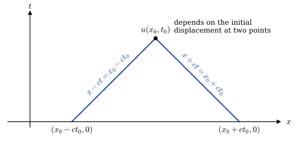{width="80%" fig-align="center"}

* For example, $\,$using this interpretation, $\,$the initial condition

  $$\begin{aligned}
   u(x,0) &= 
   \begin{cases}
     1 & \;-1 < x < 1 \\ 
     0 & \text{everywhere else} 
   \end{cases} \\ 
   u_t(x,0) &=0 
  \end{aligned}$$

  would give us the solution in the $\,xt$-plane shown in figure

  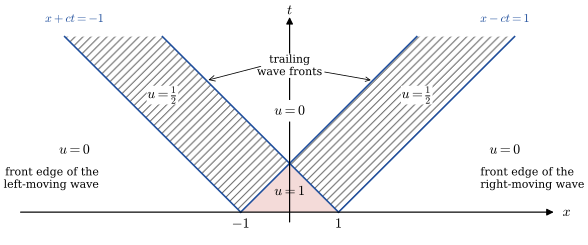{width="80%" fig-align="center"}

**CASE 2** <font color="red">$\,$Initial Displacement Zero; $\,$ Velocity Arbitrary</font>

* Consider now the IC

  $$\begin{aligned}
   u(x,0) &=0 \\ 
   u_t(x,0) &=g(x) 
  \end{aligned}, \quad -\infty < x < \infty$$

  the solution is

  $$ u(x,t) =\frac{1}{2c} \int_{x -ct}^{x +ct} g(\xi)\,d\xi $$

  and, $\,$hence, $\,$<font color="blue">the solution $\,u(x_0, t_0)\,$ can be interpreted as integrating the initial velocity between $x_0 -ct_0$ and $x_0 +ct_0$ on the initial line $t=0$</font>

* Again, $\,$using this interpretation, $\,$the solution to the initial-value problem

  $$\begin{aligned}
     u(x,0) &= 0 \quad -\infty<x<\infty \\ 
     u_t(x,0) &= \begin{cases} 1 & \;-1 < x < 1 \\ 0 & \text{everywhere else} 
    \end{cases}
  \end{aligned}$$

  has a solution in the $\,xt$-plane in figure

  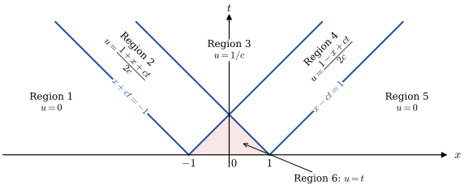{width="80%" fig-align="center"}

* To find the displacement, $\,$we compute the D'Alembert solution

$$\scriptsize \begin{aligned}
 u(x,t) &=\frac{1}{2c}\int_{x-ct}^{x+ct} g(\xi)\,d\xi & \\ 
 &= \frac{1}{2c} \int_{x-ct}^{x+ct} 0\, d\xi=0, & (x,t) \in \text{Region 1}\\ 
 &= \frac{1}{2c} \int_{-1}^{x+ct} 1\, d\xi=\frac{1+x+ct}{2c}, & (x,t) \in \text{Region 2}\\ 
 &= \frac{1}{2c} \int_{-1}^{1} 1\, d\xi=\frac{1}{c}, & (x,t) \in \text{Region 3}\\ 
 &= \frac{1}{2c} \int_{x-ct}^{1} 1\, d\xi=\frac{1-x+ct}{2c}, & (x,t) \in \text{Region 4}\\ 
 &= \frac{1}{2c} \int_{x-ct}^{x+ct} 0\, d\xi=0, & (x,t) \in \text{Region 5}\\ 
 &= \frac{1}{2c} \int_{x-ct}^{x+ct} 1\, d\xi=t, & (x,t) \in \text{Region 6}
\end{aligned}$$

$~$

```{python}
fig = plt.figure(figsize=(6, 4))
ax = plt.axes(xlim=(-15, 15), ylim=(-0.1, 1.5))

ax.set_xticks([-15, -10, -5, 0, 5, 10, 15])
ax.set_yticks([0, 0.5, 1.0, 1.5])
ax.set_xlabel('$x$')
ax.set_ylabel('$u(x,t)$')

plt.close()

time_text = ax.text(-2, 1.3, '')
line, = ax.plot([], [], lw=2)
def init():
    time_text.set_text('t = 0.0')
    line.set_data([], [])
    return (line,)
```

```{python}
c = 1
def animate(t):
    time_text.set_text(f't = {t:3.1f}')    
    xx = np.linspace(-15, 15, 300)   
    uu = np.zeros_like(xx)
    
    for i, x in enumerate(xx):
        ch1 = x +c*t
        ch2 = x -c*t
        if ch1 <-1.0 or ch2 > 1.0:
            uu[i] = 0.0
        elif t < 1.0 /c:
            if ch2 <-1.0:
                uu[i] = (1.0 +ch1) /(2.0*c)
            elif ch1 < 1.0:
                uu[i] = t
            else:
                uu[i] = (1.0 -ch2) /(2.0*c)           
        else:
            if ch1 < 1.0:
                uu[i] = (1.0 +ch1) /(2.0*c)
            elif ch2 <-1.0:
                uu[i]=1.0 /c
            else:
                uu[i] = (1.0 -ch2) /(2.0*c) 
                       
    line.set_data(xx, uu)
    return (line,)
```

```{python}
# | fig-cap: '<center><font size="3px">Initial Velocity Given: $\;u_t(x,0)=\begin{cases} 1 & \;-1 < x < 1 \\ 0 & \text{everywhere else} \end{cases}$</font></center>'
tt = list(np.linspace(0, 20, 50))
anim = animation.FuncAnimation(fig, animate, init_func=init, 
    frames=tt, interval=300, blit=True)

HTML('<center>' + anim.to_html5_video() + '</center>')
```

$~$

<font color="blue">**Solution of the Semi-Infinite String via the D'Alembert Formula**</font> 

  * In the remainder of the section, $\,$we will solve the initial-boundary-value problem for the semi-infinite string

    $$
    \begin{aligned}
      u_{tt} 
       &=c^2 u_{xx} 
       && \color{red}{0 < x < \infty}, \; 0 < t < \infty \\
      u(0, t) &= 0 && 0 < t < \infty \\ 
     \begin{array}{r}
        u(x, 0) \\
        u_t(x, 0)
      \end{array} 
      &
      \begin{array}{c}
        = f(x) \\
        = g(x)
      \end{array} && 0 < x <\infty 
    \end{aligned}$$

  * We proceed in a manner similar to that used with the infinite string, $\,$which is to find the general solution to the PDE

    $$ u(x,t) = \phi(x -ct) +\psi(x +ct) \tag{GS}\label{eq:GS}$$ 

    If we now substitute this general solution into the initial conditions, $\,$we arrive at

    $${\begin{aligned}
       \phi(x - ct)=\frac{1}{2}f(x -ct) \,-\,&\frac{1}{2c}\int_{x_0}^{x -ct} 
          g(\xi)\,d\xi -\frac{C}{2c} \\
       \psi(x +ct)=\frac{1}{2}f(x +ct) \,+\,&\frac{1}{2c}\int_{x_0}^{x +ct} 
          g(\xi)\,d\xi +\frac{C}{2c} \\
      \end{aligned}} \tag{IM}\label{eq:IM}$$ 

  * We now have a problem we didn't encounter when dealing with the infinite string. $\,$Since we are looking for the solution $\,u(x,t)\,$ <font color="blue">everywhere in the first quadrant $(x>0,\;t>0)\,$ of the $\,xt$-plane</font>, $\,$it is obvious that we must find

    $$\begin{aligned}
      \phi(x -ct)
        &\;\;\; \color{red}{\text{for all } 
        -\infty < x -ct < \infty} \\ 
      \psi(x +ct)&\;\;\; \text{for all } 
       \phantom{xxx} 0 < x +ct < \infty 
    \end{aligned}$$

  * Unfortunately, $\,$the first equation only gives us $\,\phi(x -ct)\,$ for $\,x -ct \geq 0$, $\,$since our initial data $\,f(x)$ and $g(x)$ are only known for positive arguments

  * <font color="blue">As long as $x -ct \geq 0$, $\,$we have no problem</font>, $\,$since we can substitute \eqref{eq:IM} into the general solution \eqref{eq:GS} to get

    $$ {u(x,t) =\frac{1}{2} \left[ f(x -ct) +f(x +ct) \right] +\frac{1}{2c} \int_{x-ct}^{x+ct} g(\xi)\,d\xi,\;\;\; x \geq ct} $$

    The question is, $\,$<font color="blue">what to do when $x < ct$?</font>

  * <font color="blue">When $x < ct$</font>, $\,$substituting the general solution \eqref{eq:GS} into <font color="blue">the BC $\,u(0,t)=0\,$ </font>gives

    $$\color{blue}{\phi(-ct)=-\psi(ct)}$$

    and, $\,$hence, $\,$by functional substitution

    $$ {\phi(x -ct)={\color{red}{-}}\frac{1}{2}f({\color{red}{ct -x}}) {\color{red}{-}}\frac{1}{2c}\int_{x_0}^{{\color{red}{ct -x}}} g(\xi)\,d\xi {\color{red}{-}}\frac{C}{2c}} $$

  * Substituting this value of $\phi$ into the general solution \eqref{eq:GS} gives

    $$ {u(x,t) =\frac{1}{2} \left[ f(x +ct) -f(ct -x) \right] +\frac{1}{2c} \int_{ct -x}^{x+ct} g(\xi)\,d\xi,\;\;\;0<x<ct} $$

  * For $x \geq ct$, $\,$the solution is the same as the D'Alembert solution for the infinite wave, <font color="red">while for $x < ct$, $\,$the solution $u(x,t)$ is modified as a result of the wave reflecting from the boundary (The sign of the wave is changed when it's reflected)</font>

  * The straight lines

    $$\begin{aligned}
      x +ct &= \text{constant}\\ 
      x -ct &= \text{constant} 
    \end{aligned}$$

    are known as <font color="red">**characteristics**</font>, $\,$and it is along these lines that disturbances are propagated. $\,$<font color="red">Characteristics are generally associated with hyperbolic equations</font>

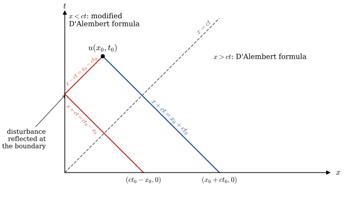{width="80%" fig-align="center"}

$~$

**Example** $\,$Solve the semi-infinite string problem

$~$

$$
  \begin{aligned}
    u_{tt} &=c^2 u_{xx} && 0 < x < \infty,\; 0 < t < \infty \\
    u(0,t) &=0 && 0 < t < \infty \\ 
    \begin{array}{r}
      u(x, 0) \\
      u_t(x, 0)
    \end{array} 
    &\,
    \begin{array}{l}
      = f(x) \\
      = 0
    \end{array} && 0 < x <\infty 
  \end{aligned}$$

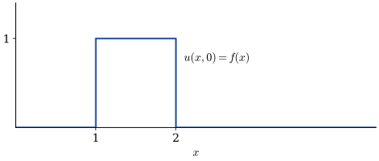{width="70%" fig-align="center"}

::: {.callout-note collapse="true" title="Answer" appearance="simple"}
$u(x,t)=\tfrac12\,\chi_{(1+ct,\ 2+ct)}(x)+\tfrac12\,\chi_{(1-ct,\ 2-ct)}(x)-\tfrac12\,\chi_{(ct-2,\ ct-1)}(x),\quad x>0$

($\chi_{(a,b)}=1$ on $(a,b)$ and $0$ elsewhere): the left-moving pulse is reflected upside down at the fixed end
:::

[Solution](files/solutions/sol_13_3a.pdf){target="_blank"}


$~$

```{python}
fig = plt.figure(figsize=(6, 4))
ax = plt.axes(xlim=(0, 5), ylim=(-1.0, 1.5))

ax.set_xticks([0, 2.5, 5])
ax.set_yticks([-1.0, -0.5, 0.0, 0.5, 1.0, 1.5])
ax.set_xlabel('$x$')
ax.set_ylabel('$u(x,t)$')

plt.close()

time_text = ax.text(2.2, 1.3, '')
line, = ax.plot([], [], lw=2)
def init():
    time_text.set_text('t = 0.0')
    line.set_data([], [])
    return (line,)
```

```{python}
c = 1
def f_i(x):
    if x >= 1 and x <= 2:
        u = 1.0
    else:
        u = 0.0
    return u
    
def animate(t):
    time_text.set_text(f't = {t:3.1f}')        
    xx = np.linspace(0, 5, 400)   
    uu = np.zeros_like(xx)
    
    for i, x in enumerate(xx):
        ch1 = x +c*t
        ch2 = x -c*t
        if ch2 >= 0:
            uu[i] = 0.5*(f_i(ch1) +f_i(ch2))
        else:
            uu[i] = 0.5*(f_i(ch1) -f_i(-ch2))
                       
    line.set_data(xx, uu)
    return (line,)
```

```{python}
# | fig-cap: '<center><font size="3px">Semi-infinite String</font></center>'
tt = list(np.linspace(0, 7, 100))
anim = animation.FuncAnimation(fig, animate, 
        init_func=init, frames=tt, interval=750, blit=True)
HTML('<center>' + anim.to_html5_video() + '</center>')
```

$~$

**Example** $\,$Solve the semi-infinite string problem

$$
  \begin{aligned}
    u_{tt} &=c^2 u_{xx} && 0 < x < \infty,\; 0 < t < \infty \\
    u_x(0,t) & =0 && 0 < t < \infty \\ 
    \begin{array}{r}
      u(x, 0) \\
      u_t(x, 0)
    \end{array} 
    &\;
    \begin{array}{l}
      = f(x) \\
      = g(x)
    \end{array} && 0 < x <\infty 
  \end{aligned}$$

following an approach analogous to the one used to solve the semi-infinite string problem in the lesson

**Solution** $\,$For $x \geq ct$, $\,$the solution is the same as the D'Alembert solution for the infinite wave, <font color="red"> $\,$while for $x < ct$, $\,$the solution $u(x,t)$ is modified as a result of the wave reflecting from the boundary</font>

$$ \begin{aligned}
    u(x,t) =\frac{1}{2}& \left[ f(x +ct) +f(ct -x) \right] \\
    &+\frac{1}{2c} \left[ \int_0^{ct -x} g(\xi)\,d\xi + \int_0^{x +ct} g(\xi)\,d\xi \right] ,\;\; 0 < x < ct 
  \end{aligned}$$

$~$

**Example** $\,$Simulate the semi-infinite string problem with the initial conditions:

$$\begin{aligned}
  u(x,0)&=\exp\left[-\frac{(x-3)^2}{0.5}\right] \\
  u_t(x,0)&=0
  \end{aligned}$$

```{python}
import numpy as np
import matplotlib.pyplot as plt
from matplotlib.animation import FuncAnimation

# ==============================================================
#  Parameters and Grid
# ==============================================================
c = 1.0                       # Wave speed
x_max = 10.0                  # Half of spatial domain
nx = 800                      # Number of spatial points
x = np.linspace(-x_max, x_max, nx)  # Include negative side

# ==============================================================
#  Initial Conditions
# ==============================================================
def f(x):
    """Initial displacement: Gaussian pulse centered at x=3"""
    return np.exp(-(x - 3)**2 /0.5)

def g(x):
    """Initial velocity: zero everywhere."""
    return np.zeros_like(x)

# ==============================================================
#  Extensions for boundary reflection behavior
# ==============================================================
def f_even(x):
    """Even extension for Neumann BC (symmetric reflection)"""
    return f(abs(x))

def f_odd(x):
    """Odd extension for Dirichlet BC (sign-flipped reflection)"""
    return np.sign(x) *f(abs(x))

# ==============================================================
#  Analytic solutions (using extended wave functions)
# ==============================================================
def u_neumann(x, t):
    """Solution for Neumann BC (u_x(0,t)=0)"""
    return 0.5 * (f_even(x -c*t) +f_even(x +c*t))

def u_dirichlet(x, t):
    """Solution for Dirichlet BC (u(0,t)=0)"""
    return 0.5 * (f_odd(x -c*t) +f_odd(x +c*t))

# ==============================================================
#  Visualization Setup
# ==============================================================
fig, ax = plt.subplots(figsize=(8, 4))
# Main curves (physical side)
line_neu, = ax.plot([], [], lw=2, color='royalblue', label='Neumann (uₓ(0,t)=0)')
line_dir, = ax.plot([], [], lw=2, color='crimson',  label='Dirichlet (u(0,t)=0)')
# Ghost (mirror) curves for visual symmetry
ghost_neu, = ax.plot([], [], lw=1, color='royalblue', alpha=0.3, ls='--')
ghost_dir, = ax.plot([], [], lw=1, color='crimson',  alpha=0.3, ls='--')

ax.axvline(0, color='gray', ls='--', lw=1.2, label='Boundary x=0')
ax.set_xlim(-x_max, x_max)
ax.set_ylim(-1.2, 1.2)
ax.set_xlabel("x")
ax.set_ylabel("u(x,t)")
ax.legend(loc='upper right')
ax.set_title("Wave Reflection Symmetry (Neumann vs Dirichlet)")

# ==============================================================
#  Animation Functions
# ==============================================================
def init():
    """Initialize empty lines for animation frames"""
    for ln in [line_neu, line_dir, ghost_neu, ghost_dir]:
        ln.set_data([], [])
    return line_neu, line_dir, ghost_neu, ghost_dir

def animate(frame):
    """Update frame at each time step"""
    t = frame * 0.05
    # Full-domain solutions
    y_neu = u_neumann(x, t)
    y_dir = u_dirichlet(x, t)

    # Restrict main waves to x > 0 (physical region)
    mask_pos = x >= 0
    # "Ghost" mirrors for x < 0 to visualize symmetry
    mask_neg = x <= 0

    # Main (physical side)
    line_neu.set_data(x[mask_pos], y_neu[mask_pos])
    line_dir.set_data(x[mask_pos], y_dir[mask_pos])
    # Mirror (imaginary side)
    ghost_neu.set_data(x[mask_neg], y_neu[mask_neg])
    ghost_dir.set_data(x[mask_neg], y_dir[mask_neg])

    ax.set_title(f"t = {t:.2f} — Blue: Neumann (symmetric) | Red: Dirichlet (sign-flipped)")
    return line_neu, line_dir, ghost_neu, ghost_dir

# ==============================================================
#  Run the animation
# ==============================================================
ani = FuncAnimation(fig, animate, init_func=init, frames=200, interval=50, blit=True)
ani.save("figures/reflection.mp4", writer="ffmpeg", fps=30)

plt.close()
```


$~$

**Example** $\,$ Solve the wave equation on the semi-infinite string $x \ge 0$:

$$u_{tt} = c^{2} u_{xx}, \quad x>0,\; t>0$$

with initial conditions

$$u(x,0) = f(x), \quad u_t(x,0) = g(x) \quad (x\ge 0)$$

and **a nonhomogeneous boundary condition**

$$u(0,t) = h(t), \quad t\ge 0$$

Thus, the difficulty comes from the fact that the boundary value at $x=0$ is not zero, so the standard odd-reflection D’Alembert method cannot be applied directly

**STEP 1:** $~$ Constructing a Boundary-Generating Wave

To handle the nonhomogeneous boundary condition, we first construct a function $w(x,t)$ that:

* satisfies the wave equation,
* satisfies the boundary condition $w(0,t) = h(t)$,
* and does not affect the given initial data

A convenient choice is a right-traveling wave of the form

$$w(x,t) = H\!\left(t - \frac{x}{c}\right)$$

where $H(s)$ is the causal extension of $h$:

$$H(s)=
\begin{cases}
h(s), & s\ge 0,\\
0, & s<0
\end{cases}$$

This function meets the boundary condition $w(0,t)=h(t)$ and has zero initial values:
$$w(x,0)=0, \quad w_t(x,0)=0$$

**STEP 2:** $~$ Reduction to a Homogeneous Boundary Problem

Define $v(x,t) = u(x,t) - w(x,t)$. Then $v$ satisfies:

* the same wave equation,
  $$v_{tt} = c^{2} v_{xx}$$

* homogeneous Dirichlet boundary condition
  $$v(0,t) = u(0,t) - w(0,t) = h(t) - h(t) = 0$$

* unchanged initial data,
  $$v(x,0) = f(x), \quad v_t(x,0) = g(x)$$

Thus, the original nonhomogeneous boundary-value problem is transformed into a standard homogeneous Dirichlet problem on a half-line, which can then be solved by odd reflection and the usual D’Alembert formula

**Example** $\,$ Solve the wave equation on the half-line $x \ge 0$:

$$u_{tt} = c^{2} u_{xx}, \quad x>0,\; t>0$$

with initial conditions

$$u(x,0) = f(x), \quad u_t(x,0) = g(x)$$

and a nonhomogeneous Neumann boundary condition

$$u_x(0,t) = p(t), \quad t \ge 0$$

**STEP 1:** $~$ Constructing a Boundary-Induced Wave

We construct a right-traveling wave of the form

$$w(x,t) = -c\, P\!\left(t - \frac{x}{c}\right)$$

where $P(s)$ is the causal antiderivative of $p(t)$:

$$P(s)=
\begin{cases}
\displaystyle \int_{0}^{s} p(\tau)\, d\tau, & s\ge 0\\[6pt]
0, & s<0
\end{cases}$$

This function satisfies $w_x(0,t)=p(t)$ and has zero initial values,

$$w(x,0)=0,\quad w_t(x,0)=0$$

so it produces exactly the incoming wave required by the boundary without disturbing the initial conditions

**STEP 2:** $~$ Reduction to a Homogeneous Neumann Problem

Define $v(x,t)=u(x,t)-w(x,t)$. Then $v$ satisfies

* the same wave equation,
  $$v_{tt}=c^{2}v_{xx}$$

* a homogeneous Neumann boundary condition,
  $$v_x(0,t)=u_x(0,t)-w_x(0,t)=p(t)-p(t)=0$$

* and unchanged initial data,
  $$v(x,0)=f(x), \qquad v_t(x,0)=g(x)$$

Thus the original nonhomogeneous Neumann problem is transformed into a standard homogeneous Neumann half-line problem, which can then be solved by an even extension of the initial data and the classical D’Alembert formula

$~$

<font color="blue">**Solution of the Wave Equation on $x\ge 0$ with a Robin Boundary Condition**</font>

We consider the wave equation on the half-line

$$u_{tt}=c^{2}u_{xx}, \quad x>0,\; t>0$$

with initial data

$$u(x,0)=f(x),\qquad u_t(x,0)=g(x)$$

and a homogeneous Robin boundary condition

$$\alpha u(0,t)+\beta u_x(0,t)=0,
\qquad t\ge 0$$

where $(\alpha,\beta)\neq(0,0)$

To solve this problem, we apply the Laplace transform in time and derive an explicit formula for the transformed solution, which then leads to a time-domain representation involving a delayed convolution kernel

**STEP 1:** $~$ Laplace Transform in $t$

Let $U(x,s)=\mathcal L\{u(x,t)\}$. Transforming the wave equation yields the ODE

$$c^{2}U_{xx}(x,s)-s^{2}U(x,s)=-(s f(x)+g(x))$$

The general solution of this inhomogeneous ODE is

$$U(x,s)=A(s)e^{-s x/c} + V_p(x,s)$$

where the first term is the decaying homogeneous solution and

$$V_p(x,s)=\frac{1}{2cs}\int_{0}^{\infty} e^{-\frac{s}{c}|x-y|}\,(s f(y)+g(y))\,dy$$

is a standard particular solution for the half-line

**STEP 2:** $~$ Enforcing the Robin Boundary Condition

Transforming the boundary condition gives

$$\alpha U(0,s) + \beta U_x(0,s)=0$$

Since

$$U(0,s)=A(s)+V_p(0,s),\quad
U_x(0,s)=-\frac{s}{c}A(s)+V_{p,x}(0,s),$$

we substitute these and solve for $A(s)$.
Using the identities

$$V_{p,x}(0,s)=\frac{s}{c}\,V_p(0,s)$$

we obtain the closed formula

$$A(s)= -\frac{\alpha c+\beta s}{\alpha c-\beta s}\,V_p(0,s)$$

Thus the transformed solution becomes

$$\boxed{
U(x,s)
=V_p(x,s)
-\frac{\alpha c+\beta s}{\alpha c-\beta s}\,V_p(0,s)\,e^{-s x/c}.
}$$

The factor

$$M(s)=\frac{\alpha c+\beta s}{\alpha c-\beta s}$$

acts as the Laplace-domain reflection coefficient at the Robin boundary

**STEP 3:** $~$ Inverse Transform and Time-Domain Representation

Write the inverse Laplace transform of

$$M(s)=\frac{\alpha c+\beta s}{\alpha c-\beta s}
= -1 - \frac{2\alpha c}{\beta s - \alpha c}$$

Its inverse transform is

$$m(t)=\mathcal L^{-1}\{M(s)\}
= -\delta(t) - \frac{2\alpha c}{\beta}\,e^{\frac{\alpha c}{\beta}t}H(t),$$

a causal kernel consisting of

*	an instantaneous reflection ($-\delta$),
*	an exponentially weighted memory term

Let

$$v_{\mathrm{free}}(x,t)=\mathcal L^{-1}\{V_p(x,s)\}$$

be the free solution (the D’Alembert wave produced by the initial data)

Applying the convolution–delay rules of the Laplace transform gives the time-domain solution

$$\boxed{
\begin{aligned}
   u(x,t) &=v_{\mathrm{free}}(x,t)
    -\bigl(m * v_{\mathrm{free}}(0,\cdot)\bigr)\!\left(t-\frac{x}{c}\right)\\
   &=v_{\mathrm{free}}(x,t) +v_{\mathrm{free}}\left(0, t-\tfrac{x}{c}\right) \\
   &\qquad+\frac{2\alpha c}{\beta} \int_0^{t -\tfrac{x}{c}} e^{\tfrac{\alpha c}{\beta}\left( t-\tfrac{x}{c} -s\right)} v_{\mathrm{free}}(0, s) \, ds
\end{aligned}
}$$

valid for $t\ge x/c$, extended by causality for $t<x/c$

This formula expresses the solution as:

* the direct wave from the initial data, plus
* a reflected wave generated by the boundary, described by a convolution kernel that incorporates the Robin boundary’s impedance

$~$

<font color="blue">**The Nonhomogeneous Wave Equation**</font>

  * We consider now the pure nonhomogeneous wave equation:

    $$
    \begin{aligned}
    u_{tt} &\, =c^2 u_{xx} +\color{red}{F(x, t)} 
      && -\infty < x < \infty,\; 0 < t < \infty \\ 
    \begin{array}{r}
      u(x, 0) \\
      u_t(x, 0)
    \end{array} 
    &
    \begin{array}{c}
      = 0 \\
      = 0
    \end{array} && -\infty < x <\infty 
    \end{aligned}$$

    which includes the forcing term $F(x, t)$, $~$but zero initial conditions

  * We again make the change of variables $\,\xi=x +ct\,$ and $\,\eta=x -ct$.
$\,$The differential equation then becomes

    $$
    \begin{aligned}
      & u_{\xi\eta} = \color{red}{-\frac{1}{4c^2} F(\xi, \eta)} \\ \\
      &\color{blue}
      {\left.\begin{matrix}
        u = 0\\ 
        u_\xi = u_\eta = 0
        \end{matrix} \;\;\right\} \;\text{ at } \xi=\eta \;\; \leftarrow 
       \left.\begin{matrix}
         u = 0 \\
         u_t = 0
       \end{matrix} \;\;\right\} \text{ at } t=0}
    \end{aligned}$$

  $$
  \begin{aligned}
   \\[5pt]
   &\Downarrow 
     {\scriptstyle\text{ integrating with respect to } \xi \text{ from } \eta \text{ to } \xi}\\[5pt] 
   u_\eta(\xi,\eta) \;&{\scriptsize= -\frac{1}{4c^2} 
    \int_\eta^\xi F\left(\bar{\xi}, \eta \right) 
     \,d\bar{\xi} +\underbrace{u_\eta(\eta,\eta)}_{=\,0}} \\[5pt] 
   &\Downarrow 
   {\scriptstyle\;\; u(\xi,\eta) = u(\xi,\xi) -\int_\eta^\xi u_\eta(\xi,\bar{\eta})\,d\bar{\eta}, \;\; u(\xi,\xi)=0}\\[5pt]
    u \;&{\scriptsize= \frac{1}{4c^2} \int_\eta^\xi 
      \left[ \int_{\bar{\eta}}^\xi F\left( \bar{\xi}, 
       \bar{\eta} \right) \,d\bar{\xi} \right ] 
        \,d\bar{\eta}}
   \end{aligned}$$

  * We let $\,\bar{\xi}=\beta +c\tau\;$ and $\,\bar{\eta}=\beta -c\tau$, $\,$($t \ge \tau$, $\,\beta=x$). $\,$The domain of integration $\,\eta \leq \bar{\eta} \leq \bar{\xi} \leq \xi\;$ becomes

    $$
    \begin{aligned}
      \eta \leq \beta -c\tau &\leq \beta +c\tau \leq \xi \\ 
      &\Downarrow \\ 
      \eta +c\tau \leq &\;\beta \leq\xi -c \tau \\ 
      0 \leq &\;\tau \leq \frac{1}{2c} (\xi -\eta) 
    \end{aligned}$$

  * The transformation from $\,(\bar{\xi}, \,\bar{\eta})\,$ to $\,(\beta, \,\tau)\,$ gives the solution formula

    $$
    \begin{aligned}
     u &= \frac{1}{4c^2} \int_\eta^\xi 
     \left[ \int_{\bar{\eta}}^\xi F\left( \bar{\xi}, \bar{\eta} \right) 
     \,d\bar{\xi} \right ] \,d\bar{\eta} \\[5pt]
    &\big\Downarrow {\scriptstyle \;\;d\bar{\xi}\,d\bar{\eta} \,=\,  \left|\begin{vmatrix}
    \frac{\partial \bar{\xi}}{\partial \beta}& \frac{\partial \bar{\xi}}{\partial \tau} \\ 
    \frac{\partial \bar{\eta}}{\partial \beta}& \frac{\partial \bar{\eta}}{\partial \tau} 
    \end{vmatrix}\right|  \,d\beta\,d\tau \,=\, \left|-2c\right| \,d\beta\,d\tau = 2c\,d\beta\,d\tau}\\[5pt]
    &=\frac{1}{2c} \int_0^{(\xi -\eta)/2c} \left[ \int_{\eta +c\tau}^{\xi -c\tau} F\left( \beta,\tau \right) \,d\beta \right ] \,d\tau \\[5pt]
    &\Downarrow {\scriptstyle  \;\xi=x +ct, \;\eta=x -ct} \\
    {\color{red}{u}}\; &{\color{red}{= \frac{1}{2c} \int_0^t \left[ \int_{x -c(t -\tau)}^{x +c(t -\tau)} F\left( \beta,\tau \right) \,d\beta \right ] \,d\tau}}
    \end{aligned}
    $$

    This expression shows how every part of the forcing function $F(x,t)$ contributes to the displacement $u(x,t)$ through the wave propagation mechanism described by D’Alembert’s principle

$~$

  * The Green’s function of the one-dimensional wave equation is given by

    $$G(x,t)=\frac{1}{2c} H \left( t - \tfrac{|x|}{c}\right)$$

    where $H(t)$ is the Heaviside step function. According to Duhamel’s principle, the solution $u(x,t)$ can be written as a space–time convolution of the forcing term $F(x,t)$ with the Green’s function $G(x,t)$:

    $$u(x,t) = \int_0^t \int_{-\infty}^\infty G(x-\beta, t -\tau) \,F(\beta, \tau) \, d\beta \,d\tau$$

    Substituting the form of $G(x,t)$ and simplifying, we obtain the explicit D’Alembert-type integral solution

  * The inner integral 
  
    $$\int_{x - c(t -\tau)}^{x + c(t -\tau)} F(\beta, \tau)\, d\beta$$ 
    
    represents the total effect of the forcing term $F$ over the spatial region that influences the point $x$ after time $t-\tau$
    It accounts for the wave propagation with speed $c$

  * The outer integral $\displaystyle \int_0^t (\cdots) \, d\tau$ sums up all the contributions over time 
    from the initial moment $\tau=0$ to the current time $t$

  * The factor $\frac{1}{2c}$ arises from the Green’s function normalization in one dimension

**Example** $~$Solve the infinite string problem

  $$\begin{aligned}
    u_{tt} &\, =c^2 u_{xx} +\color{red}{e^{-a x^2 -b t}} 
      && -\infty < x < \infty,\; 0 < t < \infty \\ 
    \begin{array}{r}
      u(x, 0) \\
      u_t(x, 0)
    \end{array} 
    &
    \begin{array}{c}
      = 0 \\
      = 0
    \end{array} && -\infty < x <\infty 
    \end{aligned}$$

::: {.callout-note collapse="true" title="Answer" appearance="simple"}
$u(x,t)=\dfrac{\sqrt\pi}{4c\sqrt a}\displaystyle\int_0^t e^{-b\tau}\Bigl[\mathrm{erf}\bigl(\sqrt a\,(x+c(t-\tau))\bigr)-\mathrm{erf}\bigl(\sqrt a\,(x-c(t-\tau))\bigr)\Bigr]d\tau$
:::

[Solution](files/solutions/sol_13_3b.pdf){target="_blank"}


## The Wave Equation in Two and Three Dimensions (Free Space) {#sex-x2-21}

The problem of this section is to generalize the D'Alembert solution to two and three dimensions

* **Waves in Three Dimensions**

  We start by considering spherical waves in three dimensions that have given ICs; $\,$that is, $\,$we would like to solve the initial value problem

  $$\begin{aligned}
    u_{tt} &=c^2(u_{xx} +u_{yy} +u_{zz}),\quad 
    \begin{cases}
      -\infty < x <\infty \\ 
      -\infty < y <\infty \\ 
      -\infty < z <\infty
    \end{cases} \\ 
    u(&x,y,z,0)=\phi(x,y,z) \\ 
    u_t(&x,y,z,0)=\psi(x,y,z) 
  \end{aligned} \tag{3D}\label{eq:3D}$$

  * To solve this problem, $\,$we first solve the simpler one (set $\phi=0$)

    $$\color{red}{\begin{aligned}
      u_{tt}&=c^2(u_{xx} +u_{yy} +u_{zz}),\quad (x,y,z) \in \mathbb{R}^3\\
      u(&x,y,z,0)=0 \\ 
      u_t(&x,y,z,0)=\psi(x,y,z) 
    \end{aligned}} \tag{3Dv}\label{eq:3Dv}$$

    This problem can be solved by the Fourier transform

    $$\begin{aligned}
      \mathcal{F}(u)
        &=\frac{1}{(2\pi)^{3/2}}\iiint_{-\infty}^\infty 
          u(x,y,z,t) e^{-i(\omega_1 x+\omega_2 y+\omega_3 z)}\,dx\,dy\,dz 
          =U(\omega_1,\omega_2,\omega_3,t)\\ 
      \mathcal{F}(\psi)&=\frac{1}{(2\pi)^{3/2}}\iiint_{-\infty}^\infty 
        \psi(x,y,z) e^{-i(\omega_1 x+\omega_2 y+\omega_3 z)}\,dx\,dy\,dz 
        =\Psi(\omega_1,\omega_2,\omega_3)
    \end{aligned}$$

  $$\scriptsize \begin{aligned}
  &\Downarrow\;\; \mathcal{F}^{-1} \\ \\
  u(x,y,z,t)= \frac{1}{(2\pi)^{3/2}} 
    \lim_{L\to\infty} \underset{\omega_1^2 +\omega_2^2 +\omega_3^2 < L^2}{\iiint}
    \Psi(\omega_1,\omega_2,\omega_3) &
    \frac{\sin ct \sqrt{ \omega_1^2 +\omega_2^2 +\omega_3^2 }}{c\sqrt{\omega_1^2 
    +\omega_2^2 +\omega_3^2 }} \,e^{i(\omega_1 x +\omega_2 y +\omega_3 z)}\,d\omega_1 \,d\omega_2 \,d\omega_3 \\ 
  = \frac{1}{(2\pi)^{3/2}} 
  \iiint_{-\infty}^\infty \psi(\xi,\eta,\zeta)\;
    {\tiny \left[ \frac{1}{(2\pi)^{3/2}}  \lim_{L\to\infty} 
      \underset{\omega_1^2 +\omega_2^2 +\omega_3^2 < L^2}{\iiint} \right. } &
    {\tiny \left. e^{-i\left[\omega_1 (\xi-x) +\omega_2 (\eta-y) +\omega_3 (\zeta-z) \right]} \;
    \frac{\sin ct \sqrt{ \omega_1^2 +\omega_2^2 +\omega_3^2 }}{c\sqrt{\omega_1^2 +\omega_2^2 +\omega_3^2 }}\,
    \,d\omega_1 \,d\omega_2 \,d\omega_3 \,\right] } \,d\xi \,d\eta \,d\zeta 
  \end{aligned}$$

  * We introduce spherical coordinates $(\varrho,\varphi,\vartheta)$ in the $(\omega_1,\omega_2,\omega_3)$ space with the north pole $\varphi=0$ in the direction of the vector $\left \langle \xi-x,\eta-y,\zeta-z \right \rangle$. $\,$Then the integral in $(\omega_1,\omega_2,\omega_3)$ becomes

    $$\scriptsize\begin{aligned}
      \frac{1}{(2\pi)^{3/2}}  \lim_{L\to\infty} 
      \underset{\omega_1^2 +\omega_2^2 +\omega_3^2 < L^2}{\iiint} 
      &e^{-i\left[\omega_1 (\xi-x) +\omega_2 (\eta-y) 
      +\omega_3 (\zeta-z)\right]}\;
      \frac{\sin ct \sqrt{ \omega_1^2 +\omega_2^2 +\omega_3^2 }}{c\sqrt{\omega_1^2 +\omega_2^2 +\omega_3^2 }}\,
      \,d\omega_1 \,d\omega_2 \,d\omega_3 \\ 
      &\;\;\Downarrow \; 
        {\tiny r=|\mathbf{r}|=\sqrt{(\xi-x)^2 +(\eta -y)^2 +(\zeta -z)^2},\;\; 
          \varrho =|\boldsymbol{\varrho}| 
      = \sqrt{\omega_1^2 +\omega_2^2 +\omega_3^2} }\\ 
        &=\frac{1}{(2\pi)^{3/2}} \lim_{L\to\infty} 
        \int_0^L \int_0^{2\pi}  \int_0^\pi 
      \;e^{-ir \varrho\cos \varphi} \;\frac{\sin ct \varrho}{c\varrho}\; 
      \varrho^2 \sin\varphi \,d\varphi\,d\vartheta\,d\varrho \\
        &\;\;\Downarrow 
        \; {\tiny \alpha=\cos\varphi, \;d\alpha=-\sin\varphi d\varphi } \\ 
        &=\frac{1}{(2\pi)^{3/2}} 
        \lim_{L\to\infty} \frac{2\pi}{c} \int_0^L \; \varrho \sin ct\varrho 
      \underbrace{\left[ \frac{e^{-ir\varrho \alpha}}{-ir\varrho} 
        \right]_{-1}^1 }_{\frac{2}{r\varrho}\sin r\varrho} \,d\varrho \\ 
        &=\frac{1}{(2\pi)^{3/2}} \lim_{L\to\infty} \frac{4\pi}{cr} \int_0^L  
        \;\sin ct \varrho \cdot \sin r\varrho \,d\varrho
    \end{aligned}$$

  * To treat the integration with respect to $\xi$, $\,\eta$, and $\,\zeta$, $~$we introduce spherical coordinates $(r,\phi,\theta)$ in the $(\xi,\eta,\zeta)$ space with their origin at $(x,y,z)$, $\,$so that

    $$\begin{aligned}
    \xi-x &=r\sin\phi \cos\theta \\ 
    \eta-y&=r\sin\phi \sin\theta \\ 
    \zeta-z&=r\cos\phi 
    \end{aligned}$$

    Then the solution becomes

    $$\scriptsize\begin{aligned}
    {\normalsize\color{red}{u(x,y,z,t)}}
    &= {\tiny \frac{4\pi}{(2\pi)^3 c} \lim_{L\to \infty} \int_0^\infty \int_0^{2\pi} \int_0^\pi  
      \;\psi(x +r\sin\phi\cos\theta,y +r\sin\phi\sin\theta, z+r\cos\phi)\; \frac{1}{r}\;\left[ \int_0^L  
      \sin ct \varrho \sin r\varrho\, d\varrho \right] r^2\sin\phi \, d\phi \, d\theta \,dr }\\
      &= {\tiny \frac{1}{2\pi^2 c} \lim_{L\to \infty} \int_0^L \sin ct\varrho \left[\int_0^\infty \sin r\varrho 
      \underbrace{\left( \int_0^{2\pi} \int_0^\pi  \psi(x +r\sin\phi\cos\theta,y +r\sin\phi\sin\theta, z+r\cos\phi) 
      \,r\,\sin\phi \,d\phi\,d\theta  \right) }_{g(r)} dr \right] d\varrho } \\ 
      &= {\tiny \frac{1}{2\pi^2 c} \frac{\pi}{2} \int_0^\infty \sin ct \varrho \;\underbrace{\left[\frac{2}{\pi} \int_0^\infty 
      \sin r\varrho \,g(r)\,dr \right]}_{G(\varrho)} d\varrho  
      = \frac{1}{4\pi c} \underbrace{\int_0^\infty \sin ct \varrho \;G(\varrho)\,d\varrho}_{g(ct)} } \\ 
      &= {\tiny \frac{t}{4\pi (ct)^2} \int_0^{2\pi}\int_0^\pi  \psi(x +ct\sin\phi\cos\theta,y +ct\sin\phi\sin\theta, z+ct\cos\phi) 
      \,(ct)^2\sin\phi \,d\phi \,d\theta  }
      = {\normalsize\color{red}{t\bar{\psi}}}
    \end{aligned}$$

    <font color="blue"> where $\bar{\psi}$ is the average of the initial disturbance $\psi$ over the surface of the sphere of radius $\,ct\,$ centered at $(x,y,z)$</font>

  * The interpretation of this solution is that the initial disturbance $\,\psi\,$ radiates outward spherically (velocity $c$) at each point, $\,$so that after so many seconds, $\,$the point $\,(x,y,z)$ will be influenced by those initial disturbances on a sphere (of radius $\,ct$) around that point

    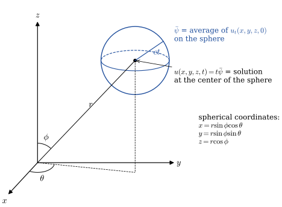{width="80%" fig-align="center"}

  * Now, $\,$to finish the problem, $\,$what about the other half; $\,$that is

    $$\color{red}{\begin{aligned}
    u_{tt}&=c^2(u_{xx} +u_{yy} +u_{zz}),\quad (x,y,z) \in \mathbb{R}^3 \\ 
    u(&x,y,z,0)=\phi(x,y,z) \\ 
    u_t(&x,y,z,0)=0 
    \end{aligned}} \tag{3Dp}\label{eq:3Dp}$$

    This is easy: $\,$A famous theorem developed by *Stokes* says all we have to do to solve this problem is to change the ICs to $\,v=0$, $\,v_t=\phi$, $\,$and then differentiate this solution with respect to time. $\,$Indeed, $\,$if $\,v\,$ solves the wave equation with $\,v=0,\ v_t=\phi\,$ at $\,t=0$, $\,$then $\,u=v_t\,$ also solves the wave equation and

    $$ u(x,y,z,0)=v_t(x,y,z,0)=\phi, \qquad u_t(x,y,z,0)=v_{tt}(x,y,z,0)=c^2\nabla^2 v(x,y,z,0)=0 $$

  * In other words, $\,$we solve

    $$\begin{aligned}
    v_{tt}&=c^2(v_{xx} +v_{yy} +v_{zz}),\quad (x,y,z) \in \mathbb{R}^3 \\ 
    v(&x,y,z,0)=0 \\ 
    v_t(&x,y,z,0)=\phi(x,y,z) 
    \end{aligned}$$

    to get $v=t\bar{\phi}\,$ and then differentiate with respect to time. $\,$This gives us the solution 
    
    $$\color{red}{u=\frac{\partial}{\partial t} \left[ t\bar{\phi} \right]}$$
    
    to problem \eqref{eq:3Dp}

  * We now have the solution to our general three-dimensional problem \eqref{eq:3D}. $\,$It's just

    $$ \color{red}{u(x,y,z,t)=\frac{\partial}{\partial t} \left[ t\bar{\phi} \right]+t\bar{\psi}}$$

    where $\,\bar{\phi}\,$ and $\,\bar{\psi}\,$ are the averages of the functions $\,\phi\,$ and $\,\psi\,$ over the sphere of radius $\,ct\,$ centered at $\,(x,y,z)$

    $~$

    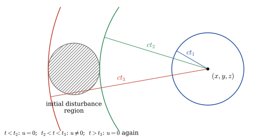{width="60%" fig-align="center"}

  * Suppose now the initial disturbances $\,\phi\,$ and $\,\psi\,$ are zero except for a small sphere. $\,$As time increases, $\,$the radius of the sphere around $(x,y,z)$ increases with velocity $\,c$

  * and so after $\,t_2$ seconds, $\,$it will finally intersect the initial disturbance region, $\,$and, $\,$hence, $\,u(x,y,z,t)\,$ becomes nonzero

  * For $\,t_2 < t < t_3$, $\,$the solution at $\,(x,y,z)\,$ will be nonzero, $\,$since the sphere intersects the disturbance region

  * but when $\,t=t_3$, $\,$the solution at $\,(x,y,z)\,$ abruptly becomes zero again. $\,$In other words, $\,$the wave disturbance originating from the initial-disturbance region has a sharp trailing edge. $\,$This general principle is known as **Huygens' principle** for the three dimensions, $\,$and $\,$it is the reason why sound waves in three dimensions stimulate our ears but die off instantaneously when the wave has passed

$~$

**Example** $\,$Illustrate by picture and words the spherical wave solution of the three-dimensional problem

$$\begin{aligned}
 u_{tt}&=c^2(u_{xx} +u_{yy} +u_{zz}), \quad
\begin{cases}
 -\infty < x <\infty \\ 
 -\infty < y <\infty \\ 
 -\infty < z <\infty
\end{cases} \\ 
 u(&x,y,z,0)=0 \\ 
 u_t(&x,y,z,0)=
 \begin{cases}
 \;1 & x^2+y^2+z^2 \leq 1 \\ 
 \;0 & \text{elsewhere} 
\end{cases} 
\end{aligned}$$

::: {.callout-note collapse="true" title="Answer" appearance="simple"}
$u(r,t)=\begin{cases} t, & ct\le 1-r\\ \dfrac{1-(r-ct)^2}{4cr}, & |r-ct|<1<r+ct\\ 0, & \text{otherwise} \end{cases}$ $\quad$ a spherical shell of thickness $2$ moving outward; behind it $u=0$ again (Huygens' principle)
:::

[Solution](files/solutions/sol_13_4a.pdf){target="_blank"}


$~$

* **Two-Dimensional Wave Equation**

  To solve the two-dimensional problem

  $$\begin{aligned}
    u_{tt}&=c^2(u_{xx} +u_{yy}),\quad
    \begin{cases}
    -\infty < x <\infty \\ 
    -\infty < y <\infty
    \end{cases} \\ 
    u(&x,y,0)=\phi(x,y) \\ 
    u_t(&x,y,0)=\psi(x,y) 
  \end{aligned} \tag{2D}\label{eq:2D}$$

  we merely let the initial disturbances $\,\phi\,$ and $\,\psi\,$ in the three-dimensional problem depend on only the two variables $\,x\,$ and $\,y$. $\,$Doing this, the three-dimensional formula

  $$ u = \frac{\partial}{\partial t} [t\bar{\phi}] +t\bar{\psi} $$

  for $\,u\,$ will describe <font color="red">cylindrical waves</font> and, $\,$hence, $\,$give us the solution for the two-dimensional problem

  * This technique is called the method of descent. $\,$Carrying out the computations, $\,$we get

    $$\scriptstyle\begin{aligned}
    \bar{\psi}(x,y,t) &= \frac{1}{4\pi (ct)^2} \color{red}{\int_0^{2\pi}  \int_{0}^\pi} 
      \psi(x +ct\sin\phi\cos\theta,y+ct\sin\phi\sin\theta)\, \color{red}{(ct)^2 \sin\phi \, d\phi \, d\theta} \;\;\leftarrow \text{spherical surface}\\
    &\Downarrow \;\; {\tiny r = ct \,\sin \phi, \; \,dr =ct \, \cos\phi \,d\phi\;\;\rightarrow\;\; \int_0^{\pi} ct \sin\phi\,d\phi = 2\int_0^{ct}\frac{r}{\sqrt{(ct)^2 -r^2}} dr } \\
    &= \frac{1}{2\pi ct} \, \color{red}{\int_0^{2\pi} \int_0^{ct}} \psi(x +r\cos\theta, y+r\sin\theta)\,\frac{1}{\sqrt{(ct)^2 -r^2}}\,\color{red}{r\,dr\,d\theta} \;\;\leftarrow \text{circle interior}\\
    \bar{\phi}(x,y,t) &= \frac{1}{2\pi ct} \, \color{red}{\int_0^{2\pi} \int_0^{ct}} 
    \phi(x +r\cos\theta, y+r\sin\theta)\,\frac{1}{\sqrt{(ct)^2 -r^2}}\,\color{red}{r\,dr\,d\theta}
    \end{aligned}$$

    Note that in this solution, $\,$the two integrals of the initial conditions $\,\phi\,$ and $\,\psi\,$ are integrated over the interior of a circle with center $\,(x,y)\,$ and radius $\,ct$. $\,$We see that initial disturbances give rise to sharp leading waves, $\,$but not to sharp trailing waves. $\,$Thus, Huygens' principle doesn't hold in two dimensions

* **One-Dimensional Wave Equation**

  Finally, $\,$if we assume the initial conditions $\,\phi\,$ and $\,\psi\,$ depend only on one variable, $\,$this gives rise to plane waves and, $\,$hence, $\,$the preceding equation descends one more dimension 

  $$\begin{aligned}
  \bar{\psi}(x,t) &= {\tiny \frac{1}{2\pi ct} \, \int_0^{2\pi} \int_0^{ct} 
    \frac{\psi(x +r\cos\theta)}{\sqrt{(ct)^2 -r^2}}\,r\,dr\,d\theta }\\
  &\Downarrow {\tiny r^2=x^2 + y^2, \; (ct)^2 -x^2 = \alpha^2 }\\
  &={\tiny \frac{1}{2\pi ct}\, \int_{x -ct}^{x +ct} \underbrace{\int_{-\alpha}^{\alpha} 
    \frac{1}{\sqrt{\alpha^2 -y^2}}\,dy}_{ \pi} \;\psi(x) \,dx }
  = \frac{1}{2ct} \int_{x-ct}^{x+ct} \psi(x)\,dx \\
  \bar{\phi}(x,t) &= \frac{1}{2ct} \int_{x-ct}^{x+ct} \phi(x)\,dx
  \end{aligned}$$

  to the well-known D'Alembert solution. $\,$Note in the D'Alembert solution, $\,$the initial position $\,\phi\,$ gives rise to sharp trailing edges, $\,$but the initial velocity $\,\psi\,$ does not. $\,$In other words, $\,$one dimension is a little unusual in that the initial position satisfies Huygens' principle, $\,$but the initial velocity does not

$~$

**Example** $\,$What is the two dimensional solution of the analogous cylindrical-wave problem

$$\begin{aligned}
 u_{tt}&=c^2(u_{xx} +u_{yy}),\quad
\begin{cases}
 -\infty < x <\infty \\ 
 -\infty < y <\infty
\end{cases} \\ 
 u(&x,y,0)=0 \\ 
 u_t(&x,y,0)=
 \begin{cases}
 \;1 & x^2+y^2 \leq 1 \\ 
 \;0 & \text{elsewhere} 
\end{cases} 
\end{aligned}$$

::: {.callout-note collapse="true" title="Answer" appearance="simple"}
$u(r,t)=\dfrac{1}{2\pi c}\displaystyle\int_0^{ct}\frac{\Theta(\rho;r)\,\rho}{\sqrt{c^2t^2-\rho^2}}\,d\rho$, $\quad u(0,t)=\begin{cases} t, & ct\le1\\ \dfrac{ct-\sqrt{c^2t^2-1}}{c}, & ct>1\end{cases}$

Unlike 3D, the wave leaves a tail that decays slowly instead of vanishing
:::

[Solution](files/solutions/sol_13_4b.pdf){target="_blank"}


**The Dimensional Geometry Summary**

| Dimension | Region of Influence | Type of Surface | Formula Name | Behavior |
|------------|--------------------|-----------------|---------------|-----------|
| **1D** | Interval $x \pm ct$ | 2 points | D’Alembert Formula | Waves move left/right |
| **2D** | Disk $r \le ct$ | Circle | Poisson Formula | Influence from entire disk |
| **3D** | Sphere $r = ct$ | Spherical shell | Kirchhoff Formula | Influence from surface only |

The difference comes from the geometry of the wavefront and how energy spreads:

- In **1D**, energy stays in two pulses (no spreading)
- In **2D**, energy spreads along the circular front → amplitude decays like $1/\sqrt{t}$
- In **3D**, energy spreads over a sphere → amplitude decays like $1/t$

These scaling differences explain why **sound intensity decreases faster in 3D** than in 2D or 1D

**Green’s Functions for the Wave Equation (1D, 2D, 3D)**

The wave equation considered:

$$\partial_t^2 G(x,t) - c^2 \Delta_x G(x,t) = \delta(x)\delta(t),
\quad G(x,t)=0 \text{ for } t<0$$

| Dimension | Green's function $G$ | Support / where nonzero | Key properties / remarks |
|:---:|---|-----|-----|
| **1D** | $\displaystyle G(x,t)=\frac{1}{2c}\,H\!\left(t-\tfrac{|x|}{c}\right)$ | Inside the characteristic cone $|x|\le ct$ | Constant $\frac{1}{2c}$ behind both fronts: no Huygens' principle. $\partial_t G=\frac12\big[\delta(x-ct)+\delta(x+ct)\big]$ gives two undistorted pulses |
| **2D** | $\displaystyle G(r,t)=\frac{H\!\big(t-\tfrac{r}{c}\big)}{2\pi\,c\,\sqrt{c^2t^2-r^2}}$, $\;r=|x|$ | Inside the light cone: $t>r/c$ | Wave influence fills the interior of the light cone; singularity at $t=r/c$ |
| **3D** | $\displaystyle G(r,t)=\frac{1}{4\pi c^2 r}\,\delta\!\big(t-\tfrac{r}{c}\big)$, $\;r=|x|$ | On the light-cone surface $t=r/c$ | Huygens’ principle: response lies exactly on the spherical wavefront; amplitude $\,\propto \,1/r$ |

Notes:
- $H(t)$: Heaviside step function
- All functions above are distributions
- Formulas correspond to the operator $\partial_t^2 - c^2\Delta$

$~$

## Boundary Conditions Associated with the Wave Equation {#sec-x2-22}

The purpose of this section is to discuss some of the various types of BCs that are associated with physical problems of wave motions. $\,$Here, $\,$we will stick to one-dimensional problems where the BCs (linear ones) are generally grouped into one of three kinds

* **First Kind: $\,$Controlled End Points**

  We are now involved with problems like

  $$
  \begin{aligned}
    u_{tt} &=c^2 u_{xx} && \color{red}{0 < x < 1},\;\; 0 < t < \infty \\ \\
    \begin{array} {r}
      u(0, t) \\ u(1,t)
    \end{array}
    &
    \begin{array} {r}
      =g_1(t) \\ =g_2(t)
    \end{array}
    && 0 < t < \infty \\ \\
    \begin{array} {r}
      u(x, 0) \\ u_t(x, 0)
    \end{array}
    &
    \begin{array} {r}
      =f(x) \\ =g(x)
    \end{array}
    && 0 \leq x \leq 1
  \end{aligned}$$

  where we control the end points so that they move in a given manner

  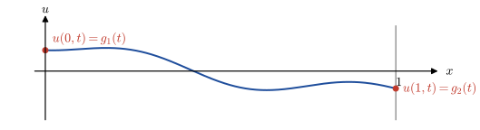{width="70%" fig-align="center"}

  A typical problem of this kind would involve suddenly twisting (at $t=1$) the right end of a fastened rod so many degrees and observing the resulting torsional vibration

  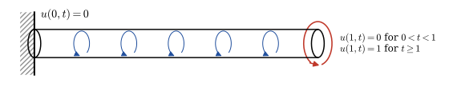{width="80%" fig-align="center"}

* **Second Kind: $\,$Force Given on the Boundaries** 

  Inasmuch as the vertical forces on the string at the left and right ends are given by $\,-Tu_x(0,t)\,$ and $\,Tu_x(1,t)$, $\,$respectively, $\,$by allowing the ends of the string to slide vertically on frictionless sleeves, $\,$the boundary conditions become

  $$\begin{aligned}
  u_x(0,t)&=0 \\ 
  u_x(1,t)&=0
  \end{aligned}, \quad 0 < t < \infty$$

  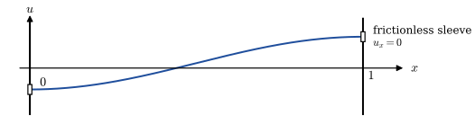{width="70%" fig-align="center"}

  If a vertical force $f(t)$ is applied at the end $x=1$, $\,$then the BC would be 

  $$u_x(1,t)=\frac{1}{T}\,f(t)$$

* **Third Kind: $\,$Elastic Attachment on the Boundaries**

  Consider finally a violin string whose ends are attached to an elastic arrangement like the one shown in figure

  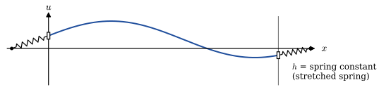{width="60%" fig-align="center"}

  Here, $\,$the spring attachments at each end give rise to vertical forces proportional to the displacements $\,-u(0,t)\,$ and $\,-u(1,t)$

  Setting the vertical tensions of the spring at the two ends $\,-Tu_x(0,t)\,$ and $\,Tu_x(1,t)\,$ equal to these displacements (multiplied by the spring constant $h$) gives us our desired BCs

  $$\begin{aligned}
  -T u_x(0,t) &= -hu(0,t)\\ 
  Tu_x(1,t) &= -hu(1,t) 
  \end{aligned}$$

  We can rewrite these two homogeneous BCs as

  $$\begin{aligned}
  u_x(0,t) -\frac{h}{T} u(0,t) &=0\\ 
  u_x(1,t) +\frac{h}{T} u(1,t) &=0 
  \end{aligned}$$

  If the two spring attachments are displaced according to the functions $\,\theta_1(t)\,$ and $\,\theta_2(t)$, $\,$we would have the nonhomogeneous BCs

  $$\begin{aligned}
  u_x(0,t) &=\frac{h}{T} \left[u(0,t) -\theta_1(t) \right]\\ 
  u_x(1,t) &=-\frac{h}{T} \left[u(1,t) -\theta_2(t) \right] 
  \end{aligned}$$

  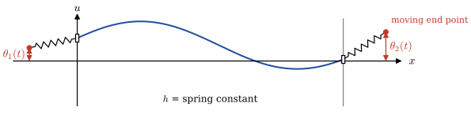{width="80%" fig-align="center"}

$~$

**NOTE** $\,$What is the general nature of BC

$$ u_x(0,t) =\frac{h}{T} \left[u(0,t) -\theta_1(t) \right]$$

when $~h \to \infty$ and $~h \to 0$

$~$

## The Finite Vibrating String (Standing Waves) {#sec-x2-23}

* So far, $\,$we have studied the wave equation $\,u_{tt}=c^2 u_{xx}\,$ <font color="red">for the unbounded domain</font> and have found D'Alembert solutions to be certain <font color="red">*traveling waves* (moving in opposite directions)</font>

* When we study the same wave equation <font color="red">in a bounded region of space $0 < x < L$</font>, $\,$we find that the waves no longer appear to be moving due to their repeated interaction with the boundaries and, in fact, often appear to be what are known as <font color="red">*standing waves*</font>

* **Separation of Variables Solution to the Finite Vibrating String**

  Consider what happens when a guitar string (fixed at both ends $x=0,\,L$) described by the simple hyperbolic IBVP is set in motion

  $$
  \begin{aligned}
    u_{tt} &=c^2 u_{xx} && \color{red}{0 < x < L},\;\; 0 < t < \infty \\ \\
    \begin{array} {r}
      u(0, t) \\ u(L,t)
    \end{array}
    &\;
    \begin{array} {r}
      =0 \\ =0
    \end{array}
    && 0 < t < \infty \\ \\
    \begin{array} {r}
      u(x, 0) \\ u_t(x, 0)
    \end{array}
    &\;
    \begin{array} {r}
      =f(x) \\ =g(x)
    \end{array}
    && 0 \leq x \leq L
  \end{aligned} \tag{FS}\label{eq:FS}$$

  * What happens is that the traveling wave solution to the PDE and IC keeps reflecting from the boundaries in such a way that the wave motion does not appear to be moving, $\,$but, $\,$in fact, appears to be vibrating in one position:

    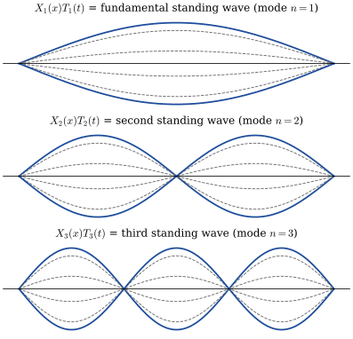{width="60%" fig-align="center"}

  * We start by seeking standing-wave solutions to the PDE; $\,$that is solutions of the form

    $$u(x,t)=X(x)T(t)$$

    Substituting this expression into the wave equation and separating variables gives us the two ODEs

    $$\begin{aligned}
      \frac{\;\;T''}{c^2 T} 
      &= \frac{\;\;X''}{X} = - \lambda <0\\
      &\Downarrow \\
      T'' +c^2\lambda T &=0\\ 
      X'' +\lambda X &=0 
    \end{aligned}$$

    in which only positive values of $\lambda$ give feasible (nonzero and bounded) solutions

  * The solutions of these two ODEs yield

    $$\begin{aligned}
    T(t) &= a \cos c\sqrt{\lambda} t +b\sin c\sqrt{\lambda}t\\ 
    X(x)&=d \cos \sqrt{\lambda}x +e\sin\sqrt{\lambda}x 
    \end{aligned}$$

    Plugging this equation into $u(0,t)=u(L,t)=0\,$ gives

    $$\scriptsize
    \begin{aligned}
      u(0,t) 
      & = d \cdot \,T(t)=0 \;\;\Rightarrow \;\; T(t) \neq 0,\;\;d=0\\ 
      u(L,t)
      & = e\sin\sqrt{\lambda}L \cdot T(t)=0\;\; \Rightarrow T(t) \neq 0,\;\; e\neq0, \;\sin\sqrt{\lambda}L=0\;\;\\ 
    &\normalsize\Rightarrow \;\;\lambda_n=\left( \frac{n\pi}{L}\right)^2,\;\;n=1,2,3,\cdots
    \end{aligned}$$

    Hence, $\,$we have now found a sequence of simple vibrations (which we subscript with $n$)

    $$ \begin{aligned} u_n(x,t)&= T_n(t)X_n(x) \\=&\left[ a_n \cos\frac{n\pi c t}{L} +b_n \sin \frac{n\pi c t}{L} \right]\,\sin \frac{n\pi x}{L}, \;\;n=1,2,3,\cdots \end{aligned}$$

  * All of which satisfy the wave equation and the BCs, $\,$and constitute a family of standing waves. $\,$Since any sum of these vibrations is also a solution to the PDE and BCs (since the PDE and BCs are linear and homogeneous), $\,$we add them together in such a way that the resulting sum also agrees with the ICs. $\,$Substituting the sum

    $$ u(x,t)= \sum_{n=1}^\infty \left[ a_n \cos\frac{n\pi c t}{L} +b_n \sin \frac{n\pi c t}{L} \right]\,\sin \frac{n\pi x}{L}$$ 

    into the ICs

    $$u(x,0)=f(x), \;\; u_t(x,0)=g(x)$$

    gives the two equations
    $$ \sum_{n=1}^\infty a_n \sin \frac{n\pi x}{L}=f(x), \;\; 
    \sum_{n=1}^\infty b_n \frac{n\pi c}{L}\sin\frac{n\pi x}{L}=g(x)$$

  * and using the orthogonality condition

    $$\int_0^L \sin \frac{m\pi x}{L}\, \sin \frac{n\pi x}{L}\,dx=\begin{cases}
    \;\;0& m \neq n \\ 
    L/2& m = n
    \end{cases}$$

    we can find the coefficients $\,a_n\,$ and $\,b_n$

    $$\begin{aligned}
    a_n&= \frac{2}{L} \int_0^L f(x)\, \sin \frac{n\pi x}{L}\,dx\\
    b_n&= \frac{2}{n\pi c} \int_0^L g(x)\, \sin \frac{n\pi x}{L}\,dx 
    \end{aligned}$$

**NOTE**

$$\scriptsize\begin{aligned}
\normalsize u(x,t) \;&\normalsize= \sum_{n=1}^\infty \left[ a_n \cos\frac{n\pi c t}{L} +b_n \sin \frac{n\pi c t}{L} \right]\,\sin \frac{n\pi x}{L}\\[5pt]
 &= \frac{1}{2} \sum_{n=1}^\infty a_n\left[\sin \frac{n\pi}{L} (x+ct) +\sin \frac{n\pi}{L} (x-ct)\right ] 
\\&\quad-\frac{1}{2} \sum_{n=1}^\infty b_n\left[\cos \frac{n\pi}{L} (x+ct) -\cos \frac{n\pi}{L} (x-ct)\right ]\\[5pt] 
 &\;\;\Big\Downarrow \;\; {\tiny f,\,g \text{ extended as odd } 2L\text{-periodic functions}, \;\; \sum_{n=1}^\infty a_n \sin \frac{n\pi x}{L}=f(x), \;\;\sum_{n=1}^\infty b_n \frac{n\pi c}{L}\sin\frac{n\pi x}{L}=g(x) \;\rightarrow\, -\sum_{n=1}^\infty b_n\, c\cos \frac{n\pi x}{L} +\sum_{n=1}^\infty b_n c=\int^x_0 g(\alpha) d\alpha} \\[5pt]
 &\normalsize= \frac{1}{2}\left[ f(x+ct) +f(x-ct)\right] +\frac{1}{2c} \int_{x-ct}^{x+ct} g(\alpha)\,d\alpha 
\end{aligned}$$

$~$

**Example** $\,$Find the solution to the vibrating-string problem \eqref{eq:FS} if the ICs are given by

$$\begin{aligned}
 u(x,0) &= \sin \frac{\pi x}{L} +0.5 \sin\frac{3\pi x}{L}\\ 
 u_t(x,0) &= 0
\end{aligned}$$

::: {.callout-note collapse="true" title="Answer" appearance="simple"}
$u(x,t)=\cos\dfrac{\pi ct}{L}\,\sin\dfrac{\pi x}{L}+0.5\cos\dfrac{3\pi ct}{L}\,\sin\dfrac{3\pi x}{L}$
:::

[Solution](files/solutions/sol_13_6a.pdf){target="_blank"}


$~$

**Example** $\,$What is the solution of the vibrating-string problem \eqref{eq:FS} if the ICs are

$$\begin{aligned}
 u(x,0)&= 0\\ 
 u_t(x,0)&= \sin\frac{3\pi x}{L}
\end{aligned}$$

::: {.callout-note collapse="true" title="Answer" appearance="simple"}
$u(x,t)=\dfrac{L}{3\pi c}\,\sin\dfrac{3\pi ct}{L}\,\sin\dfrac{3\pi x}{L}$
:::

[Solution](files/solutions/sol_13_6b.pdf){target="_blank"}


$~$

**Example** $\,$Solve the damped vibrating-string problem

$$
\begin{aligned}
  u_{tt} &=c^2 u_{xx} -\beta u_t && \color{red}{0 < x < 1},\;\; 0 < t < \infty \\ \\
  \begin{array} {r}
    u(0, t) \\ u(1,t)
  \end{array}
   &
  \begin{array} {r}
    =0 \\ =0
  \end{array}
  && 0 < t < \infty \\ \\
  \begin{array} {r}
    u(x, 0) \\ u_t(x, 0)
  \end{array}
   &
  \begin{array} {r}
    =f(x) \\ =0\phantom{(x)}
  \end{array}
  && 0 \leq x \leq 1
\end{aligned}$$

::: {.callout-note collapse="true" title="Answer" appearance="simple"}
$u(x,t)=\displaystyle\sum_{n=1}^\infty T_n(t)\sin n\pi x$, $\quad b_n=2\displaystyle\int_0^1 f(x)\sin n\pi x\,dx$, $\quad \omega_n=n\pi c$

$T_n=b_n e^{-\beta t/2}\left[\cos\nu_nt+\dfrac{\beta}{2\nu_n}\sin\nu_nt\right]$, $\ \nu_n=\sqrt{\omega_n^2-\beta^2/4}$ $\,$ if $\omega_n>\beta/2$; $\quad T_n=b_n e^{-\beta t/2}\left(1+\tfrac{\beta}{2}t\right)$ $\,$ if $\omega_n=\beta/2$

$T_n=b_n\dfrac{r_2e^{r_1t}-r_1e^{r_2t}}{r_2-r_1}$, $\ r_{1,2}=-\tfrac\beta2\pm\sqrt{\tfrac{\beta^2}4-\omega_n^2}$ $\,$ if $\omega_n<\beta/2$
:::

[Solution](files/solutions/sol_13_6c.pdf){target="_blank"}


$~$

## Solution of Nonhomogeneous Wave Equation via the Finite Transform {#sec-x2-24}

* Consider the nonhomogeneous wave equation

  $$
  \begin{aligned}
    u_{tt} &=c^2 u_{xx} +\sin\pi x && 0 < x < 1,\;\; 0 < t < \infty \\ \\
    \begin{array} {r}
      u(0, t) \\ u(1,t)
    \end{array}
    &
    \begin{array} {r}
      =0 \\ =0
    \end{array}
    && 0 < t < \infty \\ \\
    \begin{array} {r}
      u(x, 0) \\ u_t(x, 0)
    \end{array}
    &
    \begin{array} {r}
      =1 \\ =0
    \end{array}
    && 0 \leq x \leq 1
  \end{aligned}$$

**STEP 1** $\,$ Determine the transform

Since the $x$-variable ranges from $0$ to $1$, $\,$we use a finite transform. $\,$Also, $\,$you will see why, $\,$in this case, we use the sine transform. $\,$We could solve this problem with the Laplace transform by transforming $\,t$

**STEP 2** $\,$ Carry out the transformation

$$\begin{aligned}
 \mathcal{F}_s [u_{tt}]&= c^2\mathcal{F}_s [u_{xx}] +\mathcal{F}_s [\sin\pi x] \\ 
 &\Downarrow \\ 
 \frac{d^2 U_n(t)}{dt^2}&= -(n\pi c)^2 U_n(t) +2n\pi c^2\left[ u(0,t) -(-1)^n u(1,t) \right] +S_n(t) \\
 &\Downarrow\; u(0,t)=0, \;\;u(1,t)=0 \\
 \frac{d^2 U_n(t)}{dt^2}&= -(n\pi c)^2 U_n(t) +S_n(t)
\end{aligned}$$

where

$$ S_n(t) = 2 \int_0^1 \sin \pi x \, \sin n\pi x \,dx =
\begin{cases}
 1 & n=1 \\ 
 0 & n=2,3,\cdots
\end{cases}$$

If we now transform the initial conditions, $\,$we will arrive at the initial conditions for our ODE

$$\begin{aligned}
 \mathcal{F}_s [u(x,0)]&= U_n(0) =
 \begin{cases}
 \displaystyle \frac{4}{n\pi} & n=1,3,\cdots \\ 
 \;\,0 & n=2,4,\cdots 
\end{cases}\\ 
 \mathcal{F}_s [u_t(x,0)]&= \frac{dU_n(0)}{dt} =0
\end{aligned}$$ 

So, $\,$solving our new initial-value problem, $\,$we have

$$\begin{aligned}
 U_1(t)&= \left( \frac{4}{\pi} -\frac{1}{\pi^2 c^2} \right) \,\cos\pi c t +\frac{1}{\pi^2 c^2}\\ 
 U_n(t) &= \begin{cases}
 \quad\;\; 0 & n=2,4,\cdots \\ 
 \displaystyle \frac{4}{n\pi}\cos n\pi c t & n=3,5,\cdots 
\end{cases} 
\end{aligned}$$

Hence, $\,$the solution $\,u(x,t)$ of the problem is

$$\begin{aligned}
u(x,t)&=\left[ \left( \frac{4}{\pi} -\frac{1}{\pi^2 c^2} \right) \,\cos\pi c t +\frac{1}{\pi^2 c^2} \right]\,\sin \pi x \\
&\quad +\frac{4}{\pi} \sum_{n=1}^\infty \frac{1}{2n +1} \cos(2n +1)\pi c t \, \sin(2n +1)\pi x
\end{aligned}$$

## The Vibrating Drumhead (Wave Equation in Polar Coordinates) {#sec-x2-25}

* The problem is to find $\,u(r,\theta,t)$ (which stands for the height of the drumhead from the plane) that satisfies

  $$\color{red}{\begin{aligned}
  u_{tt} &= c^2 \left( u_{rr} +\frac{1}{r} u_r +\frac{1}{r^2} u_{\theta\theta} \right) && \\ 
  u(1, \theta, t) &= 0 && 0 < t < \infty \\ 
  u(r, \theta, 0) &= f(r,\theta) && 0 < r < 1\\ 
  u_t(r, \theta, 0) &= g(r,\theta) &&
  \end{aligned}}$$

  We will look for solutions of the form

  $$\color{blue}{u(r,\theta,t)=U(r,\theta)T(t)}$$

  This gives the shape $\,U(r,\theta)$ of the vibrations times the oscillatory factor $\,T(t)$

* Carrying out this substitution, $\,$we arrive at the two equations

  $$\scriptsize\begin{aligned}
  { u_{tt}} &{ = c^2 \left( u_{rr} +\frac{1}{r} u_r +\frac{1}{r^2} u_{\theta\theta} \right)}\\ 
  &\Downarrow \\ 
  { UT''} &= { c^2 \left( U_{rr} +\frac{1}{r}U_r +\frac{1}{r^2}U_{\theta\theta} \right) T}  \\
  &\Downarrow \\ 
  { \frac{\;\;T''}{c^2T}} &={\frac{\displaystyle U_{rr} +\frac{1}{r}U_r +\frac{1}{r^2}U_{\theta\theta}}{U} =-\lambda < 0} \\
  &\Downarrow \\
  \normalsize\color{red}{T''} &\normalsize\color{red}{+ c^2 \lambda T =0} && \text{Simple Harmonic Motion}\\
  \normalsize\color{red}{U_{rr}} &\normalsize\color{red}{+\frac{1}{r}U_r +\frac{1}{r^2}U_{\theta\theta} +\lambda U=0} && \text{Helmholtz Equation}
  \end{aligned}$$

* For the next step, $\,$we want to solve the Helmholtz equation, $\,$but, $\,$first, $\,$it needs a boundary condition. $\,$To find it, $\,$we substitute $\,u(r,\theta,t)=U(r,\theta)T(t)$ $\,$into the boundary condition of the drumhead to get

  $$\color{red}{u(1,\theta,t)=U(1,\theta)T(t)=0 \;\;\Rightarrow\;\;U(1,\theta)=0}$$

$~$

* **Solution of the Helmholtz Eigenvalue Problem**

  * To solve

    $$\color{blue}{\begin{aligned}
    &U_{rr} +\frac{1}{r}U_r +\frac{1}{r^2}U_{\theta\theta} +\lambda U=0\\ 
    &U(1,\theta)=0 
    \end{aligned}}$$

    we let

    $$\color{red}{U(r,\theta)=R(r)\Theta(\theta)}$$

    and plug it into the Helmholtz BVP

    $$\begin{aligned}
    U_{rr} +\frac{1}{r}U_r &+\frac{1}{r^2}U_{\theta\theta} +\lambda U=0\\ 
    &\Downarrow {\scriptsize U(r,\theta)=R(r)\Theta(\theta)}\\
    R''\Theta +\frac{1}{r}R' \Theta &+\frac{1}{r^2}R \Theta'' +\lambda R\Theta = 0 \\
    &\Downarrow \\
    -\frac{r^2 R'' +rR' +\lambda r^2R}{R} &= \frac{\;\Theta''}{\Theta} = -\mu \leq 0 \\
    &\Downarrow \\
    \color{red}{\Theta'' +\mu \Theta} &\color{red}{=0} \\
    \color{red}{r^2 R'' +rR'} &\color{red}{+(\lambda r^2 -\mu) R =0}
    \end{aligned}$$

    We get a new separation constant $\,\mu$

  * It's obvious that <font color="red">the drumhead is periodic with period $\,2\pi\,$ in $\,\theta.$</font> $\,$Thus

    $$\scriptsize\begin{aligned}
    \Theta'' &+\mu\Theta = 0 \\
    &\Downarrow \\
    \Theta(\theta) &= a \cos\sqrt{\mu}\theta +b\sin\sqrt{\mu}\theta \\ 
    &\Downarrow \;{\scriptstyle \Theta(0)=\Theta(2\pi),\;\;\Theta'(0)=\Theta'(2\pi)} \\ 
    \begin{bmatrix}
      1 -\cos 2\pi\sqrt{\mu} & -\sin 2\pi\sqrt{\mu} \\ 
      \sqrt{\mu} \sin 2\pi\sqrt{\mu} & \sqrt{\mu}\left(1 -\cos 2\pi\sqrt{\mu}\right)
    \end{bmatrix} &\begin{bmatrix} a \\ b \end{bmatrix} = \begin{bmatrix} 0 \\ 0 \end{bmatrix} \\ \;\;&\overset{\text{non-trivial solution}}{\longrightarrow} \;\; 
      {\tiny \sqrt{\mu}(1 -\cos 2\pi\sqrt{\mu})^2 +\sqrt{\mu} \sin^2 2\pi\sqrt{\mu}=0 \;\rightarrow\;1=\cos 2\pi\sqrt{\mu} } \\
    &\Downarrow \\
    \color{red}{\mu}\, &\color{red}{= n^2, \;\;n=0,1,2,\cdots} \\
    &\Downarrow \\ 
    \color{red}{\Theta_n(\theta)}\, &\color{red}{= a_n \cos n\theta +b_n\sin n\theta} \\
    &=\sqrt{a_n^2 +b_n^2} \left(\cos n\theta \cos \phi +\sin n\theta \sin \phi \right),\;\;\tan \phi=\frac{b_n}{a_n} \\
    &\color{red}{=c_n \cos (n\theta -\phi)}
    \end{aligned}$$

  * So, in order to solve the Helmholtz equation, $~$we must solve the following differential equation

    $$\color{red}{\begin{aligned}
      r^2 R_n''\, +\,&rR_n' +(\lambda r^2 -n^2) R_n =0, \;\;\;0<r<1 \\ 
      \left |  R_n(0)\right| &< \infty \\
      R_n(1)\phantom{|} &= 0 
    \end{aligned}}$$

    It is the parameterized Bessel's equation and has two linearly independent solutions $\color{red}{J_n(\sqrt{\lambda}r)}$ and $\color{red}{Y_n(\sqrt{\lambda}r)}$

$~$

```{python}
#| label: fig-Bessel-functions
#| fig-cap: "Bessel's functions"
#| fig-align: center
from scipy.special import jv, yv, jn_zeros

fig = plt.figure(figsize=(6, 8))
ax1 = fig.add_subplot(211)
ax2 = fig.add_subplot(212)

ax1.axis((0, 10, -0.6, 1))    
ax1.set_ylabel('$J_n$')

ax2.axis((0, 10, -3, 1))    
ax2.set_xlabel(r'$\sqrt{\lambda}$')
ax2.set_ylabel('$Y_n$')

ax1.plot([0, 10], [0, 0], 'k:')
ax2.plot([0, 10], [0, 0], 'k:')

x = np.linspace(0, 10, 200)
for n in range(4):
    y1 = jv(n, x)
    y2 = yv(n, x)
    ax1.plot(x, y1, label=rf'$J_{n:d}(\sqrt{{\lambda}})$')
    ax2.plot(x, y2, label=rf'$Y_{n:d}(\sqrt{{\lambda}})$')

ax1.legend(bbox_to_anchor=(1.01, 1), loc='upper left')
ax2.legend(bbox_to_anchor=(1.01, 1), loc='upper left')

plt.show()
```

$~$

* * Since the functions $Y_n(\sqrt{\lambda} r)$ are unbounded at $r=0$, $\,$we choose as our solution $J_n(\sqrt{\lambda} r)$. $\,$The last step in finding $R_n(r)$ is to use the boundary condition $R_n(1)=0~$ to find $\lambda$. $\,$We must pick $\lambda$ to be one of <font color="red">the roots of</font> $\,\color{red}{J_n(\sqrt{\lambda})=0}$; $\,$that is

    $$\color{red}{\sqrt{\lambda_{nm}}=\alpha_{nm}}$$

    where $\,\alpha_{nm}$ is the $m$-th root of $\,J_n(r)=0$, $~m=1,2,3,\cdots$.
$\,$With these roots, $\,$we have just solved the Helmholtz eigenvalue problem

  * <font color="red">The eigenvalues $\,\lambda_{nm}$ are $\,\alpha_{nm}^2$; $\,$and the corresponding eigenfunctions are</font>

    $$\color{red}{U_{nm}(r,\theta) =c_n J_n(\alpha_{nm} r) \cos (n\theta -\phi), \;\;\;n=0,1,2,\cdots, \;\;m=1,2,3,\cdots}$$

    The general shape of $\,U_{nm}(r,\theta)\,$ is the same for different values of the constants $\,c_n\,$ and $\,\phi.$ $\,$We plot these functions for the different values of $\,n$ and $\,m$ with $\,c_n=1\,$ and $\,\phi=0$

$~$    

```{python}
#| label: fig-Helmholtz
#| fig-cap: "Helmholtz Eigenfunctions: $\\,U_{nm}(r, \\theta)$"
#| fig-align: center
ncols = 4
nrows = 4
    
fig, axs = plt.subplots(ncols=ncols, 
    nrows=nrows, figsize=(7, 7), 
    subplot_kw=dict(projection='polar'))

for ax in axs.flat:
    ax.set(xticks=[], yticks=[])

azimuths = np.radians(np.linspace(0, 360, 100))
zeniths = np.linspace(0, 1, 100)

theta, r = np.meshgrid(azimuths, zeniths)

for n in range(ncols):
    alpha_nm = jn_zeros(n, nrows)
    for m in range(nrows):
        U_nm = jv(n, alpha_nm[m] *r) *np.cos(n *theta)
        axs[n, m].contourf(theta, r, U_nm, levels=[0, 10])
        if m == 0:
            axs[n, 0].set_ylabel(f'n = {n}') 
        if n == 0:
            axs[nrows -1, m].set_xlabel(f'm = {m +1}')
  
plt.show()
```

$~$

* Now that we have solved the Helmholtz equation for the basic shapes $\,U_{nm}(r,\theta)$, $\,$the final step is to multiply by the time factor

  $$\color{red}{T_{nm}(t)=A_{nm}\cos c\alpha_{nm}t +B_{nm}\sin c\alpha_{nm} t}$$

  and add the products in such a way that the initial conditions are satisfied. $\,$That is, $\,$the solution to our problem will be

  $$ \color{red}{u(r,\theta,t) = \sum_{n=0}^\infty \sum_{m=1}^\infty J_n(\alpha_{nm}r) \cos (n\theta -\phi_{nm}) \left[ A_{nm}\cos c\alpha_{nm}t +B_{nm}\sin c\alpha_{nm}t \right]}$$

  Rather than going through the complicated process of finding $\,A_{nm}\,$ and $\,B_{nm}\,$ for the general case, $\,$<font color="blue">we will find the solution for the situation where $\,u\,$ is independent of $\,\theta$ (very common, $\,n=0$). $\,$In other words, $\,$we will assume that the initial position of the drumhead depends only on $\,r$</font>

* In particular, $\,$we consider

  $$\begin{aligned}
  u(r,\theta,0) &= \color{red}{f(r)}\\ 
  u_t(r,\theta,0) &= 0 
  \end{aligned}$$

  (It's just as easy to do the case where $\,u_t \neq 0$). $\,$With these assumptions, $\,$the solution now becomes

  $$ u(r,t) = \sum_{m=1}^\infty A_{\color{red}{0}m} J_{\color{red}{0}}(\alpha_{\color{red}{0}m}r) \cos c\alpha_{\color{red}{0}m}t$$

  and our goal is to find $\,A_{0m}\,$ so that

  $$ \color{blue}{f(r) = \sum_{m=1}^\infty \color{red}{A_{0m}} J_0(\alpha_{0m}r)} \tag{IC}\label{eq:IC}$$ 

* To find the constants $\,A_{0m}$, $\,$we use the orthogonality condition of the Bessel functions:

  $$\int_0^1 rJ_0(\alpha_{0i} r)\,J_0(\alpha_{0j} r) \,dr = 
  \begin{cases}
  0 & i \neq j \\ 
  \frac{1}{2}J_1^2(\alpha_{0i}) & i=j 
  \end{cases}$$

  Hence, $\,$we multiply each side of equation \eqref{eq:IC} by $\,rJ_0(\alpha_{0j}r)\,$ and integrate from $\,0\,$ to $\,1\,$, $\,$giving 

  $$ \int_0^1 rf(r)J_0(\alpha_{0j}r)\,dr = A_{0j} \int_0^1 r J_0^2(\alpha_{0j}r)\,dr $$

  from which we can solve for $\,A_{0j}$

  $$ \color{red}{A_{0j}=\frac{2}{J_1^2(\alpha_{0j})} \int_0^1 rf(r)J_0(\alpha_{0j}r)\,dr, \;\;j =1,2,3,\cdots} $$

* **For example** $\,$the solution to the vibrating drumhead with initial conditions

  $$\begin{aligned}
  u(r,\theta,0) &= J_0(2.405 r) +0.5 J_0(8.654 r)\\ 
  u_t(r,\theta,0) &= 0
  \end{aligned}$$

  would be

  $$ u(r,t) = J_0(2.405 r) \cos(2.405 ct) +0.5 J_0(8.654 r)\cos(8.654 ct) $$

* We start by drawing $\,J_0(\sqrt{\lambda})$. $\,$Now, $\,$in order to graph the functions

  $$J_0(\alpha_{01}r), \,J_0(\alpha_{02}r), \,\cdots,\, J_0(\alpha_{0m}r)$$ 
  
  we rescale the $\,r$-axis so that $\,m$-th root passes through $\,r=1$

$~$

```{python}
#| fig-align: center
from mpl_toolkits.axisartist.axislines import SubplotZero

fig = plt.figure(figsize=(7, 8))
ax1 = SubplotZero(fig, 211)
ax2 = SubplotZero(fig, 212)

fig.add_subplot(ax1)
ax1.axis["left", "right", "bottom", "top"].set_visible(False)
ax1.axis["xzero", "yzero"].set_visible(True)
ax1.axis["xzero", "yzero"].set_axisline_style("-|>")

ax1.set_xticks([2, 4, 6, 8, 10])
ax1.set_ylim(-0.5, 1.1)
ax1.set_yticks([-0.5, 0.5, 1.0])
ax1.text(11, -0.03, r'$\sqrt{\lambda}$', fontsize=14)

fig.add_subplot(ax2)
ax2.axis["left", "right", "bottom", "top"].set_visible(False)
ax2.axis["xzero", "yzero"].set_visible(True)
ax2.axis["xzero", "yzero"].set_axisline_style("-|>")

ax2.set_xticks([0.2, 0.4, 0.6, 0.8, 1.0])
ax2.set_ylim(-0.5, 1.1)   
ax2.set_yticks([-0.5, 0.5, 1.0])
ax2.text(1.1, -0.03, '$r$', fontsize=12)

mm = 3
alpha_0m =jn_zeros(0, mm)

r1 = np.linspace(0, 10, 100)
y1 = jv(0, r1)
ax1.plot(r1, y1, label=r'$J_0(\sqrt{\lambda})$')
ax1.plot(alpha_0m, np.zeros(mm), 'ro')

for m in range(mm):
    ax1.text(alpha_0m[m] -0.2, 0.1, rf'$\alpha_{{0{m +1}}}$', fontsize=12)
ax1.legend()

r2 = np.linspace(0, 1, 100)
for m in range(mm):   
    y2 = jv(0, alpha_0m[m]*r2)
    ax2.plot(r2, y2, label=rf'$J_0(\alpha_{{0{m +1}}}r)$')
    ax2.plot(alpha_0m[:m +1] /alpha_0m[m], np.zeros(m +1), 'x')
ax2.legend()

plt.show()  
```

$~$

* In general, $\,$what we would do is to expand the initial position $\,f(r)\,$ into the sum of these basic shapes $\,J_0(\alpha_{0m} r)$, $\,$observe the vibration for each one and then add them up

```{python}
fig = plt.figure(figsize=(7, 5))
ax = plt.axes(xlim=(0, 1), ylim=(-1.5, 1.5))

ax.set_xticks([0.0, 0.2, 0.4, 0.6, 0.8, 1.0])
ax.set_yticks([-1.5, -1.0, -0.5, 0, 0.5, 1.0, 1.5])
ax.tick_params(pad=10)
ax.set_xlabel('$r$')
ax.set_ylabel('$u(r,t)$')

plt.close()
```

```{python}
#| fig-align: center
line1, = ax.plot([], [], lw=1, ls=':')
line2, = ax.plot([], [], lw=1, ls=':')
line_sum, = ax.plot([], [], lw=4)

time_text = ax.text(0.45, 1.3, '')
def init():
    time_text.set_text('t = 0.0')
    line1.set_data([], [])
    line2.set_data([], [])
    line_sum.set_data([], [])
    return (line1, line2, line_sum)

c = 1 
alpha_0m =jn_zeros(0, 3)

def animate(t):
    time_text.set_text(f't = {t:.2f}')        
    r = np.linspace(0, 1, 100)   

    u1 = jv(0, alpha_0m[0] *r) *np.cos(c *alpha_0m[0] *t)
    u2 = 0.5 *jv(0, alpha_0m[2] *r) *np.cos(c *alpha_0m[2] *t)
    u_sum = u1 +u2    
    
    line1.set_data(r, u1)
    line2.set_data(r, u2)
    line_sum.set_data(r, u_sum)
    
    return (line1, line2, line_sum)

tt = np.linspace(0, 10, 100)
anim = animation.FuncAnimation(fig, animate, 
         init_func=init, frames=tt, interval=200, blit=True)

HTML('<center>' + anim.to_html5_video() + '</center>')
```

$~$

**Example** $\,$Solve the vibrating drum head problem

$$
\begin{aligned}
  u_{tt} &=\nabla^2 u && 0 < r < 1, \;\; 0 < t < \infty \\ \\
  u(1,\theta,t) &=0 && 0 < t < \infty \\ \\
  \begin{array}{r}
    u(r,\theta,0) \\ u_t(r,\theta,0)
  \end{array}
  &
  \begin{array}{l}
    = 1 -r^2 \\ =0 \phantom{-r^2}
  \end{array} && 0 \leq r \leq 1
\end{aligned}$$

::: {.callout-note collapse="true" title="Answer" appearance="simple"}
$u(r,t)=\displaystyle\sum_{m=1}^\infty\frac{8}{\alpha_{0m}^3\,J_1(\alpha_{0m})}\,J_0(\alpha_{0m}r)\,\cos(\alpha_{0m}t)$, $\quad J_0(\alpha_{0m})=0$
:::

[Solution](files/solutions/sol_13_8.pdf){target="_blank"}


$~$

## Dimensionless Problems {#sec-x2-26}

* The basic idea behind dimensionless analysis is that by introducing new (dimensionless) variables in a problem, $\,$the problem becomes **purely mathematical** and contains none of the physical constants that originally characterized it

* In this way, $\,$many different equations in physics, biology, engineering, $\,$and chemistry that contain special nuances via physical parameters are all transformed into the same simple form

**<font color="blue">Converting a Diffusion Problem to Dimensionless Form</font>**

* Suppose we start with the initial-boundary-value problem:

  $$
    \begin{aligned}
      u_t &=\alpha u_{xx} && 0 < x < L, \;\; 0 < t < \infty \\[5pt]
      \begin{array}{r}
        u(0,t) \\ u(L,t)
      \end{array}
      &
      \begin{array}{l}
        = T_1 \\ = T_2
      \end{array} && 0 < t < \infty \\[5pt]
      u(x,0) &= \sin \frac{\pi x}{L} && 0 \leq x \leq L  
    \end{aligned}$$

  Our goal is to change this problem to a new equivalent formulation that has the properties

    1. No physical parameters (like $\alpha$) in the new equation
    2. The initial and boundary conditions are simpler

  $~$

* **Transforming the Dependent Variable** $~u \to U =\displaystyle\frac{u(x,t) -T_1}{T_2 -T_1}$ 
  
  $$
    \begin{aligned}
      U_t &=\alpha U_{xx} && 0 < x < L, \;\; 0 < t < \infty \\[5pt]
      \begin{array}{r}
        U(0,t) \\ U(L,t)
      \end{array}
      &
      \begin{array}{l}
        = 0 \\ = 1
      \end{array} && 0 < t < \infty \\[5pt]
      U(x,0) &= \frac{\displaystyle \sin \frac{\pi x}{L} -T_1}{T_2 -T_1} && 0 \leq x \leq L  
  \end{aligned}$$

  $~$

* **Transforming the Space Variable** $~x \to \xi=\;^{\displaystyle x}/_{\displaystyle L}$

  $$
    \begin{aligned}
      U_t &=\frac{\alpha}{L^2} U_{\xi\xi} && 0 < \xi < 1, \; 0 < t < \infty \\[5pt]
      \begin{array}{r}
        U(0,t) \\ U(1,t)
      \end{array}
      &
      \begin{array}{l}
        = 0 \\ = 1
      \end{array} && 0 < t < \infty \\[5pt]
      U(\xi,0) &= \frac{\sin\pi\xi -T_1}{T_2 -T_1} && 0 \leq \xi \leq 1  
  \end{aligned}$$

  $~$

* **Transforming the Time Variable** $\;\; t \to \tau$

  Since our goal is to eliminate the constant $\displaystyle\frac{\alpha}{L^2}$ from the PDE, $\,$we proceed as follows:

    1. Try a transformation of the form $\tau=ct$, $\,$where $c$ is an unknown constant
    2. Compute $U_t=U_\tau\tau_t=cU_\tau$
    3. Substitute this derivative into the PDE to obtain

       $$cU_\tau =\frac{\alpha}{L^2} U_{\xi\xi}$$

    and, $\,$hence, $\,$pick $\displaystyle c=\frac{\alpha}{L^2}$. This gives us our new time
   
  $$ \tau=\frac{\alpha}{L^2} t $$

* We now have the completely dimensionless problem

    $$
    \begin{aligned}
      U_\tau &= U_{\xi\xi} && 0 < \xi < 1, \; 0 < \tau < \infty \\[5pt]
      \begin{array}{r}
        U(0,\tau) \\ U(1,\tau)
      \end{array}
      &
      \begin{array}{l}
        = 0 \\ = 1
      \end{array} && 0 < \tau < \infty \\[5pt]
      U(\xi,0) &= \frac{\sin\pi\xi -T_1}{T_2 -T_1} && 0 \leq \xi \leq 1  
    \end{aligned}$$ 

$~$

**<font color="blue">Transforming a Hyperbolic Problem to Dimensionless Form</font>**

* Consider the vibrating string

  $$
  \begin{aligned}
    u_{tt} &=c^2 u_{xx} && 0 < x < L,\;\; 0 < t < \infty \\[5pt]
    \begin{array}{r}
      u(0,t) \\ u(L,t)
    \end{array}
    &
    \begin{array}{l}
      = 0 \\ = 0
    \end{array} && 0 < t < \infty \\[5pt]
    \begin{array}{r}
      u(x,0) \\ u_t(x,0)
    \end{array}
    &
    \begin{array}{l}
      = \sin \frac{\pi x}{L} +0.5\sin \frac{3\pi x}{L} \\ = 0
    \end{array} && 0 < x < L
  \end{aligned}$$

* By transforming the independent variables (no need to transform $u$) into new ones

  $$ \xi=\frac{x}{L}\; \text{ and } \;\tau=\frac{c}{L} t $$ 

  we get the new problem

  $$
    \begin{aligned}
      u_{\tau\tau} & =u_{\xi\xi} && 0 < \xi < 1,\;\; 0 < \tau < \infty \\[5pt]
      \begin{array}{r}
        u(0,\tau) \\ u(1,\tau)
      \end{array}
      &
      \begin{array}{l}
        = 0 \\ = 0
      \end{array} && 0 < \tau < \infty \\[5pt]
      \begin{array}{r}
        u(\xi,0) \\ u_\tau(\xi,0)
      \end{array}
      &
      \begin{array}{l}
        = \sin \pi\xi +0.5\sin 3\pi\xi \\ = 0
      \end{array} && 0 < \xi < 1 \\  
    \end{aligned}$$

  which has the solution 

  $$ u(\xi,\tau)=\cos \pi \tau \sin\pi\xi +0.5 \cos 3\pi \tau \sin 3\pi \xi $$

$~$

**Example** $\,$How could you pick a new space variable $\,\xi\,$ so that $\,v$ is eliminated in the equation

$$ u_t +vu_x=0 $$

::: {.callout-note collapse="true" title="Answer" appearance="simple"}
$\xi=\dfrac{x}{v}$ $\ \Longrightarrow\ $ $u_t+u_\xi=0$
:::

[Solution](files/solutions/sol_13_9.pdf){target="_blank"}


$~$

## $~$Classification of PDEs (Canonical Form of the Hyperbolic Equation) {#sec-x2-27}

* The purpose here is to classify the second-order linear PDE 

  $$ \color{red}{A}u_{xx} +\color{red}{B}u_{xy} +\color{red}{C} u_{yy} +Du_x +Eu_y +Fu = G \tag{SL}\label{eq:SL}$$ 

  in which $A, B, C, D, E, F,$ and $\,G$ are, in general, functions of $x$ and $y$ in two independent variables and could be constants, as

  * <font color="red">Hyperbolic if $\,B^2 -4AC > 0~$ at $\,(x,y)$ </font>

  * <font color="red">Parabolic $~\,$ if $\,B^2 -4AC = 0~$ at $\,(x,y)$ </font>

  * <font color="red">Elliptic $~~~~~\,$ if $\,B^2 -4AC < 0~$ at $\,(x,y)$ </font>  

* and depending on which is true, $\,$<font color="blue">the equation can be transformed into a corresponding canonical (simple) form by introducing new coordinates $\,\xi=\xi(x,y)$ $\,$and $\,\eta=\eta(x,y)$</font>

  $$\begin{aligned}
    u_{\xi\eta} = \Phi(\xi,\eta,u,u_\xi,u_\eta) 
    \; &\text{ or } \; 
    u_{\xi\xi} -u_{\eta\eta} = 
     \Psi(\xi,\eta,u,u_\xi,u_\eta) \\ 
    u_{\eta\eta} &= \Phi(\xi,\eta,u,u_\xi,u_\eta)\\ 
    u_{\xi\xi} +u_{\eta\eta} &= \Phi(\xi,\eta,u,u_\xi,u_\eta)
  \end{aligned}$$

  The student should note that whether equation \eqref{eq:SL} is hyperbolic, parabolic, or elliptic depends *only* on the coefficients of the second derivatives. $\,$We now come to the major portion of this section; $\,$rewriting hyperbolic equations in their canonical form

* **The Canonical Form of the Hyperbolic Equation**

  The objective here is to introduce new coordinates $\,\xi=\xi(x,y)\,$ and $\,\eta=\eta(x,y)\,$ so that the general PDE contains only one second derivative $\,u_{\xi\eta}\,$. $\,$First of all, $\,$we compute the partial derivatives

  $$\begin{aligned}
  Au_{xx} +Bu_{xy} +C u_{yy} &+Du_x +Eu_y +Fu = G \\ 
  &\Downarrow\;\;
  \color{red}{\xi=\xi(x,y), \;\eta=\eta(x,y)} \\ 
  u_x =\; u_\xi &\xi_x +u_\eta \eta_x \\
  u_y =\; u_\xi &\xi_y +u_\eta \eta_y \\  
  u_{xx} =\; u_{\xi\xi}& \xi_x^2 
    +2u_{\xi\eta}\xi_x\eta_x
    +u_{\eta\eta}\eta_x^2
    +u_\xi\xi_{xx}
    +u_\eta\eta_{xx}\\ 
  u_{xy} =\;u_{\xi\xi}& \xi_x\xi_y 
    +u_{\xi\eta}(\xi_x\eta_y +\xi_y\eta_x)
    +u_{\eta\eta}\eta_x\eta_y
    +u_\xi\xi_{xy}
    +u_\eta\eta_{xy}\\ 
  u_{yy} =\;u_{\xi\xi}& \xi_y^2 
    +2u_{\xi\eta}\xi_y\eta_y
    +u_{\eta\eta}\eta_y^2
    +u_\xi\xi_{yy}
    +u_\eta\eta_{yy}\\[5pt] 
    &\Downarrow \\
  \end{aligned}$$

  $$
  \begin{aligned}
    {\color{red}{\bar{A}}}u_{\xi\xi} 
  +{\color{red}{\bar{B}}}u_{\xi\eta} 
  +&{\color{red}{\bar{C}} u_{\eta\eta}} 
  +\bar{D}u_\xi 
  +\bar{E}u_\eta 
  +\bar{F}u = \bar{G} \\[5pt]
  \text{in which} & \\[5pt]
  \bar{A}=&\;A\xi_x^2 +B\xi_x \xi_y +C\xi_y^2 \\
  \bar{B}=&\;2A\xi_x\eta_x 
    +B(\xi_x \eta_y+\xi_y\eta_x) +2C\xi_y\eta_y \\
  \bar{C}=&\;A\eta_x^2 +B\eta_x \eta_y +C\eta_y^2 \\
  %  \bar{D}=&\;A\xi_{xx} +B\xi_{xy} 
  %    +C\xi_{yy} +D\xi_x +E\xi_y \\
  %  \bar{E}=&\;A\eta_{xx} +B\eta_{xy} 
  %    +C\eta_{yy} +D\eta_x +E\eta_y \\
  %  \bar{F}=&\;F\\
  %  \bar{G}=&\;G\\
  \Downarrow& \\ 
  \begin{pmatrix}
    2\bar{A}& \bar{B}\\ 
    \bar{B}& 2\bar{C}
  \end{pmatrix} =& \;
  \begin{pmatrix}
    \xi_x & \xi_y\\ 
    \eta_x & \eta_y 
  \end{pmatrix} 
  \begin{pmatrix}
    2A & B\\ 
      B & 2C
  \end{pmatrix}
  \begin{pmatrix}
    \xi_x & \xi_y\\ 
    \eta_x & \eta_y 
  \end{pmatrix}^T \\
  \Downarrow& \\  
  \bar{B}^2 -4\bar{A}\bar{C} 
    =& \; (\xi_x\eta_y-\xi_y\eta_x)^2(B^2 -4AC) \\
    =& \; J^2(B^2 -4AC)
  \end{aligned}$$

  in which $\,J\,$ is the Jacobian of the transformation and we select the transformation $\,(\xi,\eta)\,$ such that $\,J \neq 0$

* <font color="blue">The next step in our process is to set the coefficients $\,\bar{A}\,$ and $\,\bar{C}\,$ to zero and solve for the transformation $\,\xi\,$ and $\,\eta\,$</font>. $\,$This will give us the coordinates that reduce the original PDE to canonical form:

  $$\begin{aligned}
  \bar{A}=&\;A\xi_x^2 +B\xi_x \xi_y +C\xi_y^2 =0\\
  \bar{C}=&\;A\eta_x^2 +B\eta_x \eta_y +C\eta_y^2 =0\\
  &\Downarrow \\ 
  A\left[ \frac{\xi_x}{\xi_y} \right]^2 &+B\left[ \frac{\xi_x}{\xi_y} \right] +C=0,\;\; 
  A\left[ \frac{\eta_x}{\eta_y} \right]^2 +B\left[ \frac{\eta_x}{\eta_y} \right] +C=0 \\ 
  &\Downarrow \\
  \left[ \frac{\xi_x}{\xi_y} \right] =&\frac{-B +\sqrt{\color{blue}{B^2-4AC}}}{2A},\;\;
  \left[ \frac{\eta_x}{\eta_y} \right] =\frac{-B -\sqrt{\color{blue}{B^2-4AC}}}{2A}
  \end{aligned}$$

* We have now reduced the problem to finding the two functions $\,\xi(x,y)\,$ and $\,\eta(x,y)\,$ so that their ratio $\,[\xi_x/\xi_y]\,$ and $\,[\eta_x/\eta_y]\,$ satisfy the above equation. $\,$Finding functions satisfying these conditions is really quite easy once we look for a few moments at figure

  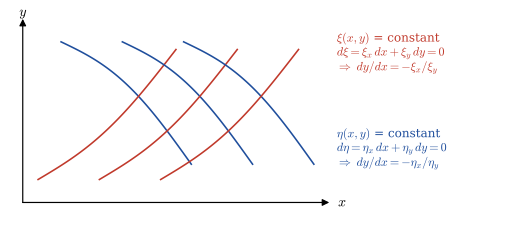{width="65%" fig-align="center"}

  $$\begin{aligned}
    &\big\Downarrow \;\;{\scriptsize \xi = \text{constant}, \eta = \text{constant}}\\
    \frac{dy}{dx} &=-\left[ \frac{\xi_x}{\xi_y} \right]=\frac{B -\sqrt{B^2-4AC}}{2A} =g_1(x,y)\\
    \frac{dy}{dx} &=-\left[ \frac{\eta_x}{\eta_y} \right]=\frac{B +\sqrt{B^2-4AC}}{2A} =g_2(x,y)\\
    &\Downarrow \;\;{\scriptsize \text{integration and arrangement}}\\
    G_1(&x,y) = c_1 \\
    G_2(&x,y) = c_2 \\
    &\Downarrow \\
    \xi &=G_1(x,y) \\
    \eta &=G_2(x,y) 
  \end{aligned}$$

$~$

**Example** $\,$Consider the simple equation

$$u_{xx} -4u_{yy} +u_x =0,\;\;\;B^2 -4AC=16>0$$

whose characteristic equations are

$$\begin{aligned}
 \frac{dy}{dx} &=-\left[ \frac{\xi_x}{\xi_y} \right]=\frac{B -\sqrt{B^2-4AC}}{2A} =-2\\
 \frac{dy}{dx} &=-\left[ \frac{\eta_x}{\eta_y} \right]=\frac{B +\sqrt{B^2-4AC}}{2A} =2\\
\end{aligned}$$

To find $\xi$ and $\eta$, $\,$we first integrate for $x$ and solve for the constants $c_1$ and $c_2,$ $\,$ getting

$$\begin{array}{l}
    y =-2x+c_1 \\ 
    y = 2x+c_2 \\ 
  \end{array}
  \;\;\Rightarrow\;\;
  \begin{array}{l}
   \xi =y+2x=c_1 \\
   \eta =y-2x=c_2
 \end{array}$$

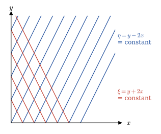{width="50%" fig-align="center"}

$~$

**Example** $\,$Suppose we start with the equation

$$y^2u_{xx} -x^2 u_{yy}=0,\;\;\;x>0,\;y>0$$

which is a hyperbolic equation in the first quadrant. $\,$We consider the problem of finding new coordinates that will change the original equation to canonical form for $\,x\,$ and $\,y\,$ in the first quadrant

**STEP 1** $\,$ Solve the two characteristic equations

$$\begin{aligned}
 \frac{dy}{dx} &=-\left[ \frac{\eta_x}{\eta_y} \right]=\frac{B -\sqrt{B^2-4AC}}{2A} =-\frac{x}{y}\\
 \frac{dy}{dx} &=-\left[ \frac{\xi_x}{\xi_y} \right]=\frac{B +\sqrt{B^2-4AC}}{2A} =\frac{x}{y}\\
\end{aligned}$$

Integrating these two equations by the ODE technique of separating variables gives the implicit relationship

$$\begin{aligned}
 y^2 &+x^2 = c_2 \\ 
 y^2 &-x^2 = c_1 \\ 
 &\Downarrow \\ 
 \xi= \,&y^2 -x^2 \\
 \eta = \,&y^2 +x^2
\end{aligned}$$

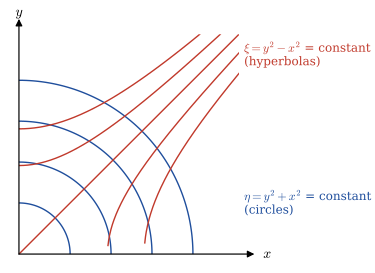{width="70%" fig-align="center"}


We substitute this new coordinate into the equation to find the new equation

$$\begin{aligned}
  y^2 u_{xx} &-x^2 u_{yy}= 0\\ 
  &\Downarrow\;\; \xi=y^2 -x^2,\; \eta=y^2 +x^2 \\ 
  -16x^2y^2 u_{\xi\eta} -2(x^2 +y^2) &u_\xi +2(y^2 -x^2) u_\eta=0
\end{aligned}$$

**STEP 2** $\,$ Finally, $\,$solving for $\,x\,$ and $\,y\,$ in terms of $\,\xi\,$ and $\,\eta$, $\,$we get

$$ u_{\xi\eta}=\frac{\eta u_\xi -\xi u_\eta}{2(\xi^2 -\eta^2)}$$

$~$

**Example** $\,$Find the new characteristic coordinates for

$$u_{xx} + 4u_{xy} = 0$$


Solve the transformed equation in the new coordinate system and then transform back to the original coordinates to find the solution to the original problem

::: {.callout-note collapse="true" title="Answer" appearance="simple"}
$u(x,y)=F(y)+G(y-4x)$, $\,$ with arbitrary twice-differentiable $F$, $G$
:::

[Solution](files/solutions/sol_13_10.pdf){target="_blank"}

$~$

**NOTES**

* The general hyperbolic equation actually has two canonical forms; $\,$the other one can be found by making yet another transformation

  $$\begin{aligned}
    \alpha &=\xi +\eta \\ 
    \beta &=\xi -\eta
  \end{aligned}$$

  and rewriting the first canonical form in terms of $\,\alpha\,$ and $\,\beta$. $\,$The partial derivatives are transformed as follows:

  $$\begin{aligned}
    u_\xi&= u_\alpha \alpha_\xi +u_\beta 
     \beta_\xi=u_\alpha +u_\beta\\ 
    u_\eta&= u_\alpha \alpha_\eta +u_\beta 
     \beta_\eta=u_\alpha -u_\beta\\ 
    u_{\xi\eta}&= u_{\alpha\alpha}\alpha_\eta 
     +u_{\alpha\beta}\beta_\eta 
      +u_{\beta\alpha}\alpha_\eta +u_{\beta\beta} 
       \beta_\eta =u_{\alpha\alpha} -u_{\beta\beta}
  \end{aligned}$$

* In the general parabolic equation, $\,$we obtain only a single canonical transformation as

  $$ \bar{A}=0, \;\;\frac{dy}{dx}=-\left [ \frac{\xi_x}{\xi_y} \right ],\;\;\;\text{or}\;\;\; \bar{C}=0, \;\;\frac{dy}{dx}=-\left [ \frac{\eta_x}{\eta_y} \right ]$$

  Suppose $\,\xi\,$ is calculated. $\,$What could be the possible choice for $\,\eta\,$? 
 $\,$We can select $\,\eta\,$ as any arbitrary function of $\,x\,$ and $\,y\,$ such that $\,\eta\,$ is independent of $\,\xi\,$ ($J \neq 0$)

* In the general elliptic case, $\,A\lambda^2 +B\lambda +C=0\,$ leads to complex conjugate canonical transformation $\,\xi\,$ and $\,\eta$. $\,$Since $\,\xi\,$ and $\,\eta\,$ are complex, $\,$we introduce new real variables

  $$\begin{aligned}
     \alpha &= \frac{1}{2}(\xi +\eta)\\ 
     \beta &= \frac{1}{2i}(\xi -\eta)
    \end{aligned}$$

  Under the transformation $\,(x, y)\to (\alpha, \beta)$, $\,$the canonical form is given by
 
  $$ u_{\alpha\alpha} +u_{\beta\beta}=\Phi(\alpha,\beta,u,u_\alpha,u_\beta)$$

* The three major classifications of linear PDEs as hyperbolic, parabolic, and elliptic equations essentially classify physical problems into three basic physical types:

   * **Wave propagation**
   * **Diffusion**
   * **Steady-state problems**
  
  The mathematical solutions of these three types of equations are quite different

$~$

## $~$First-Order Equations (Method of Characteristics) {#sec-x2-28}

* If the student recalls, $\,$when we solved the diffusion-convection equation

  $$ u_t=\alpha u_{xx} - vu_x, \quad -\infty < x < \infty, \;\; 0 < t < \infty$$

  the constant $\,\alpha\,$ stood for the amount of diffusion, $\,$while $v$ stood for the velocity of the medium

* Hence if $\,\alpha=0$ (no diffusion), $\,$it is clear (since we only have convection) that the solution will travel along the $\,x$-axis with velocity $\,v$. $\,$In other words, $\,$if the initial solution is $\,u(x,0)=\phi(x)$, $\,$then the solution to

  <font color="red">$$u_t=-vu_x$$</font>

  would be <font color="red">$\,u(x,t)=\phi(x-vt)$</font>

* So we can think of the first-order equation

  <font color="blue">$$a(x,t)u_x +b(x,t)u_t = 0$$</font>

  as the concentration along a stream where the velocity is given by

  <font color="blue">$$ v=\frac{a(x,t)}{b(x,t)}$$</font>

* The purpose of this section is to introduce the notion of first-order partial differential equations and <font color="red">method of characteristics</font>. $\,$The problem we will solve is the initial-value problem

  $$ a(x,t) u_x +b(x,t) u_t +c(x,t)u=0 $$

  $$u(x,0)=\phi(x), \;\; {-\infty<x<\infty,\;\; 0< t < \infty}$$

  The solution to this equation is based on a physical fact, $\,$that <font color="blue">an initial disturbance at some point $\,x\,$ propagates along a line (curve) in the $\,xt$-plane (called a characteristic)</font>

  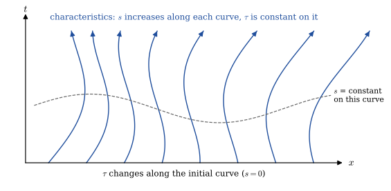{width="70%" fig-align="center"}

* With this in mind, $\,$the idea is to introduce two new coordinates $\,s\,$ and $\,\tau$ (to replace $\,x\,$ and $\,t$) that have the properties

  * $s\,$ will change along the characteristic curves
  * $\tau\,$ will change along the initial curve (most likely the line $\,t=0$)

  $$\begin{aligned}
    a(x,t) u_x +\, & b(x,t) u_t +c(x,t)u = 0\\ 
    &\big\Downarrow\;\; {\scriptsize\text{characteristic curves } \{ \left( x(s), t(s) \right) : 0<s<\infty \}} \\ 
    \frac{dx}{ds} = a(x,t), &\;
    \frac{dt}{ds} = b(x,t) \\
    &\Downarrow \\
    \frac{du}{ds}= u_x \frac{dx}{ds} +u_t\frac{dt}{ds}&=a(x,t) u_x +b(x,t) u_t \\
    &\Downarrow \\
    \frac{du}{ds} +\, &c(x,t)u =0
   \end{aligned}$$

$~$

**Example** $\,$Solve the following IVP with constant coefficients:

$$
\begin{aligned}
  u_x +u_t +2u &=0 && -\infty < x < \infty,\;\; 0 < t < \infty \\
  u(x,0) &=\sin x && -\infty < x < \infty
\end{aligned}$$

**STEP 1** $\,$ Find the characteristics (along which the initial data propagate)

$$\begin{aligned}
  \frac{dx}{ds}=1,\;\;
   \frac{dt} {ds}&=1\quad 0<s<\infty \\ 
  &\Downarrow \\ 
  x(s) = &\;s +c_1 \\
  t(s) = &\;s +c_2 \\
  &\Downarrow \;\;x(0)= \tau, \;\;t(0)=0 \\
  x = &\;s +\tau \\
  t = &\;s \\
  &\Downarrow \\
  x - t = \tau, \;\;\;&-\infty < \tau < \infty
\end{aligned}$$

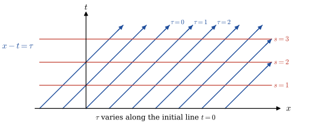{width="60%" fig-align="center"}

**STEP 2** $\,$ Using this coordinate system, $\,$we change the PDE to the ODE

$$\begin{aligned}
 \frac{du}{ds} +2u&= 0, \;\; u(0)= \sin\tau \\ 
 &\Downarrow \\
 u(s,\tau) &=\sin \tau \cdot e^{-2s} 
\end{aligned}$$

**STEP 3** $\,$ We now solve the transformation for $\,s\,$ and $\,\tau\,$ in terms of $\,x\,$ and $\,t$:

$$u(x,t) = \sin(x -t) \cdot e^{-2t}$$

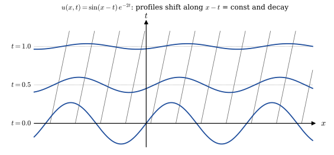{width="60%" fig-align="center"}

$~$

**Example** $\,$Solve the following IVP with variable coefficients:

$$
\begin{aligned}
  x u_x +u_t +tu &=0 && -\infty < x < \infty,\; 0 < t < \infty \\
  u(x,0) &=F(x) && -\infty < x < \infty, \;\;\text{an arbitrary initial wave}
\end{aligned}$$

**STEP 1** $\,$ Find the characteristics (along which the initial data propagate)

$$\begin{aligned}
  \frac{dx}{ds} =x,\;\;&\frac{dt}{ds} =1 
    \quad 0<s<\infty \\ 
  &\Downarrow \\ 
  x(s) &=\; c_1 e^s\\
  t(s) &=\; s +c_2 \\
  &\Downarrow \;\; x(0)= \tau, \;\;t(0)=0 \\
  x &=\;\tau e^s \\
  t &=\;s 
\end{aligned}$$

**STEP 2** $\,$ Using this coordinate system, $\,$we change the PDE to the ODE

$$\begin{aligned}
  \frac{du}{ds} +su&= 0, \;\; u(0)= F(\tau) \\ 
  &\Downarrow \\
  u(s,\tau) &=F(\tau) \cdot e^{-s^2/2} 
\end{aligned}$$

**STEP 3** $\,$ We now solve the transformation for $\,s\,$ and $\,\tau\,$ in terms of $\,x\,$ and $\,t$

$$u(x,t) = F(xe^{-t}) \cdot e^{-t^2/2}$$

$~$

**Example** $\,$ Solve the problem in higher dimensions (surface waves)

$$
\begin{aligned}
   a u_x +b u_y +c u_t +du &=0 && \scriptsize -\infty < x < \infty, \;-\infty < y < \infty, \; 0< t < \infty \\
   u(x,y,0) &=e^{-(x^2 +y^2)} && \scriptsize -\infty < x < \infty, \;-\infty < y < \infty
\end{aligned}$$

::: {.callout-note collapse="true" title="Answer" appearance="simple"}
$u(x,y,t)=\exp\!\left[-\left(x-\dfrac act\right)^2-\left(y-\dfrac bct\right)^2\right]e^{-dt/c}$
:::

[Solution](files/solutions/sol_13_11.pdf){target="_blank"}


$~$

## $~$Nonlinear First-Order Equations (Conservation Equations) {#sec-x2-29}

* One of the most useful partial differential equations in mathematics is the conservation equation

  <font color="red">$$u_t +f_x=0$$</font>

  This equation says that the increase of a physical quantity $\,u_t\,$ is equal to the change in flux $\,-f_x\,$ of that quantity across the boundary

* **Derivation of the Conservation Equation**

  Suppose we have a stretch of highway on which cars are moving from left to right, $\,$and we assume there are no exit and entrance ramps. $\,$We let

  $$
  \begin{aligned}
    u(x,t) &=\text{density of cars at } x\;\; 
      (\text{cars per unit length at } x) \\[5pt]
    f(x,t) &=\text{flux of cars at } x \;\; 
      (\text{cars per minute passing the point } x)
  \end{aligned}$$

  Then, $\,$it is fairly obvious that for a road segment $\,[a,b]$, $\,$the change in the number of cars (with respect to time) is given by both of the following expressions:

  $$\begin{aligned}
    \text{change in the number of cars in } [a,b] 
      &= \frac{d}{dt} \int_a^b u(x,t)\,dx \\
    \text{change in the number of cars in } [a,b] 
      &= f(a,t) -f(b,t) 
      = -\int_a^b \frac{\partial f}{\partial x}(x,t)\,dx
    \end{aligned}$$

  Setting these two integrals equal to each other, $\,$we have

  $$ \int_a^b \frac{\partial u}{\partial t}(x,t)\,dx = -\int_a^b \frac{\partial f}{\partial x}(x,t)\,dx$$

  Finally, $\,$since the integral $\,[a,b]\,$ was arbitrary, $\,$we have the one-dimensional conservation equation

  $$u_t +f_x=0$$

  If we carried out a similar analysis in two or three dimensions, $\,$we would have

  $$u_t +\nabla\cdot\mathbf{f}=0: \quad u_t +(f_1)_x +(f_2)_y=0, \;\; u_t +(f_1)_x +(f_2)_y +(f_3)_z=0$$

$~$

* **Conservation Equation Applied to the Traffic Problem**

  * We are now ready to see how the conservation equation $\,u_t +f_x=0\,$ can be applied to the traffic problem

  * To do this, $\,$we rewrite the change in flux $\,f_x\,$ as 

    $$f_x = \frac{df}{du} u_x,\;\;\text{chain rule}$$ 
    
    and substitute it in the conservation equation. $\,$Doing this, $\,$we arrive at

    $$ u_t +\frac{df}{du}u_x=u_t+g(u)u_x=0$$

    where we can imagine a disturbance (wave) in the traffic density moving upstream or downstream with velocity $\,g(u)$

  * Hence, after $\,t\,$ minutes, the position $\,x\,$ of the disturbance will be

    $$x = x_0 +g(u)t, \quad\text{characteristic equation}$$

   * Remembering that <font color="blue">the density $\,u(x,t)\,$ will not change along each characteristic</font>, $\,$if we know the initial density $\,u(x_0,0)$, then the characteristic equation for $\,x\,$ can be written

    $$x=x_0+g[u(x_0,0)]t$$

  * It is clear that by knowing these characteristic curves starting from each point (and knowing the solution doesn't change along these curves), $\,$we can piece together the solution $\,u(x,t)\,$ for all time $\,t$. $\,$We won't actually find the explicit equation for the solution $\,u(x,t)\,$ in terms of $\,x\,$ and $\,t\,$ but will use our knowledge of the characteristics of the equation to solve some interesting problems

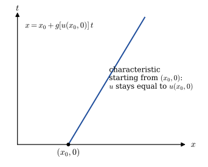{width="40%" fig-align="center"}

$~$

* **Traffic-Flow Problem**

  * We will now solve a traffic-flow problem where the flux is given by $\,f(u)=u^2$ and the initial density of cars is given. $\,$In other words, $\,$we have

  $$ u_t +2uu_x =0 \quad -\infty < x < \infty, 
  \; 0< t < \infty$$

  $$u(x,0) = 
  \begin{cases}
  \;\;\; 1 & x \leq 0\\ 
  1 -x     & 0 < x < 1 \\ 
  \;\;\; 0 & 1 \leq x 
  \end{cases}$$

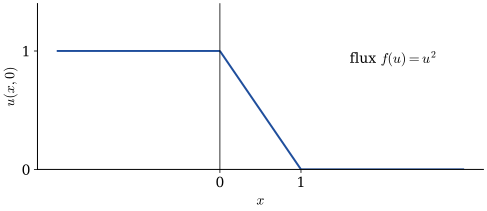{width="60%" fig-align="center"}

**STEP 1**

We begin by finding the characteristics starting from each initial point $\,(x_0,0)$.
$\,$For $\,x_0 < 0$, $\,$the characteristics are

$$\begin{aligned}
  x &= x_0 +g[u(x_0,0)] t \\ 
  &= x_0 +g[1] t\\ 
  &= x_0 +2t \\
  &\Downarrow \\
  t &=\frac{1}{2} (x -x_0)
\end{aligned}$$

Now consider those initial points $\,0 < x_0 < 1$. $\,$Here, $\,$the characteristic curves are

$$\begin{aligned}
 x &= x_0 +g[u(x_0,0)] t \\ 
 &= x_0 +g[1 -x_0] t\\ 
 &= x_0 +2(1 -x_0)t \\
 &\Downarrow \\
 t &=\frac{x -x_0}{2(1 -x_0)}
\end{aligned}$$

Finally, $\,$for $\,1 \leq x_0 < \infty$, $\,$we have the characteristics

$$\begin{aligned}
 x &= x_0 +g[u(x_0,0)] t \\ 
 &= x_0 +g[0] t\\ 
 &= x_0
\end{aligned}$$

which represents vertical lines starting at $\,x_0$

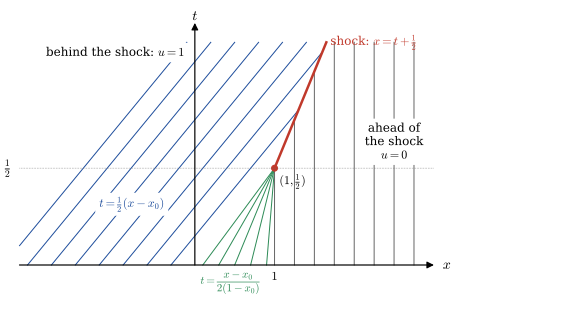{width="80%" fig-align="center"}

The solution remains constant along each characteristic line. $\,$Now the solution for $\,x \in \mathbb{R}$, $\,0 \leq t <\textstyle\frac{1}{2}\,$ is given by

$$u(x,t)=
\begin{cases}
 \quad 1 & \; x \leq 2t,\qquad 0 \leq t < \frac{1}{2}\\ 
 \displaystyle\frac{1 -x}{1 -2t} & 2t \leq x < 1, \;\, 
   0 \leq t < \frac{1}{2} \\ 
 \quad 0 & \; 1 \leq x, \qquad \; 0 \leq t < \frac{1}{2}
\end{cases}$$

The difficulty in this example is
that some characteristic lines will intersect each other. $\,$In other words, $\,$<font color="red">at the intersection point $\,(1,\textstyle \frac{1}{2})\,$ of the two characteristic lines, $\,$the solution becomes multi-valued</font>. $\,$This pathology means that the solution in the usual sense fails to exist after $\,t \geq \textstyle \frac{1}{2}$

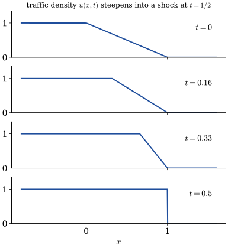{width="50%" fig-align="center"}

**STEP 2**

* Hence, $\,$to find the solution past $\,t=\textstyle \frac{1}{2}$, $\,$we must use another type of analysis. $\,$<font color="red">When characteristics run together, $\,$we have the phenomenon of shock waves (discontinuous solutions)</font>, $\,$and what we must ask is, $\,$how fast does the leading edge of the shock wave propagate along the road?

* Before proceeding further, $\,$it is necessary to introduce the concept of <font color="red">a jump condition: a condition that holds at a discontinuity or abrupt change</font>. $\,$Consider one dimensional problem where there is a jump in the conserved quantity $\,u$:

  $$u_t +f_x=0$$

  Let the solution exhibit a jump (or shock) at $\,x=x_s(t)\,$ and integrate over the partial domain, $\,x \in (x_1, x_2)$, $\,$where $\,x_1 < x_s(t) < x_2$,

  $$\scriptsize \begin{aligned}
  \frac{d}{dt} \left( \int_{x_1}^{x_s(t)}u\,dx +\int_{x_s(t)}^{x_2}u \,dx\right)&= -\int_{x_1}^{x_2} 
    \frac{\partial } {\partial x} f(u)\,dx\\
  &\Downarrow \\
    \int_{x_1}^{x_s(t)} u_t \,dx +u^-(x_s(t),t)\frac{dx_s}{dt} +\int_{x_s(t)}^{x_2} u_t \,dx 
    &-u^+(x_s(t),t)\frac{dx_s}{dt}= -\left. \underset{}{f(u)}\, \right|_{x_1}^{x_2}\\ 
  x_1 \to x_s(t),\;x_2 \to x_s(t) \;\; &\Downarrow \\ 
  \left[ u^-(x_s(t),t) -u^+(x_s(t),t) \right] \frac{d x_s}{dt} &= f(u^-(x_s(t),t)) -f(u^+(x_s(t),t)) \\
  &\Downarrow \\
  s=\frac{d x_s}{dt} &=\frac{f(u^-(x_s(t),t)) -f(u^+(x_s(t),t))}{ u^-(x_s(t),t) -u^+(x_s(t),t)}
  \end{aligned}$$

  in which $\,s\,$ is the speed of the discontinuity and represents the jump condition for the conservation equation 

* A shock situation arises in a system where its characteristics intersect, $\,$and under these conditions a requirement for a unique single-valued solution is that the solution should satisfy the Lax entropy condition

  $$f'(u^+(x_s(t),t)) < s < f'(u^-(x_s(t),t))$$

  where $f'(u^+(x_s(t),t))\,$ and $\,f'(u^-(x_s(t),t))\,$ represent characteristic speeds at downstream and upstream conditions, respectively

* So, $\,$in our example, $\,$the speed of the wave front would be(remembering that $\,f(u)=u^2$)

  $$ s = \frac{1 -0}{1 -0}=1$$

* <font color="red">Therefore, $\,$a shock is formed at $(x,t)=(1,\textstyle\frac{1}{2})$: </font>

  * After that, $\,$it moves with constant speed $1$, $\,$along the line $\,x=t +\textstyle \frac{1}{2}$, $\,$for $\,t \geq \textstyle \frac{1}{2}$. 
  
  * In conclusion, $\,$the solution takes different forms in the three different regions in the space-time plane

$$u(x,t)=
\begin{cases}
\quad 1 & x \leq 2t, \qquad\; 0 \leq t < \frac{1}{2} \;\;\text{or}\;\; x-\frac{1}{2} \leq t, \;\;t \geq \frac{1}{2}\\ 
\displaystyle\frac{1 -x}{1 -2t} & 2t \leq x < 1, \;\, 0 \leq t < \frac{1}{2} \\ 
\quad 0 & x \geq 1, \qquad\;\; 0 \leq t < \frac{1}{2} \;\;\text{or}\;\; x-\frac{1}{2} > t, \;\;t \geq \frac{1}{2}
\end{cases}$$

$~$

**Example** $\,$ Solve

$$
\begin{aligned}
  u_t +uu_x &=0 \qquad -\infty < x < \infty, \; 0 < t < \infty \\
  u(x,0) &= 
    \begin{cases}
      3(1 -|x|) & |x| \leq 1\\ 
      \quad\; 0 & |x| > 1 
    \end{cases}  
\end{aligned}$$

::: {.callout-note collapse="true" title="Answer" appearance="simple"}
For $t\ge\frac13$: $\ u(x,t)=\begin{cases}\dfrac{3(1+x)}{1+3t}, & -1\le x<x_s(t)\\ 0, & \text{otherwise}\end{cases}$, $\quad$ shock at $x_s(t)=\sqrt{2(1+3t)}-1$
:::

[Solution](files/solutions/sol_13_12a.pdf){target="_blank"}


$~$

**Example** $\,$ Verify that $\,u=\phi[x-g(u)t]\,$ is an implicit solution of the nonlinear problem

$$
\begin{aligned}
  u_t +g(u)u_x &=0 \quad -\infty < x < \infty, \; 0 < t < \infty \\
  u(x,0) &= \phi(x)
\end{aligned}$$

::: {.callout-note collapse="true" title="Answer" appearance="simple"}
$u=\phi[x-g(u)t]$ satisfies both the PDE and the initial condition as long as $1+t\,g'(u)\,\phi'(\xi)\neq0$
:::

[Solution](files/solutions/sol_13_12b.pdf){target="_blank"}


$~$

## $~$Systems of PDEs {#sec-x2-30}

* In many areas of science, $\,$several unknown quantities (and their derivatives) are modeled by a system of interlocking equations. $\,$And we seek to find all of these functions simultaneously

* There are other reasons for studying systems of equations. $\,$Although things are not quite so simple in PDE theory, $\,$it is often possible to write a single higher-order PDE as a system of first-order equations

* For example, $\,$the telegraph equation

  $$ u_{tt}=c^2u_{xx} +au_t +bu $$

  can be rewritten in equivalent form as three first-order PDEs by introducing the three variables:

  $$\begin{aligned}
    u_1 &= u \\ 
    u_2 &= u_x \\ 
    u_3 &= u_t 
  \end{aligned}$$

* It is a simple matter to see that the telegraph equation is equivalent to the three equations:

  $$\begin{aligned}
   \frac{\partial u_1}{\partial x} &= u_2 \\[2pt] 
   \frac{\partial u_1}{\partial t} &= u_3 \\[2pt] 
   \frac{\partial u_3}{\partial t} &= c^2 
    \frac{\partial u_2}{\partial x} +au_3 +bu_1
  \end{aligned}$$

**Solution of the Linear System** $\,\mathbf{u}_t +\mathbf{A}\mathbf{u}_x=\mathbf{0}$

* Consider the initial-value problem consisting of two PDEs and two ICs

  $$\begin{aligned}
      \frac{\partial u_1}{\partial t} +8
        &\frac{\partial u_2}{\partial x} = 0 \\[2pt] 
      \frac{\partial u_2}{\partial t} +2
        &\frac{\partial u_1}{\partial x} = 0 \\[5pt] 
      u_1(x,0)& = f(x) \\ 
      u_2(x,0)& = g(x) 
  \end{aligned}$$

  We start by writing the two PDEs in matrix form

  $$\begin{aligned}
      \begin{bmatrix}
      \frac{\partial u_1}{\partial t} \\ 
      \frac{\partial u_2}{\partial t}
      \end{bmatrix} 
    +&\begin{bmatrix}
        0 & 8 \\ 2 & 0 
      \end{bmatrix}
      \begin{bmatrix}
      \frac{\partial u_1}{\partial x} \\ 
      \frac{\partial u_2}{\partial x}
      \end{bmatrix}
      = \begin{bmatrix} 0 \\ 0 \end{bmatrix} \\ 
  \end{aligned}$$

  $$\begin{aligned}
    &\Downarrow \\[2pt] 
      \mathbf{u}_t +
      &\mathbf{A}\mathbf{u}_x = \mathbf{0} \\[2pt] 
    &\Downarrow \;\; 
      \mathbf{u}=\mathbf{P}\mathbf{v}\\[2pt] 
      \mathbf{v}_t +&\mathbf{P}^{-1} 
      \mathbf{A}\mathbf{P}\mathbf{v}_x 
      = \mathbf{0} \\[2pt] 
    &\Downarrow \\[2pt] 
      \mathbf{v}_t +
      &\boldsymbol{\Gamma}\mathbf{v}_x = \mathbf{0}
  \end{aligned}$$

  where

  $$\mathbf{P}=
    \begin{bmatrix}
    2 & -2 \\ 
    1 & \;\;\,1 
    \end{bmatrix},\;\;
    \boldsymbol{\Gamma}=
    \begin{bmatrix}
    4 & \;\;\,0 \\ 
    0 & -4 
  \end{bmatrix}\qquad$$

* These are the two uncoupled equations that we can solve independently

  $$\begin{aligned}
      &\frac{\partial v_1}{\partial t} +4\frac{\partial v_1}{\partial x} = 0 \\ 
      &\frac{\partial v_2}{\partial t} -4\frac{\partial v_2}{\partial x} = 0 
  \end{aligned}$$

  These equations have travelling-wave solutions

  $$\begin{aligned}
    v_1(x,t) &= \phi(x -4t) \\ 
    v_2(x,t) &= \psi(x +4t) 
  \end{aligned}$$

  where $\,\phi\,$ and $\,\psi\,$ are arbitrary differentiable functions

* To obtain our general solution $\,u$, $\,$we merely compute

  $$\mathbf{u}=\mathbf{P}\mathbf{v}=
    \begin{bmatrix}
      2\phi(x -4t) -2\psi(x+4t)\\ 
      \phi(x -4t) +\psi(x+4t)
  \end{bmatrix}$$

  We now substitute general solution into the ICs to get

  $$\begin{aligned}
    2\phi(x) &-2\psi(x) = f(x) \\ 
    \phi(x) &+\psi(x) = g(x) \\ 
    &\Downarrow \\ 
    \phi(x) &= \frac{1}{4} \left[ f(x) +2g(x) \right] \\
    \psi(x) &= \frac{1}{4} \left[ 2g(x) -f(x) \right]
  \end{aligned}$$

  and, $\,$hence, $\,$the solution to IVP is

  $$\begin{aligned}
    u_1(x,t) &= \frac{1}{2} \left[ f(x -4t) +2g(x -4t) \right] -\frac{1}{2}\left[ 2g(x +4t) -f(x +4t) \right]\\ 
    u_2(x,t) &= \frac{1}{4} \left[ f(x -4t) +2g(x -4t) \right] +\frac{1}{4}\left[ 2g(x +4t) -f(x +4t) \right]
  \end{aligned}$$

$~$

**Example** $\,$ What is the general solution of the system

$$\begin{aligned}
 &\frac{\partial u_1}{\partial t} +\frac{\partial u_1}{\partial x} +\frac{\partial u_2}{\partial x} = 0\\ 
 &\frac{\partial u_2}{\partial t} +4\frac{\partial u_1}{\partial x} +\frac{\partial u_2}{\partial x} = 0 
\end{aligned}$$

::: {.callout-note collapse="true" title="Answer" appearance="simple"}
$\begin{bmatrix}u_1\\u_2\end{bmatrix}=\phi(x-3t)\begin{bmatrix}1\\2\end{bmatrix}+\psi(x+t)\begin{bmatrix}1\\-2\end{bmatrix}$, $\,$ with arbitrary differentiable $\phi$, $\psi$
:::

[Solution](files/solutions/sol_13_13.pdf){target="_blank"}


$~$

## Summary {.unnumbered}

| Topic | Key result |
|:--|:--|
| D'Alembert | $u_{tt}=c^2u_{xx}$, $\,u(x,0)=f$, $\,u_t(x,0)=g$: $\ u=\dfrac12\left[f(x-ct)+f(x+ct)\right]+\dfrac1{2c}\displaystyle\int_{x-ct}^{x+ct}g(\alpha)\,d\alpha$ |
| Vibrating string | fixed ends: $\ u=\displaystyle\sum_{n=1}^\infty\left[a_n\cos\frac{n\pi ct}{L}+b_n\sin\frac{n\pi ct}{L}\right]\sin\frac{n\pi x}{L}$ |
| Drumhead | radially symmetric: $\ u=\sum A_mJ_0(\alpha_{0m}r)\cos(\alpha_{0m}ct)$, $\ J_0(\alpha_{0m})=0$ |
| Canonical form | characteristics $\dfrac{dy}{dx}=\dfrac{B\pm\sqrt{B^2-4AC}}{2A}$ give $\xi$, $\eta$ and $u_{\xi\eta}+\cdots=0$ |
| First-order linear | $u_t+vu_x=0$: $\ u=f(x-vt)$, $\,$constant along the characteristics $x-vt=$ const |
| Conservation law | $u_t+f(u)_x=0$; $\quad u_t+g(u)u_x=0$, $\,u(x,0)=\phi$: $\ u=\phi\big[x-g(u)t\big]$ |
| Shock speed | $s=\dfrac{dx_s}{dt}=\dfrac{f(u^-)-f(u^+)}{u^--u^+}$, $\quad f'(u^+)<s<f'(u^-)$ |

$~$

## Worked Exercises {.unnumbered}

**1.** $~$ Find $u(0,0,0,t)$

$$
\begin{aligned}
 u_{tt} &= \nabla^2 u, \;\; t > 0\\ 
 &u(x, y, z, 0) = 0, \;
 u_t(x, y, z, 0) = x^2 +y^2 +z^2
\end{aligned}
$$

**Solution**

**Step 1:** $~$ Use the Kirchhoff’s formula (solution to 3D wave equation)

For the 3D wave equation (with wave speed $c= 1$), the solution with initial conditions $u(\mathbf{x},0) = f(\mathbf{x})$, $u_t(\mathbf{x},0) = g(\mathbf{x})$ is:

$$u(\mathbf{x},t) = \frac{1}{4\pi t} \int_{|\xi - \mathbf{x}| = t} g(\xi) \, dS(\xi) + \frac{1}{4\pi t^2} \int_{|\xi - \mathbf{x}| = t} f(\xi) \, dS(\xi) $$

where the integrals are over the sphere of radius $t$ centered at $\mathbf{x}$

In our problem:

* $f(x,y,z) = 0$
* $g(x,y,z) = x^2 + y^2 + z^2 = |\xi|^2$
* Point of interest: $\mathbf{x} = (0,0,0)$

Thus:

$$u(0,0,0,t) = \frac{1}{4\pi t} \int_{|\xi| = t} |\xi|^2 \, dS(\xi)$$

**Step 2:** $~$ Evaluate the integral

On the sphere $|\xi| = t$, we have $|\xi|^2 = t^2$ constant

Then:

$$u(0,0,0,t) = \frac{1}{4\pi t} \int_{|\xi| = t} t^2 \, dS(\xi) = \frac{t^2}{4\pi t} \cdot \text{Surface area of sphere of radius } t$$

The surface area of a sphere of radius $t$ is $4\pi t^2$, so:

$$u(0,0,0,t) = \frac{t^2}{4\pi t} \cdot 4\pi t^2 = t^2 \cdot t = \boxed{t^3}$$

$~$

**2.** $~$ Find $u(x,y,z,t)$

$$
\begin{aligned}
 u_{tt} &= \nabla^2 u, \;\; t > 0\\ 
 &u(x, y, z, 0) = 0, \;
 u_t(x, y, z, 0) = x
\end{aligned}
$$

**Solution**

**Step 1:** $~$ Use Kirchhoff’s formula (3D wave equation)

For the 3D wave equation $u_{tt} = \nabla^2 u$ with wave speed $c = 1$, the general solution with initial data

$$u(\mathbf{x},0) = f(\mathbf{x}), \quad u_t(\mathbf{x},0) = g(\mathbf{x})$$

is given by:

$$u(\mathbf{x},t) = \frac{1}{4\pi t} \int_{|\xi - \mathbf{x}| = t} g(\xi) \, dS(\xi) + \frac{1}{4\pi t^2} \int_{|\xi - \mathbf{x}| = t} f(\xi) \, dS(\xi)$$

In our case:

* $f(x,y,z) = 0$
* $g(x,y,z) = x$ (we’ll write this as $\xi_1$ to distinguish from the field point $\mathbf{x} = (x_1,x_2,x_3)$)
* Therefore:

$$u(\mathbf{x},t) = \frac{1}{4\pi t} \int_{|\xi - \mathbf{x}| = t} \xi_1 \, dS(\xi)$$

**Step 2:** $~$ Use coordinate shift

Let’s simplify by performing a change of variables to center the sphere

Let $\mathbf{x} = (x_1, x_2, x_3)$, and let $\xi = \mathbf{x} + t\omega$, where $\omega \in S^2$ is a unit vector.
Then $|\xi - \mathbf{x}| = t$, and $dS(\xi) = t^2\, d\omega$. So:

$$u(\mathbf{x},t) = \frac{1}{4\pi t} \int_{|\xi - \mathbf{x}| = t} \xi_1 \, dS(\xi)
= \frac{1}{4\pi t} \int_{S^2} (x_1 + t\omega_1) \cdot t^2 \, d\omega$$

Simplify:

$$u(\mathbf{x},t) = \frac{t}{4\pi} \int_{S^2} (x_1 + t\omega_1) \, d\omega
= \frac{t}{4\pi} \left[ x_1 \int_{S^2} d\omega + t \int_{S^2} \omega_1 \, d\omega \right]$$

Now compute the integrals:

* $\displaystyle \int_{S^2} d\omega = 4\pi$

* $\displaystyle \int_{S^2} \omega_1 \, d\omega = 0~$ (odd function over symmetric sphere)

So:

$$u(\mathbf{x},t) = \frac{t}{4\pi} \cdot x_1 \cdot 4\pi = x_1 t = x t$$

$~$

**3.** $~$ Solve the vibrations of a membrane which is in the $xy$ plane:

$$
\begin{aligned}
 u_{tt} &= \frac{\rho}{T} \left[ \frac{\partial^2 u}{\partial x^2} +\frac{\partial^2 u}{\partial y^2} \right] , \;\; 0 < x < \pi, \;0 < y < \pi \\
 u&(0, y, t) =0, \; u(\pi, y, t) =0 \\ 
 u&(x, 0, t) =0, \; u(x, \pi, t) =0 \\ 
 u&(x,y,0) = \sin 2x \sin 3y +\sin 3x \sin2y. \;
 u_t(x,y,0) =0
\end{aligned}$$

**Solution**

**Step 1:** $~$ Separation of Variables

Assume a solution of the form:
$$u(x, y, t) = X(x) Y(y) T(t)$$
Plugging into the wave equation:

$$X Y T'' = c^2 \left( X'' Y T + X Y'' T \right)$$

Divide both sides by $XYT$:

$$\frac{T''}{c^2 T} = \frac{X''}{X} + \frac{Y''}{Y} = -\lambda$$

We separate variables:
$$\frac{X''}{X} + \frac{Y''}{Y} = -\lambda \Rightarrow
\begin{cases}
X’’ + \mu X = 0 \\
Y’’ + (\lambda - \mu) Y = 0
\end{cases}$$

With the boundary conditions:
$$\begin{aligned}
X(0) &= X(\pi) = 0 \Rightarrow X_n(x) = \sin(nx),\quad \mu = n^2 \\
Y(0) &= Y(\pi) = 0 \Rightarrow Y_m(y) = \sin(my),\quad \lambda - \mu = m^2 \Rightarrow \lambda = n^2 + m^2
\end{aligned}$$

Then the time part:
$$\begin{aligned}
 T'' &+ c^2(n^2 + m^2)T = 0\\ 
 &\Rightarrow
 T_{n,m}(t) = A_{n,m} \cos(c\sqrt{n^2 + m^2}t) + B_{n,m} \sin(c\sqrt{n^2 + m^2}t)
 \end{aligned}$$

**Step 2:** $~$ General Solution

$$
\begin{aligned}
u(x, y, t) = \sum_{n=1}^{\infty} \sum_{m=1}^{\infty} &\left[ A_{n,m} \cos(c\sqrt{n^2 + m^2} t)\right. \\ 
&\left.+ B_{n,m} \sin(c\sqrt{n^2 + m^2} t) \right] \sin(nx) \sin(my)
\end{aligned}
$$

**Step 3:** $~$ Apply Initial Conditions

Initial displacement:

$$u(x, y, 0) = \sum_{n,m} A_{n,m} \sin(nx)\sin(my) = \sin 2x \sin 3y + \sin 3x \sin 2y$$

So $A_{2,3} = 1$, $A_{3,2} = 1$, all others zero

Initial velocity:
$$u_t(x, y, 0) = -c\sum_{n,m} c\sqrt{n^2 + m^2} B_{n,m} \sin(nx)\sin(my) = 0 \Rightarrow B_{n,m} = 0$$

**Final Answer**

$$u(x, y, t) = \cos\left(c \sqrt{13}\, t\right) \sin(2x) \sin(3y)
	+\cos\left(c \sqrt{13}\, t\right) \sin(3x) \sin(2y)$$

where $c = \sqrt{\rho/T}$

$~$

```{python}
import numpy as np
import matplotlib.pyplot as plt

def plot_rectangle_membrane_normal_modes(n, m):
    
    fig, ax = plt.subplots(figsize=(3, 3))

    ax.set(xticks=[], yticks=[])

    x_ = np.linspace(0, np.pi, 100)
    y_ = np.linspace(0, np.pi, 100)

    X_, Y_ = np.meshgrid(x_, y_)
    U_ = np.sin(n*X_) *np.sin(m*Y_) +np.sin(m*X_) *np.sin(n*Y_) 
    
    ax.contourf(X_, Y_, U_, levels=[0, 10])
    
    ax.set_title(f'$n={n}$, $m={m}$')
    
    plt.show()
```
```{python}
plot_rectangle_membrane_normal_modes(2, 3)
```

$~$

**4.** $~$ Solve the vibrations of a membrane which is in the $xy$ plane:

$$\begin{aligned}
 u_{tt} &= \frac{\rho}{T} \left[ \frac{\partial^2 u}{\partial x^2} +\frac{\partial^2 u}{\partial y^2} \right] , \;\; 0 < x < \pi, \;0 < y < \pi \\
 u&(0, y, t) =0, \; u(\pi, y, t) =0 \\ 
 u&(x, 0, t) =0, \; u(x, \pi, t) =0 \\ 
 u&(x,y,0) = \sin x \sin 4y +\sin 4x \sin y, \;
 u_t(x,y,0) =0
\end{aligned}$$

**Solution**

**Step 1:** $~$ Use Separation of Variables

Assume a solution of the form:

$$
\begin{aligned}
u(x,y,t) = \sum_{n=1}^\infty \sum_{m=1}^\infty &\left[ A_{nm} \cos(c\sqrt{n^2 + m^2} \, t)\right.\\ 
&+\left. B_{nm} \sin(c\sqrt{n^2 + m^2} \, t) \right] \sin(nx) \sin(my)
\end{aligned}$$

From the initial displacement:
$$u(x,y,0) = \sum_{n,m} A_{nm} \sin(nx)\sin(my) = \sin x \sin 4y + \sin 4x \sin y$$

So the only nonzero coefficients are:
$$A_{1,4} = 1,\quad A_{4,1} = 1$$

From the initial velocity condition:
$$u_t(x,y,0) = 0 \Rightarrow B_{nm} = 0$$

**Step 2:** $~$ Final Solution

$$\begin{aligned}
u(x, y, t) &= A_{1,4} \cos(c \sqrt{1^2 + 4^2} \, t) \sin x \sin 4y\\
	&\quad+	A_{4,1} \cos(c \sqrt{4^2 + 1^2} \, t) \sin 4x \sin y \\
&= \cos(c\sqrt{17} \, t) \sin x \sin 4y + \cos(c\sqrt{17} \, t) \sin 4x \sin y
\end{aligned}$$

Thus, the solution is:

$$
u(x, y, t) = \cos(c\sqrt{17} \, t) \left[ \sin x \sin 4y + \sin 4x \sin y \right]
$$

where $c = \sqrt{\frac{\rho}{T}}$

$~$

```{python}
plot_rectangle_membrane_normal_modes(1, 4)
```

$~$

**5.** $~$ Suppose the vibration of a string is described by $u_{tt}=u_{xx}$ and has an initial displacement as given by the following diagram:

$(a)$

<div>
<center></center>
</div>

$(b)$

<div>
<center></center>
</div>


Assuming the initial velocity $u_t(x,0)=0$, describe the solution of this problem in the $xt$-plane and plot the solution at $t=4$ in the $xu$-plane

**Solution**

```{python}
# Re-import libraries due to code state reset
import numpy as np
import matplotlib.pyplot as plt
import matplotlib.animation as animation
from IPython.display import HTML

# Define the piecewise function f(x)
def fa(x):
    x = np.array(x)
    result = np.zeros_like(x)
    result[(x >= -3) & (x < -2)] = 1
    result[(x > -2) & (x < -1)] = 2
    result[(x >= -1) & (x < 1)] = 1
    result[(x >= 1) & (x < 2)] = 2
    result[(x >= 2) & (x < 3)] = 1
    # result is already 0 elsewhere
    return result

def fb(x):
    x = np.array(x)
    result = np.zeros_like(x)
    result[(x >= -3) & (x < -2)] = 1
    result[(x > -2) & (x < -1)] = 2
    result[(x >= -1) & (x < 1)] = 3
    result[(x >= 1) & (x < 2)] = 2
    result[(x >= 2) & (x < 3)] = 1
    # result is already 0 elsewhere
    return result    
```

```{python}
# Create meshgrid
x = np.linspace(-10, 10, 400)
t = np.linspace(0, 6, 200)
X, T = np.meshgrid(x, t)

Ua = 0.5 *(fa(X -T) +fa(X +T))
Ub = 0.5 *(fb(X -T) +fb(X +T))

# Plot u
fig, axes = plt.subplots(2, 1, figsize=(7, 7))

cba = axes[0].pcolormesh(x, t, Ua, vmin=0, vmax=3, cmap='gray_r')
cbb = axes[1].pcolormesh(x, t, Ub, vmin=0, vmax=3, cmap='gray_r')
plt.colorbar(cba, shrink=0.9, ticks=[0, 0.5, 1, 1.5, 2, 2.5, 3], label='u')
plt.colorbar(cbb, shrink=0.9, ticks=[0, 0.5, 1, 1.5, 2, 2.5, 3], label='u')

axes[0].axhline(y=4, color="black", linestyle=":", label='$t=4$')
axes[1].axhline(y=4, color="black", linestyle=":", label='$t=4$')

# Plot characteristics
for x0 in [-3, -2, -1, 1, 2, 3]:
    axes[0].plot(x0 +t, t, 'red', linestyle=':')
    axes[0].plot(x0 -t, t, 'red', linestyle=':')
    axes[1].plot(x0 +t, t, 'red', linestyle=':')
    axes[1].plot(x0 -t, t, 'red', linestyle=':')    

axes[0].set_title('Characteristic Lines and $u(x,t)$ in $x$-$t$ Plane')
axes[1].set_xlabel('x')
axes[0].set_ylabel('t')
axes[1].set_ylabel('t')

plt.legend(loc=4)
plt.tight_layout()
plt.show()
```

```{python}
# Define u(x, t) = 1/2 [f(x -t) +f(x +t)] at t = 4

t = 4
x_vals = np.linspace(-10, 10, 1000)
ua_vals = 0.5 *(fa(x_vals -t) +fa(x_vals +t))
ub_vals = 0.5 *(fb(x_vals -t) +fb(x_vals +t))

# Plot u(x, 4)
fig, axes = plt.subplots(2, 1, figsize=(7, 6))

axes[0].plot(x_vals, ua_vals, color='blue')
axes[1].plot(x_vals, ub_vals, color='blue')

axes[0].set_title('Displacement $u(x, 4)$ in the $xu$-plane')
axes[1].set_xlabel('x')
axes[0].set_ylabel('u(x, 4)')
axes[1].set_ylabel('u(x, 4)')
axes[0].grid(True)
axes[1].grid(True)

axes[0].set_ylim([-0.1, 2.1])
axes[1].set_ylim([-0.1, 2.1])

plt.tight_layout()
plt.show()
```

```{python}
# Create grid
x = np.linspace(-10, 10, 400)
t_vals_light = np.linspace(0, 6, 40)

# Set up the figure
fig, axes = plt.subplots(2, 1, figsize=(7, 6))

line0, = axes[0].plot([], [], lw=2)
line1, = axes[1].plot([], [], lw=2)
axes[0].set_xlim(-10, 10)
axes[1].set_xlim(-10, 10)

axes[0].set_ylim(-0.1, 3.1)
axes[1].set_ylim(-0.1, 3.1)

axes[1].set_xlabel('x')
axes[0].set_ylabel('u(x,t)')
axes[1].set_ylabel('u(x,t)')
#axes[0].set_title('Wave Propagation Over Time')

plt.close()

# Animation functions
def init():
    line0.set_data([], [])
    line1.set_data([], [])    
    return line0, line1

def animate(i):
    t = t_vals_light[i]
    ua = 0.5 *(fa(x -t) +fa(x +t))
    ub = 0.5 *(fb(x -t) +fb(x +t))    
    line0.set_data(x, ua)
    line1.set_data(x, ub)    
    axes[0].set_title(f'Wave at t = {t:.2f}')
    return line0, line1

# Create and save animation
ani = animation.FuncAnimation(fig, animate, frames=len(t_vals_light),
                              init_func=init, blit=True, interval=400)

HTML('<center>' + ani.to_html5_video() + '</center>')
```

$~$

**6.** $~$ Find $u\left( \frac{3}{8}, 3 \right)$

$$
\begin{aligned}
 u_{tt} &= u_{xx}, \;\;0<x<1, \; 0 < t < \infty\\ 
 u_x(0, t) &= 0\\
 u(1, t) &= 0\\
 u(x, 0) &=(1-x)^3 \\
 u_t(x, 0) &= (1-x)^2
\end{aligned}
$$

**Solution**

Method of Solution: D’Alembert’s Formula with Function Extension

**Step 1:** $~$ D’Alembert Solution on the Infinite Domain

The general D’Alembert solution for the wave equation on the entire real line is:

$$u(x,t) = \frac{1}{2}\left[f(x + t) + f(x - t)\right] + \frac{1}{2} \int_{x - t}^{x + t} g(s)\, ds$$

This solution assumes that u is defined on the entire real line with no boundary conditions. To use this method on the interval $0 < x < 1$, we extend $f(x)$ and $g(x)$ to the whole real line by reflecting them in such a way that the boundary conditions are satisfied

**Step 2:** $~$ Extend $f(x)$ and $g(x)$ to the Real Line

We extend $f(x)$ and $g(x)$ as follows:

Boundary Conditions:

* Neumann at $x = 0 \;\Rightarrow\;$ Extend as an even function about $x$ = 0
* Dirichlet at $x = 1 \;\Rightarrow\;$ Extend as an odd function about $x = 1$

This leads to a 2-periodic extension over $\mathbb{R}$. The steps:

1.	Reflect $f(x)$, $g(x)$ evenly about $x = 0$
2.	Reflect them oddly about $x = 1$
3.	Periodically extend with period 4

We denote the extended functions as $\tilde{f}(x)$, $\tilde{g}(x)$, defined for all $x \in \mathbb{R}$
and this pattern repeats every 4 units:

$$\tilde{f}(x + 4) = \tilde{f}(x)$$

**Step 3:** $~$ Apply D’Alembert Formula

Using the extended functions, the D’Alembert solution becomes:

$$u(x,t) = \frac{1}{2} \left[\tilde{f}(x + t) + \tilde{f}(x - t)\right] + \frac{1}{2} \int_{x - t}^{x + t} \tilde{g}(s)\, ds$$

Now substitute $x = \frac{3}{8}$, $t = 3$:

$$u\left( \frac{3}{8}, 3 \right) = \frac{1}{2} \left[ \tilde{f}\left(\frac{3}{8} + 3\right) + \tilde{f}\left(\frac{3}{8} - 3\right) \right] + \frac{1}{2} \int_{\frac{3}{8} - 3}^{\frac{3}{8} + 3} \tilde{g}(s)\, ds$$

* Construction of $\tilde{f}(x)$ on $[0, 4)$:

| Interval | Definition of $\tilde{f}(x)$ | Reasoning     |
|----------------|----------------------------------------|--------------------------------|
| $0 \leq x < 1$   | $(1 - x)^3$   | Original definition          |
| $1 \leq x < 2$   | $(1 - x)^3$  | Odd reflection about $x = 1$ |
| $2 \leq x < 3$   | $(x - 3)^3$  | Even reflection about $x = 2$ of previous term |
| $3 \leq x < 4$   | $(x - 3)^3$   | Odd reflection about $x = 3$ of previous term |

* Construction of $\tilde{g}(x)$ on $[0, 4)$:

| Interval | Definition of $\tilde{g}(x)$ | Reasoning     |
|----------------|----------------------------------------|--------------------------------|
| $0 \leq x < 1$   | $\phantom{-}(1 - x)^2$   | Original definition          |
| $1 \leq x < 2$   | $-(1 - x)^2$  | Odd reflection about $x = 1$ |
| $2 \leq x < 3$   | $-(x - 3)^2$  | Even reflection about $x = 2$ of previous term |
| $3 \leq x < 4$   | $\phantom{-}(x - 3)^2$   | Odd reflection about $x = 3$ of previous term |

```{python}
import numpy as np
import matplotlib.pyplot as plt

def tilde_fg(x):
    x = np.array(x)
    f = np.zeros_like(x)
    g = np.zeros_like(x)    
    
    # (0, 1): original
    mask1 = (0 <= x) & (x < 1)
    f[mask1] = (1 -x[mask1])**3
    g[mask1] = (1 -x[mask1])**2    

    # (1, 2): odd reflection about x = 1
    mask2 = (1 <= x) & (x < 2)
    f[mask2] = (1 -x[mask2])**3
    g[mask2] = -(1 -x[mask2])**2      

    # (2, 3): even reflection about x = 2 
    mask3 = (2 <= x) & (x < 3)
    f[mask3] = (x[mask3] -3)**3  # no sign change
    g[mask3] = -(x[mask3] -3)**2

    # (3, 4): odd reflection about x = 3
    mask4 = (3 <= x) & (x <= 4)
    f[mask4] = (x[mask4] -3)**3
    g[mask4] = (x[mask4] -3)**2

    return f, g

# Domain
x_vals = np.linspace(0, 4, 1000)
f_vals, g_vals = tilde_fg(x_vals)

# Plot
plt.figure(figsize=(6, 4))
plt.plot(x_vals, f_vals, color='red', label=r'$\tilde{f}$')
plt.plot(x_vals, g_vals, color='blue', label=r'$\tilde{g}$')

plt.title(r'$\tilde{f}(x), \tilde{g}(x)$ on $[0, 4)$')
plt.xlabel('x')
plt.ylabel(r'$\tilde{f}(x), \tilde{g}(x)$')
plt.legend()
plt.grid(True)
plt.tight_layout()
plt.show()
```

**Step 4:** $~$ Evaluate $\tilde{f}(x \pm t)$

$$x = \frac{3}{8} = 0.375,\quad t = 3 \Rightarrow x + t = 3.375,\quad x - t = -2.625$$

Using 4-periodicity:

* $3.375 \mod 4 = 3.375$
* $-2.625 \mod 4 = 1.375$

Thus:

* $\tilde{f}(3.375) = (3.375 - 3)^3 = (0.375)^3 = \frac{27}{512}$
* $\tilde{f}(1.375) = (1 -1.375)^3 = - (0.375)^3 = -\frac{27}{512}$

So the average is:

$$\frac{1}{2} \left[ \tilde{f}(3.375) + \tilde{f}(-2.625) \right] = \frac{1}{2} \left( \frac{27}{512} - \frac{27}{512} \right) = 0$$

**Step 5:** $~$ Evaluate the Integral Term

We now compute:

$$\int_{-2.625}^{3.375} \tilde{g}(s)\, ds =
\underbrace{\int_{-2.625}^{-2} \tilde{g}(s)\, ds}_{A}
	+\underbrace{\int_{-2}^{2} \tilde{g}(s)\, ds}_{0}
	+\underbrace{\int_{2}^{3.375} \tilde{g}(s)\, ds}_{B}$$

We computed the tails:

*	$\displaystyle A = \int_{-2.625}^{-2} \tilde{g}(s)\, ds = -\int_{1.375}^{2} (s - 1)^2 ds = \boxed{-\frac{485}{1536}}$

*	$\displaystyle B = \int_{2}^{3.375} \tilde{g}(s)\, ds$
  
  We split this into two parts, because the definition of $\tilde{g}(s)$ changes at $s = 3$:	
  
  *	On $[2, 3)$: $\tilde{g}(s) = (3 - s)^2$

    $$\int_{2}^{3} (3 - s)^2 ds = \int_1^0 u^2 (-du) = \int_0^1 u^2 du = \left[\frac{u^3}{3}\right]_0^1 = \frac{1}{3}$$

  *	On $[3, 3.375]$: $\tilde{g}(s) = -(s - 3)^2$

  $$\int_{3}^{3.375} - (s - 3)^2 ds = - \int_0^{3/8} v^2 dv = - \left[\frac{v^3}{3}\right]_0^{3/8}
= - \frac{(3/8)^3}{3} = - \frac{27}{1536}$$

So:

$$\int_{2}^{3.375} \tilde{g}(s)\, ds = \frac{1}{3} - \frac{27}{1536} = \frac{512 - 27}{1536} = \boxed{\frac{485}{1536}}$$

**Final Answer:**

Recall that from the previous step:

$$\frac{1}{2} [\tilde{f}(x+t) + \tilde{f}(x - t)] = 0
\quad\text{and}\quad \text{(integral term)} = 0$$

$$\boxed{u\left( \frac{3}{8}, 3 \right) = 0}$$

$~$

**7.** $~$ Suppose the vibration of a string is described by $u_{tt}=u_{xx}$ and has an initial displacement as given by the following diagram:


Assuming the initial velocity $u_t(x,0)=0$, describe the solution of this problem in the $xt$-plane

$~$

**8.** $~$ Consider the one-dimensional wave equation on the interval $0 < x < L$:

$$
\begin{aligned}
u_{tt}(x,t) &= c^2 u_{xx}(x,t), & 0 < x < L,\\[4pt]
u(0,t) &= 0,
\;
u(L,t) = 0, & t > 0,\\[4pt]
u(x,0) &= u_0(x),
\;
u_t(x,0) = v_0(x), & 0 \le x \le L
\end{aligned}
$$

**(a)** Write down the eigenfunctions and eigenvalues for this boundary-value problem

**(b)** Using separation of variables, provide explicit expressions for the solution in terms of $u_0$ and $v_0$

**Solution**

**(a) Eigenfunctions and Eigenvalues**

Solve $X''+\lambda X=0$ with $X(0)=0$ and $X(L)=0$. Nontrivial solutions occur when
$$\lambda_n = \left(\frac{n\pi}{L}\right)^2, \quad n=1,2,3,\dots$$
and the eigenfunctions are
$$\phi_n(x)=\sin\frac{n\pi x}{L}$$

**(b)-1 Series representation**

The general solution is
$$u(x,t)=\sum_{n=1}^{\infty}\Big(A_n\cos\frac{cn\pi t}{L}+B_n\sin\frac{cn\pi t}{L}\Big)\sin\frac{n\pi x}{L}$$
This follows by separation of variables: $u(x,t)=X(x)T(t)$ leads to the spatial eigenfunctions above, and $T(t)$ solves $T''+c^2\lambda_n T=0$

**(b)-2 Coefficients $A_n$ and $B_n$**

Using orthogonality:
$$A_n = \frac{2}{L}\int_0^L u_0(x)\sin\frac{n\pi x}{L}\,dx$$
$$B_n = \frac{2}{cn\pi}\int_0^L v_0(x)\sin\frac{n\pi x}{L}\,dx$$


