# Elliptic Partial Differential Equations {#sec-x3}

## The Laplacian (an Intuitive Description) {#sec-x3-31}

* The  Laplacian operator 

  $$ \nabla^2 =\frac{\partial^2}{\partial x^2} +\frac{\partial^2}{\partial y^2} +\frac{\partial^2}{\partial z^2}$$

  is probably the most important operator in mathematical physics. $\,$The question is, $\,$what does it mean and why should the sum of three second derivatives have anything to do with the laws of nature? 

* The answer to this lies in the fact that the Laplacian of a function allows us to compare the function at a point with the function at neighboring points. $\,$It does what the second derivative did in one dimension and might be thought of as a second derivative generalized to higher dimensions

$~$

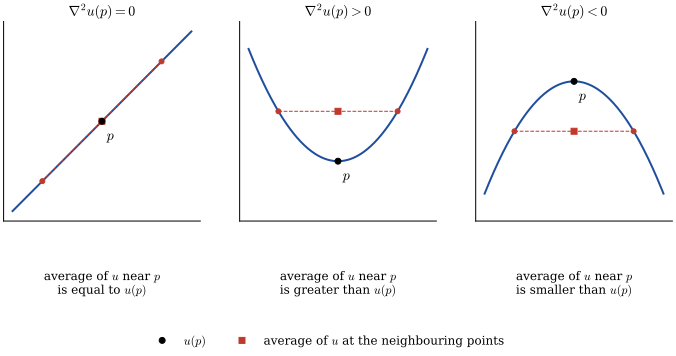{width="90%" fig-align="center"}

$~$

* The heat equation $\,u_t=\alpha\nabla^2 u\,$ measures temperature $\,u$, and the equation can be interpreted to mean that the change in temperature with respect to time $\,u_t$ is proportional to $\,\nabla^2 u$. $\,$That is, $\,$the temperature at a point is increasing if the temperature at that point is less than the average of the temperature on a circle around the point

* The wave equation $\,u_{tt}=c^2\nabla^2 u\,$ measures the displacement of a drumhead and can be interpreted to mean that the acceleration (or force) of a point on the drumhead $\,u_{tt}\,$ is proportional to $\,\nabla^2 u$. $\,$That is, $\,$the drumhead at a point is accelerating upward if the drumhead at that point is less than the average of its neighbors

* Laplace equation $\,\nabla^2 u = 0\,$ says that the solution $\,u\,$ is always equal to the average of its neighbors. $\,$For example, $\,$a steady-state, stretched rubber membrane satisfies Laplace equation, $\,$hence, $\,$the height of the membrane at any point is equal to the average height of the membrane on a circle around the point

* Poisson equation $\,\nabla^2 u=-f$, $\,$where $\,f\,$ is a function that depends only on the space variables

  * $\nabla^2 u=-\rho\,$ describes the potential of an electrostatic field where $\,\rho\,$ represents a constant charge density
  * $\nabla^2 u =-g(x,y)\,$ describes the steady-state temperature $\,u(x,y)\,$ due to a heat source $\,g(x,y)$ 

* $\nabla^2 u +\lambda u =0\,$ is known as the Helmholtz equation which describes the fundamental shapes of a stretched membrane

$~$

* **Changing Coordinates**

  Before we start, $\,$however, $\,$let's review briefly the three major coordinate systems in two or three dimensions except for Cartesian system:

  * Polar Coordinates

    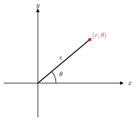{width="45%" fig-align="center"}

    $$\begin{matrix}
      x = r\cos\theta \\ 
      y = r\sin\theta \, \\ 
      \end{matrix} \;\; \Rightarrow \;\;
      \begin{matrix}
        r^2 = x^2 + y^2 \;\;\;\\ 
        \tan\theta = y/x \;\;\;\;\;
    \end{matrix}$$

    As an illustration, $\,$we see how the two-dimensional Laplacian is transformed into polar coordinates:

    $$\scriptsize 
    \begin{aligned}
    \nabla^2u &= u_{xx} +u_{yy}\\ 
    &\Updownarrow \\ 
    u_x = u_r r_x +u_\theta \theta_x &= u_r \cos\theta -u_\theta \frac{\sin\theta}{r}\\ 
    u_y = u_r r_y +u_\theta \theta_y &= u_r \sin\theta +u_\theta \frac{\cos\theta}{r}\\ 
    &\Downarrow \\
    u_{xx} = (u_x)_r r_x +(u_x)_\theta \theta_x =& 
        {\tiny\left( u_{rr} \cos\theta -u_{\theta r} \frac{\sin\theta}{r} +u_\theta\frac{\sin\theta}{r^2} \right) \cos\theta 
        -\left( u_{r\theta} \cos\theta -u_r\sin\theta -u_{\theta\theta} \frac{\sin\theta}{r} 
        -u_\theta \frac{\cos\theta}{r} \right) \frac{\sin\theta}{r} }\\
    u_{yy} = (u_y)_r r_y +(u_y)_\theta \theta_y =& 
    {\tiny  \left( u_{rr} \sin\theta +u_{\theta r} \frac{\cos\theta}{r} -u_\theta\frac{\cos\theta}{r^2} \right) \sin\theta 
        +\left( u_{r\theta} \sin\theta +u_r\cos\theta +u_{\theta\theta} \frac{\cos\theta}{r} 
        -u_\theta \frac{\sin\theta}{r} \right) \frac{\cos\theta}{r} } \\
        &\Updownarrow \\
        \color{red}{\nabla^2 u = u_{rr}} &\color{red}{+\frac{1}{r} u_r +\frac{1}{r^2} u_{\theta\theta}} 
    \end{aligned}$$

  * Cylindrical Coordinates

    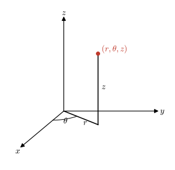{width="55%" fig-align="center"}

    $$\begin{matrix}
        x = r\cos \theta \\ 
        y = r\sin \theta \, \\
        z = z \quad\;\;\;
        \end{matrix} \;\; \Rightarrow \;\;
        \begin{matrix}
        r^2 = x^2 + y^2 \;\;\;\\ 
        \tan\theta = y/x  \quad\; \\
        z=z \qquad\;\;\;\;
    \end{matrix}$$

    Changing the Laplacian $\,\nabla^2 u = u_{xx} +u_{yy} +u_{zz}\,$ to cylindrical coordinates, $\,$we can show

    $$ \color{red}{\nabla^2 u = u_{rr} +\frac{1}{r} u_r +\frac{1}{r^2} u_{\theta\theta} +u_{zz}}$$

  * Spherical Coordinates

    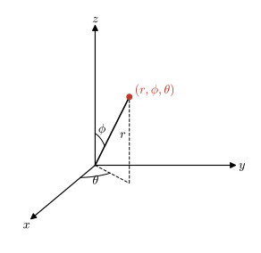{width="65%" fig-align="center"}

    $$\begin{matrix}
    x = r\sin\phi\cos \theta \\ 
    y = r\sin\phi\sin \theta \, \\
    z = r\cos\phi \quad\;\;\;
    \end{matrix} \;\; \Rightarrow \;\;
    \begin{matrix}
    r^2 = x^2 + y^2 +z^2 \;\;\;\\ 
    \cos\phi = z/r \qquad\;\;\;\;\\
    \tan\theta=y/x \qquad\;\;\;\;
    \end{matrix}$$

    Finally, $\,$if we write the Laplacian in spherical coordinates, $\,$we have

    $$\scriptsize \begin{aligned}
    \nabla^2u &= u_{xx} +u_{yy} +u_{zz}\\ 
    &\Updownarrow \\ 
    u_x = u_r r_x +u_\phi \phi_x+u_\theta \theta_x &= u_r \sin\phi\cos\theta +u_\phi \frac{\cos\phi\cos\theta}{r}
    -u_\theta \frac{\sin\theta}{r\sin\phi}\\ 
    u_y = u_r r_y +u_\phi \phi_y+u_\theta \theta_y &= u_r \sin\phi\sin\theta +u_\phi \frac{\cos\phi\sin\theta}{r}
    +u_\theta \frac{\cos\theta}{r \sin\phi}\\ 
    u_z = u_r r_z +u_\phi \phi_z+u_\theta \theta_z &= u_r \cos\phi -u_\phi\frac{\sin\phi}{r} \\ 
    &\Downarrow \\
        u_{xx} = (u_x)_r r_x +(u_x)_\phi \phi_x+(u_x)_\theta \theta_x &= 
    {\tiny \left( u_{rr} \sin\phi\cos\theta +u_{\phi r} \frac{\cos\phi\cos\theta}{r} -u_\phi\frac{\cos\phi\cos\theta}{r^2}
        -u_{\theta r} \frac{\sin\theta}{r\sin\phi} +u_\theta\frac{\sin\theta}{r^2\sin\phi} \right) 
        \sin\phi\cos\theta} \\
    { \tiny +\left( u_{r\phi}\sin\phi \cos\theta \right. }&{\tiny\, \left. +u_r\cos\phi\cos\theta +u_{\phi\phi} \frac{\cos\phi\cos\theta}{r} -u_{\phi} \frac{\sin\phi\cos\theta}{r} 
        -u_{\theta\phi} \frac{\sin\theta}{r\sin\phi} +u_\theta \frac{\sin\theta\cot\phi}{r\sin\phi}
    \right)\frac{\cos\phi \cos\theta}{r}} \\
    {\tiny -\left( u_{r\theta}\sin\phi\cos\theta \right. }&{\tiny \, \left. -u_r \sin\phi\sin\theta +u_{\phi\theta} \frac{\cos\phi\cos\theta}{r} 
    -u_\phi \frac{\cos\phi\sin\theta}{r} -u_{\theta\theta}\frac{\sin\theta}{r\sin\phi} -u_\theta \frac{\cos\theta}{r\sin\phi} \right) 
    \frac{\sin\theta}{r\sin\phi} }\qquad\qquad
    \end{aligned}$$

    $$\scriptsize \begin{aligned}
        u_{yy} = (u_y)_r r_y +(u_y)_\phi \phi_y+(u_y)_\theta \theta_y &= 
    {\tiny \left( u_{rr} \sin\phi\sin\theta +u_{\phi r} \frac{\cos\phi\sin\theta}{r}  -u_\phi\frac{\cos\phi\sin\theta}{r^2}
        +u_{\theta r} \frac{\cos\theta}{r\sin\phi} -u_\theta\frac{\cos\theta}{r^2\sin\phi} \right) 
        \sin\phi\sin\theta }\\
    {\tiny+\left( u_{r\phi}\sin\phi \sin\theta \right.} &{\tiny\, \left. +u_r\cos\phi\sin\theta +u_{\phi\phi} \frac{\cos\phi\sin\theta}{r} -u_{\phi} \frac{\sin\phi\sin\theta}{r} 
        +u_{\theta\phi} \frac{\cos\theta}{r\sin\phi} -u_\theta \frac{\cos\theta\cot\phi}{r\sin\phi}
    \right)\frac{\cos\phi \sin\theta}{r}} \\
    {\tiny+\left( u_{r\theta}\sin\phi\sin\theta \right.} &{\tiny \, \left.+u_r \sin\phi\cos\theta +u_{\phi\theta} \frac{\cos\phi\sin\theta}{r} 
    +u_\phi \frac{\cos\phi\cos\theta}{r} +u_{\theta\theta}\frac{\cos\theta}{r\sin\phi} -u_\theta \frac{\sin\theta}{r\sin\phi} \right) 
    \frac{\cos\theta}{r\sin\phi} }\\
        u_{zz} = (u_z)_r r_z +(u_z)_\phi \phi_z+(u_z)_\theta \theta_z 
        &={\tiny \left( u_{rr}\cos\phi -u_{\phi r}\frac{\sin\phi}{r} +u_\phi\frac{\sin\phi}{r^2} \right) \cos\phi} 
        {\tiny +\left( -u_{r\phi}\cos\phi \right. +}{\tiny\, \left. u_{r}\sin\phi +u_{\phi\phi}\frac{\sin\phi}{r} +u_\phi\frac{\cos\phi}{r} \right) \frac{\sin\phi}{r}}\\ 
        &\Downarrow \\
        \color{red}{\nabla^2 u =u_{rr} +\frac{2}{r} u_r }&\color{red}{+\frac{1}{r^2}u_{\phi\phi} +\frac{\cot\phi}{r^2} u_{\phi} +\frac{1}{r^2\sin^2\phi}u_{\theta\theta}} \\
        \color{red}{= \frac{1}{r^2}\left(  r^2 u_r \right)_r }& \color{red}{+\frac{1}{r^2 \sin\phi} \left( \sin\phi\, u_\phi \right)_\phi +\frac{1}{r^2\sin^2\phi}u_{\theta\theta}}
    \end{aligned}$$

$~$

**NOTES**

* The Laplacian in cartesian coordinates is the only one with constant coefficients. $\,$This is one reason why problems in other coordinate systems are harder to solve. $\,$It is still possible to use the separation of variables for these equations with variable coefficients; $\,$it's just that some of the resulting ordinary differential equations have variable coefficients

* We arrive at a lot of fairly complicated equations, $\,$such as Bessel's equation, $\,$Legendre equation, and other so-called classical equations of physics. $\,$To solve these equations, $\,$we must resort to infinite-series solutions and, $\,$in particular, $\,$the method of Frobenius

$~$

**Example** $\,$ What is the wave equation $\,u_{tt}=c^2\nabla^2 u\,$ in polar coordinates if you know that the solution $\,u\,$ depends only on $\,r\,$ and $\,t$

[Solution](files/solutions/sol_14_1a.pdf){target="_blank"}

$~$

**Example** $\,$ What is Laplace equation in spherical coordinates if the solution $\,u\,$ depends only on $\,r$? $\,$Can you find the solutions of this equation? These are the spherically symmetric potentials in three dimensions

[Solution](files/solutions/sol_14_1b.pdf){target="_blank"}

$~$

## General Nature of Boundary-Value Problems {#sec-x3-32}

* Many important problems whose outcomes do not change with time are described by elliptic boundary-value problems. $\,$There are two common situations in physical problems that give rise to PDEs that don't involve time; $\,$they are:

  1. $\;$Steady-state problems

  2. $\;$Problems where we factor out the time component in the solution

* When studying boundary-value problems (BVPs), $\,$there are three types of BCs that are most common; $\,$we discuss these three types now

* **Dirichlet Problems**

  Here, $\,$the PDE holds over a given region of space, $\,$and the solution is specified on the boundary of the region. $\,$An example would be to find the steady-state temperature inside a circle with the temperature given on the boundary

  $$ u_{rr} +\frac{1}{r}u_r + \frac{1}{r^2} u_{\theta\theta}=0, $$
  $$\;\; u(1,\theta) = \sin\theta, \;\;\;0 < r < 1,\;\;\; 0 \leq \theta < 2\pi$$

  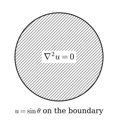{width="45%" fig-align="center"}

  Another example would be an exterior Dirichlet problem in which we are looking for the solution of Laplace equation outside the unit circle, $\,$and the boundary condition is given on the circle

  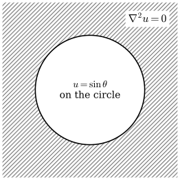{width="45%" fig-align="center"}

* **Neumann Problems**

  Here, $\,$the PDE holds in some region of space, $\,$but now the outward normal derivative 
  
  $$\frac{\partial u}{\partial n}$$ 
  
  (which is proportional to the inward flux) is specified on the boundary. $\,$For example, $\,$suppose the inward flow of heat varies around the circle according to

  $$ \frac{\partial u}{\partial r}=\sin\theta$$

  The steady-state temperature inside the circle would then be given by the solution of the BVP

  $$ \nabla^2 u = 0, \quad 0 < r < 1$$

  $$ \frac{\partial u}{\partial r} =\sin\theta, \quad r=1, \;\; 0 \leq \theta < 2\pi$$

  Here, $\,$we can see that the flux of heat across the boundary is inward for $\,0 \leq \theta \leq \pi\,$ and outward for $\,\pi \leq \theta < 2\pi$

  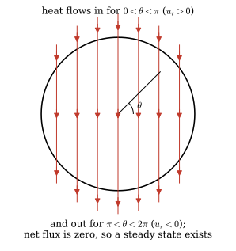{width="40%" fig-align="center"}  

  However, $\,$since the total flux

  $$ \int_0^{2\pi} \frac{\partial u}{\partial r}\, d\theta\;=\int_0^{2\pi} \sin\theta \,d\theta = 0$$

  (a condition that must be true for Neumann problems), $\,$we can say that the temperature at each point inside circle does not change with respect to time. $\,$In other words, $\,$Neumann problems make sense only if the net gain in heat across the boundary is zero

  The Neumann problem is somewhat different from other boundary conditions, $\,$in that solutions are not unique. $\,$In other words, $\,$the above Neumann problem has an infinite number of solutions $\,u(r,\theta)$. $\,$Once we have one solution, $\,$we can get the others just by adding a constant. $\,$For example, $\,$one solution to our Neumann problem is

  $$ u(r,\theta)=r\sin\theta$$

  and it is obvious that if we add a constant to this solution, $\,$another one is obtained. $\,$For this reason, $\,$if we want to find one solution to the Neumann problem, $\,$we must have some additional information (like knowing the solution at one point)

* **Robin Problems**

  These problems correspond to the PDEs being given in some region of space, $\,$but now the condition on the boundary is a mixture of the first two kinds

  $$ \frac{\partial u}{\partial n} = -h(u -g)$$

  where $\,h\,$ is a constant and $\,g\,$ is a given function that can vary over the boundary. $\,$This BC says the inward flux across the boundary is proportional to the difference between the boundary value of $\,u\,$ and specified environment value $\,g\,$ 

  In heat transfer, $\,$this, $\,$of course, $\,$is just Newton's law of cooling. $\,$The constant $\,h\,$ is a physical parameter that measures the amount of flux across the boundary per difference between $\,u\,$ and $\,g$. $\,$If $\,h\,$ is large, $\,$the solution looks very much like the solution of the Dirichlet problem $\,u=g$. $\,$On the other hand, $\,$if $\,h=0$, then the BC is reduced to the insulated BC

  $$ \color{blue}{\frac{\partial u}{\partial r}=0} $$

$~$

**Example** $\,$ Does the following Neumann problem have a solution inside the circle?

$$ \nabla^2 u = 0, \quad 0 < r < 1$$

$$ \frac{\partial u}{\partial r} =\sin^2\theta, \quad r=1, \;\; 0 \leq \theta < 2\pi$$

[Solution](files/solutions/sol_14_2a.pdf){target="_blank"}

$~$

**Example** $\,$ For different values of $h$, $~$imagine the solution $u(r,\theta)\,$ to

$$ \nabla^2 u = 0, \quad 0 < r < 1$$

$$ \frac{\partial u}{\partial r} +h(u -\sin\theta)=0, \quad r=1, \;\; 0 \leq \theta < 2\pi$$

[Solution](files/solutions/sol_14_2b.pdf){target="_blank"}

$~$

## Interior Dirichlet Problem for a Circle {#sec-x3-33}

* This section presents a number of new ideas to solve the interior Dirichlet problem for the circle

  $$ \color{red}{u_{rr} +\frac{1}{r}u_r + \frac{1}{r^2} u_{\theta\theta}=0, \;\;\;0 < r < 1}$$

  $$ \color{red}{u(1,\theta) = g(\theta), \;\;\; 0 \leq \theta < 2\pi}$$

  The method of separation of variables will be the usual procedure

  $$\scriptsize\begin{aligned}
    u_{rr} +\frac{1}{r}u_r 
    &+\frac{1}{r^2}u_{\theta\theta}= 0 \\ 
    u(1,\theta) &= g(\theta) \\ 
    &\Downarrow u(r,\theta)=R(r)\Theta(\theta)\\ 
  \end{aligned}$$

  $$\scriptsize\begin{aligned}
    -\frac{r^2R'' +rR'}{R} 
     &= \frac{\;\Theta''}{\Theta} =-\lambda \leq 0 \\ 
    &\Downarrow \\
    \Theta'' +\lambda \Theta =0 
     \;\; \xrightarrow[] 
      {\;\;\Theta(0)=\Theta(2\pi),\;\Theta'(0)
      =\Theta'(2\pi)\;\;} 
        &\;\;\Theta_n(\theta)=a_n \cos n\theta 
        +b_n \sin n\theta, \;\; \lambda_n =n^2, 
        \;\; n=0,1,2,\cdots \\
    &\Downarrow \\
    r^2R_0'' +rR_0'=0\; 
     &\xrightarrow[]{\;\;| R_0(0)| \,<\,\infty  \;\;} 
      \;\; R_0(r)=1 \\ 
    r^2R_n''+rR_n' -n^2 R_n=0,\;\;n =1,2,\cdots\; 
     &\xrightarrow[]{\;\; | R_n(0) | \,<\,\infty \;\;} 
      \;\;R_n(r)= r^n \\ 
    &\Downarrow \\
    \color{red}{u(r,\theta) =\frac{a_0}{2} 
     +\sum_{n=1}^\infty }
     &\color{red}{ r^n \left( a_n \cos n\theta 
      +b_n \sin n\theta \right)} \\
    a_n = \frac{1}{\pi} \int_0^{2\pi} &g(\theta) 
     \cos n\theta \,d\theta \\
    b_n = \frac{1}{\pi} \int_0^{2\pi} &g(\theta) 
     \sin n\theta \,d\theta
  \end{aligned}$$

  * The solution can be interpreted as expanding the boundary function $\,g(\theta)\,$ as a Fourier series

    $$ g(\theta)=\frac{a_0}{2} +\sum_{n=1}^\infty \left(a_n \cos n\theta +b_n \sin n\theta \right)$$

      and solve the problem for $\,\cos n\theta\,$ and $\,\sin n\theta\,$ in the series. $\,$Since each of these terms will give rise to solutions $\,r^n\cos n\theta\,$ and $\,r^n \sin n\theta$, $\,$we can then say (by superposition) that

    $$ u(r,\theta)=\frac{a_0}{2} +\sum_{n=1}^\infty {\color{red}{r^n}} \left(a_n \cos n\theta +b_n \sin n\theta \right)$$

  * Note that the constant term $\,\displaystyle\frac{a_0}{2}\,$ in the solution represents the average of $\,g(\theta)$

    $$ \frac{a_0}{2} = \frac{1}{2\pi} \int_0^{2\pi} g(\theta)\,d\theta$$

  * If the radius of the circle was arbitrary (say $R$), $\,$then the solution would be

    $$ u(r,\theta)=\frac{a_0}{2} +\sum_{n=1}^\infty \left(\frac{r}{R}\right)^n \left(a_n \cos n\theta +b_n \sin n\theta \right)$$

    This completes our discussion of the separation of variables solution. $\,$We now go to the interesting Poisson integral formula

$~$

**Example** $\,$The solution of

$$ \quad\;\;\;\nabla^2 u = 0, \quad 0 < r < 1$$

$$\begin{aligned}
 u(1, \theta)&=1 + \sin\theta +\frac{1}{2}\sin3\theta +\cos 4\theta \\ 
\end{aligned}$$

would be

$$\begin{aligned}
 u(r, \theta)&=1 + r\sin\theta +\frac{r^3}{2}\sin3\theta +r^4\cos 4\theta \\ 
\end{aligned}$$

$~$

* **Poisson Integral Formula**

  We start with the separation of variables solution

  $$ u(r,\theta)
   =\frac{a_0}{2} +\sum_{n=1}^\infty 
    \left(\frac{r}{R}\right)^n \left(a_n \cos n\theta 
     +b_n \sin n\theta \right)$$

  and substitute the coefficients $\,a_n\,$ and $\,b_n$. $\,$After a few manipulations, $\,$we have

  $$\scriptsize\begin{aligned}
  u(r,\theta) 
    &= \frac{1}{2\pi} \int_0^{2\pi} 
     g(\alpha)\,d\alpha +\frac{1}{\pi} 
    \sum_{n=1}^\infty \left(\frac{r}{R} \right)^n 
     \int_0^{2\pi} g(\alpha) 
      \left( \cos n\alpha\cos n\theta
      +\sin n\alpha \sin n\theta \right)\,d\alpha \\ 
    &= \frac{1}{2\pi} \int_0^{2\pi}  
     \left\{ 1 +2\sum_{n=1}^\infty 
     \left(\frac{r}{R} \right)^n 
      \cos n(\theta -\alpha) \right\} 
       \,g(\alpha)\,d\alpha \\ 
  \end{aligned}$$

  $$\scriptsize\begin{aligned}
 &= \frac{1}{2\pi} \int_0^{2\pi}  \left\{  1 +\sum_{n=1}^\infty \left(\frac{r}{R} \right)^n \left[e^{in(\theta -\alpha)} +e^{-in(\theta -\alpha)}  \right] \right\}\,g(\alpha)\,d\alpha \\ 
 &= \frac{1}{2\pi} \int_0^{2\pi}  \left\{  1 +\frac{re^{i(\theta -\alpha)}}{R -re^{i(\theta -\alpha)}} 
 +\frac{re^{-i(\theta -\alpha)}}{R -re^{-i(\theta -\alpha)}} \right\}\,g(\alpha)\,d\alpha \\ 
 &= \color{red}{\frac{1}{2\pi} \int_0^{2\pi}  \left\{ \frac{R^2 -r^2}{R^2 +r^2 -2rR\cos(\theta -\alpha)} \right\}\,g(\alpha)\,d\alpha} 
\end{aligned}$$

  This last equation is what we were looking for; $\,$it's the Poisson Integral Formula

  * We can interpret the Poisson integral solution as finding the potential $\,u\,$ at $\,(r,\theta)\,$ as a weighted average of the boundary potentials $\,g(\theta)\,$ weighted by the Poisson kernel

    $$\mathcal{P}(r,\theta)=\frac{1}{2\pi}\frac{R^2 -r^2}{R^2 +r^2 -2rR\cos(\theta -\alpha)}$$

    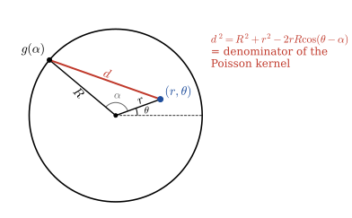{width="45%" fig-align="center"}

    For boundary values $\,g(\alpha)\,$ close to $\,(r,\theta)\,$, $\,$the Poisson kernel gets larger, $\,$since the denominator of the Poisson kernel is the square of the distance from $\,(r,\theta)\,$ to $\,(R,\alpha)$

  * If we evaluate the potential at the center of the circle by the Poisson integral, $\,$we find

    $$ u(0,0) = \frac{1}{2\pi} \int_0^{2\pi} g(\theta) \,d\theta$$

    In other words, $\,$the potential at the center of the circle is the average of the boundary potential

$~$

## The Dirichlet Problem in an Annulus and in an Exterior {#sec-x3-34}

* The Dirichlet problem between two circles (annulus) is

  $$ \color{red}{u_{rr} +\frac{1}{r}u_r + \frac{1}{r^2} u_{\theta\theta}=0, \;\;R_1 < r < R_2}$$
  $$\;\; \color{red}{\begin{aligned} u(R_1,\theta) &= g_1(\theta) \\ u(R_2,\theta) &= g_2(\theta) \end{aligned}, \;\;\; 0 \leq \theta < 2\pi}$$

  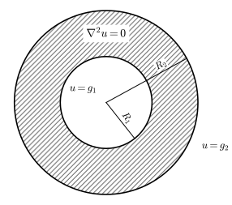{width="45%" fig-align="center"}

* We begin by looking for solutions of the form

  $$ u(r,\theta)=R(r)\Theta(\theta)$$

  Substituting this into Laplace equation, $\,$we get the two following ODEs in $\,R(r)\,$ and $\,\Theta(\theta)$:

  $$\begin{aligned}
  &r^2 R'' +rR' -\lambda R = 0 \quad (\text{Euler's equation}) \\ 
  &\Theta'' +\lambda \Theta = 0 
  \end{aligned}$$

  Note that in the two equations, $\,$we required the separation constant $\,\lambda\,$ to be greater than, $\,$or equal to zero, $\,$or else the solution for $\,\Theta(\theta)\,$ would not be periodic

* Solving these two ODEs, $\,$we now have

  $$\begin{aligned}
  \lambda = 0 \;\; 
  &\begin{cases}
  \Theta(\theta)= \alpha + \beta\theta \\
  R(r) = \gamma + \delta\ln r 
  \end{cases} \\ 
  \lambda > 0 \;\;
  &\begin{cases}
  \Theta(\theta)=  a\cos\sqrt{\lambda}\theta +b\sin \sqrt{\lambda}\theta\\ 
  R(r) = cr^{\sqrt{\lambda}} +dr^{-\sqrt{\lambda}}   
  \end{cases} 
  \end{aligned}$$

  and using the requirement that $\,\Theta(\theta)\,$ must be periodic with period $\,2\pi$, $\,$we have that $\,\beta=0 \,\text{ at }\, \lambda=0\,$ and $\,\lambda (>0)\,$ must be $\,n^2$, $\,n= 1,2,3,\cdots$

* Hence, $\,$we arrive at the following solutions to Laplace equation

  $$\begin{aligned}
    &1 \;\;\;(\text{constants}) \\ 
    &\ln r \\ 
    &r^n \cos n\theta \\ 
    &r^n \sin n\theta \\ 
    &r^{-n} \cos n\theta \\
    &r^{-n} \sin n\theta 
  \end{aligned}$$

* Since any sum of these solutions is also a solution, $\,$we arrive at our general solution

  $$ \color{red}{u(r,\theta) = 
   \frac{a_0}{2} +\frac{\hat{a}_0}{2} \ln r 
    +\sum_{n=1}^\infty \left[ \left(a_n r^n 
     +\hat{a}_n r^{-n}\right) \cos n\theta +
  \left(b_n r^n +\hat{b}_n r^{-n}\right) 
  \sin n\theta \right]}$$

  The only task left is to determine the constants in the sum so that $\,u(r,\theta)\,$ satisfies the BCs

  $$ \begin{aligned} u(R_1,\theta) &= g_1(\theta) \\ u(R_2,\theta) &= g_2(\theta) \end{aligned}, \;\;\; 0 \leq \theta < 2\pi$$

* Substituting the general solution into these BCs and integrating gives the following equations

  $$\scriptsize\begin{aligned}
  &\begin{cases}
    a_0 +\hat{a}_0 \ln R_1 
     =\displaystyle \frac{1}{\pi} \int_0^{2\pi} 
      g_1(\alpha)\,d\alpha \\ 
    a_0 +\hat{a}_0 \ln R_2 
     =\displaystyle \frac{1}{\pi} \int_0^{2\pi} 
      g_2(\alpha)\,d\alpha
   \end{cases} &&\text{Solve for } a_0, \hat{a}_0 \\ 
  &\begin{cases}
    a_n R_1^n +\hat{a}_n R_1^{-n} 
     =\displaystyle \frac{1}{\pi} \int_0^{2\pi} 
      g_1(\alpha) \cos n\alpha \,d\alpha \\ 
    a_n R_2^n +\hat{a}_n R_2^{-n} 
     =\displaystyle \frac{1}{\pi} \int_0^{2\pi} 
      g_2(\alpha) \cos n\alpha \,d\alpha
  \end{cases} &&\text{Solve for } a_n, \hat{a}_n \\ 
  &\begin{cases}
    b_n R_1^n +\hat{b}_n R_1^{-n} 
     =\displaystyle \frac{1}{\pi} \int_0^{2\pi} 
      g_1(\alpha) \sin n\alpha \,d\alpha \\ 
    b_n R_2^n +\hat{b}_n R_2^{-n} 
     =\displaystyle \frac{1}{\pi} \int_0^{2\pi} 
      g_2(\alpha) \sin n\alpha \,d\alpha
   \end{cases} &&\text{Solve for } b_n, \hat{b}_n
  \end{aligned}$$

$~$

**Example** $\,$ Suppose the potential on the inside circle is zero, $\,$while the outside potential is $\,\sin \theta$

$$ u_{rr} +\frac{1}{r}u_r + \frac{1}{r^2} u_{\theta\theta}=0, \;\;\;1 < r < 2$$

$$ \begin{aligned} u(1,\theta) &= 0 \\ u(2,\theta) &= \sin\theta \end{aligned}, \;\;\; 0 \leq \theta < 2\pi$$

Solving the necessary equations for $\,a_0, \hat{a}_0$, $a_n, \hat{a}_n$, $b_n$, and $\hat{b}_n\,$ yields

$$ u(r,\theta)=\frac{2}{3} \left(r -\frac{1}{r} \right) \sin \theta$$

$~$

**Example** $\,$ Consider the problem with constant potentials on the boundaries

$$ u_{rr} +\frac{1}{r}u_r + \frac{1}{r^2} u_{\theta\theta}=0, \;\;\;1 < r < 2 $$

$$ \begin{aligned} u(1,\theta) &= 3 \\ u(2,\theta) &= 5 \end{aligned}, \;\;\; 0 \leq \theta < 2\pi $$

In this case, $\,$since it's obvious that the solution is independent of $\,\theta$, $\,$we know our solution must be of the form $\,a_0 +\hat{a}_0 \ln r$. $\,$Using our two equations for $\,a_0\,$ and $\,\hat{a}_0$, $\,$we obtain

$$ u(r,\theta)=3 +\frac{2}{\ln 2} \ln r$$

The only solutions of the two dimensional Laplace equation that depend only on $\,r\,$ are constant and $\,\ln r$. $\,$The potential $\,\ln r\,$ is very important and is called the logarithmic potential

$~$

**Example** $\,$ Another interesting problem is

$$ u_{rr} +\frac{1}{r}u_r + \frac{1}{r^2} u_{\theta\theta}=0, \;\;\;1 < r < 2$$

$$ \begin{aligned} u(1,\theta) &= \sin\theta \\ u(2,\theta) &= \sin\theta \end{aligned}, \;\;\; 0 \leq \theta < 2\pi$$

A quick check of the coefficients reveals that they are all zero except for $\,b_1\,$ and $\,\hat{b}_1$. $\,$Solving for $\,b_1\,$ and $\,\hat{b}_1\,$ gives the solution

$$ u(r,\theta)=\left(\frac{r}{3} +\frac{2}{3r}\right) \sin\theta$$

$~$

* **Exterior Dirichlet Problem**

  The exterior Dirichlet problem

  $$ u_{rr} +\frac{1}{r}u_r + \frac{1}{r^2} u_{\theta\theta}=0, \;\;\;\color{red}{R_1 < r < \infty}$$

  $$ u(R_1,\theta)=g(\theta), \;\;\; 0 \leq \theta < 2\pi$$

  is solved exactly like the interior Dirichlet problem except that now we throw out the solutions that are unbounded as $\,r\,$ goes to infinity

  Hence, $\,$we are left with the solution

  $$ \color{red}{u(r,\theta)= \frac{a_0}{2} +\sum_{n=1}^{\infty} \left(\frac{r}{R_1}\right)^{-n}\left( \hat{a}_n \cos n\theta +\hat{b}_n \sin n \theta \right)}$$

  where $\,a_0$, $\,\hat{a}_n\,$ and $\,\hat{b}_n\,$ are exactly as Fourier series. $\,$In other words, $\,$we merely expand $\,u(R_1,\theta)=g(\theta)\,$ as a Fourier series

  $$ g(\theta)=\frac{a_0}{2} +\sum_{n=1}^\infty \left( \hat{a}_n \cos n\theta +\hat{b}_n \sin n\theta \right)$$

  and then insert the factor $\,\displaystyle\left(\frac{r}{R_1}\right)^{-n}\,$ in each term to get the solution

$~$

**Example** $\,$ The exterior problem 

$$ u_{rr} +\frac{1}{r}u_r + \frac{1}{r^2} u_{\theta\theta}=0, \;\;\;1 < r < \infty$$

$$ u(1,\theta)=1 +\sin\theta +\cos 3\theta, \;\;\; 0 \leq \theta < 2\pi$$

has the solution

$$ u(r,\theta)=1 +\frac{1}{r}\sin\theta +\frac{1}{r^3}\cos 3\theta, \;\;\; 0 \leq \theta < 2\pi$$

$~$

**Example** $\,$ The exterior Neumann problem

$$ u_{rr} +\frac{1}{r}u_r + \frac{1}{r^2} u_{\theta\theta}=0, \;\;\;1 < r < \infty$$

$$ \frac{\partial u}{\partial r}(1,\theta)=g(\theta), \;\;\; 0 \leq \theta < 2\pi$$

has a solution that is the same form as the Dirichlet problem

$$ u(r,\theta)= \frac{a_0}{2} +\sum_{n=1}^{\infty} r^{-n}\left( \hat{a}_n \cos n\theta +\hat{b}_n \sin n \theta \right)$$

but now the coefficients $\,a_0$, $\,\hat{a}_n$ and $\,\hat{b}_n\,$ must satisfy the new BC.
Of course, once you have this solution, $\,$any constant plus this solution is also a solution

$~$

## Laplace Equation in Spherical Coordinates (Spherical Harmonics) {#sec-x3-35}

* An important problem in physics is to find the potential inside or outside a sphere when the potential is given on the boundary 

* For the interior problem, $\,$we must find the solution $\,u(r,\phi,\theta)\,$ that satisfies

  $$ \left( r^2 u_r \right)_r +\frac{1}{\sin\phi} \left( \sin\phi\, u_\phi \right)_\phi +\frac{1}{\sin^2\phi} u_{\theta\theta} = 0 $$

   $$ u(1,\phi,\theta)=g(\phi,\theta), \;0\leq \theta <2\pi,\;0 \leq \phi \leq \pi $$ 

  Note that this spherical Laplacian is written in a different form than those we've seen before. $\,$This form is slightly more compact and easier to use

* Quite often $\,g(\phi,\theta)\,$ has a specific form, $\,$so that it isn't necessary to solve the problem in its most general form. $\,$Two important special cases are considered in this section. $\,$One is the case when $\,g(\phi,\theta)\,$ is constant, $\,$and the other is when it depends only on the angle $\,\phi\,$ (the angle from the north pole)

  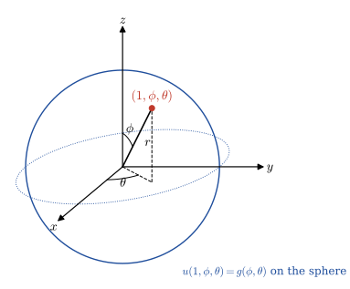{width="45%" fig-align="center"}

* **Special Case 1** $\,$ $-\;\;\color{red}{g(\phi,\theta) = \text{constant}}$

  In this case, $\,$it is clear that the solution is independent of $\,\phi\,$ and $\,\theta$, $\,$and so Laplace equation reduces to the ODE

  $$ \left( r^2 u_r \right)_r = 0 $$

  This is a simple ODE that the student can easily solve; $\,$the general solution is 

  $$ u(r)=\frac{a}{r} +b $$

  In other words, $\,$constant and $\,\displaystyle\frac{a}{r}\,$ are the only potentials that depend only on the radial distance from the origin. $\,$The potential $\,\displaystyle\frac{1}{r}\,$ is very important in physics and is called the Newtonian potential

$~$

**Example** $\,$ (Potential interior to a sphere)

$$ \nabla^2 u = 0, \;\;\; 0 < r < 1 $$

$$ u(1,\phi,\theta) = 3 $$

Here solution must be $\,u(r,\phi,\theta) = 3\,$ in order to be bounded

$~$

**Example** $\,$ (Potential between two spheres each at constant potential)

Suppose we want to find the steady-state temperature between two spheres held at different temperatures

$$ \nabla^2 u = 0, \;\;\; R_1 < r < R_2 $$

$$\begin{aligned}
 u(R_1,\phi,\theta) &= A \\ 
 u(R_2,\phi,\theta) &= B 
\end{aligned}$$

Since we know the potential has the general solution

$$ u(r)=\frac{a}{r} +b $$

we substitute it in the BCs and solve for $\,a\,$ and $\,b\,$; $\,$doing this gives

$$ u(r)= (A -B) \frac{R_1 R_2}{R_2 -R_1} \frac{1}{r} + \frac{R_2 B -R_1 A}{R_2 -R_1} $$

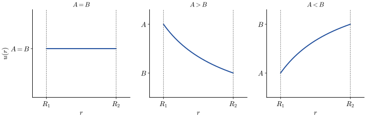{width="75%" fig-align="center"}

$~$

* **Special Case 2** $\,$ $-\;\;\color{red}{g(\phi,\theta) \text{ depends only on } \phi}$

  Here, the Dirichlet problem takes the form

  $$ r^2 u_{rr} +2r u_r +\frac{1}{\sin\phi} 
   \left( \sin\phi\, u_\phi \right)_\phi = 0, 
   \;\;\; 0 < r < 1 $$

  $$ u(1,\phi)=g(\phi),\;\;\; 0 \leq \phi \leq \pi $$

  Using separation of variables, $\,$we look for solutions of the form

  $$ u(r,\phi)=R(r)\Phi(\phi) $$

  and arrive at the two ODEs

  $$ \begin{aligned}
    &\left(\sin\phi\, \Phi' \right)' +\lambda \sin\phi \Phi= 0 &&\text{Legendre's equation}\\ 
    &r^2R'' +2rR' -\lambda R = 0 && \text{Euler's equation}
    \end{aligned} $$

  Legendre's equation isn't easy; $\,$the general strategy in solving this equation is to make the substitution

  $$x=\cos\phi$$

  Making this change of variable gives rise to the new Legendre's equation

  $$\scriptsize 
  \begin{aligned}
    \left(\sin\phi\, \Phi' \right)' 
    &+\lambda \sin\phi \Phi= 0\\ 
    &\Downarrow 
    \;\; x=\cos\phi, 
      \;\; \Phi'=\frac{d\Phi}{dx} \frac{dx}{d\phi}
      =-\sin\phi\frac{d\Phi}{dx} \\
    \left(\sin\phi\, \Phi' \right)'
    &=-\frac{d}{dx}
      \left(\sin^2\phi \frac{d\Phi}{dx} \right) 
      \frac{dx}{d\phi}
    =\left(\sin^2\phi \frac{d^2\Phi}{dx^2} 
    +2\sin\phi\cos\phi 
    \frac{d\phi}{dx}\frac{d\Phi}{dx} \right)\sin\phi \\
    &=\left[ (1 -x^2) \frac{d^2\Phi}{dx^2} 
    -2x\frac{d\Phi}{dx} \right] \sin\phi \\
    &\Downarrow \\
      \color{red}{(1 -x^2) \frac{d^2\Phi}{dx^2}} 
    &\color{red}{-2x\frac{d\Phi}{dx} +\lambda \Phi = 0, 
    \;\;\; -1 \leq x \leq 1} \\
    &\Downarrow \\
    \frac{d}{dx} \left[ (1 -x^2) 
    \frac{d\Phi}{dx} \right] 
    &+\lambda \Phi = 0
  \end{aligned}$$

  * One of the difficulties in this equation is that 

    the coefficient $\,(1-x^2)$ of $\displaystyle \,\frac{d^2\Phi}{dx^2}$ is zero at the ends of the domain $-1 \leq x \leq 1$ 
  
    Equations like this are called singular differential equations. $\,$We arrive at a very interesting conclusion

  * The only bounded solutions of Legendre's equation occur when $\,\lambda=n(n +1)$, $\,n=0,1,2,\cdots\,$ and these solutions are Legendre polynomials $\,P_n(x)$

    $$\begin{aligned}
      &P_0(x) = 1 \\ 
      &P_1(x) = x \\ 
      &P_2(x) = \frac{1}{2}(3x^2 -1) \\ 
      &P_3(x) = \frac{1}{2}(5x^3 -3x) \\
      &\qquad \vdots \\
      &P_n(x) = \frac{1}{2^n n!} \frac{d^n}{dx^n} 
       \left[ (x^2 -1)^n \right]
    \end{aligned}$$

    The graphs of a few Legendre polynomials are shown in

    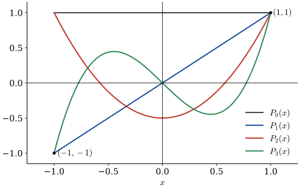{width="65%" fig-align="center"}

  * We now solve Euler's equation by substituting $\,\lambda = n(n+1)\,$ and $\,R(r)=r^\alpha\,$ in the equation and solving for $\,\alpha$. $\,$Doing this, $\,$we get two values

    $$\alpha = \begin{cases}
      \phantom{-(n \,} n \\ 
    -(n +1) 
    \end{cases}$$

    and, $\,$hence, $\,$Euler's equation has the general solution

    $$R_n(r)= a_n r^n + b_n r^{-(n +1)} \;\;\xrightarrow[]{\text{ bounded solution }}\;\;a_n r^n$$

  * The final step is to form the sum

    $$ \color{red}{u(r,\phi) = \sum_{n=0}^\infty a_n r^n P_n(\cos\phi)}\;\;\;$$

    in such a way that it agrees with the BC $\,u(1,\phi)=g(\phi)$. $\,$Substituting the above solution into the BC gives

    $$ g(\phi) = \sum_{n=0}^\infty a_n P_n(\cos\phi)$$

    If we multiply each side of this equation by $\,P_m(\cos\phi)\sin\phi\,$ and integrate $\,\phi\,$ from $\,0\,$ to $\,\pi$, $\,$we get

    $$\begin{aligned}
    \int_0^\pi g(\phi) P_m(\cos\phi)\,\sin\phi \,d\phi 
    &= \sum_{n=0}^\infty 
        a_n \int_0^{\pi} P_n(\cos\phi) 
        P_m(\cos\phi)\,\sin\phi \, d\phi \\
        &= \sum_{n=0}^\infty a_n 
        \int_{-1}^1 P_n(x) P_m(x) \,dx \\ 
        &=
    \begin{cases}
        \quad\: 0  & n \neq m \\ 
        \displaystyle \frac{2}{2m +1}\, a_m & n = m 
    \end{cases} \\ 
    &\Downarrow \\ 
    a_n &=\frac{2n +1}{2} \int_0^{\pi} g(\phi) 
        P_n(\cos\phi)\, \sin \phi \,d\phi
    \end{aligned}$$

$~$

**Example** $\,$ Suppose the temperature on the surface of the sphere is given by

$$ g(\phi) = 1 -\cos 2\phi, \quad 0 \leq \phi \leq \pi $$

and suppose we would like to find the temperature inside the sphere. $\,$In this problem, $\,$the temperature is constant on circles of constant latitude. $\,$To find $\,u$, $\,$we must solve

$$ \left( r^2 u_r \right)_r +\frac{1}{\sin\phi} \left( \sin\phi\, u_\phi \right)_\phi = 0, \;\;\; 0 < r < 1 $$

$$u(1,\phi)=1 -\cos 2\phi,\;\;\; 0 \leq \phi \leq \pi $$

Our goal now is to expand $\,g(\phi)\,$ as a series of Legendre polynomials;

$$\begin{aligned}
 1 -\cos 2\phi &= 1 - \left( 2\cos^2\phi -1 \right) \\ 
 &= \frac{4}{3} - \frac{4}{3}\left[ \frac{1}{2} (3\cos^2\phi -1) \right] \\ 
 &= \frac{4}{3} P_0(\cos\phi) -\frac{4}{3}P_2(\cos\phi)\\
 &\Downarrow \\
 a_0 = \frac{4}{3},\;\; a_2&=-\frac{4}{3},\;\;a_1=a_3=a_4=a_5=\cdots =0
\end{aligned}$$

Hence, $\,$the solution to the problem is

$$\begin{aligned}
 u(r,\phi) &= \frac{4}{3} P_0(\cos\phi) -\frac{4}{3} r^2 P_2(\cos\phi)
 = \frac{4}{3} - \frac{2}{3} r^2 (3\cos^2\phi -1) 
\end{aligned}$$

$~$

**NOTE** $\,$ The solution of the exterior Dirichlet problem

$$\begin{aligned} 
    \left( r^2 u_r \right)_r &+\frac{1}{\sin\phi} \left( \sin\phi\, u_\phi \right)_\phi = 0, \;\; 1 < r < \infty \\ 
    u&(1,\phi)=g(\phi),\;\;\; 0 \leq \phi \leq \pi 
  \end{aligned}$$

is 
  
$$ u(r,\phi)=\sum_{n=0}^\infty \frac{b_n}{r^{n+1}} P_n(\cos\phi)$$

where $\;\displaystyle b_n = \frac{2n +1}{2} \int_0^\pi g(\phi) P_n(\cos\phi)\, \sin\phi \, d\phi$

For example, $\,$the BC $\,g(\phi)=3\,$ would yield the solution $\,u(r,\phi)=3/r$. $\,$Note that in this problem, $\,$the solution goes to zero, $\,$while in two dimensions, $\,$the exterior solution with constant BC was itself a constant

$~$

* **General Case**  $\,$ $-\;\;\color{red}{g(\phi,\theta)}$

  We consider the boundary value problem

  $$\color{red}{\begin{aligned}
  r^2 u_{rr} +2r u_r &+\frac{1}{\sin\phi}\left(\sin\phi u_{\phi}\right)_\phi +\frac{1}{\sin^2\phi}u_{\theta\theta} = 0, \;\; r < R \\ 
  u(R,\phi,\theta) &= g(\phi,\theta)\\ 
  \end{aligned}}$$

  in a sphere of radius $\,R$

  | 1. $~$ Solve this problem by separation of variables, 
  | 2. $~$ Derive $\,K(r,\phi,\theta; R,\varphi,\vartheta)\,$ in the equivalent integral formula:

  $$ u(r,\phi,\theta) = \int_0^{2\pi} \int_0^\pi K(r,\phi,\theta; R,\varphi,\vartheta)\, g(\varphi,\vartheta) \sin\varphi \,d\varphi \, d\vartheta$$

  **1.** $\,$Applying separation of variables, $\,$we find that the equation has the solution of the form $\,R(r) \,\Phi(\phi) \,\Theta(\theta)$, $\,$provided

  $$ -\sin^2\phi \, \frac{r^2 R'' +2rR'}{R} -\sin\phi\frac{(\sin\phi\, \Phi')'}{\Phi} = \frac{\;\Theta''}{\Theta}= -\mu \leq 0$$

  Since $\Theta$ must be periodic of period $\,2\pi$, $\,$we have $\,\color{blue}{\Theta=\cos m\theta}\,$ or $\,\color{blue}{\sin m\theta}$, $\,$where $\,\color{blue}{\mu = m^2, \; m = 0, 1, 2,\cdots}$. $\,$Then

  $$\begin{aligned}
    -\frac{r^2 R'' +2rR'}{R} 
    = \frac{(\sin\phi\, \Phi')'}{\sin\phi\,\Phi} 
    &-\frac{m^2}{\sin^2\phi} = -\lambda \leq 0 \\ 
    &\Downarrow \\ 
    \color{blue}{(\sin\phi\, \Phi')' 
    +\left(\lambda \sin\phi \, 
    {\color{red}{-\frac{m^2}{\sin\phi}}} \right) 
    \Phi } \;& {\color{blue}{= 0}}\\ 
    \color{blue}{r^2 R'' +2r R' -\lambda R} 
     \;&\color{blue}{= 0} 
  \end{aligned}$$

  * The equation for $\,\Phi(\phi)\,$ is singular at its two endpoints $\,\phi=0\,$ and $\,\phi=\pi$. $\,$In lieu of boundary conditions, $\,$we impose the condition that $\,\Phi\,$ and $\,\Phi'\,$ remain bounded at both ends. $\,$This gives an eigenvalue problem with two singular endpoints. $\,$We introduce the new variable $\,x=\cos\phi\,$ and let $\,\Phi(\phi)=P(x)$. $\,$Then the equation for $\,\Phi(\phi)\,$ becomes

    $$\color{red}{\frac{d}{dx} 
    \left[\left(1 -x^2\right) \frac{dP}{dx} \right] 
     +\left[\lambda -\frac{m^2}{1 -x^2 } \right] P = 0} 
    \tag{AL}\label{eq:AL}$$ 

  * In the case of $\,m=0$: 

    $$\frac{d}{dx} \left[\left(1 -x^2\right) 
    \frac{dP}{dx} \right] +\lambda P = 0
    \tag{LG}\label{eq:LG}$$ 

    we obtain a function which is bounded for $\,-1 \leq x \leq 1\,$ if and only if

    $$\lambda=n(n+1), \;\; n=0,1,2,\cdots$$

    These, $\,$then, $\,$are the eigenvalues. $\,$Setting $P_n(1)=1$, $\,$we obtain the eigenfunction $\,P_n(x)\,$ corresponding to the eigenvalue $\,\lambda_n=n(n+1):$

    $$ P_n(x)= \sum_{k=0}^n \frac{(n +k)!}{2^k (k!)^2 (n -k)!}(x - 1)^k\;\;$$

    It is called a **Legendre polynomial**

    * Since $\,P_n(x)\,$ is of exactly degree $\,n\,$ in $\,x$, $\,$any polynomial of degree $\,k\,$ can be expressed as a linear combination of $\,P_n(x)\,$ with $\,n=0,1,\cdots,k$. $\,$Since $\,P_n(x)\,$ are orthogonal, $\,$each $\,P_n(x)\,$ must therefore be orthogonal to all powers of $\,x\,$ less than $\,n:$

      $$ \int_{-1}^1 x^k P_n(x)\, dx=0, \;\;k=0,1,\cdots, n-1$$

      These $\,n\,$ linear conditions, $\,$together with the fact that $\,P_n(x)\,$ is of degree $\,n$, $\,$determine $\,P_n(x)\,$ uniquely

    * We can verify the identity

      $$ P_n(x)=\frac{1}{2^n n!}\frac{d^n}{dx^n} \left(x^2 -1\right)^n$$

      which is called the **Rodrigues formula**. $\,$It is clear from this formula that $\,P_n(x)\,$ is even in $\,x\,$ if $\,n\,$ is even, $\,$and odd if $\,n\,$ is odd

    * The Legendre polynomials can also be defined as the coefficients in a formal expansion in powers of $\,t\,$ of the **generating function**

      $$ \frac{1}{\sqrt{1 -2xt +t^2}} = \sum_{n=0}^\infty P_n(x) t^n $$

  * We now wish to consider the equation \eqref{eq:AL} with a positive $m$. $\,$For this purpose, $\,$we first differentiate the equation \eqref{eq:LG} $\,m\,$ times with respect to $\,x$. $\,$This gives

    $$ \left(1 -x^2\right) \frac{d^{m+2}}{dx^{m+2}}P -2(m +1)x \frac{d^{m+1}}{dx^{m+1}}P +\left[ \lambda -m(m +1)\right] \frac{d^{m}}{dx^{m}}P=0$$

    We now introduce the new dependent variable

    $$ \color{red}{Q(x)=\left(1 -x^2\right)^{m/2} \frac{d^{m}}{dx^{m}}P(x)}$$

  * The above equation becomes

    $$\frac{d}{dx} \left[\left(1 -x^2\right) \frac{dQ}{dx} \right] +\left[\lambda -\frac{m^2}{1 -x^2 } \right] Q = 0\;\;$$

    Thus any solution $\,P(x)\,$ of \eqref{eq:LG} leads to a solution $\,Q(x)\,$ of \eqref{eq:AL}, $\,$unless $\,P(x)\,$ is a polynomial of degree less than $\,m$
 
  * Since $\,P_n(x)\,$ is a polynomial of degree $\,n$, 
  
    $$\frac{d^m}{dx^m} P_n = 0 \, \text{ for }\, n < m,$$ 
    
    and we get no eigenfunction. $\,$Therefore, $\,$the eigenvalues are precisely $\,n(n+1)\,$ with $\,n=m, m+1, \cdots.$ $\,$The eigenfunctions

    $$ \color{red}{P_n^m(x)=\left(1 -x^2 \right)^{m/2} \frac{d^m}{dx^m} P_n(x)=\frac{1}{2^n n!} \left(1 -x^2 \right)^{m/2} \frac{d^{m +n}}{dx^{m +n}} \left(x^2 -1 \right)^n}$$

    are called the **associated Legendre functions**. $\,P_n^m(x)\,$ corresponds to the eigenvalue $\,n(n +1)$, $\,$and $\,n \geq m$ 

  * In Fourier expressions, $\,$it is useful to know the integrals of $\,\left[P_n^m(x)\right]^2$. $\,$It follows from the Rodrigues formula and $\,n\,$ integrations by parts that

    $$\tiny \begin{aligned}
      \color{blue}{\int_0^\pi \left[ P_n(\cos\phi)\right]^2 \,\sin\phi  \,d\phi} &= \int_{-1}^1 \left[P_n(x) \right]^2 \,dx\\ 
      &= \frac{1}{2^{2n} n!^2} \int_{-1}^1 \left[ \frac{d^n}{dx^n} \left(1- x^2 \right)^n\right]^2 \, dx\\ 
      &= \frac{1}{2^{2n} n!^2} \left[ \underbrace{\left.\frac{d^{n-1}}{dx^{n-1}} \left(1- x^2 \right)^n
      \frac{d^{n}}{dx^{n}} \left(1- x^2 \right)^n \right|_{-1}^{1}}_{=0} 
      -\int_{-1}^1 \frac{d^{n-1}}{dx^{n-1}} \left(1- x^2 \right)^n
      \frac{d^{n+1}}{dx^{n+1}} \left(1- x^2 \right)^n \,dx\right]\\ 
      &\,\vdots \\ 
      &=\frac{(-1)^n}{2^{2n} n!^2} \int_{-1}^1 \left(1- x^2 \right)^n
      \underbrace{\frac{d^{2n}}{dx^{2n}} \left(1- x^2 \right)^n}_{(-1)^n (2n)!} \,dx \\
      &=\frac{(2n)!}{2^{2n} n!^2} \int_{-1}^1 \left(1- x^2 \right)^n \,dx = \frac{(2n)!}{2^{2n} n!^2} 2^{2n +1} \frac{n!^2}{(2n+1)!}=\color{blue}{\frac{2}{2n +1}}
    \end{aligned}$$

  * Similarly,

    $$\tiny \begin{aligned}
      \color{blue}{\int_0^\pi \left[ P_n^m(\cos\phi)\right]^2 \,\sin\phi  \,d\phi} &= \int_{-1}^1 \left[P_n^m(x) \right]^2 \,dx 
      = \int_{-1}^1 \left[ \left(1 -x^2 \right)^{m/2} \frac{d^m}{dx^m} P_n(x) \right]^2 \, dx\\ 
      &= \underbrace{\left. \frac{d^{m-1}}{dx^{m-1}} P_n(x)
      \left\{ \left(1- x^2 \right)^m  \frac{d^m}{dx^m} P_n(x) \right\} \right|_{-1}^{\phantom{-}1}}_{=0} 
      -\int_{-1}^1 \frac{d^{m-1}}{dx^{m-1}} P_n(x)
      \frac{d}{dx} \left\{\left(1- x^2 \right)^m  \frac{d^m}{dx^m} P_n(x)  \right\} \,dx \\ 
      &\;\Downarrow \;\;\left(1- x^2 \right)^m = (-1)^m x^{2m}+\cdots, \;\;\frac{d^m}{dx^m} P_n(x)=c_n \frac{n!}{(n -m)!}x^{n -m}+\cdots\\ 
      &= (-1)^m \int_{-1}^1 P_n(x)
      \underbrace{\frac{d^m}{dx^m} \left\{\left(1- x^2 \right)^m  \frac{d^m}{dx^m} P_n(x) \right\}}_{(-1)^m c_n \frac{n!}{(n-m)!} \frac{(n +m)!}{n!} x^n +\cdots} \,dx \\
      &=\frac{(n+m)!}{(n-m)!} \int_{-1}^1 P_n(x) c_n x^n \,dx \\
      &=\frac{(n+m)!}{(n-m)!} \int_{-1}^1 \left[ P_n(x) \right ]^2 \,dx \\
      &=\color{blue}{\frac{2}{2n +1}\frac{(n+m)!}{(n-m)!}}
    \end{aligned}$$

    in which $\,c_n\,$ is the coefficient of $\,x^n\,$ in $\,P_n(x)$

  * Putting $\,\lambda=n(n+1)\,$ in the equation for $\,R(r)$, $\,$we obtain the two solutions $\,\color{blue}{r^n}\,$ and $\,r^{-(n +1)}$. $\,$Only the first of these is bounded at $\,r=0$

  * The method of separation of variables thus gives the harmonic functions

    $$\begin{aligned}
    &r^n P_n^m(\cos\phi) \cos m\theta\\ 
    &r^n P_n^m(\cos\phi) \sin m\theta 
    \end{aligned}$$

    * We note that $\,P_n^m(\cos\phi)\,$ is $\,\sin^m\phi\,$ times a polynomial of degree $\,(n -m)\,$ in $\,\cos\phi\,$ which is even or odd according as $\,(n -m)\,$ is even or odd

    * Since $\,r\cos\phi=z$, $\,$it follows that $\,r^{n-m}\,$ times this polynomial is a polynomial in $\,r^2\,$ and $\,z$, $\,$and hence in $\,x$, $\,y$, and $\,z$

    * Also, $\,r\sin\phi=\sqrt{x^2 +y^2}\,$. $\,$Thus $\,r^m\sin^m\phi \cos m\theta\,$ and $\,r^m\sin^m\phi \sin m\theta\,$ are the polynomial solutions in $\,x\,$ and $\,y\,$ obtained by separating the two-dimensional Laplace equation in polar coordinates

    * We see then that the functions $\,r^n P_n^m(\cos\phi) \cos m\theta\,$ and $\,r^n P_n^m(\cos\phi) \sin m\theta\,$ are homogeneous polynomials of degree $\,n\,$ in $\,x$, $\,y$, and $\,z$. $\,$They are of degree $\,(n -m)\,$ in $\,z$. $\,$These polynomials are called **spherical harmonics**

  The formal solution of the problem is then

  $$ \color{red}{u(r,\phi,\theta) = \sum_{n=0}^\infty \left( \frac{r}{R} \right)^n \left[ \frac{1}{2} a_{n0} P_n(\cos\phi) +\sum_{m=1}^n \left(a_{nm} \cos m\theta +b_{nm} \sin m\theta \right) P_n^m(\cos\phi) \right]} $$

  where

  $$\begin{aligned}
    a_{nm} &= \frac{(2n +1)}{2\pi}
    \frac{(n -m)!}{(n +m)!} 
   \int_{0}^{2\pi} \int_{0}^\pi g(\phi,\theta) 
      \,P_n^m(\cos\phi) \,\cos m\theta \,
      \sin\phi \,d\phi 
        \,d\theta \\ 
    b_{nm} &= \frac{(2n +1)}{2\pi}
    \frac{(n -m)!}{(n +m)!} 
    \int_{0}^{2\pi} \int_{0}^\pi g(\phi,\theta) 
        \,P_n^m(\cos\phi) \,\sin m\theta \,
        \sin\phi \,d\phi 
        \,d\theta
  \end{aligned} $$

  are the $\,n\,$-th Fourier coefficients of $\,g(\phi,\theta)=u(R,\phi,\theta)$

  $~$

  **2.** $\,$We can write this solution as

  $$ u(r,\phi,\theta) = \int_0^{2\pi} \int_0^\pi K(r,\phi,\theta; R,\varphi,\vartheta)\, g(\varphi,\vartheta) \sin\varphi \,d\varphi \, d\vartheta $$

  where $\,K(r,\phi,\theta; R,\varphi,\vartheta)\,$ is

  $$ \scriptsize\displaystyle
     \sum_{n=0}^\infty \left( \frac{r}{R} \right)^n 
     \underbrace{\left[ \frac{2n +1}{4\pi} 
      P_n(\cos\phi) P_n(\cos\varphi) +\sum_{m=1}^n 
       \frac{(2n +1)}{2\pi}\frac{(n -m)!}{(n +m)!} 
        P_n^m(\cos\phi) P_n^m(\cos\varphi) 
        \cos m(\theta -\vartheta) 
         \right]}_{K_n(\phi,\,\theta; 
          \,\varphi,\,\vartheta)}
   \tag{KL}\label{eq:KL}$$

  * For a fixed $\,n$, 

    $$\begin{aligned}
     \int_{0}^{2\pi} \int_{0}^\pi & 
      \,K_n(\phi,\theta;\varphi,\vartheta)\, r^l 
       \,P_l^m(\cos\varphi) \,(a\cos m\vartheta 
       +b\sin m\vartheta) \,\sin\varphi \,d\varphi 
        \,d\vartheta \\ 
     &= 
     \begin{cases}
       r^n P_n^m(\cos\phi) 
       (a\cos m\theta +b\sin m\theta)
       & \text{ for }\; l=n \\ 
       0 & \text{ for }\; l \neq n 
     \end{cases}
    \end{aligned}$$

  * This means that any homogeneous polynomial of degree $\,l\,$ which is a solution of Laplace equation can be written as a linear combination of the $\,2l+1\,$ spherical harmonics $\,r^l \,P_l^m(\cos\phi)\cos m\theta\,$ and $\,r^l \,P_l^m(\cos\phi)\sin m\theta$. $\,$The kernel $\,K_n(\phi,\theta;\varphi,\vartheta)\,$ has the property that it reproduces all homogeneous harmonic polynomials of degree $\,n,$ $\,$and reduces those of other degrees to zero

  * Since rotation of the coordinate axes takes a homogeneous harmonic polynomial of degree $\,l\,$ into another such polynomial in the new variable, $\,$the kernel $\,K_n\,$ must be unchanged by such a rotation. $\,$That is, $\,$if the new polar coordinates are $\,(r',\phi',\theta'),$ $\,$we have $\,K_n(\phi,\theta;\varphi,\vartheta)=K_n(\phi',\theta';\varphi',\vartheta')$. $\,$In particular, $\,$we can rotate our coordinates so that the new $\,z$-axis passes through $\,(r,\phi,\theta)$; $\,$that is, so that $\,\phi'=0$

  * By definition, $\,P_n(1)=1$. $\,$On the other hand, $\,P_n^m(x)\,$ with $\,m \geq 1\,$ has a factor $\,\left(1 -x^2\right)^{m/2}$, $\,$so that $\,P_n^m(1)=0$, $\,$for $\,m \geq 1$. $\,$Therefore 

    $$ K_n(\phi,\theta;\varphi,\vartheta) =K_n(0,\theta';\varphi',\vartheta')= \frac{2n+1}{4\pi} P_n(\cos\varphi') \tag{KS}\label{eq:KS}$$

    where $\,\varphi'\,$ is the angle between the direction $\,(\phi,\theta)\,$ and $\,(\varphi,\vartheta):$

    $$ \cos\varphi'=\cos\phi\cos\varphi +\sin\phi\sin\varphi \cos(\theta-\vartheta) $$

  * Substituting the identity \eqref{eq:KS} in \eqref{eq:KL}, $\,$we find

    $$\begin{aligned}
        K(r,\phi,\theta;R,\varphi,\vartheta) &= \frac{1}{4\pi} \sum_{n=0}^\infty (2n +1) \left( \frac{r}{R} \right)^n P_n(\cos\varphi')\\ 
        &= \frac{1}{4\pi} \left( 2r\frac{\partial }{\partial r} +1 \right) \sum_{n=0}^\infty \left( \frac{r}{R} \right)^n P_n(\cos\varphi')
    \end{aligned}$$

  * Evaluating the generating function at $\,x=\cos\varphi'\,$ and $\,t=\frac{r}{R}$, $\,$we have the identity

    $$ \frac{R}{\sqrt{r^2 +R^2 -2rR\cos\varphi'}} = \sum_{n=0}^\infty \left( \frac{r}{R}\right)^n P_n(\cos\varphi') $$

    Since

    $$ \scriptsize 
   \begin{aligned}
    \frac{1}{4\pi}\left( 2r\frac{\partial}{\partial r} +1\right) 
     &\frac{R}{\sqrt{r^2 +R^2 -2rR\cos\varphi'}} 
     = \frac{1}{4\pi}\frac{R\left(R^2 -r^2\right)}{\left(r^2 +R^2 -2rR\cos\varphi'\right)^{3/2}} \\
     &= \frac{1}{4\pi}\frac{\displaystyle 1 -\left(\frac{r}{R}\right)^2}{\displaystyle\left(1 +\left(\frac{r}{R}\right)^2 -2\frac{r}{R}\cos\varphi'\right)^{3/2}} = \mathcal{P}(r, R, \varphi')
     \end{aligned}$$

    where $\,\left(r^2 +R^2 -2rR\cos\varphi'\right)^{1/2}$ is the distance from the point $\,(r,\phi,\theta)\,$ to the point $\,(R,\varphi,\vartheta)$, $\,$thus, $\,$the solution formula is equivalent to the integral formula

    $$
    \color{red}{u(r,\phi,\theta)
    = \int_0^{2\pi} \int_0^\pi 
      \mathcal{P}(r, R, \varphi') \, 
        g(\varphi,\vartheta) \sin\varphi \,d\varphi \, 
        d\vartheta} $$
  
    This is **Poisson integral formula** in three dimensions

$~$

**Poisson Integral Formula in 2D and 3D — Summary Table**

| Dimension | Domain | Poisson Kernel $\mathcal{P}$ | Poisson Integral Formula |
|----------|--------|-----------------------|---------------------------|
| **2D** | Unit disk $D=\{\mathbf{x}\in\mathbb{R}^2:|\mathbf{x}|<1\}$ | $\displaystyle \mathcal{P}(\mathbf{x},\boldsymbol{\xi}) = \frac{1}{2\pi}\frac{1 - |\mathbf{x}|^2}{|\mathbf{x} - \boldsymbol{\xi} |^2}$ | $\displaystyle u(\mathbf{x}) = \int_{\partial D} \mathcal{P}(\mathbf{x},\boldsymbol{\xi})\, g(\boldsymbol{\xi})\, d\boldsymbol{\xi}$ |
| **3D** | Unit ball $B=\{\mathbf{x}\in\mathbb{R}^3:|\mathbf{x}|<1\}$ | $\displaystyle \mathcal{P}(\mathbf{x},\boldsymbol{\xi})= \frac{1}{4\pi}\frac{1 - |\mathbf{x}|^2}{|\mathbf{x} - \boldsymbol{\xi}|^3}$ | $\displaystyle u(\mathbf{x}) = \int_{\partial B} \mathcal{P}(\mathbf{x},\boldsymbol{\xi})\, g(\boldsymbol{\xi})\, d\boldsymbol{\xi}$ |

## A Nonhomogeneous Dirichlet Problem (Green's Function) {#sec-x3-36}

* A common problem in applied mathematics is to find the potential in some region of space in response to a forcing term $\,f$. $\,$A typical example would be to find the potential inside a circle in two dimensions that satisfies

  $$ u_{rr} +\frac{1}{r}u_r + \frac{1}{r^2} u_{\theta\theta}=-f(r,\theta), \;\;\;0 < r < 1 $$

  $$ u(1,\theta) = 0, \;\;\; 0 \leq \theta < 2\pi $$

* Note that we have chosen the boundary values to be zero. $\,$If we wanted to solve the general case, where both the equation and BC were nonhomogeneous, $\,$we could add the Poisson integral formula from @sec-x3-33 to the solution from this section

* In order to gain a little intuition about nonhomogeneous differential equations, $\,$let's consider graphing the solution to the following Poisson equation:

  $$ u_{rr} +\frac{1}{r}u_r + \frac{1}{r^2} u_{\theta\theta}=-q, \quad 0 < r < 1 $$

  $$ u(1,\theta) = 0, \quad 0 \leq \theta < 2\pi $$

  Here, $\,$the potential is fixed at zero on the boundary, $\,$and the Laplacian of $\,u\,$ is always equal to $-q\,$ inside the circle. $\,$Since $\,\nabla^2 u(p)\,$ measures the difference between $\,u(p)\,$ and the average of its neighbors, $\,$it will look like a thin membrane fixed at the boundary that was continuously being pushed up by a stream of air from below

$~$

* **Potentials from Point Sources and Sinks**

  * In solving a nonhomogeneous linear equation, $\,$it is sufficient to solve the equation with a point source since we can find the solution to the general problem by summing the responses to point sources. $\,$Our goal here is to find the potential in some region of space due to a point source (or sink)

  * Suppose we have a single point source of magnitude $\,q\,$ located at the origin. $\,$It is clear that the heat will flow outward along radial lines, $\,$and, $\,$hence, $\,$if we compute the total outward flux across a circle of radius $\,r$, $\,$we have

  $$ \text{Total outward flux across the circle }=-\int_0^{2\pi} \underbrace{u_r(r)}_{<\,0}\, r\,d\theta = -2\pi r\, u_r(r)$$

  * But the outward flux must be equal to the heat generated within the circle (conservation of energy), $\,$so we have

    $$-2\pi r u_r(r) = q$$

    Solving this simple differential equation for $\,u_r(r)$, $\,$we get

    $$ u(r)=\frac{q}{2\pi} \ln \frac{1}{r} $$

    A sink, $\,$on the other hand, $\,$is represented by a negative source, $\,$and so a sink with magnitude $-q\,$ would give rise to a potential field

    $$ u(r)=-\frac{q}{2\pi} \ln \frac{1}{r} $$

$~$

* **Poisson Equation Inside a Circle**

  * We will now solve the important problem

    $$ u_{rr} +\frac{1}{r}u_r + \frac{1}{r^2} u_{\theta\theta}=-f(r,\theta), \quad 0 < r < 1 $$

    $$ u(1,\theta) = 0, \quad 0 \leq \theta < 2\pi $$

  * The Green function technique (impulse-response method) consists of two steps:

    * Finding the potential $\,G(r,\theta,\rho,\phi)\,$ at $\,(r,\theta)$, $\,$which we force to be zero on the 
      boundary and which is due to a single charge (magnitude 1) at $\,(\rho,\phi)$
    * Summing the individual responses $\,G(r,\theta,\rho,\phi)\,$ weighted by $\,f(\rho,\phi)\,$ over all 
    $\,(\rho,\phi)\,$ in the circle to get the solution

    $$ u(r,\theta)=\int_0^{2\pi} \int_0^1 G(r,\theta,\rho,\phi)\, f(\rho,\phi)\,\rho\, d\rho d\phi$$

**STEP 1** $\,$ Since the function

$$ \frac{1}{2\pi} \ln \frac{1}{R} $$

is the potential at $\,(r,\theta)\,$ due to a single unit charge at $\,(\rho,\phi)$, $\,$where $\,R\,$ is the distance from $\,(r,\theta)\,$ to $\,(\rho,\phi)\,$, $\,$the only thing left to do is to modify the function so that it is zero on the boundary

**STEP 2** $\,$ The strategy is to place a sink outside the circle at such a point that the potential due to both is constant on the circle at $\,r=1$. $\,$We can then subtract this constant value to obtain a zero potential on the boundary. $\,$The big question is, $\,$of course, $\,$where do we place the sink outside circle, $\,$so that the potential on the boundary is constant?

Without going into the details, $\,$we can show rather easily that if the sink is placed at $\,(1/\rho,\phi)$, $\,$then the potential due to the source and the sink will be constant on the circle $\,r=1$  

$$\begin{aligned} 
 \displaystyle u^*(r,\theta) 
   &= \frac{1}{2\pi} \ln \frac{1}{R} 
   -\frac{1}{2\pi} \ln \frac{1}{\bar{R}} 
   = \frac{1}{2\pi} \ln\frac{\bar{R}}{R} \\[2pt]
   &=\frac{1}{2\pi} 
   \ln \frac{\sqrt{r^2 +1/\rho^2 
    -2r/\rho \cos(\theta-\phi)}}{\sqrt{r^2 +\rho^2 
     -2r\rho \cos(\theta -\phi)}} \\[2pt]
   &\Downarrow \;\; r=1 \\
   u^*(1,\theta) &= -\frac{1}{2\pi} \ln \rho
\end{aligned}$$

With these steps in mind, $\,$we construct Green's function

$$ G(r,\theta,\rho,\phi)=\frac{1}{2\pi}\ln \frac{1}{R} -\frac{1}{2\pi}\ln \frac{1}{\bar{R}} + \frac{1}{2\pi}\ln \rho $$

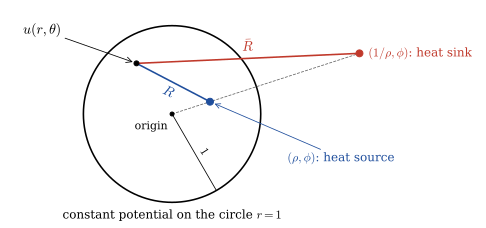{width="85%" fig-align="center"}

To find the solution to our original problem, $\,$we merely superimpose the impulse functions; $\,$this brings us to the final solution

$$ \color{red}{u(r,\theta) = \frac{1}{2\pi} \int_0^{2\pi} \int_0^1 \ln \left(\rho\frac{\bar{R}}{R}\right) \, f(\rho,\phi)\, \rho\,d\rho\,d\phi}
\tag{CG}\label{eq:CG} $$

This is Green's function solution of Poisson equation inside a circle

**NOTES**

**1.** It is also possible to solve

$$ u_{rr} +\frac{1}{r}u_r + \frac{1}{r^2} u_{\theta\theta}=0, \;\;\;0 < r < 1 $$

$$ u(1,\theta) = g(\theta), \;\;\; 0 \leq \theta < 2\pi $$

by means of the Green's function approach

* Choose any point $\,(r_0,\theta_0)\,$ inside a circle. $\,$Let $\,v(r,\theta)\,$ be any twice continuously differentiable function in a circle such that $\,v=g\,$ on the boundary, $\,$and $\,v=0\,$ near $\,(r_0,\theta_0)$. $\,$Let $w = u -v$. $\,$Then $\,w\,$ satisfies

  $$ \nabla^2w = -\nabla^2v, \;\;\;0 < r < 1 $$

  $$ w(1,\theta) = 0, \;\;\; 0 \leq \theta < 2\pi $$

  Therefore

  $$ w(r_0,\theta_0)=\int_0^{2\pi} \int_0^1 G(r_0,\theta_0,\rho,\phi)\, \nabla^2 v\,\rho\, d\rho d\phi $$

* Since $\,v=0\,$ near the singularity $\,(r_0,\theta_0)\,$ of $\,G$, $\,$we can apply the divergence theorem to the identity

  $$ G\nabla^2 v = G \nabla^2 v -v\nabla^2 G = \nabla \cdot \left( G\nabla v -v\nabla G\right)$$

  to find that

  $$ \begin{aligned} w(r_0,\theta_0)&=\int_0^{2\pi} \int_0^1 G(r_0,\theta_0,\rho,\phi)\, \nabla^2 v\,\rho\, d\rho d\phi \\
  &\Downarrow \;\;{\scriptstyle \text{Divergence Theorem}} \\
  &=\int_0^{2\pi} \left[ G(r_0,\theta_0,1,\phi) \frac{\partial v}{\partial \rho}(1,\phi) -v(1,\phi)\frac{\partial G}{\partial \rho}(r_0,\theta_0,1,\phi)\right]\,d\phi \\
  &\Downarrow \;\;{\scriptstyle \text{ On the boundary, } G\, =\, 0, \; v\, = g} \\
  &=-\int_0^{2\pi} \frac{\partial G}{\partial \rho}(r_0,\theta_0,1,\phi) \,g(\phi)\,d\phi 
  \end{aligned} $$

* But $\,v(r_0,\theta_0)=0$, $\,$so that $\,w(r_0,\theta_0)=u(r_0,\theta_0).$ $\,$Since $\,(r_0,\theta_0)\,$ was any point in a circle, $\,$the solution is

  $$ u(r,\theta) =-\int_0^{2\pi} \frac{\partial G}{\partial \rho}(r,\theta,1,\phi)\,g(\phi)\,d\phi $$

  which, $\,$if we compute $\,\displaystyle\frac{\partial G}{\partial \rho}$, $\,$gives

  $$ u(r,\theta) = \frac{1}{2\pi} \int_0^{2\pi} \left[ \frac{1 - r^2}{1 +r^2 -2r\cos(\theta -\phi)} \right]\,g(\phi)\,d\phi 
  \tag{PI}\label{eq:PI}$$

  which is the Poisson integral formula

**2.** The solution to the general Dirichlet problem

$$ u_{rr} +\frac{1}{r}u_r + \frac{1}{r^2} u_{\theta\theta}=-f(r,\theta), \;\;\;0 < r < 1 $$

$$ u(1,\theta) = g(\theta), \;\;\; 0 \leq \theta < 2\pi $$

would be the sum of solutions \eqref{eq:CG} and \eqref{eq:PI}  

$~$

* **Poisson Equation Inside a Sphere**

  * We consider the problem

    $$\begin{aligned}
    u_{rr} &+\frac{2}{r} u_r 
     +\frac{1}{r^2}u_{\phi\phi} 
     +\frac{\cot\phi}{r^2} u_{\phi} 
     +\frac{1}{r^2\sin^2\phi}u_{\theta\theta} 
      = -F(r,\phi,\theta), \;\; r < R \\ 
     &u(R,\phi,\theta) = 0
    \end{aligned}\tag{SK}\label{eq:SK}$$

  * The solution procedure consists of two steps:
    
    * Solve by taking the finite Fourier Transforms

      $$\scriptsize
      \begin{aligned}
       \mathcal{F}_{c,nm} 
        \left[f(r,\phi,\theta)\right] 
         &= \frac{2n +1}{2\pi} \frac{(n -m)!}{(n +m)!} 
         \int_{0}^{2\pi} \int_{0}^\pi f(r,\phi,\theta) 
         \,P_n^m(\cos\phi) \,\cos m\theta 
         \,\sin\phi \,d\phi \,d\theta \\
       \mathcal{F}_{s,nm} 
        \left[f(r,\phi,\theta)\right]
         &= \frac{2n +1}{2\pi} \frac{(n -m)!}{(n +m)!} 
         \int_{0}^{2\pi} \int_{0}^\pi f(r,\phi,\theta) 
         \,P_n^m(\cos\phi) \,\sin m\theta 
         \,\sin\phi \,d\phi \,d\theta
      \end{aligned}$$

    * Derive $\,G(r,\phi,\theta; \rho, \varphi, \vartheta)\,$ in the equivalent integral formula

      $$\scriptsize u(r,\phi,\theta) 
      = \int_0^{2\pi} \int_0^\pi \int_0^R 
      G(r,\phi,\theta; \rho,\varphi,\vartheta)\, 
      F(\rho, \varphi,\vartheta) 
      \,\rho^2 \sin\varphi 
      \,d\rho \,d\varphi \, d\vartheta$$

**STEP 1** $\,$Using the finite Fourier transforms of $\,u\,$ and $\,F$:

$$\begin{aligned}
 a_{nm}(r) &= \mathcal{F}_{c,nm}
  \left[u(r,\phi,\theta)\right]\\ 
 b_{nm}(r) &= \mathcal{F}_{s,nm}
  \left[u(r,\phi,\theta)\right]\\ 
 A_{nm}(r) &= \mathcal{F}_{c,nm}
  \left[F(r,\phi,\theta)\right]\\ 
 B_{nm}(r) &= \mathcal{F}_{s,nm}
  \left[F(r,\phi,\theta)\right]
\end{aligned}$$

we obtain the finite Fourier transforms of the differential equation and integrating by parts leads to the system

$$\begin{aligned}
 r^2 a_{nm}'' +2r a_{nm}' &-n(n +1) a_{nm} = -r^2 A_{nm}, \; 
 a_{nm}(R)= 0, \; \left|a_{nm}\right| < \infty\\ 
 r^2 b_{nm}'' +2r b_{nm}' &-n(n +1) b_{nm} = -r^2 B_{nm}, \; 
 b_{nm}(R)= 0, \; \left|b_{nm}\right| < \infty 
\end{aligned}$$

These problems have the solutions

$$\begin{aligned}
 a_{nm}(r) 
  &=\int_0^R G_n(r,\rho)\,A_{nm}(\rho)
   \,\rho^2 \,d\rho \\ 
 b_{nm}(r) 
  &=\int_0^R G_n(r,\rho)\,B_{nm}(\rho)
   \,\rho^2 \,d\rho
\end{aligned}
 \tag{SG}\label{eq:SG}$$ 

where (See @sec-GF)

$$ \scriptsize G_n(r,\rho) = 
\begin{cases}
 \displaystyle\frac{1}{(2n +1)R}\left(\frac{r}{R} \right)^n\left[\left(\frac{\rho}{R} \right)^{-(n+1)} -\left(\frac{\rho}{R} \right)^{n} \right] & \text{ for } r \leq \rho \\ 
 \displaystyle\frac{1}{(2n +1)R}\left(\frac{\rho}{R} \right)^n\left[\left(\frac{r}{R} \right)^{-(n+1)} -\left(\frac{r}{R} \right)^{n} \right]& \text{ for } r \geq \rho 
\end{cases}$$

Thus the problem \eqref{eq:SK} has a solution

$$ u(r,\phi,\theta) = \sum_{n=0}^\infty \left[ \frac{1}{2} a_{n0}(r) P_n(\cos\phi) +\sum_{m=1}^n \left(a_{nm}(r) \cos m\theta +b_{nm}(r) \sin m\theta \right) P_n^m(\cos\phi) \right]
\tag{SS}\label{eq:SS}$$

**STEP 2** $\,$We substitute the definitions of $\,A_{nm}(r)\,$ and $\,B_{nm}(r)\,$ in \eqref{eq:SG}, $\,$and formally interchange integration and summation in \eqref{eq:SS}. $\,$This process gives the formal solution 

$$ u(r,\phi,\theta) = \int_0^{2\pi} \int_0^\pi \int_0^R G(r,\phi,\theta; \rho,\varphi,\vartheta)\, F(\rho, \varphi,\vartheta) \,\rho^2 \sin\varphi \,d\rho \,d\varphi \, d\vartheta $$

where for $\,r > \rho$

$$\scriptsize \begin{aligned}
 G(r,\phi,\theta;\rho,\varphi,\vartheta) &=\sum_{n=0}^\infty \frac{1}{(2n +1)R}
  \left(\frac{\rho}{R} \right)^n 
  \left[ \left(\frac{r}{R} \right)^{-(n +1)} -\left(\frac{r}{R} \right)^{n} \right] 
  K_n(\phi,\theta;\varphi,\vartheta)\\ 
 &= \frac{1}{4\pi R} \sum_{n=0}^\infty \left(\frac{\rho}{R} \right)^n 
  \left[ \left(\frac{r}{R} \right)^{-(n +1)} -\left(\frac{r}{R} \right)^{n} \right] P_n(\cos\varphi') 
\end{aligned}$$

For $\,r < \rho$, $\,$we must only interchange $\,r\,$ and $\,\rho\,$ in this formula

To evaluate the series in the above equation, $\,$we use the generating function:

$$\begin{aligned}
 G(r,\phi,\theta;\rho,\varphi,\vartheta) &=\frac{1}{4\pi} \frac{1}{\sqrt{r^2+\rho^2-2r\rho\cos\varphi'}}
 -\frac{1}{4\pi} \frac{1}{\sqrt{R^2 +\frac{r^2\rho^2}{R^2} -2r\rho\cos\varphi'}}
\end{aligned}
$$

This, $\,$then, $\,$is the Green's function for $\,r > \rho$. $\,$It is already symmetric in $\,r\,$ and $\,\rho$, $\,$so that the same formula holds for $\,r < \rho$, and even for $\,r=\rho$. $\,$We note that $\,G=0\,$ for $\,r=R$

**Green Function in 2D and 3D - Summary Table**

| Dimension - Domain | Object | Formula | Purpose |
|-------------------|---------|----------|----------|
| **2D** - Unit disk $\scriptsize D=\{\mathbf{x}\in\mathbb{R}^2:|\mathbf{x}|<1\}$ | **Green Function** | $\scriptsize\displaystyle G(\mathbf{x},\mathbf{y})=\frac{1}{2\pi}\left(\ln \frac{1}{|\mathbf{x}-\mathbf{y}|} -\ln\frac{1}{|\mathbf{y}|\,|\mathbf{x} -\mathbf{y}^*|} \right),\quad \mathbf{y}^*=\frac{\mathbf{y}}{|\mathbf{y}|^2}$ | Solve **Poisson equation** $\scriptsize\Delta u = -f$: $\scriptsize\displaystyle u(\mathbf{x})=\int_{D} G(\mathbf{x},\mathbf{y})f(\mathbf{y})d\mathbf{y}$ |
| **3D** - Unit ball $\scriptsize B=\{\mathbf{x}\in\mathbb{R}^3:|\mathbf{x}|<1\}$ | **Green Function** | $\scriptsize \displaystyle G(\mathbf{x},\mathbf{y})=\frac{1}{4\pi}\left( \frac{1}{|\mathbf{x}-\mathbf{y}|}-\frac{1}{|\mathbf{y}|\,|\mathbf{x}-\mathbf{y}^*|} \right),\quad \mathbf{y}^*=\frac{\mathbf{y}}{|\mathbf{y}|^2}$ | Solve **Poisson equation** $\scriptsize\Delta u=-f$: $\scriptsize\displaystyle u(\mathbf{x})=\int_{B} G(\mathbf{x},\mathbf{y})f(\mathbf{y})d\mathbf{y}$|

$~$

## Hydrogen Atom {#sec-x3-37}

* As the electron circles around the nucleus, $\,$the system (the proton and the electron) rotates around the center of gravity. $\,$For the rotating system, $\,$we can write the reduced mass, $\,\mu$, $\,$as

  $$ \frac{1}{\mu} = \frac{1}{m_e} + \frac{1}{m_p} $$

  
$~$or

  $$ \mu = \frac{m_em_p}{m_e +m_p} $$

  Since the mass of the electron is so much less than that of the proton, $\,m_e +m_p \approx m_p\,$ and $\,\mu \approx m_e$. $\,$Assuming that the nucleus is stationary and that the electron does all of the moving (the infinite-nuclear-mass approximation) leads to the same result

* The Hamiltonian can be written as the sum of the kinetic and potential energies

  $$H = T + V$$

  in which $\,T = p^2/2\mu\,$ and the potential energy $\,V$ $\,$for the interaction of the electron with the proton is $-e^2/r$ (Gaussian units; $\,e^2 \to e^2/4\pi\varepsilon_0\,$ in SI units). $\,$Therefore, $\,$the Hamiltonian operator $\,H\,$ is

  $$ H=-\frac{\hbar^2}{2\mu} \nabla^2 -\frac{e^2}{r} $$

* Therefore, $\,$the time-independent wave function $\psi$ gives

  $$\begin{aligned}
  H \psi &= E \psi \\ 
  &\Downarrow \\
  \nabla^2 \psi +\color{red}{\frac{2\mu}{\hbar^2}} &\color{red}{\left( \frac{e^2}{r} +E \right) \psi} =0 \\
  &\Downarrow \\
  \frac{1}{r^2}\left( r^2 \psi_r \right)_r +\frac{1}{r^2\sin\phi} \left( \sin\phi\, \psi_\phi \right)_\phi 
    &+\frac{1}{r^2\sin^2\phi} \psi_{\theta\theta} +\frac{2\mu}{\hbar^2} \left( \frac{e^2}{r} +E \right) \psi =0 
  \end{aligned}$$

* We assume that $\,\psi(r,\phi,\theta)=R(r)\,\Phi(\phi)\,\Theta(\theta)\,$ and make the substitution. $\,$For simplicity, $\,$we will write the partial solutions as $\,R$, $\,\Phi$, and $\,\Theta\,$ without showing the functionality. $\,$We now divide both sides by $\,R\,\Phi\,\Theta\,$ and multiply by $\,r^2\sin^2\phi$:
   
  $$\frac{\sin^2\phi}{R}\left( r^2 R_r \right)_r +\frac{\sin\phi}{\Phi} \left( \sin\phi\, \Phi_\phi \right)_\phi 
  +\frac{1}{\Theta} \Theta_{\theta\theta} +\frac{2\mu r^2\sin^2\phi}{\hbar^2} \left( \frac{e^2}{r} +E \right) =0 $$

* Inspection shows that, $\,$of the four terms on the left side of the equation, $\,$there is no functional dependence on $\,\theta\,$ except in the third term. $\,$Therefore, $\,$with respect to the other variables, $\,$the third term can be treated as a constant:

  $$\begin{aligned}
    \scriptsize
    -\frac{\sin^2\phi}{R}\left( r^2 R_r \right)_r -\frac{\sin\phi}{\Phi} \left( \sin\phi\, \Phi_\phi \right)_\phi 
      &\scriptsize
      -\frac{2\mu r^2\sin^2\phi}{\hbar^2} \left( \frac{e^2}{r} +E \right) 
      = \frac{1}{\Theta} \Theta_{\theta\theta} = -\lambda \leq 0 \\ 
    &\Downarrow \\
    \Theta_{\theta\theta} &+\lambda \Theta = 0, \;\;\Theta(0)=\Theta(2\pi)\\
      &\Downarrow \;\;e^{\pm i2\pi \sqrt{\lambda}} =1\\
      \lambda_m = m^2, &\;m=0,\pm 1, \pm 2,\cdots \\ 
      \Theta_m(\theta) &= \frac{1}{\sqrt{2\pi}} e^{im\theta} 
  \end{aligned}$$

  Actually, $\,$there are two solutions: $\,e^{im\theta}\,$ and $\,e^{-im\theta}$, $\,$but we cover the latter by allowing $\,m\,$ to run negative

* We can now write the wave equation as

  $$\scriptsize \frac{\sin^2\phi}{R}\left( r^2 R_r \right)_r +\frac{\sin\phi}{\Phi} \left( \sin\phi\, \Phi_\phi \right)_\phi 
    -m^2 +\frac{2\mu r^2\sin^2\phi}{\hbar^2} \left( \frac{e^2}{r} +E \right) 
    = 0$$
    
  If we divide the equation by $\sin^2\phi$ and rearrange, $~$we obtain

  $$\scriptsize \begin{aligned}
  \frac{1}{R}\left( r^2 R_r \right)_r +\frac{2\mu r^2}{\hbar^2} \left( \frac{e^2}{r} +E \right) &+\frac{1}{\Phi\sin\phi} 
    \left( \sin\phi\, \Phi_\phi \right)_\phi -\frac{m^2}{\sin^2\phi} = 0 \\
  &\Downarrow \\
    \frac{1}{\Phi\sin\phi} \left( \sin\phi\, \Phi_\phi \right)_\phi &-\frac{m^2}{\sin^2\phi} = -\beta \\
    \frac{1}{R}\left( r^2 R_r \right)_r +\frac{2\mu r^2}{\hbar^2} &\left( \frac{e^2}{r} +E \right) = \beta \\[2pt]
  &\Downarrow \;\;
  \frac{1}{\sin\phi} \left( \sin\phi\, \Phi_\phi \right)_\phi +\left( \beta-\frac{m^2}{\sin^2\phi}\right)\Phi = 0 \\[2pt]
  \frac{1}{r^2}\left( r^2 R_r \right)_r +\color{red}{\frac{2\mu}{\hbar^2}} &\color{red}{\left( \frac{e^2}{r} +E \right)R -\frac{\beta}{r^2}R}=0
\end{aligned}$$

* We will now turn our attention to the equation involving $\,\phi$. $\,$The standard method for solving this equation is to make the transformation $\,x=\cos\phi$

  $$\scriptsize\begin{aligned}
    \frac{1}{\sin\phi} \frac{d}{d\phi} \left( \frac{\sin^2\phi}{\sin\phi}\, \frac{d\Phi}{d\phi} \right) &+\left( \beta-\frac{m^2}{\sin^2\phi}\right)\Phi = 0 \\ 
    &\Downarrow\;\;x=\cos\phi,\;dx=-\sin\phi\,d\phi \\ 
    \frac{d}{dx} \left[ \left(1 -x^2\right) \frac{d\Phi}{dx} \right] &+ \left( \beta-\frac{m^2}{1 -x^2}\right)\Phi = 0 \\ 
    &\Downarrow \\
    \left(1 -x^2\right) \frac{d^2\Phi}{dx^2} -2x \frac{d\Phi}{dx} &+ \left( \beta-\frac{m^2}{1 -x^2}\right)\Phi = 0 
  \end{aligned}$$

* This is the associated Legendre equation. $\,$If you start with the Legendre equation and differentiate it $\,|m|\,$ times, $\,$you end up with a new differential equation 

  $$\scriptsize\begin{aligned}
    \left(1 -x^2\right)P_l''(x) -\,&\,2xP_l'(x) +l(l+1)P_l(x) = 0,\;\;\; l=0,1,2,\cdots \\[5pt] 
    &\Downarrow\;\; {\scriptstyle \text{differentiate it } |m| \text{ times}, \;\;y = \left(\frac{d}{dx}\right)^{|m|} P_l(x),\; \; |m|\, \leq\, l} \\[5pt] 
    \left(1 -x^2\right)y'' -2 |m| x y'&-|m|(|m| -1)y -2x y' -2|m|y +l(l +1)y = 0\\ 
    &\Downarrow\\ 
    \left(1 -x^2\right)y'' -2x(|m| +1)&y' +\left[l(l +1) -|m|(|m| +1)\right] y = 0 
  \end{aligned}$$

* And the substitution

  $$\scriptsize\begin{aligned}
  y&= \left(1 -x^2\right)^{-|m|/2} \Phi \\ 
  y'&= \left(1 -x^2\right)^{-|m|/2} \left[\frac{d\Phi}{dx} +\frac{|m|x}{1 -x^2}\Phi \right] \\ 
  y''&= \left(1 -x^2\right)^{-|m|/2} \left[\frac{d^2\Phi}{dx^2} +\frac{2|m|x}{1 -x^2}\frac{d\Phi}{dx} 
    +\frac{|m|+|m|x^2 +|m|^2x^2}{(1-x^2)^2} \Phi \right]
  \end{aligned}$$

  puts the equation into standard form with respect to $\,\Phi$. $\,$Then the standard solutions of the associated Legendre equation were found to be

  $$\scriptsize \Phi(x) = P_l^{|m|}(x) = \left(1 -x^2\right)^{|m|/2} \left(\frac{d}{dx}\right)^{|m|} P_l(x) = \left(1 -x^2\right)^{|m|/2} \frac{1}{2^l l!} \left(\frac{d}{dx}\right)^{|m|+l} \left(x^2 -1\right)^l $$

  and $\,P_l^{|m|}(x)\,$ are orthogonal with the weight function $1$

  $$ \scriptsize \int_{-1}^1 P_l^{|m|}(x)\, P_{l'}^{|m|}(x)\,dx = \frac{2}{2l +1} \frac{(l +|m|)!}{(l -|m|)!} \,\delta_{ll'} $$

* Notice that $\,l\,$ must be a nonnegative integer. $\,$For any given $\,l,$ $\,$then, $\,$there are $\,(2l +1)\,$ possible values of $\,m$:

  $$l=0,1,2,\cdots; \;\;m =-l, -l +1, \cdots, -1, 0, 1, \cdots, l -1, l $$

  For historical reasons, $\,l\,$ is called the azimuthal quantum number, $\,$and $\,m\,$ the magnetic quantum number

* The normalized angular wave functions are called spherical harmonics:

  $$ \color{red}{Y_l^{m}(\phi,\theta)=\epsilon \sqrt{\frac{(2l +1)}{4\pi} \frac{(l -|m|)!}{(l +|m|)!}} P_l^{|m|}(\cos\phi) e^{im\theta}} $$

  where $\,\epsilon=(-1)^m\,$ for $\,m \geq 0\,$ and $\,\epsilon=1\,$ for $\,m < 0$

* Notice that the angular part of the wave function, $\,Y(\phi,\theta)$, $\,$is the same for all spherically symmetric potentials; $\,$the actual shape of the potential $\,V(r)$ $\,$affects only the radial part of the wave function, $\,R(r)$, $\,$which is determined by

  $$ \frac{1}{r^2}\left( r^2 R_r \right)_r +\frac{2\mu}{\hbar^2} \left( \frac{e^2}{r} +E \right)R -\frac{l(l +1)}{r^2}R=0$$

  This equation simplifies if we change variables:

  $$\scriptsize \begin{aligned}
  \text{Let } u(r) &= rR(r) \\ 
  &\Downarrow \;{\tiny\text{so that}} \\ 
  R = \frac{u}{r}, \;\; \frac{dR}{dr} = \frac{1}{r^2} 
    &\left( r\frac{du}{dr} -u \right), 
    \;\; \frac{d}{dr} 
    \left[ r^2 \frac{dR}{dr} \right] 
    = r\frac{d^2 u}{dr^2} \\
  &\Downarrow \;
  {\tiny \kappa = \frac{\sqrt{-2\mu E}}{\hbar}
    \;\;\text{ and } 
    \;\rho_0 = \frac{2\mu e^2}{\hbar^2 \kappa}} \\
    \frac{d^2u}{dr^2} 
    =\left[-\frac{\rho_0 \kappa}{ r} 
    +\kappa^2 +\frac{l(l +1)}{r^2} \right] u \;\; 
      &\overset{\rho=\kappa r}{\rightarrow} 
      \;\;\frac{d^2u}{d\rho^2} 
      =\left[1 -\frac{\rho_0}{\rho}\right. 
        +\left.\frac{l(l +1)}{\rho^2} \right] u
  \end{aligned}$$

* The next step is to peel off the asymptotic behavior, $\,$introducing the new function $\,v(\rho)$

  $$u(\rho)=\rho^{l +1} e^{-\rho} v(\rho)$$

  in the hope that $\,v(\rho)\,$ will turn out to be simpler than $\,u(\rho)$. In terms of $\,v(\rho)$, $\,$then, $\,$the radial equation reads

  $$ \rho \frac{d^2v}{d\rho^2} +2(l +1 -\rho) \frac{dv}{d\rho} +\left[ \rho_0 -2(l +1) \right]v=0 $$

* Finally, $\,$we assume the solution can be expressed as a power series in $\,\rho$:

  $$ v(\rho) = \sum_{k = 0}^\infty c_k \rho^k $$

  Inserting the power series into the equation and equating the coefficients of like powers yields

  $$ c_{k +1} = \frac{2(k +l +1) -\rho_0}{(k +1)(k +2l +2)} c_k$$

* Now let's see what the coefficients look like for large $\,k$. $\,$In this regime the recursion formula says

  $$c_{k +1} \approx \frac{2}{k +1} c_k$$

  Suppose for a moment that this were exact. $\,$Then

  $$c_k = \frac{2^k}{k!} c_0$$

* so
  $$v(\rho) = c_0 \sum_{k=0}^\infty \frac{2^k}{k!} \rho^k = c_0 e^{2\rho} \;\;
  \Rightarrow \;\; u(\rho)=c_0\rho^{l +1} e^\rho $$

  which blows up at large $\,\rho$. $\,$The positive exponential is precisely the asymptotic behavior we didn't want

* There is only one way out of this dilemma: *The series must terminate*. $\,$There must occur some maximal integer, $\,k_{max}$, $\,$such that

  $$ c_{k_{max}\, +1} = 0 $$

  and beyond which all coefficients vanish automatically. $\,$Evidently

  $$ 2(k_{max} +l +1) -\rho_0 = 0 $$

* Defining the so-called principal quantum number

  $$ n = k_{max} +l +1 $$

  we have 

  $$ \rho_0 = 2n $$

* But $\,\rho_0\,$ determines $\,E$

  $$ E = -\frac{\hbar^2 \kappa^2}{2 \mu} = -\frac{2\mu e^4}{\hbar^2 \rho_0^2} $$

  so the allowed energies are

  $$ E_n = - \left[ \frac{\mu e^4}{2\hbar^2} \right] \frac{1}{n^2}, \;\;\;n=1,2,3,\cdots $$

  This is the famous **Bohr formula**. $\,$The ground state (that is, $\,$the state of lowest energy) is the case $\,n=1$; $\,$putting in the accepted values for the physical constants, $\,$we get

  $$ E_1 = - \left[ \frac{\mu e^4}{2\hbar^2} \right] =-13.6\,eV $$

  and we find that 

  $$ \kappa = \frac{\mu e^2}{\hbar^2} \frac{1}{n} = \frac{1}{a_0 n},\;\;\rho = \frac{r}{a_0 n} $$

  where

  $$ a_0 = \frac{\hbar^2}{\mu e^2} = 0.529 \times 10^{-10} m $$

  is the so-called **Bohr radius**

* Anyway the radial equation gives

  $$ \color{red}{R_{nl}(r) = \frac{1}{r} \rho^{l +1} e^{-\rho} v(\rho)} $$

  in which $\,v(\rho)\,$ is a polynomial of degree $\,k_{max} = n -l -1\,$ in $\,\rho,$ $\,$whose coefficients are determined by the recursion formula

  $$ c_{k +1} = \frac{2(k +l +1 -n)}{(k +1)(k +2l +2)} c_k $$

  For arbitrary $\,n$, $\,$the possible values of $\,l\,$ are

  $$ l=0,1,2,\cdots,n-1 $$

  and for each $\,l$, $\,$there are $\,(2l +1)\,$ possible values of $\,m$, $\,$so the total degeneracy of the energy level $\,E_n\,$ is

  $$ d(n)=\sum_{l=0}^{n-1}(2l +1)=n^2 $$

* The polynomial $\,v(\rho)\,$ is a function well known to applied mathematicians;  $\,$it can be written as

  $$ \color{red}{v(\rho) = L_{n -l -1}^{2l +1}(2\rho)} $$

  where

  $$ L_{q-p}^p(x)=(-1)^p \left( \frac{d}{dx} \right)^p L_q(x) =\sum_{k=0}^{q-p} \frac{(-1)^k}{k!} \binom{q}{q-p-k} x^k $$

  is a generalized Laguerre polynomial, $\,$and

  $$ L_q(x) =\frac{e^x}{q!} \left( \frac{d}{dx} \right)^q (e^{-x} x^q) = \sum_{k=0}^q \frac{(-1)^k}{k!} \binom{q}{k} x^k  $$

  is the $\,q$-th Laguerre polynomial

* The radial wave functions are given by

  $$ \color{red}{R_{nl}(r) = \sqrt{\left( \frac{2}{na_0}\right)^3 \frac{(n -l -1)!}{2n (n +l)!}} e^{-r/na_0}
  \left( \frac{2r}{na_0} \right)^l \, L_{n -l -1}^{2l +1} \left( \frac{2r}{na_0} \right)} $$

  The combinatorial factor in front assures that $\,R_{nl}(r)\,$ are normalized with respect to an integration over $\,r$:

  $$ \int_0^\infty R^2_{nl}(r) \, r^2 dr = 1$$

  Note that the volume element here is $\,r^2 dr$, which is the $\,r\,$ part of the spherical coordinate volume element $\,r^2 \sin \phi \,dr \,d\phi \,d\theta$

* The complete hydrogen atomic wave functions are

  $$ \color{red}{\psi_{nlm}(r, \phi, \theta) = R_{nl}(r)\,Y_l^m(\phi,\theta)} $$

* The normalization condition is

  $$ \scriptsize\int_0^{2\pi} \int_0^{\pi} \int_0^\infty \left|\psi_{nlm}(r,\phi,\theta)\right|^2 \,r^2 \sin\phi \,dr \,d\phi \, d\theta = 1 $$

* The functions $\,\psi_{nlm}\,$ must also be orthogonal. $\,$This orthonormality relationship is given by

  $$ \scriptsize\int_0^{2\pi} \int_0^{\pi} \int_0^\infty \psi^*_{n'l'm'}(r,\phi,\theta)\,\psi_{nlm}(r,\phi,\theta) \,r^2 \sin\phi \,dr \,d\phi \, d\theta = \delta_{nn'} \delta_{ll'}\delta_{mm'}$$

See the [Hydrogen Atomic Orbitals](x_hydrogen_orbital.qmd)

$~$

## Worked Exercises {.unnumbered}

**1.** $~$ Solve the exterior Dirichlet problem in a circle:
$$
\begin{align*}
 \nabla^2 u &= 0, \;\;1 < r < \infty \\ 
 &u(1,\theta) =  \sin\theta + \cos 3\theta
\end{align*}
$$

**Solution**

**Step 1:** $~$ General Solution in Polar Coordinates

The general solution to Laplace’s equation in polar coordinates for $r > 1$ (the exterior region) is:

$$\scriptsize u(r, \theta) = a_0 + b_0 \ln r + \sum_{n=1}^\infty \left( a_n r^n + b_n r^{-n} \right) \cos n\theta + \sum_{n=1}^\infty \left( c_n r^n + d_n r^{-n} \right) \sin n\theta$$

**Step 2:** $~$ Apply the decay condition $u(r,\theta) \to 0$ as $r \to \infty$

This requires:

* $a_0 = 0$
* $b_0 = 0$
* $a_n = 0$, $c_n = 0$ for all $n \ge 1$

Hence, the solution becomes:

$$u(r, \theta) = \sum_{n=1}^\infty b_n r^{-n} \cos n\theta + \sum_{n=1}^\infty d_n r^{-n} \sin n\theta$$

**Step 3:** $~$ Use Boundary Condition $u(1, \theta) = \sin\theta + \cos 3\theta$

At $r = 1$, we get:

$$u(1, \theta) = \sum_{n=1}^\infty b_n \cos n\theta + \sum_{n=1}^\infty d_n \sin n\theta = \sin\theta + \cos 3\theta$$

So:

* $b_3 = 1$, $d_1 = 1$
* All other $b_n$, $d_n$ are $0$

**Final Solution**

$$
u(r, \theta) = \frac{\cos 3\theta}{r^3} + \frac{\sin\theta}{r}
$$

This satisfies Laplace’s equation in $r > 1$, the boundary condition at $r = 1$, and decays at infinity

$~$

**2.** $~$ Solve the interior Dirichlet problem in a sphere
$$
\begin{align*}
 \nabla^2 u &= 0, \;r <1\\ 
 &u(1,\phi) = 1 + \cos\phi
\end{align*}
$$

**Solution**

We are solving the interior Dirichlet problem for Laplace’s equation inside the unit sphere. The boundary condition is given only in terms of $\phi$, which suggests axial symmetry (i.e., the function does not depend on the azimuthal angle $\theta$).
Hence, we can solve the axisymmetric Laplace equation in spherical coordinates

**Step 1:** $~$ Axisymmetric Laplace Equation

In spherical coordinates with axial symmetry (no \theta dependence), Laplace’s equation becomes:

$$\frac{1}{r^2} \frac{\partial}{\partial r} \left( r^2 \frac{\partial u}{\partial r} \right) +\frac{1}{r^2 \sin \phi} \frac{\partial}{\partial \phi} \left( \sin \phi \frac{\partial u}{\partial \phi} \right) = 0$$

**Step 2:** $~$ Separation of Variables

Assume $u(r, \phi) = R(r) P(\phi)$. Substituting and separating variables gives:

$$\frac{1}{R} \frac{d}{dr} \left( r^2 \frac{dR}{dr} \right)
	+\frac{1}{P \sin \phi} \frac{d}{d\phi} \left( \sin \phi \frac{dP}{d\phi} \right) = 0$$

Set both parts equal to $\ell(\ell+1)$. Then:

* $R(r) = A_\ell r^\ell$ (we discard $r^{-(\ell+1)}$ since $u$ must be finite at $r = 0$),
* $P(\phi)$ satisfies Legendre’s equation:

$$\frac{1}{\sin \phi} \frac{d}{d\phi} \left( \sin \phi \frac{dP}{d\phi} \right) + \ell(\ell+1) P = 0 \Rightarrow P(\phi) = P_\ell(\cos\phi)$$ 

**Step 3:** $~$ General Solution

The general solution is:

$$u(r, \phi) = \sum_{\ell=0}^\infty A_\ell r^\ell P_\ell(\cos\phi)$$

**Step 4:** $~$ Apply Boundary Condition

At $r = 1$, the boundary condition is:

$$u(1, \phi) = \sum_{\ell=0}^\infty A_\ell P_\ell(\cos\phi) = 1 + \cos\phi$$

We expand $1 + \cos\phi$ in terms of Legendre polynomials

* $P_0(\cos\phi) = 1$
* $P_1(\cos\phi) = \cos\phi$

So:

$$1 + \cos\phi = P_0(\cos\phi) + P_1(\cos\phi)
\Rightarrow A_0 = 1, \; A_1 = 1, \; A_\ell = 0 \text{ for } \ell \geq 2$$

**Final Solution**

$$u(r, \phi) = P_0(\cos\phi) + r P_1(\cos\phi)
= 1 + r \cos\phi$$

This satisfies Laplace’s equation inside the unit ball and matches the boundary condition

$~$

**3.** $~$ Solve the exterior Dirichlet problem in a sphere
$$
\begin{align*}
 \nabla^2 u &= 0, \;1 < r \\ 
 &u(1,\phi) = 1 + \cos2\phi
\end{align*}
$$

**Solution**

We are solving the exterior Dirichlet problem for Laplace’s equation in a spherically symmetric setting. The boundary condition depends only on the polar angle $\phi$, so we assume axial symmetry (i.e., no $\theta$-dependence)

**Step 1:** $~$ General Axisymmetric Solution to Laplace’s Equation (Exterior)

The axisymmetric solution to Laplace’s equation in spherical coordinates (no $\theta$ dependence) is:

$$u(r, \phi) = \sum_{\ell=0}^{\infty} \left( A_\ell r^{-\ell-1} + B_\ell r^\ell \right) P_\ell(\cos\phi)$$

To ensure the solution decays at infinity:

* Set $B_\ell = 0$

So the solution becomes:

$$u(r, \phi) = \sum_{\ell=0}^{\infty} A_\ell r^{-\ell - 1} P_\ell(\cos\phi)$$

**Step 2:** $~$ Apply Boundary Condition

At $r = 1$, the boundary condition is:

$$u(1, \phi) = \sum_{\ell=0}^\infty A_\ell P_\ell(\cos\phi) = 1 + \cos 2\phi$$

Recall:

* $P_0(\cos\phi) = 1$
* $P_2(\cos\phi) = \frac{1}{2}(3\cos^2\phi - 1) = \cos 2\phi$ (identity on the sphere)

So this corresponds to:

$$A_0 = 1, \quad A_2 = 1, \quad A_\ell = 0 \text{ for } \ell \ne 0,2$$

**Final Solution**

$$u(r, \phi) = \frac{1}{r} P_0(\cos\phi) + \frac{1}{r^3} P_2(\cos\phi)
= \frac{1}{r} + \frac{1}{r^3} \cos 2\phi$$

This is harmonic for $r > 1$, satisfies the boundary condition at $r = 1$, and decays as $r \to \infty$

$~$

**4.** $~$ Solve the Dirichlet problem in a circle:

$$
\begin{aligned}
 \nabla^2 u &= 0, \;\;1 < r < 2 \\ 
 u(1,\theta) &=  \frac{1}{2} + \cos\theta\\ 
 u(2,\theta) &= 1 + \sin\theta 
\end{aligned}
$$

**Solution**

We solve this using separation of variables in polar coordinates $(r, \theta)$, where the Laplacian is:

$$\nabla^2 u = \frac{\partial^2 u}{\partial r^2} + \frac{1}{r} \frac{\partial u}{\partial r} + \frac{1}{r^2} \frac{\partial^2 u}{\partial \theta^2}$$

🧩 General Solution to Laplace’s Equation in Annulus

We use the standard separation-of-variables solution:

$$\scriptsize u(r, \theta) = a_0 + b_0 \log r + \sum_{n=1}^{\infty} \left( A_n r^n + B_n r^{-n} \right)\cos(n\theta) + \left( C_n r^n + D_n r^{-n} \right)\sin(n\theta)$$

Since $r \in (1, 2)$, both $r^n$ and $r^{-n}$ are bounded, so we retain all terms

**Step 1:** $~$ Fourier Series of Boundary Data

We write the boundary functions as Fourier series

$$u(r,\theta) = a_0 + b_0 \log r + (A_1 r + B_1 r^{-1}) \cos\theta + (C_1 r + D_1 r^{-1}) \sin\theta$$

We’ll determine the constants $a_0$, $b_0$, $A_1$, $B_1$, $C_1$, $D_1$ by applying the boundary conditions at $r = 1$ and $r = 2$

At $r = 1$:

$$u(1, \theta) = a_0 + (A_1 + B_1)\cos\theta + (C_1 + D_1)\sin\theta
= \frac{1}{2} + \cos\theta$$

this gives:

* $a_0 = \frac{1}{2}$
* $A_1 + B_1 = 1$
* $C_1 + D_1 = 0$

At $r = 2$:

$$u(2, \theta) = a_0 + b_0 \log 2 + (2A_1 + \frac{1}{2}B_1)\cos\theta + (2C_1 + \frac{1}{2}D_1)\sin\theta = 1 + \sin\theta$$

Match terms:

* $a_0 + b_0 \log 2 = 1$
* $2A_1 + \frac{1}{2}B_1 = 0$
* $2C_1 + \frac{1}{2}D_1 = 1$

Now solve the system

**Step 2:** $~$ Solve the System

We already have:

* $a_0 = \frac{1}{2}$
* $a_0 + b_0 \log 2 = 1 \Rightarrow \frac{1}{2} + b_0 \log 2 = 1 \Rightarrow b_0 = \frac{1}{2 \log 2}$

Solve for $A_1$, $B_1$:

*	$A_1 + B_1 = 1$
* $2A_1 + \frac{1}{2}B_1 = 0$

Multiply first by 2 and subtract by second:

$$(2A_1 + 2B_1) - (2A_1 + \tfrac{1}{2}B_1) = 2 - 0 \Rightarrow \tfrac{3}{2}B_1 = 2 \Rightarrow B_1 = \frac{4}{3},\; A_1 = 1 - \frac{4}{3} = -\frac{1}{3}$$

Solve for $C_1$, $D_1$:

* $C_1 + D_1 = 0$
* $2C_1 + \frac{1}{2}D_1 = 1$

Substitute $D_1 = -C_1$ into second:

$$2C_1 - \frac{1}{2}C_1 = 1 \Rightarrow \frac{3}{2}C_1 = 1 \Rightarrow C_1 = \frac{2}{3},\; D_1 = -\frac{2}{3}$$

**Final Solution**

$$\boxed{
\begin{aligned}
u(r, \theta) &= \frac{1}{2} + \frac{1}{2 \log 2} \log r + \left( -\frac{1}{3}r + \frac{4}{3}r^{-1} \right)\cos \theta \\
&\quad + \left( \frac{2}{3}r - \frac{2}{3}r^{-1} \right)\sin \theta
\end{aligned}
}$$

This is the harmonic function in the annulus $1 < r < 2$ satisfying the given Dirichlet boundary conditions

$~$

**5.** $~$ Consider the Laplace equation on the upper half-plane:

$$
\begin{aligned}
\nabla^2 u(x,y)=0, && y>0, \\[4pt]
u(x,0)=\phi(x), && x\in\mathbb{R}
\end{aligned}$$

where $\phi\in L^\infty(\mathbb{R})$

**(a)** Starting from the Fourier transform method, derive the Poisson kernel $\mathcal{P}$

**(b)** Show that the solution can be expressed as the Poisson integral
$$u(x,y) = \int_{\mathbb{R}} \mathcal{P}(x-\xi, y)\, \phi(\xi)\, d\xi.$$

**(c)** Let
$$\phi(x)=
\begin{cases}
1, & |x|<1,\\
0, & |x|\ge 1
\end{cases}$$
Compute $u(0,y)$ explicitly in terms of the arctangent function

$~$

**Hint:** $$
\int \frac{1}{\xi^2+y^2}\,d\xi = \frac{1}{y} \arctan\left(\frac{\xi}{y}\right)+C
$$

**Solution**

**(a) Derivation of the Poisson kernel**

Take the Fourier transform in $x$ of the harmonic function $u(\cdot,\,y)$ for each fixed $y>0$:

$$
\widehat{u}(\omega,y)=\frac{1}{\sqrt{2\pi}}\int_{\mathbb{R}} e^{-i\omega x} u(x,y)\,dx
$$

Applying the Laplace equation $u_{xx}+u_{yy}=0$ and transforming in $x$ gives the ODE in $y$:

$$
\frac{\partial^2}{\partial y^2} \widehat{u}(k,y) - \omega^2 \widehat{u}(\omega,y)=0
$$

The general solution (for fixed $\omega$) is

$$
\widehat{u}(\omega,y)=A(\omega)e^{|\omega|y}+B(\omega)e^{-|\omega|y}
$$

For $u(\cdot,\,y)$ to remain bounded as $y\to+\infty$, $\,$ we must set $A(\omega)=0$. The boundary condition $u(x,0)=\phi(x)$ implies

$$
\widehat{u}(\omega,0)=\widehat{\phi}(\omega)=B(\omega)
$$

Hence

$$
\widehat{u}(\omega,y)=\widehat{\phi}(\omega) e^{-|\omega|y}
$$

Invert the Fourier transform:

$$
u(x,y) = \frac{1}{\sqrt{2\pi}} \int_{\mathbb{R}} \widehat{\phi}(\omega) e^{-|\omega|y}\,e^{i\omega x}\, d\omega
$$

Write $\displaystyle\widehat{\phi}(\omega)=\frac{1}{\sqrt{2\pi}}\int_{\mathbb{R}} e^{-i\omega\xi} \phi(\xi)\, d\xi\;$ and interchange integrals to obtain

$$
u(x,y)=\int_{\mathbb{R}} \left(\frac{1}{2\pi} \int_{\mathbb{R}} e^{i\omega (x-\xi)} e^{-|\omega|y}\, d\omega\right) \phi(\xi)\, d\xi
$$

The inner integral is the inverse Fourier transform of $e^{-|\omega|y}$ to $z=x-\xi$ coordinate. A standard computation yields

$$
\frac{1}{2\pi} \int_{\mathbb{R}} e^{i\omega z} e^{-|\omega|y}\, d\omega = \frac{1}{\pi}\frac{y}{z^2+y^2} = \mathcal{P}(z,y)
$$

so that the Poisson kernel for the upper half-plane is

$$
\boxed{\; \mathcal{P}(z,y)=\frac{1}{\pi}\frac{y}{z^2+y^2}, \quad y>0 \; }
$$

One way to compute the inverse transform is to split the integral into $\omega>0$ and $\omega<0$ and evaluate each as a complex exponential integral

**(b) Poisson integral representation**

Plugging the kernel found above into the expression for $u(x,y)$ gives

$$
\boxed{\; u(x,y)=\int_{\mathbb{R}} P(x-\xi,y)\,\phi(\xi)\, d\xi \; }
$$

which is harmonic in $y>0$, continuous in $x$ for each fixed $y>0$, and reproduces boundary values in the sense of non-tangential limits under mild regularity assumptions on $\phi$

**(c) Explicit value at $x=0$ for indicator data**

With $\phi=\mathbf{1}_{(-1,1)}$ we have

$$
u(0,y)=\int_{\mathbb{R}} P(-\xi,y)\,\mathbf{1}_{(-1,1)}\,d\xi
= \int_{-1}^{1} \frac{1}{\pi}\frac{y}{\xi^2+y^2}\,d\xi
$$

Directly using the antiderivative of $1/(\xi^2+y^2)$:

$$
\int \frac{1}{\xi^2+y^2}\,d\xi = \frac{1}{y} \arctan\left(\frac{\xi}{y}\right)+C
$$

Hence

$$
u(0,y)=\frac{y}{\pi} \left[ \frac{1}{y} \arctan\left(\frac{\xi}{y}\right) \right]_{\xi=-1}^{\xi=1}
= \frac{1}{\pi} \left[ \arctan\left(\frac{1}{y}\right) - \arctan\left( -\frac{1}{y} \right) \right]
$$

Using the oddness of $\arctan$, this simplifies to

$$
u(0,y)=\frac{2}{\pi} \arctan\left(\frac{1}{y}\right), \quad y>0
$$

**Boundary limit.** As $y\to 0$ we have $\arctan(1/y)\to \pi/2$, so

$$
\lim_{y\to 0} u(0,y)=\frac{2}{\pi}\cdot \frac{\pi}{2} = 1
$$

which equals the boundary value $\phi(0)=1$. This is consistent with the Poisson integral reproducing the continuous boundary values. If $\phi$ had discontinuities, the Poisson integral would converge to the average of the lateral limits at the discontinuity

