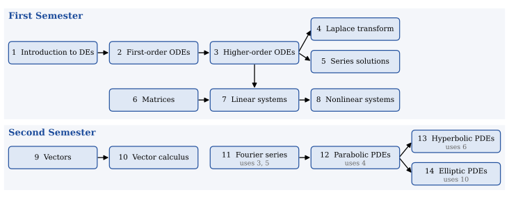

## Welcome {.unnumbered}

**Chemical engineering** occupies a unique position at the interface between molecular sciences and engineering. Intimately linked with the fundamental subjects of chemistry, biology, **mathematics**, and physics — and in close collaboration with fellow engineering disciplines like materials science, computer science, and mechanical, electrical, and civil engineering — chemical engineering offers unparalleled opportunities to do great things

::: {.content-visible when-format="html"}
[Download the lecture notes as a PDF](files/Engineering-Mathematics.pdf) $\,$(main chapters; the appendices are on this site and in Colab)
:::

---

## How to Use These Notes {.unnumbered}

* Each chapter opens with its **learning objectives** and a **Builds on** line that names the earlier sections it uses, $\,$and it ends with a **Summary** table and **Worked Exercises**
* Some examples are worked out in the text. $\,$The others are for practice: $\,$a collapsed **Answer** box gives the short answer, $\,$and the **Solution** link opens a worked solution (PDF, in Korean)
* The Python code that draws the figures is folded: $\,$click **Code** above a figure to see it. $\,$The PDF edition prints only the figures, $\,$and its animations are shown as four still frames
* **Try it in Python** boxes link to the appendices, $\,$which are also available as Colab notebooks
* Cross-references such as @sec-12-3 are links; $\,$follow them back to the material a step relies on

### Course Map {.unnumbered}

{width="100%" fig-align="center" fig-alt="Course map: in the first semester, introduction, first-order and higher-order ODEs lead to the Laplace transform, series solutions and, with matrices, to linear and then nonlinear systems; in the second semester, vectors lead to vector calculus, and Fourier series lead to parabolic PDEs and then to hyperbolic and elliptic PDEs"}

::: {.content-visible when-format="html"}
---

## Contents {.unnumbered}

### First Semester

* [Introduction to Differential Equations](ch_01_Introduction_to_Differential_Equations.qmd)
* [First-Order Differential Equations](ch_02_First-Order_Differential_Equations.qmd)
* [Higher-Order Differential Equations](ch_03_Higher-Order_Differential_Equations.qmd)
* [The Laplace Transform](ch_04_The_Laplace_Transform.qmd)
* [Series Solutions of Linear Differential Equations](ch_05_Series_Solutions_of_Linear_Differential_Equations.qmd)
* [Matrices](ch_08_Matrices.qmd)
* [Systems of Linear Differential Equations](ch_10_Systems_of_Linear_Differential_Equations.qmd)
* [Systems of Nonlinear Differential Equations](ch_11_Systems_of_Nonlinear_Differential_Equations.qmd)

---

### Second Semester

* [Vectors](ch_07_Vectors.qmd)
* [Vector Calculus](ch_09_Vector_Calculus.qmd)
* [Orthogonal Functions and Fourier Series](ch_12_Orthogonal_Functions_and_Fourier_Series.qmd)
* [Parabolic Partial Differential Equations](ch_x1_Parabolic_PDEs.qmd)
* [Hyperbolic Partial Differential Equations](ch_x2_Hyperbolic_PDEs.qmd)
* [Elliptic Partial Differential Equations](ch_x3_Elliptic_PDEs.qmd)

:::

---

{width=150px}

::: {.content-visible when-format="html"}
### Scientific Computing in Python

* [Numpy: Vectors, Matrices, and Multidimensional Arrays](x_numpy_vectors_matrices_and_multidimensional_arrays.qmd)
* [Sympy: Symbolic Computing](x_sympy_symbolic_computing.qmd)
* [Sympy: Laplace Transform](x_sympy_Laplace_transform.qmd)
* [Equation Solving](x_equation_solving.qmd)
* [Optimization](x_optimization.qmd)
* [Interpolation](x_interpolation.qmd)
* [Integration](x_integration.qmd)
* [Ordinary Differential Equations](x_ordinary_differential_equations.qmd)
* [Double Pendulum](x_double_pendulum.qmd)

---

### Plotting and Data Analysis in Python

* [Matplotlib](x_matplotlib.qmd)
* [Mandelbrot Set in Python](x_Mandelbrot_set.qmd)
* [Hydrogen Atomic Orbitals](x_hydrogen_orbital.qmd)
<!-- * [Pandas](x_pandas.qmd) -->

:::

---

## References {.unnumbered}

* D.G. Zill and W.S. Wright, **Advanced Engineering Mathematics**, *7^th^ ed.*, Jones and Bartlett, 2022.
* E.A. Coddington, **An Introduction to Ordinary Differential Equations**, Prentice-Hall, 1961. (Dover Publications Inc., 1989 - Unabridged, corrected republication).
* G.E. Shilov, **Linear Algebra**, Prentice-Hall, 1971. (Dover Publications Inc., 1977 - Unabridged republication)
* S.J. Farlow, **Partial Differential Equations for Scientists and Engineers**, John Wiley & Sons, 1982. (Dover Publications Inc., 1993 -- Unabridged, corrected republication).
* H.F. Weinberger, **A First Course in Partial Differential Equations with Complex Variables and Transform Methods**, Blaisdell Publishing Company, 1965. (Dover Publications Inc., 1995 - New edition).
* R. Johansson, **Numerical Python: Scientific Computing and Data Science Applications with Numpy, Scipy and Matplotlib**, *2^nd^ ed.*, Apress, 2018.
