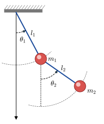

# Double Pendulum {#sec-double-pendulum}

[](https://colab.research.google.com/github/SeoulTechPSE/EngMath/blob/main/notebooks/x_double_pendulum.ipynb)

$~$

* Consider the rather complicated system of <font color="blue">two coupled 2^nd^-order nonlinear ODEs</font> for a double pendulum

  {width="35%" fig-align="center"}

* <font color="blue">Nonlinear governing equations</font>

  $$\scriptsize
  \begin{aligned}
     (m_1+m_2) l_1\color{red}{\ddot{\theta_1}} + m_2l_2\color{red}{\ddot{\theta_2}\cos(\theta_1-\theta_2)} &  
      + m_2l_2\color{red}{\left(\dot{\theta_2}\right)^2\sin(\theta_1-\theta_2)}+g(m_1+m_2)\color{red}{\sin(\theta_1)} = 0\\ 
     m_2l_2\color{red}{\ddot{\theta_2}} + m_2l_1\color{red}{\ddot{\theta_1}\cos(\theta_1-\theta_2)} &  
    - m_2l_1 \color{red}{\left(\dot{\theta_1}\right)^2 \sin(\theta_1-\theta_2)} +m_2g\color{red}{\sin(\theta_2)} = 0
  \end{aligned}$$

::: {.callout-note appearance="simple" icon="false"}
**Used in the main text:** @sec-3-11 (Solving Nonlinear Models), @sec-11-4 (Autonomous Systems as Mathematical Models)
:::

$~$

```{python}
import numpy as np
from scipy import integrate

import sympy
from sympy import init_printing
init_printing()

import matplotlib.pyplot as plt
from matplotlib.animation import FuncAnimation
from IPython.display import HTML

import scipy
print("sympy: ", sympy.__version__)
print("scipy: ", scipy.__version__)
```

```{python}
th1, th2 = sympy.symbols("theta_1, theta_2", cls=sympy.Function)
t, g, m1, l1, m2, l2 = sympy.symbols("t, g, m_1, l_1, m_2, l_2")

ode1 = sympy.Eq((m1 +m2) *l1 *th1(t).diff(t, t) +
                m2 *l2 *th2(t).diff(t, t) *sympy.cos(th1(t) -th2(t)) +
                m2 *l2 *th2(t).diff(t)**2 *sympy.sin(th1(t) -th2(t)) + 
                g *(m1 +m2) *sympy.sin(th1(t)), 0)

ode2 = sympy.Eq(m2 *l2 *th2(t).diff(t, t) +
                m2 *l1 *th1(t).diff(t, t) *sympy.cos(th1(t) -th2(t)) -
                m2 *l1 *th1(t).diff(t)**2 *sympy.sin(th1(t) -th2(t)) +
                m2 *g *sympy.sin(th2(t)), 0)
```

$~$

* We first have <font color='red'>to write the system of two 2^nd^-order ODEs as a system of $\,$four 1^st^-order ODEs in standard form</font>. $\,$To this end, $\,$we need to introduce new functions

  $$
  \begin{aligned}
   y_1(t) &= \theta_1(t) \\
   y_2(t) &= \dot{\theta_1}(t) \\
   y_3(t) &= \theta_2(t) \\
   y_4(t) &=\dot{\theta_2}(t)
  \end{aligned}$$

  and rewrite the ODEs in terms of these functions

$~$

```{python}
y1, y2, y3, y4 = sympy.symbols("y_1, y_2, y_3, y_4", cls=sympy.Function)

varchange = {th1(t): y1(t),
             th1(t).diff(t, t): y2(t).diff(t),
             th2(t): y3(t),
             th2(t).diff(t, t): y4(t).diff(t)}

ode1_vc = ode1.subs(varchange)
ode2_vc = ode2.subs(varchange)
ode3 = sympy.Eq(y1(t).diff(t) -y2(t), 0)
ode4 = sympy.Eq(y3(t).diff(t) -y4(t), 0)
```

$~$

* At this point, $\,$we have <font color="blue">four coupled 1^st^-order ODEs for the functions $\,y_1\,$ to $\,y_4$</font>. $\,$It only remains to solve for the derivatives of these functions to obtain the ODEs <font color="blue">in standard form</font>

$~$

```{python}
y = sympy.Matrix([y1(t), y2(t), y3(t), y4(t)])
vcsol = sympy.solve((ode1_vc, ode2_vc, ode3, ode4), y.diff(t), dict=True)

f = y.diff(t).subs(vcsol[0])
f
```

```{python}
jac = sympy.Matrix([[f_i.diff(y_j) for y_j in y] for f_i in f])

jac[:, 0]
```

```{python}
jac[:, 1]
```

```{python}
jac[:, 2]
```

```{python}
jac[:, 3]
```

```{python}
params = {m1: 5.0, l1: 2.0, m2: 5.0, l2: 1.0, g: 9.8}

f_np = sympy.lambdify((t, y), f.subs(params), 'numpy')
jac_np = sympy.lambdify((t, y), jac.subs(params), 'numpy')
```

* We integrate with `solve_ivp`. $~$The lambdified functions return a column matrix, $~$so we flatten the right-hand side to the 1-D array that `solve_ivp` expects. $~$Supplying the Jacobian is optional for explicit methods, but it helps implicit solvers such as `'LSODA'` or `'Radau'`

```{python}
y0 = [2.0, 0.0, 0.0, 0.0]   # theta_1(0) = 2 rad, all other initial values zero

t = np.linspace(0, 20, 1000)
dt = t[1] - t[0]

sol = integrate.solve_ivp(lambda t_, y_: np.ravel(f_np(t_, y_)), 
                          (t[0], t[-1]), y0, t_eval=t,
                          method='LSODA', jac=jac_np, rtol=1e-8, atol=1e-10)
sol.message
```

```{python}
y = sol.y.T   # rows: time points, columns: y_1, ..., y_4
```

```{python}
#| fig-align: center
fig, ax = plt.subplots(figsize=(8, 3.5))

ax.plot(t, y[:, 0], 'r', label=r'$\theta_1(t)$')
ax.plot(t, y[:, 2], 'b', label=r'$\theta_2(t)$')
ax.set_xlabel(r'$t$', fontsize=12)
ax.set_ylabel('angle (rad)', fontsize=12)
ax.set_xlim(0, 20)
ax.legend(loc='upper right')
ax.tick_params(which='both', direction='in')
```

$~$

* When visualizing this solution, $\,$it is more intuitive <font color="blue">to animate the positions of the pendulums in the $\,x–y\,$ plane</font> rather than their angular deflections

$~$

```{python}
th1_np, th2_np = y[:, 0], y[:, 2]

x1 = params[l1] *np.sin(th1_np)
y1 = -params[l1] *np.cos(th1_np)
x2 = x1 +params[l2] *np.sin(th2_np)
y2 = y1 -params[l2] *np.cos(th2_np)
```

```{python}
fig, ax = plt.subplots(figsize=(6, 6))

ax.set_xlabel('$x$', fontsize=16)
ax.set_ylabel('$y$', fontsize=16)
ax.set_xticks([-4, -2, 0, 2, 4])
ax.set_yticks([-4, -2, 0, 2, 4])
ax.set_xticklabels([-4, -2, 0, 2, 4], fontsize=14)
ax.set_yticklabels([-4, -2, 0, 2, 4], fontsize=14)
ax.set_xlim(-4, 4)
ax.set_ylim(-4, 4)
ax.tick_params(which='both', direction='in')

plt.close()
```

```{python}
# | fig-cap: '<center><font size="5px"> Double Pendulum Animation </font></center>'

line1, = ax.plot([], [], 'o-', color='r', markersize=4.0, lw=2)
line2, = ax.plot([], [], 'o-', color='b', markersize=20.0, lw=2)

time_text = ax.text(0.05, 0.9, '', fontsize=18, transform=ax.transAxes)


def init():
    line1.set_data([], [])
    line2.set_data([], [])
    time_text.set_text('')

    return line1, line2, time_text


def animate(i):
    t_x1 = [0, x1[i]]
    t_y1 = [0, y1[i]]
    t_x2 = [x1[i], x2[i]]
    t_y2 = [y1[i], y2[i]]

    line1.set_data(t_x1, t_y1)
    line2.set_data(t_x2, t_y2)
    time_text.set_text(f'time = {t[i]:.1f}s')

    return line1, line2, time_text


anim = FuncAnimation(fig, animate, range(len(y)),
        interval=dt*1000, blit=True, init_func=init)
HTML('<center>' + anim.to_html5_video() + '</center>')
```
